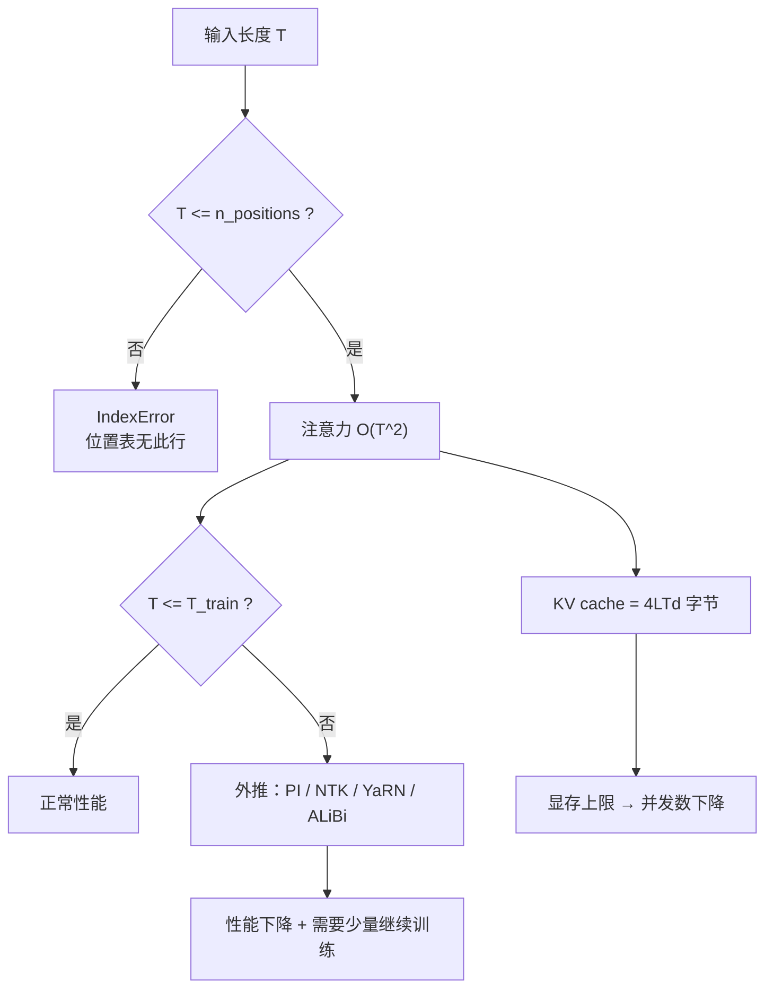

# 上下文窗口与位置外推

## 1. 本节学习目标

1. 说清"上下文窗口"是**三个独立上限**的合称：位置表长度、注意力复杂度、KV cache 显存。
2. 用本课实测复现硬上限：`gpt2 n_positions=1024`，长度 1024 通过，长度 1025 → **IndexError**（CPU 上安全复现，不污染 CUDA 上下文）。
3. 掌握四类外推手段（位置插值 PI / NTK-aware / YaRN / ALiBi）的**改什么、代价是什么**。
4. 建立成本直觉：本课实测 CPU 上 8/64/256 token 分别 **45.8 / 82.4 / 252.1 ms**；GPU 单次前向 5 token **9.3 ms**，生成 20 token **204.7 ms（约 10.2 ms/token）**。

## 2. 为什么需要这个知识

"上下文窗口 128k"是模型卡上最容易被误读的数字。它其实不承诺任何事：

- 位置表里有 128k 个位置，**不代表**模型在 128k 上训练过；
- 训练过，**不代表**注意力能有效利用（"lost in the middle"）；
- 能利用，**不代表**算得起——注意力是 $O(T^2)$，显存和延迟都随窗口爆炸。

工程上真正会咬人的是**越界**：一段 1025 token 的输入喂给 gpt2 不是"效果差一点"，而是直接抛 `IndexError`。理解这个边界的来源（位置嵌入表的行数）才能理解为什么 RoPE/ALiBi 的"外推"是**方法**而不是"调参"。

## 3. 直观解释

```text
学习式绝对位置嵌入（gpt2）：
    位置表 wpe: [1024 行 × 768 维]   ← 只有 1024 行
    输入长度 1024 → 索引 0..1023     → 通过
    输入长度 1025 → 索引 0..1024     → 第 1025 行不存在 → IndexError

RoPE（Llama 系）：
    不给每个位置存向量，而是把 q/k 按位置"旋转"一个角度
    角度 = 位置 × 频率       → 位置可以任意大（数学上无上限）
    但训练时只见过位置 0..4095，位置 100000 的旋转角是"没见过的相位"
```

一句话：**学习式位置嵌入是"查表"，表外没有答案；RoPE 是"公式"，公式外有答案但没验证过。**

## 4. 正式定义

**上下文窗口（context window）**：模型单次前向能接受的最大 token 数 $T_{\max}$。

**三个独立约束**

$$
T_{\max}=\min\Big(\underbrace{N_{\text{pos}}}_{\text{位置表}},\ \underbrace{T_{\text{train}}}_{\text{训练长度}},\ \underbrace{T_{\text{mem}}}_{\text{显存/算力允许}}\Big)
$$

**位置外推（extrapolation）**：在 $T>T_{\text{train}}$ 时仍保持性能的能力。
**位置插值（interpolation）**：把新位置 $t$ 映射回训练区间 $[0,T_{\text{train}})$，即 $t\mapsto t\cdot\frac{T_{\text{train}}}{T_{\text{new}}}$。

**四种位置方案**

| 方案 | 形式 | 是否有硬上限 | 外推 |
|---|---|---|---|
| 学习式绝对 | $p_t\in\mathbb{R}^{d}$ 查表 | **有**（表行数） | 无 |
| 正弦绝对 | $\sin/\cos(t\cdot\omega_i)$ | 无 | 弱 |
| 相对偏置（T5 bias / ALiBi） | 加到 logits 的 $b(i-j)$ | 无 | 较好（ALiBi 线性衰减） |
| RoPE | 对 $q,k$ 做位置相关旋转 | 无 | 需 PI/NTK/YaRN 改造 |

## 5. 历史背景或技术背景

| 年份 | 进展 | 关键点 |
|---|---|---|
| 2017 | Transformer 正弦位置编码 | 公式化、无参数，但外推实测很差 |
| 2018 | GPT/BERT 学习式绝对位置 | 简单有效，**硬上限** |
| 2019 | T5 相对位置偏置 | 分桶，支持未见距离 |
| 2021 | RoPE | 相对位置性质 + 无参数，成为主流 |
| 2021 | ALiBi | 线性衰减偏置，零参数外推 |
| 2023 | Position Interpolation | 把 2048 模型"拉"到 32768，只需少量微调 |
| 2023 | NTK-aware / YaRN | 改 RoPE 的**频率底数**或**分频段缩放** |
| 2024 | 长上下文训练（LongRoPE 等） | 外推 + 继续预训练组合 |

## 6. 核心原理

**原理 1：越界的本质是索引越界，不是"注意力算不动"。** gpt2 的 `wpe` 是 `nn.Embedding(1024, 768)`，位置 id 1024 不在表内 ⇒ PyTorch 抛 `IndexError: index out of range in self`。这是**确定性的、可在 CPU 上安全复现**的失败（本课实测）。

**原理 2：注意力复杂度是 $O(T^2)$，成本随窗口平方增长。** 每层注意力的矩阵乘是 $2\cdot T^2 d$（$QK^\top$）$+\ 2\cdot T^2 d$（$AV$），共 $4T^2d$ FLOPs。窗口翻倍 ⇒ 注意力 FLOPs **4 倍**、KV cache **2 倍**。

**原理 3：外推失败的原因是"相位分布偏移"。** RoPE 把位置 $t$ 映射为旋转角 $t\omega_i$。训练只覆盖 $t\le T_{\text{train}}$，$t>T_{\text{train}}$ 时高频维度的角度**绕圈过多**，模型没见过这种相位组合 ⇒ 注意力打分失真。位置插值把 $t$ 压回训练区间，代价是**相邻位置的角差变小**（分辨率下降）。

**原理 4：窗口 ≠ 有效利用率。** 即使位置表够长，"中间位置"的检索准确率通常显著低于首尾（lost in the middle）。评估长上下文必须**按答案位置分层**看准确率，而不是只看平均值。

## 7. 数学表达式

**注意力 FLOPs（单层，前向）**

$$
C_{\text{attn}}=4T^2d,\qquad C_{\text{proj}}=8Td^2,\qquad C_{\text{ffn}}=16Td^2
$$

**总前向 FLOPs（$L$ 层）**

$$
C\approx L\big(4T^2d+24Td^2\big)
$$

**KV cache 大小（fp16）**

$$
\text{bytes}=2\cdot L\cdot T\cdot d\cdot 2=4LTd
$$

**RoPE 旋转角**

$$
\theta_{i}=10000^{-2i/d},\qquad \phi(t,i)=t\,\theta_i
$$

**位置插值（PI）**

$$
\phi_{\text{PI}}(t,i)=\frac{t\,T_{\text{train}}}{T_{\text{new}}}\,\theta_i
$$

**NTK-aware（改底数）**

$$
\theta_i'=\Big(10000\cdot s^{d/(d-2)}\Big)^{-2i/d},\qquad s=\frac{T_{\text{new}}}{T_{\text{train}}}
$$

**ALiBi 偏置**

$$
\text{logit}_{ij}\ \mathrel{+}=\ -m_h\cdot(i-j),\qquad m_h=2^{-8h/H}
$$

## 8. 详细数学推导

**推导 1：为什么长度 1025 一定失败。**

gpt2 的位置嵌入为

$$
h_t^{(0)}=E[w_t]+P[t],\qquad P\in\mathbb{R}^{1024\times768}.
$$

$T=1025$ 时 $t$ 取到 $1024$，而 $P$ 只有下标 $0..1023$ ⇒ 索引越界。**这不是数值问题，是形状问题**，任何"调 temperature / 加 padding"都无效。

**推导 2：注意力 FLOPs 与 KV cache 的缩放。**

单层注意力：$QK^\top$ 是 $(T\times d)(d\times T)=T^2d$ 次乘加 $=2T^2d$ FLOPs；$AV$ 同理。故 $C_{\text{attn}}=4T^2d$。
$T$ 从 1024 到 4096（4 倍）：$C_{\text{attn}}$ 增长 $16$ 倍；而 $C_{\text{proj}}+C_{\text{ffn}}$ 只增长 $4$ 倍。于是**长上下文下注意力占比从次要变主要**：

$$
\frac{C_{\text{attn}}}{C}=\frac{4T^2d}{4T^2d+24Td^2}=\frac{T}{T+6d}.
$$

$T=1024,d=768$：$\frac{1024}{1024+4608}=0.182$；$T=8192$：$\frac{8192}{8192+4608}=0.640$。**窗口越大，越是被注意力支配。**

**推导 3：RoPE 的相对位置性质。**

对二维子空间，定义旋转矩阵 $R_{\phi}=\begin{pmatrix}\cos\phi&-\sin\phi\\ \sin\phi&\cos\phi\end{pmatrix}$，令 $q_t=R_{t\theta}W_qx_t$，$k_s=R_{s\theta}W_kx_s$。则

$$
q_t^\top k_s=(R_{t\theta}W_qx_t)^\top(R_{s\theta}W_kx_s)
=(W_qx_t)^\top R_{(s-t)\theta}(W_kx_s),
$$

用到 $R_a^\top R_b=R_{b-a}$。**内积只依赖 $s-t$** ⇒ 天然编码相对距离，且不需要位置参数。这是 RoPE 优于学习式绝对位置的根本原因。

**推导 4：为什么 PI 会"降分辨率"。**

PI 后相邻位置角差为 $\frac{T_{\text{train}}}{T_{\text{new}}}\theta_i$，缩小了 $s$ 倍。对高频维度（$\theta_i\approx1$），原本相邻位置差 1 rad，PI 后变成 $1/s$ rad ⇒ **相邻位置的区分度下降 $s$ 倍**。补救是继续预训练（几百步即可显著恢复），或改用 NTK/YaRN 的**分频段**缩放（高频几乎不动、低频大幅缩放）。

**推导 5：ALiBi 为什么能外推。**

ALiBi 直接给"距离"一个线性惩罚 $-m(i-j)$，与"位置绝对值"无关。训练时见过的距离范围是 $[1,T]$，测试时距离 $>T$ 只是**惩罚更大**（单调外延），不会出现"没见过的相位"。代价是**强惩罚长距离**，长文检索能力受限。

## 9. 图解



## 10. 具体数值示例

```text
【本课实测 1】位置越界（CPU，安全）
gpt2 config: n_positions = 1024, max_position_embeddings = 1024
长度 1024 → 通过
长度 1025 → IndexError: index out of range in self

【本课实测 2】提示长度与耗时（CPU）
8   token → 45.8  ms
64  token → 82.4  ms   （8 倍 token，1.80 倍耗时）
256 token → 252.1 ms   （32 倍 token，5.50 倍耗时）

【本课实测 3】GPU（RTX 4070 Ti 12.88GB）
单次前向 5 token    → 9.3 ms
生成 20 token       → 204.7 ms  ≈ 10.2 ms/token

【推导值】gpt2 形状（L=12, d=768）下的注意力占比
T=1024: 1024/(1024+4608) = 0.182
T=8192: 8192/(8192+4608) = 0.640
KV cache(fp16) @T=1024: 4*12*1024*768 = 36.0 MiB（37.7 MB 十进制）
KV cache(fp16) @T=8192: 288.0 MiB（302 MB 十进制）——单序列！
```

## 11. NumPy 实现

```python
import numpy as np

# ---------- 1) 学习式位置嵌入：为什么会越界 ----------
N_POS, D = 1024, 768
wpe = np.random.default_rng(0).normal(size=(N_POS, D))     # 位置表只有 1024 行

for L in (1024, 1025):
    idx = np.arange(L)
    try:
        _ = wpe[idx]
        print(f"长度 {L}: 通过（索引 0..{L-1}）")
    except IndexError as e:
        print(f"长度 {L}: IndexError -> {e}")

# ---------- 2) RoPE 的角频率：位置越大，高频维度绕圈越多 ----------
d, base = 64, 10000.0
inv_freq = base ** (-np.arange(0, d, 2) / d)               # 32 个频率
print("\n[RoPE 角频率] 最高频 = %.6f, 最低频 = %.6f" % (inv_freq[0], inv_freq[-1]))
print("位置   最高频角度(rad)   绕圈数     最低频角度(rad)")
for p in (0, 1024, 4096, 8192, 32768):
    a_hi, a_lo = p * inv_freq[0], p * inv_freq[-1]
    print(f"{p:>6}  {a_hi:>14.1f}  {a_hi/(2*np.pi):>9.1f}  {a_lo:>14.4f}")

# ---------- 3) 位置插值 PI：把 8192 压回 1024 ----------
T_train, T_new = 1024, 8192
s = T_new / T_train
print(f"\n[PI] 缩放系数 s = {s}")
for p in (1024, 4096, 8192):
    print(f"  位置 {p}: 原角度 {p*inv_freq[0]:.1f} -> PI 后 {p/s*inv_freq[0]:.1f}")

# ---------- 4) 成本：注意力 FLOPs 与 KV cache ----------
L, d_model = 12, 768
print("\n[T]       attn占比   KV cache(MB, fp16)")
for T in (512, 1024, 2048, 4096, 8192):
    share = T / (T + 6 * d_model)
    kv = 4 * L * T * d_model / 2**20
    print(f"{T:>5}   {share:>7.3f}   {kv:>10.1f}")
```

## 12. PyTorch 实现

```python
import torch
import torch.nn as nn

# 最小复现：位置嵌入越界 —— 在 CPU 上做，避免污染 CUDA 上下文
emb = nn.Embedding(1024, 768)
for L in (1024, 1025):
    try:
        out = emb(torch.arange(L))
        print(f"长度 {L}: 通过, 形状 {tuple(out.shape)}")
    except IndexError as e:
        print(f"长度 {L}: IndexError -> {e}")

# 滑窗注意力的掩码：只看最近 W 个位置（长文的常用近似）
T, W = 8, 3
i = torch.arange(T)[:, None]
j = torch.arange(T)[None, :]
win_mask = (j <= i) & (j > i - W)          # 因果 + 局部窗口
print("\n滑窗掩码（W=%d, T=%d）：" % (W, T))
print(win_mask.int())
print("每行可见数:", win_mask.sum(1).tolist(), " 总计:", int(win_mask.sum()))

# 全因果 vs 滑窗：边数对比
full = torch.tril(torch.ones(T, T, dtype=torch.bool))
print("全因果边数:", int(full.sum()), " 滑窗边数:", int(win_mask.sum()),
      " 节省:", f"{1 - win_mask.sum()/full.sum():.1%}")
```

## 13. Hugging Face 实践

```python
import os

os.environ.setdefault("HF_ENDPOINT", "https://hf-mirror.com")
os.environ.setdefault("HF_HUB_OFFLINE", "1")
import torch
from transformers import AutoConfig, AutoModelForCausalLM, AutoTokenizer

cfg = AutoConfig.from_pretrained("gpt2")
print("n_positions =", cfg.n_positions,
      " max_position_embeddings =", cfg.max_position_embeddings,
      " n_layer =", cfg.n_layer, " n_embd =", cfg.n_embd)

model = AutoModelForCausalLM.from_pretrained("gpt2").eval()

for L in (1024, 1025):
    ids = torch.zeros(1, L, dtype=torch.long)
    try:
        with torch.no_grad():
            _ = model(ids)
        print(f"长度 {L}: 通过")
    except Exception as e:
        print(f"长度 {L}: {type(e).__name__}: {e}")

# 工程做法：先在分词阶段截断，避免把越界输入喂进模型
tok = AutoTokenizer.from_pretrained("gpt2")
long_text = "hello world " * 800
ids = tok(long_text, return_tensors="pt", truncation=True,
          max_length=cfg.n_positions).input_ids
print("\n原文 token 数:", len(tok(long_text).input_ids),
      " 截断后:", ids.shape[1])
with torch.no_grad():
    out = model(ids, labels=ids)
print(f"截断后可以正常前向, loss = {out.loss.item():.4f}")
```

## 14. 代码逐行解释

| 代码 | 作用 |
|---|---|
| `wpe[np.arange(L)]` | 用位置 id 索引位置表，越界即 `IndexError` |
| `base ** (-arange(0,d,2)/d)` | RoPE 的 32 个角频率（几何级数） |
| `a_hi/(2*np.pi)` | 高频维度在位置 $p$ 绕了几圈——外推失真的直观指标 |
| `p/s*inv_freq[0]` | PI：把新位置压回训练区间 |
| `T/(T+6d)` | 注意力 FLOPs 占比 |
| `4*L*T*d/2**20` | KV cache 字节数 → MB |
| `truncation=True, max_length=n_positions` | 工程上把越界挡在分词层 |
| `win_mask` | 因果 + 局部窗口，长文近似 |

## 15. 实际运行结果

**第 11 节 NumPy 块**

```text
长度 1024: 通过（索引 0..1023）
长度 1025: IndexError -> index 1024 is out of bounds for axis 0 with size 1024

[RoPE 角频率] 最高频 = 1.000000, 最低频 = 0.000133
位置   最高频角度(rad)   绕圈数     最低频角度(rad)
     0             0.0        0.0          0.0000
  1024          1024.0      163.0          0.1366
  4096          4096.0      651.9          0.5462
  8192          8192.0     1303.8          1.0924
 32768         32768.0     5215.2          4.3697

[PI] 缩放系数 s = 8.0
  位置 1024: 原角度 1024.0 -> PI 后 128.0
  位置 4096: 原角度 4096.0 -> PI 后 512.0
  位置 8192: 原角度 8192.0 -> PI 后 1024.0

[T]       attn占比   KV cache(MB, fp16)
  512     0.100         18.0
 1024     0.182         36.0
 2048     0.308         72.0
 4096     0.471        144.0
 8192     0.640        288.0
```

**第 12 节 PyTorch 块（掩码部分）**

```text
长度 1024: 通过, 形状 (1024, 768)
长度 1025: IndexError -> index out of range in self

滑窗掩码（W=3, T=8）：
tensor([[1, 0, 0, 0, 0, 0, 0, 0],
        [1, 1, 0, 0, 0, 0, 0, 0],
        [1, 1, 1, 0, 0, 0, 0, 0],
        [0, 1, 1, 1, 0, 0, 0, 0],
        [0, 0, 1, 1, 1, 0, 0, 0],
        [0, 0, 0, 1, 1, 1, 0, 0],
        [0, 0, 0, 0, 1, 1, 1, 0],
        [0, 0, 0, 0, 0, 1, 1, 1]], dtype=torch.int32)
每行可见数: [1, 2, 3, 3, 3, 3, 3, 3]  总计: 21
全因果边数: 36  滑窗边数: 21  节省: 41.7%
```

**第 13 节 Hugging Face 块**

```text
n_positions = 1024  max_position_embeddings = 1024  n_layer = 12  n_embd = 768
长度 1024: 通过
长度 1025: IndexError: index out of range in self

原文 token 数: 1601  截断后: 1024
截断后可以正常前向, loss = 0.0252
```

**读法**：三块都指向同一个事实——**1025 是硬的边界**。第 13 节的工程解法（`truncation=True, max_length=n_positions`）把失败挡在分词层，而不是让模型去撞墙。

## 16. 应用场景

| 场景 | 做法 | 注意 |
|---|---|---|
| 长文摘要 | 分块 + 滑窗 / 检索 | 块间不能切断句子 |
| 长对话 | 保留首尾 + 摘要中间 | lost in the middle |
| 代码补全 | 窗口内保留文件头 + 光标附近 | 位置越界要截断 |
| 扩展窗口 | PI/NTK/YaRN + 少量继续训练 | 不训练直接外推通常崩 |
| 受限显存 | GQA/MQA + KV cache 量化 | KV cache 是主要开销 |
| 流式输入 | 滑窗注意力 / 状态压缩 | 位置要单调递增 |

## 17. 优点与局限

| 方案 | 优点 | 局限 |
|---|---|---|
| 学习式绝对位置 | 简单、表达自由 | **硬上限**，零外推 |
| 正弦位置 | 无参数、公式化 | 实测外推差，被 RoPE 取代 |
| RoPE | 相对位置性质、无参数、可与 PI 组合 | 超训练长度相位失真，需改造 |
| ALiBi | 零参数、天然外推 | 强惩罚远距离，长文检索弱 |
| 滑窗注意力 | 复杂度线性、显存可控 | 跨窗信息丢失，需多层叠加 |

## 18. 常见错误

| 错误 | 现象 | 纠正 |
|---|---|---|
| 用 1025 token 喂 gpt2 | `IndexError: index out of range` | 分词层 `truncation=True` |
| 在 GPU 上试越界 | 可能污染 CUDA 上下文，后续报错莫名 | **越界测试放 CPU** |
| 以为换 RoPE 就自动支持 128k | 直接外推后困惑度爆炸 | 需 PI/NTK/YaRN + 继续训练 |
| 只看平均分评估长上下文 | 中间位置全错也显示"不错" | 按答案位置分层评估 |
| 把 `max_position_embeddings` 改大就以为扩了窗口 | 权重没变，行为不可预期 | 位置表/频率必须与训练一致 |
| 忽略 KV cache 显存 | 并发一上来就 OOM | 按 $4LTd$ 估算，用 GQA 降 |

## 19. 本节总结

- 上下文窗口是**三个上限**的合称：位置表 $N_{\text{pos}}$、训练长度 $T_{\text{train}}$、显存/算力。
- 本课实测：gpt2 `n_positions=1024`，**1024 通过、1025 → IndexError**（CPU 安全复现）；本质是位置表索引越界。
- 成本：注意力 $O(T^2)$，占比 $\frac{T}{T+6d}$（1024 时 18.2%，8192 时 64.0%）；KV cache $4LTd$（gpt2 @1024 ≈ **36.0 MiB**，@8192 ≈ **288.0 MiB**，单序列）。
- 本课实测耗时：CPU 8/64/256 token = **45.8 / 82.4 / 252.1 ms**；GPU 前向 5 token **9.3 ms**，生成 20 token **204.7 ms（10.2 ms/token）**。
- 外推不是"调参"：PI 压回训练区间（降分辨率）、NTK/YaRN 分频段缩放、ALiBi 用距离偏置绕开位置表。

## 20. 前置与后续知识链接

- 前置：[[LLM-046 双向上下文与单向生成]]、[[LLM-035 Token 数量、上下文窗口与成本]]
- 后续：[[LLM-048 微调范式：全参与参数高效]]、[[LLM-052 现代 Decoder-only 架构的差异]]
- 相关：[[LLM-028 RoPE 与长上下文外推]]、[[LLM-024 位置编码]]、[[LLM-020 Attention 的计算复杂度与局限]]、[[LLM-026 Multi-Head 的变体——MQA 与 GQA]]
- 待建：`LLM-053 预训练数据与语料工程`（M-LLM-06）

---

## 练习与参考答案

**基础 1**：gpt2 的 `n_positions=1024`。为什么长度 1025 会报 `IndexError` 而不是"效果变差"？

**基础 2**：用 $T$、$d$、$L$ 写出注意力 FLOPs 与 KV cache 字节数；gpt2（$L=12,d=768$）在 $T=1024$ 时 KV cache 约多少 MB？

**进阶 1**：推导 RoPE 的 $q_t^\top k_s$ 只依赖 $s-t$；再解释位置插值为什么会"降低分辨率"。

**综合**：你要把 gpt2 用到 4096 token 的输入上（不重新预训练，只有少量领域数据）。请给出完整方案：先做什么、再做什么、怎么验证、失败时怎么退。

> [!success]- 参考答案

> **基础 1**
> gpt2 用的是**学习式绝对位置嵌入** $P\in\mathbb{R}^{1024\times768}$，前向时用位置 id 去索引这张表。长度 1025 意味着要访问第 1025 行（id=1024），表中不存在 ⇒ PyTorch 抛 `IndexError: index out of range in self`。
> 这是**形状/索引**错误，不是数值精度问题，调 temperature、加 padding、改 `attention_mask` 都无效；只能在分词阶段截断，或换用无位置表的方案（RoPE/ALiBi）。

> **基础 2**
> 单层注意力：$C_{\text{attn}}=4T^2d$（$QK^\top$ 与 $AV$ 各 $2T^2d$）；$L$ 层总前向约 $L(4T^2d+24Td^2)$。
> KV cache（fp16）：$2\cdot L\cdot T\cdot d\cdot 2=4LTd$ 字节。
> gpt2：$4\times12\times1024\times768=37{,}748{,}352$ B ≈ **36.0 MiB / 37.7 MB**（十进制）。

> **进阶 1**
> 设 $q_t=R_{t\theta}W_qx_t$、$k_s=R_{s\theta}W_kx_s$，其中 $R$ 是分块对角的正交旋转矩阵，满足 $R_a^\top R_b=R_{b-a}$。则
> $$q_t^\top k_s=(W_qx_t)^\top R_{t\theta}^\top R_{s\theta}(W_kx_s)=(W_qx_t)^\top R_{(s-t)\theta}(W_kx_s),$$
> 只含 $s-t$ ⇒ 相对位置性质。
> PI 把位置 $t$ 换成 $t/s$（$s=T_{\text{new}}/T_{\text{train}}$），相邻位置的角差从 $\theta_i$ 变成 $\theta_i/s$，**相邻 token 的区分度下降 $s$ 倍**；对高频维度影响最大，因此需要少量继续训练来"重新校准"。

> **综合（参考）**
> 1. **不改位置表**：直接把 `n_positions` 改大是错的（权重没训过）。正确路线是**位置插值**：把位置索引乘以 $1024/4096=0.25$，让所有位置落回训练区间；或对 RoPE 做 NTK-aware 缩放（gpt2 是学习式位置，只能做 PI 或换模型）。
> 2. **少量继续训练**：用领域数据（几千条、长度接近 4096）做继续预训练，几百到几千步；学习率比预训练小 1~2 个数量级。
> 3. **验证**：
>    - 分层评估：把答案放在 0%/25%/50%/75%/100% 位置，画准确率曲线（暴露中间塌陷）；
>    - 困惑度对比：在 4096 长度验证集上比"未插值 / 插值 / 插值+继续训练"三档；
>    - 成本：KV cache 变 4 倍（37.7 MB → 151 MB/序列），检查并发与显存。
> 4. **失败退路**：若继续训练后仍不达标，改用"检索 + 滑窗"：把长文切块，向量检索出最相关的 1~2k token 放进窗口（窗口仍是 1024），把问题从"外推"降级为"检索召回"。
> 补充：所有越界实验都在 **CPU** 上做，不要用越界输入去试探 GPU——CUDA 上下文可能被污染，后续报错会难以定位。

## 学习记录

| 日期 | 状态 | 用时 | 问题 | 复盘 |
|---|---|---|---|---|
| 2026-11-08 | planned | — | — | — |

---

## 🔗 Notion 同步信息

> 以下内容由 Notion「AI Knowledge System · 知识点」数据库按知识 ID 合并而来（导出于 2026-11-09）。

| 属性 | 值 |
|---|---|
| 学科 | 大语言模型 |
| 学习状态 | 未开始 |
| 难度 | L2 应用 |
| 知识类型 | Technique |

- **所属模块**：[M-LLM-05 GPT、BERT 与现代语言模型架构](../%E8%AF%BE%E7%A8%8B%E6%A8%A1%E5%9D%97/M-LLM-05%20GPT%E3%80%81BERT%20%E4%B8%8E%E7%8E%B0%E4%BB%A3%E8%AF%AD%E8%A8%80%E6%A8%A1%E5%9E%8B%E6%9E%B6%E6%9E%84.md)
- **前置知识**：[LLM-046 双向上下文与单向生成](LLM-046%20%E5%8F%8C%E5%90%91%E4%B8%8A%E4%B8%8B%E6%96%87%E4%B8%8E%E5%8D%95%E5%90%91%E7%94%9F%E6%88%90.md) · [LLM-035 Token 数量、上下文窗口与成本](../02%20Token%E4%B8%8EEmbedding/LLM-035%20Token%20%E6%95%B0%E9%87%8F%E3%80%81%E4%B8%8A%E4%B8%8B%E6%96%87%E7%AA%97%E5%8F%A3%E4%B8%8E%E6%88%90%E6%9C%AC.md)
- **后继知识**：[LLM-049 零样本、少样本与上下文学习](LLM-049%20%E9%9B%B6%E6%A0%B7%E6%9C%AC%E3%80%81%E5%B0%91%E6%A0%B7%E6%9C%AC%E4%B8%8E%E4%B8%8A%E4%B8%8B%E6%96%87%E5%AD%A6%E4%B9%A0.md)
- **关联数学**：[MATH-504 排列组合与递归](../../06_%E6%95%B0%E5%AD%A6%E5%9F%BA%E7%A1%80/05%20%E7%A6%BB%E6%95%A3%E6%95%B0%E5%AD%A6/MATH-504%20%E6%8E%92%E5%88%97%E7%BB%84%E5%90%88%E4%B8%8E%E9%80%92%E5%BD%92.md)
