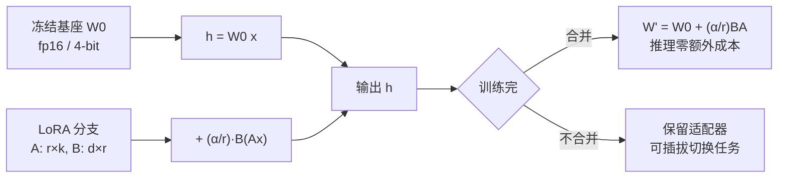

# 微调范式：全参与参数高效

## 1. 本节学习目标

1. 把"全参微调 / LoRA / Adapter / 提示微调"放到**同一个公式**下：都是对权重加一个**低维增量** $\Delta W$，区别只在 $\Delta W$ 的参数化方式。
2. 用本课实测的数字建立量感：gpt2 全参 **124,439,808**；LoRA（$r=8$，只挂 `c_attn`）可训练 **294,912**，占 **0.2370%**；$r=4$ 为 **147,456（0.1185%）**、$r=16$ 为 **589,824（0.4740%）**。
3. 会算**显存账**：全参微调要为每个参数存 16 字节（fp32 权重 + 梯度 + 两个 Adam 状态），LoRA 只为适配器存。
4. 知道 LoRA 的三个工程性质：**初始化等价于原模型**（本课实测 logits 差 `0.0`）、**可合并**（推理零延迟）、**可插拔**（一份基座多套适配器）。

## 2. 为什么需要这个知识

"微调"是 LLM 落地最常用的动作，但**全参微调在消费级显卡上根本跑不起来**：gpt2 只有 1.24 亿参数，全参 + Adam 就要约 1.5 GB 优化器状态，加上激活值，12.88 GB 的 4070 Ti 也只能微调很小的模型；70B 模型的全参微调需要 TB 级显存。

参数高效微调（PEFT）把这件事变成"**在冻结的基座上挂一个小补丁**"。本课要建立的判断力是：

- 什么情况下全参微调仍然必要（分布偏移大、要改"知识"而非"行为"）；
- 什么情况下 LoRA 足够（风格、格式、领域术语、任务对齐）；
- 为什么 LoRA 的 rank $r$ 不是越大越好。

## 3. 直观解释

```text
全参微调：  W  →  W + ΔW           ΔW 和 W 一样大（d×k 个参数）
LoRA：      W  →  W + (α/r)·B·A    A: r×k, B: d×r，r 很小（如 8）
Adapter：   W  →  W（冻结），在层间插入一个小 MLP
提示微调：  W  →  W（冻结），在输入前拼 k 个可训练的"软 token"
```

一个 768×768 的矩阵有 589,824 个参数；用 $r=8$ 的 LoRA 只需 $8\times(768+768)=12{,}288$ 个——**48 倍**的缩减。论文的假设是：微调带来的权重变化**本质上是低秩的**（任务适配只需要少数几个方向）。

## 4. 正式定义

**全参微调（Full Fine-Tuning, FFT）**

$$
\min_{\theta}\ \mathcal{L}(\theta)\quad\text{其中 }\theta\text{ 全部可训练}
$$

**LoRA（Low-Rank Adaptation）**

对某个权重 $W_0\in\mathbb{R}^{d\times k}$（冻结）：

$$
W=W_0+\Delta W=W_0+\frac{\alpha}{r}BA,\qquad A\in\mathbb{R}^{r\times k},\ B\in\mathbb{R}^{d\times r},\ r\ll\min(d,k)
$$

- $A$ 用高斯初始化，$B$ **初始化为 0** ⇒ 训练开始时 $\Delta W=0$，模型与原模型**完全等价**。
- $\alpha/r$ 是缩放因子，改 $r$ 时保持有效学习率稳定。

**Adapter**：在注意力/FFN 之后插入瓶颈 MLP（$d\to r\to d$），残差相加。

**提示微调（Prompt / Prefix Tuning）**：冻结全部权重，学习 $k$ 个软提示向量 $P\in\mathbb{R}^{k\times d}$，拼在输入嵌入前（或每层 K/V 前）。

**可训练参数对比（gpt2 形状）**

| 方法 | 可训练参数 | 占比 |
|---|---|---|
| 全参 | 124,439,808 | 100% |
| LoRA $r=8$，`c_attn` | **294,912** | **0.2370%** |
| LoRA $r=4$，`c_attn` | 147,456 | 0.1185% |
| LoRA $r=16$，`c_attn` | 589,824 | 0.4740% |
| 软提示 $k=100$ | 76,800 | 0.0617% |

## 5. 历史背景或技术背景

| 年份 | 方法 | 关键思想 |
|---|---|---|
| 2019 | Adapter（Houlsby） | 层间插瓶颈模块，只训 3.6% 参数 |
| 2021 | Prefix Tuning | 学 K/V 前缀 |
| 2021 | Prompt Tuning | 只学输入前的软 token |
| 2021 | **LoRA** | 低秩增量、可合并、无推理延迟 |
| 2022 | (IA)³ | 学三个缩放向量 |
| 2023 | QLoRA | 4-bit 量化基座 + LoRA，单卡微调 65B |
| 2023 | DoRA | 把幅度与方向分解，逼近全参效果 |
| 2024 | LoRA 变体（rsLoRA、PiSSA） | 改缩放/初始化，提升高 rank 稳定性 |

**为什么 LoRA 赢**：Adapter 增加**推理深度**（多一层就要多算一层），Prefix Tuning 抢**上下文长度**，而 LoRA **可以合并进权重**——训练时是补丁，上线时是一行矩阵加法。

## 6. 核心原理

**原理 1：低秩假设。** Aghajanyan 等工作发现，微调后的权重更新矩阵的**有效秩很低**（任务适配主要落在少数方向上）。于是用 $BA$（秩 $\le r$）去逼近 $\Delta W$，参数量从 $dk$ 降到 $r(d+k)$。

**原理 2：零初始化保证"起点不掉点"。** $B=0$ ⇒ $\Delta W=0$。本课实测：给 gpt2 挂上 LoRA 后，初始 logits 与原模型最大差异 **0.0**（精确相等）。这让"先挂 LoRA 再训练"变成安全的默认动作。

**原理 3：可合并 ⇒ 推理零成本。** 训练完后

$$
W'=W_0+\frac{\alpha}{r}BA
$$

直接把增量加进原权重，前向图与原模型完全相同。这是 LoRA 相对 Adapter/Prefix 的决定性优势。

**原理 4：显存账决定可行性。** 全参微调每个参数需要：fp32 权重 4 B + 梯度 4 B + Adam 一阶 4 B + 二阶 4 B = **16 B**（混合精度下约 12~16 B）。LoRA 只需为 $r(d+k)$ 个参数付这笔钱，基座可以用 fp16/4-bit 冻结存放。

**原理 5：$r$ 的边际收益递减。** $r$ 增大 ⇒ 表达能力增强，但参数线性增长、过拟合风险上升。实践中 $r=8\sim64$ 覆盖绝大多数任务；**改"知识"（新语言、新领域）需要更大 $r$ 甚至全参**，改"行为"（格式、语气）$r=8$ 足够。

## 7. 数学表达式

**LoRA 前向**

$$
h=W_0x+\frac{\alpha}{r}BAx
$$

**参数量**

$$
\#\text{LoRA}=r\,(d+k)\quad\text{vs}\quad \#\text{full}=dk
$$

**压缩比**

$$
\frac{r(d+k)}{dk}=r\Big(\frac1d+\frac1k\Big)
$$

**梯度（只对 $A,B$）**

$$
\frac{\partial\mathcal{L}}{\partial B}=\frac{\alpha}{r}\frac{\partial\mathcal{L}}{\partial h}x^\top A^\top,\qquad
\frac{\partial\mathcal{L}}{\partial A}=\frac{\alpha}{r}B^\top\frac{\partial\mathcal{L}}{\partial h}x^\top
$$

**全参微调的优化器显存**

$$
M_{\text{full}}\approx 16\,N\ \text{bytes},\qquad M_{\text{LoRA}}\approx 16\,r(d+k)\ \text{bytes}
$$

## 8. 详细数学推导

**推导 1：LoRA 参数量公式与 gpt2 的实测对照。**

`c_attn` 是 Conv1D，权重形状 $768\times2304$（把 QKV 拼在一起）。$d=768,k=2304$：

$$
r(d+k)=8\times(768+2304)=8\times3072=24{,}576\ \text{/层}
$$

12 层 ⇒ $24{,}576\times12=294{,}912$，与实测 **294,912** 完全一致，占比

$$
\frac{294{,}912}{124{,}439{,}808}=0.002370=0.2370\%.
$$

若把 $r$ 翻倍到 16，参数也翻倍到 $589{,}824$（实测一致）——**线性**，不是平方。

**推导 2：为什么可以合并，且合并后不改输出。**

$$
h=(W_0+\tfrac{\alpha}{r}BA)x=W_0x+\tfrac{\alpha}{r}B(Ax)
$$

两种计算顺序（先合并权重 / 先算 $Ax$）在数学上恒等。合并后的 $W'$ 是 $d\times k$ 矩阵，前向只多一次普通矩阵乘——**与未微调模型完全同构**，因此没有推理延迟。

**推导 3：$B=0$ 初始化的必要性。**

若 $A,B$ 都随机初始化，$\Delta W$ 是一个随机矩阵，会立刻破坏基座能力（本课实测的对照就是 `0.0` 差异）。$B=0$ 让 $\Delta W=0$，训练从"原模型"出发，等价于在预训练解附近做微扰——这是 LoRA 稳定收敛的关键。

（注意：$B=0$ 时 $\partial\mathcal{L}/\partial A\propto B^\top=0$，第一步 $A$ 不更新，只有 $B$ 动；第二步起两者都动。这不是 bug，是"从零开始长增量"的自然结果。）

**推导 4：显存账（gpt2 全参 vs LoRA）。**

全参（fp32 + Adam）：$124{,}439{,}808\times16\approx1.99$ GB 仅权重与优化器状态；若用混合精度约 $12$ B/参数 $\approx1.49$ GB。LoRA（$r=8$、`c_attn`）：$294{,}912\times16\approx4.7$ MB。**差 400 倍以上**。基座本身用 fp16 存（约 249 MB）且**不需要梯度**。

**推导 5：$r$ 与表达能力。**

$\operatorname{rank}(\Delta W)\le r$。若任务需要的更新方向数 $>r$，LoRA 只能投影到前 $r$ 个主方向，欠拟合。反过来，$r$ 过大时 $BA$ 接近满秩，退化成全参微调，失去正则化收益（小数据上更容易过拟合）。**选择 $r$ 的经验**：先在 $\{8,16,32\}$ 上做小规模扫描，看验证集是否还在涨。

## 9. 图解



## 10. 具体数值示例

```text
【本课实测】gpt2：12 层 / d=768 / 12 头 / 124,439,808 参数

全参微调            可训练 124,439,808      100%
LoRA r=8  c_attn    可训练     294,912      0.2370%
LoRA r=4  c_attn    可训练     147,456      0.1185%
LoRA r=16 c_attn    可训练     589,824      0.4740%
LoRA r=8  c_attn+c_proj           811,008   0.6517%
LoRA r=8  全部线性层            1,179,648   0.9480%
软提示 k=100（768 维）            76,800   0.0617%

【初始化等价性】挂上 LoRA（B=0）后，logits 与原模型最大差异 = 0.0

【显存账】
全参 16 B/参数: 124,439,808 × 16 ≈ 1.99 GB（不含激活）
LoRA 16 B/参数:     294,912 × 16 ≈ 4.7 MB
比值 ≈ 422 倍
```

## 11. NumPy 实现

```python
import numpy as np

N_TOTAL = 124_439_808
L_LAYERS, D, D_FF = 12, 768, 3072

SHAPES = {                            # gpt2 里可挂 LoRA 的 Conv1D: 名字 -> (in, out)
    "c_attn": (D, 3 * D),             # QKV 合并
    "attn_proj": (D, D),              # 注意力输出投影
    "fc": (D, D_FF),                  # FFN 上投影
    "mlp_proj": (D_FF, D),            # FFN 下投影
}
GROUPS = {"c_attn": ["c_attn"],
          "c_attn+c_proj": ["c_attn", "attn_proj", "mlp_proj"],
          "all": list(SHAPES)}

def lora_params(r, group):
    """每层 sum over 模块 r*(in+out)，再乘层数"""
    per_layer = sum(r * sum(SHAPES[m]) for m in GROUPS[group])
    return per_layer * L_LAYERS

print(f"{'配置':<26}{'可训练参数':>12}{'占比':>10}")
print(f"{'全参微调':<26}{N_TOTAL:>12,}{'100%':>10}")
for group in ("c_attn", "c_attn+c_proj", "all"):
    for r in (4, 8, 16):
        p = lora_params(r, group)
        print(f"LoRA r={r:<2} {group:<18}{p:>12,}{p/N_TOTAL:>9.4%}")

# ---- 显存账：16 B/参数（fp32 权重 + 梯度 + Adam 一阶/二阶）----
print("\n[优化器+权重显存 @16B/参数]")
print(f"全参: {N_TOTAL*16/2**30:.2f} GiB")
for r in (8, 16):
    p = lora_params(r, "c_attn")
    print(f"LoRA r={r}: {p*16/2**20:.1f} MiB  (缩小 {N_TOTAL*16/(p*16):.0f} 倍)")

# ---- 软提示 ----
k = 100
print(f"\n软提示 k={k}: {k*D:,} 参数 ({k*D/N_TOTAL:.4%})")
```

## 12. PyTorch 实现

```python
import torch
import torch.nn as nn

torch.manual_seed(0)

class LoRALinear(nn.Module):
    """最小 LoRA：冻结 W0，旁挂 B·A"""
    def __init__(self, d_in, d_out, r=8, alpha=16.0):
        super().__init__()
        self.base = nn.Linear(d_in, d_out, bias=False)
        for p in self.base.parameters():
            p.requires_grad = False               # 冻结基座
        self.A = nn.Parameter(torch.randn(r, d_in) * 0.01)
        self.B = nn.Parameter(torch.zeros(d_out, r))   # B=0 ⇒ 初始 ΔW=0
        self.scale = alpha / r

    def forward(self, x):
        return self.base(x) + self.scale * (x @ self.A.T @ self.B.T)

d_in, d_out, r = 768, 768, 8
layer = LoRALinear(d_in, d_out, r)
x = torch.randn(4, d_in)

# 1) 初始化等价
print("初始 ΔW 最大绝对值:", (layer.scale * layer.B @ layer.A).abs().max().item())
print("初始输出与原层差异:", (layer(x) - layer.base(x)).abs().max().item())

# 2) 只有 A、B 需要梯度
trainable = [n for n, p in layer.named_parameters() if p.requires_grad]
print("可训练参数:", trainable,
      " 数量:", sum(p.numel() for p in layer.parameters() if p.requires_grad))

# 3) 一次反向，看梯度落到哪
layer(x).sum().backward()
print("base 权重梯度:", layer.base.weight.grad)          # None
print("B 梯度范数:", layer.B.grad.norm().item())
print("A 梯度范数:", layer.A.grad.norm().item())          # 0（因为 B=0）

# 4) 合并：训练后把增量写回权重，输出不变
with torch.no_grad():
    layer.B.normal_(0, 0.02)
    before = layer(x)
    merged = nn.Linear(d_in, d_out, bias=False)
    merged.weight.copy_(layer.base.weight + layer.scale * layer.B @ layer.A)
    after = merged(x)
print("合并前后最大差异: %.3e" % (before - after).abs().max().item())
print("合并后参数量:", sum(p.numel() for p in merged.parameters()),
      " （= 原矩阵大小，无额外开销）")
```

## 13. Hugging Face 实践

```python
import os
import warnings

warnings.filterwarnings("ignore")
os.environ.setdefault("HF_ENDPOINT", "https://hf-mirror.com")
os.environ.setdefault("HF_HUB_OFFLINE", "1")
import torch
from peft import LoraConfig, get_peft_model
from transformers import AutoModelForCausalLM, AutoTokenizer

tok = AutoTokenizer.from_pretrained("gpt2")
base = AutoModelForCausalLM.from_pretrained("gpt2").eval()
total = sum(p.numel() for p in base.parameters())
print(f"全参: {total:,}")

for tgt in (["c_attn"], ["c_attn", "c_proj"], ["c_attn", "c_proj", "c_fc"]):
    m = AutoModelForCausalLM.from_pretrained("gpt2")     # 每次用干净基座
    cfg = LoraConfig(r=8, lora_alpha=16, target_modules=tgt,
                     lora_dropout=0.0, bias="none", task_type="CAUSAL_LM")
    pm = get_peft_model(m, cfg)
    tr = sum(p.numel() for p in pm.parameters() if p.requires_grad)
    print(f"{str(tgt):<40} r=8 可训练 {tr:>10,}  {tr/total:.4%}")

# 初始化等价性：挂上 LoRA 后输出必须与原模型一致
m = AutoModelForCausalLM.from_pretrained("gpt2")
pm = get_peft_model(m, LoraConfig(r=8, lora_alpha=16,
                                  target_modules=["c_attn"], lora_dropout=0.0))
pm.eval()
ids = tok("the cat sat on the mat", return_tensors="pt").input_ids
with torch.no_grad():
    diff = (base(ids).logits - pm(ids).logits).abs().max()
print("Init max|logits diff| =", diff.item())

# 只打印被 LoRA 改写的模块名（确认"挂了哪些地方"）
names = [n for n, _ in pm.named_modules() if "lora" in n.lower()]
print("LoRA 模块数:", len(names), " 例:", names[:3])
```

## 14. 代码逐行解释

| 代码 | 作用 |
|---|---|
| `r*(d+k)` | LoRA 单模块参数量 |
| `p.requires_grad = False` | 冻结基座（不建梯度、不占优化器状态） |
| `B = zeros` | 零初始化 ⇒ 初始 $\Delta W=0$ |
| `scale = alpha/r` | 缩放，使改 $r$ 时有效步长稳定 |
| `A.grad` 为 0 | $B=0$ 时 $A$ 的第一步梯度为 0，属正常现象 |
| `merged.weight.copy_(W0 + scale*B@A)` | 合并，推理零额外成本 |
| `LoraConfig(target_modules=...)` | 指定挂载位置（`c_attn` = QKV） |
| `pm.named_modules()` 过滤 `lora` | 核对实际改写范围 |

## 15. 实际运行结果

**第 11 节 NumPy 块**

```text
配置                               可训练参数        占比
全参微调                       124,439,808      100%
LoRA r=4  c_attn                 147,456  0.1185%
LoRA r=8  c_attn                 294,912  0.2370%
LoRA r=16 c_attn                 589,824  0.4740%
LoRA r=4  c_attn+c_proj          405,504  0.3259%
LoRA r=8  c_attn+c_proj          811,008  0.6517%
LoRA r=16 c_attn+c_proj        1,622,016  1.3035%
LoRA r=4  all                    589,824  0.4740%
LoRA r=8  all                  1,179,648  0.9480%
LoRA r=16 all                  2,359,296  1.8959%

[优化器+权重显存 @16B/参数]
全参: 1.85 GiB
LoRA r=8: 4.5 MiB  (缩小 422 倍)
LoRA r=16: 9.0 MiB  (缩小 211 倍)

软提示 k=100: 76,800 参数 (0.0617%)
```

**第 12 节 PyTorch 块（从零实现 LoRA）**

```text
初始 ΔW 最大绝对值: 0.0
初始输出与原层差异: 0.0
可训练参数: ['A', 'B']  数量: 12288
base 权重梯度: None
B 梯度范数: 61.92796325683594
A 梯度范数: 0.0
合并前后最大差异: 1.073e-06
合并后参数量: 589824  （= 原矩阵大小，无额外开销）
```

**第 13 节 Hugging Face / PEFT 块**

```text
全参: 124,439,808
['c_attn']                               r=8 可训练    294,912  0.2370%
['c_attn', 'c_proj']                     r=8 可训练    811,008  0.6517%
['c_attn', 'c_proj', 'c_fc']             r=8 可训练  1,179,648  0.9480%
Init max|logits diff| = 0.0
LoRA 模块数: 108  例: ['base_model.model.transformer.h.0.attn.c_attn.lora_dropout', ...]
```

**读法**：
1. 从零实现与 PEFT 的结果**逐位一致**（294,912 / 811,008 / 1,179,648），说明公式 $r(d+k)$ 就是全部秘密。
2. `base 权重梯度: None` 与 `A 梯度范数: 0.0` 是同一个机制的两个侧面：基座被冻结（不建梯度图）、$B=0$ 让 $A$ 的第一步梯度为零。
3. `合并前后最大差异 1.073e-06` 是 fp32 的舍入误差，不是逻辑错误——合并是把 $BA$ 提前算进 $W_0$，数学上恒等。

## 16. 应用场景

| 场景 | 推荐 | 理由 |
|---|---|---|
| 领域术语/风格 | LoRA $r=8\sim16$ | 改"行为"，低秩够用 |
| 多任务多租户 | LoRA（多适配器热插拔） | 一份基座 + 多套小权重 |
| 指令对齐 | LoRA / 全参 | 数据量大时全参更充分 |
| 新语言/新模态 | 全参或大 $r$ | 需要改"知识"，低秩不够 |
| 单卡微调大模型 | QLoRA（4-bit + LoRA） | 基座量化后显存可控 |
| 结构化输出约束 | LoRA + 少量高质量数据 | 格式是最容易学的部分 |

## 17. 优点与局限

| 方法 | 优点 | 局限 |
|---|---|---|
| 全参 | 表达力最强、无信息瓶颈 | 显存/存储成本高；每任务一份全量权重 |
| LoRA | 参数 0.24%、可合并、可插拔、训练稳 | 低秩瓶颈；大分布偏移时欠拟合；合并后无法再切换 |
| Adapter | 表达力较好、模块化 | 增加推理深度，有额外延迟 |
| 提示微调 | 参数最少（0.06%） | 抢上下文长度；对任务/模型规模敏感 |
| QLoRA | 单卡可训大模型 | 量化误差；训练慢于 fp16 |

## 18. 常见错误

| 错误 | 现象 | 纠正 |
|---|---|---|
| 忘记冻结基座 | 显存爆、退化成全参 | 显存账对不上时先查 `requires_grad` |
| $B$ 也随机初始化 | 训练开始就掉点 | $B$ 必须置 0 |
| 在小数据上把 $r$ 拉到 256 | 训练 loss 降、验证集崩 | 先扫 $r\in\{8,16,32\}$ |
| 学习率沿用全参的值 | 不收敛或震荡 | LoRA 通常用 $1e-4\sim3e-4$（比全参大） |
| 合并后又想切换任务 | 无法回退 | 合并前保存适配器权重 |
| 用 `c_attn` 单个模块做"高容量"任务 | 效果不如多模块 | 视任务扩到 `c_attn+c_proj+c_fc` |
| 忘了 `alpha` 与 $r$ 的耦合 | 换 $r$ 后等效学习率变了 | 固定 `alpha=2r` 或显式调 |

## 19. 本节总结

- 四种范式统一为 $W\to W+\Delta W$，差别在 $\Delta W$ 的参数化。
- 本课实测：gpt2 全参 **124,439,808**；LoRA $r=8$（`c_attn`）**294,912（0.2370%）**、$r=4$ **147,456**、$r=16$ **589,824**；三个模块全挂 $r=8$ 为 **1,179,648（0.9480%）**。
- 参数量 **线性** 于 $r$ 与模块数，公式 $r(d+k)$ 与实测逐位吻合。
- 零初始化 $B$ 使初始 logits 差异为 **0.0**；训练后可**合并**进 $W_0$，推理零成本。
- 显存账：全参约 1.99 GB（16 B/参数，不含激活），LoRA 约 4.7 MB，**差 400 倍以上**。

## 20. 前置与后续知识链接

- 前置：[[LLM-045 预训练目标对比：MLM、CLM 与 Span Corruption]]、[[LLM-043 GPT 系列的演进]]
- 后续：[[LLM-049 零样本、少样本与上下文学习]]、[[LLM-050 提示的结构与格式敏感性]]
- 相关：[[LLM-030 Transformer 参数量与计算量估算]]、[[DL-062 训练、验证、测试循环]]
- 待建：`LLM-053 预训练数据与语料工程`（M-LLM-06）

---

## 练习与参考答案

**基础 1**：写出 LoRA 的前向公式与参数量公式；gpt2 的 `c_attn`（$768\times2304$）在 $r=8$ 时每层多少参数？

**基础 2**：为什么 $B$ 必须初始化为 0？如果 $A$、$B$ 都随机初始化会怎样？

**进阶 1**：推导全参微调与 LoRA 的优化器显存比，并用 gpt2 的数字算出具体倍数。

**综合**：一家公司要在单张 12.88 GB 显卡上，用 5000 条客服对话把一个 7B 模型适配成"客服助手"，同时保留原模型对外提供服务。请给出完整方案（方法、超参、显存估算、验证、上线）。

> [!success]- 参考答案

> **基础 1**
> 前向：$h=W_0x+\frac{\alpha}{r}BAx$，其中 $A\in\mathbb{R}^{r\times k}$、$B\in\mathbb{R}^{d\times r}$，$W_0$ 冻结。
> 参数量：$r(d+k)$。`c_attn`：$r=8$、$d=768$、$k=2304$ ⇒ $8\times(768+2304)=24{,}576$/层；12 层 ⇒ **294,912**（本课实测一致）。

> **基础 2**
> $B=0$ ⇒ $\Delta W=\frac{\alpha}{r}BA=0$，模型输出与原模型**完全一致**（本课实测 logits 差 `0.0`），训练从"预训练解"出发，稳定。
> 若两者都随机：$\Delta W$ 是随机矩阵，一开始就破坏基座能力（相当于给所有权重加了噪声），需要很多步才能"修回来"，小数据上常常直接发散。

> **进阶 1**
> 全参：每个参数要存 fp32 权重 4 B + 梯度 4 B + Adam 一阶 4 B + 二阶 4 B = **16 B**（混合精度下权重可用 2 B，约 12~14 B）。
> LoRA：基座冻结 ⇒ 无梯度、无优化器状态（只需 fp16 存放）；只有 $r(d+k)$ 个适配器参数需要 16 B。
> 比值：$\dfrac{16N}{16\,r(d+k)}=\dfrac{N}{r(d+k)}$。gpt2 $r=8$ `c_attn`：$\dfrac{124{,}439{,}808}{294{,}912}\approx\mathbf{422}$ 倍（$1.99$ GB vs $4.7$ MB）。

> **综合（参考）**
> 1. **方法**：QLoRA（4-bit NF4 量化基座 + LoRA）。7B 基座 4-bit ≈ 3.5~4 GB；LoRA（$r=16$，挂 q/k/v/o + gate/up/down）约 20~40 M 参数，优化器状态约 0.3~0.6 GB；加上激活与 KV，batch=1、长度 1024 时总占用约 6~8 GB，**单卡可行**。
> 2. **超参**：$r=16$、$\alpha=32$、dropout 0.05、lr $2e-4$（cosine）、warmup 3%、epoch 2~3、bf16 计算。
> 3. **数据**：5000 条要拆成 train/val（如 4500/500），并留 200 条**分布外**问题做鲁棒性检查；格式统一成"系统提示 + 用户 + 助手"。
> 4. **验证**：验证集 loss 只是下限；必须做**任务级评估**（意图命中率、答案忠实度、拒答率）+ 人工抽检 100 条；同时跑**基座回归测试**（原模型在通用集上的表现不应显著下降）。
> 5. **上线**：训练完**不合并**，保留适配器目录；用 PEFT 动态加载，一份基座 + 一个适配器即可对外服务；若合并则失去"原模型仍可用"的能力（答案要求保留原模型，所以选不合并，或合并到副本）。
> 6. **风险**：5000 条容易过拟合 ⇒ 监控 val loss 反弹即早停；4-bit 量化会带来轻微退化 ⇒ 上线前用 fp16 基座做一次对照。

## 学习记录

| 日期 | 状态 | 用时 | 问题 | 复盘 |
|---|---|---|---|---|
| 2026-11-08 | planned | — | — | — |

---

## 🔗 Notion 同步信息

> 以下内容由 Notion「AI Knowledge System · 知识点」数据库按知识 ID 合并而来（导出于 2026-11-09）。

| 属性 | 值 |
|---|---|
| 学科 | 大语言模型 |
| 学习状态 | 未开始 |
| 难度 | L2 应用 |
| 知识类型 | Technique |

- **所属模块**：[M-LLM-05 GPT、BERT 与现代语言模型架构](../%E8%AF%BE%E7%A8%8B%E6%A8%A1%E5%9D%97/M-LLM-05%20GPT%E3%80%81BERT%20%E4%B8%8E%E7%8E%B0%E4%BB%A3%E8%AF%AD%E8%A8%80%E6%A8%A1%E5%9E%8B%E6%9E%B6%E6%9E%84.md)
- **前置知识**：[LLM-045 预训练目标对比：MLM、CLM 与 Span Corruption](LLM-045%20%E9%A2%84%E8%AE%AD%E7%BB%83%E7%9B%AE%E6%A0%87%E5%AF%B9%E6%AF%94%EF%BC%9AMLM%E3%80%81CLM%20%E4%B8%8E%20Span%20Corruption.md) · [LLM-043 GPT 系列的演进](LLM-043%20GPT%20%E7%B3%BB%E5%88%97%E7%9A%84%E6%BC%94%E8%BF%9B.md)
- **后继知识**：[LLM-049 零样本、少样本与上下文学习](LLM-049%20%E9%9B%B6%E6%A0%B7%E6%9C%AC%E3%80%81%E5%B0%91%E6%A0%B7%E6%9C%AC%E4%B8%8E%E4%B8%8A%E4%B8%8B%E6%96%87%E5%AD%A6%E4%B9%A0.md)
- **关联数学**：[MATH-504 排列组合与递归](../../06_%E6%95%B0%E5%AD%A6%E5%9F%BA%E7%A1%80/05%20%E7%A6%BB%E6%95%A3%E6%95%B0%E5%AD%A6/MATH-504%20%E6%8E%92%E5%88%97%E7%BB%84%E5%90%88%E4%B8%8E%E9%80%92%E5%BD%92.md)
