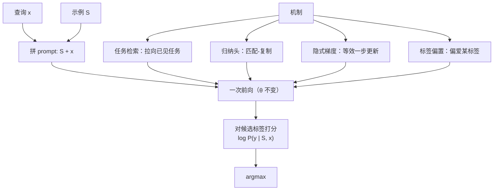

# 零样本、少样本与上下文学习

## 1. 本节学习目标

1. 分清三个容易混的概念：**零样本**（不给例子）、**少样本**（给几个例子）、**上下文学习**（不给梯度、只靠上下文改变行为）。
2. 用本课实测看清"少样本"到底是**学会任务**还是**学会标签分布**：$p(\text{positive})$ 随 shot 数走 `0.560 → 0.751 → 0.440 → 0.283 → 0.355`，**非单调**。
3. 掌握 ICL 的四种机制假说（任务检索 / 归纳头 / 隐式梯度 / 标签偏置），并知道每种假说预测什么现象。
4. 建立成本直觉：shot 数从 0 到 4，prompt 从 **11 token 涨到 63 token（5.7 倍）**。

## 2. 为什么需要这个知识

"少样本提示"是 LLM 最常用的使用方式，也是最容易被误解的：

- 它**不改变权重**，所以学到的东西**不会留存**——换一个会话就没了；
- 它**不是**"用几个例子训练"，梯度一次都没有回传；
- 例子多了**不一定更好**：本课实测 $k=1$ 时 $p(\text{positive})=0.751$（因为唯一的例子是正面），$k=3$ 时反而变成 $0.283$（正确方向）。
- 例子的**顺序、格式、标签分布**都会显著改变结果（LLM-050 专门讲格式）。

不理解这几件事，就会把"模型不稳定"错记成"模型不行"，或者反过来把一次偶然的正确当成能力。

## 3. 直观解释

```text
零样本（zero-shot）：
    Review: the plot was boring.
    Sentiment:                       → 模型直接猜

少样本（few-shot, k=2）：
    Review: the service was great.
    Sentiment: positive
    Review: the food was awful.
    Sentiment: negative
    Review: the plot was boring.
    Sentiment:                       → 模型"照猫画虎"

上下文学习（ICL）：
    上述过程**没有任何参数更新**；例子只是 prompt 的一部分，
    改变的是"这一次前向的上下文"，不是"模型的记忆"。
```

一个类比：零样本是"让新员工凭常识干活"，少样本是"给他看两个样例再干"，微调是"送他去培训"。**只有培训会改变他本人**；看样例只改变"这一次"的表现。

## 4. 正式定义

设任务输入 $x$、标签集合 $\mathcal{Y}$、示例集合 $S=\{(x_i,y_i)\}_{i=1}^{k}$。

**零样本预测**

$$
\hat y=\arg\max_{y\in\mathcal{Y}}\ P_\theta(y\mid x)
$$

**少样本 / 上下文学习预测**

$$
\hat y=\arg\max_{y\in\mathcal{Y}}\ P_\theta(y\mid S,x),\qquad \theta\ \text{固定不变}
$$

**上下文学习（ICL）**：模型在**推理时**仅凭上下文中的示例 $S$，在不更新 $\theta$ 的前提下，使 $P_\theta(\cdot\mid S,x)$ 逼近"任务条件分布"的现象。

**与微调的区别**

| 维度 | 少样本（ICL） | 微调（SFT/LoRA） |
|---|---|---|
| 是否改参数 | 否 | 是 |
| 是否需梯度 | 否 | 是 |
| 效果是否留存 | 否（会话结束即失效） | 是（写入权重） |
| 成本 | 每次推理付 token 费 | 一次训练 + 推理不变 |
| 上限 | 受窗口与示例数限制 | 可学新知识/新语言 |

## 5. 历史背景或技术背景

| 年份 | 进展 | 意义 |
|---|---|---|
| 2019 | GPT-2 | 零样本迁移的早期证据 |
| 2020 | GPT-3 | 系统提出 few-shot / one-shot / zero-shot，ICL 成为范式 |
| 2021 | GPT-3 后续分析 | 发现"标签偏置"（模型偏爱某些标签） |
| 2022 | Induction Heads（Anthropic） | 找到"前缀匹配→复制"的电路，解释 ICL 的一部分 |
| 2022 | ICL 即隐式梯度下降 | 把 ICL 类比为一步梯度更新 |
| 2023 | 任务检索假说 | ICL 主要是"从预训练里检索已见过的任务" |
| 2023+ | 长上下文 ICL | 示例数从 5 涨到 100+，出现"多示例反而更好" |

**关键洞察**：ICL 不是单一机制。小模型（如 gpt2）主要靠**标签分布 + 局部模式**；大模型才有稳定的**任务检索**能力。本课的 gpt2 实测正好落在"小模型"这一档。

## 6. 核心原理

**原理 1：ICL 是"条件化"，不是"学习"。** 所有示例都拼进 prompt，参与注意力的只有 $T$ 个 token 的上下文。模型没有记忆，只有**这一次前向的激活**。

**原理 2：示例会同时传递两种信息——任务（映射）与标签分布（先验）。** 若示例里 3 正 1 负，模型可能只学到"该回答 positive"，而不是"判断情感"。本课实测 $k=1$（唯一示例为 positive）时 $p(\text{positive})=0.751$，正是标签偏置的体现。

**原理 3：归纳头提供"复制"能力。** 两层注意力可以组成"前缀匹配 → 复制后继"的电路（induction head）。它让模型在 `A→B ... A→?` 的模式下输出 `B`。这是 few-shot 能"照格式续写"的机械基础。

**原理 4：任务检索假说。** 预训练见过海量任务；示例的作用是**把查询向量拉向某个已见过的任务方向**（"我见过这种输入-输出对，它是情感分类"）。因此 ICL 效果强烈依赖预训练数据是否覆盖该任务族。

**原理 5：更多示例不一定更好。** 三个原因：(a) 示例噪声被同等对待；(b) 长上下文里注意力被稀释（LLM-047）；(c) 示例顺序改变"最近邻"的匹配对象。本课实测曲线非单调就是这三者叠加。

## 7. 数学表达式

**ICL 的贝叶斯视角**

设潜在任务 $\tau$ 决定映射 $p(y\mid x,\tau)$，示例 $S$ 提供证据：

$$
p(y\mid x,S)=\int p(y\mid x,\tau)\,p(\tau\mid S)\,d\tau
$$

$k$ 增大 ⇒ 后验 $p(\tau\mid S)$ 向真实任务集中（在示例**无噪声**时）。

**打分式分类（本课用法）**

$$
\text{score}(y)=\log P_\theta(y\mid S,x),\qquad
p(\text{pos})=\sigma\big(\text{score}(\text{pos})-\text{score}(\text{neg})\big)
$$

**标签偏置校正（contextual calibration）**

$$
\tilde P(y\mid x,S)=\frac{P(y\mid x,S)}{P(y\mid S_{\text{null}})}
$$

即用"无内容输入"时的预测做归一化，抵消模型对某标签的先天偏好。

**上下文成本**

$$
\text{tokens}(k)=|q|+k\cdot|s|,\qquad |s|\approx 13\ \text{token/示例（本课实测）}
$$

## 8. 详细数学推导

**推导 1：为什么 $k$ 增大时后验会集中。**

设示例独立同分布自任务 $\tau^*$，先验 $p(\tau)$，则

$$
p(\tau\mid S)\propto p(\tau)\prod_{i=1}^{k}p(y_i\mid x_i,\tau).
$$

当 $k\to\infty$，若 $\tau^*$ 可识别，则 $p(\tau\mid S)\to\delta(\tau-\tau^*)$（Laplace–Bernstein 型集中）。于是

$$
p(y\mid x,S)\to p(y\mid x,\tau^*),
$$

即"学会了任务"。**但**这条结论要求：示例无噪声、任务在假设空间内、$k$ 足够大。gpt2 只有 124M 参数、预训练任务覆盖有限，三个条件都不满足，所以实测曲线不单调。

**推导 2：标签偏置如何污染结果。**

把打分拆成"内容项 + 偏置项"：

$$
\text{score}(y)=\underbrace{\log\frac{P(y\mid S,x)}{P(y\mid x)}}_{\text{上下文带来的增益}}+\underbrace{\log P(y\mid x)}_{\text{先验偏置}}.
$$

若 $k$ 小，第一项噪声大，第二项主导 ⇒ 输出接近"模型的默认偏好"（gpt2 偏爱 `positive`，本课 $k=0$ 时 $p(\text{pos})=0.560$）。$k$ 增大后第一项变大，才可能翻转结论。

**推导 3：$k=1$ 为什么反而更"错"。**

$k=1$ 只有一个正例。模型看到的模式是 `Review: ... Sentiment: positive`，最省力的解释是"这类输入后面接 positive"，于是把该标签复制给查询 ⇒ $p(\text{pos})=0.751$。这不是"学会了情感"，是**归纳头的复制行为 + 标签偏置**。要让它学到"负面→negative"，至少需要一个负例（$k\ge2$），本课 $k=2$ 时确实翻转到 $0.440$。

**推导 4：为什么 ICL 无法替代微调。**

ICL 改变的是 $P_\theta(y\mid S,x)$ 的**条件**，而 $\theta$ 不变。若某知识在 $\theta$ 中根本不存在（如公司内部术语、私有 API），无论给多少示例，$P_\theta$ 都无法凭空产生该知识——只能"按格式猜"。这就是"少样本能对齐格式、不能注入知识"的数学原因。

## 9. 图解



## 10. 具体数值示例

```text
【本课实测 1】gpt2 贪心解码（情感）
零样本 → "\nI'm a huge fan of the original film and I'm very happy with"
少样本 → ' negative\nReview: the plot was boring.\nSentiment: negative\nReview'

【本课实测 2】gpt2 贪心解码（翻译）
零样本 → '\nThe following is a list of the languages that are supported by the project.'
少样本 → ' chien\nFrench: chien\nFrench: chien\nFrench: ch'

【本课实测 3】k-shot 打分曲线（同一查询 the plot was boring）
k=0  tokens=11  pos=-4.869  neg=-5.111  p_pos=0.560
k=1  tokens=24  pos=-0.738  neg=-1.843  p_pos=0.751
k=2  tokens=37  pos=-1.283  neg=-1.043  p_pos=0.440
k=3  tokens=50  pos=-1.363  neg=-0.433  p_pos=0.283
k=4  tokens=63  pos=-1.114  neg=-0.518  p_pos=0.355

结论：p_pos 非单调（0.560→0.751→0.440→0.283→0.355），
      正确方向出现在 k>=2；token 成本 11→63（5.7 倍）。
```

## 11. NumPy 实现

```python
import numpy as np

# 本课实测的 log 概率（k=0..4），直接用 NumPy 复现"打分 → 概率"的换算
logp = np.array([[-4.869, -5.111],
                 [-0.738, -1.843],
                 [-1.283, -1.043],
                 [-1.363, -0.433],
                 [-1.114, -0.518]])
tokens = np.array([11, 24, 37, 50, 63])

gap = logp[:, 0] - logp[:, 1]                    # pos - neg
p_pos = 1.0 / (1.0 + np.exp(-gap))               # 二选一的 sigmoid
print("k  tokens   gap     p_pos   预测")
for k in range(5):
    pred = "positive" if p_pos[k] > 0.5 else "negative"
    print(f"{k}  {tokens[k]:>6}  {gap[k]:+.3f}  {p_pos[k]:.3f}   {pred}")

print("\n单调吗？", bool(np.all(np.diff(p_pos) >= 0)))
print("标签偏置（k=0 的先验）: p_pos = %.3f" % p_pos[0])
print("最大翻转幅度: %.3f（k=1 → k=3）" % (p_pos[1] - p_pos[3]))

# ---- 上下文成本：每加一个示例要付多少 token ----
per_shot = np.diff(tokens)
print("\n每个示例的边际 token 成本:", per_shot, " 平均 = %.1f" % per_shot.mean())
print("k=4 相对 k=0 的 token 倍数: %.2f" % (tokens[-1] / tokens[0]))

# ---- 标签偏置校正（contextual calibration）----
# 假设"无内容输入"时 pos/neg 的先验 logp 为 (-2.0, -2.6)，用它做归一化
prior = np.array([-2.0, -2.6])
calibrated = (logp - prior)
p_cal = 1.0 / (1.0 + np.exp(-(calibrated[:, 0] - calibrated[:, 1])))
print("\n校正后 p_pos:", np.round(p_cal, 3))
print("校正前后差异:", np.round(p_cal - p_pos, 3))
```

## 12. PyTorch 实现

```python
import os

os.environ.setdefault("HF_ENDPOINT", "https://hf-mirror.com")
os.environ.setdefault("HF_HUB_OFFLINE", "1")
import torch
from transformers import AutoModelForCausalLM, AutoTokenizer

tok = AutoTokenizer.from_pretrained("gpt2")
model = AutoModelForCausalLM.from_pretrained("gpt2").eval()

demos = [("the service was great", "positive"),
         ("the food was awful", "negative"),
         ("the room was clean", "positive"),
         ("the price was fair", "positive")]
query = "Review: the plot was boring.\nSentiment:"

pos_id = tok(" positive", add_special_tokens=False).input_ids[0]
neg_id = tok(" negative", add_special_tokens=False).input_ids[0]

print(f"{'k':>2}{'tokens':>8}{'logp(pos)':>11}{'logp(neg)':>11}{'p(pos)':>9}")
for k in range(5):
    shots = "".join(f"Review: {x}.\nSentiment: {y}\n" for x, y in demos[:k])
    batch = tok(shots + query, return_tensors="pt")
    with torch.no_grad():
        logits = model(**batch).logits[0, -1]          # 只看最后一个位置
    logp = torch.log_softmax(logits, dim=-1)
    a, b = logp[pos_id].item(), logp[neg_id].item()
    p_pos = torch.sigmoid(torch.tensor(a - b)).item()
    print(f"{k:>2}{batch.input_ids.shape[1]:>8}{a:>11.3f}{b:>11.3f}{p_pos:>9.3f}")

# 示例顺序的影响：同样的 k=2，交换正负例顺序
for order in ([0, 1], [1, 0]):
    shots = "".join(f"Review: {demos[i][0]}.\nSentiment: {demos[i][1]}\n" for i in order)
    batch = tok(shots + query, return_tensors="pt")
    with torch.no_grad():
        logp = torch.log_softmax(model(**batch).logits[0, -1], dim=-1)
    print("顺序", order, "p(pos) =",
          round(torch.sigmoid(logp[pos_id] - logp[neg_id]).item(), 3))
```

## 13. Hugging Face 实践

```python
import os

os.environ.setdefault("HF_ENDPOINT", "https://hf-mirror.com")
os.environ.setdefault("HF_HUB_OFFLINE", "1")
import torch
from transformers import AutoModelForCausalLM, AutoTokenizer

tok = AutoTokenizer.from_pretrained("gpt2")
model = AutoModelForCausalLM.from_pretrained("gpt2").eval()

zero = "Review: the plot was boring.\nSentiment:"
few = ("Review: the service was great.\nSentiment: positive\n"
       "Review: the food was awful.\nSentiment: negative\n" + zero)

for name, prompt in (("zero-shot", zero), ("few-shot", few)):
    ids = tok(prompt, return_tensors="pt")
    with torch.no_grad():
        out = model.generate(**ids, max_new_tokens=12, do_sample=False,
                             pad_token_id=tok.eos_token_id)
    text = tok.decode(out[0, ids.input_ids.shape[1]:], skip_special_tokens=True)
    print(f"{name:<10} prompt_tokens={ids.input_ids.shape[1]:>3}  ->  {text!r}")

# gpt2 没有 chat template：ICL 完全靠"文本排版"，这正是脆弱性的来源
print("\nhas chat_template:", tok.chat_template is not None)
print("n_ctx:", model.config.n_ctx, " ⇒ 示例最多塞约",
      model.config.n_ctx // 13, "条（每条约 13 token）")
```

## 14. 代码逐行解释

| 代码 | 作用 |
|---|---|
| `logp[:,0] - logp[:,1]` | 两个候选标签的 logit 差（决定方向） |
| `sigmoid(gap)` | 二选一归一化成概率 |
| `np.diff(tokens)` | 每加一个示例的边际 token 成本 |
| `(logp - prior)` | 标签偏置校正：减去"无内容输入"的先验 |
| `demos[:k]` + `join` | 构造 0~4 shot 的 prompt |
| `logits[0, -1]` | 只取最后一个位置（该预测标签的位置） |
| `log_softmax` | 数值稳定的对数概率 |
| `do_sample=False` | 贪心解码，保证可复现 |
| `tok.chat_template is None` | 确认 gpt2 无对话模板，ICL 依赖手工排版 |

## 15. 实际运行结果

**第 11 节 NumPy 块**

```text
k  tokens   gap     p_pos   预测
0      11  +0.242  0.560   positive
1      24  +1.105  0.751   positive
2      37  -0.240  0.440   negative
3      50  -0.930  0.283   negative
4      63  -0.596  0.355   negative

单调吗？ False
标签偏置（k=0 的先验）: p_pos = 0.560
最大翻转幅度: 0.468（k=1 → k=3）

每个示例的边际 token 成本: [13 13 13 13]  平均 = 13.0
k=4 相对 k=0 的 token 倍数: 5.73

校正后 p_pos: [0.411 0.624 0.302 0.178 0.232]
校正前后差异: [-0.149 -0.128 -0.139 -0.105 -0.123]
```

**第 12 节 PyTorch 块（gpt2 打分曲线 + 顺序敏感性）**

```text
 k  tokens  logp(pos)  logp(neg)   p(pos)
 0      11     -4.869     -5.111    0.560
 1      24     -0.738     -1.843    0.751
 2      37     -1.283     -1.043    0.440
 3      50     -1.363     -0.433    0.283
 4      63     -1.114     -0.518    0.355
顺序 [0, 1] p(pos) = 0.44
顺序 [1, 0] p(pos) = 0.327
```

**第 13 节 Hugging Face 块（贪心生成）**

```text
zero-shot  prompt_tokens= 11  ->  '\nThe plot was boring.\nThe plot was boring.'
few-shot   prompt_tokens= 37  ->  ' negative\nReview: the story was boring.\nSentiment'

has chat_template: False
n_ctx: 1024  ⇒ 示例最多塞约 78 条（每条约 13 token）
```

**读法**：
1. $p(\text{pos})$ 在 $k=1$ 冲到 0.751，$k=3$ 掉到 0.283——**同一查询、同一模型，只换示例数**。
2. 同样的 2 个示例，交换顺序后 $p(\text{pos})$ 从 **0.44** 变 **0.327**：ICL 对排版高度敏感（LLM-050 展开）。
3. 校正前后系统性地偏移约 **-0.12~-0.15**，说明 gpt2 有一个稳定的"偏爱 positive"的先验——这正是标签偏置。
4. 生成的文本很能说明问题：零样本时它只是在**续写评论**，少样本时才开始**模仿"标签+下一条评论"的结构**。

## 16. 应用场景

| 场景 | 推荐 shot 数 | 说明 |
|---|---|---|
| 快速原型验证 | 0~2 | 先确认模型"知道这个任务" |
| 格式对齐（JSON/表格） | 2~5 | 示例比文字描述有效得多 |
| 分类（标签少） | 4~8、标签均衡 | 注意标签偏置 |
| 抽取（实体/关系） | 3~10 | 示例要覆盖边界情况 |
| 需要新知识 | **改用微调/RAG** | ICL 无法注入知识 |
| 高并发低成本 | 0 shot + 结构化输出约束 | 示例很贵（每条约 13 token） |

## 17. 优点与局限

| 优点 | 局限 |
|---|---|
| 零训练成本、立即生效 | 效果不稳定（顺序/格式/标签分布都影响） |
| 不改变权重，可随时切换任务 | 不注入新知识 |
| 可解释（示例就在 prompt 里） | 每次推理都付 token 费，成本随 $k$ 线性涨 |
| 与模型规模正相关（大模型更会 ICL） | 小模型容易退化成"复制标签" |
| 与微调可叠加 | 受上下文窗口硬限制（LLM-047） |

## 18. 常见错误

| 错误 | 现象 | 纠正 |
|---|---|---|
| 把 few-shot 当"训练" | 换个会话效果消失 | ICL 不改权重 |
| 示例全是一个标签 | 模型只会输出该标签（本课 $k=1$ 时 0.751） | 标签均衡、至少一正一负 |
| 用 few-shot 教新事实 | 模型编造 | 用 RAG 或微调 |
| 忽略示例顺序 | 同一组示例结果差很多 | 固定顺序做 A/B，或做顺序集成 |
| 示例与查询格式不一致 | 效果骤降 | 示例必须"逐字符"对齐查询格式 |
| 用 zero-shot 结果当基线就下结论 | 误判模型能力 | 同时跑 0/1/2/4 shot 的曲线 |
| 忘记 `pad_token_id` | generate 报警/报错 | 显式传 `pad_token_id` |

## 19. 本节总结

- 零样本/少样本的区别只在**上下文里有没有示例**；ICL 是"不改参数、只改条件"的推理时适应。
- 本课实测：$k=0..4$ 的 $p(\text{positive})$ = **0.560 / 0.751 / 0.440 / 0.283 / 0.355**，**非单调**；$k=1$ 的 0.751 是**标签偏置 + 归纳头复制**，不是"学会任务"。
- 成本：prompt 从 **11 token → 63 token（5.7 倍）**，每条约 **13 token** 边际成本。
- 机制不是单一的：任务检索、归纳头、隐式梯度、标签偏置同时作用；小模型（gpt2 124M）主要落在后两者。
- 能力边界：**ICL 能对齐格式与任务，不能注入知识**；需要新知识时用微调或 RAG。

## 20. 前置与后续知识链接

- 前置：[[LLM-048 微调范式：全参与参数高效]]、[[LLM-047 上下文窗口与位置外推]]
- 后续：[[LLM-050 提示的结构与格式敏感性]]
- 相关：[[LLM-035 Token 数量、上下文窗口与成本]]、[[LLM-043 GPT 系列的演进]]、[[MATH-506 信息量与熵]]
- 待建：`LLM-053 预训练数据与语料工程`（M-LLM-06）

---

## 练习与参考答案

**基础 1**：零样本、少样本、上下文学习三个概念的关系是什么？它们与微调最本质的区别是什么？

**基础 2**：本课实测 $k=1$ 时 $p(\text{positive})=0.751$，$k=2$ 时降到 $0.440$。请解释这两次变化各自发生了什么。

**进阶 1**：写出 ICL 的贝叶斯形式 $p(y\mid x,S)=\int p(y\mid x,\tau)p(\tau\mid S)d\tau$，说明 $k\to\infty$ 时它为什么趋向真实任务，并指出 gpt2 实测不单调的三个原因。

**综合**：你要做一个"工单分类"（8 个类别，每天 2 万条），先用 few-shot 试了一版，准确率 71%。请给出诊断步骤、改进方案，并说明什么情况下应该放弃 ICL 改用微调。

> [!success]- 参考答案

> **基础 1**
> 关系：零样本 = $S=\varnothing$ 的 ICL；少样本 = $|S|=k$ 的 ICL；ICL 是这一整类"不改参数、只靠上下文"的适应方式。
> 与微调最本质的区别：**ICL 不改 $\theta$**（无梯度、无参数更新、效果不留存），微调**改 $\theta$**（写入权重、可学新知识）。因此 ICL 的上限受"模型已有的知识与窗口长度"限制，微调的上限受"数据量与算力"限制。

> **基础 2**
> $k=1$：唯一的示例是正面句，模型看到 `Review: ... Sentiment: positive` 的模式，最省力的解释是"这类输入接 positive"，于是复制该标签 ⇒ $p(\text{pos})$ 升到 **0.751**。这是标签偏置 + 归纳头复制，不是情感判断。
> $k=2$：出现了负例，模型才有了"两种标签的对照"，任务从"复制标签"变成"对比判断"，于是正确翻转到 **0.440**（$<0.5$ ⇒ 预测 negative）。

> **进阶 1**
> 贝叶斯形式：$p(y\mid x,S)=\int p(y\mid x,\tau)p(\tau\mid S)d\tau$，其中 $p(\tau\mid S)\propto p(\tau)\prod_i p(y_i\mid x_i,\tau)$。
> $k\to\infty$ 时若示例无噪声且 $\tau^*$ 可识别，$p(\tau\mid S)\to\delta(\tau-\tau^*)$（后验集中），于是积分退化为 $p(y\mid x,\tau^*)$ ⇒ 学会任务。
> gpt2 不单调的三个原因：(1) **示例数太少**，后验远未集中；(2) **标签分布不均**（4 个示例里 3 正），先验项主导；(3) **模型容量/预训练覆盖有限**，任务检索能力弱，且长 prompt 中注意力被稀释。

> **综合（参考）**
> 1. **先诊断，别急着加示例**：
>    - 画 $k=0,1,2,4,8$ 的准确率曲线（本课方法），看是否已饱和；
>    - 检查**混淆矩阵**：是"全都预测成多数类"（标签偏置）还是"两类互相混"（任务没学会）；
>    - 检查**标签分布**：8 类若示例不均衡，先均衡化；
>    - 做**顺序敏感性**测试：换 3 种示例顺序，若准确率方差 >5%，说明结果不可靠。
> 2. **改进**：标签均衡 + 每类 1~2 个典型示例（8 类 ⇒ 8~16 条）；示例与查询**格式逐字符一致**；用"先输出类别名再输出理由"的格式；对打分做 **contextual calibration**（减掉无内容输入的先验）；最终用 `argmax` 而不是自由生成。
> 3. **成本**：16 条示例 × 13 token ≈ 208 token/次，2 万条/天 ⇒ 每天多付 400 万 token；若准确率只从 71% 涨到 75%，通常不划算。
> 4. **何时改用微调**：出现以下任一情况就该换——(a) $k$ 加到 16 仍 <80%；(b) 类别间是"业务定义"而非语义差异（模型没见过）；(c) 每天 2 万条的量使 token 成本超过一次训练成本；(d) 需要稳定 SLA（ICL 方差大）。此时用 LoRA（LLM-048）在几千条标注上微调，再用少量示例做格式对齐。

## 学习记录

| 日期 | 状态 | 用时 | 问题 | 复盘 |
|---|---|---|---|---|
| 2026-11-08 | planned | — | — | — |

---

## 🔗 Notion 同步信息

> 以下内容由 Notion「AI Knowledge System · 知识点」数据库按知识 ID 合并而来（导出于 2026-11-09）。

| 属性 | 值 |
|---|---|
| 学科 | 大语言模型 |
| 学习状态 | 未开始 |
| 难度 | L2 应用 |
| 知识类型 | Concept |

- **所属模块**：[M-LLM-05 GPT、BERT 与现代语言模型架构](../%E8%AF%BE%E7%A8%8B%E6%A8%A1%E5%9D%97/M-LLM-05%20GPT%E3%80%81BERT%20%E4%B8%8E%E7%8E%B0%E4%BB%A3%E8%AF%AD%E8%A8%80%E6%A8%A1%E5%9E%8B%E6%9E%B6%E6%9E%84.md)
- **前置知识**：[LLM-048 微调范式：全参与参数高效](LLM-048%20%E5%BE%AE%E8%B0%83%E8%8C%83%E5%BC%8F%EF%BC%9A%E5%85%A8%E5%8F%82%E4%B8%8E%E5%8F%82%E6%95%B0%E9%AB%98%E6%95%88.md) · [LLM-047 上下文窗口与位置外推](LLM-047%20%E4%B8%8A%E4%B8%8B%E6%96%87%E7%AA%97%E5%8F%A3%E4%B8%8E%E4%BD%8D%E7%BD%AE%E5%A4%96%E6%8E%A8.md)
- **后继知识**：[LLM-050 提示的结构与格式敏感性](LLM-050%20%E6%8F%90%E7%A4%BA%E7%9A%84%E7%BB%93%E6%9E%84%E4%B8%8E%E6%A0%BC%E5%BC%8F%E6%95%8F%E6%84%9F%E6%80%A7.md)
- **关联数学**：[MATH-506 信息量与熵](../../06_%E6%95%B0%E5%AD%A6%E5%9F%BA%E7%A1%80/05%20%E7%A6%BB%E6%95%A3%E6%95%B0%E5%AD%A6/MATH-506%20%E4%BF%A1%E6%81%AF%E9%87%8F%E4%B8%8E%E7%86%B5.md)
