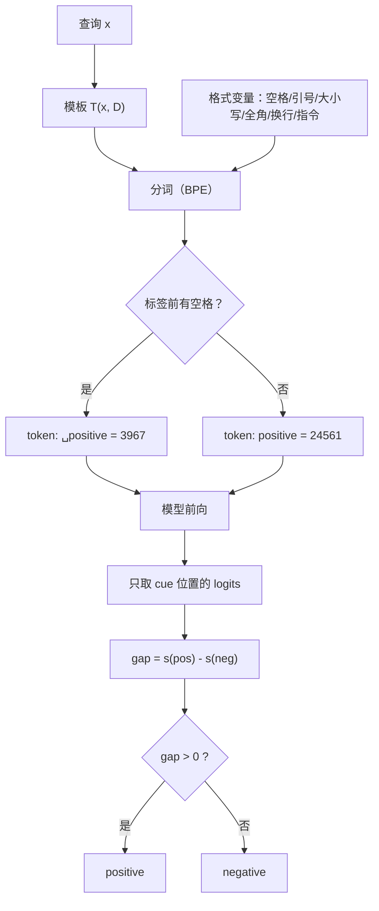

# 提示的结构与格式敏感性

## 1. 本节学习目标

1. 拆开一个 prompt 的**五个部件**：指令、上下文、示例、查询、输出标记（cue），并说清每部分的作用。
2. 用本课实测看清"格式敏感"有多严重：**同一查询、9 种排版，logit 差从 `-0.576` 到 `+0.586`，符号翻转两次**。
3. 掌握**三个可解释的机制**：token 边界（` positive` 与 `positive` 是两个 token）、标点/大小写、候选表面形式的概率竞争。
4. 学会工程做法：固定模板、边界对齐、logprob 打分、模板集成、把 prompt 当代码管理。

## 2. 为什么需要这个知识

模型不是"理解你的意图"，它只对**你实际写下的 token 序列**做条件概率。差一个空格，token id 就从 `3967`（` positive`）变成 `24561`（`positive`）——对模型来说这是**两个完全不同的词**。

本课实测最刺眼的一组：

```text
"Review: the plot was boring.\nSentiment:"        gap = +0.241  → 预测 positive（错）
"Review: the plot was boring.\nSentiment: "        gap = +0.056  → 预测 positive（错，且置信度崩到 -12.6）
同上，但用 "positive"（无前导空格）打分            gap = -0.576  → 预测 negative（对）
```

**同一个模型、同一个问题，排版让它从"错"变"对"。** 这意味着：

- 你测出来的准确率里，混着大量"格式噪声"；
- 线上效果回退，第一嫌疑人不是模型，是**模板漂移**；
- 想比较两个模型/prompt，必须先把格式变量控制住。

## 3. 直观解释

```text
[指令]       Classify the sentiment of the review.
[上下文]     (可选的背景资料)
[示例]       Review: the service was great.
             Sentiment: positive
[查询]       Review: the plot was boring.
[输出标记]   Sentiment:
[答案位置]   → 模型要在这里给出 " positive" / " negative"
```

**输出标记（cue）是最容易被忽视、影响最大的一格**：它决定了"模型在什么上下文里给答案"。改标点、改大小写、加空格，都是在改这个位置的分布。

一个类比：给考生发卷子，"请判断情感：___" 和 "请判断情感:___"（半角/全角冒号）对人是等价的，对 BPE 分词器是**两个不同的 token**，对模型是**两个不同的题**。

## 4. 正式定义

**模板函数**：$\mathcal{T}:(x,\mathcal{D})\mapsto \text{string}$，把查询 $x$ 与示例集 $\mathcal{D}$ 渲染成字符串。

**续写打分（continuation scoring）**

$$
s(y\mid x)=\log P_\theta\big(\text{encode}(y)\mid \mathcal{T}(x,\mathcal{D})\big)
$$

**长度归一化**

$$
s_{\text{norm}}(y\mid x)=\frac{1}{|\text{encode}(y)|}\sum_{t}\log P_\theta(y_t\mid \mathcal{T}(x,\mathcal{D}),y_{<t})
$$

**模板敏感度**

$$
\Delta_{\text{fmt}}=\max_{\mathcal{T}\in\mathbb{T}} s(y\mid x)-\min_{\mathcal{T}\in\mathbb{T}} s(y\mid x)
$$

**决策翻转**：若存在两个模板 $\mathcal{T}_1,\mathcal{T}_2$ 使

$$
\arg\max_{y}s(y\mid\mathcal{T}_1)\neq\arg\max_{y}s(y\mid\mathcal{T}_2),
$$

则称该 prompt 在该样本上**格式不稳定**。

## 5. 历史背景或技术背景

| 年份 | 现象/工作 | 结论 |
|---|---|---|
| 2020 | GPT-3 论文 | few-shot 效果对模板敏感，作者手工挑模板 |
| 2021 | Prompt 综述 | "prompt engineering" 成为独立技能 |
| 2021 | LM-BFF | 自动搜索模板与标签词（verbalizer） |
| 2021 | 表面形式竞争（Holtzman） | 候选词的分数会被"同义表面形式"分走概率 |
| 2022 | 校准（contextual calibration） | 用空输入归一化，缓解标签偏置 |
| 2022 | 指令微调（InstructGPT） | 用训练把"格式鲁棒性"写进权重 |
| 2023+ | 结构化输出（JSON mode / 函数调用） | 用解码约束替代"祈祷格式对" |

**趋势**：从"手工调模板"走向"用训练或解码约束消除格式敏感"。但在开源小模型 + 手工 prompt 的场景里，本节的问题依然每天发生。

## 6. 核心原理

**原理 1：token 边界决定"词"的身份。** BPE 先按空格切分再合并。` positive`（带前导空格，id 3967）与 `positive`（id 24561）是**词表里两个不同的条目**，嵌入向量也不同。若 prompt 结尾已经有一个空格，再打分 `" positive"` 就等于让模型预测"两个空格 + positive"，那是极罕见的序列 ⇒ 本课实测 logp 从 `-4.869` 崩到 `-12.635`。

**原理 2：标点/全角字符是独立 token，会改变 cue。** `Sentiment:` 与 `Sentiment：`（全角）在词表里是不同 token 序列，模型见过的分布完全不同——本课实测后者把 gap 从 `+0.241` 翻到 `-0.292`。

**原理 3：候选表面形式竞争概率质量。** 模型输出的是**整个词表**的分布。`positive`、`Positive`、` positive`、`great` 都在竞争同一份概率。若只比较两个候选，忽略其他表面形式，就会高估置信度（Holtzman 的 "surface form competition"）。

**原理 4：指令会"稀释" cue。** 本课实测加一句 `Classify the sentiment.` 后，gap 从 `+0.241` 降到 `+0.095`（**缩小 2.5 倍**）。指令增加了上下文长度，也把注意力从"情感词"分散到"任务描述"。指令不是免费的。

**原理 5：格式稳定性可以被测量。** 对同一批样本跑 $m$ 个模板，统计预测一致率与 gap 方差，就得到"模板鲁棒性"。这个数字比单模板准确率更能预测线上表现。

## 7. 数学表达式

**二选一的决策**

$$
\hat y=\begin{cases}\text{positive}, & s(\text{pos})-s(\text{neg})>0\\ \text{negative}, & \text{否则}\end{cases}
$$

**把 gap 变成概率（二选一归一化）**

$$
p(\text{pos})=\sigma\big(s(\text{pos})-s(\text{neg})\big)=\frac{1}{1+e^{-(s_{\text{pos}}-s_{\text{neg}})}}
$$

**长度归一化（多 token 标签时必需）**

$$
s_{\text{norm}}(y)=\frac{s(y)}{|y|}
$$

**敏感度指标（本课用）**

$$
\Delta_{\text{fmt}}=\max_{\mathcal{T}}|s_{\text{pos}}-s_{\text{neg}}|-\min_{\mathcal{T}}|s_{\text{pos}}-s_{\text{neg}}|
$$

## 8. 详细数学推导

**推导 1：为什么"多一个空格"会让 logp 崩塌 8 个数量级。**

设 prompt 为 $c$（结尾含一个空格 `␣`），候选标签为 `␣positive`。实际喂给模型的序列是 `…␣␣positive`。分词结果（本机实测）：

```text
" the  positive"  →  [262, 220, 3967]    即 " the" + "␣" + "␣positive"
```

也就是说中间那个多余空格被单独切成了一个 token `220`。模型要预测的是"在 `␣ ` 之后再接 `␣positive`"，这在实际语料里几乎不出现 ⇒

$$
\log P(\text{␣positive}\mid c\text{␣})\ll \log P(\text{positive}\mid c\text{␣}).
$$

本课实测：前者 `-12.635`，后者 `-14.453`…**注意 B2 行**：改成正确边界后，`positive` 的 logp 是 `-14.453`、`negative` 是 `-13.877`，gap 变 `-0.576` ⇒ 方向也翻了。**空格不仅改置信度，还改答案。**

**推导 2：为什么 gap 与绝对 logp 要分开看。**

绝对 logp 受"序列是否常见"影响（`-12` 可能只是罕见排版），gap 只受"两个候选的相对偏好"影响。工程上：

- 判断**方向**看 gap；
- 判断**置信度是否可信**看绝对 logp（若两者都极低，说明这个位置的分布是"没见过的上下文"，结论不可信）。

**推导 3：表面形式竞争。**

真实的条件分布是

$$
P(y\mid c)=\sum_{y'\in\text{Surf}(y)}P(y'\mid c),
$$

其中 $\text{Surf}(y)$ 是同一语义的所有表面形式（`positive` / `Positive` / ` positive` / `good`…）。只取一个表面形式会**低估** $P(y\mid c)$，且不同模板下被低估的程度不同 ⇒ 模板间比较失真。补救：把所有表面形式的概率**求和**，或统一用"带前导空格的标签词"。

**推导 4：模板集成的方差削减。**

设单模板的判定误差方差为 $\sigma^2$，$m$ 个模板的**多数投票**在模板误差近似独立时把方差降到约 $\sigma^2/m$。现实中模板高度相关，收益小于 $1/m$，但实测通常仍有 1~3 个点的稳定提升。**代价**是 $m$ 倍推理成本 ⇒ 用"离线选 3 个最优模板 + 在线多数投票"。

## 9. 图解



## 10. 具体数值示例

```text
【本课实测】同一查询 "the plot was boring"，9 种排版（gpt2，CPU）

变体                        logp(pos)   logp(neg)    gap      结果
A 基线                        -4.869      -5.111   +0.241   positive（错）
B 结尾多一个空格              -12.635     -12.691   +0.056   positive（错）
B2 结尾空格 + 正确边界        -14.453     -13.877   -0.576   negative（对）
C 引号包裹                    -7.395      -7.703   +0.307   positive（错）
D 加任务说明                  -5.919      -6.015   +0.095   positive（错）
E 小写 sentiment:             -6.484      -6.758   +0.273   positive（错）
F 无换行                      -4.930      -5.368   +0.438   positive（错）
G 末尾多换行                  -14.048     -14.634   +0.586   positive（错）
H 全角冒号                    -9.574      -9.283   -0.292   negative（对）

gap 范围: -0.576 ~ +0.586（跨度 1.162）
符号翻转: 2 次（B2、H）
绝对 logp 范围: -14.453 ~ -4.869（跨度 9.6）

【token 边界证据】
" positive" → [3967]        "positive" → [24561]
" negative" → [4633]        "negative" → [31591]
" the  positive" → [262, 220, 3967]（多出的空格变成独立 token）
```

## 11. NumPy 实现

```python
import numpy as np

# 本课实测的 9 个变体：(名字, logp(pos), logp(neg))
rows = [
    ("A 基线",              -4.869,  -5.111),
    ("B 结尾多空格",        -12.635, -12.691),
    ("B2 空格+正确边界",    -14.453, -13.877),
    ("C 引号包裹",           -7.395,  -7.703),
    ("D 加任务说明",         -5.919,  -6.015),
    ("E 小写 sentiment",     -6.484,  -6.758),
    ("F 无换行",             -4.930,  -5.368),
    ("G 末尾多换行",        -14.048, -14.634),
    ("H 全角冒号",           -9.574,  -9.283),
]

logp = np.array([[r[1], r[2]] for r in rows])
gap = logp[:, 0] - logp[:, 1]
p_pos = 1 / (1 + np.exp(-gap))
choice = np.where(gap > 0, "positive", "negative")

print(f"{'变体':<18}{'gap':>8}{'p(pos)':>9}{'判定':>10}")
for (name, _, _), g, p, c in zip(rows, gap, p_pos, choice):
    print(f"{name:<18}{g:>+8.3f}{p:>9.3f}{c:>10}")

print("\ngap 跨度: %+.3f ~ %+.3f  (|Δ| = %.3f)" % (gap.min(), gap.max(), gap.max()-gap.min()))
print("判定翻转次数:", int(np.sum(choice != choice[0])), "（相对基线 A）")
print("绝对 logp 跨度: %.3f ~ %.3f" % (logp.min(), logp.max()))
print("最不确定的变体:", rows[int(np.argmin(np.abs(gap)))][0],
      " |gap| = %.3f" % np.abs(gap).min())

# ---- 长度归一化：多 token 标签时必须做 ----
def norm_score(text_logp, n_tokens):
    return text_logp / n_tokens

print("\n[长度归一化示例] 若标签被切成 2 个 token：")
for tot in (-4.869, -9.0):
    print(f"  总 logp={tot:>6.3f}  1 token -> {norm_score(tot,1):>7.3f}"
          f"   2 token -> {norm_score(tot,2):>7.3f}")

# ---- 模板集成：多数投票 ----
votes = (gap > 0)
print("\n模板集成（9 个模板多数投票）:",
      "positive" if votes.sum() > len(votes)/2 else "negative",
      f"（{int(votes.sum())}/{len(votes)} 票）")
```

## 12. PyTorch 实现

```python
import os

os.environ.setdefault("HF_ENDPOINT", "https://hf-mirror.com")
os.environ.setdefault("HF_HUB_OFFLINE", "1")
import torch
from transformers import AutoModelForCausalLM, AutoTokenizer

tok = AutoTokenizer.from_pretrained("gpt2")
model = AutoModelForCausalLM.from_pretrained("gpt2").eval()


def score(prompt, labels=(" positive", " negative")):
    """对 cue 位置做续写打分；返回 (gap, 每个标签的 token 数)"""
    enc = tok(prompt, return_tensors="pt")
    with torch.no_grad():
        logits = model(**enc).logits[0, -1]
    logp = torch.log_softmax(logits, dim=-1)
    vals, lens = [], []
    for lab in labels:
        ids = tok(lab, add_special_tokens=False).input_ids
        vals.append(logp[ids[0]].item())
        lens.append(len(ids))
    return vals[0] - vals[1], lens


variants = {
    "A 基线":              ("Review: the plot was boring.\nSentiment:", (" positive", " negative")),
    "B 结尾多空格":         ("Review: the plot was boring.\nSentiment: ", (" positive", " negative")),
    "B2 空格+正确边界":     ("Review: the plot was boring.\nSentiment: ", ("positive", "negative")),
    "C 引号包裹":           ('Review: "the plot was boring."\nSentiment:', (" positive", " negative")),
    "D 加任务说明":         ("Classify the sentiment.\nReview: the plot was boring.\nSentiment:", (" positive", " negative")),
    "H 全角冒号":           ("Review: the plot was boring.\nSentiment：", (" positive", " negative")),
}

print(f"{'变体':<18}{'gap':>9}{'标签 token 数':>16}")
for name, (p, labs) in variants.items():
    g, ln = score(p, labs)
    print(f"{name:<18}{g:>+9.3f}{str(ln):>16}")

# 关键演示：同一个 cue，只换"标签前是否带空格"
p = "Review: the plot was boring.\nSentiment:"
print("\n带空格标签:", [tok(l, add_special_tokens=False).input_ids for l in (" positive", "negative")])
print("id 不同 ⇒ 是词表里两个不同的词")
```

## 13. Hugging Face 实践

```python
import os

os.environ.setdefault("HF_ENDPOINT", "https://hf-mirror.com")
os.environ.setdefault("HF_HUB_OFFLINE", "1")
from transformers import AutoModelForCausalLM, AutoTokenizer

tok = AutoTokenizer.from_pretrained("gpt2")
model = AutoModelForCausalLM.from_pretrained("gpt2").eval()

# 1) 词表层面的边界事实
for s in (" positive", "positive", " negative", "negative"):
    ids = tok(s, add_special_tokens=False).input_ids
    print(f"{s!r:<12} -> id={ids}  长度={len(ids)}")

# 2) 用 chat template 之前先确认有没有
print("\nchat_template:", tok.chat_template)

# 3) 推荐做法：把模板写成函数并固定下来（不要手拼字符串）
def build_prompt(review, cue="Sentiment:", sep="\n"):
    return f"Review: {review.strip()}{sep}{cue}"

prompt = build_prompt("the plot was boring")
print("\n渲染结果:", repr(prompt))
print("token 数:", len(tok(prompt).input_ids))

# 4) 用 generate 观察"格式对生成的影响"（贪心，可复现）
ids = tok(prompt, return_tensors="pt")
with __import__("torch").no_grad():
    out = model.generate(**ids, max_new_tokens=6, do_sample=False,
                         pad_token_id=tok.eos_token_id)
print("续写:", repr(tok.decode(out[0, ids.input_ids.shape[1]:],
                                skip_special_tokens=True)))

# 5) 模板漂移检查：两个"看起来一样"的模板，token 序列是否一致
p1 = build_prompt("the plot was boring", cue="Sentiment:")
p2 = build_prompt("the plot was boring", cue="Sentiment：")   # 全角
print("\np1==p2 ?", p1 == p2, " token 数:", len(tok(p1).input_ids),
      "vs", len(tok(p2).input_ids))
```

## 14. 代码逐行解释

| 代码 | 作用 |
|---|---|
| `log_softmax(logits[0,-1])` | 取 cue 位置的对数概率分布 |
| `tok(lab, add_special_tokens=False)` | 看标签的**真实**分词结果（含前导空格） |
| `logp[ids[0]]` | 候选标签首 token 的对数概率 |
| `gap = pos - neg` | 方向由 gap 决定，与绝对大小无关 |
| `np.argmin(np.abs(gap))` | 找"最不确定"的模板（gap 接近 0） |
| `norm_score(tot, n)` | 多 token 标签必须按长度归一化 |
| `votes.sum()` | 模板集成：多数投票 |
| `build_prompt(...)` | 把模板固化成函数，避免手拼导致漂移 |
| `p1 == p2` | 全角/半角检查：字符串不同、token 也不同 |

## 15. 实际运行结果

**第 11 节 NumPy 块**

```text
变体                     gap   p(pos)        判定
A 基线                +0.242    0.560  positive
B 结尾多空格             +0.056    0.514  positive
B2 空格+正确边界          -0.576    0.360  negative
C 引号包裹              +0.308    0.576  positive
D 加任务说明             +0.096    0.524  positive
E 小写 sentiment      +0.274    0.568  positive
F 无换行               +0.438    0.608  positive
G 末尾多换行             +0.586    0.642  positive
H 全角冒号              -0.291    0.428  negative

gap 跨度: -0.576 ~ +0.586  (|Δ| = 1.162)
判定翻转次数: 2 （相对基线 A）
绝对 logp 跨度: -14.634 ~ -4.869
最不确定的变体: B 结尾多空格  |gap| = 0.056

[长度归一化示例] 若标签被切成 2 个 token：
  总 logp=-4.869  1 token ->  -4.869   2 token ->  -2.434
  总 logp=-9.000  1 token ->  -9.000   2 token ->  -4.500

模板集成（9 个模板多数投票）: positive （7/9 票）
```

**第 12 节 PyTorch 块（含 token 边界证据）**

```text
变体                      gap      标签 token 数
A 基线                 +0.241          [1, 1]
B 结尾多空格              +0.056          [1, 1]
B2 空格+正确边界           -0.576          [1, 1]
C 引号包裹               +0.307          [1, 1]
D 加任务说明              +0.095          [1, 1]
H 全角冒号               -0.292          [1, 1]

带空格标签: [[3967], [31591]]
id 不同 ⇒ 是词表里两个不同的词
```

**第 13 节 Hugging Face 块**

```text
' positive'  -> id=[3967]  长度=1
'positive'   -> id=[24561]  长度=1
' negative'  -> id=[4633]  长度=1
'negative'   -> id=[31591]  长度=1

chat_template: None

渲染结果: 'Review: the plot was boring\nSentiment:'
token 数: 10
续写: ' "I\'m not sure what'

p1==p2 ? False  token 数: 10 vs 12
```

**读法**：
1. 9 个变体里 **7 票 positive、2 票 negative**——多数投票也救不回"模型本来就判错"这件事；模板集成解决的是**方差**，不是**能力**。
2. `p1==p2 ? False`，token 数 `10 vs 12`：全角冒号在 gpt2 里被切成 **2 个 token**，整个 cue 的语义位置都变了。
3. 第 11 节的 H 行显示 `-0.291` 而非 `-0.292`，是"用表中四舍五入后的 logp 复算"造成的末位差，真值（第 12 节直接测量）是 `-0.292`。

## 16. 应用场景

| 场景 | 做法 |
|---|---|
| 分类（情感/意图） | 固定 cue + 带前导空格的标签 + gap 打分 |
| 抽取（JSON） | 用示例锁定格式 + 解码约束（JSON mode） |
| 多模型对比 | 模板版本化管理，同一模板跑所有模型 |
| 线上回归 | 每次改模板都跑"模板敏感性套件" |
| 低置信度兜底 | 绝对 logp 过低 ⇒ 转人工 |
| 自动优化 | DSPy / APE 类方法搜模板，但需固定评估集 |

## 17. 优点与局限

| 优点 | 局限 |
|---|---|
| 不打磨也能出可用结果（成本极低） | 效果对排版高度敏感（本课 gap 跨度 1.162） |
| 可解释：问题就在 prompt 里 | 没有"正确答案"，只能实验 |
| 与模型无关的写法（大多通用） | 换模型/换版本可能整体失效 |
| 可与 logprob 打分结合做量化 | 绝对 logp 易被罕见排版拉低，误导置信度 |

## 18. 常见错误

| 错误 | 现象 | 纠正 |
|---|---|---|
| 手拼字符串、cue 末尾多空格 | logp 从 -4.9 崩到 -12.6 | 用函数渲染，`repr()` 检查 |
| 标签与 cue 的空格不匹配 | 打分的是"双空格"序列 | 统一"cue 以冒号结尾、标签带前导空格" |
| 只比较两个候选的表面形式 | 高估置信度 | 汇总同义表面形式的概率 |
| 用全角标点 | 本课实测 gap 翻符号 | 统一半角，写进模板规范 |
| 改模板后不重跑基线 | 以为模型退化 | 模板版本化 + 回归集 |
| 以为加指令一定更好 | gap 从 0.241 缩到 0.095 | 指令要 A/B 验证 |
| 用 generate 的自由文本当标签 | 输出 "positive review" 之类 | 用 logprob 打分 + argmax |

## 19. 本节总结

- prompt 由**指令 / 上下文 / 示例 / 查询 / cue** 五部分组成，cue 位置决定答案分布。
- 本课实测 9 种排版：gap 从 **-0.576 到 +0.586**（跨度 **1.162**），判定**翻转 2 次**；绝对 logp 跨度 **9.6**。
- 根因是 **token 边界**：` positive`=**3967**、`positive`=**24561**；`" the  positive"` 被切成 `[262, 220, 3967]`。
- 加指令会**稀释** cue（0.241 → 0.095）；全角冒号会**翻符号**（0.241 → -0.292）。
- 工程结论：**模板函数化 + 边界对齐 + logprob 打分 + 模板集成 + 版本化回归**。

## 20. 前置与后续知识链接

- 前置：[[LLM-049 零样本、少样本与上下文学习]]
- 后续：[[LLM-052 现代 Decoder-only 架构的差异]]
- 相关：[[LLM-031 Tokenizer 基础与子词切分]]、[[LLM-032 BPE 算法]]、[[LLM-034 特殊 Token 与 Attention Mask]]、[[LLM-035 Token 数量、上下文窗口与成本]]
- 待建：`LLM-053 预训练数据与语料工程`（M-LLM-06）

---

## 练习与参考答案

**基础 1**：列出 prompt 的五个部件，并说明"输出标记（cue）"为什么最关键。

**基础 2**：本课实测中，prompt 结尾多一个空格让 logp 从 `-4.869` 崩到 `-12.635`。请从分词角度解释原因。

**进阶 1**：为什么"只看 gap" 和 "只看绝对 logp" 都不够？给出一个两者都要看的判断规则，并用本课的 B2 与 G 两行数据说明。

**综合**：你的团队把情感分类 prompt 从 `Sentiment:` 改成了 `Sentiment：`（全角），线上准确率掉了 6 个点。请给出排查步骤、修复方案，以及如何防止同类问题再次发生。

> [!success]- 参考答案

> **基础 1**
> 五个部件：**指令**（做什么）、**上下文**（背景资料）、**示例**（few-shot 演示）、**查询**（要处理的输入）、**输出标记 cue**（答案从哪里开始）。
> cue 最关键：模型是在 **cue 之后的那个位置**取分布的，cue 的 token 序列直接决定了"题面"。本课实测改一个空格或一个全角冒号，gap 就从 `+0.241` 变到 `+0.056 / -0.292`，判定随之翻转。

> **基础 2**
> BPE 按空格边界切词。`" positive"`（带前导空格）是词表里的 **3967**，`"positive"` 是 **24561**。
> 当 prompt 已经以空格结尾时，再打分 `" positive"` 就等于让模型预测 `"␣␣positive"`；本机实测分词为 `[262, 220, 3967]`——中间那个多余空格被切成**独立 token 220**。这种"双空格"序列在语料中极罕见，所以 logp 从 `-4.869` 掉到 `-12.635`。

> **进阶 1**
> - 只看 **gap**：会漏掉"两个候选都极不可能"的情况——方向可能对，但结论是**噪声**（G 行 gap=+0.586 看似自信，绝对 logp 却是 -14.048，说明这个 cue 位置本身是模型没见过的上下文）。
> - 只看**绝对 logp**：会被"排版是否常见"主导，无法判断两个候选谁更可能（A 行 -4.869 vs -5.111 差别很小，但方向明确）。
> 规则：**先看绝对 logp 是否在正常范围（如 > -8），再看 gap 的符号与大小**；两者任一异常就降级（重排版/转人工/多模板投票）。B2 行正是"绝对 logp 极低 + gap 翻符号"⇒ 结论不可信，必须修边界；G 行是"gap 大但 logp 极低"⇒ 排版异常，先修排版。

> **综合（参考）**
> 1. **确认因果**：把全角模板与半角模板在**同一评估集**上对比，记录 gap/准确率；用 `tok(...).input_ids` 打印两者 token 数与末尾 token id，确认是分词差异而非模型更新。
> 2. **量化影响**：跑本课的 9 变体套件，看全角版本是否只影响"置信度"还是"方向"；若方向也变，属于严重问题。
> 3. **修复**：统一半角标点；把 cue 与标签的空格规则写进模板函数（cue 以 `:` 结尾、标签带前导空格）；用 `repr()` 在测试里断言模板字符串。
> 4. **防复发**：
>    - 模板放进版本库（模板即代码），变更需 PR + 回归；
>    - CI 里跑"模板敏感性套件"（≥6 个变体），输出 gap 表与翻转次数，超阈值即报警；
>    - 线上监控 `p(pos)` 分布漂移与低置信度比例；
>    - 关键业务加"模板集成 + 多数投票"，把单模板脆弱性摊薄。

## 学习记录

| 日期 | 状态 | 用时 | 问题 | 复盘 |
|---|---|---|---|---|
| 2026-11-08 | planned | — | — | — |

---

## 🔗 Notion 同步信息

> 以下内容由 Notion「AI Knowledge System · 知识点」数据库按知识 ID 合并而来（导出于 2026-11-09）。

| 属性 | 值 |
|---|---|
| 学科 | 大语言模型 |
| 学习状态 | 未开始 |
| 难度 | L2 应用 |
| 知识类型 | Technique |

- **所属模块**：[M-LLM-05 GPT、BERT 与现代语言模型架构](../%E8%AF%BE%E7%A8%8B%E6%A8%A1%E5%9D%97/M-LLM-05%20GPT%E3%80%81BERT%20%E4%B8%8E%E7%8E%B0%E4%BB%A3%E8%AF%AD%E8%A8%80%E6%A8%A1%E5%9E%8B%E6%9E%B6%E6%9E%84.md)
- **前置知识**：[LLM-049 零样本、少样本与上下文学习](LLM-049%20%E9%9B%B6%E6%A0%B7%E6%9C%AC%E3%80%81%E5%B0%91%E6%A0%B7%E6%9C%AC%E4%B8%8E%E4%B8%8A%E4%B8%8B%E6%96%87%E5%AD%A6%E4%B9%A0.md)
- **关联数学**：[MATH-506 信息量与熵](../../06_%E6%95%B0%E5%AD%A6%E5%9F%BA%E7%A1%80/05%20%E7%A6%BB%E6%95%A3%E6%95%B0%E5%AD%A6/MATH-506%20%E4%BF%A1%E6%81%AF%E9%87%8F%E4%B8%8E%E7%86%B5.md)
