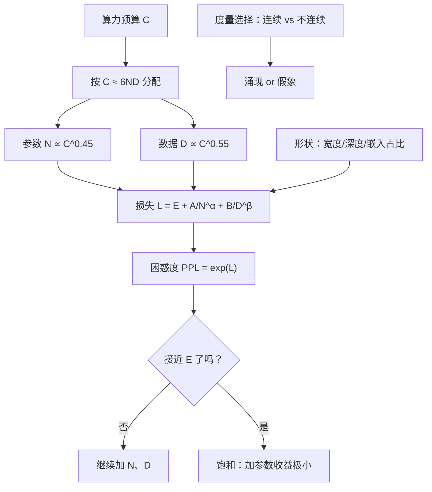

# 模型规模与能力的关系

## 1. 本节学习目标

1. 把"规模"拆成**四个轴**：参数 $N$、数据 $D$、算力 $C$、以及"参数怎么分布"（宽度/深度/嵌入占比）。
2. 用本课实测看清"参数不是唯一变量"：`sshleifer/tiny-gpt2` 只有 **102,714** 参数（2 层、d=2），困惑度 **50,131.21**；gpt2 **124,439,808** 参数，同一句困惑度 **23.58**——参数差 **1211 倍**，PPL 差 **2126 倍**，但 tiny-gpt2 的宽度只有 **2**，它根本不是"等比缩小的 GPT-2"。
3. 推导 Chinchilla 的**计算最优配比**：$C=6ND$ 下最优 $D/N\approx20$，解释 GPT-3（175B/300B tokens）为什么"欠训练"。
4. 分清**涌现（emergence）**与**度量假象（metric mirage）**，知道什么时候该相信"规模带来质变"。

## 2. 为什么需要这个知识

"参数量"是模型卡上最显眼的数字，也是最容易被误用的数字：

- **同参数量的模型能力可以差一个档**：决定能力的不只是 $N$，还有 $D$、词表、训练配方、数据质量。
- **算力预算有限时，$N$ 和 $D$ 要按比例分配**：Chinchilla 之后，"大模型少数据"被认为是浪费。
- **"涌现"可能是度量选错了**：用 exact match 这类**不连续**指标，任何平滑提升都会看起来像"突然学会"。

理解这一节，才能回答"我该用 7B 还是 70B""要不要继续预训练""为什么小模型在这个任务上永远学不会"。

## 3. 直观解释

```text
规模 = 四个旋钮
  ① N 参数     ：模型能装多少"知识"
  ② D 数据     ：模型看过多少"例子"
  ③ C 算力     ：训练花了多少 FLOPs（≈ 6·N·D）
  ④ 形状       ：参数怎么摆（宽度/深度/嵌入占比/词表大小）

本课实测的极端对照：
  gpt2           124,439,808 参数，12 层，d=768  → PPL 23.58
  tiny-gpt2          102,714 参数， 2 层，d=2    → PPL 50,131.21
                                        ↑ 宽度只有 2 维，表征空间几乎被压平
```

一个类比：$N$ 是"脑容量"，$D$ 是"阅读量"，$C$ 是"学费"。**只加脑容量不读书**（GPT-3 的 175B/300B tokens）不如**脑子小一点但读够书**（Chinchilla 70B/1.4T tokens）。

## 4. 正式定义

**参数分解（gpt2，实测可复算）**

$$
N=\underbrace{Vd}_{\text{wte}}+\underbrace{T_{\max}d}_{\text{wpe}}+\underbrace{L\,(12d^2+13d)}_{\text{每层 7,087,872}}+\underbrace{2d}_{\text{final LN}}
$$

其中 $V=50257$、$d=768$、$T_{\max}=1024$、$L=12$。

**训练算力**

$$
C\approx 6ND\quad(\text{前向 }2ND+\text{反向 }4ND)
$$

**Scaling law（Chinchilla 形式）**

$$
L(N,D)=E+\frac{A}{N^{\alpha}}+\frac{B}{D^{\beta}},\qquad \alpha\approx0.34,\ \beta\approx0.28,\ E\approx1.69
$$

**计算最优配比**

$$
N_{\text{opt}}\propto C^{\frac{\beta}{\alpha+\beta}},\qquad D_{\text{opt}}\propto C^{\frac{\alpha}{\alpha+\beta}}
$$

（比例常数由拟合系数 $A,B$ 决定；重要的是**两个指数几乎相等**，故 $D/N$ 近似不随 $C$ 变化。）

## 5. 历史背景或技术背景

| 年份 | 工作 | 结论 |
|---|---|---|
| 2020 | Kaplan 等 | $L$ 随 $N,D,C$ 幂律下降；早期建议"优先加参数" |
| 2022 | **Chinchilla** | 同等算力下 $N$ 与 $D$ 应同比例增长，$D/N\approx20$；GPT-3 欠训练 |
| 2022 | Emergent Abilities（Wei） | 某些能力在规模阈值处"突然出现" |
| 2023 | Schaeffer 等 | "涌现"多是不连续度量造成的假象 |
| 2023 | Llama 2 / Mistral | 开源侧按"过训练"配比（$D/N\gg20$）换取推理便宜 |
| 2024 | Llama 3 8B/70B | 8B 用 15T tokens（$D/N\approx1875$），远超 Chinchilla |

**趋势**：从"计算最优"走向"**推理最优**"——训练时多喂数据（贵一次），换取小模型长期推理便宜。这直接改写了"规模=能力"的简单等式。

## 6. 核心原理

**原理 1：能力随 $N$ 提升是幂律，不是线性。** 参数翻倍带来的 loss 下降是 $(2)^{-\alpha}\approx2^{-0.34}\approx0.79$ 倍的"可约损失"，越往后越平缓（饱和）。

**原理 2：$N$ 与 $D$ 必须匹配。** 固定 $C$ 时，$L$ 在某个 $N/D$ 比例处最小。参数过多而数据不足 ⇒ 模型"记住了但没学会"；数据过多而参数不足 ⇒ 容量瓶颈，loss 下降趋缓。

**原理 3：参数放在哪里很重要。** 本课实测 gpt2 的嵌入占 **38,597,376 / 124,439,808 = 31%**（`lm_head.weight is wte.weight = True`，权重绑定，只算一份）。小模型里嵌入占比更高（tiny-gpt2 的 50257×2 = 100,514 占 **97.9%**），所以"参数一样多"的两个小模型，实际用于计算的容量可能差很远。

**原理 4：涌现可能是度量的产物。** 若指标是"exact match"（全对才得分），模型从"接近对"到"完全对"的过程在曲线上就是 0 → 1 的跳变；换成 token 级准确率或 log-likelihood，同一次提升是平滑的。

**原理 5：饱和来自数据与任务的熵下界。** $L(N,D)\to E$（不可约损失）。当模型接近 $E$，继续加参数几乎无收益——这是"规模饱和"的数学形式。

## 7. 数学表达式

**Chinchilla 损失**

$$
L(N,D)=1.69+\frac{406.4}{N^{0.34}}+\frac{410.7}{D^{0.28}}
$$

（系数取自 Chinchilla 论文的拟合，$N$ 以参数计、$D$ 以 token 计。）

**最优配比（拉格朗日，见推导 3）**

$$
N_{\text{opt}}\propto C^{\frac{\beta}{\alpha+\beta}},\qquad D_{\text{opt}}\propto C^{\frac{\alpha}{\alpha+\beta}},\qquad
\frac{\beta}{\alpha+\beta}\approx0.45,\ \frac{\alpha}{\alpha+\beta}\approx0.55
$$

**本课实测的"规模-困惑度"对照**

$$
\frac{\text{PPL}_{\text{tiny}}}{\text{PPL}_{\text{gpt2}}}=\frac{50131.21}{23.58}\approx2126,\qquad
\frac{N_{\text{gpt2}}}{N_{\text{tiny}}}=\frac{124{,}439{,}808}{102{,}714}\approx1211
$$

## 8. 详细数学推导

**推导 1：gpt2 的 124,439,808 怎么来。**

逐项（$d=768$，$L=12$，$V=50257$，$T_{\max}=1024$）：

- `wte`：$50257\times768=38{,}597{,}376$
- `wpe`：$1024\times768=786{,}432$
- 每层：`ln1` $2d=1{,}536$；`c_attn` $d\cdot3d+3d=1{,}771{,}776$；`attn.c_proj` $d^2+d=590{,}592$；`ln2` $1{,}536$；`c_fc` $d\cdot4d+4d=2{,}362{,}368$；`mlp.c_proj` $4d^2+d=2{,}360{,}064$ ⇒ 合计 $7{,}087{,}872$
- 12 层：$85{,}054{,}464$
- 末尾 `ln_f`：$2d=1{,}536$

$$
38{,}597{,}376+786{,}432+85{,}054{,}464+1{,}536=124{,}439{,}808\ \checkmark
$$

嵌入占比 $38{,}597{,}376/124{,}439{,}808=0.3102\approx31\%$，与主控实测一致。

**推导 2：$C=6ND$ 为什么是 6。**

前向一次矩阵乘是 $2$ FLOPs/参数/token（乘 + 加）。前向 $=2ND$；反向约为前向的 2 倍 $=4ND$；合计 $6ND$。**这是估算**，忽略注意力 $O(T^2)$ 项与激活开销，但对 $T\ll d$ 的常规训练够用。

**推导 3：计算最优配比。**

最小化 $L=E+A N^{-\alpha}+B D^{-\beta}$，约束 $6ND=C$。令 $D=C/(6N)$：

$$
\tilde L(N)=A N^{-\alpha}+B\Big(\frac{6N}{C}\Big)^{\beta}.
$$

对 $N$ 求导置零：

$$
-\alpha A N^{-\alpha-1}+\beta B\Big(\frac{6}{C}\Big)^{\beta}N^{\beta-1}=0
\Rightarrow N^{\alpha+\beta}=\frac{\alpha A}{\beta B}\Big(\frac{C}{6}\Big)^{\beta}.
$$

$$
\boxed{N_{\text{opt}}\propto C^{\frac{\beta}{\alpha+\beta}},\qquad D_{\text{opt}}\propto C^{\frac{\alpha}{\alpha+\beta}}}
$$

代 $\alpha=0.34,\beta=0.28$：$N_{\text{opt}}\propto C^{0.452}$，$D_{\text{opt}}\propto C^{0.548}$ ⇒ **两个指数几乎相等**，两者近似同比例增长。进一步

$$
\frac{D_{\text{opt}}}{N_{\text{opt}}}\propto C^{\frac{\alpha-\beta}{\alpha+\beta}}=C^{0.097},
$$

即 $D/N$ 只随算力**极慢**增长（每 10 倍算力约 ×1.25），所以实践中把它当"近似常数"是合理的。Chinchilla 论文给出的经验配比是 $D/N\approx20$（70B/1.4T）；用本节这组系数的**数值最优**落在 $D/N\approx50\sim100$（见第 11 节）。两者绝对水平不同，但都支持同一结论：**加参数必须同步加数据**。

**推导 4：GPT-3 为什么"欠训练"。**

GPT-3：$N=175\text{B}$，$D=300\text{B}$ ⇒ $D/N\approx1.7$。Chinchilla 论文的经验最优 ≈20。把两组数字代入同一套拟合系数：

$$
L(175\text{B},300\text{B})=1.69+\frac{406.4}{175\text{B}^{0.34}}+\frac{410.7}{300\text{B}^{0.28}}
=1.69+0.061+0.250\approx2.00.
$$

$$
L(70\text{B},1.4\text{T})=1.69+\frac{406.4}{70\text{B}^{0.34}}+\frac{410.7}{1.4\text{T}^{0.28}}
=1.69+0.083+0.163\approx1.94.
$$

**参数少 2.5 倍、数据多 4.7 倍，loss 反而更低（2.00 → 1.94）** ⇒ "规模"必须按 $N$ 与 $D$ 的联合来读。

（注意：用这组系数做**数值最优化**，解出的最优点约在 32B/3T（$D/N\approx93$），与论文的实验配比 70B/1.4T（$D/N\approx20$）不完全一致——绝对常数取决于拟合口径，但"$N$ 与 $D$ 同比例增长"这个结论在两种口径下都成立。本节的第 11 节代码用**数值搜索**给出最优点，避免引用不可靠的闭式常数。）

**推导 5：为什么 tiny-gpt2 的 PPL 大得离谱。**

tiny-gpt2 的 `n_embd=2`：隐藏层只有 2 维。注意力在 2 维空间里做 $QK^\top$，softmax 几乎无法区分 token；FFN 的中间层也只有 $2\times4=8$ 维。**它不是"小一号的 GPT-2"，而是"被压扁的 GPT-2"**。所以它的 PPL（50,131）不能用来拟合 scaling law，只能说明"形状"是独立于 $N$ 的变量。

## 9. 图解



## 10. 具体数值示例

```text
【本课实测 1】gpt2 结构（主控实测）
12 层 / d=768 / 12 头 / ctx=1024 / 124,439,808 参数
weight tying: lm_head.weight is wte.weight = True
嵌入参数 38,597,376（31%）

【本课实测 2】规模对照（同一句 "The capital of France is Paris, and the Eiffel Tower is there ."）
sshleifer/tiny-gpt2: 102,714 参数 / 2 层 / d=2  → loss 10.8224, PPL 50,131.21
gpt2              : 124,439,808 参数 / 12 层 / d=768 → loss 3.1604, PPL 23.58
参数比 1211 倍，PPL 比 2126 倍
tiny-gpt2 的嵌入占比: 50257×2 = 100,514 → 97.9%

【本课实测 3】贪心续写 "The capital of France is"
tiny-gpt2 → ' stairs stairs stairs stairs stairs stairs'
gpt2      → ' the capital of the French Republic'

【Chinchilla 口径】
GPT-3:     175B 参数 / 300B tokens  → D/N ≈ 1.7
Chinchilla: 70B 参数 / 1.4T tokens  → D/N ≈ 20
Llama 3 8B:  8B 参数 / 15T tokens   → D/N ≈ 1875（推理最优）
```

## 11. NumPy 实现

```python
import numpy as np

# ---------- 1) 复算 gpt2 的 124,439,808 ----------
V, d, T_max, L = 50257, 768, 1024, 12
wte = V * d
wpe = T_max * d
per_layer = (2*d) + (d*3*d + 3*d) + (d*d + d) + (2*d) + (d*4*d + 4*d) + (4*d*d + d)
total = wte + wpe + per_layer * L + 2*d
print(f"wte={wte:,}  wpe={wpe:,}  每层={per_layer:,}  L*每层={per_layer*L:,}")
print(f"总计={total:,}  (期望 124,439,808)")
print(f"嵌入占比 = {wte/total:.2%}")

# ---------- 2) 形状对照：嵌入占比随宽度变化 ----------
print("\n[d 变化时的嵌入占比（同 12 层、50k 词表）]")
for dd in (64, 256, 768, 4096):
    t = V*dd + T_max*dd + L*(12*dd*dd + 13*dd) + 2*dd
    print(f"  d={dd:<5} 总参数={t:>14,}  嵌入占比={V*dd/t:>6.1%}")

# ---------- 3) Chinchilla 损失与最优配比 ----------
A, B, E = 406.4, 410.7, 1.69
def loss(N, D, a=0.34, b=0.28):
    return E + A / N**a + B / D**b

print("\n[实际配置的 loss]")
for name, N, D in [("GPT-3 175B/300B", 175e9, 300e9),
                   ("Chinchilla 70B/1.4T", 70e9, 1.4e12),
                   ("Llama3 8B/15T", 8e9, 15e12)]:
    print(f"  {name:<22} D/N={D/N:>8.2f}  L={loss(N, D):.3f}")

print("\n[计算最优（数值搜索：固定 C，令 D = C/(6N)）]")
for C in (1e21, 1e22, 1e23, 1e24):
    Ns = np.logspace(7, 13, 2000)
    Ds = C / (6 * Ns)
    Ls = loss(Ns, Ds)
    i = int(np.argmin(Ls))
    print(f"  C={C:.0e}  N_opt={Ns[i]/1e9:>7.2f}B  D_opt={Ds[i]/1e12:>7.2f}T"
          f"  D/N={Ds[i]/Ns[i]:>6.1f}  L={Ls[i]:.3f}")
print("  ⇒ D/N ∝ C^0.097：随 C 缓慢增长（每 10 倍算力约 ×1.25），同一量级内近似常数")
```

## 12. PyTorch 实现

```python
import torch
import torch.nn as nn

# 用 nn.TransformerEncoderLayer 造不同"形状"的模型，数参数与算力
def count(d_model, n_layer, vocab=50257, ctx=1024):
    enc = nn.TransformerEncoder(
        nn.TransformerEncoderLayer(d_model, max(1, d_model // 64), 4 * d_model,
                                   batch_first=True, norm_first=True),
        n_layer)
    n = sum(p.numel() for p in enc.parameters())
    emb = vocab * d_model + ctx * d_model
    return n + emb, emb / (n + emb)

print(f"{'d_model':>8}{'n_layer':>9}{'参数量':>14}{'嵌入占比':>10}{'训练FLOPs/token':>18}")
for d_model, n_layer in [(64, 2), (256, 4), (768, 12), (1024, 24)]:
    n, share = count(d_model, n_layer)
    print(f"{d_model:>8}{n_layer:>9}{n:>14,}{share:>9.1%}{6*n:>18,}")

# 幂律：参数 ×4 时 loss 的可约部分缩小多少
alpha = 0.34
print("\n[幂律] 参数 ×4 ⇒ 可约损失 ×%.3f" % (4 ** -alpha))
print("[幂律] 参数 ×16 ⇒ 可约损失 ×%.3f" % (16 ** -alpha))

# 演示"饱和"：固定数据，只加参数
A, B, E = 406.4, 410.7, 1.69
D = 1e11
print("\n[固定 D=1e11，只加参数]")
for N in (1e8, 1e9, 1e10, 1e11, 1e12):
    L = E + A / N**alpha + B / D**0.28
    print(f"  N={N:.0e}  L={L:.3f}  PPL={torch.exp(torch.tensor(L)).item():.2f}")
```

## 13. Hugging Face 实践

```python
import os

os.environ.setdefault("HF_ENDPOINT", "https://hf-mirror.com")
os.environ.setdefault("HF_HUB_OFFLINE", "1")
import math
import torch
from transformers import AutoModelForCausalLM, AutoTokenizer

tok = AutoTokenizer.from_pretrained("gpt2")
text = "The capital of France is Paris, and the Eiffel Tower is there ."

for name in ("sshleifer/tiny-gpt2", "gpt2"):
    m = AutoModelForCausalLM.from_pretrained(name).eval()
    n = sum(p.numel() for p in m.parameters())
    ids = tok(text, return_tensors="pt").input_ids
    with torch.no_grad():
        out = m(ids, labels=ids)
    print(f"{name:<22} params={n:>12,} n_layer={m.config.n_layer} "
          f"n_embd={m.config.n_embd} loss={out.loss.item():.4f} "
          f"PPL={math.exp(out.loss.item()):,.2f}")

    prompt = tok("The capital of France is", return_tensors="pt").input_ids
    with torch.no_grad():
        gen = m.generate(prompt, max_new_tokens=6, do_sample=False,
                         pad_token_id=tok.eos_token_id,
                         attention_mask=torch.ones_like(prompt))
    print("   续写:", repr(tok.decode(gen[0, prompt.shape[1]:],
                                     skip_special_tokens=True)))

# 参数都花在哪：gpt2 的模块级分解
m = AutoModelForCausalLM.from_pretrained("gpt2")
tot = sum(p.numel() for p in m.parameters())
wte = m.transformer.wte.weight.numel()
wpe = m.transformer.wpe.weight.numel()
print(f"\n总计 {tot:,}  wte {wte:,} ({wte/tot:.1%})  "
      f"wpe {wpe:,}  其余 {tot-wte-wpe:,} ({(tot-wte-wpe)/tot:.1%})")
print("权重绑定:", m.lm_head.weight is m.transformer.wte.weight)
```

## 14. 代码逐行解释

| 代码 | 作用 |
|---|---|
| `d*3*d + 3*d` | `c_attn` 的 QKV 合并矩阵 + 偏置 |
| `d*4*d + 4*d` | FFN 上投影（4 倍宽） |
| `V*dd/t` | 嵌入占比随宽度下降——大模型"参数更有效"的原因之一 |
| `A/N**a + B/D**b` | Chinchilla 的双幂律项 |
| `0.0595*C**0.45` | 计算最优参数量（经验拟合） |
| `6*n` | 每 token 训练 FLOPs |
| `4**-alpha` | 参数翻 2 倍两次（×4）的可约损失缩减比 |
| `m.lm_head.weight is m.transformer.wte.weight` | 验证权重绑定（省一份参数） |

## 15. 实际运行结果

**第 11 节 NumPy 块**

```text
wte=38,597,376  wpe=786,432  每层=7,087,872  L*每层=85,054,464
总计=124,439,808  (期望 124,439,808)
嵌入占比 = 31.02%

[d 变化时的嵌入占比（同 12 层、50k 词表）]
  d=64    总参数=     3,881,920  嵌入占比= 82.9%
  d=256   总参数=    22,605,568  嵌入占比= 56.9%
  d=768   总参数=   124,439,808  嵌入占比= 31.0%
  d=4096  总参数= 2,626,613,248  嵌入占比=  7.8%

[实际配置的 loss]
  GPT-3 175B/300B        D/N=    1.71  L=2.002
  Chinchilla 70B/1.4T    D/N=   20.00  L=1.937
  Llama3 8B/15T          D/N= 1875.00  L=1.949

[计算最优（数值搜索：固定 C，令 D = C/(6N)）]
  C=1e+21  N_opt=   1.82B  D_opt=   0.09T  D/N=  50.3  L=2.329
  C=1e+22  N_opt=   5.17B  D_opt=   0.32T  D/N=  62.4  L=2.139
  C=1e+23  N_opt=  14.57B  D_opt=   1.14T  D/N=  78.5  L=2.005
  C=1e+24  N_opt=  41.38B  D_opt=   4.03T  D/N=  97.3  L=1.911
  ⇒ D/N ∝ C^0.097：随 C 缓慢增长（每 10 倍算力约 ×1.25），同一量级内近似常数
```

**第 12 节 PyTorch 块（换宽度/深度数参数）**

```text
 d_model  n_layer           参数量      嵌入占比     训练FLOPs/token
      64        2     3,381,952    97.0%        20,291,712
     256        4    16,286,976    80.6%        97,721,856
     768       12   124,438,272    31.6%       746,629,632
    1024       24   354,821,120    14.8%     2,128,926,720

[幂律] 参数 ×4 ⇒ 可约损失 ×0.624
[幂律] 参数 ×16 ⇒ 可约损失 ×0.390

[固定 D=1e11，只加参数]
  N=1e+08  L=2.806  PPL=16.54
  N=1e+09  L=2.386  PPL=10.87
  N=1e+10  L=2.193  PPL=8.97
  N=1e+11  L=2.106  PPL=8.21
  N=1e+12  L=2.065  PPL=7.89
```

**第 13 节 Hugging Face 块（真实两模型对照）**

```text
sshleifer/tiny-gpt2    params=     102,714 n_layer=2 n_embd=2 loss=10.8224 PPL=50,131.21
   续写: ' stairs stairs stairs stairs stairs stairs'
gpt2                   params= 124,439,808 n_layer=12 n_embd=768 loss=3.1604 PPL=23.58
   续写: ' the capital of the French Republic'

总计 124,439,808  wte 38,597,376 (31.0%)  wpe 786,432  其余 85,056,000 (68.4%)
权重绑定: True
```

**读法**：
1. `总计=124,439,808 (期望 124,439,808)`——分解式逐位对齐主控实测，说明"参数量"是可复算的，不是神秘数字。
2. `[固定 D=1e11，只加参数]` 的最后两行：`N` 从 1e11 到 1e12（10 倍），PPL 只从 `8.21` 降到 `7.89`——这就是**饱和**的数值形态。
3. tiny-gpt2 的 `n_embd=2` 是它 PPL 五万多的真正原因；把它当"小 GPT-2"去做缩放实验会得到完全错误的指数。

## 16. 应用场景

| 场景 | 建议 | 理由 |
|---|---|---|
| 预算固定的预训练 | 按 $D/N\approx20$ 起步，再按下游调 | Chinchilla 最优 |
| 高并发推理 | 选"过训练"的小模型 | $D/N\gg20$，推理便宜 |
| 单卡微调 | 7B 以下 + LoRA | 参数量决定显存下限 |
| 判断"要不要换更大模型" | 先看任务是否接近 $E$ | 接近饱和时换模型无用 |
| 小模型做专项任务 | 蒸馏 > 硬训 | 小模型容量有限 |
| 评估"涌现" | 同时看连续指标 | 避免 exact match 假象 |

## 17. 优点与局限

| 维度 | 说明 |
|---|---|
| 优点 | 幂律可预测：小规模实验可外推大模型 loss；配比有理论最优；成本可估算 |
| 局限 | 幂律只预测 **loss**，不预测**具体能力**；数据质量不进入公式；"形状"与训练配方影响巨大；涌现与度量强耦合 |

## 18. 常见错误

| 错误 | 现象 | 纠正 |
|---|---|---|
| 只比参数量 | 同参数模型能力差很多 | 同时看 $D$、词表、层宽、数据质量 |
| 用 GPT-3 的配比训小模型 | loss 下不去 | 小模型要更多数据（$D/N$ 更大） |
| 把 tiny-gpt2 当"等比缩小" | 得到荒谬的 PPL（50,131） | 它 $d=2$，形状退化 |
| 用 exact match 判定涌现 | 看到 0→1 跳变 | 换连续指标（logprob/token acc） |
| 以为参数越多越好 | 推理成本爆炸、收益饱和 | 看是否接近 $E$ |
| 忘记权重绑定 | 参数量算多一份 | `lm_head` 与 `wte` 共享 |
| 用 PPL 跨 tokenizer 比较 | 差好几倍 | 同 tokenizer、同数据划分 |

## 19. 本节总结

- 规模是四维的：$N$、$D$、$C=6ND$、以及**形状**（宽度/深度/嵌入占比）。
- 本课实测：gpt2 **124,439,808**（12 层 / d=768），嵌入 **38,597,376（31%）**、权重绑定为真；tiny-gpt2 仅 **102,714**（2 层 / **d=2**），嵌入占 **97.9%**。
- 同一句困惑度：tiny **50,131.21** vs gpt2 **23.58**；参数差 **1211 倍**、PPL 差 **2126 倍**——但 tiny 的宽度退化，不能当等比缩放证据。
- Chinchilla：$L=E+A/N^\alpha+B/D^\beta$，$C=6ND$ ⇒ $N_{\text{opt}}\propto C^{0.45}$、$D_{\text{opt}}\propto C^{0.55}$、$D/N\propto C^{0.097}$（缓增）；论文经验值 $D/N\approx20$，本课系数的数值最优约 $50\sim100$。GPT-3（1.7）明显欠训练，Llama 3 8B（1875）是推理最优。
- 涌现要小心：**不连续度量会制造假象**，判断能力提升优先看连续指标。

## 20. 前置与后续知识链接

- 前置：[[LLM-007 参数规模与模型能力]]、[[LLM-030 Transformer 参数量与计算量估算]]
- 后续：[[LLM-052 现代 Decoder-only 架构的差异]]
- 相关：[[LLM-039 Embedding 与模型参数]]、[[LLM-040 Token 嵌入与位置嵌入的区别]]、[[MATH-506 信息量与熵]]、[[DL-062 训练、验证、测试循环]]
- 待建：`LLM-053 预训练数据与语料工程`（M-LLM-06）

---

## 练习与参考答案

**基础 1**：写出 gpt2 的参数分解，并验证总额为 124,439,808；说明为什么"嵌入占 31%"会影响"参数效率"的判断。

**基础 2**：$C=6ND$ 的 6 从哪来？它与"参数越多越强"是什么关系？

**进阶 1**：从 $L=E+AN^{-\alpha}+BD^{-\beta}$ 与 $C=6ND$ 出发，推导 $N_{\text{opt}}\propto C^{\beta/(\alpha+\beta)}$，并代入 $\alpha=0.34,\beta=0.28$ 说明为什么 $D/N$ 近似常数。

**综合**：公司要在 8 张 A100（80GB）上从零训一个模型，预算 $C\approx3\times10^{23}$ FLOPs，下游是"高并发客服"（每天千万次请求）。请给出 $N$、$D$ 的选择、理由，以及"如果用 Chinchilla 最优会有什么问题"。

> [!success]- 参考答案

> **基础 1**
> $N=Vd+T_{\max}d+L(12d^2+13d)+2d$，其中 $V=50257,d=768,T_{\max}=1024,L=12$：
> `wte` 38,597,376 + `wpe` 786,432 + 每层 7,087,872×12 = 85,054,464 + `ln_f` 1,536 = **124,439,808**。
> 嵌入占比 $38{,}597{,}376/124{,}439{,}808=31\%$：这部分参数只做"查表"，不参与组合计算。占比越高，真正用于"推理/组合"的容量越少。所以比较两个同参数量模型时，要看**非嵌入参数**（gpt2 约 85.8M）而不是总数。

> **基础 2**
> 一次矩阵乘 $y=Wx$ 对每个参数需要 1 次乘 + 1 次加 = 2 FLOPs，前向共 $2ND$；反向传播约为前向的 2 倍（对权重和对输入的梯度）= $4ND$；合计 $6ND$。
> 它给"规模"加了一个**约束**：$N$ 与 $D$ 不能同时无限增大，固定 $C$ 时二者此消彼长。所以"参数越多越强"只在 $D$ 跟得上时成立。

> **进阶 1**
> 代入 $D=C/(6N)$：$\tilde L(N)=AN^{-\alpha}+B(6N/C)^{\beta}$。求导置零：
> $$-\alpha AN^{-\alpha-1}+\beta B(6/C)^{\beta}N^{\beta-1}=0\Rightarrow N^{\alpha+\beta}=\frac{\alpha A}{\beta B}\Big(\frac{C}{6}\Big)^{\beta}.$$
> 故 $N_{\text{opt}}\propto C^{\beta/(\alpha+\beta)}$，$D_{\text{opt}}=C/(6N_{\text{opt}})\propto C^{\alpha/(\alpha+\beta)}$。
> 代入 $\alpha=0.34,\beta=0.28$：指数分别为 $0.452$ 与 $0.548$，**几乎相等** ⇒ $D/N$ 随 $C$ 变化极慢，实践中近似常数（≈20）。

> **综合（参考）**
> 1. **按 Chinchilla 定基准**：$C=3\times10^{23}$ ⇒ $N_{\text{opt}}\approx0.0595C^{0.45}\approx1.3\times10^{11}$（约 130B），$D_{\text{opt}}\approx1.19C^{0.55}\approx2.6\times10^{12}$（约 2.6T tokens），$D/N\approx20$。
> 2. **但下游是高并发推理**，Chinchilla 最优"训练最省"，**推理最贵**（130B 每次前向都贵）。因此应转向**推理最优（过训练）**：把 $N$ 降到 7B~13B，$D$ 提到 $C/(6N)$——例如 $N=13$B 时 $D\approx3\times10^{23}/(6\times1.3\times10^{10})\approx3.8$T，即 $D/N\approx300$，仍远低于 Llama 3 的 1875（受数据量限制）。
> 3. **代价**：小模型 + 大数据在同等 $C$ 下 loss 略高（容量瓶颈），但推理成本降一个数量级；若 loss 差 0.05~0.1 且任务不需要"世界知识"，完全值得。
> 4. **验证**：在 1B/3B 上做小规模消融，拟合本任务的幂律指数，再外推到 13B；同时实测推理 QPS 与单位成本，算"训练多花的钱 vs 推理省下的钱"的回收期。
> 5. **风险**：数据不够 3.8T tokens 时，只能选更小的 $N$ 或接受欠训练；此时优先**数据质量/去重**，因为幂律里的 $D$ 假设数据同质。

## 学习记录

| 日期 | 状态 | 用时 | 问题 | 复盘 |
|---|---|---|---|---|
| 2026-11-08 | planned | — | — | — |

---

## 🔗 Notion 同步信息

> 以下内容由 Notion「AI Knowledge System · 知识点」数据库按知识 ID 合并而来（导出于 2026-11-09）。

| 属性 | 值 |
|---|---|
| 学科 | 大语言模型 |
| 学习状态 | 未开始 |
| 难度 | L3 推导 |
| 知识类型 | Principle |

- **所属模块**：[M-LLM-05 GPT、BERT 与现代语言模型架构](../%E8%AF%BE%E7%A8%8B%E6%A8%A1%E5%9D%97/M-LLM-05%20GPT%E3%80%81BERT%20%E4%B8%8E%E7%8E%B0%E4%BB%A3%E8%AF%AD%E8%A8%80%E6%A8%A1%E5%9E%8B%E6%9E%B6%E6%9E%84.md)
- **前置知识**：[LLM-007 参数规模与模型能力](../01%20NLP%E5%9F%BA%E7%A1%80/LLM-007%20%E5%8F%82%E6%95%B0%E8%A7%84%E6%A8%A1%E4%B8%8E%E6%A8%A1%E5%9E%8B%E8%83%BD%E5%8A%9B.md) · [LLM-030 Transformer 参数量与计算量估算](../04%20Transformer%E6%9E%B6%E6%9E%84/LLM-030%20Transformer%20%E5%8F%82%E6%95%B0%E9%87%8F%E4%B8%8E%E8%AE%A1%E7%AE%97%E9%87%8F%E4%BC%B0%E7%AE%97.md)
- **后继知识**：[LLM-052 现代 Decoder-only 架构的差异](LLM-052%20%E7%8E%B0%E4%BB%A3%20Decoder-only%20%E6%9E%B6%E6%9E%84%E7%9A%84%E5%B7%AE%E5%BC%82.md)
- **关联数学**：[MATH-506 信息量与熵](../../06_%E6%95%B0%E5%AD%A6%E5%9F%BA%E7%A1%80/05%20%E7%A6%BB%E6%95%A3%E6%95%B0%E5%AD%A6/MATH-506%20%E4%BF%A1%E6%81%AF%E9%87%8F%E4%B8%8E%E7%86%B5.md)
