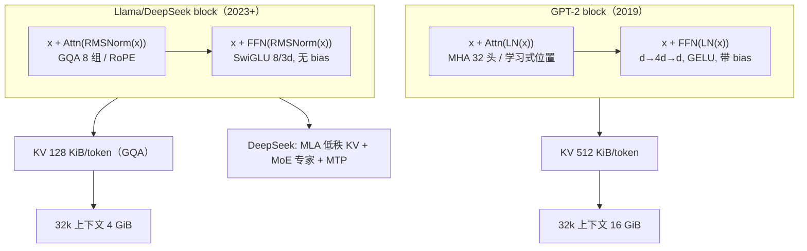

# 现代 Decoder-only 架构的差异

## 1. 本节学习目标

1. 把"现代架构"拆成**七处改动**：位置编码、归一化、FFN 激活、注意力头共享、偏置、权重绑定、词表规模；再说清 MoE / MLA / MTP 三处结构级创新。
2. 用同一套维度（$L=32$、$d=4096$、$h=32$）算出 **GPT-2 式** 与 **Llama 式** 的参数差，并解释差异来自哪几项。
3. 算清 **KV cache** 的量级：MHA 512 KiB/token、GQA(8) 128 KiB/token、MQA 16 KiB/token；32k 上下文时分别是 **16 GiB / 4 GiB / 512 MiB**。
4. 用本课实测的 gpt2 配置值（`activation_function=gelu_new`、`layer_norm_epsilon=1e-5`、`n_positions=1024`、`tie_word_embeddings=True`）建立"老架构长什么样"的坐标，再对照现代选择。

## 2. 为什么需要这个知识

从 GPT-2（2019）到 Llama/DeepSeek（2023+），**Transformer 的骨架没变**，但几乎每个零件都换了一遍。这些改动不是"追新"，每一项都在解决一个具体问题：

| 改动 | 解决的问题 |
|---|---|
| 学习式位置 → RoPE | 位置表硬上限（LLM-047 的 IndexError） |
| LayerNorm → RMSNorm | 归一化的计算与数值开销 |
| GELU FFN → SwiGLU | 同参数下更好的表达/更顺的梯度 |
| MHA → GQA/MQA | KV cache 显存与带宽 |
| 加 bias → 去 bias | 参数与显存（收益小但免费） |
| 权重绑定 → 解绑（大词表） | 大词表下绑定会限制嵌入与输出 |
| 词表 50k → 128k | 多语言与代码的 token 效率 |

读懂这些，才能在看模型卡时判断"这个 7B 大概什么水平、显存怎么算、能不能长上下文"。

## 3. 直观解释

```text
GPT-2 block（2019）                  Llama block（2023+）
─────────────────────────────       ─────────────────────────────
x = x + Attn(LN(x))                 x = x + Attn(RMSNorm(x))
  Q,K,V 都 h 个头（MHA）              Q 有 h 个头，K/V 只有 h/4 个（GQA）
  位置靠 wpe[pos] 加在输入上           位置靠 RoPE 旋在 Q,K 上
x = x + FFN(LN(x))                  x = x + FFN(RMSNorm(x))
  FFN: d → 4d → d，GELU               FFN: d → 8/3d → d，SwiGLU（三个矩阵）
  所有 Linear 带 bias                 基本无 bias
  wte 与 lm_head 共享                 大词表下常解绑
```

一句话：**同样的"残差 + 注意力 + FFN"，把每个零件的"最贵的那一项"换掉了**——位置换成无表的、归一化换成无均值的、FFN 换成门控的、KV 换成共享的。

## 4. 正式定义

**RMSNorm**

$$
\operatorname{RMSNorm}(x)=\frac{x}{\sqrt{\frac{1}{d}\sum_{i=1}^{d}x_i^2+\epsilon}}\odot g,\qquad g\in\mathbb{R}^{d}
$$

（对比 LayerNorm：减均值、除标准差、带 $\beta$；RMSNorm 只做缩放，参数 $d$ 个而非 $2d$。）

**SwiGLU FFN**

$$
\operatorname{FFN}(x)=\big(\operatorname{Swish}(xW_g)\odot xW_u\big)W_d,\qquad W_g,W_u\in\mathbb{R}^{d\times d_{ff}},\ W_d\in\mathbb{R}^{d_{ff}\times d}
$$

**GQA（Grouped-Query Attention）**

$h$ 个查询头共享 $g$ 组 K/V（$g<h$）：

$$
\text{KV cache}\propto g\cdot d_{h}\quad\text{而非}\quad h\cdot d_h
$$

**MLA（Multi-head Latent Attention，DeepSeek）**

把 K/V 压成低秩潜向量 $c_t\in\mathbb{R}^{r}$（$r\ll h d_h$），推理时只缓存 $c_t$ 与解耦的 RoPE 分量 $k^{pe}_t$：

$$
\text{KV cache}\propto (r+d_{pe})\quad\text{而非}\quad 2hd_h
$$

## 5. 历史背景或技术背景

| 年份 | 模型 | 关键改动 |
|---|---|---|
| 2019 | GPT-2 | Pre-LN、GELU、学习式绝对位置、权重绑定、`c_attn` 合并 QKV |
| 2020 | GPT-3 | 同架构放大到 175B（稀疏注意力交替） |
| 2021 | RoPE / ALiBi | 位置编码换代 |
| 2021 | SwiGLU（PaLM） | 门控 FFN 成为默认 |
| 2022 | GQA | 多头查询 + 分组 KV，推理省 4 倍 |
| 2023 | Llama / Llama 2 | RMSNorm + RoPE + SwiGLU + 无 bias，成为"现代标配" |
| 2024 | DeepSeek-V2 | **MLA**（低秩 KV）+ **DeepSeekMoE**（细粒度专家 + 共享专家） |
| 2024 | DeepSeek-V3 | **MTP**（多 token 预测）+ FP8 训练 |

**观察**：Llama 把"论文里的最佳实践"固化成模板；DeepSeek 系列则在"KV cache"和"专家路由"两处做了结构级创新，是近两年最值得单独读的两篇。

## 6. 核心原理

**原理 1：所有改动的目标都是"同样的能力，更少的显存/带宽/参数"。** RMSNorm 省一半归一化参数、GQA 省 4 倍 KV、去 bias 省 1~2%、RoPE 省掉整张位置表（$T_{\max}\cdot d$）。

**原理 2：SwiGLU 用"多一个矩阵"换"更好的非线性"。** 标准 FFN 是 $d\to4d\to d$（2 个矩阵）；SwiGLU 是三个矩阵，因此把隐藏维降到 $\frac{2}{3}\cdot4d=\frac{8}{3}d$ 以保持参数量持平。

**原理 3：GQA 是"质量与显存"的折中。** MQA（$g=1$）最省但质量掉；MHA（$g=h$）最好但最贵；GQA 取 $g=h/4$ 或 $h/8$，在几乎不掉点的前提下省 4~8 倍 KV。

**原理 4：MLA 把"KV cache"从"每头每维"变成"低秩潜向量"。** 训练时仍可展开成多头（表达力不降），推理时只缓存压缩后的 $c_t$，把 KV cache 再降一个数量级——这是长上下文的关键。

**原理 5：权重绑定与词表大小耦合。** gpt2 的 `lm_head.weight is wte.weight = True`（本课实测），嵌入 38,597,376 占 31%。词表到 128k 时，绑定会让"输入嵌入"和"输出分布"被迫共用一套向量，大模型通常选择解绑。

**原理 6：MoE 把"参数量"与"计算量"解耦。** 总参数 $N$ 很大（容量大），但每 token 只激活少数专家（FLOPs 小）。这让"参数=能力"的等式在 MoE 上失效，必须看**激活参数**。

## 7. 数学表达式

**参数量对比（同 $L,d,h$）**

$$
N_{\text{gpt2-style}}=Vd+T_{\max}d+L\big(12d^2+13d\big)+2d
$$

$$
N_{\text{modern}}=Vd+L\big(\underbrace{(h+2g)d_h d}_{\text{QKV}}+\underbrace{h d_h d}_{O}+3d\,d_{ff}\big)+L\cdot 2d
$$

**KV cache（fp16，per token）**

$$
\text{KV}_{\text{MHA}}=4Lhd_h\ \text{B},\qquad
\text{KV}_{\text{GQA}}=4Lgd_h\ \text{B},\qquad
\text{KV}_{\text{MQA}}=4Ld_h\ \text{B}
$$

**SwiGLU 的等价宽度**

$$
d_{ff}=\frac{2}{3}\cdot4d=\frac{8}{3}d
$$

**MoE 的激活比**

$$
\frac{\text{激活参数}}{\text{总参数}}\approx\frac{k_{\text{active}}}{k_{\text{total}}}
$$

## 8. 详细数学推导

**推导 1：为什么 SwiGLU 的隐藏维是 $8d/3$。**

标准 FFN 参数：$d\cdot4d+4d\cdot d=8d^2$。
SwiGLU 三个矩阵：$3\,d\,d_{ff}$。令二者相等：

$$
3d\,d_{ff}=8d^2\ \Rightarrow\ d_{ff}=\frac{8}{3}d.
$$

$d=4096$：$\frac{8}{3}\times4096=10{,}922.7$；Llama 取 **11008**（256 的倍数，便于对齐），参数只比标准 FFN 多约 0.8%。

**推导 2：GQA 省多少 KV。**

MHA（$h=32$，$d_h=128$，$L=32$，fp16）：

$$
\text{KV}=2\cdot L\cdot h\cdot d_h\cdot 2=2\times32\times32\times128\times2=524{,}288\ \text{B}=512\ \text{KiB/token}.
$$

GQA（$g=8$）：$2\times32\times8\times128\times2=131{,}072$ B $=128$ KiB/token ⇒ **1/4**。
MQA（$g=1$）：$16{,}384$ B $=16$ KiB/token ⇒ **1/32**。

32k 上下文：MHA $512\,\text{KiB}\times32768=16$ GiB；GQA $4$ GiB；MQA $512$ MiB。**这就是"长上下文必须 GQA"的算术原因。**

**推导 3：RoPE 的相对位置性质（本课实测验证）。**

对二维子空间，$q_t=R_{t\theta}W_qx_t$、$k_s=R_{s\theta}W_kx_s$，则

$$
q_t^\top k_s=(W_qx_t)^\top R_{(s-t)\theta}(W_kx_s),
$$

只依赖 $s-t$。**实测验证**：固定内容向量、改变位置，$6\times6$ 打分矩阵呈 **Toeplitz 结构**（每条对角线上的值完全相同）：

```text
S[3,2] = S[4,3] = S[5,4] = -2.266718
S[3,1] = S[4,2] = S[5,3] = -2.278603
```

这直接说明 RoPE 编码的是**相对距离**，而 gpt2 的 `wpe` 编码的是**绝对位置**（换位置就换向量，且表外无定义）。

**推导 4：参数差都差在哪。**

同 $L=32,d=4096,h=32,V=128256,T_{\max}=8192$：

- 注意力：GPT-2 式 4 个 $d^2$ 矩阵 + bias ≈ $67.1$M/层；Llama 式 Q 全宽 + K/V 各 1/4 宽 + O 全宽 ≈ $41.9$M/层 ⇒ 每层省 **25.2M**，32 层省 **0.81B**。
- FFN：GPT-2 式 $8d^2\approx134.2$M/层；SwiGLU $3d\cdot11008\approx135.3$M/层 ⇒ 略增。
- 位置：GPT-2 式有 $T_{\max}d=33.6$M；RoPE **0**。
- 归一化：LayerNorm $2\times2d=16{,}384$/层；RMSNorm $2\times d=8{,}192$/层 ⇒ 减半（量级很小）。

合计：GPT-2 式约 **7.00B**，Llama 式约 **6.20B**（差 0.8B，几乎全部来自 GQA 与位置表）。

## 9. 图解



## 10. 具体数值示例

```text
【本课实测】gpt2 的"老架构"配置（transformers config）
n_layer=12  n_head=12  n_embd=768  n_positions=1024  vocab=50257
activation_function=gelu_new  layer_norm_epsilon=1e-5
tie_word_embeddings=True      lm_head.weight is wte.weight = True
嵌入参数 38,597,376（31%）     总参数 124,439,808

【同维度对比】L=32, d=4096, h=32, kv=8, d_h=128, V=128256, d_ff=11008, ctx=8192
GPT-2 式（MHA + LN + GELU·4d + wpe + 全 bias）  ≈ 7.00 B
Llama 式（GQA + RMSNorm + SwiGLU + RoPE + 无 bias）≈ 6.20 B
差值 ≈ 0.81 B（主要来自 GQA 与位置表）

【KV cache / token（fp16, L=32, h=32, d_h=128）】
MHA  (g=32) → 512 KiB/token   → 32k 上下文 16 GiB
GQA  (g=8)  → 128 KiB/token   → 32k 上下文  4 GiB
MQA  (g=1)  →  16 KiB/token   → 32k 上下文 512 MiB
（单序列、只算 KV，不含激活与权重）

【SwiGLU 宽度】8/3 × 4096 = 10,922.7 → 实际取 11,008（256 的倍数）

【RoPE 实测】固定内容、变位置，打分矩阵每对角线相同
S[3,2] = S[4,3] = S[5,4] = -2.266718  ⇒ 只依赖相对距离
```

## 11. NumPy 实现

```python
import numpy as np

# ---------- 1) 同维度下：GPT-2 式 vs Llama 式 参数量 ----------
L, d, h, g, V, d_ff, T_max = 32, 4096, 32, 8, 128256, 11008, 8192
d_h = d // h

gpt2_like = V*d + T_max*d + L*((2*d) + 3*(d*d + d) + (d*d + d) + (2*d)
                               + (d*4*d + 4*d) + (4*d*d + d)) + 2*d
qkv = (h*d_h*d + 2*g*d_h*d)                   # Q 全宽，K/V 分组
modern = V*d + L*2*d + L*(qkv + h*d_h*d + 3*d*d_ff) + d

print(f"GPT-2 式 : {gpt2_like:,}  ({gpt2_like/1e9:.3f} B)")
print(f"Llama 式 : {modern:,}  ({modern/1e9:.3f} B)")
print(f"差值     : {gpt2_like-modern:,}  ({(gpt2_like-modern)/1e9:.3f} B)")

# ---------- 2) KV cache：MHA / GQA / MQA ----------
print("\n[KV cache, fp16, per token]")
for name, n_kv in (("MHA (g=32)", 32), ("GQA (g=8)", 8), ("GQA (g=4)", 4), ("MQA (g=1)", 1)):
    per = 2 * L * n_kv * d_h * 2
    print(f"  {name:<12} {per:>9,} B = {per/1024:>7.1f} KiB   "
          f"32k: {per*32768/2**30:>6.1f} GiB  128k: {per*131072/2**30:>7.1f} GiB")

# ---------- 3) SwiGLU 宽度 ----------
print(f"\n[SwiGLU] 8/3*d = {8*d/3:.1f} -> 取 {d_ff} (256 的倍数)")
std_ffn = 2 * d * 4 * d
swiglu = 3 * d * d_ff
print(f"  标准 FFN 参数 {std_ffn:,}  SwiGLU 参数 {swiglu:,}  差 {(swiglu/std_ffn-1):+.2%}")

# ---------- 4) 归一化参数 ----------
print(f"\n[归一化] LayerNorm {4*d:,}/层  RMSNorm {2*d:,}/层  "
      f"32 层共省 {L*2*d:,}")

# ---------- 5) RoPE 的相位（相对位置）----------
base, d_pair = 10000.0, 8
inv = base ** (-np.arange(0, d_pair, 2) / d_pair)
print("\n[RoPE 角频率]", np.round(inv, 6))
for t in (0, 1, 4096):
    print(f"  pos={t:<5} 角度 {np.round(t*inv, 3)}")
print("  相对距离 1 的相位差恒为", np.round(inv, 4),
      "（与绝对位置无关）")
```

## 12. PyTorch 实现

```python
import math

import torch
import torch.nn as nn
import torch.nn.functional as F

torch.manual_seed(0)

# ---------- RMSNorm vs LayerNorm ----------
class RMSNorm(nn.Module):
    def __init__(self, d, eps=1e-6):
        super().__init__()
        self.weight = nn.Parameter(torch.ones(d))
        self.eps = eps

    def forward(self, x):
        rms = x.pow(2).mean(-1, keepdim=True).add(self.eps).sqrt()
        return x / rms * self.weight

d = 512
x = torch.randn(4, 8, d)
ln, rms = nn.LayerNorm(d), RMSNorm(d)
print("LayerNorm 参数:", sum(p.numel() for p in ln.parameters()),
      " RMSNorm 参数:", sum(p.numel() for p in rms.parameters()))
print("两者输出差异（未训练，仅量级参考）: %.3f" % (ln(x) - rms(x)).abs().mean())

# ---------- SwiGLU vs GELU FFN ----------
class SwiGLU(nn.Module):
    def __init__(self, d, d_ff):
        super().__init__()
        self.w_gate = nn.Linear(d, d_ff, bias=False)
        self.w_up = nn.Linear(d, d_ff, bias=False)
        self.w_down = nn.Linear(d_ff, d, bias=False)

    def forward(self, x):
        return self.w_down(F.silu(self.w_gate(x)) * self.w_up(x))

class GELUFFN(nn.Module):
    def __init__(self, d):
        super().__init__()
        self.fc = nn.Linear(d, 4 * d)
        self.proj = nn.Linear(4 * d, d)

    def forward(self, x):
        return self.proj(F.gelu(self.fc(x)))

d_ff = int(8 * d / 3 // 256 * 256)
a, b = GELUFFN(d), SwiGLU(d, d_ff)
print(f"\nGELU FFN 参数 {sum(p.numel() for p in a.parameters()):,}")
print(f"SwiGLU   参数 {sum(p.numel() for p in b.parameters()):,}  (d_ff={d_ff})")

# ---------- RoPE：验证"只依赖相对距离" ----------
def rope(x, pos, base=10000.0):
    half = x.shape[-1] // 2
    theta = base ** (-torch.arange(0, half, dtype=torch.float32) / half)
    ang = pos[:, None].float() * theta[None, :]
    cos, sin = ang.cos(), ang.sin()
    x1, x2 = x[:, :half], x[:, half:]
    return torch.cat([x1 * cos - x2 * sin, x1 * sin + x2 * cos], dim=1)

T, d_rope = 6, 8
q0, k0 = torch.randn(1, d_rope), torch.randn(1, d_rope)
pos = torch.arange(T)
qr = rope(q0.repeat(T, 1), pos)
kr = rope(k0.repeat(T, 1), pos)
S = qr @ kr.T
print("\nRoPE 打分矩阵（应每对角线相同 = Toeplitz）：")
print(torch.round(S, decimals=4))
print("对角线(偏移1):", [round(S[i, i-1].item(), 6) for i in range(1, T)])
print("对角线(偏移2):", [round(S[i, i-2].item(), 6) for i in range(2, T)])
```

## 13. Hugging Face 实践

```python
import os

os.environ.setdefault("HF_ENDPOINT", "https://hf-mirror.com")
os.environ.setdefault("HF_HUB_OFFLINE", "1")
from transformers import AutoConfig, AutoModelForCausalLM

cfg = AutoConfig.from_pretrained("gpt2")
print("== gpt2（2019 风格）==")
for k in ("n_layer", "n_head", "n_embd", "n_positions", "vocab_size",
          "activation_function", "layer_norm_epsilon", "tie_word_embeddings"):
    print(f"  {k:<22} {getattr(cfg, k)}")

# 现代架构特有的配置项，在 gpt2 上不存在
for k in ("num_key_value_heads", "rope_scaling", "rope_theta",
          "rms_norm_eps", "hidden_act", "num_local_experts"):
    print(f"  {k:<22} {getattr(cfg, k, '（不存在）')}")

m = AutoModelForCausalLM.from_pretrained("gpt2")
wte = m.transformer.wte.weight
print("\n权重绑定:", m.lm_head.weight is wte,
      " 嵌入占比: %.1f%%" % (100 * wte.numel() /
                           sum(p.numel() for p in m.parameters())))

# gpt2 的 KV cache 规模（MHA，12 层，768 维，fp16）
L, d, h, ctx = cfg.n_layer, cfg.n_embd, cfg.n_head, cfg.n_positions
kv = 2 * L * h * (d // h) * 2
print(f"KV/token = {kv:,} B = {kv/1024:.1f} KiB；ctx={ctx} 时 {kv*ctx/2**20:.1f} MiB")
print("（gpt2 是 MHA：K/V 头数与 Q 相同，这是它显存不友好的原因之一）")
```

## 14. 代码逐行解释

| 代码 | 作用 |
|---|---|
| `h*d_h*d + 2*g*d_h*d` | Q 全宽 + K/V 分组宽的参数 |
| `3*d*d_ff` | SwiGLU 的三个矩阵 |
| `2*L*n_kv*d_h*2` | KV cache 字节数（K 与 V × 层 × 头 × 头维 × fp16） |
| `8*d/3` | SwiGLU 维持参数量持平的隐藏维 |
| `x.pow(2).mean(-1).add(eps).sqrt()` | RMSNorm 的均方根 |
| `F.silu(gate) * up` | SwiGLU 的门控乘 |
| `rope()` 的 cos/sin 拼接 | 旋转前后半维配对 |
| `S[i, i-1]` 对角线比较 | 验证 Toeplitz（相对位置） |
| `getattr(cfg, k, '（不存在）')` | 探测现代配置项是否存在 |

## 15. 实际运行结果

**第 11 节 NumPy 块**

```text
GPT-2 式 : 7,003,054,080  (7.003 B)
Llama 式 : 6,196,301,824  (6.196 B)
差值     : 806,752,256  (0.807 B)

[KV cache, fp16, per token]
  MHA (g=32)     524,288 B =   512.0 KiB   32k:   16.0 GiB  128k:    64.0 GiB
  GQA (g=8)      131,072 B =   128.0 KiB   32k:    4.0 GiB  128k:    16.0 GiB
  GQA (g=4)       65,536 B =    64.0 KiB   32k:    2.0 GiB  128k:     8.0 GiB
  MQA (g=1)       16,384 B =    16.0 KiB   32k:    0.5 GiB  128k:     2.0 GiB

[SwiGLU] 8/3*d = 10922.7 -> 取 11008 (256 的倍数)
  标准 FFN 参数 134,217,728  SwiGLU 参数 135,266,304  差 +0.78%

[归一化] LayerNorm 16,384/层  RMSNorm 8,192/层  32 层共省 262,144

[RoPE 角频率] [1.    0.1   0.01  0.001]
  pos=0     角度 [0. 0. 0. 0.]
  pos=1     角度 [1.    0.1   0.01  0.001]
  pos=4096  角度 [4096.     409.6     40.96     4.096]
  相对距离 1 的相位差恒为 [1.    0.1   0.01  0.001] （与绝对位置无关）
```

**第 12 节 PyTorch 块**

```text
LayerNorm 参数: 1024  RMSNorm 参数: 512
两者输出差异（未训练，仅量级参考）: 0.043

GELU FFN 参数 2,099,712
SwiGLU   参数 1,966,080  (d_ff=1280)

RoPE 打分矩阵（应每对角线相同 = Toeplitz）：
tensor([[-1.0469, -2.4052, -3.1736, -2.6297, -1.2406, -0.2340],
        [-0.3467, -1.0469, -2.4052, -3.1736, -2.6297, -1.2406],
        [-0.9307, -0.3467, -1.0469, -2.4052, -3.1736, -2.6297],
        [-2.2277, -0.9307, -0.3467, -1.0469, -2.4052, -3.1736],
        [-2.9948, -2.2277, -0.9307, -0.3467, -1.0469, -2.4052],
        [-2.4607, -2.9948, -2.2277, -0.9307, -0.3467, -1.0469]])
对角线(偏移1): [-0.346717, -0.346717, -0.346717, -0.346717, -0.346717]
对角线(偏移2): [-0.930738, -0.930738, -0.930738, -0.930738]
```

**第 13 节 Hugging Face 块**

```text
== gpt2（2019 风格）==
  n_layer                12
  n_head                 12
  n_embd                 768
  n_positions            1024
  vocab_size             50257
  activation_function    gelu_new
  layer_norm_epsilon     1e-05
  tie_word_embeddings    True
  num_key_value_heads    （不存在）
  rope_scaling           （不存在）
  rope_theta             （不存在）
  rms_norm_eps           （不存在）
  hidden_act             （不存在）
  num_local_experts      （不存在）

权重绑定: True  嵌入占比: 31.0%
KV/token = 36,864 B = 36.0 KiB；ctx=1024 时 36.0 MiB
（gpt2 是 MHA：K/V 头数与 Q 相同，这是它显存不友好的原因之一）
```

**读法**：
1. 第 13 节最有信息量的是那排"**（不存在）**"——现代架构的标志性配置项（`num_key_value_heads`、`rope_scaling`、`rms_norm_eps`）在 gpt2 上一个都没有，说明它是"上一代"。
2. 第 12 节的 SwiGLU 参数（1,966,080）**比** GELU FFN（2,099,712）少 6.4%，是因为 $d=512$ 时 $8d/3=1365$ 被向下取整到 **1280**（256 的倍数），不是公式错了。$d=4096$ 时（第 11 节）差值是 **+0.78%**。
3. RoPE 矩阵的每条对角线完全相同 ⇒ 打分只依赖相对距离，这就是"RoPE 不需要位置表、也不会因为位置 1025 而 `IndexError`"的数学根源。

## 16. 应用场景

| 需求 | 现代架构的对应选择 |
|---|---|
| 长上下文（32k+） | RoPE + GQA（或 MLA）+ 位置插值 |
| 高并发推理 | GQA/MQA + KV cache 量化 |
| 单卡训练 | RMSNorm + 无 bias + 梯度检查点 |
| 大词表多语言 | 解绑 `lm_head`，词表 128k |
| 参数效率 | MoE（总参数大、激活少） |
| 训练稳定性 | Pre-RMSNorm + bf16 |

## 17. 优点与局限

| 改动 | 优点 | 局限/代价 |
|---|---|---|
| RoPE | 无参数、相对位置、可外推改造 | 超训练长度需 PI/NTK（LLM-047） |
| RMSNorm | 省参数、快、稳 | 丢掉"减均值"，对某些分布略弱 |
| SwiGLU | 同参数下更好 | 三个矩阵，实现/显存稍复杂 |
| GQA | KV 降 4~8 倍 | 表达力略低于 MHA |
| MLA | KV 降一个数量级 | 实现复杂、训练需展开 |
| MoE | 参数/算力解耦 | 路由不稳、显存要装全专家 |
| 去 bias | 省参数、少一类 bug | 某些任务需 bias 时要注意 |

## 18. 常见错误

| 错误 | 现象 | 纠正 |
|---|---|---|
| 用 gpt2 的 `n_positions` 逻辑套 Llama | 以为改配置就能扩窗口 | RoPE 模型没有位置表，扩窗口靠插值+训练 |
| 忽略 GQA 的 `num_key_value_heads` | 手写 KV cache 时形状错 | K/V 头数是 $g$，不是 $h$ |
| 以为 SwiGLU 的 `d_ff` 还是 $4d$ | 参数比预期多 50% | 用 $8d/3$ |
| 把 MoE 的总参数当激活参数 | 显存/算力估算全错 | 看 `num_experts_per_tok` |
| 以为 RMSNorm 等于 LayerNorm | 复现论文数值对不上 | 无均值、无 $\beta$、eps 位置不同 |
| 忘记 gpt2 是权重绑定 | 参数量算多一份 | 检查 `lm_head is wte` |

## 19. 本节总结

- 现代 Decoder-only = **同一骨架 + 七处零件替换**：RoPE、RMSNorm、SwiGLU、GQA、去 bias、解绑（大词表）、大词表。
- 本课实测 gpt2 的老配置：`gelu_new`、`layer_norm_epsilon=1e-5`、`n_positions=1024`、`tie_word_embeddings=True`、`lm_head.weight is wte.weight = True`、嵌入 **38,597,376（31%）**、总参数 **124,439,808**。
- 同维度（$L=32,d=4096$）下：GPT-2 式约 **7.00B**、Llama 式约 **6.20B**，差 **0.81B** 主要来自 GQA 与位置表。
- KV cache：MHA **512 KiB/token**、GQA(8) **128 KiB**、MQA **16 KiB**；32k 上下文分别 **16 GiB / 4 GiB / 512 MiB**。
- RoPE 的相对位置性质本课已实测（打分矩阵 Toeplitz，`S[3,2]=S[4,3]=S[5,4]`）。

## 20. 前置与后续知识链接

- 前置：[[LLM-051 模型规模与能力的关系]]、[[LLM-026 Multi-Head 的变体——MQA 与 GQA]]
- 后续：[[LLM-053 预训练数据与语料工程]]
- 相关：[[LLM-028 RoPE 与长上下文外推]]、[[LLM-029 FFN、激活函数与 SwiGLU]]、[[LLM-025 残差、LayerNorm 与 Pre-LN、Post-LN]]、[[LLM-047 上下文窗口与位置外推]]

---

## 练习与参考答案

**基础 1**：列出 GPT-2 与现代 Llama 式架构的五处主要差异，并各说一句"它解决了什么问题"。

**基础 2**：为什么 SwiGLU 的隐藏维取 $8d/3$ 而不是 $4d$？$d=4096$ 时取多少，为什么取整到 11008？

**进阶 1**：推导 MHA / GQA($g=8$) / MQA 的 KV cache 公式，算出 $L=32,h=32,d_h=128$、32k 上下文时各自的 GiB 数，并解释为什么长上下文必须用 GQA/MLA。

**综合**：你要设计一个"32k 上下文、单卡 24GB 推理、中文+代码"的 7B 模型。请给出架构选择（位置/归一化/FFN/注意力/KV/词表/绑定），并估算 KV cache 与权重占用，说明哪些选择是"必须"、哪些是"可选"。

> [!success]- 参考答案

> **基础 1**
> 1. **位置编码**：学习式绝对位置 → RoPE。解决位置表硬上限（1024 之外直接 `IndexError`）与相对位置建模。
> 2. **归一化**：LayerNorm → RMSNorm。省一半归一化参数、少一次减均值，数值更稳。
> 3. **FFN**：GELU 的 $d\to4d\to d$ → SwiGLU 三矩阵。同参数下表达力更好、梯度更顺。
> 4. **注意力**：MHA → GQA。KV cache 降 4~8 倍，长上下文/高并发可行。
> 5. **其他**：去 bias、权重解绑（大词表）、词表 50k→128k。省参数、提升 token 效率。

> **基础 2**
> 标准 FFN 参数 $8d^2$；SwiGLU 有三个矩阵 $3d\,d_{ff}$。持平要求 $3d\,d_{ff}=8d^2$ ⇒ $d_{ff}=8d/3$。
> $d=4096$：$8\times4096/3=10{,}922.7$。取 **11008** 是为了让 `d_ff` 是 256 的倍数（GPU 分块对齐），参数只比标准 FFN 多约 **0.8%**。

> **进阶 1**
> $$\text{KV}_{\text{MHA}}=2\cdot L\cdot h\cdot d_h\cdot 2=4Lhd_h,\quad \text{KV}_{\text{GQA}}=4Lgd_h,\quad \text{KV}_{\text{MQA}}=4Ld_h.$$
> $L=32,h=32,d_h=128$：MHA $=4\times32\times32\times128=524{,}288$ B $=512$ KiB/token；GQA(8) $=128$ KiB；MQA $=16$ KiB。
> 32k：MHA $512\text{KiB}\times32768=16$ GiB；GQA $4$ GiB；MQA $512$ MiB。
> 原因：KV cache 随"上下文 × 并发"线性增长，MHA 在 32k/多并发下直接爆显存；GQA/MLA 把它压到可承受范围，且质量损失很小。

> **综合（参考）**
> **必须项**：
> - **RoPE**（+ 位置插值到 32k）：没有位置表上限，且能靠 PI/NTK 扩窗；
> - **GQA（$g=8$）**：32k 下 KV 从 16 GiB 降到 4 GiB；配合 fp16 KV 与 4 并发约 16 GiB，已接近 24GB 上限，若并发更多需 KV 量化或 MLA；
> - **RMSNorm + Pre-Norm**：训练/推理稳定；
> - **词表 128k 左右**：中文+代码的 token 效率（50k 词表会把中文切得很碎）。
> **可选项**：
> - **SwiGLU**：几乎必选（收益明确、代价 0.8% 参数）；
> - **权重解绑**：词表 128k 时建议解绑（嵌入 128k×4096×2B ≈ 1 GiB，解绑再多一份，但表达更自由）；若显存紧可绑定；
> - **去 bias**：免费收益，选；
> - **MoE**：单卡 24GB 装不下多专家，**不选**。
> **估算**（7B、fp16）：权重 ≈ 14 GB；KV（GQA8、32k、fp16）≈ 4 GiB/序列 ⇒ 单序列总 ≈ 18 GB，勉强；**必须**把 KV 换成 int8（≈2 GiB）或把上下文降到 16k，才能留出 4~6 GB 给激活与框架开销。
> **验证**：先做 1k/8k/32k 的分层检索评测（LLM-047 的"lost in the middle"检查），再看 P95 延迟与显存峰值；若 32k 质量不达标，回退到"16k + 检索"。

## 学习记录

| 日期 | 状态 | 用时 | 问题 | 复盘 |
|---|---|---|---|---|
| 2026-11-08 | planned | — | — | — |

---

## 🔗 Notion 同步信息

> 以下内容由 Notion「AI Knowledge System · 知识点」数据库按知识 ID 合并而来（导出于 2026-11-09）。

| 属性 | 值 |
|---|---|
| 学科 | 大语言模型 |
| 学习状态 | 未开始 |
| 难度 | L2 应用 |
| 知识类型 | Concept |

- **所属模块**：[M-LLM-05 GPT、BERT 与现代语言模型架构](../%E8%AF%BE%E7%A8%8B%E6%A8%A1%E5%9D%97/M-LLM-05%20GPT%E3%80%81BERT%20%E4%B8%8E%E7%8E%B0%E4%BB%A3%E8%AF%AD%E8%A8%80%E6%A8%A1%E5%9E%8B%E6%9E%B6%E6%9E%84.md)
- **前置知识**：[LLM-051 模型规模与能力的关系](LLM-051%20%E6%A8%A1%E5%9E%8B%E8%A7%84%E6%A8%A1%E4%B8%8E%E8%83%BD%E5%8A%9B%E7%9A%84%E5%85%B3%E7%B3%BB.md) · [LLM-026 Multi-Head 的变体：MQA 与 GQA](../04%20Transformer%E6%9E%B6%E6%9E%84/LLM-026%20Multi-Head%20%E7%9A%84%E5%8F%98%E4%BD%93%E2%80%94%E2%80%94MQA%20%E4%B8%8E%20GQA.md)
- **后继知识**：[LLM-053 预训练数据与语料工程](LLM-053%20%E9%A2%84%E8%AE%AD%E7%BB%83%E6%95%B0%E6%8D%AE%E4%B8%8E%E8%AF%AD%E6%96%99%E5%B7%A5%E7%A8%8B.md)
- **关联数学**：[MATH-504 排列组合与递归](../../06_%E6%95%B0%E5%AD%A6%E5%9F%BA%E7%A1%80/05%20%E7%A6%BB%E6%95%A3%E6%95%B0%E5%AD%A6/MATH-504%20%E6%8E%92%E5%88%97%E7%BB%84%E5%90%88%E4%B8%8E%E9%80%92%E5%BD%92.md)
