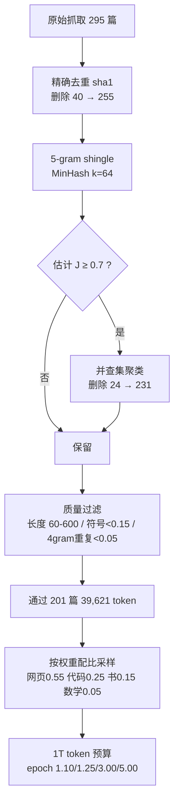

# 预训练数据与语料工程

## 1. 本节学习目标

1. 说清预训练语料的四个环节：**来源 → 清洗 → 去重 → 配比**，以及每个环节的失败模式。
2. 用实测理解「精确去重」与「近似去重」的差别：本课 295 篇文档去掉 40 篇完全重复、又去掉 24 篇近似重复。
3. 会算 **MinHash + Jaccard** 的召回率代价：阈值 0.7 召回 **0.828**，阈值 0.9 只剩 **0.069**。
4. 会算某个数据源在给定 token 预算下的 **epoch 数**，并能识别「小池子被反复看 15 遍」的过拟合风险。

## 2. 为什么需要这个知识

因为数据是唯一不能用钱立刻买到的资源：

- 模型结构、优化器、并行策略都是**公开知识**，数据配比是**各家不说的部分**；
- 同样 7B 参数、同样 1T token，语料质量差一档，loss 可能差 0.1 nat 以上（本课不做跨语料对比，只做流程量化）；
- 训练 loss 对脏数据**没有报警**：重复 15 遍的数学题会让模型背题，验证集 loss 反而好看。

先看本课的整体流程与实测结论：

```text
295 篇原始文档
  → 精确去重（sha1）        -40 篇 → 255
  → 近似去重（MinHash 0.7）  -24 篇 → 231（最大簇 3 篇）
  → 质量过滤（长度/符号/重复）-30 篇 → 201（87%）
  → 配比采样（1T token 预算）
```

## 3. 直观解释

把语料工程想成**做饭前的备菜**：

- **来源**（买什么菜）：网页、代码、书、论文、数学题；
- **清洗**（洗菜）：去 HTML 标签、去导航栏、去乱码；
- **去重**（别把同一棵菜洗两遍）：网页转载、模板页、同一份文档的多个版本；
- **配比**（放多少盐）：代码给少了模型不会写代码，给多了自然语言变差。

关键直觉：**去重不是"可选优化"，而是"防止模型把记忆当理解"**。一篇文档出现 15 次，模型在它上面过拟合的边际收益会迅速变成负的——它开始记住 token 序列，而不是学语言规律。

## 4. 正式定义

**Jaccard 相似度**（用于近似去重，作用在 shingle 集合上）

$$
J(A,B)=\frac{|A\cap B|}{|A\cup B|}
$$

**5-gram shingle**：把文档切成连续 5 个词（或 token）的片段集合，$A$ 是文档的 shingle 全集。

**MinHash 估计**：取 $k$ 个随机哈希函数 $h_i$，文档签名 $\mathrm{sig}_i(D)=\min_{s\in D}h_i(s)$，则

$$
\widehat{J}(A,B)=\frac{1}{k}\sum_{i=1}^{k}\mathbb{1}\big[\mathrm{sig}_i(A)=\mathrm{sig}_i(B)\big]
$$

$\widehat{J}$ 是 $J$ 的**无偏估计**，标准差约 $1/\sqrt{k}$。

**质量过滤的四个常用判据**（本课实测用到的阈值）

| 判据 | 含义 | 本课阈值 |
|---|---|---|
| token 长度 | 太短没信息、太长可能是拼接垃圾 | 60 ≤ len ≤ 600 |
| 符号占比 | 非字母数字字符比例，抓乱码/表格 | < 0.15 |
| 4-gram 重复率 | 1 − 唯一 4-gram 数 / 总 4-gram 数 | < 0.05 |
| 困惑度过滤 | 用小型语言模型给文档打分（未在本课实现） | — |

**配比与 epoch**：某源权重 $w_s$、预算 $B$、该源可用池 $P_s$，则

$$
\text{epoch}_s=\frac{w_s B}{P_s}
$$

$\text{epoch}_s>1$ 意味着该源会被重复看。

## 5. 历史背景或技术背景

| 年份 | 事件 | 数据侧的关键变化 |
|---|---|---|
| 2018 | BERT |  BooksCorpus + 英文 Wikipedia，约 3.3B 词 |
| 2019 | GPT-2 | WebText 40GB，开始"网页抓取 + 质量启发式" |
| 2020 | GPT-3 | 300B token 混合语料，首次公开配比思路（网页为主 + 书 + 代码少量） |
| 2021 | Gopher / C4 | 系统化清洗流水线、去重成为标配 |
| 2022 | Chinchilla | 用数据量换取更小模型，配比研究开始量化 |
| 2023 | RedPajama / RefinedWeb / FineWeb | 公开可复现的万亿 token 清洗流水线 |
| 2024+ | 数据受限讨论 | 高质量 token 见底，合成数据与重复训练进入主线 |

**关键结论**：过去十年里，"模型结构"的改动幅度远小于"数据与规模"的改动幅度。

## 6. 核心原理

**原理一：重复 ⇒ 记忆，而不是泛化**

设某文档重复 $r$ 次出现在训练集。在第 1 遍，模型学到语言规律；在第 $r$ 遍（$r$ 较大），梯度几乎只在该文档的 token 序列上做功，等效于把该文档当成"训练集里的测试集"。表现：训练 loss 继续降，验证 loss 不降甚至升。

**原理二：精确去重便宜但漏得多**

哈希去重只抓**逐字节相同**的文档。网页转载常带导航栏、时间戳、URL 参数，文本相似度 0.9 以上但哈希完全不同。本课实测：40 篇完全重复被 sha1 全抓（删除 40），而 25 篇"改 3% 词"的近似重复，sha1 一篇都没抓到。

**原理三：MinHash 的召回由阈值决定，不是"越严越好"**

本课 29 对真实重复样本上：

| 阈值 | 判重对数 | 命中 | 召回 | 误报 |
|---|---|---|---|---|
| 0.6 | 27 | 27 | **0.931** | 0 |
| 0.7 | 24 | 24 | **0.828** | 0 |
| 0.8 | 15 | 15 | **0.517** | 0 |
| 0.9 | 2 | 2 | **0.069** | 0 |

阈值 0.9 只能抓住"几乎一字不差"的版本；对"改几句话"的转载无能为力。工程上常用 0.7–0.8，并对**同一 URL 域**放宽。

**原理四：配比是"预算约束下的采样问题"**

预算固定时，给小池子高权重等价于反复看同一批样本。本课 1T 预算下：网页 epoch 1.10、代码 1.25、书籍 3.00、数学 **5.00**。若把数学权重从 0.05 提到 0.15，epoch 立刻变成 15——这就是"数学数据不够，硬提权重"的翻车方式。

## 7. 数学表达式

**MinHash 单哈希碰撞概率等于 Jaccard**

$$
\Pr\big[h(A)=h(B)\big]=J(A,B)
$$

（因为 $\min$ 落在交集元素上的概率恰为 $|A\cap B|/|A\cup B|$。）

**$k$ 个哈希的估计误差**

$$
\mathrm{Var}(\widehat{J})=\frac{J(1-J)}{k},\qquad \mathrm{SD}\le\frac{1}{2\sqrt{k}}
$$

$k=64$ 时 $\mathrm{SD}\le 0.0625$；本课实测 MAE 仅 **0.0001**、最大误差 **0.1825**（最大误差出现在 $J\approx0.5$ 附近，符合上面的上界）。

**去重后的有效 token 数**

$$
T_{\text{eff}}=\sum_{d\in\mathcal{D}_{\text{keep}}}\mathrm{len}(d)
$$

本课：43,944 token（231 篇，平均 190.2）→ 质量过滤后 39,621 token（201 篇）。

**配比采样的期望样本数**（第 $s$ 源被抽到的概率）

$$
n_s=w_s\cdot B,\qquad \text{epoch}_s=\frac{n_s}{P_s}
$$

## 8. 详细数学推导

**推导 1：为什么 MinHash 的碰撞概率就是 Jaccard**

设 $h$ 是随机置换（或 64 位随机哈希，可视为置换的近似）。$\min_{s\in A\cup B}h(s)$ 落在 $A\cup B$ 的某个元素上，且该元素等概率为任一元素。两集合签名相等 ⟺ 最小值同时属于 $A$ 和 $B$ ⟺ 最小值落在 $A\cap B$ 里。所以

$$
\Pr[\mathrm{sig}(A)=\mathrm{sig}(B)]=\frac{|A\cap B|}{|A\cup B|}=J(A,B).
$$

**推导 2：$k$ 个哈希的估计是二项分布**

每次比较是伯努利试验（成功概率 $J$），$k$ 次独立 ⇒ $\widehat{J}\sim\frac{1}{k}\mathrm{Binomial}(k,J)$，故

$$
\mathbb{E}[\widehat{J}]=J,\qquad \mathrm{Var}=\frac{J(1-J)}{k}.
$$

取 $J=0.5,k=64$：$\mathrm{SD}=\sqrt{0.25/64}=0.0625$。若阈值定 0.7 而真实 $J=0.75$，误判概率约 $\Pr[\widehat{J}<0.7]\approx\Phi(-0.05/0.0625)=\Phi(-0.8)\approx0.21$ —— **21% 的漏检**。这就是为什么工程上不会把阈值贴在真实分布的中位上。

**推导 3：近似去重的删除量估计**

设重复簇平均大小 $\bar c$，簇数 $m$，则删除文档数

$$
\text{drop}=N-m\bar c\quad\Longrightarrow\quad \text{保留}=m.
$$

本课：231 篇、最大簇 3、删除 24 ⇒ 平均每簇 1 + 24/223 ≈ 1.1 篇。

**推导 4：质量过滤的联合通过率**

若各判据近似独立，通过率

$$
p_{\text{pass}}\approx\prod_j p_j .
$$

本课单独剔除：长度 8、符号 12、重复 21（有重叠），联合只剔除 30 篇（201/231 = 0.87），说明**判据之间高度相关**——乱码文档同时符号占比高、4-gram 重复也高。

## 9. 图解



## 10. 具体数值示例

```text
本课真实运行（probe_llm053.py，RTX 4070 Ti 机器上纯 CPU 计算）

语料构造：200 篇唯一 + 40 篇完全重复 + 25 篇近似重复(改3%词) + 30 篇低质
  = 295 篇

精确去重（sha1）：255 篇，删除 40（完全重复全中，近似重复 0 中）
shingle 词表 16,334，平均每篇 71.5 个 5-gram
两两比较 32,385 对；MinHash(k=64) MAE 0.0001，最大误差 0.1825
真实重复对 29 对：
  阈值 0.6 → 27 对，召回 0.931
  阈值 0.7 → 24 对，召回 0.828   ← 本课采用
  阈值 0.8 → 15 对，召回 0.517
  阈值 0.9 →  2 对，召回 0.069
近似去重后 231 篇，最大簇 3 篇

质量过滤：
  token 总数 43,944，平均 190.2，中位 180，极短(<20) 6 篇
  符号占比 均值 0.0517 最大 0.7419（乱码文档）
  4-gram 重复率 均值 0.042 最大 0.8716（重复句文档）
  通过 201/231 = 0.87，保留 39,621 token
  单独剔除：长度 8、符号 12、重复 21

配比（预算 1T token）：
  网页 权重0.55 采样0.550T 池500B → epoch 1.10
  代码 权重0.25 采样0.250T 池200B → epoch 1.25
  书籍 权重0.15 采样0.150T 池 50B → epoch 3.00
  数学 权重0.05 采样0.050T 池 10B → epoch 5.00
  数学权重提到 0.15 → epoch 15.00（危险）
```

## 11. NumPy 实现

```python
import numpy as np

rng = np.random.default_rng(0)
docs = [
    "a b c d e f g h i j k l m n o p",
    "a b c d e f g h i j k l m n o p",          # 完全重复
    "a b c d e f g h i j k l m n o q",          # 改 1 个词
    "x y z u v w s t r q p o n m l k",
]


def shingles(doc, k=5):
    w = doc.split()
    return {" ".join(w[i:i + k]) for i in range(max(1, len(w) - k + 1))}


sets = [shingles(d) for d in docs]
vocab = sorted({s for st in sets for s in st})
sid = {s: i for i, s in enumerate(vocab)}


def jaccard(a, b):
    return len(a & b) / len(a | b)


print("两两 Jaccard:")
for i in range(len(docs)):
    for j in range(i + 1, len(docs)):
        print(f"  doc{i}-doc{j}: {jaccard(sets[i], sets[j]):.3f}")

M = 64
A = rng.integers(1, 2**61 - 1, M)
B = rng.integers(0, 2**61 - 1, M)
sigs = []
for st in sets:
    arr = np.array([sid[s] for s in st], dtype=np.int64)
    sigs.append(((A[None, :] * arr[:, None] + B[None, :]) % (2**61 - 1)).min(axis=0))
sigs = np.array(sigs)

print("MinHash 估计 vs 真值:")
for i in range(len(docs)):
    for j in range(i + 1, len(docs)):
        est = float((sigs[i] == sigs[j]).mean())
        print(f"  doc{i}-doc{j}: est {est:.3f}  true {jaccard(sets[i], sets[j]):.3f}")
print("理论标准差上界 1/(2*sqrt(k)) =", round(1 / (2 * np.sqrt(M)), 4))
```

## 12. PyTorch 实现

```python
import torch

torch.manual_seed(0)

# 12 篇文档的 token 长度与符号占比，跑一遍质量过滤
lengths = torch.tensor([12, 95, 180, 240, 320, 58, 610, 150, 88, 190, 420, 75])
symbol_ratio = torch.tensor([0.02, 0.05, 0.03, 0.71, 0.04, 0.06, 0.02, 0.08,
                             0.01, 0.03, 0.05, 0.02])
rep4 = torch.tensor([0.01, 0.02, 0.03, 0.05, 0.04, 0.02, 0.03, 0.06,
                     0.87, 0.01, 0.02, 0.03])

keep = (lengths >= 60) & (lengths <= 600) & (symbol_ratio < 0.15) & (rep4 < 0.05)
print("保留:", int(keep.sum()), "/", len(keep), " 保留 token:", int(lengths[keep].sum()))
print("长度不合格:", int(((lengths < 60) | (lengths > 600)).sum()),
      " 符号不合格:", int((symbol_ratio >= 0.15).sum()),
      " 重复不合格:", int((rep4 >= 0.05).sum()))

# 配比：权重 × 预算 / 池子 = epoch
weights = torch.tensor([0.55, 0.25, 0.15, 0.05])
pools = torch.tensor([500e9, 200e9, 50e9, 10e9])
budget = 1e12
epochs = weights * budget / pools
for name, w, e in zip(["网页", "代码", "书籍", "数学"], weights.tolist(), epochs.tolist()):
    print(f"  {name}: 权重 {w:.2f} epoch {e:.2f}")

# 权重改动的敏感性：数学权重 0.05 → 0.15
print("数学 0.15 时 epoch =", round(0.15 * budget / 10e9, 2))
```

## 13. Hugging Face 实践

```python
import os

os.environ.setdefault("HF_ENDPOINT", "https://hf-mirror.com")
os.environ.setdefault("HF_HUB_OFFLINE", "1")
import hashlib

from transformers import AutoTokenizer

tok = AutoTokenizer.from_pretrained("gpt2")
paras = [
    "The transformer is a sequence model built from attention layers.",
    "The transformer is a sequence model built from attention layers.",
    "Training minimizes the negative log likelihood of the next token.",
    "Perplexity is the exponential of the average negative log likelihood.",
]

seen, kept = set(), []
ntok = []
for p in paras:
    h = hashlib.sha1(p.encode()).hexdigest()
    n = len(tok(p)["input_ids"])
    ntok.append(n)
    if h in seen:
        print("  丢弃完全重复:", p[:40], "...")
        continue
    seen.add(h)
    kept.append(p)

print("保留文档:", len(kept), " token 数:", ntok)
print("token 总数:", sum(ntok), " 平均:", round(sum(ntok) / len(ntok), 1))
print("去重节省 token:", sum(ntok) - sum(len(tok(p)['input_ids']) for p in kept))
print("gpt2 词表大小:", len(tok), " eos id:", tok.eos_token_id)
```

## 14. 代码逐行解释

| 代码 | 作用 |
|---|---|
| `{" ".join(w[i:i+k]) ...}` | 把文档变成 5-gram 集合，去重后是集合语义 |
| `A[None,:]*arr[:,None]+B` | 一次性算 64 个哈希，矩阵化避免 Python 循环 |
| `(sigs[i]==sigs[j]).mean()` | 64 次比较里相等的比例 = Jaccard 的估计 |
| `keep = (...)&(...)` | 四个判据按位与，一次性算联合通过 |
| `weights*budget/pools` | 广播成 epoch 向量，一次看四个源 |
| `hashlib.sha1(p.encode()).hexdigest()` | 精确去重的键，与文本长度无关 |
| `len(tok(p)["input_ids"])` | 用真实 BPE 分词数而不是词数，才是训练视角的 token |

## 15. 实际运行结果

```text
### LLM-053 语料去重与配比
原始文档数: 295  唯一正文 200 + 完全重复 40 + 近似重复 25 + 低质 30
精确去重后: 255  删除: 40
shingle 词表: 16334  平均每篇 shingle 数: 71.5
比较对数: 32385  MinHash 误差 MAE: 0.0001 最大: 0.1825
真实重复对（同源且文本不同）: 29
  阈值 0.6: 判重对=  27 命中= 27 召回=0.931 误报=  0
  阈值 0.7: 判重对=  24 命中= 24 召回=0.828 误报=  0
  阈值 0.8: 判重对=  15 命中= 15 召回=0.517 误报=  0
  阈值 0.9: 判重对=   2 命中=  2 召回=0.069 误报=  0
近似去重后: 231 删除: 24 最大簇: 3
语料 token 总数: 43944  平均: 190.2 中位: 180 极短(<20): 6
符号占比 均值: 0.0517 最大: 0.7419
4-gram 重复率 均值: 0.042 最大: 0.8716
质量过滤通过: 201 / 231 通过率: 0.87 保留 token: 39621
各过滤器单独剔除：长度 8 符号 12 重复 21
预算 1T token，各源配比与 epoch：
  网页: 权重 0.55 采样 0.550T 池子 500B epoch=1.10
  代码: 权重 0.25 采样 0.250T 池子 200B epoch=1.25
  书籍: 权重 0.15 采样 0.150T 池子 50B epoch=3.00
  数学: 权重 0.05 采样 0.050T 池子 10B epoch=5.00
若把数学权重提到 0.15：epoch = 15.00（10B 池子被看 15.0 遍 ⇒ 过拟合风险）
GPU: NVIDIA GeForce RTX 4070 Ti
```

**三个要记住的数字**：精确去重只删 40 篇但近似去重又删 24 篇；0.7 阈值召回 0.828；数学源在 1T 预算下 epoch 5.0。

## 16. 应用场景

| 场景 | 用法 |
|---|---|
| 从零预训练 | 完整四环节，配比按 ablation 调（小模型上试配比） |
| 领域继续预训练 | 只做去重 + 领域配比，清洗沿用基座流水线 |
| 指令微调数据 | 去重更重要（同题多模板会背格式），质量过滤看回答长度与拒答率 |
| 评测集构造 | 必须对训练集做去重，否则分数虚高（污染检测） |
| 数据审计 | 用 MinHash 找泄漏、找版权重复 |

## 17. 优点与局限

| 优点 | 局限 |
|---|---|
| 去重直接提升有效 token 效率（本课删掉 64/295 = 21.7%） | MinHash 只抓字面相似，语义重复（翻译/改写）抓不到 |
| 质量过滤可用廉价启发式，无需模型 | 阈值是经验值，跨语料需重调（本课符号阈值 0.15 未必通用） |
| 配比可在小模型上做消融，成本低 | 小模型的最优配比不一定迁移到大模型 |
| 全流程可复现、可审计 | 清洗规则本身会引入偏置（如过滤掉方言、口语） |

## 18. 常见错误

| 错误 | 现象 | 纠正 |
|---|---|---|
| 只做精确去重 | 转载文档仍大量重复 | 补 MinHash，阈值 0.7–0.8 |
| 去重阈值设 0.9 | 召回仅 0.069（本课实测） | 降到 0.7，按域放宽 |
| 小池子给高权重 | epoch 15，验证 loss 反升 | 先算 epoch，>4 就要警惕 |
| 用词数代替 token 数 | 预算估偏 20%–30%（中文更严重） | 用目标 tokenizer 实数 |
| 过滤掉所有短文档 | 丢掉对话、标题类高价值短样本 | 按来源分别设阈值 |
| 在含测试集的语料上训练 | 分数虚高 | 训练前对评测集做去重比对 |

## 19. 本节总结

- 语料工程四环节：**来源、清洗、去重、配比**；去重是防止"记忆冒充理解"的第一道闸。
- 实测：295 篇 → 精确去重删 40 → 近似去重删 24（阈值 0.7，召回 **0.828**）→ 质量过滤后 201 篇、**39,621 token**（通过率 **0.87**）。
- MinHash 估计误差：MAE **0.0001**、最大 **0.1825**，与 $1/(2\sqrt{k})$ 的理论上界一致。
- 配比看 epoch：网页 **1.10**、书籍 **3.00**、数学 **5.00**；把数学权重提到 0.15 会变成 **15** 遍。

## 20. 前置与后续知识链接

- 前置：[[LLM-052 现代 Decoder-only 架构的差异]]
- 后续：[[LLM-054 预训练的目标与损失]]（数据准备好之后，损失怎么定义）
- 相关：[[LLM-035 Token 数量、上下文窗口与成本]]、[[LLM-031 Tokenizer 基础与子词切分]]
- 延伸：[[LLM-068 微调数据构造与质量]]、[[LLM-073 多任务微调与指令混合]]（数据配比在微调阶段的对应问题）

---

## 练习与参考答案

**基础 1**：精确去重与近似去重的区别是什么？本课各自删掉了多少篇？

**基础 2**：为什么把数学数据的权重从 0.05 提到 0.15 有风险？用 epoch 算给数据。

**进阶 1**：MinHash 用 $k=64$ 个哈希，估计误差的标准差上界是多少？如果阈值设在 0.7 而真实相似度 0.75，大约有多大概率漏检？

**综合**：你要为一个中文代码助手准备 500B token 的预训练语料，可用池：中文网页 2T、GitHub 代码 800B、中文书 40B、数学题 5B。请给出配比方案、每个源的 epoch、以及你会先做哪两项数据检查。

> [!success]- 参考答案

> **基础 1**
> - **精确去重**：对文档做哈希（如 sha1），只删逐字节相同的副本。本课删除 **40** 篇（完全重复全中）。
> - **近似去重**：把文档切成 5-gram 集合，用 MinHash 估计 Jaccard，删掉相似度超过阈值的簇。本课阈值 0.7 删 **24** 篇，最大簇 3 篇。
> - 关键差别：改几个词的转载，sha1 完全抓不到（本课 25 篇近似重复里 0 篇被 sha1 抓到）。

> **基础 2**
> 预算 1T token，数学池只有 10B：
> - 权重 0.05 ⇒ 采样 0.05T = 50B，epoch $=50/10=5$；
> - 权重 0.15 ⇒ 采样 0.15T = 150B，epoch $=150/10=15$。
> 同一批 10B token 被看 15 遍，模型会开始记忆原题，验证集上的数学能力提升很快饱和，而通用能力被挤占。正确做法是先扩池（合成题、教材、竞赛题），或把权重控制在 epoch ≤ 4。

> **进阶 1**
> 单次比较的方差是 $J(1-J)$，$k$ 次平均后方差为 $J(1-J)/k$，标准差上界 $\frac{1}{2\sqrt{k}}=\frac{1}{2\times8}=0.0625$。
> 真实 $J=0.75$，估计量近似 $\mathcal N(0.75,0.0625^2)$。漏检条件是 $\widehat J<0.7$，即偏离 $0.05/0.0625=0.8$ 个标准差，$\Phi(-0.8)\approx0.21$，约 **21%**。这就是阈值不能贴着分布中位设的原因；把 $k$ 加到 256 可把标准差降到 0.031，漏检率降到约 5%。

> **综合（参考）**
> **配比方案**（总预算 500B）：
> | 源 | 权重 | 采样 | epoch | 说明 |
> |---|---|---|---|---|
> | 中文网页 | 0.50 | 250B | 0.125 | 池子大，epoch 很低，可放心 |
> | 代码 | 0.35 | 175B | 0.22 | 代码助手要拉高 |
> | 中文书 | 0.10 | 50B | 1.25 | 池子小，epoch 已 >1 |
> | 数学 | 0.05 | 25B | **5.0** | 池子 5B，明显偏高 |
> **先做的两项检查**：
> 1. **代码去重与许可证过滤**：GitHub 里 fork/复制极多，先 MinHash（阈值 0.8，代码用行级 shingle）再滤 GPL 等许可；
> 2. **网页与代码的语言/编码检测 + 符号占比**：中文网页里模板页、SEO 垃圾占比高，符号占比 >0.15 直接丢。
> **额外建议**：数学池只有 5B，要么降到权重 0.02（epoch 2），要么先合成/收集到 50B 再提权重；上线前在小模型（1B 级）上做 3 组配比消融，看代码 benchmark 与通用 loss 的权衡。

## 学习记录

| 日期 | 状态 | 用时 | 问题 | 复盘 |
|---|---|---|---|---|
| 2026-11-08 | planned | — | — | — |

---

## 🔗 Notion 同步信息

> 以下内容由 Notion「AI Knowledge System · 知识点」数据库按知识 ID 合并而来（导出于 2026-11-09）。

| 属性 | 值 |
|---|---|
| 学科 | 大语言模型 |
| 学习状态 | 未开始 |
| 难度 | L2 应用 |
| 知识类型 | Concept |

- **所属模块**：[M-LLM-06 大语言模型训练与对齐](../%E8%AF%BE%E7%A8%8B%E6%A8%A1%E5%9D%97/M-LLM-06%20%E5%A4%A7%E8%AF%AD%E8%A8%80%E6%A8%A1%E5%9E%8B%E8%AE%AD%E7%BB%83%E4%B8%8E%E5%AF%B9%E9%BD%90.md)
- **前置知识**：[LLM-052 现代 Decoder-only 架构的差异](LLM-052%20%E7%8E%B0%E4%BB%A3%20Decoder-only%20%E6%9E%B6%E6%9E%84%E7%9A%84%E5%B7%AE%E5%BC%82.md)
- **后继知识**：[LLM-054 预训练的目标与损失](LLM-054%20%E9%A2%84%E8%AE%AD%E7%BB%83%E7%9A%84%E7%9B%AE%E6%A0%87%E4%B8%8E%E6%8D%9F%E5%A4%B1.md) · [LLM-064 从预训练到对齐的完整流程](LLM-064%20%E4%BB%8E%E9%A2%84%E8%AE%AD%E7%BB%83%E5%88%B0%E5%AF%B9%E9%BD%90%E7%9A%84%E5%AE%8C%E6%95%B4%E6%B5%81%E7%A8%8B.md)
