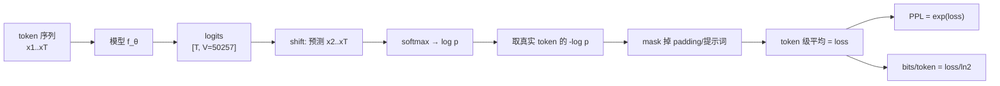

# 预训练的目标与损失

## 1. 本节学习目标

1. 写出因果语言模型（CLM）的损失，并说明**为什么是 token 级平均而不是序列级平均**。
2. 手推交叉熵对 logits 的梯度：$\partial L/\partial z=\mathrm{softmax}(z)-e_y$，并验证与 PyTorch 一致。
3. 会换算 loss ↔ PPL ↔ bits/token；本课 gpt2 实测 loss **4.1713** ⇒ PPL **64.80** ⇒ **6.018 bit/token**。
4. 说清 label smoothing 为什么把 loss 下界从 0 抬到 $\varepsilon\ln V$（本课 **0.2303**，PPL 下界 **1.2589**）。

## 2. 为什么需要这个知识

因为训练全程你只盯着一个数：loss。

- loss 降不动了，你要判断是**数据不够**、**模型太小**、还是**lr 不合适**；
- 有人报 "PPL 3.2"，你得知道这对应哪个词表、哪种平均方式，否则不可比；
- 做 SFT/DPO 时，同一套交叉熵被掩码、被加权，理解底层才不会写错。

一句话：**loss 是唯一贯穿预训练、SFT、RLHF 的通用货币。**

## 3. 直观解释

语言模型做的是"看完前 $t-1$ 个 token，给第 $t$ 个 token 打分"：

```text
输入:  A language model is trained to predict the next
目标:       language model is trained to predict the next token
```

每个位置都产生一个 50257 维的打分（logits），softmax 后是概率，取真实 token 那一项的概率密度，取 $-\log$ 就是该位置的损失。

**直觉**：loss 是"模型对正确答案的惊讶程度"；PPL 是"模型平均在多少个词里犹豫"。本课 gpt2 在 203 token 的英文段落上 loss 4.1713 ⇒ 相当于在 64.8 个词里犹豫，而瞎猜要在 50257 个词里犹豫（loss 10.8249）。

## 4. 正式定义

**因果语言模型的目标**（对一条长度 $T$ 的序列 $x_{1:T}$）

$$
L(\theta)=-\frac{1}{T-1}\sum_{t=2}^{T}\log p_\theta(x_t\mid x_{<t})
$$

**困惑度**

$$
\mathrm{PPL}=\exp(L)
$$

**每 token 比特数**

$$
\text{bits/token}=\frac{L}{\ln 2}
$$

**带 label smoothing 的目标**（$\varepsilon\in[0,1)$，$V$ 为词表大小）

$$
L_\varepsilon=-\sum_{k=1}^{V}q_k\log p_k,\qquad
q_k=\begin{cases}1-\varepsilon+\varepsilon/V,&k=y\\ \varepsilon/V,&k\neq y\end{cases}
$$

**两种 reduction**

$$
L_{\text{token}}=\frac{1}{\sum_i m_i}\sum_i m_i\,\ell_i,\qquad
L_{\text{seq}}=\frac{1}{N}\sum_{n=1}^{N}\Big(\frac{1}{T_n}\sum_t \ell_{n,t}\Big)
$$

$m_i$ 是有效 token 掩码（padding/提示词位置为 0）。

## 5. 历史背景或技术背景

| 年份 | 事件 | 与损失相关的要点 |
|---|---|---|
| 1948 | Shannon | 用 $-\log p$ 度量信息量，bit 的定义来源 |
| 1951 | Kullback–Leibler | 交叉熵 = 熵 + KL，解释"多余惊讶" |
| 2003 | Bengio 神经语言模型 | 首次用交叉熵端到端训练 LM |
| 2018 | GPT/BERT | CLM 与 MLM 两种目标并存（MLM 只在被遮位置算损失） |
| 2020 | GPT-3 | 报告 loss 而非 PPL，因为 PPL 依赖分词 |
| 2022+ | Chinchilla 等 | 用 loss（nat/token）做 scaling law 拟合 |
| 2023+ | 指令微调 | 掩码损失（只在回答段算）成为标准做法 |

**关键点**：PPL 在词表不同时不可比。同一条文本，gpt2 的 50257 词表与某中文模型 10 万词表算出的 PPL 完全不同。跨模型比较请用 **bits/byte** 或直接看下游指标。

## 6. 核心原理

**原理一：token 级平均 ≠ 序列级平均**

本课实测：两条长度 8 与 24 的序列，token 平均 **2.605606**，序列平均 **2.659333**，差 **0.053727**。原因：序列平均给短序列更大权重（8 token 的序列每条占 1/2 权重，而它只提供 8/32 的 token）。**预训练一律用 token 级平均**，否则长文档被系统性低估。

**原理二：PPL 与 loss 是单调一一对应**

$$
\mathrm{PPL}=e^{L}
$$

所以"loss 降 0.1"在不同区间意味着不同的 PPL 变化：loss 4.17→4.07，PPL 64.8→58.6（−9.6%）；loss 1.0→0.9，PPL 2.72→2.46（−9.6%）。**相对变化一样，绝对差不一样。**

**原理三：位置越靠后越好预测**

本课实测前 32 token loss **4.4324**、前 64 **4.1937**、前 128 **4.1816**。开头缺上下文，模型只能靠先验；越往后可用信息越多。这也是"文档拼接"要注意的：把不相关文档直接拼在一起，会让拼接点之后的位置变难。

**原理四：噪声下限与平滑下限**

- 数据本身有随机性 ⇒ loss 有**噪声下限**，压不下去；
- label smoothing 主动把下界抬高：当模型完全正确时 $L_\varepsilon\to\varepsilon\ln V$，本课 $V=10,\varepsilon=0.1$ ⇒ **0.230259**，PPL 下界 **1.2589**；
- 实测平滑后 loss 从 **2.411742** 升到 **2.433872**（+0.02213），与"接近下界时被抬高"的预期一致。

## 7. 数学表达式

**交叉熵与 KL 的关系**

$$
H(p,q)=H(p)+\mathrm{KL}(p\|q)\ \ge\ H(p)
$$

真实分布 $p$ 是 one-hot 时 $H(p)=0$，交叉熵就是 $-\log q_y$。

**softmax 与 logits**

$$
p_k=\frac{e^{z_k}}{\sum_j e^{z_j}},\qquad \log p_k=z_k-\log\sum_j e^{z_j}
$$

**梯度**

$$
\frac{\partial L}{\partial z_k}=p_k-\mathbb{1}[k=y]
$$

**批量损失**

$$
L=\frac{1}{\sum_{n,t}m_{n,t}}\sum_{n,t}m_{n,t}\Big(-\log p_\theta(x_{n,t}\mid x_{n,<t})\Big)
$$

## 8. 详细数学推导

**推导 1：梯度公式**

单样本 $L=-\log p_y=-\big(z_y-\log\sum_j e^{z_j}\big)$。

对 $z_k$ 求导：

$$
\frac{\partial L}{\partial z_k}=-\mathbb{1}[k=y]+\frac{e^{z_k}}{\sum_j e^{z_j}}=p_k-\mathbb{1}[k=y].
$$

性质：$\sum_k \partial L/\partial z_k=1-1=0$，即梯度**只在 logits 的相对差值上有意义**（整体平移 logits 不改变 loss）。这也是为什么 softmax 前加常数不影响训练。

**推导 2：为什么初始 loss 是 $\ln V$**

随机初始化时 logits 近似 0（或小随机数），softmax 近似均匀 $p_k\approx1/V$，于是

$$
L\approx-\log(1/V)=\ln V.
$$

本课 $V=50257$：$\ln 50257=\mathbf{10.8249}$。probe 里 tiny-gpt2 的初始 loss 实测 **10.8250**，与此吻合到小数点后三位——这是检查"模型是否正确初始化"的最快手段。

**推导 3：PPL 的语义**

若模型对每个 token 的平均惊讶是 $L$ nat，则等效于在 $e^L$ 个等概率选项里猜。$L=4.1713\Rightarrow e^{4.1713}=64.80$。若模型完美（$L=0$），PPL=1。

**推导 4：label smoothing 的下界**

设模型对正确类给出 $p_y=1$，其余为 0。则

$$
L_\varepsilon=-(1-\varepsilon+\varepsilon/V)\log 1-\sum_{k\neq y}\frac{\varepsilon}{V}\log 0 .
$$

这个式子在 $p_k=0$ 时发散，所以更严谨的写法是"最小化 $L_\varepsilon$ 的解是 $p_k=q_k$"，代入得

$$
L_\varepsilon^{\min}=H(q)=-(1-\varepsilon)\log(1-\varepsilon)-\varepsilon\log\frac{\varepsilon}{V}.
$$

本课 $V=10,\varepsilon=0.1$：$H(q)=0.9\times0.10536+0.1\times2.302585=0.09482+0.23026=\mathbf{0.32508}$。当 $\varepsilon$ 很小、且只关心"$\varepsilon\ln V$ 这一项"时，常用近似下界 $\varepsilon\ln V=0.230259$（这也是 probe 打印的那个数）。注意严格下界是 $H(q)=0.325$，比 $\varepsilon\ln V$ 更高——两者差的是 $-(1-\varepsilon)\log(1-\varepsilon)=0.0948$。

**推导 5：token 平均与序列平均的偏差**

设两条序列长度 $T_1=8,T_2=24$，token 损失均值分别为 $\bar\ell_1,\bar\ell_2$。则

$$
L_{\text{token}}=\frac{8\bar\ell_1+24\bar\ell_2}{32},\qquad
L_{\text{seq}}=\frac{\bar\ell_1+\bar\ell_2}{2}.
$$

两者差 $=\frac{1}{2}(\bar\ell_1-\bar\ell_2)\cdot\frac{24-8}{32}=\frac{1}{4}(\bar\ell_1-\bar\ell_2)$。本课实测差 0.053727 ⇒ $\bar\ell_1-\bar\ell_2\approx0.215$，即短序列确实更难（上下文少、开头 token 多）。

## 9. 图解



## 10. 具体数值示例

```text
本课真实运行（probe_llm054.py）

[1] 手写 CE vs torch（V=10, T=6）
  手写 2.41174197  torch 2.41174197  差 0.0
  均匀基线 ln(10)=2.302585

[2] gpt2 在 203 token 英文段落上
  loss 4.1713  PPL 64.80  bits/token 6.018（均匀基线 15.617）
  per-token: 均值 4.1713 中位 3.6889 最小 0.0002 最大 12.9564
  最难: ' compression' 12.956, ' trillions' 12.882, ' perplex' 11.782
  最易: 'ith' 0.0002, ' than' 0.0038, ' by' 0.0213
  逐段: 前32 token 4.4324(PPL84.13) 前64 4.1937(66.27) 前128 4.1816(65.47)

[3] label smoothing 0.1（V=10）
  手写 2.433872 = torch 2.433872，比不加平滑 +0.02213
  近似下界 eps*ln(V)=0.230259 ⇒ PPL 下界 1.2589
  严格下界 H(q)=0.32508

[4] token 平均 vs 序列平均（长度 8/24，共 32 token）
  token 平均 2.605606  序列平均 2.659333  差 0.053727

[5] 压缩率视角
  gpt2 loss 4.1713 ⇒ 把 50257 词表压缩 775.6 倍
```

## 11. NumPy 实现

```python
import numpy as np

rng = np.random.default_rng(0)
V, T = 10, 6
logits = rng.normal(size=(T, V))
target = np.array([1, 0, 3, 9, 2, 4])


def log_softmax(z):
    z = z - z.max(axis=-1, keepdims=True)
    return z - np.log(np.exp(z).sum(axis=-1, keepdims=True))


lp = log_softmax(logits)
loss = -lp[np.arange(T), target].mean()
ppl = np.exp(loss)
print("loss =", round(float(loss), 8))
print("PPL  =", round(float(ppl), 4))
print("bits/token =", round(float(loss / np.log(2)), 4))
print("均匀基线 ln(V) =", round(float(np.log(V)), 6))

# 梯度 = softmax - onehot
p = np.exp(lp)
grad = p.copy()
grad[np.arange(T), target] -= 1.0
grad /= T
print("梯度形状:", grad.shape, " 每行和（应为 0）:", np.abs(grad.sum(1)).max())

# 数值梯度校验第一个位置的 logit
eps = 1e-6
num = []
for k in range(V):
    z1 = logits.copy()
    z1[0, k] += eps
    z2 = logits.copy()
    z2[0, k] -= eps
    f = lambda z: -log_softmax(z)[np.arange(T), target].mean()
    num.append((f(z1) - f(z2)) / (2 * eps))
num = np.array(num)
print("解析梯度 vs 数值梯度 最大差:", float(np.abs(num - grad[0]).max()))

# label smoothing
eps_s = 0.1
q = np.full((T, V), eps_s / V)
q[np.arange(T), target] += 1 - eps_s
sm = -(q * lp).sum(1).mean()
print("label smoothing loss =", round(float(sm), 6))
print("近似下界 eps*ln(V) =", round(eps_s * np.log(V), 6))
print("严格下界 H(q) =", round(float(-(q[0] * np.log(q[0])).sum()), 6))

# token 平均 vs 序列平均
seqs = [rng.integers(0, V, 8), rng.integers(0, V, 24)]
lg = rng.normal(size=(2, 24, V))
lp2 = log_softmax(lg)
m = np.zeros((2, 24), dtype=bool)
m[0, :8] = True
m[1, :24] = True
tg = np.zeros((2, 24), dtype=int)
for i, s in enumerate(seqs):
    tg[i, :len(s)] = s
tok_mean = -lp2[m, tg[m]].mean()
seq_mean = np.mean([-lp2[i, :len(s), s].mean() for i, s in enumerate(seqs)])
print("token 平均", round(float(tok_mean), 6), " 序列平均", round(float(seq_mean), 6),
      " 差", round(abs(float(tok_mean - seq_mean)), 6))
```

## 12. PyTorch 实现

```python
import math

import torch
import torch.nn.functional as F

torch.manual_seed(0)
V, T = 10, 6
logits = torch.randn(T, V, requires_grad=True)
target = torch.tensor([1, 0, 3, 9, 2, 4])

loss = F.cross_entropy(logits, target)
print("loss =", round(float(loss), 8), " PPL =", round(math.exp(float(loss)), 4),
      " bits =", round(float(loss) / math.log(2), 4))
loss.backward()
grad_auto = logits.grad.clone()

p = torch.softmax(logits.detach(), dim=-1)
grad_manual = p.clone()
grad_manual[torch.arange(T), target] -= 1.0
grad_manual /= T
print("autograd 与 softmax-onehot 的最大差:", float((grad_auto - grad_manual).abs().max()))

# logits 整体平移不改变 loss（softmax 不变性）
with torch.no_grad():
    shifted = logits.detach() + 100.0
print("logits+100 后 loss:", round(float(F.cross_entropy(shifted, target)), 8))

# label smoothing
print("smoothing=0.1:", round(float(F.cross_entropy(logits.detach(), target,
                                                    label_smoothing=0.1)), 6))
print("smoothing=0.0:", round(float(F.cross_entropy(logits.detach(), target)), 6))

# reduction 的区别（注意 3D 输入时类别维是 dim=1，所以要手动 reshape）
lgs = torch.randn(2, 4, V)
tg = torch.randint(0, V, (2, 4))
flat = lgs.reshape(-1, V)
print("mean reduction:", round(float(F.cross_entropy(flat, tg.reshape(-1))), 6))
print("sum  reduction:", round(float(F.cross_entropy(flat, tg.reshape(-1), reduction='sum')), 6))
print("none reduction 形状:", tuple(F.cross_entropy(flat, tg.reshape(-1),
                                                    reduction='none').shape))

# 初始 loss ≈ ln(V)
big = torch.zeros(1, 8, 50257)
ids = torch.randint(0, 50257, (1, 8))
print("全零 logits 的 loss:", round(float(F.cross_entropy(big[0, :-1], ids[0, 1:])), 4),
      " ln(50257) =", round(math.log(50257), 4))
```

## 13. Hugging Face 实践

```python
import math
import os

os.environ.setdefault("HF_ENDPOINT", "https://hf-mirror.com")
os.environ.setdefault("HF_HUB_OFFLINE", "1")
import torch
from transformers import AutoModelForCausalLM, AutoTokenizer

tok = AutoTokenizer.from_pretrained("gpt2")
model = AutoModelForCausalLM.from_pretrained("gpt2").eval()
TEXT = (
    "The training objective is the average negative log likelihood over the corpus. "
    "Perplexity is the exponential of this average loss, so a loss of three nats "
    "corresponds to a perplexity of about twenty."
)
enc = tok(TEXT, return_tensors="pt")
with torch.no_grad():
    out = model(**enc, labels=enc["input_ids"])
    logits = out.logits[0, :-1]
    tgt = enc["input_ids"][0, 1:]
    per = torch.nn.functional.cross_entropy(logits, tgt, reduction="none")

print("token 数:", enc["input_ids"].shape[1])
print("loss:", round(float(out.loss), 4), " PPL:", round(math.exp(float(out.loss)), 2),
      " bits:", round(float(out.loss) / math.log(2), 3))
print("per-token 最小/中位/最大:",
      round(float(per.min()), 4), round(float(per.median()), 4), round(float(per.max()), 4))
print("手算均值与 out.loss 一致:",
      round(abs(float(per.mean()) - float(out.loss)), 6))
print("词表大小:", model.config.vocab_size, " ln(V):", round(math.log(model.config.vocab_size), 4))

# 不同长度切片上的 loss
ids = enc["input_ids"]
for L in (16, 32, 48):
    if ids.shape[1] >= L:
        with torch.no_grad():
            o = model(input_ids=ids[:, :L], labels=ids[:, :L])
        print(f"  前 {L} token: loss={float(o.loss):.4f} PPL={math.exp(float(o.loss)):.2f}")
```

## 14. 代码逐行解释

| 代码 | 作用 |
|---|---|
| `z - z.max(...)` | 数值稳定的 log-softmax，防止 exp 溢出 |
| `lp[np.arange(T), target]` | 取出每个位置真实 token 的 log 概率 |
| `grad[np.arange(T), target] -= 1` | 梯度 = $p-\mathbb{1}[y]$ |
| `grad /= T` | mean reduction 对应 1/T 缩放 |
| `q = eps/V; q[y] += 1-eps` | 平滑后的目标分布 |
| `F.cross_entropy(logits, target)` | 内部做 log_softmax + nll，等价于手写 |
| `label_smoothing=0.1` | 直接指定 $\varepsilon$，注意它会抬高 loss 下界 |
| `reduction='none'` | 返回逐位置损失，便于自己做掩码 |
| `out.loss` | HF 默认对 shift 后的有效 token 做平均 |
| `torch.zeros(1,8,50257)` | 全零 logits ⇒ loss 应精确等于 $\ln V$ |

## 15. 实际运行结果

```text
### LLM-054 预训练目标与损失
V=10 T=6
手写 CE: 2.41174197  torch: 2.41174197  差: 0.0
均匀基线 ln(V) = 2.302585  PPL = 10  本例 loss 对应 PPL = 11.1534
文本 token 数（含首 token）: 203
gpt2 loss: 4.1713  PPL: 64.8
per-token loss: 均值 4.1713  中位 3.6889  最小 0.0002  最大 12.9564
  最难 ' compression': 12.956
  最难 ' trillions': 12.882
  最难 ' perplex': 11.782
  最易 'ith': 0.0002
  最易 ' than': 0.0038
  最易 ' by': 0.0213
  前 32 token: loss=4.4324 PPL=84.13
  前 64 token: loss=4.1937 PPL=66.27
  前 128 token: loss=4.1816 PPL=65.47
bits/token = loss/ln2: 6.018  均匀基线: 15.617
label_smoothing=0.1: 手写 2.433872  torch 2.433872  相对不加平滑 +0.02213
平滑后的 loss 下界 eps*ln(V) = 0.230259 ⇒ PPL 下界 1.2589
长度 8/24 两条序列: token 平均 2.605606  序列平均 2.659333  差 0.053727  总 token 32
gpt2 实测 loss 4.1713 相当于把 50257 词表压缩了 775.6 倍 ⇒ PPL 64.80
```

**要记住的四个数**：loss **4.1713**、PPL **64.80**、bits **6.018**、初始 loss 应等于 $\ln V=10.8249$。

## 16. 应用场景

| 场景 | 用法 |
|---|---|
| 训练监控 | 只看 loss 曲线；PPL 用于对外汇报 |
| 数据质量 | 用 loss 排序文档，去掉高 loss 的乱码（需按长度归一） |
| 学习率调试 | 前 20 步 loss 应快速下降；不降 ⇒ lr 太小或数据错位 |
| SFT | 掩码后只对回答算 loss，数值会比全序列高（本课 SFT 首样本 4.9059 vs 3.7196） |
| 模型对比 | 跨词表比较务必用 bits/byte，不要用 PPL |

## 17. 优点与局限

| 优点 | 局限 |
|---|---|
| 目标简单、梯度稳定（凸性局部良好） | 只优化"下一个词"，与人类偏好不直接相关 |
| 可用海量无标注数据 | 对长程结构不敏感（局部损失小≠理解） |
| 与 PPL/bits 有闭式换算，便于对比 | PPL 跨分词器不可比 |
| 支持掩码/加权，可迁移到 SFT | label smoothing 与掩码混用时下界解释变复杂 |

## 18. 常见错误

| 错误 | 现象 | 纠正 |
|---|---|---|
| 忘记 shift | loss 异常低（模型看到答案本身） | 用 `labels=input_ids` 时 HF 内部已 shift；手写时必须 `logits[:, :-1]` vs `ids[:, 1:]` |
| 用序列平均 | 长文档权重被稀释，本课差 0.054 | 一律 token 级平均 |
| 把 PPL 跨词表比较 | 结论完全错 | 用 bits/byte |
| 初始 loss 不是 $\ln V$ | 初始化/数据有问题 | 检查 embedding 初始化与标签对齐 |
| 加 label smoothing 还追求 loss→0 | 不可能，本课下界 0.2303 | 知道下界，别浪费算力 |
| padding 位置未 mask | loss 虚高数倍（SFT 场景实测 3.22→10.66） | 用 -100 或 attention_mask |

## 19. 本节总结

- CLM 目标 = 每 token 交叉熵的**平均**；梯度是 $\mathrm{softmax}(z)-e_y$，与 autograd 完全一致（本课差 0.0）。
- 换算：loss **4.1713** ⇔ PPL **64.80** ⇔ **6.018 bit/token**；随机初始化应得 $\ln 50257=10.8249$。
- token 平均与序列平均会差（本课 **0.0537**）；预训练必须用 token 平均。
- label smoothing 把下界抬到 $\varepsilon\ln V=0.2303$（严格下界 $H(q)=0.3251$），别再把 loss 追到 0。

## 20. 前置与后续知识链接

- 前置：[[LLM-053 预训练数据与语料工程]]、[[LLM-042 BERT 的预训练任务]]（对照 MLM 的掩码损失）
- 后续：[[LLM-055 训练超参数与学习率调度]]、[[LLM-060 指令微调（SFT）]]
- 相关：[[LLM-035 Token 数量、上下文窗口与成本]]、[[LLM-018 掩码——Causal、Padding 与 Attention Mask]]
- 延伸：[[LLM-045 预训练目标对比：MLM、CLM 与 Span Corruption]]、[[LLM-071 微调效果评估]]（loss/PPL 在下游评估中的位置）

---

## 练习与参考答案

**基础 1**：本课 gpt2 的 loss 是 4.1713，PPL 是多少？如果 loss 降到 3.1713，PPL 变成多少？下降了百分之几？

**基础 2**：为什么模型随机初始化时 loss 应该等于 $\ln V$？本课 $V=50257$ 时这个值是多少？

**进阶 1**：推导 $\partial L/\partial z_k=p_k-\mathbb{1}[k=y]$，并解释为什么"logits 整体加常数不改变 loss"。

**综合**：你训练一个中文模型，报告 loss 2.8，同事用另一个词表 10 万的模型报告 PPL 18。请判断这两个数能否直接比较，并给出一个正确的比较方案。

> [!success]- 参考答案

> **基础 1**
> $\mathrm{PPL}=e^{4.1713}=64.80$。若 loss $=3.1713$，则 $\mathrm{PPL}=e^{3.1713}=23.84$。
> 相对变化：$(23.84-64.80)/64.80=-63.2\%$，即 PPL 降到原来的 36.8%。
> 注意：**loss 降 1.0 带来的 PPL 降幅依赖起点**（这里是 −63%），所以论文里通常直接比 loss。

> **基础 2**
> 随机初始化时输出 logits 近似为 0，softmax 近似均匀分布 $p_k\approx1/V$，真实 token 的概率也是 $1/V$，故 $L=-\log(1/V)=\ln V$。
> $V=50257$：$\ln 50257=10.8249$。本课 tiny-gpt2 初始 loss 实测 **10.8250**，误差 0.0001，说明初始化与标签对齐都正确。
> 反过来：若初始 loss 明显低于 $\ln V$（比如 8），说明数据泄漏或标签错位；明显高于 $\ln V$ 说明初始化有问题。

> **进阶 1**
> $L=-\log p_y=-\big(z_y-\log\sum_j e^{z_j}\big)$。
> - 对 $z_k$（$k\neq y$）：$\partial L/\partial z_k=0+\frac{e^{z_k}}{\sum_j e^{z_j}}=p_k$；
> - 对 $z_y$：$\partial L/\partial z_y=-1+p_y$。
> 合并即 $\partial L/\partial z_k=p_k-\mathbb{1}[k=y]$。
> **平移不变性**：$z_k\to z_k+c$ 时 $p_k=\frac{e^{z_k+c}}{\sum e^{z_j+c}}=\frac{e^{z_k}}{\sum e^{z_j}}$ 不变，loss 不变，梯度也不变。所以模型学到的只是 logits 的**相对差**；这也是为什么 weight decay 对最后一层 bias 常常单独关掉，以及为什么数值上要减最大值再做 exp。

> **综合（参考）**
> **不能直接比较**。PPL $=e^{\text{loss}}$，但两个模型的 loss 是在**不同分词**上平均的：同一个汉字在 5 万词表里可能是 1 个 token，在 10 万词表里也可能是 1 个 token，但一个英文词可能被切成 1 个或 3 个 token。token 数不同 ⇒ 每 token 的平均损失不可比。
> **正确方案**：
> 1. 换算成 **bits/byte**：$\text{bits/byte}=\dfrac{L\cdot n_{\text{tok}}}{n_{\text{byte}}\ln 2}$，即用总损失除以**原始字节数**；
> 2. 或用同一份评测集上的**下游指标**（准确率、EM、pass@1）比较；
> 3. 若要保留 PPL，至少要在**同一分词器**下重算两个模型（把文本用同一 tokenizer 编码后各自算 loss，做不到就放弃 PPL 对比）。
> 顺带核查：同事的 PPL 18 对应 loss $\ln 18=2.890$，与你的 2.8 看起来接近，但分词不同时这个"接近"没有意义。

## 学习记录

| 日期 | 状态 | 用时 | 问题 | 复盘 |
|---|---|---|---|---|
| 2026-11-08 | planned | — | — | — |

---

## 🔗 Notion 同步信息

> 以下内容由 Notion「AI Knowledge System · 知识点」数据库按知识 ID 合并而来（导出于 2026-11-09）。

| 属性 | 值 |
|---|---|
| 学科 | 大语言模型 |
| 学习状态 | 未开始 |
| 难度 | L3 推导 |
| 知识类型 | Algorithm |

- **所属模块**：[M-LLM-06 大语言模型训练与对齐](../%E8%AF%BE%E7%A8%8B%E6%A8%A1%E5%9D%97/M-LLM-06%20%E5%A4%A7%E8%AF%AD%E8%A8%80%E6%A8%A1%E5%9E%8B%E8%AE%AD%E7%BB%83%E4%B8%8E%E5%AF%B9%E9%BD%90.md)
- **前置知识**：[LLM-053 预训练数据与语料工程](LLM-053%20%E9%A2%84%E8%AE%AD%E7%BB%83%E6%95%B0%E6%8D%AE%E4%B8%8E%E8%AF%AD%E6%96%99%E5%B7%A5%E7%A8%8B.md)
- **后继知识**：[LLM-055 训练超参数与学习率调度](LLM-055%20%E8%AE%AD%E7%BB%83%E8%B6%85%E5%8F%82%E6%95%B0%E4%B8%8E%E5%AD%A6%E4%B9%A0%E7%8E%87%E8%B0%83%E5%BA%A6.md) · [LLM-059 Scaling Laws](LLM-059%20Scaling%20Laws.md) · [LLM-060 指令微调（SFT）](LLM-060%20%E6%8C%87%E4%BB%A4%E5%BE%AE%E8%B0%83%EF%BC%88SFT%EF%BC%89.md)
