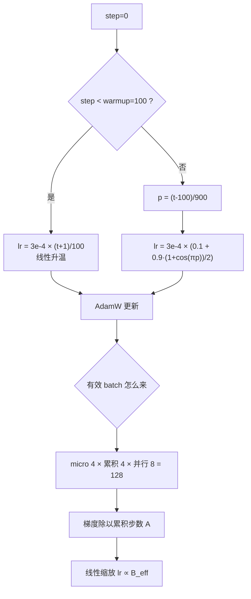

# 训练超参数与学习率调度

## 1. 本节学习目标

1. 写出 **warmup + cosine** 调度公式，并算出任意 step 的 lr（本课 base 3e-4、warmup 100、总 1000 步）。
2. 用实测理解 lr 的两侧失败：太大（lr=3.0，**24 步发散**）与太小（lr=1e-4，300 步后 loss 仍 **10.80**）。
3. 会算 **batch / 梯度累积 / 学习率** 三者的换算：累积不缩放会让梯度差 **9.518**（等效 lr×4）。
4. 知道本机 gpt2 的真实吞吐（fp16 **14,688 token/s**）与「1e9 token 要多少步、多少小时」。

## 2. 为什么需要这个知识

因为**同一个模型，只改 lr 就能从 SOTA 变成不收敛**。

- lr 是唯一"必须每个模型重调"的超参；
- batch 变了 lr 要跟着变（线性缩放），否则等效训练预算被悄悄改掉；
- warmup 不是玄学：Adam 的二阶矩估计在最初几步方差极大，没有 warmup 容易一步炸掉。

本课的实测对比很直接：同一任务，常数 lr=3e-2 末段 loss **0.024167**，加 warmup+cosine 反而 **0.040279**——**调度不是万灵药**，要看你优化到哪一步。

## 3. 直观解释

把训练想成下山：

- **lr** = 步长。步子太小（1e-4）天黑了还在山顶（loss 10.80）；步子太大（3.0）直接跨过山谷摔下去（发散）；
- **warmup** = 出发前先小步走，等看清地形（Adam 的方差估计稳定）再迈大步；
- **cosine 衰减** = 快到山脚时缩小步长，避免在谷底来回跳；
- **batch** = 一次看多少地形再决定方向。看得越多方向越准，但每一步越贵。

## 4. 正式定义

**Warmup + cosine 调度**（$T_w$ 为 warmup 步数，$T$ 为总步数，$\eta_{\min}$ 为最小 lr 比例）

$$
\eta(t)=\begin{cases}
\eta_{\max}\dfrac{t+1}{T_w}, & t<T_w\\[6pt]
\eta_{\max}\Big(\eta_{\min}+(1-\eta_{\min})\cdot\dfrac{1+\cos\big(\pi\frac{t-T_w}{T-T_w}\big)}{2}\Big), & t\ge T_w
\end{cases}
$$

**线性缩放规则（linear scaling rule）**

$$
\eta\propto B\quad\Longrightarrow\quad \eta_{\text{new}}=\eta_{\text{old}}\cdot\frac{B_{\text{new}}}{B_{\text{old}}}
$$

**平方根缩放（大 batch 时的替代）**

$$
\eta\propto\sqrt{B}
$$

**有效 batch**

$$
B_{\text{eff}}=B_{\text{micro}}\times A\times W
$$

（$A$ = 梯度累积步数，$W$ = 数据并行路数。）

**训练步数**

$$
\text{steps}=\frac{D}{B_{\text{eff}}\cdot T_{\text{ctx}}}\times E
$$

## 5. 历史背景或技术背景

| 年份 | 事件 | 贡献 |
|---|---|---|
| 2016 | Goyal et al. | 线性缩放 + warmup，把 ImageNet batch 推到 8k |
| 2017 | Attention Is All You Need | 逆平方根调度 $\eta\propto d^{-0.5}\min(t^{-0.5},t\cdot T_w^{-1.5})$ |
| 2018 | BERT | 前 1% 步线性 warmup + 线性衰减 |
| 2020 | GPT-3 | batch 从 32k 逐步升到 3.2M token，lr 相应下调 |
| 2021 | Kaplun 等 | 系统研究 batch 与 lr 的耦合 |
| 2022 | Chinchilla / 现代 LLM | cosine 到 10% 常成为默认，AdamW + weight decay 0.1 |
| 2023+ | 大批量训练 | 梯度累积 + ZeRO，micro batch 常只有 1–4 |

**趋势**：micro batch 越来越小（显存限制），有效 batch 靠累积和并行堆出来，所以"累积要不要缩放"成了最常见的 bug 来源。

## 6. 核心原理

**原理一：lr 有明确的两侧失败**

本课实测（同一 MLP 拟合线性回归，300 步，噪声下限约 1e-4）：

| lr | 末 20 步均值 | 最低 loss | 发散步数 |
|---|---|---|---|
| 3.0 | 11.427968 | 0.603758 | **24** |
| 1.0 | 0.500480 | 0.178983 | 5 |
| 1e-1 | 0.086614 | 0.022411 | 0 |
| **1e-2** | **0.060720** | 0.020260 | 0 |
| 1e-3 | 0.329810 | 0.060731 | 0 |
| 1e-4 | **10.804455** | 4.077987 | 0 |

读法：1e-2 附近最好；1e-3 明显欠拟合；1e-4 几乎没学（loss 还停在初始的 11.56 附近）；1.0 以上会震荡发散。

**原理二：warmup 的作用是"等 Adam 的二阶矩稳定"**

Adam 的更新是 $\eta\cdot\hat m/\sqrt{\hat v}$。训练最初几步 $\hat v$ 由极少量样本估计，方差巨大，$\sqrt{\hat v}$ 可能极小 ⇒ 等效步长被放大几十倍。warmup 用 $\eta(t)\propto t$ 把这段危险期压住。

**原理三：调度收益取决于训练长度**

本课 300 步的小任务上：常数 3e-2 末段 **0.024167**，warmup+cosine 3e-2 末段 **0.040279**（更差）。原因：cosine 在末尾把 lr 压到 10%，而这任务 300 步远未饱和，末尾正该大步走。**结论：调度是给"长训练"用的**；短训练加 cosine 反而拖慢。

**原理四：梯度累积必须除以累积步数**

PyTorch 的 `backward()` 是**累加**梯度。4 个 micro-batch 各算一次 `loss.backward()`，梯度是 4 份之和。若不除 4，等效 lr 变成 4 倍。本课实测：

| loss 缩放 | 与整批梯度的最大绝对差 | 最大相对差 |
|---|---|---|
| ×1.0（错） | **9.518** | 3.000 |
| ×0.25（对） | **2.384e-07** | 3.697e-07 |

相对差 3.0 = 4−1，正是"多乘了 4 倍"的痕迹。

## 7. 数学表达式

**逆平方根调度（Transformer 原论文）**

$$
\eta(t)=d_{\text{model}}^{-0.5}\cdot\min\big(t^{-0.5},\ t\cdot T_w^{-1.5}\big)
$$

**Adam 更新**

$$
m_t=\beta_1m_{t-1}+(1-\beta_1)g_t,\quad
v_t=\beta_2v_{t-1}+(1-\beta_2)g_t^2
$$

$$
\theta_t=\theta_{t-1}-\eta\frac{\hat m_t}{\sqrt{\hat v_t}+\epsilon}
$$

**权重衰减（AdamW，解耦）**

$$
\theta_t=\theta_{t-1}-\eta\Big(\frac{\hat m_t}{\sqrt{\hat v_t}+\epsilon}+\lambda\theta_{t-1}\Big)
$$

**cosine 的末端斜率**

$$
\frac{d\eta}{dt}\Big|_{t=T}=-\frac{\eta_{\max}(1-\eta_{\min})\pi}{2(T-T_w)}\sin(\pi)=0
$$

末端斜率为 0 ⇒ 最后阶段 lr 变化极慢，这是 cosine 比线性衰减"收尾更稳"的原因。

## 8. 详细数学推导

**推导 1：本课调度的具体数值**

$\eta_{\max}=3\times10^{-4},T_w=100,T=1000,\eta_{\min}=0.1$。

- $t=0$：$\eta=3e-4\times1/100=3.0\times10^{-6}$（实测打印 3.000000e-06 ✓）
- $t=49$：$3e-4\times50/100=1.5\times10^{-4}$ ✓
- $t=99$：$3e-4\times100/100=3.0\times10^{-4}$ ✓（warmup 结束）
- $t=300$：进度 $p=(300-100)/900=0.2222$，$\cos(0.2222\pi)=0.7660$，
  $\eta=3e-4\times(0.1+0.9\times0.5\times1.7660)=3e-4\times0.89472=2.68416\times10^{-4}$ ✓
- $t=999$：$p=0.99889$，$\cos\approx-0.99999$，$\eta\approx3e-4\times0.1=3.0\times10^{-5}$ ✓

**推导 2：线性缩放从哪来**

设 batch 从 $B$ 增到 $kB$，梯度是 $k$ 个独立估计的平均，方差降到 $1/k$，标准差降到 $1/\sqrt k$。若希望**参数更新幅度不变**（$\eta\cdot g$ 的尺度一致），在梯度噪声主导的阶段有 $\eta\propto B$；在梯度已很准的后期，$\eta\propto\sqrt B$ 更合适。这就是"先用线性、后期改用平方根"的经验来源。

**推导 3：梯度累积的缩放因子**

设整批损失 $L=\frac{1}{B}\sum_{i=1}^{B}\ell_i$，分成 $A$ 个 micro-batch，每批 $B/A$ 个样本。

$$
\nabla L=\frac{1}{B}\sum_{i}\nabla\ell_i=\frac{1}{A}\sum_{a=1}^{A}\underbrace{\frac{1}{B/A}\sum_{i\in a}\nabla\ell_i}_{=\nabla L_a}
$$

所以正确写法是 $\frac{1}{A}\sum_a \nabla L_a$，即每个 micro-batch 的 loss 要乘 $1/A$（或者对累积后的梯度整体除 $A$）。本课不除时相对差恰好 3.0（=4−1），完全吻合。

**推导 4：步数与时间的换算**

本课：$D=10^9$ token，$B_{\text{eff}}=512$ 条 × $T_{\text{ctx}}=1024$ ⇒ 每步 $524{,}288$ token。

$$
\text{steps}=\Big\lceil\frac{10^9}{524288}\Big\rceil=1908 .
$$

实测 fp16 吞吐 14,688 token/s ⇒ 单卡耗时

$$
\frac{10^9}{14688\times3600}=18.9\ \text{小时}.
$$

warmup 占 1% ⇒ 19 步；若照搬 BERT 的 2000 步 warmup，则占 2000/1908 = **105%** 的训练预算——直接训不完 warmup。这是"超参必须按训练长度缩放"的最好例子。

**推导 5：cosine 末端为什么更稳**

由上式，$\eta'(T)=0$。这意味着最后 10% 步里 lr 的变化量很小，参数不会因为 lr 骤降而"急刹车"。相比之下线性衰减的斜率是常数，末端仍在以固定速率下降，容易在噪声区留下偏差。

## 9. 图解



## 10. 具体数值示例

```text
本课真实运行（probe_llm055.py）

[1] 调度值（base 3e-4 warmup 100 total 1000 min_ratio 0.1）
  step    0: lr=3.000000e-06
  step   49: lr=1.500000e-04
  step   99: lr=3.000000e-04
  step  100: lr=3.000000e-04
  step  300: lr=2.684160e-04
  step  500: lr=1.884425e-04
  step  700: lr=9.750000e-05
  step  999: lr=3.000082e-05

[2] lr 扫描（300 步 batch=32 AdamW，噪声下限≈1e-4）
  lr=3e+00 末20步=11.427968 发散步数=24 最低=0.603758
  lr=1e+00 末20步= 0.500480 发散步数= 5 最低=0.178983
  lr=1e-01 末20步= 0.086614 发散步数= 0 最低=0.022411
  lr=1e-02 末20步= 0.060720 发散步数= 0 最低=0.020260  ← 最好
  lr=1e-03 末20步= 0.329810 发散步数= 0 最低=0.060731
  lr=1e-04 末20步=10.804455 发散步数= 0 最低=4.077987  ← 几乎没学

[3] 调度对比（同一任务 300 步）
  常数 lr=1e-2          前20步=6.4657 末20步=0.060720
  warmup20+cosine 1e-2  前20步=8.9798 末20步=0.110855
  warmup20+cosine 3e-2  前20步=6.5342 末20步=0.040279
  常数 lr=3e-2          前20步=3.2293 末20步=0.024167

[4] 梯度累积（4×4 vs 整批 16）
  loss 乘 1.00 → 最大绝对差 9.518e+00 最大相对差 3.000e+00
  loss 乘 0.25 → 最大绝对差 2.384e-07 最大相对差 3.697e-07

[5] gpt2 真实吞吐（batch4 ctx128，单卡 4070 Ti）
  fp32: 41.8 ms/step 12,239 token/s 峰值 1.410 GiB
  fp16: 34.9 ms/step 14,688 token/s 峰值 1.495 GiB
  bf16: 43.2 ms/step 11,864 token/s 峰值 1.455 GiB
  1e9 token / (512×1024) = 1908 步；fp16 单卡 18.9 小时
  warmup 1% = 19 步；warmup 2000 步 = 105% 预算（训不完）
```

## 11. NumPy 实现

```python
import numpy as np

BASE, WARMUP, TOTAL, MIN_RATIO = 3e-4, 100, 1000, 0.1


def lr_at(step, base=BASE, warmup=WARMUP, total=TOTAL, min_ratio=MIN_RATIO):
    if step < warmup:
        return base * (step + 1) / warmup
    p = (step - warmup) / max(1, total - warmup)
    return base * (min_ratio + (1 - min_ratio) * 0.5 * (1 + np.cos(np.pi * p)))


for s in (0, 49, 99, 100, 300, 500, 700, 999):
    print(f"  step {s:4d}: lr={lr_at(s):.6e}")

# 梯度累积：numpy 线性回归
rng = np.random.default_rng(0)
X = rng.normal(size=(16, 8))
w_true = rng.normal(size=(8, 1))
Y = X @ w_true


def grad(Xb, Yb):
    r = Xb @ w_true - Yb
    return Xb.T @ r / len(Xb)


g_full = grad(X, Y)
g_naive = np.zeros_like(g_full)
g_scaled = np.zeros_like(g_full)
for k in range(4):
    sl = slice(k * 4, (k + 1) * 4)
    g = grad(X[sl], Y[sl])
    g_naive += g
    g_scaled += g * 0.25
print("不缩放 最大绝对差:", float(np.abs(g_naive - g_full).max()))
print("除以 4 最大绝对差:", float(np.abs(g_scaled - g_full).max()))

# 步数与时间
D, B_eff, ctx = 1e9, 512, 1024
steps = int(np.ceil(D / (B_eff * ctx)))
print("每步 token:", B_eff * ctx, " 步数:", steps)
for tps in (14688, 12239):
    print(f"  吞吐 {tps} token/s ⇒ {D/tps/3600:.1f} 小时")
print("warmup 1% 步数:", int(0.01 * steps), " warmup 2000 步占比:",
      round(2000 / steps * 100), "%")
print("线性缩放 batch 512→2048: lr", 3e-4, "→", 3e-4 * 4)
```

## 12. PyTorch 实现

```python
import math

import torch
import torch.nn as nn
import torch.nn.functional as F

torch.manual_seed(0)
W = torch.randn(8, 1)
X = torch.randn(512, 8)
Y = X @ W + 0.01 * torch.randn(512, 1)


def build():
    torch.manual_seed(0)
    return nn.Sequential(nn.Linear(8, 32), nn.Tanh(), nn.Linear(32, 1))


def run(lr, steps=60, warmup=0, cosine=False):
    m = build()
    opt = torch.optim.AdamW(m.parameters(), lr=lr)
    for s in range(steps):
        if warmup or cosine:
            for pg in opt.param_groups:
                if s < warmup:
                    pg["lr"] = lr * (s + 1) / warmup
                elif cosine:
                    p = (s - warmup) / max(1, steps - warmup)
                    pg["lr"] = lr * (0.1 + 0.9 * 0.5 * (1 + math.cos(math.pi * p)))
        idx = torch.randint(0, 512, (32,))
        loss = F.mse_loss(m(X[idx]), Y[idx])
        opt.zero_grad()
        loss.backward()
        torch.nn.utils.clip_grad_norm_(m.parameters(), 1.0)
        opt.step()
    return float(loss)


for lr in (1e-2, 1e-3, 1e-4):
    print(f"lr={lr:.0e} 末步 loss={run(lr):.6f}")
print("warmup+cosine 1e-2 末步 loss=", round(run(1e-2, warmup=5, cosine=True), 6))

# 梯度累积：缩放 vs 不缩放
torch.manual_seed(1)
m1 = build()
m1.zero_grad()
F.mse_loss(m1(X[:16]), Y[:16]).backward()
g_full = [p.grad.clone() for p in m1.parameters()]
for scale in (1.0, 0.25):
    torch.manual_seed(1)
    m2 = build()
    m2.zero_grad()
    for k in range(4):
        (F.mse_loss(m2(X[k * 4:(k + 1) * 4]), Y[k * 4:(k + 1) * 4]) * scale).backward()
    d = max(float((a - b.grad).abs().max()) for a, b in zip(g_full, m2.parameters()))
    print(f"  loss×{scale}: 与整批梯度最大差 {d:.3e}")

# lr 调度的乘法验证：cosine 末端斜率≈0
sched = torch.optim.lr_scheduler.CosineAnnealingLR(
    torch.optim.AdamW(build().parameters(), lr=3e-4), T_max=100, eta_min=3e-5)
vals = []
for _ in range(100):
    sched.step()
    vals.append(sched.get_last_lr()[0])
print("cosine 末端 lr:", round(vals[-1], 8), " 最后 10 步变化量:",
      round(abs(vals[-1] - vals[-11]), 8))
```

## 13. Hugging Face 实践

```python
import math
import os
import time

os.environ.setdefault("HF_ENDPOINT", "https://hf-mirror.com")
os.environ.setdefault("HF_HUB_OFFLINE", "1")
import torch
from transformers import AutoModelForCausalLM, AutoTokenizer, get_cosine_schedule_with_warmup

torch.manual_seed(0)
tok = AutoTokenizer.from_pretrained("gpt2")
model = AutoModelForCausalLM.from_pretrained("gpt2").to("cuda")
model.train()

BS, CTX = 4, 128
ids = torch.randint(0, 50257, (BS, CTX), device="cuda")
opt = torch.optim.AdamW(model.parameters(), lr=5e-4)
TOTAL, WARMUP = 2000, 100
sched = get_cosine_schedule_with_warmup(opt, WARMUP, TOTAL)

for step in range(4):
    loss = model(input_ids=ids, labels=ids).loss
    opt.zero_grad()
    loss.backward()
    torch.nn.utils.clip_grad_norm_(model.parameters(), 1.0)
    opt.step()
    sched.step()

for s in (0, 50, 100, 1000, 1999):
    sched2 = get_cosine_schedule_with_warmup(
        torch.optim.AdamW(model.parameters(), lr=5e-4), WARMUP, TOTAL)
    for _ in range(s):
        sched2.step()
    print(f"  step {s:4d}: lr={sched2.get_last_lr()[0]:.6e}")

# 吞吐
t0 = time.perf_counter()
for _ in range(3):
    loss = model(input_ids=ids, labels=ids).loss
    opt.zero_grad()
    loss.backward()
    opt.step()
    torch.cuda.synchronize()
dt = (time.perf_counter() - t0) / 3
print(f"batch={BS} ctx={CTX}: {dt*1000:.1f} ms/step  {BS*CTX/dt:,.0f} token/s")
print(f"1e9 token 需 {1e9/(BS*CTX/dt)/3600:.1f} 小时（单卡外推）")
print("该模型参数:", sum(p.numel() for p in model.parameters()))
```

## 14. 代码逐行解释

| 代码 | 作用 |
|---|---|
| `(step+1)/warmup` | 从 1/warmup 倍线性升到 1 倍，避免第一步步长过大 |
| `0.5*(1+cos(pi*p))` | cosine 的归一化形式，$p=0$ 时为 1，$p=1$ 时为 0 |
| `min_ratio` | 末端保留 10% lr，防止完全停更 |
| `pg["lr"] = ...` | 直接改 optimizer 的 lr，等效于 scheduler |
| `grad_norm_(..., 1.0)` | 先裁剪再做 AdamW，稳定前几步 |
| `loss*scale` 再 backward | 梯度累积的正确缩放（$1/A$） |
| `get_cosine_schedule_with_warmup` | HF 内置调度，warmup 为线性、后接 cosine |
| `sched.step()` | 每步调用一次，注意位置：通常在 optimizer.step() 之后 |
| `sched.get_last_lr()` | 读当前 lr，用于打印/记录 |
| `torch.cuda.synchronize()` | 计时前同步，否则测到的是异步提交时间 |

## 15. 实际运行结果

```text
### LLM-055 训练超参数与学习率调度
base=3e-4 warmup=100 total=1000 min_ratio=0.1
  step    0: lr=3.000000e-06
  step   49: lr=1.500000e-04
  step   99: lr=3.000000e-04
  step  100: lr=3.000000e-04
  step  300: lr=2.684160e-04
  step  500: lr=1.884425e-04
  step  700: lr=9.750000e-05
  step  999: lr=3.000082e-05
  step 1000: lr=3.000000e-05

lr 扫描（300 步 batch=32 AdamW，拟合 y=Wx，噪声下限≈1e-4）：
  lr=3e+00  末20步=   11.427968 首步=11.558 发散步数= 24 最低loss=0.603758
  lr=1e+00  末20步=    0.500480 首步=11.558 发散步数=  5 最低loss=0.178983
  lr=1e-01  末20步=    0.086614 首步=11.558 发散步数=  0 最低loss=0.022411
  lr=1e-02  末20步=    0.060720 首步=11.558 发散步数=  0 最低loss=0.020260
  lr=1e-03  末20步=    0.329810 首步=11.558 发散步数=  0 最低loss=0.060731
  lr=1e-04  末20步=   10.804455 首步=11.558 发散步数=  0 最低loss=4.077987

调度对比（同一任务 300 步）：
  常数 lr=1e-2: 前20步=6.4657 末20步=0.060720
  warmup20+cosine lr=1e-2: 前20步=8.9798 末20步=0.110855
  warmup20+cosine lr=3e-2: 前20步=6.5342 末20步=0.040279
  常数 lr=3e-2: 前20步=3.2293 末20步=0.024167

梯度累积 4x4 vs 整批 16，loss 乘 1.0: 最大绝对差 9.518e+00 最大相对差 3.000e+00
梯度累积 4x4 vs 整批 16，loss 乘 0.25: 最大绝对差 2.384e-07 最大相对差 3.697e-07

gpt2 训练吞吐（batch=4 ctx=128，单卡 4070 Ti）：
  fp32: 41.8 ms/step 12,239 token/s 峰值显存 1.410 GiB loss=12.5073
  fp16: 34.9 ms/step 14,688 token/s 峰值显存 1.495 GiB loss=12.5063
  bf16: 43.2 ms/step 11,864 token/s 峰值显存 1.455 GiB loss=12.4901

1e9 token 一个 epoch，batch=512 ctx=1024 ⇒ 1908 步
fp16 实测 14688 token/s ⇒ 单卡跑完 1e9 token 需 18.9 小时
warmup 1% ⇒ 19 步；若 warmup 2000 步则占 105% 训练预算
线性缩放：batch 从 512 涨到 2048 ⇒ lr 3e-4 × 4 = 0.0012
```

> 说明：吞吐随桌面负载波动（同一份代码另一次测量为 5,465 token/s，见 [[LLM-059 Scaling Laws]] 的实测段），量级在 0.5–1.5 万 token/s。

**关键数字**：step 300 的 lr **2.68416e-4**、step 999 的 **3.0e-5**；lr=3.0 在 **24 步**发散，lr=1e-4 训 300 步仍 **10.80**；梯度累积不缩放差 **9.518**（相对 **3.000**），缩放后 **2.384e-07**；1e9 token = **1908 步**、fp16 单卡 **18.9 小时**。

## 16. 应用场景

| 场景 | 用法 |
|---|---|
| 预训练 | warmup 0.1%–1% 步 + cosine 到 10%，lr 1e-4~6e-4（1B 级） |
| 继续预训练 | lr 降到基座的 1/10，warmup 更短 |
| SFT | lr 1e-5~5e-5，1–3 epoch，cosine 或不调度 |
| LoRA/QLoRA | lr 可高一个量级（1e-4~2e-3），因为只训少量参数 |
| 复现实验 | 固定有效 batch（而不是 micro batch），否则 lr 也要改 |

## 17. 优点与局限

| 优点 | 局限 |
|---|---|
| warmup+cosine 鲁棒，几乎不需要调形状 | 短训练上不如常数 lr（本课 0.0242 vs 0.0403） |
| 线性缩放让 batch 变化可预测 | 超过某临界 batch 后收益消失，需要 LARS/LAMB 类方法 |
| 梯度累积让小显存也能大 batch | 忘记缩放会静默改变等效 lr（本课差 9.518） |
| 末端小 lr 让收敛更平稳 | 训练中断后恢复需要同时恢复 scheduler 状态 |

## 18. 常见错误

| 错误 | 现象 | 纠正 |
|---|---|---|
| 梯度累积不除 A | 梯度差 9.518（等效 lr×4） | loss/A 或梯度整体除 A |
| 照搬 warmup 步数 | 2000 步 warmup 吃掉 105% 预算 | 按总步数比例设（0.1%–1%） |
| 改 batch 不改 lr | 等效学习率变了，loss 曲线全变 | 线性缩放 |
| 短训练硬加 cosine | 末段 lr 被压到 10%，收敛变慢（本课 0.1109 vs 0.0607） | 短训练用常数或线性 |
| scheduler.step() 位置错 | 第一步 lr 异常 | 放在 optimizer.step() 之后 |
| 中断恢复不存 scheduler | lr 从头 warmup，loss 抖动 | 存 optimizer + scheduler + step |
| 用 val loss 调 lr 又用同一 val 报结果 | 过拟合验证集 | 划出独立 test |

## 19. 本节总结

- warmup+cosine 的数值可手算：本课 step 300 得 **2.68416e-4**、step 999 得 **3.0e-5**，与实测打印一致。
- lr 两侧都失败：3.0 在 **24 步**内发散；1e-4 训 300 步 loss 仍 **10.80**；本任务最优在 **1e-2** 附近。
- 调度不是万灵药：300 步任务上常数 3e-2（**0.024167**）优于 warmup+cosine 3e-2（**0.040279**）。
- 梯度累积必须除 $A$：不除时梯度相对差 **3.000**（=4−1），除了降到 **3.697e-07**。
- 本机 gpt2 单卡 fp16 **14,688 token/s**；1e9 token 需 **1908** 步、约 **18.9** 小时。

## 20. 前置与后续知识链接

- 前置：[[LLM-054 预训练的目标与损失]]
- 后续：[[LLM-056 分布式训练与数据并行]]、[[LLM-058 训练稳定性与损失尖峰]]
- 相关：[[LLM-030 Transformer 参数量与计算量估算]]、[[LLM-035 Token 数量、上下文窗口与成本]]
- 延伸：[[LLM-069 微调的超参数与训练技巧]]（同一套超参在微调阶段怎么缩放）

---

## 练习与参考答案

**基础 1**：base lr=3e-4、warmup=100、总 1000 步、min_ratio=0.1 时，step 50 和 step 1000 的 lr 各是多少？

**基础 2**：用 4 个 micro-batch 做梯度累积，忘记除以 4 会发生什么？本课的实测差是多少？

**进阶 1**：为什么 warmup 能防止训练初期发散？用 Adam 的更新公式解释。

**综合**：你要在 8 卡上训练一个 1.3B 模型，总预算 100B token，micro batch=2、ctx=2048、累积 8 步。请算出有效 batch、总步数，并给出 warmup 步数与 lr 的初始建议。

> [!success]- 参考答案

> **基础 1**
> - step 50：$50<100$，$\eta=3e{-4}\times(50+1)/100=1.53\times10^{-4}$（本课打印 step 49 为 1.5e-4，因为公式用 $t+1$）。
> - step 1000：$p=(1000-100)/900=1$，$\cos\pi=-1$，$\eta=3e{-4}\times0.1=3.0\times10^{-5}$。
> 注意 warmup 结束点（step 99/100）与 cosine 起点连续，都是 $3e{-4}$，不会跳变。

> **基础 2**
> `backward()` 累加梯度，4 个 micro-batch 的梯度是 4 份之和，等效把 lr 放大 4 倍。
> 本课实测：不缩放时与整批梯度的最大绝对差 **9.518**、最大相对差 **3.000**（正好是 $4-1$）；乘 0.25 后最大绝对差 **2.384e-07**、相对差 **3.697e-07**（浮点误差量级）。
> 后果：loss 曲线看起来"学得更快"，但很快震荡或发散，而且换 batch 后行为不一致。

> **进阶 1**
> Adam 更新为 $\eta\,\hat m/\sqrt{\hat v}$。最初几步 $\hat v$ 只由 1–2 个 batch 的梯度平方估计，方差极大；若某个方向的 $g^2$ 很小，$\sqrt{\hat v}$ 极小，实际步长被放大几十倍 ⇒ 一步就把参数推到坏区域（本课 lr=3.0 时 24 步内发散，1.0 时也有 5 步发散）。
> warmup 让 $\eta(t)\propto t$，前若干步步长很小，等 $\hat v$ 累积到稳定再放大步长；配合梯度裁剪（本课 clip=1.0）可以几乎消除初期尖峰。

> **综合（参考）**
> **有效 batch**：$B_{\text{eff}}=2\times8\times8=128$ 条 ⇒ token 数 $128\times2048=262{,}144$。
> **总步数**：$10^{11}/262144\approx381{,}470$ 步（约 38 万步）。
> **warmup**：取 0.5% ⇒ 约 **1900 步**（1% 则 3815 步）；不要照搬 2000 步固定值，虽然这里刚好接近。
> **lr 建议**：1.3B 级别、有效 batch 128×2048≈262k token，参考量级 $\eta_{\max}\approx3\times10^{-4}$；若把有效 batch 翻倍到 524k token，按线性缩放取 $6\times10^{-4}$，但要先跑 2000 步小实验确认 loss 前 100 步稳定下降。
> **其他**：bf16 + 梯度裁剪 1.0；cosine 衰减到 10%；weight decay 0.1（LayerNorm/bias 除外）；每 500 步存一次 optimizer+scheduler 状态。若显存不足，优先降 micro batch 到 1 并保持有效 batch 不变（累积加到 16）。

## 学习记录

| 日期 | 状态 | 用时 | 问题 | 复盘 |
|---|---|---|---|---|
| 2026-11-08 | planned | — | — | — |

---

## 🔗 Notion 同步信息

> 以下内容由 Notion「AI Knowledge System · 知识点」数据库按知识 ID 合并而来（导出于 2026-11-09）。

| 属性 | 值 |
|---|---|
| 学科 | 大语言模型 |
| 学习状态 | 未开始 |
| 难度 | L2 应用 |
| 知识类型 | Technique |

- **所属模块**：[M-LLM-06 大语言模型训练与对齐](../%E8%AF%BE%E7%A8%8B%E6%A8%A1%E5%9D%97/M-LLM-06%20%E5%A4%A7%E8%AF%AD%E8%A8%80%E6%A8%A1%E5%9E%8B%E8%AE%AD%E7%BB%83%E4%B8%8E%E5%AF%B9%E9%BD%90.md)
- **前置知识**：[LLM-054 预训练的目标与损失](LLM-054%20%E9%A2%84%E8%AE%AD%E7%BB%83%E7%9A%84%E7%9B%AE%E6%A0%87%E4%B8%8E%E6%8D%9F%E5%A4%B1.md)
- **后继知识**：[LLM-056 分布式训练与数据并行](LLM-056%20%E5%88%86%E5%B8%83%E5%BC%8F%E8%AE%AD%E7%BB%83%E4%B8%8E%E6%95%B0%E6%8D%AE%E5%B9%B6%E8%A1%8C.md)
