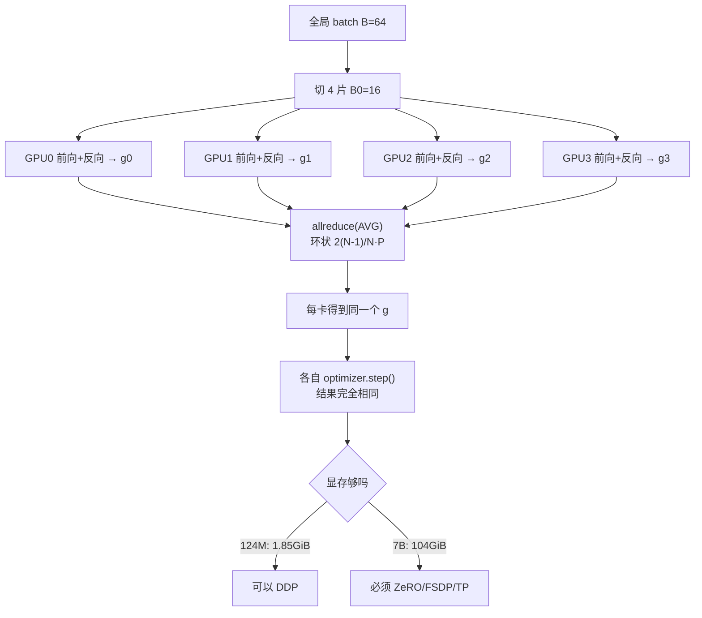

# 分布式训练与数据并行

## 1. 本节学习目标

1. 区分 DP / DDP / TP / PP / SP 五种并行，说清各自切的是什么。
2. 推导"各卡梯度取平均 = 全局 batch 的梯度"，并用实测确认误差量级（本课 **1.788e-07**）。
3. 会算环形 allreduce 的通信量 $2(N-1)/N\cdot P$：124M 模型、8 卡 fp32 每卡 **831 MiB/步**。
4. 会算显存账：混合精度 Adam **16 字节/参数**，7B 需要 **104.31 GiB**，单卡 80GB 装不下。

> **本机限制（必须说清）**：本机只有 **1 张 RTX 4070 Ti**。真多卡 NCCL 通信**未验证**。本节用「单进程 4 副本模拟 + 2 进程 gloo CPU 模拟 + 公式推算」三种手段，标注了哪些是实测、哪些是推算。

## 2. 为什么需要这个知识

因为单卡装不下、也等不起：

- 7B 模型光优化器状态就 104 GiB，**单卡 80GB 直接不可能**；
- 1e9 token 单卡要 18.9 小时（见 [[LLM-055 训练超参数与学习率调度]]），70B 级别要按年算；
- 并行不是"免费加速"：通信会吃掉算力，配比错了 8 卡只能跑出 3 卡的效率。

数据并行是最常用、也是最先遇到瓶颈的那一种，必须先把它算清楚。

## 3. 直观解释

**数据并行（DP）**：把同一份模型复制 N 份，每份看不同的数据分片，算完各自梯度后**取平均**，再各自更新。等价于"用 N 倍大的 batch 训练一份模型"。

```text
GPU0: 模型副本0 + 数据分片0 → 梯度 g0 ┐
GPU1: 模型副本1 + 数据分片1 → 梯度 g1 ├→ allreduce 平均 → g → 每卡各自更新
GPU2: 模型副本2 + 数据分片2 → 梯度 g2 ┤
GPU3: 模型副本3 + 数据分片3 → 梯度 g3 ┘
```

**其他并行**：

| 并行 | 切什么 | 典型用途 |
|---|---|---|
| DP / DDP | 切数据（模型复制） | 默认方案，收益线性直到通信瓶颈 |
| TP（张量并行） | 切单层内的矩阵（按列/行） | 单层放不下时，层内切分，通信最频繁 |
| PP（流水并行） | 切层（前几层在卡 0，后几层在卡 1） | 深模型，需要 micro-batch 填流水 |
| SP（序列并行） | 切序列长度维 | 长上下文 |

## 4. 正式定义

**数据并行的全局目标**

设全局 batch $B=\sum_{r=1}^{N}B_r$，第 $r$ 卡的局部损失

$$
L_r(\theta)=\frac{1}{B_r}\sum_{i\in\text{shard }r}\ell_i(\theta)
$$

则全局损失 $L=\frac{1}{N}\sum_r L_r$（各卡分片等大时），梯度

$$
\nabla L=\frac{1}{N}\sum_{r=1}^{N}\nabla L_r
$$

**DDP 的同步步骤**：每卡算完 $\nabla L_r$ 后做 **allreduce(AVG)**，然后**每卡独立**执行同一个优化器更新（因为参数与梯度完全相同，更新结果也相同）。

**环形 allreduce 的通信量**（每卡）

$$
V_{\text{comm}}=2\cdot\frac{N-1}{N}\cdot P\cdot b
$$

$P$ 为参数量、$b$ 为每参数字节数。系数 2 来自 reduce-scatter + all-gather 两阶段。

**显存（每卡，DDP 不分片）**

$$
M=16P\ \text{bytes}
$$

（fp16 权重 2 + fp16 梯度 2 + fp32 主权重 4 + Adam $m$ 4 + $v$ 4。）

## 5. 历史背景或技术背景

| 年份 | 事件 | 关键点 |
|---|---|---|
| 2014 | parameter server | 中心化聚合，易成瓶颈 |
| 2017 | Baidu ring allreduce | 带宽最优 $2(N-1)/N$，去中心化 |
| 2017 | NCCL 发布 | NVIDIA GPU 专用集合通信库 |
| 2018 | Horovod | 把 ring allreduce 做成通用框架 |
| 2019 | PyTorch DDP | 用 bucket 把梯度分桶，与反向计算重叠 |
| 2020 | ZeRO / DeepSpeed | 把优化器状态、梯度、参数分片，突破单卡显存 |
| 2021 | Megatron-LM | TP + PP + DP 三维并行成为大模型标配 |
| 2022+ | FSDP | PyTorch 原生分片数据并行 |

**主线**：并行维度的演进都是被**显存**逼出来的——先是数据并行不够快，然后是"模型一份都放不下"。

## 6. 核心原理

**原理一：平均梯度 = 大 batch 的梯度**

若各卡分片等大且数据独立同分布，$\frac{1}{N}\sum_r\nabla L_r$ 就是全局 batch 梯度的**无偏估计**。本课实测（4 副本 vs 整批 64）：

- 平均梯度与整批梯度最大绝对差 **1.788e-07**（整批最大梯度 7.194e-01，相对 **2.49e-07**）——浮点误差量级，说明等价成立。
- 若只 SUM 不除 world_size：最大绝对差 **2.158**，等效把 lr 放大 4 倍。

再用 2 进程 gloo 真正跑一次 allreduce(AVG)：与单进程整批梯度最大绝对差 **1.490e-07**。**这是本机唯一"真通信"的证据，但仍是 1 台机器上的 2 个 CPU 进程，不是多卡。**

**原理二：通信量与参数量成正比，与卡数弱相关**

$2(N-1)/N$ 在 $N$ 大时趋于 2，所以"每卡每步要发两倍模型大小的数据"。本课实测的每卡通信量：

| 卡数 | fp32 | bf16 |
|---|---|---|
| 2 | 475 MiB | 237 MiB |
| 8 | 831 MiB | 415 MiB |
| 64 | 935 MiB | 467 MiB |

64 卡时全网总通信 **58.4 GiB/步**——这就是为什么大集群必须要 NVLink/IB，而不是以太网。

**原理三：通信能不能藏起来，取决于算通比**

本机 gloo（TCP loopback）实测有效带宽只有 **0.13 GB/s**（fp32 475 MiB 用了 3841 ms）。按这个带宽，8 卡训练 124M 模型每步通信要 **6700 ms**，而一步计算只要约 35 ms——完全不可用。换成 PCIe4 x16（25 GB/s）是 **34.8 ms**，NVLink（300 GB/s）是 **2.9 ms**。所以：

- **单机多卡**：PCIe/NVLink，通信可与计算重叠，效率高；
- **多机**：IB/RoCE，跨机带宽是瓶颈，要减少同步频率（梯度累积）或换并行策略。

**原理四：DDP 不省显存，只省时间**

DDP 每卡一份完整副本：124M 模型状态 **1.85 GiB**，7B 要 **104.31 GiB**，70B 要 **1043.08 GiB**。80GB 卡连 7B 的优化器状态都放不下 ⇒ 必须上 ZeRO/FSDP（见 [[LLM-057 混合精度与显存优化]]）。

## 7. 数学表达式

**allreduce 后每卡梯度**

$$
g=\frac{1}{N}\sum_{r=1}^{N}g_r
$$

**参数更新等价性**（学习率 $\eta$）

$$
\theta_{t+1}=\theta_t-\eta\, g=\theta_t-\frac{\eta}{N}\sum_r g_r
$$

即"$N$ 卡 + lr $\eta$"等价于"1 卡 + batch $N B_0$ + lr $\eta$"（前提是梯度噪声允许，见线性缩放）。

**ring allreduce 两阶段**

$$
\text{reduce-scatter}:\ \frac{N-1}{N}P b\ \text{字节/卡},\qquad
\text{all-gather}:\ \frac{N-1}{N}P b\ \text{字节/卡}
$$

**计算/通信比**

$$
R=\frac{T_{\text{compute}}}{T_{\text{comm}}}
=\frac{6PD_{\text{local}}/F}{2\frac{N-1}{N}Pb/BW}
=\frac{3D_{\text{local}}BW}{F b}\cdot\frac{N}{N-1}
$$

$F$ 为算力（FLOP/s），$BW$ 为带宽（B/s），$D_{\text{local}}$ 为每卡每步 token 数。

## 8. 详细数学推导

**推导 1：为什么 allreduce 用 AVG 而不是 SUM**

全局损失 $L=\frac{1}{B}\sum_{i=1}^{B}\ell_i$，其中 $B=NB_0$。分成 $N$ 片：

$$
\nabla L=\frac{1}{NB_0}\sum_{r=1}^{N}\sum_{i\in r}\nabla\ell_i=\frac{1}{N}\sum_{r=1}^{N}\underbrace{\frac{1}{B_0}\sum_{i\in r}\nabla\ell_i}_{g_r}=\frac{1}{N}\sum_r g_r .
$$

所以必须除 $N$。本课实测：不除时梯度差 2.158（约 3 倍于整批最大梯度 0.719，符合 $4-1$ 的关系），除了之后差 1.788e-07。

**推导 2：ring allreduce 的 $2(N-1)/N$ 从哪来**

把 $P$ 个参数分成 $N$ 块，每块 $P/N$。

- **reduce-scatter**：做 $N-1$ 轮，每轮每卡发送一块（$P/N$），共发 $(N-1)P/N$ 字节，结束时每卡持有**一块**的完整求和结果；
- **all-gather**：再 $N-1$ 轮，每轮每卡发送自己那块（$P/N$），共 $(N-1)P/N$，结束时每卡持有全部块。

合计 $2(N-1)P/N$。$N=2$ 时为 $P$（每卡只发一份模型大小），$N\to\infty$ 时趋于 $2P$。

**推导 3：算通比与并行效率**

单步时间（假设通信不重叠）

$$
T=T_{\text{compute}}+T_{\text{comm}}=\frac{6PD_{\text{local}}}{F}+\frac{2(N-1)Pb}{N\,BW}.
$$

并行效率

$$
\text{eff}=\frac{N\,T_{\text{ideal}}}{T_{\text{wall}}},\qquad
T_{\text{ideal}}=\frac{6PD_{\text{local}}}{F}.
$$

本机实测数据代入（$P=124.44$M，$b=4$，$D_{\text{local}}=512$ token，$F\approx4\times10^{12}$，$BW=0.13\times10^9$）：

$$
T_{\text{compute}}\approx\frac{6\times1.244\text{e}8\times512}{4\text{e}12}\approx0.096\ \text{s},\quad
T_{\text{comm}}\approx\frac{1.75\times1.244\text{e}8\times4}{0.13\text{e}9}\approx6.7\ \text{s}
$$

效率 $\approx 0.096/(0.096+6.7)=1.4\%$——**这就是"用 TCP 跑 DDP 不可行"的定量版本**。

**推导 4：显存账与 7B 的不可能性**

$M=16P$ 字节：

- 124.44M ⇒ $1.99\times10^9$ B $=1.85$ GiB（实测打印 1.85 ✓）
- 7B ⇒ $1.12\times10^{11}$ B $=104.31$ GiB
- 70B ⇒ $1.12\times10^{12}$ B $=1043.08$ GiB

80GB 卡的可用显存约 79 GiB（还要留给激活），7B 的状态就超了 25 GiB。**结论：7B 想训练，至少要让优化器状态分布在 2 张卡上（ZeRO-1/2）或 8 张（ZeRO-3，13.04 GiB/卡）。**

## 9. 图解



## 10. 具体数值示例

```text
本课真实运行（probe_llm056.py，1 张 RTX 4070 Ti + 2 个 CPU 进程）

[单进程模拟 4 副本]
  平均梯度 vs 整批梯度：最大绝对差 1.788e-07（整批最大梯度 7.194e-01，相对 2.49e-07）
  只 SUM 不除 world_size：最大绝对差 2.158（等效 lr×4）

[2 进程 gloo，真 allreduce]
  allreduce(AVG) 后梯度 vs 单进程整批：最大绝对差 1.490e-07
  fp32 张量 475 MiB 耗时 3841 ms ⇒ 有效带宽 0.13 GB/s
  bf16 张量 237 MiB 耗时 2094 ms ⇒ 有效带宽 0.12 GB/s
  （1 机 2 个 CPU 进程走 TCP，真多卡 NCCL 未验证）

[公式：环形 allreduce 每卡发送量]
  N= 2 fp32 475 MiB / bf16 237 MiB
  N= 8 fp32 831 MiB / bf16 415 MiB
  N=64 fp32 935 MiB / bf16 467 MiB
  N=64 全网总通信 ≈ 58.4 GiB/步

[推算：8 卡训练 124M，每步通信 831 MiB]
  本机 gloo 0.13 GB/s  → 6700.6 ms/步（不可用）
  PCIe4 x16 25 GB/s    →   34.8 ms/步
  NVLink 300 GB/s      →    2.9 ms/步

[显存：16 字节/参数]
  gpt2 124M: 1.85 GiB（80GB 余 78 GiB 给激活）
  7B:       104.31 GiB（超 80GB，必须分片）
  70B:     1043.08 GiB
```

## 11. NumPy 实现

```python
import numpy as np

rng = np.random.default_rng(0)

# 4 副本各自在自己的分片算梯度，再平均
N, B0, D = 4, 16, 8
X = rng.normal(size=(N * B0, D))
w = rng.normal(size=(D, 1))
Y = X @ w


def grad(Xb, Yb):
    return Xb.T @ (Xb @ w - Yb) / len(Xb)


g_full = grad(X, Y)
g_avg = np.zeros_like(g_full)
g_sum = np.zeros_like(g_full)
for r in range(N):
    sl = slice(r * B0, (r + 1) * B0)
    gr = grad(X[sl], Y[sl])
    g_avg += gr / N
    g_sum += gr

print("平均 vs 整批 最大绝对差:", float(np.abs(g_avg - g_full).max()))
print("求和 vs 整批 最大绝对差:", float(np.abs(g_sum - g_full).max()),
      "（≈3 倍整批梯度 ⇒ 等效 lr×4）")

# 通信量：环形 allreduce 每卡 2(N-1)/N·P·b
P = 124_439_808
print("\n每卡通信量（MiB）：")
for n in (2, 8, 64):
    for name, b in (("fp32", 4), ("bf16", 2)):
        v = 2 * (n - 1) / n * P * b
        print(f"  N={n:2d} {name}: {v/2**20:8.0f}")

# 时间推算
vol8 = 2 * (7 / 8) * P * 4
for bw, name in ((0.13e9, "gloo 0.13GB/s"), (25e9, "PCIe4 25GB/s"), (300e9, "NVLink 300GB/s")):
    print(f"  {name}: {vol8/bw*1000:9.1f} ms/步")

# 显存账
print("\n每卡显存（GiB，16 字节/参数）：")
for name, n in (("124M", P), ("7B", 7e9), ("70B", 70e9)):
    print(f"  {name}: {n*16/2**30:.2f}")
```

## 12. PyTorch 实现

```python
import torch
import torch.nn as nn
import torch.nn.functional as F

torch.manual_seed(0)
X = torch.randn(64, 16)
Y = X @ torch.randn(16, 4)


def build():
    torch.manual_seed(0)
    return nn.Sequential(nn.Linear(16, 32), nn.Tanh(), nn.Linear(32, 4))


# 1) 整批梯度
m = build()
m.zero_grad()
F.mse_loss(m(X), Y).backward()
g_full = [p.grad.clone() for p in m.parameters()]

# 2) 模拟 4 卡：各卡算局部梯度后 allreduce(AVG)
N, B0 = 4, 16
acc = [torch.zeros_like(g) for g in g_full]
for r in range(N):
    torch.manual_seed(0)
    mr = build()
    mr.zero_grad()
    F.mse_loss(mr(X[r * B0:(r + 1) * B0]), Y[r * B0:(r + 1) * B0]).backward()
    for i, p in enumerate(mr.parameters()):
        acc[i] += p.grad / N
print("AVG 后最大绝对差:", max(float((a - b).abs().max()) for a, b in zip(g_full, acc)))
print("SUM 后最大绝对差:",
      max(float((a - b * N).abs().max()) for a, b in zip(g_full, acc)))

# 3) 通信量与算通比
P = 124_439_808
for n, b, name in ((8, 4, "fp32"), (8, 2, "bf16")):
    v = 2 * (n - 1) / n * P * b
    print(f"  N={n} {name}: 每卡 {v/2**20:.0f} MiB/步, 全网 {n*v/2**30:.1f} GiB/步")

for bw_name, bw in (("gloo", 0.13e9), ("PCIe", 25e9), ("NVLink", 300e9)):
    t_comm = 2 * (7 / 8) * P * 4 / bw
    t_comp = 6 * P * 512 / 4e12
    print(f"  {bw_name}: 通信 {t_comm*1000:.1f} ms, 计算 {t_comp*1000:.1f} ms, "
          f"效率 {t_comp/(t_comp+t_comm)*100:.1f}%")

# 4) 显存账
for name, n in (("124M", P), ("7B", 7_000_000_000)):
    gb = n * 16 / 2**30
    print(f"  {name}: {gb:.2f} GiB, 80GB 卡{'装不下' if gb > 80 else '装得下'}")
```

## 13. Hugging Face 实践

```python
import os

os.environ.setdefault("HF_ENDPOINT", "https://hf-mirror.com")
os.environ.setdefault("HF_HUB_OFFLINE", "1")
import torch
from transformers import AutoConfig

cfg = AutoConfig.from_pretrained("gpt2")
# 用配置推参数量（不加载权重，省内存）
emb = cfg.vocab_size * cfg.n_embd + cfg.n_positions * cfg.n_embd
body = cfg.n_layer * (12 * cfg.n_embd ** 2)
total = emb + body
print("配置推算参数:", f"{total:,}", "  真实 gpt2: 124,439,808")
print(f"  层数 {cfg.n_layer} 隐藏 {cfg.n_embd} 词表 {cfg.vocab_size} 位置 {cfg.n_positions}")

P = 124_439_808
print("\nDDP 通信/显存速查（P=124.44M）：")
for n in (2, 4, 8):
    vol = 2 * (n - 1) / n * P * 4
    print(f"  {n} 卡: 每卡 {vol/2**20:.0f} MiB/步  状态 {P*16/2**30:.2f} GiB/卡")

# bf16 梯度通信可以省一半
print("bf16 梯度每卡通信量（8 卡）:", f"{2*(7/8)*P*2/2**20:.0f} MiB")

for dt in (torch.float32, torch.float16, torch.bfloat16):
    t = torch.zeros(P, dtype=dt)
    print(f"  {str(dt).split('.')[-1]}: {t.numel()*t.element_size()/2**30:.2f} GiB")
    del t
```

## 14. 代码逐行解释

| 代码 | 作用 |
|---|---|
| `acc[i] += p.grad / N` | 模拟 allreduce 的 AVG 语义 |
| `(a - b*N).abs().max()` | 验证"不除 N"会把梯度放大 N 倍 |
| `2*(n-1)/n*P*b` | 环形 allreduce 每卡发送字节数 |
| `6*P*D/F` | 计算时间模型：6ND 除以算力 |
| `cfg.n_layer*(12*n_embd**2)` | 非嵌入参数估算，12 来自 attention+FFN |
| `n*16/2**30` | 混合精度 Adam 状态换算成 GiB |
| `element_size()` | 看 dtype 的真实字节数（bf16 = 2） |
| `AutoConfig` | 只读配置不读权重，适合做容量规划 |

## 15. 实际运行结果

```text
### LLM-056 分布式训练与数据并行（1 卡 + 2 进程 gloo 模拟 + 公式推算）
GPU 数: 1  设备: NVIDIA GeForce RTX 4070 Ti

[单进程模拟 4 副本] 平均梯度 vs 整批梯度：最大绝对差 1.788e-07（整批最大梯度 7.194e-01，相对 2.49e-07）
若只 SUM 不除 world_size：最大绝对差 2.158e+00 ⇒ 等效把 lr 放大 4 倍
[2 进程 gloo] allreduce(AVG) 后梯度 vs 单进程整批：最大绝对差 1.490e-07
[实测 allreduce] fp32 张量 475 MiB 耗时 3841 ms 每卡实际发送 475 MiB ⇒ 有效带宽 0.13 GB/s
[实测 allreduce] bf16 张量 237 MiB 耗时 2094 ms 每卡实际发送 237 MiB ⇒ 有效带宽 0.12 GB/s
说明：以上是 1 台机器上的 2 个 CPU 进程走 gloo/TCP，真多卡 NCCL 未验证

[公式] 环形 allreduce 每卡发送 2(N-1)/N × P 字节（DDP 默认 fp32 梯度）
  N= 2 fp32: 每卡 475 MiB/步
  N= 2 bf16: 每卡 237 MiB/步
  N= 8 fp32: 每卡 831 MiB/步
  N= 8 bf16: 每卡 415 MiB/步
  N=64 fp32: 每卡 935 MiB/步
  N=64 bf16: 每卡 467 MiB/步
  N=64 fp32 每步全网总通信 ≈ 58.4 GiB

[推算] 8 卡训练 124M 模型，每步通信 2*(7/8)*P*4 = 831 MiB：
  带宽 本机 gloo 实测 0.13 GB/s: 6700.6 ms/步
  带宽 PCIe4 x16 25 GB/s: 34.8 ms/步
  带宽 NVLink 300 GB/s: 2.9 ms/步

[显存] 混合精度 Adam 16 字节/参数，DDP 不分片（每卡一份完整副本）
  gpt2 124M: 状态 1.85 GiB；80GB 卡余量 78 GiB 给激活
  7B: 状态 104.31 GiB；80GB 卡余量 -24 GiB 给激活（装不下）
  70B: 状态 1043.08 GiB；80GB 卡余量 -963 GiB 给激活（装不下）
  结论：124M 单卡够；7B 单卡状态 104 GiB 直接超 80GB ⇒ 必须 ZeRO/TP
```

**四个关键数**：梯度平均误差 **1.788e-07**、8 卡每卡通信 **831 MiB**、7B 状态 **104.31 GiB**、gloo 带宽 **0.13 GB/s**（推算效率仅 1.4%，实测的是 CPU 进程走 TCP）。

## 16. 应用场景

| 场景 | 用法 |
|---|---|
| 单机多卡 | DDP + NCCL，梯度分桶与反向重叠 |
| 多机多卡 | DDP over IB/RoCE；跨机带宽不足时增大梯度累积 |
| 模型放不下 | FSDP/ZeRO-3 或 TP；TP 通常限制在同一节点内 |
| 长上下文 | SP（序列并行）或 Ring-Attention |
| 小显存实验 | 单卡 + 梯度累积模拟大 batch（注意缩放） |

## 17. 优点与局限

| 优点 | 局限 |
|---|---|
| 实现简单（DDP 几行代码），加速接近线性 | 不省显存，每卡一份完整副本 |
| 梯度平均有严格等价性（实测 1.8e-07） | 通信量大：每步 2× 模型大小 |
| 与梯度累积正交，可组合出大 batch | 跨机时带宽差，效率骤降（本课 1.4% 的极端例子） |
| 生态成熟（NCCL/FSDP/DeepSpeed） | 故障恢复、随机种子、数据分片都要额外处理 |

## 18. 常见错误

| 错误 | 现象 | 纠正 |
|---|---|---|
| allreduce 用 SUM | 等效 lr×N，loss 炸 | 用 AVG 或 SUM 后除 N |
| 每卡随机种子相同 | 各卡看到同一批数据，等于没并行 | 按 rank 设置数据分片与种子 |
| 各卡 batch 不等大 | 平均梯度有偏 | pad 到等大或按 token 数加权 |
| BatchNorm 类跨卡统计 | 行为与单卡不一致 | LLM 用 LayerNorm/RMSNorm，无此问题 |
| 用 TCP 跑大模型 DDP | 通信占 99% 时间（本课 6700ms vs 35ms） | 上 NVLink/IB，或减少同步 |
| 只在 1 卡上验证就上多卡 | 掩盖分片/同步 bug | 先用 2 进程 gloo 做单机验证（本课做法） |

## 19. 本节总结

- DP 的核心等式：$\nabla L=\frac{1}{N}\sum_r\nabla L_r$；实测误差 **1.788e-07**（模拟）/**1.490e-07**（真 gloo allreduce），不除 $N$ 则差 **2.158**。
- 通信量 $2(N-1)/N\cdot P$：8 卡 fp32 每卡 **831 MiB/步**，64 卡全网 **58.4 GiB/步**。
- 本机 gloo 有效带宽 **0.13 GB/s**，按此推算 8 卡效率仅 **1.4%**；换 PCIe4 为 34.8 ms/步、NVLink 为 2.9 ms/步（推算）。
- 显存 16 字节/参数：124M **1.85 GiB**、7B **104.31 GiB** ⇒ 7B 必须分片（ZeRO-3 8 卡 13.04 GiB/卡）。
- **真多卡 NCCL 本机未验证**，以上并行效率均为公式推算。

## 20. 前置与后续知识链接

- 前置：[[LLM-055 训练超参数与学习率调度]]、[[LLM-030 Transformer 参数量与计算量估算]]
- 后续：[[LLM-057 混合精度与显存优化]]（显存不够时怎么分片）
- 相关：[[LLM-035 Token 数量、上下文窗口与成本]]
- 延伸：[[LLM-095 推理显存估算与可行性判断]]（显存账在推理侧的另一套算法）；张量并行/流水并行与集群故障恢复，本课程暂无对应笔记

---

## 练习与参考答案

**基础 1**：8 卡训练一个 124.44M 参数模型，用 fp32 梯度做 DDP，每卡每步要发多少 MiB？如果改用 bf16 梯度呢？

**基础 2**：为什么 allreduce 要用 AVG 而不是 SUM？本课不除 world_size 时梯度差多少？

**进阶 1**：推导环形 allreduce 每卡发送 $2(N-1)P/N$ 字节，并说明 $N\to\infty$ 时为什么趋于 $2P$。

**综合**：你要在 4 台机器（每台 8 卡 A100 80GB，机内 NVLink 300GB/s，机间 IB 200Gb/s）上训练 70B 模型。请说明为什么纯 DDP 不行，并给出一个可行的并行方案与关键数字。

> [!success]- 参考答案

> **基础 1**
> 每卡 $2(N-1)/N\cdot P\cdot b$：
> - fp32（$b=4$）：$2\times\frac{7}{8}\times124{,}439{,}808\times4=871{,}078{,}656$ B $\approx$ **831 MiB**；
> - bf16（$b=2$）：一半，约 **415 MiB**。
> 全网总量（8 卡）分别是 6.6 GiB 与 3.3 GiB 每步。这也是为什么大模型训练优先用 bf16 通信。

> **基础 2**
> 全局损失是各分片损失的平均，$\nabla L=\frac{1}{N}\sum_r\nabla L_r$，所以同步算子必须是 AVG（或 SUM 后除 $N$）。
> 本课实测：4 副本只 SUM 不除，与整批梯度的最大绝对差 **2.158**，而整批最大梯度是 0.719 —— 差值的量级正好是 $(4-1)\times$，说明梯度被整体放大 4 倍，等效 lr×4，训练会震荡。

> **进阶 1**
> 把 $P$ 个参数切成 $N$ 块（每块 $P/N$）：
> 1. **reduce-scatter**：$N-1$ 轮环状传递，每轮每卡发送一块 $P/N$，累计 $(N-1)P/N$；结束时每卡拥有一块的完整和；
> 2. **all-gather**：再 $N-1$ 轮，把自己的那块发出去，累计 $(N-1)P/N$；结束时每卡拥有全部块。
> 合计 $2(N-1)P/N$。
> $N\to\infty$ 时 $(N-1)/N\to1$，故趋于 $2P$；$N=2$ 时 $(N-1)/N=1/2$，每卡只发 $P$（即一份模型大小）。这个下界说明"每步至少传两倍模型"，无法靠增加卡数摊薄。

> **综合（参考）**
> **纯 DDP 不行**：70B 的混合精度 Adam 状态 $16\times70\text{e}9/2^{30}=1043$ GiB，而每卡只有 80GB —— 连一份副本都放不下，更别说 32 卡各一份（每卡都要 1043 GiB）。
> **可行方案**（3D 并行）：
> - **TP=8**（机内，NVLink 300GB/s）：把每层矩阵切 8 份，单层参数降到 1/8；
> - **PP=4**（跨机，IB 200Gb/s≈25GB/s）：按层切 4 段，每台机器放一段；
> - **DP=4**：在 PP 的每一段内做 4 路数据并行（跨机）；
> - 总计 $8\times4\times4=128$ 卡。
> **关键数字**：
> - 单卡状态：$16\times70\text{e}9/128\approx8.75$ GiB（ZeRO-3 风格分片后）；若不做 ZeRO，TP+PP 后每卡约 1043/32≈32.6 GiB，仍可放下；
> - 每步梯度通信（DP=4，bf16）：$2\times\frac{3}{4}\times70\text{e}9\times2/2^{20}\approx200$ GiB/步，必须走 IB 且与计算重叠；
> - 建议用 bf16 梯度 + 梯度累积（如累积 4 步）降低跨机同步频率，并开 activation checkpointing 给激活留空间。
> **验证顺序**：先在单机 8 卡上用 TP=8 + DP=1 跑通，再加 PP，最后加跨机 DP —— 每步都对比 loss 曲线与单卡小模型的等价性。

## 学习记录

| 日期 | 状态 | 用时 | 问题 | 复盘 |
|---|---|---|---|---|
| 2026-11-08 | planned | — | — | — |

---

## 🔗 Notion 同步信息

> 以下内容由 Notion「AI Knowledge System · 知识点」数据库按知识 ID 合并而来（导出于 2026-11-09）。

| 属性 | 值 |
|---|---|
| 学科 | 大语言模型 |
| 学习状态 | 未开始 |
| 难度 | L3 推导 |
| 知识类型 | Principle |

- **所属模块**：[M-LLM-06 大语言模型训练与对齐](../%E8%AF%BE%E7%A8%8B%E6%A8%A1%E5%9D%97/M-LLM-06%20%E5%A4%A7%E8%AF%AD%E8%A8%80%E6%A8%A1%E5%9E%8B%E8%AE%AD%E7%BB%83%E4%B8%8E%E5%AF%B9%E9%BD%90.md)
- **前置知识**：[LLM-055 训练超参数与学习率调度](LLM-055%20%E8%AE%AD%E7%BB%83%E8%B6%85%E5%8F%82%E6%95%B0%E4%B8%8E%E5%AD%A6%E4%B9%A0%E7%8E%87%E8%B0%83%E5%BA%A6.md)
- **后继知识**：[LLM-057 混合精度与显存优化](LLM-057%20%E6%B7%B7%E5%90%88%E7%B2%BE%E5%BA%A6%E4%B8%8E%E6%98%BE%E5%AD%98%E4%BC%98%E5%8C%96.md)
