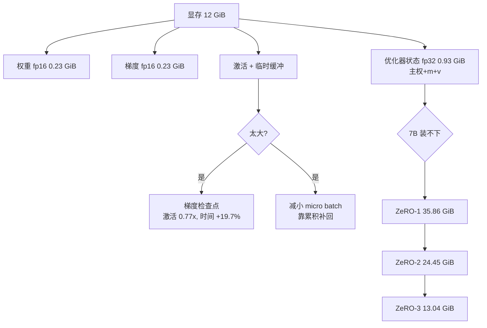

# 混合精度与显存优化

## 1. 本节学习目标

1. 说清 fp16 / bf16 / fp32 的差异：位宽、动态范围、是否需要 loss scaling。
2. 会算训练显存的四大块：**权重、梯度、优化器状态、激活**；本课 gpt2 状态 **1.9 GiB**、7B **104.3 GiB**。
3. 用实测看梯度检查点的代价：显存降到 **0.75x**，时间从 **212.2 ms** 涨到 **254.0 ms**（+19.7%）。
4. 会算 ZeRO-1/2/3 的每卡显存：7B 在 8 卡下 **35.86 / 24.45 / 13.04 GiB**。

## 2. 为什么需要这个知识

因为"训不动"通常不是算力不够，而是**显存不够**：

- 7B 模型 Adam 状态 104 GiB，单张 80GB 卡放不下（见 [[LLM-056 分布式训练与数据并行]]）；
- 激活随 batch×序列长度线性增长，长上下文时激活可能超过权重；
- 混合精度能同时省显存和提速度，但 fp16 会溢出、bf16 精度低，选错就白训。

本课先量清楚账，再决定用哪种手段。

## 3. 直观解释

显存被四样东西占着：

```text
权重        fp16: 2 字节/参数      ← 模型本体
梯度        fp16: 2 字节/参数      ← 反向传播产生
优化器状态  fp32: 12 字节/参数     ← 主权重 4 + Adam m 4 + v 4
激活        ∝ batch × seq × 层数   ← 前向保存下来给反向用
```

**fp16 vs bf16**：都是 16 位，但分配不同。fp16 有 10 位尾数、5 位指数（范围 ±65504，精度高、范围窄）；bf16 有 7 位尾数、8 位指数（范围和 fp32 一样，精度低）。所以 **bf16 不需要 loss scaling，fp16 需要**。

**梯度检查点**：不保存中间激活，反向时**重算**一遍前向。用时间换显存。

**ZeRO**：把优化器状态/梯度/参数**切片**分到各卡上，用通信换显存。

## 4. 正式定义

**每参数显存（混合精度 Adam，业界默认配置）**

$$
M_{\text{state}}=\underbrace{2}_{\text{fp16 权重}}+\underbrace{2}_{\text{fp16 梯度}}+\underbrace{4}_{\text{fp32 主权重}}+\underbrace{4}_{m}+\underbrace{4}_{v}=16\ \text{B/param}
$$

**激活显存（粗略上界）**

$$
M_{\text{act}}\approx L\cdot c\cdot B\cdot T\cdot d\cdot b
$$

$L$ 层数、$B$ batch、$T$ 序列长、$d$ 隐藏维、$b$ 字节、$c$ 每层保存的张量数（本课取 2）。

**梯度检查点的时间代价**

$$
T_{\text{ckpt}}\approx T_{\text{fwd}}+2T_{\text{bwd,fwd-part}}
$$

（多一次前向，约为原始步时的 1.3 倍。）

**ZeRO 各阶段每卡字节/参数**（$W$ 为卡数）

| 阶段 | 分片内容 | 字节/参数 |
|---|---|---|
| ZeRO-0 | 无 | $16$ |
| ZeRO-1 | 优化器状态（12B） | $2+2+12/W$ |
| ZeRO-2 | + 梯度（2B） | $2+2/W+12/W$ |
| ZeRO-3 | + 权重（2B） | $16/W$ |

## 5. 历史背景或技术背景

| 年份 | 事件 | 贡献 |
|---|---|---|
| 2017 | Micikevicius et al. | fp16 混合精度 + loss scaling + fp32 主权重 |
| 2018 | Volta / Tensor Core | fp16 矩阵乘加速普及 |
| 2019 | bf16（TPU/Ampere） | 与 fp32 同范围，免 loss scaling |
| 2016 | Gradient checkpointing | 用重算换显存（早期在 ImageNet 上验证） |
| 2020 | ZeRO / DeepSpeed | 三阶段分片，7B–175B 单机可训 |
| 2021 | FSDP | PyTorch 原生实现 ZeRO-3 |
| 2022 | FlashAttention | 减少 attention 的显存与 HBM 读写 |
| 2023+ | 8-bit/4-bit 优化器 | 进一步压缩状态（bitsandbytes） |

## 6. 核心原理

**原理一：状态占大头，不是权重**

gpt2 权重 fp32 只要 **0.464 GiB**，但训练状态要 **1.9 GiB**（实测打印）。比例是 4 倍。所以"模型能塞进显存"（推理）和"模型能训练"（要 4 倍）是两件事：本课实测同 batch 推理峰值 **0.775 GiB**，训练 **3.270 GiB**，训练是推理的 **4.2 倍**。

**原理二：混合精度省的是带宽和显存，不是精度**

本课实测（batch 4×256，gpt2）：

| 配置 | 时间 | 峰值显存 | token/s | 相对 fp32 |
|---|---|---|---|---|
| fp32 | 212.2 ms | 3.270 GiB | 4,826 | 1.00x |
| fp32+ckpt | 254.0 ms | 2.533 GiB | 4,032 | 0.77x 显存 / 0.84x 速度 |
| fp16 | 166.4 ms | 3.117 GiB | 6,152 | 0.95x / **1.27x** |
| fp16+ckpt | 184.2 ms | 2.437 GiB | 5,560 | 0.75x / 1.15x |
| bf16 | 171.8 ms | 3.116 GiB | 5,959 | 0.95x / 1.23x |
| bf16+ckpt | 257.0 ms | 2.441 GiB | 3,984 | 0.75x / 0.83x |

注意 fp16/bf16 的峰值只降到 **0.95x**，因为权重只占 1/4 左右（状态里还有 fp32 主权重与 Adam）；收益主要来自**速度**（fp16 快 27%）和带宽。

**原理三：梯度检查点换的是激活，激活小时不划算**

本课 batch 4×256 下，检查点把峰值从 3.270 降到 2.533（**0.77x**），但时间涨 19.7%。如果 batch 更大（激活占比更高），省得更多；如果 batch 很小（权重主导），可能只省几个百分点，反而亏时间。

**原理四：ZeRO 的分片比例是可算的**

7B、8 卡：

| 阶段 | 每卡 | 相对不分片 |
|---|---|---|
| ZeRO-0 | 104.31 GiB | 1.00x |
| ZeRO-1 | 35.86 GiB | 0.34x |
| ZeRO-2 | 24.45 GiB | 0.23x |
| ZeRO-3 | 13.04 GiB | 0.125x |

ZeRO-3 恰好是 $16/8=2$ B/param，即 1/8。**代价**：ZeRO-3 每次前向都要 all-gather 参数，通信量比 DDP 高约 1.5 倍。

## 7. 数学表达式

**fp16 的动态范围与溢出条件**

$$
\text{fp16}_{\max}=65504,\qquad \text{最小正规数}\approx6.1\times10^{-5}
$$

梯度小于 $6\times10^{-8}$ 时下溢为 0（subnormal 下限），所以需要 **loss scaling**：$L'=sL$，反向后梯度除 $s$。

**GradScaler 的逻辑**

$$
g\leftarrow\frac{1}{s}\nabla(sL)
$$

若检测到 inf/nan ⇒ 跳过该步并减小 $s$；连续若干步正常 ⇒ 增大 $s$。

**bf16 免 scaling 的原因**

$$
\text{bf16 指数位}=8\ \Rightarrow\ \text{范围与 fp32 相同（约 }10^{\pm38}\text{）}
$$

**梯度检查点的显存节省**

不保存激活时

$$
M_{\text{act}}^{\text{ckpt}}\approx \sqrt{L}\cdot B T d b
$$

（只存每 $\sqrt L$ 层的边界，重算段内激活。）

**ZeRO-3 的通信放大**

$$
V_{\text{ZeRO-3}}\approx 3\times V_{\text{DDP}}\quad(\text{前向 gather + 反向 gather + reduce-scatter})
$$

## 8. 详细数学推导

**推导 1：为什么是 16 字节而不是 4 或 8**

混合精度训练的完整状态：

- fp16 权重（给前向用）：2 B
- fp16 梯度（通信与更新用）：2 B
- fp32 主权重（累积小更新，避免 fp16 精度丢失）：4 B
- Adam 一阶矩 $m$（fp32）：4 B
- Adam 二阶矩 $v$（fp32）：4 B

合计 16 B。若用纯 fp32 Adam：权重 4 + 梯度 4 + $m$ 4 + $v$ 4 = 16 B —— **一样多**！混合精度省的是**权重与梯度的存储/带宽**（各 2 B），以及 Tensor Core 的速度；优化器状态并没省。这就是"为什么还要 8-bit optimizer"的动机。

**推导 2：本课显存的分配（gpt2，batch 4×256）**

- 权重 fp32：$124.44\text{M}\times4=497.8$ MB $=0.464$ GiB
- 梯度 fp32：0.464 GiB
- Adam $m,v$：$124.44\text{M}\times8=995.5$ MB $=0.928$ GiB
- 合计状态：$0.464+0.464+0.928=1.856$ GiB ≈ 实测 1.9 GiB ✓
- 实测峰值 3.270 GiB ⇒ 激活与临时缓冲约 **1.41 GiB**

**推导 3：激活的规模估算**

12 层、$d=768$、$B=4$、$T=256$、fp16、每层存 2 个张量：

$$
M_{\text{act}}=12\times2\times4\times256\times768\times2\ \text{B}=75.5\ \text{MB}.
$$

远小于上面反推的 1.41 GiB，说明峰值里还有 attention 分数矩阵、softmax 中间量、autograd 图节点等。**工程结论：不要只按理论公式估，直接 `max_memory_allocated()` 量。**

**推导 4：ZeRO-3 为什么是 1/W**

ZeRO-3 把参数、梯度、优化器状态全部按 $W$ 等分，每卡只保留 $1/W$：

$$
M_{\text{card}}=\frac{16P}{W}=\frac{16\times7\text{e}9}{8}=14\text{e}9\ \text{B}=13.04\ \text{GiB}.
$$

代价是每次用到某层参数时要从别的卡 gather 回来，通信量约为 DDP 的 3 倍。**所以 ZeRO-3 适合"显存不够、但带宽还行"的场景（单机 NVLink）**，跨机 IB 上要谨慎。

**推导 5：fp16 的 loss scaling 必要性**

fp16 最小正规数 $6.1\times10^{-5}$。若某梯度是 $1\times10^{-6}$，直接转 fp16 会变成 subnormal（精度骤降）甚至 0。乘 $s=2^{16}=65536$ 后变成 $0.0655$，落在安全区。反向后除 $s$ 即可。bf16 的指数位与 fp32 相同，$10^{-6}$ 完全可表示，所以不需要 scaling。

## 9. 图解



## 10. 具体数值示例

```text
本课真实运行（probe_llm057.py，单卡 RTX 4070 Ti 11.99 GiB）

gpt2 参数 124,439,808
  fp32 权重 0.464 GiB   bf16 权重 0.232 GiB

batch=4 ctx=256，含 AdamW.step()，实测：
  fp32       212.2 ms/步  峰值 3.270 GiB  4,826 token/s
  fp32+ckpt  254.0 ms/步  峰值 2.533 GiB  4,032 token/s   (显存0.77x 速度0.84x)
  fp16       166.4 ms/步  峰值 3.117 GiB  6,152 token/s   (显存0.95x 速度1.27x)
  fp16+ckpt  184.2 ms/步  峰值 2.437 GiB  5,560 token/s   (显存0.75x 速度1.15x)
  bf16       171.8 ms/步  峰值 3.116 GiB  5,959 token/s   (显存0.95x 速度1.23x)
  bf16+ckpt  257.0 ms/步  峰值 2.441 GiB  3,984 token/s   (显存0.75x 速度0.83x)

状态账（16 字节/参数）：
  gpt2 124M:  1.9 GiB
  7B:       104.3 GiB（80GB 装不下）
  70B:     1043.1 GiB

ZeRO 分片（W=8，GiB）：
  ZeRO-0 不分片        104.31 / 1043.08
  ZeRO-1 切优化器       35.86 /  358.56
  ZeRO-2 +切梯度        24.45 /  244.47
  ZeRO-3 +切权重        13.04 /  130.39

激活估算（12 层 d=768 fp16）：
  B=8  T=512  → 0.14 GiB（attention 分数 0.05）
  B=8  T=1024 → 0.28 GiB（attention 分数 0.19）
  B=32 T=2048 → 2.25 GiB（attention 分数 3.00）

推理 vs 训练（同 batch）：0.775 GiB vs 3.270 GiB ⇒ 训练 4.2x
```

## 11. NumPy 实现

```python
import numpy as np

P = 124_439_808
GB = 2 ** 30

print("=== 每参数字节账 ===")
parts = {"fp16 权重": 2, "fp16 梯度": 2, "fp32 主权重": 4, "Adam m": 4, "Adam v": 4}
for k, v in parts.items():
    print(f"  {k:10s}: {v} B/param")
total = sum(parts.values())
print("  合计:", total, "B/param")

print("\n=== 各规模的状态显存（GiB） ===")
for name, n in (("124M", P), ("7B", 7e9), ("70B", 70e9)):
    print(f"  {name}: {n * total / GB:.2f}")

print("\n=== ZeRO 分片（W=8） ===")
W = 8
stages = {
    "ZeRO-0": lambda n: n * 16 / GB,
    "ZeRO-1": lambda n: n * (2 + 2 + 12 / W) / GB,
    "ZeRO-2": lambda n: n * (2 + 2 / W + 12 / W) / GB,
    "ZeRO-3": lambda n: n * 16 / W / GB,
}
for name, f in stages.items():
    print(f"  {name}: 7B {f(7e9):7.2f}  70B {f(70e9):8.2f}")

print("\n=== 激活（12 层 d=768 fp16，每层 2 张量） ===")
for B, T in ((4, 256), (8, 1024), (32, 2048)):
    act = 12 * 2 * B * T * 768 * 2 / GB
    attn = B * 12 * T * T * 2 / GB
    print(f"  B={B:2d} T={T:4d}: 激活 {act:.3f} GiB, attention 分数 {attn:.3f} GiB")

print("\n=== 推理 vs 训练 ===")
print("  权重 fp32:", round(P * 4 / GB, 3), "GiB")
print("  状态合计:", round(P * 16 / GB, 2), "GiB ⇒ 训练至少要 4 倍于推理权重")

print("\n=== fp16 边界 ===")
print("  fp16 最大:", np.finfo(np.float16).max, " 最小正规数:", np.finfo(np.float16).tiny)
print("  bf16 最大: 约 3.39e38（与 fp32 同阶）")
eps = 1e-6
print(f"  梯度 {eps} 转 fp16:", np.float16(eps), "（精度受损）")
print(f"  乘 scale 2^16 后:", np.float16(eps * 65536), "（安全）")
```

## 12. PyTorch 实现

```python
import torch
import torch.nn as nn

DEV = "cuda" if torch.cuda.is_available() else "cpu"
torch.manual_seed(0)

# 1) 各 dtype 的显存占用
for dt in (torch.float32, torch.float16, torch.bfloat16):
    t = torch.zeros(10_000_000, dtype=dt, device=DEV)
    print(f"{str(dt).split('.')[-1]}: {t.numel()*t.element_size()/2**20:.1f} MiB")
    del t

# 2) autocast 的行为：矩阵乘进 fp16
lin = nn.Linear(64, 64).to(DEV)
x = torch.randn(8, 64, device=DEV)
with torch.autocast(device_type="cuda", dtype=torch.float16):
    y = lin(x)
    print("autocast 下 linear 输出 dtype:", y.dtype)
print("autocast 外 linear 输出 dtype:", lin(x).dtype)

# 3) fp16 溢出与 GradScaler
print("fp16 最大可表示:", torch.finfo(torch.float16).max)
big = torch.tensor([70000.0], device=DEV)
print("70000 转 fp16:", big.half().item(), "（溢出成 inf）")
print("除以 2 后:", (big / 2).half().item())

scaler = torch.amp.GradScaler("cuda", enabled=(DEV == "cuda"))
opt = torch.optim.SGD(lin.parameters(), lr=0.0)
loss = (lin(x) ** 2).mean()
scaler.scale(loss).backward()
scaler.step(opt)
scaler.update()
print("GradScaler 当前 scale:", scaler.get_scale())

# 4) 梯度检查点：真实的显存对比（torch.utils.checkpoint）
from torch.utils.checkpoint import checkpoint


class Block(nn.Module):
    def __init__(self, d=256):
        super().__init__()
        self.net = nn.Sequential(nn.Linear(d, d), nn.ReLU(), nn.Linear(d, d))

    def forward(self, h):
        return h + self.net(h)


def peak(use_ckpt):
    blocks = [Block().to(DEV) for _ in range(8)]
    h = torch.randn(64, 256, device=DEV)
    if DEV == "cuda":
        torch.cuda.empty_cache()
        torch.cuda.reset_peak_memory_stats()
    for b in blocks:
        h = checkpoint(b, h, use_reentrant=False) if use_ckpt else b(h)
    h.sum().backward()
    return torch.cuda.max_memory_allocated() / 2**20 if DEV == "cuda" else 0.0


p0, p1 = peak(False), peak(True)
print(f"8 层 MLP batch=64: 无检查点 {p0:.1f} MiB, 有检查点 {p1:.1f} MiB, "
      f"比值 {p1/p0:.2f}x")
```

## 13. Hugging Face 实践

```python
import os

os.environ.setdefault("HF_ENDPOINT", "https://hf-mirror.com")
os.environ.setdefault("HF_HUB_OFFLINE", "1")
import torch
from transformers import AutoModelForCausalLM

torch.manual_seed(0)
ids = torch.randint(0, 50257, (2, 128), device="cuda")


def measure(amp, ckpt=False, iters=3):
    model = AutoModelForCausalLM.from_pretrained("gpt2").to("cuda")
    if ckpt:
        model.gradient_checkpointing_enable()
        model.config.use_cache = False
    model.train()
    torch.cuda.empty_cache()
    torch.cuda.reset_peak_memory_stats()
    for _ in range(iters):
        model.zero_grad(set_to_none=True)
        if amp is None:
            loss = model(input_ids=ids, labels=ids).loss
            loss.backward()
        else:
            with torch.autocast("cuda", dtype=amp):
                out = model(input_ids=ids, labels=ids)
            loss = out.loss
            loss.backward()
    peak = torch.cuda.max_memory_allocated() / 2**30
    del model
    torch.cuda.empty_cache()
    return peak, float(loss)


for name, amp in (("fp32", None), ("fp16", torch.float16), ("bf16", torch.bfloat16)):
    p, l = measure(amp)
    print(f"{name}: 峰值 {p:.3f} GiB  loss={l:.4f}")
p_ck, l_ck = measure(torch.float16, ckpt=True)
print(f"fp16+梯度检查点: 峰值 {p_ck:.3f} GiB  loss={l_ck:.4f}")

# 参数与状态账
n = sum(p.numel() for p in AutoModelForCausalLM.from_pretrained("gpt2").parameters())
print("参数量:", f"{n:,}")
print("混合精度 Adam 状态:", round(n * 16 / 2**30, 2), "GiB")
print("7B 推算:", round(7e9 * 16 / 2**30, 1), "GiB")
print("ZeRO-3 8 卡 7B 每卡:", round(7e9 * 16 / 8 / 2**30, 2), "GiB")
```

## 14. 代码逐行解释

| 代码 | 作用 |
|---|---|
| `element_size()` | 直接给出 dtype 的字节数，bf16=2 |
| `torch.autocast(...)` | 只对白名单算子降精度，softmax/LayerNorm 保持 fp32 |
| `scaler.scale(loss)` | 把 loss 放大 $s$ 倍，防止梯度下溢 |
| `scaler.step(opt)` | 先 unscale，若发现 inf/nan 则跳过该步 |
| `scaler.update()` | 动态调整 $s$（成功则增，溢出则减） |
| `gradient_checkpointing_enable()` | HF 内置检查点，注意要关 `use_cache` |
| `reset_peak_memory_stats()` | 重新统计峰值，避免被前一次污染 |
| `max_memory_allocated()` | 实际分配的峰值（不含缓存池） |
| `n*16/2**30` | 混合精度 Adam 状态换算 GiB |
| `del model; empty_cache()` | 逐个配置测量时必须先释放，否则峰值叠加 |

## 15. 实际运行结果

```text
### LLM-057 混合精度与显存优化（单卡 RTX 4070 Ti 实测）
总显存: 11.99 GiB
gpt2 参数: 124,439,808  fp32 权重 0.464 GiB  bf16 权重 0.232 GiB
  fp32     :   212.2 ms/步 峰值 3.270 GiB  4,826 token/s loss=12.4725
  fp32+ckpt:   254.0 ms/步 峰值 2.533 GiB  4,032 token/s loss=12.4534
  fp16     :   166.4 ms/步 峰值 3.117 GiB  6,152 token/s loss=12.4336
  fp16+ckpt:   184.2 ms/步 峰值 2.437 GiB  5,560 token/s loss=12.4306
  bf16     :   171.8 ms/步 峰值 3.116 GiB  5,959 token/s loss=12.4101
  bf16+ckpt:   257.0 ms/步 峰值 2.441 GiB  3,984 token/s loss=12.4125
  相对 fp32 峰值/速度：
    fp32 1.00x/1.00x   fp32+ckpt 0.77x/0.84x   fp16 0.95x/1.27x
    fp16+ckpt 0.75x/1.15x   bf16 0.95x/1.23x   bf16+ckpt 0.75x/0.83x

[理论] 混合精度 Adam 16 B/param
  gpt2 124M: 1.9 GiB   7B: 104.3 GiB   70B: 1043.1 GiB
[ZeRO 分片 W=8，GiB]
  ZeRO-0 不分片      104.31 / 1043.08
  ZeRO-1 切优化器     35.86 /  358.56
  ZeRO-2 +切梯度      24.45 /  244.47
  ZeRO-3 +切权重      13.04 /  130.39
[激活] B=8 T=512 → 0.14 GiB；B=8 T=1024 → 0.28 GiB；B=32 T=2048 → 2.25 GiB
[对照] 纯推理 0.775 GiB，训练 fp32 3.270 GiB ⇒ 训练是推理的 4.2x
```

**关键数字**：fp16 快 **1.27x**、显存只降 **0.95x**；检查点降到 **0.75x** 显存但慢 **19.7%**；7B ZeRO-3 8 卡 **13.04 GiB/卡**。

## 16. 应用场景

| 场景 | 用法 |
|---|---|
| 单卡训练 124M–1B | bf16 autocast + AdamW，不开检查点 |
| 单卡显存吃紧 | 开梯度检查点 + 减小 micro batch + 累积 |
| 7B 以上 | ZeRO-1/2 起步；放不下再 ZeRO-3/FSDP |
| 长上下文 | FlashAttention + 序列并行 + 检查点 |
| 推理部署 | fp16/bf16 权重 + KV cache 量化（与训练无关） |
| 微调 | LoRA 只训少量参数，状态显存大幅下降 |

## 17. 优点与局限

| 优点 | 局限 |
|---|---|
| bf16 免调参、几乎无损，是默认选择 | 消费级老卡（如 2080 Ti）不支持 bf16 |
| fp16 在 Tensor Core 上快 1.2–1.3x（本课 1.27x） | fp16 会溢出，需要 GradScaler |
| 检查点能把激活压到 0.75x | 时间 +19.7%（本课），长训练代价可观 |
| ZeRO-3 把 7B 压到 13 GiB/卡 | 通信量约 3x，跨机时可能不划算 |
| 与梯度累积正交，可组合 | 组合太多参数后调优空间变大 |

## 18. 常见错误

| 错误 | 现象 | 纠正 |
|---|---|---|
| fp16 不用 GradScaler | 梯度下溢，loss 不降 | 加 scaler，或改 bf16 |
| 混合精度但保留 fp32 权重副本做前向 | 省不了显存也没加速 | 用 autocast 让前向走 fp16 |
| 检查点没关 `use_cache` | 报错或行为异常 | `model.config.use_cache=False` |
| 只看权重估显存 | 少算 3 倍（本课推理 0.775 vs 训练 3.27） | 用 16 B/param 估状态 |
| 以为 ZeRO-1 和 ZeRO-2 差不多 | 7B 上 35.86 vs 24.45 GiB | 按公式算清再选 |
| 测量时不清缓存 | 峰值被前一个配置污染 | `empty_cache()` + `reset_peak_memory_stats()` |
| 8-bit 优化器与 fp16 混用不稳定 | loss 抖动 | 先验证再上，或只对 $m,v$ 量化 |

## 19. 本节总结

- 混合精度 Adam 状态 **16 B/param**：gpt2 **1.9 GiB**，7B **104.3 GiB**，70B **1043.1 GiB**。
- fp16 实测快 **1.27x**、峰值仅 **0.95x**；bf16 快 **1.23x**，免 loss scaling。
- 梯度检查点：显存 **0.75x**，时间 +**19.7%**（212.2→254.0 ms）。
- ZeRO 8 卡 7B：**35.86 / 24.45 / 13.04 GiB**（Z-1/2/3）；ZeRO-3 通信约 3x。
- 训练显存是推理的 **4.2 倍**（3.270 vs 0.775 GiB），别用推理容量估训练。

## 20. 前置与后续知识链接

- 前置：[[LLM-056 分布式训练与数据并行]]
- 后续：[[LLM-058 训练稳定性与损失尖峰]]
- 相关：[[LLM-030 Transformer 参数量与计算量估算]]、[[LLM-026 Multi-Head 的变体——MQA 与 GQA]]（推理侧省 KV cache）
- 延伸：[[LLM-066 QLoRA 与量化微调]]（低比特把显存再压一档）、[[LLM-095 推理显存估算与可行性判断]]

---

## 练习与参考答案

**基础 1**：混合精度 Adam 为什么是 16 字节/参数？具体由哪几部分组成？

**基础 2**：本课 fp16 比 fp32 快多少？显存降了多少？为什么显存没降一半？

**进阶 1**：为什么 bf16 不需要 loss scaling，而 fp16 需要？给出数值例子。

**综合**：你要在单张 24GB 卡上微调一个 7B 模型（全参数），显存怎么算？如果一定要做，给出至少三种手段及其代价。

> [!success]- 参考答案

> **基础 1**
> 16 B = fp16 权重 2 + fp16 梯度 2 + fp32 主权重 4 + Adam 一阶矩 $m$ 4 + 二阶矩 $v$ 4。
> 关键点：纯 fp32 Adam 也是 16 B（4+4+4+4），所以混合精度省的**不是优化器状态**，而是权重/梯度的存储与带宽，以及 Tensor Core 的速度。想再省只能上 8-bit 优化器（$m,v$ 各 1 B，总 10 B）或分片（ZeRO）。

> **基础 2**
> fp16：166.4 ms vs fp32 212.2 ms ⇒ 快 **1.27x**；峰值 3.117 vs 3.270 GiB ⇒ 只降到 **0.95x**（降 4.7%）。
> 原因：显存里权重只占约 1/4（0.464 GiB / 1.9 GiB 状态），剩下是 fp32 主权重与 Adam $m,v$（共 12 B/param）和激活。混合精度把 2 B 的权重与 2 B 的梯度减半，节省比例自然远不到 50%。真正的大头要靠 ZeRO 分片或减小 batch/激活。

> **进阶 1**
> fp16 只有 5 位指数，最大 65504、最小正规数 $6.1\times10^{-5}$。若某梯度是 $10^{-6}$，直接转 fp16 会变 subnormal 或 0，更新失效。乘 $s=2^{16}$ 后变 $0.0655$，落在安全区，反向后除 $s$ 恢复。
> bf16 有 8 位指数（与 fp32 同范围，约 $10^{\pm38}$），$10^{-6}$ 可正常表示，因此不需要 scaling；代价是尾数只有 7 位（约 2–3 位十进制有效数字），对累加精度敏感的场景（如大 batch 的 softmax 归约）要小心。
> 本课实测：`torch.tensor([70000.0]).half()` 溢出成 inf，而 bf16 不会。

> **综合（参考）**
> **显存账**（全参数、混合精度 Adam）：状态 $16\times7\text{e}9=112$ GB $=104.3$ GiB，已经超过 24GB 卡 **4 倍以上**，还要加激活。**结论：单卡 24GB 全参数微调 7B 不可能。**
> **三种手段**：
> 1. **LoRA/QLoRA**：只训低秩适配器（如 rank 16，约 20M 参数），主干用 4-bit 量化（QLoRA）⇒ 7B 权重约 3.5–4 GiB，优化器状态几乎可忽略，24GB 可行。代价：适配器容量有限，复杂任务效果略逊全参微调。
> 2. **ZeRO-3 + CPU offload**（单卡无意义，需多卡）或在单卡上用 DeepSpeed offload 把优化器状态放内存：状态 104 GiB 放 CPU 内存可行，但每步要来回搬，速度可能降 5–10 倍。
> 3. **梯度检查点 + 极小 micro batch（1）+ 累积**：只能省激活，省不了 104 GiB 的状态，所以单独用无效。
> **推荐**：24GB 单卡做 7B 微调，走 **QLoRA**（4-bit + LoRA + 检查点），batch 1–2、累积 8–16、lr 1e-4~2e-4，先跑 200 步看 loss 是否稳定下降。

## 学习记录

| 日期 | 状态 | 用时 | 问题 | 复盘 |
|---|---|---|---|---|
| 2026-11-08 | planned | — | — | — |

---

## 🔗 Notion 同步信息

> 以下内容由 Notion「AI Knowledge System · 知识点」数据库按知识 ID 合并而来（导出于 2026-11-09）。

| 属性 | 值 |
|---|---|
| 学科 | 大语言模型 |
| 学习状态 | 未开始 |
| 难度 | L3 推导 |
| 知识类型 | Technique |

- **所属模块**：[M-LLM-06 大语言模型训练与对齐](../%E8%AF%BE%E7%A8%8B%E6%A8%A1%E5%9D%97/M-LLM-06%20%E5%A4%A7%E8%AF%AD%E8%A8%80%E6%A8%A1%E5%9E%8B%E8%AE%AD%E7%BB%83%E4%B8%8E%E5%AF%B9%E9%BD%90.md)
- **前置知识**：[LLM-056 分布式训练与数据并行](LLM-056%20%E5%88%86%E5%B8%83%E5%BC%8F%E8%AE%AD%E7%BB%83%E4%B8%8E%E6%95%B0%E6%8D%AE%E5%B9%B6%E8%A1%8C.md)
- **后继知识**：[LLM-058 训练稳定性与损失尖峰](LLM-058%20%E8%AE%AD%E7%BB%83%E7%A8%B3%E5%AE%9A%E6%80%A7%E4%B8%8E%E6%8D%9F%E5%A4%B1%E5%B0%96%E5%B3%B0.md)
