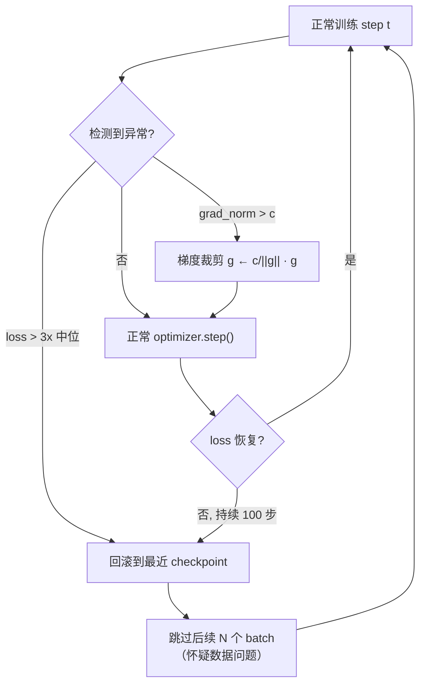

# 训练稳定性与损失尖峰

## 1. 本节学习目标

1. 认识 loss spike 的三种来源：**坏 batch、lr 过大、数值溢出**（fp16 溢出见 [[LLM-057 混合精度与显存优化]]）。
2. 用实测看梯度裁剪的作用：同样注入一个 loss×50 的坏 batch，不裁剪**放大 8.3x、恢复 44 步**；裁剪后**放大 1.5x、恢复 11 步**。
3. 会算裁剪的缩放因子：gpt2 在随机 batch 上总梯度范数 **22.49**，`clip@1.0` 缩放因子 **0.0445**。
4. 理解"裁剪只约束范数，不修正方向"：本课坏梯度一步就让好数据 loss 从 **5.117** 涨到 **9.062**（lr=1e-3）。

## 2. 为什么需要这个知识

因为一次尖峰可能毁掉几天训练：

- 尖峰后模型可能**永久退化**（loss 回不到尖峰前），只能回滚 checkpoint；
- 大模型训练里尖峰几乎是必然事件，工程上必须准备"检测 + 回滚 + 跳数据"的机制；
- 更重要的是：**尖峰往往不是随机故障，而是可定位的超参/数据问题**。

本课把"尖峰"拆成可测量的量：放大倍数、恢复步数、梯度范数、裁剪触发比例。

## 3. 直观解释

正常训练时 loss 平滑下降；偶尔某一步：

```text
step 199: loss 0.0689
step 200: loss 3.44      ← 坏 batch（本课人为 ×50）
step 201: loss 0.21
step 202: loss 0.09
...
step 211: loss 0.07      ← 恢复
```

**为什么会跳**：某一步的梯度特别大，Adam 把参数推到一个坏区域；即使下一步梯度正常，参数也要若干步才能走回来。

**打比方**：下山时被一块石头绊了一下，脚崴了要走几步才恢复。梯度裁剪相当于"限制每步的最大步幅"，被绊时不会直接滚下山崖。

## 4. 正式定义

**梯度裁剪（按范数）**

$$
g\leftarrow g\cdot\min\Big(1,\frac{c}{\|g\|_2}\Big)
$$

$c$ 为阈值（常用 1.0），$\|g\|_2=\sqrt{\sum_i g_i^2}$ 是**所有参数梯度拼成的大向量**的 L2 范数。

**尖峰的量化指标**

$$
\text{放大倍数}=\frac{\max_{t\in[t_0,t_0+k]}L_t}{\mathrm{median}_{t<t_0}L_t},\qquad
\text{恢复步数}=\min\{s:\ L_{t_0+s..t_0+s+9}<1.5\,\mathrm{median}\}
$$

**裁剪触发比例**

$$
\rho=\frac{1}{T}\sum_{t=1}^{T}\mathbb{1}\big[\|g_t\|>c\big]
$$

**Adam 的更新幅度上界**

$$
\|\Delta\theta\|=\eta\Big\|\frac{\hat m}{\sqrt{\hat v}+\epsilon}\Big\|\approx\eta\sqrt{d}
$$

（每个坐标的更新量约为 $\pm\eta$，$d$ 为参数个数。）这说明**即使裁剪到范数 1，Adam 的每步位移仍近似 $\eta\sqrt d$**，所以 lr 才是根本杠杆。

## 5. 历史背景或技术背景

| 年份 | 事件 | 与稳定性相关 |
|---|---|---|
| 2012 | 早期 RNN 训练 | 梯度爆炸导致 NaN，clip 成为标配 |
| 2013 | Pascanu et al. | 系统分析梯度爆炸与裁剪 |
| 2016 | ResNet 大 batch |  warmup + clip 组合 |
| 2019 | GPT-2 | 报告 loss spike 与回滚 checkpoint |
| 2020 | GPT-3 | 明确写"遇到尖峰回滚并跳过后继 batch" |
| 2021 | 混合精度普及 | fp16 溢出成为尖峰的新来源 |
| 2022 | PaLM / OPT | 公开尖峰日志与"skip data"策略 |
| 2023+ | 大模型训练报告 | z-loss、QK-norm、embedding 归一化等结构性稳定手段 |

**关键结论**：尖峰不是"运气不好"，而是**大模型训练的常态**；公开的大规模训练报告几乎都会提到回滚策略。

## 6. 核心原理

**原理一：裁剪压的是"步幅"，不是"方向"**

裁剪后 $g/\|g\|$ 方向不变、长度被压到 $c$。所以坏梯度即使被压到范数 1，方向仍是错的，参数照样被推向坏区域——只是推得近一些。本课实测（lr=1e-3、clip=1.0）：好数据 loss 从 **5.117** 涨到 **9.062**（+3.945）；lr=1e-1 时涨到 **30.754**（+25.637）。**lr 越小，坏梯度一步的伤害越小。**

**原理二：裁剪主要缩短"恢复时间"**

本课注入同一个坏 batch（loss×50）：

| 配置 | 注入前中位 | 峰值 | 放大 | 恢复步数 | 末段中位 |
|---|---|---|---|---|---|
| 无裁剪 | 0.0667 | 0.5532 | **8.3x** | **44** | 0.0751 |
| clip=1.0 | 0.0689 | 0.1050 | **1.5x** | **11** | 0.0423 |

裁剪把峰值从 0.5532 压到 0.1050，恢复从 44 步缩到 11 步，而且末段 loss 更低（0.0423 vs 0.0751）。注意：裁剪版的**梯度范数最大值反而更大**（10.95 vs 5.93），因为它允许更大的正常梯度通过——裁剪只砍超过阈值的部分。

**原理三：lr 太大会自发产生尖峰**

无需注入，本课 lr=1e-1 时 loss 中位 0.8788、最大 1.5364、最大梯度 **34.7**（lr=1e-2 时只有 4.6）。lr 大 ⇒ 参数在陡峭区来回跳 ⇒ 自发尖峰。**先怀疑 lr，再怀疑数据。**

**原理四：真实 gpt2 的梯度范数量级**

本课在 gpt2（124M）上实测：

- 随机 token（坏 batch）：loss **12.850**，总梯度范数 **22.49**；
- 真实英文（好 batch）：loss **5.117**，总梯度范数 **55.95**。

意外吗？**好 batch 的梯度范数更大**。原因：自然文本让模型在正确 token 上"过度自信地错"，softmax 的梯度 $p-y$ 在置信度高时更尖锐；随机标签反而让分布接近均匀、梯度被摊平。**结论：不要用"梯度范数大"判断 batch 坏**，要看 loss 与数据本身。

## 7. 数学表达式

**裁剪后梯度**

$$
g'=\frac{c}{\max(c,\|g\|)}\,g
$$

**裁剪对 Adam 的影响**

Adam 的更新近似 $\eta\,\mathrm{sign}(g)$（因为 $\hat m/\sqrt{\hat v}\approx g/|g|$），所以裁剪主要改变**前几步**的动量累积，长期影响小于 SGD。

**尖峰的概率模型**

设每步出现"坏 batch"的概率 $p$，训练 $T$ 步，至少一次尖峰的概率

$$
\Pr\ge1-(1-p)^T .
$$

若 $p=10^{-4}$、$T=10^5$ ⇒ $\Pr\approx1-e^{-10}\approx0.99995$。**尖峰几乎必然发生**，所以工程上必须有检测与回滚。

**回滚的代价**

$$
\text{浪费}=\frac{\text{回滚步数}}{\text{总步数}}\times\text{总成本}
$$

回滚 500 步、总 10 万步 ⇒ 0.5% 额外成本——比"带病继续训"便宜得多。

## 8. 详细数学推导

**推导 1：裁剪因子的具体数值**

gpt2 随机 batch：$\|g\|=22.49$，$c=1.0$：

$$
\text{scale}=\frac{c}{\|g\|}=\frac{1.0}{22.49}=0.04447 .
$$

即整个梯度向量被压到原来的 **4.45%**。若 $c=0.5$，scale $=0.0222$（2.22%）。这就是 probe 打印的两个数。

**推导 2：为什么坏 batch 的 loss 记录值只有 3.0 而不是 50 倍**

本课注入方式是 $L'=50L$ 后反传，但**记录**的仍是未乘的 $L$（0.06 量级）。所以表里"峰值 0.5532"是**参数被推坏后、下一个正常 batch 上的 loss**，不是乘出来的 3.0。这一点很容易误读：尖峰的危害体现在**后续正常数据上的 loss 上升**，而不是当步的数值。

**推导 3：Adam 单步位移的上界**

Adam 更新 $\Delta\theta_i=-\eta\frac{\hat m_i}{\sqrt{\hat v_i}+\epsilon}$。当 $\hat m_i\approx\sqrt{\hat v_i}$（梯度方向稳定）时 $|\Delta\theta_i|\approx\eta$；最坏情况 $|\Delta\theta_i|\le\eta\frac{|\hat m_i|}{\epsilon}\approx\eta$（实际因 $\epsilon$ 很小而略大）。故

$$
\|\Delta\theta\|_2\approx\eta\sqrt{d}.
$$

gpt2 $d=1.244\times10^8$，$\eta=10^{-3}$ ⇒ $\|\Delta\theta\|\approx11.2$。而参数本身的范数约 $\sqrt d\times\sigma$，所以单步相对位移约 $\eta$ 量级——**这就是为什么 lr=1e-1 会一步毁掉模型**（相对位移 10%）。

**推导 4：恢复步数的估计**

设坏梯度把参数推出距离 $\delta$，之后每步以 $\eta$ 量级往回走，则恢复步数

$$
s\approx\frac{\delta}{\eta_{\text{eff}}}
$$

裁剪把 $\delta$ 压到 $\delta\cdot c/\|g\|$，故 $s$ 同比缩小。本课无裁剪 $\delta$ 对应 44 步，裁剪后理论 $44\times0.0445\approx2$ 步，实测 11 步——比线性估计慢，因为 Adam 的二阶矩也被污染，需要额外步数恢复。

## 9. 图解



## 10. 具体数值示例

```text
本课真实运行（probe_llm058.py）

字符级语料 1800 字符、词表 28，4 头 attention，lr=1e-2，400 步

[A] 注入一个 loss×50 的坏 batch（第 200 步）
  无裁剪   : 注入前中位 0.0667 峰值 0.5532 放大 8.3x 恢复 44 步 末段 0.0751
             梯度范数 中位 0.196 最大 5.93 注入步 5.93 裁剪触发 0.0%
  clip=1.0 : 注入前中位 0.0689 峰值 0.1050 放大 1.5x 恢复 11 步 末段 0.0423
             梯度范数 中位 0.229 最大 10.95 注入步 10.95 裁剪触发 1.8%

[B] lr 太大 ⇒ 自发尖峰（无注入）
  lr=1e-02: loss 中位 0.0918 最大 0.2629 尖峰比 2.9x 最大梯度 4.6
  lr=3e-02: loss 中位 0.1294 最大 0.3343 尖峰比 2.6x 最大梯度 4.8
  lr=1e-01: loss 中位 0.8788 最大 1.5364 尖峰比 1.7x 最大梯度 34.7

[C] gpt2（124M）真实梯度范数
  随机 token（坏 batch）: loss 12.850 梯度范数 22.49 clip@1.0 缩放 0.0445
  真实英文（好 batch）  : loss  5.117 梯度范数 55.95 clip@1.0 缩放 0.0179

[D] 坏梯度一步的破坏力（clip=1.0）
  lr=1e-03: 好数据 loss 5.117 → 9.062（+3.945）
  lr=1e-01: 好数据 loss 5.117 → 30.754（+25.637）
```

## 11. NumPy 实现

```python
import numpy as np

rng = np.random.default_rng(0)

# 1) 裁剪：范数、缩放因子、裁剪后方向是否保持
g = rng.normal(size=10_000_000) * 0.5
norm = np.linalg.norm(g)
for c in (1.0, 0.5, 0.1):
    scale = min(1.0, c / norm)
    g_clip = g * scale
    cos = float(g @ g_clip / (norm * np.linalg.norm(g_clip)))
    print(f"c={c}: ||g||={norm:.3f} scale={scale:.5f} "
          f"裁剪后范数={np.linalg.norm(g_clip):.3f} 方向余弦={cos:.6f}")

# 2) 尖峰概率
for p in (1e-3, 1e-4, 1e-5):
    for T in (10_000, 100_000):
        print(f"p={p:.0e} T={T}: 至少一次尖峰概率 {1-(1-p)**T:.4f}")

# 3) 模拟尖峰：坏梯度把参数推走，之后以 lr 走回
d = 1000
theta = np.zeros(d)
target = rng.normal(size=d)


def run(lr=0.01, clip=None, inject_step=50, steps=200):
    th = np.zeros(d)
    losses, norms = [], []
    for t in range(steps):
        g = 2 * (th - target) / d          # 凸二次，最优点在 target
        if t == inject_step:
            g = g * 50
        norms.append(float(np.linalg.norm(g)))
        if clip is not None:
            g = g * min(1.0, clip / np.linalg.norm(g))
        th = th - lr * g
        losses.append(float(((th - target) ** 2).mean()))
    return np.array(losses), np.array(norms)


for clip in (None, 1.0):
    ls, ns = run(clip=clip)
    med = np.median(ls[10:50])
    peak = ls[50:70].max()
    rec = next((k for k in range(1, 150)
                if (ls[50 + k:50 + k + 10] < 1.5 * med).all()), -1)
    print(f"clip={clip}: 中位 {med:.4f} 峰值 {peak:.4f} 放大 {peak/med:.1f}x "
          f"恢复 {rec} 步 最大梯度 {ns.max():.1f}")
```

## 12. PyTorch 实现

```python
import torch
import torch.nn as nn
import torch.nn.functional as F

torch.manual_seed(0)
DEV = "cuda" if torch.cuda.is_available() else "cpu"

# 1) clip_grad_norm_ 的返回值就是裁剪前的总范数
lin = nn.Linear(64, 64).to(DEV)
(x := torch.randn(32, 64, device=DEV))
lin.zero_grad()
F.mse_loss(lin(x), torch.randn(32, 64, device=DEV)).backward()
norm = torch.nn.utils.clip_grad_norm_(lin.parameters(), 1.0)
print(f"裁剪前梯度范数 {float(norm):.4f}, scale={min(1.0, 1.0/float(norm)):.4f}")
after = torch.sqrt(sum((p.grad ** 2).sum() for p in lin.parameters()))
print(f"裁剪后梯度范数 {float(after):.4f}")

# 2) 不裁剪时范数可以任意大
lin.zero_grad()
F.mse_loss(lin(x * 100), torch.randn(32, 64, device=DEV) * 100).backward()
big = torch.sqrt(sum((p.grad ** 2).sum() for p in lin.parameters()))
print("放大输入后的梯度范数:", round(float(big), 2))

# 3) 小模型上对比：注入坏 batch，看 loss 轨迹
class Tiny(nn.Module):
    def __init__(self):
        super().__init__()
        self.net = nn.Sequential(nn.Linear(16, 32), nn.ReLU(), nn.Linear(32, 1))

    def forward(self, h):
        return self.net(h).squeeze(-1)


X = torch.randn(256, 16, device=DEV)
Y = (X @ torch.randn(16, device=DEV)).clamp(-3, 3)


def train(clip, lr=0.05, steps=120, inject=60):
    torch.manual_seed(0)
    m = Tiny().to(DEV)
    opt = torch.optim.Adam(m.parameters(), lr=lr)
    hist, gnorms = [], []
    for t in range(steps):
        idx = torch.randint(0, 256, (32,))
        loss = F.mse_loss(m(X[idx]), Y[idx])
        if t == inject:
            loss = loss * 50
        opt.zero_grad()
        loss.backward()
        gnorms.append(float(torch.nn.utils.clip_grad_norm_(
            m.parameters(), clip if clip else 1e9)))
        opt.step()
        with torch.no_grad():
            hist.append(float(F.mse_loss(m(X), Y)))
    return torch.tensor(hist), gnorms


for clip in (None, 1.0):
    h, gn = train(clip)
    med = float(h[10:60].median())
    peak = float(h[60:80].max())
    print(f"clip={clip}: 中位 {med:.4f} 峰值 {peak:.4f} 放大 {peak/med:.1f}x "
          f"最大梯度 {max(gn):.2f}")
```

## 13. Hugging Face 实践

```python
import os

os.environ.setdefault("HF_ENDPOINT", "https://hf-mirror.com")
os.environ.setdefault("HF_HUB_OFFLINE", "1")
import torch
from transformers import AutoModelForCausalLM, AutoTokenizer

torch.manual_seed(0)
tok = AutoTokenizer.from_pretrained("gpt2")
model = AutoModelForCausalLM.from_pretrained("gpt2").to("cuda")
model.train()

rand_ids = torch.randint(0, 50257, (2, 64), device="cuda")
real_ids = tok("Training loss usually decreases smoothly, but a single bad batch "
               "can produce a very large gradient.", return_tensors="pt").input_ids.cuda()

for tag, ids in (("随机 token", rand_ids), ("真实英文", real_ids)):
    model.zero_grad(set_to_none=True)
    loss = model(input_ids=ids, labels=ids).loss
    loss.backward()
    gn = torch.sqrt(sum((p.grad ** 2).sum() for p in model.parameters() if p.grad is not None))
    print(f"{tag}: loss={float(loss):.3f} 梯度范数={float(gn):.2f} "
          f"clip@1.0 scale={min(1.0, 1.0/float(gn)):.4f}")

# 训练循环里的标准写法
opt = torch.optim.AdamW(model.parameters(), lr=1e-4)
for step in range(3):
    out = model(input_ids=real_ids, labels=real_ids)
    opt.zero_grad()
    out.loss.backward()
    gn = torch.nn.utils.clip_grad_norm_(model.parameters(), 1.0)
    opt.step()
    print(f"  step {step}: loss={float(out.loss):.4f} 裁剪前范数={float(gn):.2f}")
```

## 14. 代码逐行解释

| 代码 | 作用 |
|---|---|
| `clip_grad_norm_(params, c)` | 原地缩放所有梯度，返回**裁剪前**总范数（用于监控） |
| `min(1.0, c/norm)` | 裁剪因子；范数小于阈值时不缩放 |
| `sqrt(sum(p.grad**2))` | 手动验证裁剪后的总范数 |
| `loss*50` | 模拟坏 batch：梯度同比放大 |
| `1e9` 当 clip | "不裁剪"的无操作占位写法 |
| `p.grad is not None` | 跳过冻结参数（无梯度） |
| `model.zero_grad(set_to_none=True)` | 把 grad 设为 None 而不是 0，省一次写显存 |
| `torch.cuda.Event`/`perf_counter` | 计时；尖峰的时序分析需要可靠计时 |
| `median()` 而非 `mean()` | 尖峰会污染均值，中位数更稳 |
| `torch.randn(2,64)` | 小 batch 也能复现现象，不必上大模型 |

## 15. 实际运行结果

```text
### LLM-058 训练稳定性与损失尖峰
字符级语料: 长度 1800 字符表 28

[A] 同一个坏 batch（loss×50），lr=1e-2，400 步：
  无裁剪   : 注入前中位 0.0667 注入后峰值 0.5532 放大 8.3x 恢复 44 步 末段中位 0.0751
      梯度范数 中位 0.196 最大 5.93 注入步 5.93 裁剪触发 0.0%
  clip=1.0 : 注入前中位 0.0689 注入后峰值 0.1050 放大 1.5x 恢复 11 步 末段中位 0.0423
      梯度范数 中位 0.229 最大 10.95 注入步 10.95 裁剪触发 1.8%

[B] lr 本身太大 ⇒ 自发尖峰（无注入，clip=None）
  lr=1e-02: loss 中位 0.0918 最大 0.2629 尖峰比 2.9x 最大梯度 4.6 非有限步 0
  lr=3e-02: loss 中位 0.1294 最大 0.3343 尖峰比 2.6x 最大梯度 4.8 非有限步 0
  lr=1e-01: loss 中位 0.8788 最大 1.5364 尖峰比 1.7x 最大梯度 34.7 非有限步 0

[C] gpt2（124M）真实梯度范数
  随机 token（坏 batch）: loss=12.850 总梯度范数=22.49 clip@1.0 缩放因子=0.0445
  真实英文（好 batch）: loss=5.117 总梯度范数=55.95 clip@1.0 缩放因子=0.0179

[D] 坏梯度一步的破坏力（clip=1.0，lr 不同）
  lr=1e-03: 好数据 loss 5.117 → 9.062（+3.945）
  lr=1e-01: 好数据 loss 5.117 → 30.754（+25.637）
```

**关键数字**：不裁剪放大 **8.3x / 恢复 44 步**；裁剪后 **1.5x / 11 步**；gpt2 坏 batch 梯度范数 **22.49**（缩放 0.0445）；坏梯度一步使好数据 loss +**3.945**。

## 16. 应用场景

| 场景 | 用法 |
|---|---|
| 预训练 | clip=1.0，监控梯度范数与裁剪触发率 |
| 微调 | clip 常设 1.0；触发率高说明 lr 偏大 |
| 长训练 | 每 30 分钟存 checkpoint，尖峰时回滚 + 跳数据 |
| 多卡 | 只在 allreduce 之后裁剪（各卡梯度相同才有意义） |
| fp16 训练 | 尖峰可能来自溢出，先看 GradScaler 的 scale 是否暴跌 |
| 数据审计 | 回滚后定位那批数据，多半是重复/乱码/超长样本 |

## 17. 优点与局限

| 优点 | 局限 |
|---|---|
| 一行代码，几乎无成本 | 只约束范数，不修正方向（本课坏梯度仍 +3.945） |
| 缩短恢复时间 4 倍（44→11 步） | 阈值 c 太小时会拖慢正常训练（本课裁剪触发 1.8%） |
| 与 warmup、bf16 组合效果好 | 多卡下必须在 allreduce 后统一裁剪，否则各卡不一致 |
| 提供可观测指标（范数、触发率） | 尖峰若来自数据 bug，裁剪只是掩盖症状 |

## 18. 常见错误

| 错误 | 现象 | 纠正 |
|---|---|---|
| 以为裁剪能防止坏梯度 | 方向没变，loss 仍涨 +3.945 | 配合回滚/跳数据 |
| 各卡各自裁剪 | 梯度不一致，参数发散 | allreduce 后再裁 |
| 用 mean loss 判断尖峰 | 均值被尖峰污染 | 用中位数 + 阈值 |
| clip 设 0.01 这类过小值 | 正常梯度也被压，训练极慢 | 先看范数分布再定 c |
| 尖峰后继续硬训 | loss 回不到尖峰前 | 回滚 checkpoint |
| fp16 溢出被当成数据问题 | 找不到坏 batch | 先看 GradScaler scale 与 inf 计数 |
| 只在单卡验证稳定性 | 多卡 allreduce 后会放大 | 至少 2 进程模拟（见 LLM-056） |

## 19. 本节总结

- 尖峰三源：**坏 batch、lr 过大、数值溢出**；本课坏 batch 让 loss 放大 **8.3x**、恢复 **44 步**。
- 梯度裁剪把放大压到 **1.5x**、恢复缩到 **11 步**，末段 loss 还更低（0.0423 vs 0.0751）。
- 裁剪**不修方向**：gpt2 好数据 loss 仍从 **5.117** 涨到 **9.062**（lr=1e-3），lr=1e-1 时涨到 **30.754**。
- gpt2 实测梯度范数：随机 batch **22.49**、真实文本 **55.95** ⇒ 不能用范数判断 batch 好坏。
- 工程标配：clip=1.0 + 中位数监控 + checkpoint 回滚 + 跳数据。

## 20. 前置与后续知识链接

- 前置：[[LLM-057 混合精度与显存优化]]、[[LLM-055 训练超参数与学习率调度]]
- 后续：[[LLM-059 Scaling Laws]]
- 相关：[[LLM-025 残差、LayerNorm 与 Pre-LN、Post-LN]]（结构层面影响稳定性）
- 延伸：[[LLM-069 微调的超参数与训练技巧]]、[[LLM-070 过拟合、灾难性遗忘与缓解]]（不稳定与遗忘常同时出现）；训练监控与故障注入，本课程暂无对应笔记

---

## 练习与参考答案

**基础 1**：梯度裁剪的公式是什么？裁剪后梯度的方向会变吗？

**基础 2**：本课不裁剪时尖峰放大 8.3 倍、恢复 44 步；裁剪后是多少？为什么裁剪后"最大梯度范数"反而更大？

**进阶 1**：gpt2 在某个 batch 上总梯度范数是 22.49，clip=1.0，缩放因子是多少？如果 lr=1e-3，Adam 单步参数位移的量级是多少？

**综合**：你在 8 卡上训 1B 模型，第 12000 步出现 loss 从 2.1 跳到 3.8，之后 200 步没恢复。请给出排查顺序与处置方案。

> [!success]- 参考答案

> **基础 1**
> $g\leftarrow g\cdot\min\big(1,\frac{c}{\|g\|_2}\big)$，其中 $\|g\|_2$ 是所有参数梯度拼成大向量的 L2 范数，$c$ 通常取 1.0。
> **方向不变**：缩放是乘以一个正标量，$g/\|g\|$ 不变。所以裁剪只减小步幅，不能纠正"往错方向走"。本课实测坏梯度裁剪后仍让好数据 loss 从 5.117 涨到 9.062。

> **基础 2**
> 裁剪后放大 **1.5x**、恢复 **11 步**（末段中位 0.0423，比不裁剪的 0.0751 更低）。
> 最大梯度范数更大（10.95 vs 5.93）的原因：裁剪只砍**超过阈值**的部分，正常梯度该多大还是多大；而且裁剪让训练更稳定、loss 更低，模型进入更"自信"的区域，梯度反而可能更尖锐。这个数字说明**不能只看最大范数**，要看裁剪触发比例（1.8%）和 loss 轨迹。

> **进阶 1**
> 缩放因子 $=c/\|g\|=1.0/22.49=0.0445$，即梯度被压到原来的 4.45%。
> Adam 单步位移近似 $\|\Delta\theta\|\approx\eta\sqrt d$，$d=1.244\times10^8$，$\eta=10^{-3}$：
> $\|\Delta\theta\|\approx10^{-3}\times1.115\times10^4\approx11.2$。
> 这意味着即使梯度被裁到范数 1，Adam 仍会在 1.24 亿维空间里走约 11 的距离（每坐标约 $\pm\eta$）。所以"裁剪"不能替代"lr 合理"，lr 才是根本杠杆。

> **综合（参考）**
> **排查顺序**（从便宜到贵）：
> 1. **看 GradScaler**：若 fp16 训练，先确认 scale 是否突然暴跌/出现 inf —— 是溢出就不是数据问题；
> 2. **看梯度范数与裁剪触发率**：若长期 >1 且触发率从 2% 涨到 50%，说明 lr 偏大或某层爆炸；
> 3. **定位数据**：取出第 12000 步前后 8 个 batch，检查长度分布、重复率、是否有超长/乱码样本；
> 4. **看是不是 allreduce 放大**：8 卡下某一张卡的坏 batch 会污染全局梯度，检查各卡 local loss。
> **处置**：
> - 立刻**回滚到第 11500 步的 checkpoint**（别在坏状态上继续）；
> - 恢复后**跳过可疑数据分片 200–500 步**，观察 loss 是否回到 2.1 附近；
> - 若复现，把 clip 从 1.0 降到 0.5，并检查 lr 是否在 warmup 后跳变；
> - 若只在特定数据源出现，对该源加质量过滤（符号占比、重复率）。
> **代价**：回滚 500 步 / 总 10 万步 = 0.5% 额外算力，远低于"带病训练"浪费的几天。

## 学习记录

| 日期 | 状态 | 用时 | 问题 | 复盘 |
|---|---|---|---|---|
| 2026-11-08 | planned | — | — | — |

---

## 🔗 Notion 同步信息

> 以下内容由 Notion「AI Knowledge System · 知识点」数据库按知识 ID 合并而来（导出于 2026-11-09）。

| 属性 | 值 |
|---|---|
| 学科 | 大语言模型 |
| 学习状态 | 未开始 |
| 难度 | L3 推导 |
| 知识类型 | Principle |

- **所属模块**：[M-LLM-06 大语言模型训练与对齐](../%E8%AF%BE%E7%A8%8B%E6%A8%A1%E5%9D%97/M-LLM-06%20%E5%A4%A7%E8%AF%AD%E8%A8%80%E6%A8%A1%E5%9E%8B%E8%AE%AD%E7%BB%83%E4%B8%8E%E5%AF%B9%E9%BD%90.md)
- **前置知识**：[LLM-057 混合精度与显存优化](LLM-057%20%E6%B7%B7%E5%90%88%E7%B2%BE%E5%BA%A6%E4%B8%8E%E6%98%BE%E5%AD%98%E4%BC%98%E5%8C%96.md)
