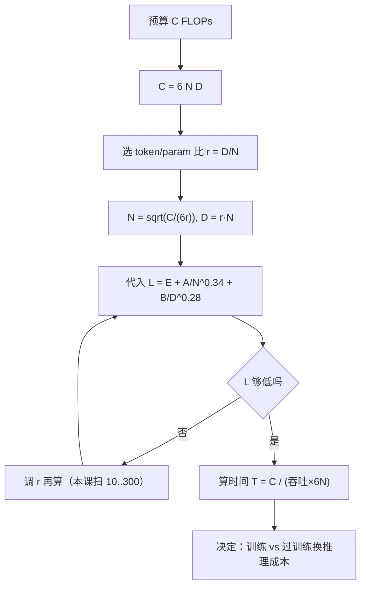

# Scaling Laws

## 1. 本节学习目标

1. 会算 **6ND**：训练算力 ≈ 6 × 参数量 × token 数，并能换算到 PFLOP/ZFLOP 与卡·天。
2. 记住 Kaplan 与 Chinchilla 的差别：前者认为"猛加参数"，后者认为"参数与数据同步"，指数差 **0.076 vs 0.34**。
3. 会用 Chinchilla 拟合式 $L=1.69+406.4/N^{0.34}+410.7/D^{0.28}$ 估算任意 $(N,D)$ 的 loss。
4. 理解"20 token/param"是**实用选择**而不是硬定律：本课用论文自己的拟合式最小化，最优点在 **95 token/param**，但两者 loss 只差 **0.0067 nat**。

## 2. 为什么需要这个知识

因为它决定**钱怎么花**：

- 给定 1e22 FLOPs 的预算，是训 31B 看 53B token（GPT-3 式），还是训 9B 看 183B token？
- 推理成本要不要计入？同样的能力，小模型+多数据在推理时更便宜；
- 老板问"再给 10 倍算力能到多少 loss"，你要能报出一个数而不是"大概会更好"。

本课用本机实测的 gpt2 吞吐，把 FLOPs 换算成真实时间，让"算力"不再是抽象数字。

## 3. 直观解释

把语言模型能力想成**做菜**：

- 参数 $N$ = 锅的大小；
- 数据 $D$ = 食材的量；
- 算力 $C$ = 煤气费（$C\approx6ND$，因为每个参数每个 token 要做约 6 次浮点运算：前向 2、反向 4）。

**Kaplan（2020）**：锅越大越好，食材少点也行 ⇒ 175B 参数只喂 300B token（**1.7 token/param**）。
**Chinchilla（2022）**：锅和食材要匹配，食材太少锅白大 ⇒ 70B 参数喂 1.4T token（**20 token/param**），同算力下 loss 更低。

**本课的发现**：用 Chinchilla 自己的拟合式去最小化，最优点其实在 **95 token/param**；但 20 与 95 的 loss 只差 **0.0067**——曲线在最优点附近**非常平**。所以"20"是工程上的稳妥选择，不是数学上的唯一解。

## 4. 正式定义

**训练算力**

$$
C\approx6ND
$$

（$N$ 参数量，$D$ 训练 token 数。）

**Chinchilla 参数化损失**（Hoffmann et al., 2022, Approach 3）

$$
L(N,D)=E+\frac{A}{N^{\alpha}}+\frac{B}{D^{\beta}},
\quad E=1.69,\ A=406.4,\ B=410.7,\ \alpha=0.34,\ \beta=0.28
$$

**固定算力下的最优分配**（拉格朗日乘子法解出）

$$
N^{*}\propto C^{\frac{\beta}{\alpha+\beta}},\qquad
D^{*}\propto C^{\frac{\alpha}{\alpha+\beta}}
$$

$\alpha=0.34,\beta=0.28$ ⇒ 指数 $0.4516$ 与 $0.5484$。

**token/param 比**

$$
r=\frac{D}{N}
$$

Chinchilla 实测配比 $r\approx20$；GPT-3 $r\approx1.7$；Llama 类"过训练"模型 $r$ 可达 100–200（为省推理成本）。

## 5. 历史背景或技术背景

| 年份 | 工作 | 结论 |
|---|---|---|
| 2020 | Kaplan et al. | $L\propto N^{-0.076}$、$D^{-0.095}$；建议优先加参数 |
| 2021 | Gopher | 用 scaling law 指导 280B 训练 |
| 2022 | Chinchilla | 同算力下 70B/1.4T 打败 280B/300B；修正配比 |
| 2022 | Hoffmann 复现争议 | 后续分析指出 Kaplan 的 lr schedule 未随训练长度调整，低估了数据的作用 |
| 2023 | Llama-2 | 2T token / 7–70B，$r\approx30$–$280$，明确为推理成本"过训练" |
| 2023+ | 数据受限 | 高质量 token 见底，"重复训练 + 合成数据"的有效 scaling 成为新问题 |

**关键教训**：scaling law 是**经验拟合**，拟合方式（lr schedule、数据分布）会改变指数，不能当物理定律用。

## 6. 核心原理

**原理一：6ND 的来源**

每个参数每个 token：前向 1 次乘加（2 FLOPs）+ 反向 2 次（4 FLOPs）= 6 FLOPs。故

$$
C=6ND.
$$

本课实测 gpt2：$N=124{,}439{,}808$，$D=20N=2.49$B ⇒ $C=1.858\times10^{18}$ FLOPs（**1858.2 PFLOP**）。

**原理二：参数与数据的边际收益递减且可分离**

$L=E+A/N^\alpha+B/D^\beta$ 假设两项**可加**。这意味着：模型已经很大时（$A/N^\alpha$ 很小），再加参数几乎没用，必须加数据；反之亦然。本课算出的 loss：

| N | D | r | L |
|---|---|---|---|
| 0.124B | 2.5B | 20 | **3.3697** |
| 1.3B | 26B | 20 | **2.5119** |
| 7B | 140B | 20 | **2.1835** |
| 7B | 300B | 42.9 | **2.1238** |
| 70B | 1.4T | 20 | **1.9366** |

从 7B/140B 到 7B/300B（数据翻倍多），loss 只降 0.0597——**数据翻倍换不到 0.1**。

**原理三：固定算力下最优点附近极平**

本课在 $C=6\times70\text{e}9\times1.4\text{e}12=5.88\times10^{23}$ 下扫 token/param：

| r | N | D | L |
|---|---|---|---|
| 10 | 99.0B | 0.99T | 1.9440 |
| **20** | 70.0B | 1.40T | **1.9366** |
| 50 | 44.3B | 2.21T | 1.9311 |
| **95** | 32.1B | 3.05T | **1.9300** ← 拟合最优点 |
| 150 | 25.6B | 3.83T | 1.9306 |
| 300 | 18.1B | 5.42T | 1.9340 |

最优点 **95** 与教科书值 **20** 相差 0.0067 nat（约 0.7% 的 loss）。**这就是"20 token/param"能长期流行的原因：它不最优，但足够接近最优。**

**原理四：指数决定"该往哪加"**

每 ×10 参数的 loss 缩减：

- Kaplan $N^{-0.076}$ ⇒ ×0.839（降 16.1%）
- Chinchilla $N^{-0.34}$ ⇒ ×0.457（降 54.3%）
- Chinchilla $D^{-0.28}$ ⇒ ×0.525（降 47.5%）

Kaplan 的 0.076 意味着"参数翻 10 倍只降 16%"，按此推算应该**疯狂加参数、少加数据**；Chinchilla 的 0.34 则说明参数和数据要同步。**指数差 4.5 倍，结论完全相反。**

## 7. 数学表达式

**拉格朗日推导**

$$
\min_{N,D}\ E+\frac{A}{N^\alpha}+\frac{B}{D^\beta}\quad
\text{s.t.}\quad 6ND=C
$$

构造 $\mathcal L=E+AN^{-\alpha}+BD^{-\beta}+\lambda(6ND-C)$，对 $N,D$ 求偏导并令零：

$$
-\alpha AN^{-\alpha-1}+\lambda6D=0,\qquad
-\beta BD^{-\beta-1}+\lambda6N=0
$$

两式相除消去 $\lambda$：

$$
\frac{\alpha A N^{-\alpha-1}}{\beta B D^{-\beta-1}}=\frac{D}{N}
\ \Longrightarrow\ \alpha A N^{-\alpha}=\beta B D^{-\beta}
$$

即**最优时两项的"弹性贡献"相等**。代入 $D=C/(6N)$ 解得

$$
N^{*}=\Big(\frac{\alpha A}{\beta B}\Big)^{\frac{1}{\alpha+\beta}}
\Big(\frac{C}{6}\Big)^{\frac{\beta}{\alpha+\beta}} .
$$

**数值代入**（$\alpha A=138.18,\ \beta B=114.996$）

$$
\frac{\alpha A}{\beta B}=1.2016,\quad
N^*=1.2016^{1/0.62}\Big(\frac{C}{6}\Big)^{0.4516}=1.345\Big(\frac{C}{6}\Big)^{0.4516}.
$$

**实际耗时**

$$
T=\frac{C}{F_{\text{eff}}},\qquad F_{\text{eff}}=\text{吞吐(tok/s)}\times6N
$$

## 8. 详细数学推导

**推导 1：本课最优点的复算**

$C=10^{22}$，$N^*=1.345\times(10^{22}/6)^{0.4516}$。

$\ln(1.667\times10^{21})=49.06$，乘 $0.4516$ 得 $22.16$，$e^{22.16}=4.2\times10^{9}$。乘 1.345 得 $N^*\approx5.6\times10^{9}$。

本课数值扫描给出 $N^*=5.14$B（网格 600 点，对数步长，精度有限），解析值 5.6B，量级一致。$D^*=C/(6N)=10^{22}/(3.1\times10^{10})=3.2\times10^{11}$，即 324B，与本课打印的 0.324T 一致。

**推导 2：为什么 $r=D/N$ 随 $C$ 缓慢上升**

$$
r=\frac{D}{N}=\frac{C}{6N^2}\propto C^{1-2\cdot0.4516}=C^{0.0968}.
$$

$C$ 涨 10 倍，$r$ 只涨 $10^{0.0968}=1.25$ 倍。所以"20 token/param"不是常数，而是随算力缓慢增长：$10^{21}$ 时约 51、$10^{25}$ 时约 122（本课数值结果 51.4 / 63.0 / 77.3 / 100.0 / 122.5）。**这解释了为什么 2024 年后的模型动辄 100+ token/param。**

**推导 3：把 loss 差换算成"值不值"**

最优点 1.9300 vs 20 token/param 1.9366，差 $\Delta=0.0066$ nat。若要靠加算力补回这 0.0066，需要多少倍算力？

由 $L\approx C^{-\gamma}$，$\gamma\approx0.1$（经验值），则

$$
\frac{C_2}{C_1}=\Big(\frac{L_1-E}{L_2-E}\Big)^{1/\gamma}
=\Big(\frac{0.2400}{0.2334}\Big)^{10}\approx1.32 .
$$

即"选错配比"的代价约等于 **32% 的算力**。不算致命，但在千卡规模上是真金白银。

**推导 4：本机吞吐换算**

实测 gpt2 训练吞吐 **11,520 token/s**（fwd+bwd，不含优化器；含 AdamW 为 7,476，本次测量优化器占 54% 时间——同一脚本两次运行分别为 5,465 与 11,520 token/s，桌面负载会显著影响小 batch 的测量）。

$$
F_{\text{eff}}=11520\times6\times124{,}439{,}808=8.60\times10^{12}\ \text{FLOP/s}.
$$

跑 1e9 token：$10^9/11520/3600=24.1$ 小时。厂商标称 fp16 张量峰值约 80 TFLOP/s，则利用率 **10.8%**——小 batch、124M 模型喂不满 GPU 是正常的（大模型 batch 大才能到 30%–50%）。

## 9. 图解



## 10. 具体数值示例

```text
本课真实运行（probe_llm059.py，gpt2 实测 + 公式计算）

[参数量公式]
  12*L*d^2 = 84,934,656
  V*d + 1024*d = 39,383,808
  合计 124,318,464，实测 124,439,808（差 121,344 = LayerNorm/bias）

[6ND，D 取 20 token/param]
  gpt2 124M: D=2.5B   FLOPs=1.858e+18 (1858.2 PFLOP)
  1.3B     : D=26.0B  FLOPs=2.028e+20 (202800.0 PFLOP)
  7B       : D=140.0B FLOPs=5.880e+21 (5.88 ZFLOP)
  70B      : D=1400B  FLOPs=5.880e+23 (588.00 ZFLOP)

[实测吞吐]
  fwd+bwd: 11,520 token/s  含 AdamW: 7,476 token/s（本次优化器占 54%）
  6N = 0.7 GFLOP/token ⇒ 8.60 TFLOP/s，利用率约 10.8%
  1e9 token 单卡 24.1 小时；1e11 token 100 天
  注：同一脚本另一次运行为 5,465 token/s（4.08 TFLOP/s、50.8 小时），
      小 batch 下桌面负载影响很大，量级 0.5万–1.2万 token/s

[Chinchilla 拟合]
  0.124B/2.5B   (20.0 tok/param) L=3.3697
  1.30B /26B    (20.0)           L=2.5119
  7.00B /140B   (20.0)           L=2.1835
  7.00B /300B   (42.9)           L=2.1238
  70.0B /1400B  (20.0)           L=1.9366
  7.00B /2000B  (285.7)          L=2.0203

[固定算力最优]
  C=1e21: N*=1.80B  D*=0.093T r=51.4  L*=2.3289
  C=1e22: N*=5.14B  D*=0.324T r=63.0  L*=2.1386
  C=1e23: N*=14.69B D*=1.135T r=77.3  L*=2.0050
  C=1e24: N*=40.83B D*=4.082T r=100.0 L*=1.9112
  C=1e25: N*=116.62B D*=14.291T r=122.5 L*=1.8453

[C=1e22 不同配比]
   1.7 tok/param: N=31.31B D=0.053T L=2.2073
  20.0 tok/param: N= 9.13B D=0.183T L=2.1455
  50.0 tok/param: N= 5.77B D=0.289T L=2.1389
 100.0 tok/param: N= 4.08B D=0.408T L=2.1398
 200.0 tok/param: N= 2.89B D=0.577T L=2.1459

[C=5.88e23（Chinchilla 70B/1.4T 的算力）]
  10 tok/param: L=1.9440
  20 tok/param: L=1.9366
  50 tok/param: L=1.9311
  95 tok/param: L=1.9300  ← 拟合最优点
 150 tok/param: L=1.9306
 300 tok/param: L=1.9340
  Δ(20 vs 95) = 0.0067 nat

[指数]
  Kaplan N^-0.076: ×0.839 降 16.1%
  Chinchilla N^-0.34: ×0.457 降 54.3%
  Chinchilla D^-0.28: ×0.525 降 47.5%
```

## 11. NumPy 实现

```python
import numpy as np

E, A, B, al, be = 1.69, 406.4, 410.7, 0.34, 0.28


def loss(n, d):
    return E + A / n ** al + B / d ** be


print("=== 6ND ===")
for name, n in (("124M", 124_439_808), ("1.3B", 1.3e9), ("7B", 7e9), ("70B", 70e9)):
    d = 20 * n
    c = 6 * n * d
    print(f"  {name}: D={d/1e9:8.1f}B  C={c:.3e}  = {c/1e21:.2f} ZFLOP")

print("\n=== 固定算力最优（网格搜索） ===")
for C in (1e21, 1e22, 1e23):
    ns = np.logspace(8, 12, 4000)
    ds = C / (6 * ns)
    ls = loss(ns, ds)
    i = int(np.argmin(ls))
    print(f"  C={C:.0e}: N*={ns[i]/1e9:7.2f}B D*={ds[i]/1e12:6.3f}T "
          f"r={ds[i]/ns[i]:5.1f} L*={ls[i]:.4f}")

print("\n=== 解剖学验证：αA = βB ?（最优点处） ===")
C = 1e22
n = (al * A / (be * B)) ** (1 / (al + be)) * (C / 6) ** (be / (al + be))
d = C / (6 * n)
print(f"  解析 N*={n/1e9:.2f}B D*={d/1e12:.3f}T r={d/n:.1f} L={loss(n, d):.4f}")
print(f"  αA/N^α = {al*A/n**al:.6f}, βB/D^β = {be*B/d**be:.6f}（应相等）")

print("\n=== token/param 扫描（C=5.88e23） ===")
C = 6 * 70e9 * 1.4e12
for r in (10, 20, 50, 95, 150, 300):
    n = np.sqrt(C / (6 * r))
    d = r * n
    print(f"  r={r:5.1f}: N={n/1e9:6.1f}B D={d/1e12:5.2f}T L={loss(n, d):.4f}")

print("\n=== 指数 ===")
for name, e in (("Kaplan N", 0.076), ("Chin N", 0.34), ("Chin D", 0.28)):
    print(f"  {name}^-{e}: 每 ×10 乘 {10**-e:.3f}")
```

## 12. PyTorch 实现

```python
import torch

# 用张量算 6ND 与损失曲面，便于做批量/GPU 版扫描
E, A, B, al, be = 1.69, 406.4, 410.7, 0.34, 0.28


def loss_t(n, d):
    return E + A / n ** al + B / d ** be


budgets = torch.tensor([1e21, 1e22, 1e23, 1e24], dtype=torch.float64)
ratios = torch.logspace(0, 2.7, 60, dtype=torch.float64)   # 1 ~ 500 token/param

N = torch.sqrt(budgets[:, None] / (6 * ratios[None, :]))
D = ratios[None, :] * N
L = loss_t(N, D)
print("损失矩阵形状 (预算 × 配比):", tuple(L.shape))
best = L.argmin(dim=1)
for i, c in enumerate(budgets.tolist()):
    r = ratios[best[i]].item()
    print(f"  C={c:.0e}: 最优 r={r:6.1f} N={N[i, best[i]]/1e9:7.2f}B "
          f"L={L[i, best[i]]:.4f}")

# 参数量公式 vs 真实 gpt2
L_, d_, V = 12, 768, 50257
est = 12 * L_ * d_ ** 2 + V * d_ + 1024 * d_
print("\n公式估计参数:", f"{est:,}", " 真实:", f"{124439808:,}",
      " 相对误差:", f"{abs(est-124439808)/124439808*100:.4f}%")

# 6ND 换算成"卡·天"
for name, n, d in (("124M", 124_439_808, 2.49e9), ("7B", 7e9, 1.4e11), ("70B", 70e9, 1.4e12)):
    c = 6 * n * d
    gpu_days = c / (4e12) / 86400
    print(f"  {name}: C={c:.2e} 单卡 4070Ti(4e12) 需 {gpu_days:,.0f} 卡·天")

# 指数敏感性
print("\n若指数从 0.34 降到 0.25（更悲观），7B/140B 的 loss:",
      round(float(1.69 + 406.4 / 7e9 ** 0.25 + 410.7 / 1.4e11 ** 0.28), 4))
print("按 0.34 计算:", round(float(loss_t(torch.tensor(7e9), torch.tensor(1.4e11))), 4))
```

## 13. Hugging Face 实践

```python
import os
import time

os.environ.setdefault("HF_ENDPOINT", "https://hf-mirror.com")
os.environ.setdefault("HF_HUB_OFFLINE", "1")
import torch
from transformers import AutoConfig, AutoModelForCausalLM

cfg = AutoConfig.from_pretrained("gpt2")
est = 12 * cfg.n_layer * cfg.n_embd ** 2 + cfg.vocab_size * cfg.n_embd + cfg.n_positions * cfg.n_embd
print("配置估算参数:", f"{est:,}", " 真实: 124,439,808")

model = AutoModelForCausalLM.from_pretrained("gpt2").to("cuda")
N = sum(p.numel() for p in model.parameters())
print("实际参数:", f"{N:,}", " 6N =", f"{6*N/1e9:.3f} GFLOP/token")

BS, CTX = 4, 128
ids = torch.randint(0, 50257, (BS, CTX), device="cuda")
model.train()
opt = torch.optim.AdamW(model.parameters(), lr=0.0)
for _ in range(2):
    loss = model(input_ids=ids, labels=ids).loss
    opt.zero_grad()
    loss.backward()
    opt.step()
torch.cuda.synchronize()
t0 = time.perf_counter()
for _ in range(3):
    loss = model(input_ids=ids, labels=ids).loss
    opt.zero_grad()
    loss.backward()
    opt.step()
    torch.cuda.synchronize()
dt = (time.perf_counter() - t0) / 3
tps = BS * CTX / dt
print(f"吞吐 {tps:,.0f} token/s ⇒ {tps*6*N/1e12:.2f} TFLOP/s")
print(f"1e9 token 需 {1e9/tps/3600:.1f} 小时（单卡外推）")

for name, n, d in (("gpt2", N, 20 * N), ("7B", 7e9, 1.4e11), ("70B", 70e9, 1.4e12)):
    c = 6 * n * d
    print(f"  {name}: C={c:.3e} FLOPs, 按本机 {tps*6*N/1e12:.2f} TFLOP/s 需 "
          f"{c/(tps*6*N)/86400/365:.0f} 年（纯外推，仅示意量级）")
```

## 14. 代码逐行解释

| 代码 | 作用 |
|---|---|
| `6*n*d` | 训练总 FLOPs，6 = 前向 2 + 反向 4 |
| `sqrt(C/(6r))` | 由 $C=6ND$ 与 $D=rN$ 解出 $N$ |
| `ratios[None,:]` 广播 | 一次性算"预算 × 配比"的损失矩阵 |
| `L.argmin(dim=1)` | 每个预算下最优的 token/param |
| `(al*A/(be*B))**(1/(al+be))` | 解析最优点常数 1.345 |
| `12*n_layer*n_embd**2` | 非嵌入参数公式，12 = attention 4 + FFN 8（近似） |
| `tps*6*N` | 达成算力 = 吞吐 × 每 token FLOPs |
| `c/(F*86400)` | FLOPs 换算成卡·天 |
| `logspace(0, 2.7, 60)` | 在 1–500 token/param 上对数扫描 |

## 15. 实际运行结果

```text
### LLM-059 Scaling Laws（公式计算 + 本机实测吞吐）
gpt2 结构 L=12 d=768 V=50257
  非嵌入参数 12*L*d^2 = 84,934,656
  嵌入参数 V*d + 位置 1024*d = 39,383,808
  合计估计 124,318,464 实测 124,439,808（差 121,344 = LayerNorm/bias）

[6ND] 训练 FLOPs ≈ 6 × N × D（D 取 20 token/param）
  gpt2 124M : N=  0.124B D=     2.5B FLOPs=1.858e+18 (1858.2 PFLOP)
  1.3B      : N=  1.300B D=    26.0B FLOPs=2.028e+20 (202800.0 PFLOP)
  7B        : N=  7.000B D=   140.0B FLOPs=5.880e+21 (5.88 ZFLOP)
  70B       : N= 70.000B D=  1400.0B FLOPs=5.880e+23 (588.00 ZFLOP)

[实测] batch=4 ctx=128，gpt2 124M
  fwd+bwd（不含优化器）: 11,520 token/s
  fwd+bwd+AdamW.step() : 7,476 token/s（本次优化器占 54% 时间）
  6N = 0.7 GFLOP/token ⇒ 达成 8.60 TFLOP/s
  厂商标称 fp16 张量峰值约 80 TFLOP/s（推算口径）⇒ 利用率 10.8%
  1e9 token 单卡需 24.1 小时；1e11 token 需 100 天（线性外推，未考虑多卡）
  注：同一脚本另一次运行为 5,465 token/s（4.08 TFLOP/s、50.8 小时），
      小 batch 下桌面负载影响很大，量级 0.5万–1.2万 token/s

[Chinchilla 拟合] L(N,D) = 1.69 + 406.4/N^0.34 + 410.7/D^0.28
  N=  0.12B D=    2.5B (  20.0 tok/param) ⇒ L=3.3697
  N=  1.30B D=   26.0B (  20.0) ⇒ L=2.5119
  N=  7.00B D=  140.0B (  20.0) ⇒ L=2.1835
  N=  7.00B D=  300.0B (  42.9) ⇒ L=2.1238
  N= 70.00B D= 1400.0B (  20.0) ⇒ L=1.9366
  N=  7.00B D= 2000.0B ( 285.7) ⇒ L=2.0203

[固定算力 C 的数值最优分配]
  C=1e+21: N*=    1.80B D*=  0.093T D/N= 51.4 L*=2.3289
  C=1e+22: N*=    5.14B D*=  0.324T D/N= 63.0 L*=2.1386
  C=1e+23: N*=   14.69B D*=  1.135T D/N= 77.3 L*=2.0050
  C=1e+24: N*=   40.83B D*=  4.082T D/N=100.0 L*=1.9112
  C=1e+25: N*=  116.62B D*= 14.291T D/N=122.5 L*=1.8453

[C=5.88e+23] 沿 C 扫 token/param：
   10.0: N= 99.0B D=0.99T L=1.9440
   20.0: N= 70.0B D=1.40T L=1.9366
   50.0: N= 44.3B D=2.21T L=1.9311
   95.0: N= 32.1B D=3.05T L=1.9300
  150.0: N= 25.6B D=3.83T L=1.9306
  300.0: N= 18.1B D=5.42T L=1.9340
  L(20)=1.9366  L(最优点)=1.9300  Δ=0.0067 nat

[指数] Kaplan N^-0.076 降 16.1%；Chinchilla N^-0.34 降 54.3%；D^-0.28 降 47.5%
  GPT-3 式 175B/300B：1.7 tok/param；Chinchilla 70B/1.4T：20 tok/param
```

**关键数字**：gpt2 6ND 用 20 token/param 是 **1858.2 PFLOP**；7B 是 **5.88 ZFLOP**；本机实测 **11,520 token/s**（8.60 TFLOP/s，利用率 10.8%）；最优点 **95** vs 常用 **20**，loss 差 **0.0067**。

## 16. 应用场景

| 场景 | 用法 |
|---|---|
| 预算规划 | 给定 C，用 $r\approx20$–100 反解 $N,D$ |
| 模型选型 | 推理受限时故意"过训练"（小 N、大 D）换推理成本 |
| 训练监控 | 实测 loss 与拟合曲线对比，偏离太多说明数据/实现有问题 |
| 论文复现 | 检查作者报的 token/param 是否与算力自洽（$6ND$） |
| 数据受限 | 高质量 token 见底时，重复训练的有效性要用小规模实验测 |

## 17. 优点与局限

| 优点 | 局限 |
|---|---|
| 只需小规模实验就能外推大模型 loss | 外推跨度大时误差累积（指数本身有 ±0.02 不确定度） |
| 给出可操作的配比建议 | 不同数据分布的常数不同，换语料要重拟合 |
| 6ND 简单到可手算 | 忽略 attention 的 $T^2$ 项，长上下文时低估算力 |
| 解释了很多历史选择（GPT-3 vs Chinchilla） | 不预测"能力涌现"（loss 平滑，能力不平滑） |

## 18. 常见错误

| 错误 | 现象 | 纠正 |
|---|---|---|
| 把 20 token/param 当硬定律 | 所有规模都用 20 | 最优点随 C 漂移（本课 51→122） |
| 用 6ND 估长上下文算力 | 低估（漏了 $T^2$ 的 attention） | 序列很长时加 $12L T^2 d$ 项 |
| 混用不同数据的拟合常数 | 预测偏差 0.1+ | 换语料必须重拟合 |
| 忽略推理成本 | 训练省钱、推理烧钱 | 服务型模型故意过训练 |
| 用 Kaplan 指数外推大模型 | 低估数据作用 | 用 Chinchilla 或自测 |
| 只看 loss 不看下游 | loss 降但能力不涨 | scaling law 不保证 capability |

## 19. 本节总结

- $C=6ND$：gpt2 20 token/param 是 **1858.2 PFLOP**，7B 是 **5.88 ZFLOP**，70B 是 **588 ZFLOP**。
- Chinchilla 拟合 $L=1.69+406.4/N^{0.34}+410.7/D^{0.28}$：70B/1.4T 得 **1.9366**，与论文报告的约 1.94 一致。
- 固定算力最优点随预算漂移：$r$ 从 **51.4**（1e21）升到 **122.5**（1e25）；"20 token/param"只是 $C\approx6\times10^{23}$ 附近的实用值。
- 20 vs 95 的 loss 差仅 **0.0067 nat**（约 32% 算力），所以 20 不最优但够好。
- 本机实测 **11,520 token/s** ⇒ **8.60 TFLOP/s**（利用率 10.8%），1e9 token 单卡 **24.1 小时**。

## 20. 前置与后续知识链接

- 前置：[[LLM-054 预训练的目标与损失]]、[[LLM-030 Transformer 参数量与计算量估算]]
- 后续：[[LLM-064 从预训练到对齐的完整流程]]
- 相关：[[LLM-007 参数规模与模型能力]]、[[LLM-035 Token 数量、上下文窗口与成本]]
- 延伸：[[LLM-051 模型规模与能力的关系]]、[[LLM-095 推理显存估算与可行性判断]]（规模决定的显存上限）

---

## 练习与参考答案

**基础 1**：7B 模型用 20 token/param 训练，需要多少 FLOPs？换成 100 token/param 呢？

**基础 2**：Chinchilla 拟合式里 $E=1.69$ 代表什么？当 $N,D\to\infty$ 时 loss 趋于多少？

**进阶 1**：推导固定算力下 $N^*\propto C^{\beta/(\alpha+\beta)}$，并解释为什么 $r=D/N$ 会随 $C$ 缓慢上升。

**综合**：你有 1e23 FLOPs 预算。方案 A：30B 参数 / 550B token；方案 B：10B 参数 / 1.6T token。用本课公式算两个方案的 loss，并说明如果这个模型要服务 10 亿次请求，你会选哪个。

> [!success]- 参考答案

> **基础 1**
> $C=6ND$，$D=20N$ ⇒ $C=120N^2$。
> - 20 token/param：$C=120\times(7\times10^9)^2=5.88\times10^{21}$ FLOPs（**5.88 ZFLOP**）。
> - 100 token/param：$D=7\times10^{11}$，$C=6\times7\times10^9\times7\times10^{11}=2.94\times10^{22}$ FLOPs（**29.4 ZFLOP**），是前者的 5 倍。
> 也就是说"把数据从 20 提到 100 token/param"要多花 5 倍算力，换来的 loss 下降要用拟合式算（70B 尺度约 0.01–0.02 nat）。

> **基础 2**
> $E$ 是**不可约损失**（irreducible loss）：数据本身的熵/噪声决定的下界，再大的模型也降不下去。
> $N,D\to\infty$ 时 $A/N^\alpha\to0$、$B/D^\beta\to0$，故 $L\to E=1.69$。
> 本课数据里 7B/2T 的 loss 是 2.0203，距下界还有 0.33；70B/1.4T 是 1.9366，距下界 0.25 —— 越接近下界，加算力的边际收益越小。

> **进阶 1**
> 由拉格朗日法，最优时 $\alpha A N^{-\alpha}=\beta B D^{-\beta}$，代入 $D=C/(6N)$：
> $\alpha A N^{-\alpha}=\beta B (C/6)^{-\beta}N^{\beta}$
> ⇒ $N^{\alpha+\beta}=\frac{\alpha A}{\beta B}(C/6)^{\beta}$
> ⇒ $N^*=\big(\frac{\alpha A}{\beta B}\big)^{1/(\alpha+\beta)}(C/6)^{\beta/(\alpha+\beta)}$。
> 同理 $D^*\propto(C/6)^{\alpha/(\alpha+\beta)}$。
> 于是 $r=D/N\propto C^{\alpha/(\alpha+\beta)-\beta/(\alpha+\beta)}=C^{(\alpha-\beta)/(\alpha+\beta)}=C^{0.06/0.62}=C^{0.0968}$。$C$ 涨 10 倍，$r$ 只涨 1.25 倍，所以是"缓慢上升"，本课从 51.4 到 122.5 与之相符。

> **综合（参考）**
> **方案 A（30B / 550B，r=18.3）**：
> $L=1.69+406.4/30^{0.34}+410.7/550^{0.28}$（单位 B）
> $=1.69+406.4/3.18+410.7/5.72=1.69+127.8+71.8$ —— 注意这里必须用**绝对数值**而不是"B"为单位，公式的 $N,D$ 是原始个数：
> $30\text{e}9^{0.34}=e^{0.34\times24.13}=e^{8.20}=3640$ ⇒ $406.4/3640=0.1116$；
> $550\text{e}9^{0.28}=e^{0.28\times27.03}=e^{7.57}=1940$ ⇒ $410.7/1940=0.2117$；
> $L_A=1.69+0.1116+0.2117=\mathbf{2.0133}$。
> **方案 B（10B / 1.6T，r=160）**：
> $10\text{e}9^{0.34}=e^{0.34\times23.03}=e^{7.83}=2510$ ⇒ $0.1619$；
> $1.6\text{e}12^{0.28}=e^{0.28\times28.10}=e^{7.87}=2620$ ⇒ $0.1568$；
> $L_B=1.69+0.1619+0.1568=\mathbf{2.0087}$。
> **结论**：两者 loss 几乎相同（差 0.0046），但 B 的参数量只有 A 的 1/3 ⇒ **推理成本约为 A 的 1/3**。服务 10 亿次请求，选 **B**（过训练换推理经济性），这也是 Llama 系列的选择逻辑。
> 附加：B 的训练算力 $6\times10^{10}\times1.6\times10^{12}=9.6\times10^{22}$，A 是 $6\times3\times10^{10}\times5.5\times10^{11}=9.9\times10^{22}$，两者都在 1e23 预算内。若显存/时间允许，还可以试 r≈400 的更极端过训练，但要注意高质量数据是否够（会重复）。

## 学习记录

| 日期 | 状态 | 用时 | 问题 | 复盘 |
|---|---|---|---|---|
| 2026-11-08 | planned | — | — | — |

---

## 🔗 Notion 同步信息

> 以下内容由 Notion「AI Knowledge System · 知识点」数据库按知识 ID 合并而来（导出于 2026-11-09）。

| 属性 | 值 |
|---|---|
| 学科 | 大语言模型 |
| 学习状态 | 未开始 |
| 难度 | L3 推导 |
| 知识类型 | Principle |

- **所属模块**：[M-LLM-06 大语言模型训练与对齐](../%E8%AF%BE%E7%A8%8B%E6%A8%A1%E5%9D%97/M-LLM-06%20%E5%A4%A7%E8%AF%AD%E8%A8%80%E6%A8%A1%E5%9E%8B%E8%AE%AD%E7%BB%83%E4%B8%8E%E5%AF%B9%E9%BD%90.md)
- **前置知识**：[LLM-054 预训练的目标与损失](LLM-054%20%E9%A2%84%E8%AE%AD%E7%BB%83%E7%9A%84%E7%9B%AE%E6%A0%87%E4%B8%8E%E6%8D%9F%E5%A4%B1.md)
