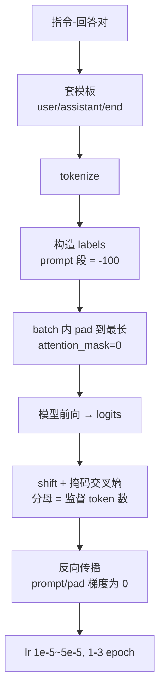

# 指令微调（SFT）

## 1. 本节学习目标

1. 说清 SFT 与预训练的三处差别：**数据形态（指令-回答对）、损失掩码（只算回答）、规模（百万级 token）**。
2. 会构造 `labels` 掩码：prompt 段置 **-100**，本课 6 条样本共 699 token、其中监督 **176**（**25.2%**）。
3. 用手算验证掩码会改变 loss 数值：首条样本全序列 **3.7196** vs 只看回答 **4.9059**。
4. 知道 padding 必须 mask：本课 pad 占 **34.2%**，把 pad 当目标会让 loss 从 **3.2224** 虚高到 **10.6639**。

## 2. 为什么需要这个知识

因为预训练模型**不会听话**：

- 你问"翻译这句话"，它可能接着写"翻译这句话的英文是……"然后编下去；
- SFT 把"续写"变成"回答问题"，是模型可用性的第一步；
- 后续 RLHF/DPO 全部建立在 SFT 模型之上，SFT 做坏了，对齐阶段再怎么调也救不回来。

而且 SFT 最容易出**静默 bug**：掩码写错、padding 没 mask、模板 token 不一致，loss 看着在降，模型却学坏了。

## 3. 直观解释

```text
预训练看到的：   "今天天气很好。The weather is nice today."   → 学"下一个词"
SFT 看到的：     <|user|> 把这句话翻译成英文：今天天气很好。
                <|assistant|> The weather is nice today.<|end|>
                 └────── 不算损失 ──────┘ └──── 算损失 ────┘
```

**关键直觉**：SFT 只应该"奖励"回答部分。prompt 是用户给的，模型不需要学会生成"用户的提问"——如果把 prompt 也算进损失，模型会花容量去建模"用户会怎么问"，而且推理时它可能自己续写用户的问题。

## 4. 正式定义

**SFT 的损失**（掩码交叉熵）

$$
L_{\text{SFT}}(\theta)=-\frac{1}{\sum_t m_t}\sum_{t=1}^{T}m_t\log p_\theta(x_t\mid x_{<t}),
\qquad
m_t=\begin{cases}1,&t\in\text{回答段}\\0,&t\in\text{prompt 段或 padding}\end{cases}
$$

工程上 $m_t=0$ 用 `labels[t] = -100` 表示（PyTorch 的 `CrossEntropyLoss(ignore_index=-100)` 会跳过）。

**监督比例**

$$
\rho=\frac{\#\{t:m_t=1\}}{\#\{t:m_t\ge0\}}
$$

本课 $\rho=176/699=25.2\%$。

**数据规模经验值**

$$
D_{\text{SFT}}\approx 10^4\sim10^6\ \text{条},\qquad
\text{token}\approx 10^7\sim10^9
$$

对比预训练 $10^{12}$ token：SFT 只占 **0.001%–0.1%**。

**训练步数**

$$
\text{steps}=E\cdot\Big\lceil\frac{N_{\text{ex}}}{B}\Big\rceil
$$

$E$ 为 epoch 数（常用 1–3），$N_{\text{ex}}$ 样本数，$B$ batch。

## 5. 历史背景或技术背景

| 年份 | 工作 | 贡献 |
|---|---|---|
| 2021 | FLAN | 把多任务指令化，验证 zero-shot 泛化 |
| 2022 | InstructGPT | SFT → RM → PPO 三阶段成为范式 |
| 2022 | T0 / OPT-IML | 大规模指令集，多任务混训 |
| 2023 | Alpaca / Vicuna | 用少量高质量指令（5万/7万条）复现聊天能力 |
| 2023 | LIMA | 1000 条精选数据即可，质量 > 数量 |
| 2024 | 合成指令数据 | 用强模型生成 + 过滤，规模化 SFT 数据 |
| 2025+ | 多轮/工具/推理链 | SFT 覆盖 agent、function call、长思维链 |

**主线结论**：SFT 的**数据质量**比数量重要得多；LIMA 用 1000 条就把"会聊天"教会了。

## 6. 核心原理

**原理一：SFT 是"格式迁移"，不是"知识注入"**

预训练已经给了模型语言能力与知识；SFT 教的是**在什么格式下输出**。所以：

- 数据量可以很小（本课 6 条就能把 loss 压到接近 0）；
- 但**格式必须一致**：训练用什么模板，推理必须用同一模板，否则效果断崖。

**原理二：掩码改变的是梯度来源，不只是数值**

本课实测首条样本：全序列 loss **3.7196**（PPL 41.2），只看回答 **4.9059**（PPL 135.1）。差 1.19 nat，因为回答段更难（跨语言翻译）。

但 6 条样本平均：不掩码 **3.5792**，掩码 **3.4808**，差 **−0.0984**——掩码后反而更低。这说明**这批数据的 prompt 段并不比回答段好预测**；掩码的价值不在"让 loss 变小"，而在"让梯度只来自我们要它学的位置"。

**原理三：padding 是最容易踩的坑**

本课把 6 条样本 pad 到 177 token，pad 占 **34.2%**。若把 pad 位置也标成监督目标（label=eos）：

- 正确 mask：loss **3.2224**；
- pad 当目标：loss **10.6639**（虚高 **7.4414**）。

模型会花大量梯度去学"预测填充 token"，这部分能力推理时完全无用。

**原理四：SFT 的学习率必须小**

预训练 lr 常用 3e-4，SFT 常用 **1e-5 ~ 5e-5**（小 10 倍）。原因：

- SFT 数据少，大步长会**灾难性遗忘**预训练能力；
- 目标只是"微调输出分布"，不需要大改参数。

本课 gpt2 SFT 用 5e-5、120 步就把指令集 loss 打到 0.0000，同时通用文本 PPL 从 38.21 涨到 45.63（见 [[LLM-063 对齐的代价与风险]]）——**这就是对齐税的雏形**。

## 7. 数学表达式

**逐 token 掩码损失的矩阵形式**

$$
L=-\frac{1}{\sum_{n,t}m_{n,t}}\sum_{n=1}^{N}\sum_{t=1}^{T}m_{n,t}\log\frac{\exp z_{n,t,y_{n,t}}}{\sum_k\exp z_{n,t,k}}
$$

**监督比例的期望**

设 prompt 平均长度 $\bar T_p$、回答平均长度 $\bar T_r$，则

$$
\rho=\frac{\bar T_r}{\bar T_p+\bar T_r}
$$

本课：总 699、监督 176 ⇒ $\rho=0.252$，即 prompt 平均是回答的 3 倍长（含系统提示）。

**padding 后的无效 token 比例**

$$
\text{pad 比例}=1-\frac{\sum_{n}T_n}{N\cdot T_{\max}}
$$

本课：$1-\frac{699}{6\times177}=1-0.658=0.342$ ✓（与打印的 0.342 一致）。

## 8. 详细数学推导

**推导 1：掩码如何改变梯度**

对单个位置，$\partial \ell_t/\partial z_t=p_t-e_{y_t}$。掩码相当于给每个位置乘 $m_t$：

$$
\frac{\partial L}{\partial z_t}=\frac{m_t}{\sum_s m_s}(p_t-e_{y_t}).
$$

所以：

- $m_t=0$ 的位置**梯度精确为 0**，不参与更新；
- 分母从 $T$ 变成 $\sum m_t$，即**只在监督位置上平均**，否则 prompt 越长 loss 被稀释得越厉害。

这正是"掩码不只是把某些位置置零，还要改分母"的原因。若只置零不改分母（例如用 `reduction='mean'` 后再手乘），loss 会随 prompt 长度变化，不同样本权重失衡。

**推导 2：本课的监督比例**

6 条样本的（总 token，监督 token）：

| # | 总 | 监督 | 比例 |
|---|---|---|---|
| 1 | 95 | 10 | 10.5% |
| 2 | 149 | 76 | 51.0% |
| 3 | 75 | 10 | 13.3% |
| 4 | 118 | 43 | 36.4% |
| 5 | 177 | 26 | 14.7% |
| 6 | 85 | 11 | 12.9% |
| 合计 | **699** | **176** | **25.2%** |

比例跨度 10.5%–51.0%，说明**样本间差异极大**（英文短答 vs 中文长答）。若按序列平均而不是 token 平均，长回答的样本权重会被严重低估。

**推导 3：为什么 pad 当目标会让 loss 爆炸**

pad 位置的标签若设成 eos（50256），模型要在每个 pad 位置预测 eos。问题在于：

- pad 数量多（本课 363/1062 = 34.2%），占比高；
- 这些位置的上下文是"句子已结束后又接 eos"，分布与真实文本完全不同；
- 模型会学到"看到 eos 就继续输出 eos"，推理时可能陷入重复。

实测 loss 从 3.2224 变 10.6639（接近 $\ln V=10.8249$），说明模型在这些位置**几乎学不会**，梯度全被浪费。

**推导 4：SFT 的步数与预算**

10000 条、平均 220 token、batch 32、3 epoch：

$$
\text{steps}=3\times\Big\lceil\frac{10000}{32}\Big\rceil=3\times313=939,
$$

每步 $32\times220=7040$ token，总 token $=939\times7040=6.61$M。若监督比例 25.2%，真正产生梯度的 token 只有 **1.67M**——比很多人想象的小两个数量级。

## 9. 图解



## 10. 具体数值示例

```text
本课真实运行（probe_llm060.py，gpt2 tokenizer）

每条样本的（总 token, 监督 token, 比例）：
  1  95 / 10  = 10.5%   "The weather is nice today."
  2 149 / 76  = 51.0%   "梯度下降是沿着损失函数的负梯度方向……"
  3  75 / 10  = 13.3%   "I do not like cats."
  4 118 / 43  = 36.4%   "常数学习率、余弦退火、带 warmup 的线性衰减。"
  5 177 / 26  = 14.7%   "多层线性加非线性。"
  6  85 / 11  = 12.9%   "负面"
  合计 699 token，监督 176（25.2%），prompt 523 个 token 被 -100

单条对比：
  全序列 loss 3.7196（PPL 41.2）
  只看回答 loss 4.9059（PPL 135.1）

6 条平均：
  不掩码 3.5792 / 掩码 3.4808（差 -0.0984）

padding（pad 到 177）：
  pad 占比 0.342（363/1062）
  正确 mask loss = 3.2224
  pad 当目标 loss = 10.6639（虚高 7.4414，接近 lnV=10.8249）

预算（10000 条 × 220 token，bs=32，3 epoch）：
  2.2M token，313 步/epoch，939 步
  监督 token 约 0.6M（按 25.2%）
```

## 11. NumPy 实现

```python
import numpy as np

# 两条样本：词表 V=8，prompt 长 5/3，回答长 2/4
V, T = 8, 7
ids = [[1, 2, 3, 4, 5, 6, 7],
       [1, 2, 3, 4, 5, 6, 7]]
prompt_len = [5, 3]

labels = np.full((2, T), -100, dtype=int)
for i, (seq, pl) in enumerate(zip(ids, prompt_len)):
    labels[i, pl:] = seq[pl:]
print("labels:")
print(labels)
print("每行监督 token:", (labels != -100).sum(1))
print("监督比例:", round(float((labels != -100).sum() / (labels >= 0).sum()), 3))

# 模拟 logits 与掩码损失
rng = np.random.default_rng(0)
logits = rng.normal(size=(2, T, V))


def log_softmax(z):
    z = z - z.max(-1, keepdims=True)
    return z - np.log(np.exp(z).sum(-1, keepdims=True))


lp = log_softmax(logits)
tgt = np.where(labels != -100, labels, 0)
mask = labels != -100
loss_masked = -lp[np.arange(2)[:, None], np.arange(T)[None, :], tgt][mask].mean()
loss_all = -lp[np.arange(2)[:, None], np.arange(T)[None, :], tgt].mean()
print("掩码 loss:", round(float(loss_masked), 4),
      " 全位置 loss:", round(float(loss_all), 4))

# 若只置零不改分母（错误做法），loss 会被 prompt 长度稀释
manual = (-lp[np.arange(2)[:, None], np.arange(T)[None, :], tgt] * mask).sum() / (2 * T)
print("只置零不改分母:", round(float(manual), 4),
      " 与正确值比:", round(float(manual / loss_masked), 4))

# padding 的比例
valid = sum(len(s) for s in ids)
total = 2 * (T + 4)
print(f"pad 比例: {1 - valid/total:.3f}（{total-valid}/{total}）")
```

## 12. PyTorch 实现

```python
import torch
import torch.nn.functional as F

torch.manual_seed(0)
V, T = 10, 6
logits = torch.randn(2, T, V, requires_grad=True)
targets = torch.tensor([[3, 4, 5, 6, 7, 8],
                        [2, 9, 1, 0, 3, 4]])
prompt_len = [3, 2]          # 前 3 / 前 2 个位置是 prompt

labels = targets.clone()
for i, pl in enumerate(prompt_len):
    labels[i, :pl] = -100
print("labels:\n", labels)
print("监督 token:", int((labels != -100).sum()), "/", labels.numel(),
      " 比例:", round(float((labels != -100).float().mean()), 3))

# 展平后算掩码交叉熵
loss_masked = F.cross_entropy(logits.reshape(-1, V), labels.reshape(-1),
                              ignore_index=-100)
loss_full = F.cross_entropy(logits.reshape(-1, V), targets.reshape(-1))
print("掩码 loss:", round(float(loss_masked), 6), " 全序列 loss:", round(float(loss_full), 6))

# 错误做法：用 reduction='none' 再对全位置平均
per = F.cross_entropy(logits.reshape(-1, V), labels.reshape(-1), reduction='none')
print("逐位置 loss（-100 处为 0）:", [round(float(x), 3) for x in per])
wrong = per.sum() / per.numel()
print("只置零不改分母:", round(float(wrong), 6), " 正确:", round(float(loss_masked), 6))

# 梯度验证：prompt 位置的梯度应为 0
loss_masked.backward()
print("logits.grad 形状:", tuple(logits.grad.shape))
print("prompt 位置梯度绝对值之和:",
      float(logits.grad[0, :3].abs().sum() + logits.grad[1, :2].abs().sum()))

# padding：pad 位置若标成 eos 会怎样
ids = torch.tensor([[1, 2, 3, 4, 5, 0, 0],
                    [1, 2, 6, 7, 8, 9, 4]])
am = torch.tensor([[1, 1, 1, 1, 1, 0, 0],
                   [1, 1, 1, 1, 1, 1, 1]])
pad_frac = 1 - am.float().mean()
print("pad 比例:", round(float(pad_frac), 3))
```

## 13. Hugging Face 实践

```python
import os

os.environ.setdefault("HF_ENDPOINT", "https://hf-mirror.com")
os.environ.setdefault("HF_HUB_OFFLINE", "1")
import torch
from transformers import AutoModelForCausalLM, AutoTokenizer

tok = AutoTokenizer.from_pretrained("gpt2")
tok.pad_token = tok.eos_token
model = AutoModelForCausalLM.from_pretrained("gpt2").eval()

data = [("把这句话翻译成英文：今天天气很好。", "The weather is nice today."),
        ("判断情感：这家店的服务太差了。", "负面")]
TMPL = "<|user|> {q}\n<|assistant|> "

batch_ids, batch_lab = [], []
for q, a in data:
    p = tok(TMPL.format(q=q))["input_ids"]
    r = tok(a + "<|end|>")["input_ids"]
    batch_ids.append(p + r)
    batch_lab.append([-100] * len(p) + r)
    print(f"  prompt {len(p):3d} token, 回答 {len(r):3d} token, "
          f"监督比例 {len(r)/(len(p)+len(r))*100:.1f}%")

M = max(len(x) for x in batch_ids)
X = torch.full((len(batch_ids), M), tok.eos_token_id, dtype=torch.long)
Y = torch.full((len(batch_ids), M), -100, dtype=torch.long)
A = torch.zeros(len(batch_ids), M, dtype=torch.long)
for i, (x, y) in enumerate(zip(batch_ids, batch_lab)):
    X[i, :len(x)] = torch.tensor(x)
    Y[i, :len(y)] = torch.tensor(y)
    A[i, :len(x)] = 1
print("pad 比例:", round(float(1 - A.float().mean()), 3))

with torch.no_grad():
    masked = model(input_ids=X, attention_mask=A, labels=Y).loss
    lm_only = model(input_ids=X, labels=Y).loss
    y2 = Y.clone()
    y2[A == 0] = tok.eos_token_id
    pad_as_target = model(input_ids=X, labels=y2).loss
print("正确 mask loss:", round(float(masked), 4))
print("不传 attention_mask:", round(float(lm_only), 4))
print("pad 当目标 loss:", round(float(pad_as_target), 4))

# 单条：全序列 vs 只看回答
x1 = torch.tensor([batch_ids[0]])
with torch.no_grad():
    print("首条 全序列:", round(float(model(input_ids=x1, labels=x1).loss), 4),
          " 只看回答:", round(float(model(input_ids=x1,
                                        labels=torch.tensor([batch_lab[0]])).loss), 4))
```

## 14. 代码逐行解释

| 代码 | 作用 |
|---|---|
| `labels[i, :pl] = -100` | 把 prompt 位置的标签置为忽略位 |
| `ignore_index=-100` | `cross_entropy` 跳过这些位置**且不计入分母** |
| `logits.reshape(-1, V)` | 把 (B,T,V) 拉平成 (B·T,V) 才能与 labels 对齐 |
| `(labels != -100).sum()` | 统计监督 token 数，用于算监督比例 |
| `per.sum()/per.numel()` | 错误做法：分母包含被忽略位置，loss 被稀释 |
| `tok.pad_token = tok.eos_token` | gpt2 没有 pad token，借 eos（要配合 attention_mask） |
| `attention_mask=A` | 告诉模型哪些位置是 padding |
| `Y[A==0] = eos` | 演示"把 pad 当目标"的错误做法 |
| `TMPL.format(q=q)` | 模板必须训练/推理一致 |
| `model(..., labels=Y)` | 传 labels 时 HF 自动做 shift 与掩码平均 |

## 15. 实际运行结果

```text
### LLM-060 指令微调（SFT）
  总  95 token  监督  10 (10.5%)  prompt  85  回答: The weather is...
  总 149 token  监督  76 (51.0%)  prompt  73  回答: 梯度下降是沿着损失函数的负梯...
  总  75 token  监督  10 (13.3%)  prompt  65  回答: I do not like ...
  总 118 token  监督  43 (36.4%)  prompt  75  回答: 常数学习率、余弦退火、带 w...
  总 177 token  监督  26 (14.7%)  prompt 151  回答: 多层线性加非线性。...
  总  85 token  监督  11 (12.9%)  prompt  74  回答: 负面...
合计 699 token，监督 176（25.2%），被 -100 的 prompt token 523

第一条样本：全序列 loss=3.7196（PPL 41.2）  只看回答 loss=4.9059（PPL 135.1）
6 条样本：不掩码平均 loss=3.5792  掩码后平均 loss=3.4808  差 -0.0984

[padding] 把 6 条 pad 到最长（177 token）
  pad 占比 0.342（363/1062）
  正确 mask 的 loss=3.2224；把 pad 也当目标 loss=10.6639（虚高 7.4414）
  结论：pad 位置被当成监督目标会把 loss 拉高数倍，模型被迫学『预测填充 token』

[预算] 假设 10000 条指令、平均 220 token、bs=32、3 epoch
  token 总量 2200000（2.2M）；每步 32*220=7040 token ⇒ 313 步/epoch，共 939 步
  监督 token 占比按本课 25.2% ⇒ 真正有梯度的 token 约 0.6M
```

**关键数字**：监督比例 **25.2%**（176/699）；首条掩码前后 **4.9059 vs 3.7196**；pad 当目标虚高 **7.4414**（3.2224→10.6639）；939 步、真正有梯度的 token 仅 **0.6M**。

## 16. 应用场景

| 场景 | 用法 |
|---|---|
| 聊天助手 | 单轮/多轮指令 + 拒答样本 |
| 工具调用 | 模板里嵌入 JSON schema，只对调用结果算损失 |
| 领域助手 | 少量高质量领域指令（LIMA 式） |
| 格式对齐 | 统一 `user/assistant/end` 模板，推理必须一致 |
| 推理链蒸馏 | 用强模型生成思维链，SFT 学生模型（只对完整链算损失） |
| 多语言 | 混合语言指令，注意监督比例差异（本课 10.5%–51.0%） |

## 17. 优点与局限

| 优点 | 局限 |
|---|---|
| 实现简单，就是掩码交叉熵 | 只能模仿数据分布，学不到"更好" |
| 数据需求小（1000 条也能见效） | 质量敏感：噪声数据直接教坏格式 |
| 训练快（本课 120 步 10 秒） | 容易灾难性遗忘（本课 PPL 38.21→45.63） |
| 与模板解耦，便于换格式 | 模板不一致会断崖式掉点 |
| 是 RLHF/DPO 的必要前置 | 无法表达"两个都不好"的偏好 |

## 18. 常见错误

| 错误 | 现象 | 纠正 |
|---|---|---|
| 不掩码 prompt | 模型学会续写用户提问 | labels 置 -100 |
| 只置零不改分母 | loss 随 prompt 长度漂移 | 用 `ignore_index` 让它同时改分母 |
| pad 当监督目标 | loss 虚高到 10.66（本课） | attention_mask + labels=-100 |
| 训练/推理模板不一致 | 线上效果断崖 | 模板写进代码常量，共用 |
| lr 用预训练的值（3e-4） | 灾难性遗忘 | 1e-5~5e-5 |
| epoch 太多 | 过拟合、输出变呆板 | 1–3 epoch，看验证集 |
| 忽略 `eos`/`<|end|>` | 模型不会停 | 每条样本末尾加结束符 |
| 用 val loss 当唯一指标 | loss 低但回答差 | 加人工/模型评审 |

## 19. 本节总结

- SFT = **掩码交叉熵**：prompt 段 `-100`，只在回答段算损失；本课监督比例 **25.2%**。
- 掩码会改变 loss 数值（首条 **3.7196 → 4.9059**），但更重要的是**梯度只来自回答**。
- padding 必须 mask：pad 占 **34.2%** 时，把 pad 当目标会让 loss 从 **3.2224** 虚高到 **10.6639**。
- 规模：本课预算下 939 步、2.2M token，真正有梯度的只有 **0.6M**。
- lr 要小（1e-5~5e-5）、epoch 要少（1–3），否则遗忘预训练能力。

## 20. 前置与后续知识链接

- 前置：[[LLM-054 预训练的目标与损失]]、[[LLM-034 特殊 Token 与 Attention Mask]]
- 后续：[[LLM-061 人类偏好对齐与 RLHF]]
- 相关：[[LLM-018 掩码——Causal、Padding 与 Attention Mask]]、[[LLM-035 Token 数量、上下文窗口与成本]]
- 延伸：[[LLM-065 LoRA 与参数高效微调]]、[[LLM-068 微调数据构造与质量]]、[[LLM-073 多任务微调与指令混合]]

---

## 练习与参考答案

**基础 1**：SFT 为什么要对 prompt 段做掩码？如果不做会怎样？

**基础 2**：本课 699 token 里监督 176 个，监督比例是多少？如果 prompt 平均长度增加一倍，比例会怎么变？

**进阶 1**：为什么"只把 labels 置 -100"还不够，还要保证分母只统计监督位置？用公式说明。

**综合**：你要给一个客服场景做 SFT，数据 2 万条对话，包含多轮。请给出数据构造、掩码策略、训练配置，并说明如何检测"模型开始复读用户问题"这个典型 bug。

> [!success]- 参考答案

> **基础 1**
> prompt 是用户给的输入，模型不需要学会生成它。不掩码会有三个后果：
> 1. 模型把容量花在建模"用户会怎么问"，浪费；
> 2. 推理时模型可能**自己续写用户的问题**（因为它被训练成"生成提问"）；
> 3. loss 数值被大量易预测的模板 token 拉低，掩盖回答段的真实难度——本课实测全序列 3.7196 vs 只看回答 4.9059，差 1.19 nat。
> 例外：某些"文档补全"式训练会保留 prompt 损失，但对话 SFT 一律掩码。

> **基础 2**
> $\rho=176/699=0.2518\approx25.2\%$。
> 若 prompt 平均长度翻倍（回答不变），总 token 变成 $699+523=1222$，监督仍是 176，比例降到 $176/1222=14.4\%$。
> 这正是本课样本 5 的情况（prompt 151 token，监督仅 26，比例 14.7%）。**注意**：因为用了掩码平均，比例下降**不会**改变 loss 的数值尺度（分母只算 176），但会改变"每条样本贡献多少梯度"——prompt 超长的样本如果回答很短，几乎不贡献学习信号。

> **进阶 1**
> 带掩码的损失是
> $$L=-\frac{1}{\sum_t m_t}\sum_t m_t\log p_t .$$
> 若把 $m_t=0$ 的位置置零但分母用 $T$（总长度），得到 $L'=\frac{\sum_t m_t\ell_t}{T}=\frac{\sum m_t}{T}L$，即 loss 被乘上监督比例 $\rho$。$\rho$ 随每条样本变化（本课 10.5%–51.0%），于是**同一批里长短回答的权重失衡**，梯度尺度也随 batch 组成波动。
> PyTorch 的 `ignore_index=-100` 同时做两件事：跳过这些位置、且不计入分母，所以直接用它就对了。手写实现时务必 `loss = (per * mask).sum() / mask.sum()`。

> **综合（参考）**
> **数据构造**：
> 1. 每条对话保留全部轮次，但**只对 assistant 的回复算损失**（user/system/tool 全部 -100）；
> 2. 统一模板（如 `<|system|>…<|user|>…<|assistant|>…<|end|>`），训练与线上共用同一份模板常量；
> 3. 超长对话按轮切分或截断，保证单条 ≤ 模型上下文；截断时**不要切断 assistant 回答**；
> 4. 去重（同一问题多模板会背格式）、过滤拒答/空回复、检查 PII。
> **掩码策略**：多轮里**每个 assistant 段都要算损失**，不是只算最后一段；若只算最后一轮，模型学不会中间轮的回答。
> **训练配置**：lr 2e-5（全参）或 1e-4（LoRA）；batch 32（按 token 数更准）；1–2 epoch；warmup 3%；bf16；clip 1.0；序列打包（packing）时注意用 attention_mask 隔断样本，别让不同对话互相注意。
> **检测"复读用户问题"**：
> - 构造 200 条**未见过的**指令，生成回答后统计"回答开头与用户提问的最长公共子串长度"，若显著大于基线（如 >8 个字符的比例超过 10%）即为 bug；
> - 同时监控**首个 assistant token 的分布**：正常模型开头是"好的/可以/该"，若高频出现"把/请/帮我"（用户提问的典型开头），说明 prompt 被算进了损失；
> - 回归测试：固定 50 条 prompt，比较改动前后的输出，人工抽检 20 条。
> **兜底**：训练日志里打印 `(labels != -100).sum() / labels.numel()`，正常应在 20%–40%；若 >60%，几乎肯定掩码写错了。

## 学习记录

| 日期 | 状态 | 用时 | 问题 | 复盘 |
|---|---|---|---|---|
| 2026-11-08 | planned | — | — | — |

---

## 🔗 Notion 同步信息

> 以下内容由 Notion「AI Knowledge System · 知识点」数据库按知识 ID 合并而来（导出于 2026-11-09）。

| 属性 | 值 |
|---|---|
| 学科 | 大语言模型 |
| 学习状态 | 未开始 |
| 难度 | L2 应用 |
| 知识类型 | Algorithm |

- **所属模块**：[M-LLM-06 大语言模型训练与对齐](../%E8%AF%BE%E7%A8%8B%E6%A8%A1%E5%9D%97/M-LLM-06%20%E5%A4%A7%E8%AF%AD%E8%A8%80%E6%A8%A1%E5%9E%8B%E8%AE%AD%E7%BB%83%E4%B8%8E%E5%AF%B9%E9%BD%90.md)
- **前置知识**：[LLM-054 预训练的目标与损失](LLM-054%20%E9%A2%84%E8%AE%AD%E7%BB%83%E7%9A%84%E7%9B%AE%E6%A0%87%E4%B8%8E%E6%8D%9F%E5%A4%B1.md)
- **后继知识**：[LLM-061 人类偏好对齐与 RLHF](LLM-061%20%E4%BA%BA%E7%B1%BB%E5%81%8F%E5%A5%BD%E5%AF%B9%E9%BD%90%E4%B8%8E%20RLHF.md) · [LLM-064 从预训练到对齐的完整流程](LLM-064%20%E4%BB%8E%E9%A2%84%E8%AE%AD%E7%BB%83%E5%88%B0%E5%AF%B9%E9%BD%90%E7%9A%84%E5%AE%8C%E6%95%B4%E6%B5%81%E7%A8%8B.md) · [LLM-065 LoRA 与参数高效微调](LLM-065%20LoRA%20%E4%B8%8E%E5%8F%82%E6%95%B0%E9%AB%98%E6%95%88%E5%BE%AE%E8%B0%83.md)
- **被项目引用**：[PROJ-022 用 LoRA 微调 gpt2 做文本分类](../../07_%E5%AE%9E%E6%88%98%E9%A1%B9%E7%9B%AE/05%20%E5%A4%A7%E6%A8%A1%E5%9E%8B%E9%A1%B9%E7%9B%AE/PROJ-022%20%E7%94%A8%20LoRA%20%E5%BE%AE%E8%B0%83%20gpt2%20%E5%81%9A%E6%96%87%E6%9C%AC%E5%88%86%E7%B1%BB.md)
