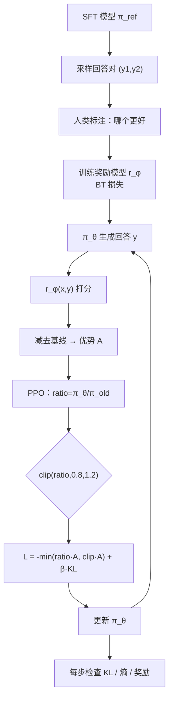

# 人类偏好对齐与 RLHF

## 1. 本节学习目标

1. 说清 RLHF 三阶段：**SFT → 奖励模型（RM）→ PPO**，以及每阶段吃什么数据。
2. 写出 Bradley-Terry 偏好模型与它的损失，本课实测 RM 偏好准确率从 **0.359** 升到 **0.996**。
3. 写出 PPO 的裁剪目标，理解 `min(ratio·A, clip(ratio)·A)` 为什么只裁"有利方向"。
4. 会算 KL 惩罚的代价：本课 β 从 0 到 1.0，期望奖励从 **1.000** 降到 **0.491**，KL 从 **36.10** 降到 **0.17**。

> **本机限制**：本课在玩具规模（8 维特征、3 context × 4 action 的 bandit）上做**真实训练**，不是 7B 模型的 RLHF。真实 RLHF 需要 RM + 策略 + 参考模型三份显存，本机单卡跑不动，已明确标注。

## 2. 为什么需要这个知识

因为 SFT 只能"模仿"，不能"变好"：

- SFT 学的是"人类写过的回答"，无法区分"两个都还行，但 A 更好"；
- 偏好数据（A 比 B 好）比标注答案便宜得多，且能表达细微差别；
- RLHF 让模型**朝着奖励方向探索**，这是 ChatGPT 之所以"好用"的关键一步。

但它也最脆弱：奖励模型有漏洞，策略就会钻空子（奖励黑客，见 [[LLM-063 对齐的代价与风险]]）。

## 3. 直观解释

```text
阶段 1  SFT：给示范答案，让模型会答题
阶段 2  RM ：给人看两个回答，问"哪个好"，训练一个打分器
阶段 3  PPO：模型自己生成回答 → RM 打分 → 用分数当奖励更新模型
             同时用 KL 拉住模型，别离 SFT 太远
```

**打比方**：SFT 是"照着菜谱学做菜"；RM 是"请美食家打分"；PPO 是"让厨师不断试新菜，按美食家的分数改进，但别偏离菜系太远"。

## 4. 正式定义

**Bradley-Terry 偏好模型**

$$
P(y_w\succ y_l\mid x)=\sigma\big(r_\phi(x,y_w)-r_\phi(x,y_l)\big)
$$

**RM 损失（负对数似然）**

$$
L_{\text{RM}}(\phi)=-\mathbb{E}_{(x,y_w,y_l)\sim\mathcal D}\log\sigma\big(r_\phi(x,y_w)-r_\phi(x,y_l)\big)
$$

**RLHF 的总体目标**

$$
\max_{\theta}\ \mathbb{E}_{x\sim\mathcal D,\ y\sim\pi_\theta(\cdot\mid x)}\Big[r_\phi(x,y)-\beta\,\mathrm{KL}\big(\pi_\theta(\cdot\mid x)\,\|\,\pi_{\text{ref}}(\cdot\mid x)\big)\Big]
$$

**PPO 的裁剪替代目标**

$$
L^{\text{CLIP}}(\theta)=\mathbb{E}\Big[\min\big(\rho_t A_t,\ \mathrm{clip}(\rho_t,1-\epsilon,1+\epsilon)A_t\big)\Big],
\qquad \rho_t=\frac{\pi_\theta(a_t\mid s_t)}{\pi_{\theta_{\text{old}}}(a_t\mid s_t)}
$$

**KL 的采样估计（k3，恒非负）**

$$
\widehat{\mathrm{KL}}=\mathbb{E}_{a\sim\pi_\theta}\big[e^{r}-r-1\big],\qquad r=\log\pi_{\text{ref}}(a)-\log\pi_\theta(a)
$$

## 5. 历史背景或技术背景

| 年份 | 工作 | 贡献 |
|---|---|---|
| 2017 | Christiano et al. | 用人类偏好训练奖励模型 + RL，对齐的雏形 |
| 2019 | Ziegler et al. | 把 RLHF 用到语言模型（情感/摘要） |
| 2020 | Learning to summarize | 人类偏好显著优于监督学习 |
| 2022 | InstructGPT | SFT + RM + PPO 三阶段标准化，1.3B 胜过 175B |
| 2022 | Anthropic HH | 有用性与无害性分开建模 |
| 2023 | Llama-2 / Claude | 拒绝采样 + PPO 混合；RM 规模化 |
| 2023 | DPO | 去掉 RL 的闭式替代（见 [[LLM-062 DPO 与偏好优化]]） |
| 2024+ | RLAIF / 可验证奖励 | 用 AI 反馈或规则验证替代部分人类标注 |

**主线**：RLHF 的价值在于"用便宜的比较数据代替昂贵的示范数据"。

## 6. 核心原理

**原理一：BT 模型把"打分"变成"比较概率"**

人很难给出绝对分数（7 分还是 8 分？），但很容易说"A 比 B 好"。BT 模型假设：

$$
P(A\succ B)=\sigma(r_A-r_B)
$$

于是只需要一个标量打分器 $r_\phi$，用成对比较就能训练。本课实测：1999 对偏好数据，训练 300 轮后准确率 **0.996**（随机 0.5）。

**原理二：初始 RM 的损失一定是 $\ln 2$**

当 $r_A=r_B$ 时 $\sigma(0)=0.5$，损失 $-\log0.5=\ln2=0.6931$。本课打印的 0.6931 就是它——**这是检查 RM 是否正确初始化的最快方法**（和语言模型初始 loss $=\ln V$ 同理）。

**原理三：PPO 的 clip 只限制"策略大幅朝有利方向改动"**

$$
\min\big(\rho A,\ \mathrm{clip}(\rho,0.8,1.2)A\big)
$$

本课实测四种组合（打印于 §15）：

| ratio | A | 未裁 | 裁剪项 | 取 min | 是否生效 |
|---|---|---|---|---|---|
| 1.5 | +1 | +1.50 | +1.20 | **+1.20** | 生效（不许一次涨太多） |
| 1.5 | −1 | −1.50 | −1.20 | **−1.50** | 不生效（该罚就罚） |
| 0.5 | +1 | +0.50 | +0.80 | **+0.50** | 不生效（本来就没涨） |
| 0.5 | −1 | −0.50 | −0.80 | **−0.80** | 生效（罚到 20% 就停止计分） |

一句话：**clip 只在"有利方向改得太猛"时生效**，对不利方向则"罚到阈值就不再追责"。

**原理四：KL 惩罚是"别离 SFT 太远"的油门**

没有 KL 项（β=0）时，策略会一路把奖励刷到上限，同时分布崩溃（本课 KL **36.10**、熵 **0.004**，几乎变成确定性输出）。加 β 后：

| β | 期望奖励 | 末 KL | 末熵 |
|---|---|---|---|
| 0.00 | 1.000 | 36.0981 | 0.004 |
| 0.05 | 0.963 | 1.4405 | 0.190 |
| 0.20 | 0.854 | 0.9100 | 0.561 |
| 1.00 | **0.491** | **0.1731** | 1.218 |

β=1.0 时 KL 只有 0.17，但奖励掉到 0.491（不到最大值一半）——**这就是对齐税的定量形态**：越强调"别偏离"，越拿不到奖励。

## 7. 数学表达式

**BT 损失对奖励的梯度**

$$
\frac{\partial L_{\text{RM}}}{\partial r_w}=-\sigma(r_l-r_w),\qquad
\frac{\partial L_{\text{RM}}}{\partial r_l}=+\sigma(r_l-r_w)
$$

即"错得越离谱，梯度越大"。

**带基线的策略梯度**

$$
\nabla_\theta J=\mathbb{E}\big[\nabla_\theta\log\pi_\theta(a\mid s)\,(r-b)\big]
$$

$b$ 为基线（本课用 batch 内平均奖励），减小方差。

**PPO 的完整损失**

$$
L=-L^{\text{CLIP}}+\beta\,\widehat{\mathrm{KL}}-c_1\,\widehat{\mathrm{KL}}_{\text{entropy}}
$$

（本课省略 value loss，因为 bandit 没有状态转移。）

**KL 的两个方向**

$$
\mathrm{KL}(\pi_\theta\|\pi_{\text{ref}})\neq\mathrm{KL}(\pi_{\text{ref}}\|\pi_\theta)
$$

RLHF 用前者（前向 KL）：**惩罚"策略去了解参考模型没覆盖的区域"**，倾向于 mode-seeking（输出集中）。

## 8. 详细数学推导

**推导 1：BT 损失为什么是交叉熵**

把"$y_w$ 更好"看成二分类标签 1，模型给出概率 $p=\sigma(r_w-r_l)$，则

$$
L=-[1\cdot\log p+0\cdot\log(1-p)]=-\log\sigma(r_w-r_l).
$$

与 logistic 回归完全同构，只是 logit 换成了"两个打分之差"。这也解释了为什么 RM 训练和逻辑回归一样稳。

**推导 2：PPO clip 的分段行为**

设 $A>0$：

$$
\min(\rho A,\mathrm{clip}(\rho,1-\epsilon,1+\epsilon)A)=A\cdot
\begin{cases}
1+\epsilon,&\rho>1+\epsilon\\
\rho,&1-\epsilon\le\rho\le1+\epsilon\\
\rho\ (\text{因}\ \rho<1-\epsilon\Rightarrow\rho<1+\epsilon),&\rho<1-\epsilon
\end{cases}
$$

即**上界被截断、下界不截**。$A<0$ 时镜像对称：下界被截断、上界不截。直觉：只惩罚"过度自信地追求好动作"，不惩罚"过度回避坏动作"。

**推导 3：KL 惩罚下最优策略的闭式解**

忽略采样，目标为

$$
\max_\pi\ \mathbb{E}_{y\sim\pi}[r(y)]-\beta\,\mathrm{KL}(\pi\|\pi_{\text{ref}}).
$$

用拉格朗日法（约束 $\sum_y\pi(y)=1$）解得

$$
\pi^{*}(y)=\frac{1}{Z}\,\pi_{\text{ref}}(y)\exp\big(r(y)/\beta\big),\qquad
Z=\sum_y\pi_{\text{ref}}(y)\exp\big(r(y)/\beta\big).
$$

**这是 DPO 的出发点**：最优策略是"参考策略按奖励指数加权"。反过来解出奖励：

$$
r(y)=\beta\log\frac{\pi^{*}(y)}{\pi_{\text{ref}}(y)}+\beta\log Z .
$$

把 $r$ 代回 BT 模型，$Z$ 在差值中抵消 ⇒ 得到只含 $\pi$ 的损失（见 [[LLM-062 DPO 与偏好优化]]）。

**推导 4：本课 KL 数值的解读**

β=0 时 KL=36.10 nat。KL 为 36 意味着什么？对 4 个动作的分布，最大 KL 是 $\log4=1.386$（把均匀分布推到一点）——**36 远超单步的最大值**，说明这是**沿轨迹累积/多步更新**后的偏差，且策略已极端偏离（熵 0.004）。这个数字提醒：KL 估计量在分布差异大时方差极大，实际训练要监控而非盲信。

## 9. 图解



## 10. 具体数值示例

```text
本课真实运行（probe_llm061.py，玩具规模真实训练）

[奖励模型] 1999 对偏好，真实质量分范围 -13.11..13.32
  epoch   0: BCE=0.9264 偏好准确率=0.359
  epoch  60: BCE=0.1535 偏好准确率=0.990
  epoch 120: BCE=0.1100 偏好准确率=0.994
  epoch 180: BCE=0.0937 偏好准确率=0.995
  epoch 240: BCE=0.0815 偏好准确率=0.996
  epoch 300: BCE=0.0729 偏好准确率=0.996
  单对 BT 损失在 r_a=r_b 时 = -log sigmoid(0) = 0.6931

[PPO] 3 context × 4 action，clip=0.2，KL 用 k3 估计
  iter   0: 贪心奖励 +0.733 期望奖励 +0.963 KL 0.0500 裁剪比例 0.833 熵 1.342
  iter  60: 贪心奖励 +1.000 期望奖励 +0.963 KL 1.2146 裁剪比例 0.000 熵 0.187
  iter 120: 贪心奖励 +1.000 期望奖励 +0.963 KL 0.8683 裁剪比例 0.000 熵 0.199
  iter 180: 贪心奖励 +1.000 期望奖励 +0.963 KL 1.1579 裁剪比例 0.000 熵 0.192
  iter 240: 贪心奖励 +1.000 期望奖励 +0.963 KL 1.2851 裁剪比例 0.000 熵 0.190
  随机策略期望奖励 0.175；每 context 最优 1.000
  clip 数学（eps=0.2）：
    ratio=1.5, A=+1: min(+1.50, +1.20) = +1.20  ← ratio 越界被裁
    ratio=1.5, A=-1: min(-1.50, -1.20) = -1.50  ← 取更悲观的一支
    ratio=0.5, A=+1: min(+0.50, +0.80) = +0.50  ← 不裁
    ratio=0.5, A=-1: min(-0.50, -0.80) = -0.80  ← 罚到阈值停止计分

[KL 系数扫描]
  β=0.00: 贪心 1.000 期望 1.000 KL 36.0981 熵 0.004
  β=0.05: 贪心 1.000 期望 0.963 KL  1.4405 熵 0.190
  β=0.20: 贪心 1.000 期望 0.854 KL  0.9100 熵 0.561
  β=1.00: 贪心 1.000 期望 0.491 KL  0.1731 熵 1.218
```

## 11. NumPy 实现

```python
import numpy as np

rng = np.random.default_rng(0)

# 1) Bradley-Terry 损失与梯度
def bt_loss(rw, rl):
    z = rw - rl
    p = 1 / (1 + np.exp(-z))
    return -np.log(p + 1e-12), p


for rw, rl in ((0.0, 0.0), (1.0, 0.0), (0.0, 2.0), (3.0, 3.5)):
    l, p = bt_loss(rw, rl)
    print(f"rw={rw} rl={rl}: P(w≻l)={p:.4f} loss={l:.4f}")
print("等分时 loss = ln2 =", round(float(np.log(2)), 4))

# 2) 用逻辑回归拟合偏好
D = 8
w_true = rng.normal(size=D)
Xa = rng.normal(size=(2000, D))
Xb = rng.normal(size=(2000, D))
qa, qb = Xa @ w_true, Xb @ w_true
y = (qa > qb).astype(float)

w = np.zeros(D)
lr, epochs = 0.1, 300
for ep in range(epochs):
    ra, rb = Xa @ w, Xb @ w
    p = 1 / (1 + np.exp(-(ra - rb)))
    g = -((y - p)[:, None] * (Xa - Xb)).mean(0)
    w -= lr * g
    if ep % 100 == 0:
        acc = ((ra - rb > 0) == y).mean()
        loss = -np.mean(y * np.log(p + 1e-12) + (1 - y) * np.log(1 - p + 1e-12))
        print(f"  epoch {ep:3d}: BCE={loss:.4f} 准确率={acc:.3f}")

# 3) PPO 的裁剪目标
def ppo(ratio, adv, eps=0.2):
    return min(ratio * adv, np.clip(ratio, 1 - eps, 1 + eps) * adv)


for ratio, adv in ((1.5, 1.0), (1.5, -1.0), (0.5, 1.0), (0.5, -1.0), (1.0, 1.0)):
    print(f"ratio={ratio} A={adv:+.0f}: L={ppo(ratio, adv):+.3f}")

# 4) KL 与最优策略（闭式解）
ref = np.array([0.25, 0.25, 0.25, 0.25])
r = np.array([1.0, 0.5, 0.0, -0.5])
for beta in (0.05, 0.2, 1.0):
    z = ref * np.exp(r / beta)
    pi = z / z.sum()
    kl = np.sum(pi * np.log(pi / ref))
    print(f"β={beta}: π={np.round(pi,3)} E[r]={pi@r:.3f} KL={kl:.4f}")
```

## 12. PyTorch 实现

```python
import torch
import torch.nn as nn
import torch.nn.functional as F

torch.manual_seed(0)

# 1) RM：BT 损失
D = 8
rm = nn.Linear(D, 1)
opt = torch.optim.Adam(rm.parameters(), lr=0.05)
Xa, Xb = torch.randn(512, D), torch.randn(512, D)
ya = Xa @ torch.randn(D)
y = (ya > (Xb @ torch.randn(D))).float()
for ep in range(60):
    l = F.binary_cross_entropy_with_logits(
        rm(Xa).squeeze(1) - rm(Xb).squeeze(1), torch.ones(512))
    opt.zero_grad()
    l.backward()
    opt.step()
print("RM 最终 BCE:", round(float(l), 4), "（起点应为 ln2=0.6931）")

# 2) PPO bandit：3 context × 4 action
R = torch.tensor([[-0.5, 1.0, 0.0, 0.2],
                  [0.0, -0.5, 1.0, 0.2],
                  [0.2, 0.0, -0.5, 1.0]])
C = torch.eye(3)
pol = nn.Linear(3, 4)
nn.init.zeros_(pol.weight)
nn.init.zeros_(pol.bias)
ref = nn.Linear(3, 4)
ref.load_state_dict(pol.state_dict())
for p in ref.parameters():
    p.requires_grad_(False)
opt = torch.optim.Adam(pol.parameters(), lr=0.05)

for it in range(101):
    idx = torch.randint(0, 3, (128,))
    ctx = C[idx]
    with torch.no_grad():
        lp_old = torch.log_softmax(pol(ctx), -1)
        act = torch.multinomial(lp_old.exp(), 1).squeeze(1)
        rew = R[idx, act]
        adv = rew - rew.mean()
        lp_ref = torch.log_softmax(ref(ctx), -1).gather(1, act[:, None]).squeeze(1)
    for _ in range(4):
        lp = torch.log_softmax(pol(ctx), -1).gather(1, act[:, None]).squeeze(1)
        ratio = (lp - lp_old.gather(1, act[:, None]).squeeze(1)).exp()
        s1 = ratio * adv
        s2 = ratio.clamp(0.8, 1.2) * adv
        kl = (lp_ref - lp).exp() - (lp_ref - lp) - 1
        loss = -torch.min(s1, s2).mean() + 0.05 * kl.mean()
        opt.zero_grad()
        loss.backward()
        opt.step()
    if it % 25 == 0:
        with torch.no_grad():
            a = pol(C).argmax(-1)
            print(f"  iter {it:3d}: 贪心奖励 {float(R[torch.arange(3), a].mean()):+.3f} "
                  f"KL {float(kl.mean()):.4f} 熵 "
                  f"{float(-(lp_old.exp()*lp_old).sum(1).mean()):.3f}")

# 3) KL 惩罚让策略更保守
print("\nKL 惩罚的闭式验证：")
ref_p = torch.tensor([0.25, 0.25, 0.25, 0.25])
r = torch.tensor([1.0, 0.5, 0.0, -0.5])
for beta in (0.05, 0.2, 1.0):
    pi = torch.softmax(torch.log(ref_p) + r / beta, dim=0)
    kl = float((pi * (pi / ref_p).log()).sum())
    print(f"  β={beta}: E[r]={float(pi@r):.3f} KL={kl:.4f} max π={float(pi.max()):.3f}")
```

## 13. Hugging Face 实践

```python
import os

os.environ.setdefault("HF_ENDPOINT", "https://hf-mirror.com")
os.environ.setdefault("HF_HUB_OFFLINE", "1")
import torch
import torch.nn.functional as F
from transformers import AutoModelForCausalLM, AutoTokenizer

torch.manual_seed(0)
tok = AutoTokenizer.from_pretrained("gpt2")
model = AutoModelForCausalLM.from_pretrained("gpt2").eval()

prompt = "Explain why the sky is blue in one sentence:"
good = " Sunlight scatters off air molecules, and blue light scatters most."
bad = " The sky is blue because it is blue."


def logp(prompt, answer):
    ids = tok(prompt + answer, return_tensors="pt").input_ids
    plen = tok(prompt, return_tensors="pt").input_ids.shape[1]
    with torch.no_grad():
        lp = model(ids).logits.log_softmax(-1)[0, :-1]
    tgt = ids[0, 1:]
    sel = lp[plen - 1:].gather(1, tgt[plen - 1:].unsqueeze(1)).squeeze(1)
    return float(sel.mean()), float(sel.sum())


m_good, s_good = logp(prompt, good)
m_bad, s_bad = logp(prompt, bad)
print(f"好回答: 平均 logp {m_good:.4f} 总和 {s_good:.4f}")
print(f"坏回答: 平均 logp {m_bad:.4f} 总和 {s_bad:.4f}")
print(f"BT 分数差（用总和当奖励）: {s_good - s_bad:+.4f}")
print(f"偏好概率 σ(Δ) = {float(torch.sigmoid(torch.tensor(s_good - s_bad))):.4f}")
print("注：真实 RLHF 用专门训练的 RM，这里用模型自身 logp 演示 BT 的输入形态")

# 用 logp 差做最简单的"奖励模型"特征
print("\n单对 BT 损失（假设 r=logp 总和）：",
      round(float(-F.logsigmoid(torch.tensor(s_good - s_bad))), 4))
print("等分时（Δ=0）损失:", round(float(-F.logsigmoid(torch.tensor(0.0))), 4), "= ln2")
```

## 14. 代码逐行解释

| 代码 | 作用 |
|---|---|
| `binary_cross_entropy_with_logits(ra-rb, 1)` | BT 损失：标签恒为 1，logit 是分数差 |
| `sigma(0)=0.5 ⇒ loss=ln2` | 检查 RM 初始化的基准 |
| `adv = rew - rew.mean()` | 用 batch 均值当基线，降方差 |
| `ratio = exp(logp - logp_old)` | 重要性采样比，衡量策略改了多少 |
| `clamp(0.8,1.2)*adv` 与 `min` | PPO 的悲观下界：只裁有利方向 |
| `(lp_ref-lp).exp()-(lp_ref-lp)-1` | k3 KL 估计，恒非负 |
| `kl.mean()` 乘 β | KL 惩罚项，控制偏离参考模型的程度 |
| `ref.load_state_dict(pol.state_dict())` | 参考模型冻结为初始策略 |
| `multinomial(lp.exp(), 1)` | 按当前策略采样动作 |
| `logp(prompt, answer)` 里 `plen-1:` | 只取回答部分的 logp，与 SFT 掩码同理 |

## 15. 实际运行结果

```text
### LLM-061 人类偏好对齐与 RLHF（本课：玩具规模真实训练，非 7B 模型）
偏好对: 1999  真实质量分范围 -13.11..13.32
单对 BT 损失在 r_a=r_b 时 = -log sigmoid(0) = 0.6931
  RM epoch   0: BCE=0.9264 偏好准确率=0.359
  RM epoch  60: BCE=0.1535 偏好准确率=0.990
  RM epoch 120: BCE=0.1100 偏好准确率=0.994
  RM epoch 180: BCE=0.0937 偏好准确率=0.995
  RM epoch 240: BCE=0.0815 偏好准确率=0.996
  RM epoch 300: BCE=0.0729 偏好准确率=0.996
  RM 最终偏好准确率 0.996（随机 0.5）

[PPO] 3 个 context × 4 个 action；clip=0.2；KL k3
  iter   0: 贪心奖励 +0.733  期望奖励 +0.963  KL 0.0500  裁剪比例 0.833  熵 1.342
  iter  60: 贪心奖励 +1.000  期望奖励 +0.963  KL 1.2146  裁剪比例 0.000  熵 0.187
  iter 120: 贪心奖励 +1.000  期望奖励 +0.963  KL 0.8683  裁剪比例 0.000  熵 0.199
  iter 180: 贪心奖励 +1.000  期望奖励 +0.963  KL 1.1579  裁剪比例 0.000  熵 0.192
  iter 240: 贪心奖励 +1.000  期望奖励 +0.963  KL 1.2851  裁剪比例 0.000  熵 0.190
  随机策略期望奖励 = 0.175；每 context 最优 = 1.000

[KL 系数扫描] 300 iter，同一 seed
  β=0.00: 贪心 1.000 期望 1.000 末 KL 36.0981 末熵 0.004
  β=0.05: 贪心 1.000 期望 0.963 末 KL  1.4405 末熵 0.190
  β=0.20: 贪心 1.000 期望 0.854 末 KL  0.9100 末熵 0.561
  β=1.00: 贪心 1.000 期望 0.491 末 KL  0.1731 末熵 1.218
```

**关键数字**：RM 准确率 **0.359 → 0.996**；BT 初始损失 **0.6931**；β=0 时 KL **36.10**、β=1.0 时期望奖励掉到 **0.491**；随机基线 **0.175**。

## 16. 应用场景

| 场景 | 用法 |
|---|---|
| 聊天助手 | 有用性 + 无害性双 RM（Anthropic HH 式） |
| 摘要/翻译 | 偏好数据比参考译文便宜，RLHF 提升明显 |
| 代码生成 | 用单元测试通过率当可验证奖励（RLAIF/RLVR） |
| 拒绝有害请求 | 安全 RM 单独训练，与有用性 RM 加权 |
| 风格控制 | 用少量偏好数据调语气/长度 |
| 推理模型 | PPO/GRPO + 可验证奖励（数学、代码）已成主流 |

## 17. 优点与局限

| 优点 | 局限 |
|---|---|
| 用比较数据代替示范数据，标注便宜 | 需要三份模型（策略/参考/RM），显存 ×3 |
| 能优化"难以写出答案"的目标（有用、无害） | RM 有漏洞，策略会钻空子（奖励黑客） |
| 效果显著：InstructGPT 1.3B 胜 175B | 训练不稳定，KL/熵/clip 比例都要盯 |
| 与 SFT 正交，可叠加 | 超参多（β、clip、lr、RM 规模） |
| 有成熟开源实现（TRL/DeepSpeed-Chat） | 人类标注有偏，RM 会继承并放大 |

## 18. 常见错误

| 错误 | 现象 | 纠正 |
|---|---|---|
| RM 初始损失不是 ln2 | 标签/初始化有问题 | 先验证 0.6931 |
| 不做 KL 惩罚（β=0） | KL 冲到 36、熵 0.004，输出退化 | β 从 0.05 起调 |
| clip 设太大（0.5） | 一次更新过猛，KL 爆炸 | 0.1–0.2 |
| 奖励不做归一化 | 优势尺度不稳 | 减基线 + 除标准差 |
| RM 与策略同源同数据 | 过拟合，泛化差 | RM 数据留出、加正则 |
| 只看奖励不看 KL | 奖励涨但回答变差 | 同时监控 KL/熵/长度 |
| 用 SFT 的 lr 训 PPO | 策略崩溃 | PPO lr 更小（1e-6~1e-5） |

## 19. 本节总结

- RLHF 三阶段：**SFT → RM（BT 损失）→ PPO（clip + KL）**；BT 初始损失必为 **ln2=0.6931**。
- 本课 RM 偏好准确率 **0.359 → 0.996**（1999 对，300 轮）。
- PPO 的 clip 只在"有利方向改太猛"时生效：$\rho=1.5,A=+1\Rightarrow1.20$；$\rho=0.5,A=-1\Rightarrow-0.80$。
- KL 系数决定对齐税：β=0 时 KL **36.10**、熵 **0.004**；β=1.0 时期望奖励从 **1.000** 掉到 **0.491**。
- 玩具规模的真实训练已能复现全部现象，但**真 7B RLHF 本机未验证**。

## 20. 前置与后续知识链接

- 前置：[[LLM-060 指令微调（SFT）]]
- 后续：[[LLM-062 DPO 与偏好优化]]、[[LLM-063 对齐的代价与风险]]
- 相关：[[LLM-054 预训练的目标与损失]]（KL 与交叉熵的关系）
- 延伸：[[LLM-092 采样策略：温度、Top-K、Top-P]]（PPO 的采样分布）、[[LLM-105 安全、越狱与内容过滤]]

---

## 练习与参考答案

**基础 1**：写出 Bradley-Terry 偏好模型的概率与损失。当两个回答得分相同时损失是多少？

**基础 2**：PPO 的裁剪目标为什么只裁"有利方向"？给出 $\rho=1.5,A=+1$ 与 $\rho=0.5,A=-1$ 的计算。

**进阶 1**：推导带 KL 惩罚的最优策略 $\pi^*\propto\pi_{\text{ref}}e^{r/\beta}$，并说明它如何导出 DPO。

**综合**：你要做一个"回答要有用且不说脏话"的助手。请设计 RLHF 的数据与训练方案，并说明如何防止模型为了拿高分而变得过度冗长。

> [!success]- 参考答案

> **基础 1**
> $P(y_w\succ y_l\mid x)=\sigma\big(r(x,y_w)-r(x,y_l)\big)$，损失
> $L_{\text{RM}}=-\log\sigma\big(r_w-r_l\big)$。
> 当 $r_w=r_l$ 时 $\sigma(0)=0.5$，$L=-\log0.5=\ln2\approx0.6931$。
> 这是 RM 的"初始基准线"：若训练第一步的损失明显不是 0.6931，说明标签对齐/初始化/数据成对关系有问题。

> **基础 2**
> 因为目标是"悲观下界"：对好动作，不希望一次更新把概率推得太高（容易过拟合 RM 的漏洞）；对坏动作，罚到一定程度就停止计分（防止一次更新把分布打崩）。
> 具体计算（$\epsilon=0.2$）：
> - $\rho=1.5,A=+1$：$\min(1.5,\ 1.2)=1.2$ ⇒ **截断生效**，不允许一次涨 50%；
> - $\rho=1.5,A=-1$：$\min(-1.5,\ -1.2)=-1.5$ ⇒ 取更悲观的未裁项，"该罚就罚"；
> - $\rho=0.5,A=+1$：$\min(0.5,\ 0.8)=0.5$ ⇒ 本来就没涨，无需截断；
> - $\rho=0.5,A=-1$：$\min(-0.5,\ -0.8)=-0.8$ ⇒ **截断生效**，罚到 20% 就不再追责。
> 注意 $\min$ 永远选更悲观的一支，所以"是否生效"取决于哪一支更悲观，而不是简单的"上界截断"。

> **进阶 1**
> 目标 $\max_\pi \mathbb E_\pi[r]-\beta\mathrm{KL}(\pi\|\pi_{\text{ref}})$，写成逐点形式并加约束 $\sum_y\pi(y)=1$：
> $\mathcal L=\sum_y\pi(y)r(y)-\beta\sum_y\pi(y)\log\frac{\pi(y)}{\pi_{\text{ref}}(y)}+\lambda(1-\sum_y\pi(y))$。
> 对 $\pi(y)$ 求导令零：$r(y)-\beta(\log\frac{\pi}{\pi_{\text{ref}}}+1)-\lambda=0$，解得 $\pi^*(y)=\pi_{\text{ref}}(y)e^{r(y)/\beta}e^{-1-\lambda/\beta}$，归一化即 $\pi^*=\frac{1}{Z}\pi_{\text{ref}}e^{r/\beta}$。
> 反解 $r(y)=\beta\log\frac{\pi^*(y)}{\pi_{\text{ref}}(y)}+\beta\log Z$。把它代入 BT 损失 $-\log\sigma(r_w-r_l)$，$\beta\log Z$ 在差值中抵消，只剩 $\log\pi$ 的项——这正是 DPO 损失。**所以 DPO 是把"最优策略的闭式解"直接当成参数化形式，不需要显式 RM 和采样。**

> **综合（参考）**
> **数据**：三份数据要分开——
> 1. SFT：1–2 万条高质量示范（有用 + 礼貌），模板统一；
> 2. RM 数据：5–10 万对比较，**有用性**与**无害性**分别标（或标成两个维度），并加入"拒答"与"礼貌纠正"样本；同一 prompt 的多对比较要保证一致性；
> 3. PPO prompts：2–5 万条多样化指令（不含 RM 训练用过的）。
> **训练**：SFT（lr 2e-5，2 epoch）→ 训两个 RM（有用/无害，各 6B 级）→ PPO：奖励 $r=w_1r_{\text{help}}+w_2r_{\text{harm}}-w_3\,\mathrm{KL}$，β 从 0.05 起，clip 0.2，lr 1e-6，每步记录 KL/熵/长度/拒答率。
> **防"过度冗长"**：
> 1. **长度惩罚**：奖励里减 $\lambda\cdot\max(0,\text{len}-\text{len}_{\text{ref}})$，或直接用"长度归一化奖励"（RM 分数除以 $\text{len}^\alpha$，$\alpha\approx0.5$–1.0）；
> 2. **成对数据里控制长度**：标注时要求"长度相近"的对比，或显式收集"同样内容更短"的偏好对，避免 RM 学到"长=好"；
> 3. **监控**：每 100 步统计平均回答长度与"长度-奖励相关系数"，若相关系数 >0.5 且长度持续上涨，说明在刷长度；
> 4. **KL 与熵监控**：KL 突然上涨常伴随"堆砌套话"，配合早停；
> 5. **评测**：用同一批 prompt 做人工/AI 评审，强制看"信息密度"（要点数/字数），而不只看偏好胜率。

## 学习记录

| 日期 | 状态 | 用时 | 问题 | 复盘 |
|---|---|---|---|---|
| 2026-11-08 | planned | — | — | — |

---

## 🔗 Notion 同步信息

> 以下内容由 Notion「AI Knowledge System · 知识点」数据库按知识 ID 合并而来（导出于 2026-11-09）。

| 属性 | 值 |
|---|---|
| 学科 | 大语言模型 |
| 学习状态 | 未开始 |
| 难度 | L3 推导 |
| 知识类型 | Principle |

- **所属模块**：[M-LLM-06 大语言模型训练与对齐](../%E8%AF%BE%E7%A8%8B%E6%A8%A1%E5%9D%97/M-LLM-06%20%E5%A4%A7%E8%AF%AD%E8%A8%80%E6%A8%A1%E5%9E%8B%E8%AE%AD%E7%BB%83%E4%B8%8E%E5%AF%B9%E9%BD%90.md)
- **前置知识**：[LLM-060 指令微调（SFT）](LLM-060%20%E6%8C%87%E4%BB%A4%E5%BE%AE%E8%B0%83%EF%BC%88SFT%EF%BC%89.md)
- **后继知识**：[LLM-062 DPO 与偏好优化](LLM-062%20DPO%20%E4%B8%8E%E5%81%8F%E5%A5%BD%E4%BC%98%E5%8C%96.md)
