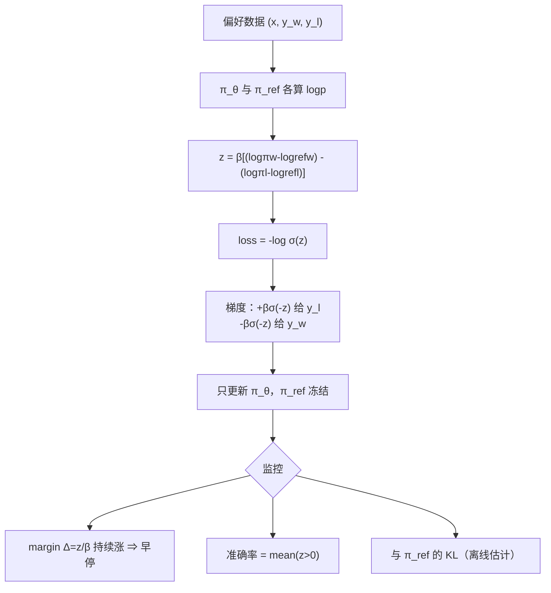

# DPO 与偏好优化

## 1. 本节学习目标

1. 从"KL 正则最优策略"推导出 DPO 损失，说清它与 BT 模型的关系。
2. 手写 DPO 损失与解析梯度，并用有限差分验证（本课误差 **2.78e-11**）。
3. 理解初始值必为 $\ln 2$（本课 **0.693147**），以及为什么 DPO 的 margin 会一路涨到无穷。
4. 会比较 DPO 与 RLHF：省掉 RM 与在线采样，但失去探索与 KL 的显式控制。

## 2. 为什么需要这个知识

因为 RLHF 工程复杂度太高：

- 要同时驻留策略、参考模型、奖励模型（显存 ×3）；
- PPO 有 4 个以上超参（clip、β、lr、GAE），调不好就崩；
- 采样-打分-更新是串行流程，吞吐低。

DPO 把这一切压成**一个类似 SFT 的监督损失**：一份偏好数据、两个模型（策略 + 冻结参考）、一次前向即可。2023 年后它成了开源社区对齐的默认选择。

## 3. 直观解释

RLHF 的隐式奖励是"策略相对参考模型的概率提升"：

$$
\hat r(y)=\beta\log\frac{\pi_\theta(y)}{\pi_{\text{ref}}(y)}
$$

**直觉**：如果一个回答在策略里比在参考模型里"更受偏爱"，就认为它更好。DPO 直接把这个隐式奖励塞进 BT 模型：

```text
好回答：π_θ(y_w) 要比 π_ref(y_w) 更大   → log 比值为正
坏回答：π_θ(y_l) 要比 π_ref(y_l) 更小   → log 比值为负
目标：让两者的差距尽量大
```

所以 DPO 不需要单独训一个打分器——**策略自己就是打分器**。

## 4. 正式定义

**DPO 损失**（$\sigma$ 为 sigmoid，$\beta>0$）

$$
L_{\text{DPO}}(\theta)=-\mathbb{E}_{(x,y_w,y_l)}\log\sigma\Big(\beta\Big[\log\frac{\pi_\theta(y_w\mid x)}{\pi_{\text{ref}}(y_w\mid x)}-\log\frac{\pi_\theta(y_l\mid x)}{\pi_{\text{ref}}(y_l\mid x)}\Big]\Big)
$$

记

$$
z=\beta\Big[(\log\pi_\theta(y_w)-\log\pi_{\text{ref}}(y_w))-(\log\pi_\theta(y_l)-\log\pi_{\text{ref}}(y_l))\Big],
$$

则 $L=-\log\sigma(z)$。

**隐式奖励**

$$
\hat r_\theta(x,y)=\beta\log\frac{\pi_\theta(y\mid x)}{\pi_{\text{ref}}(y\mid x)}
$$

**BT 一致性**：把 $\hat r$ 代入 $P(y_w\succ y_l)=\sigma(\hat r_w-\hat r_l)$ 即得 DPO，$\beta\log Z(x)$ 在差值中抵消。

## 5. 历史背景或技术背景

| 年份 | 工作 | 贡献 |
|---|---|---|
| 2022 | InstructGPT | RLHF 三阶段确立，PPO 成标配 |
| 2023 | DPO（Rafailov et al.） | 用闭式最优策略消掉 RM 与 RL |
| 2023 | IPO | 指出 DPO 在确定性偏好下会过拟合，加正则 |
| 2024 | KTO / ORPO / SimPO | 单样本偏好、无需参考模型、长度归一化 |
| 2024 | 迭代 DPO / 在线 DPO | 用当前策略采样新偏好对，缓解离线覆盖不足 |
| 2025+ | 与可验证奖励结合 | 数学/代码用规则奖励，DPO 用于风格与安全 |

**主线**：DPO 把"对齐"从 RL 工程问题降级成"监督学习 + 数据工程"问题，极大降低了门槛。

## 6. 核心原理

**原理一：DPO 的起点损失是 $\ln 2$**

初始时 $\pi_\theta=\pi_{\text{ref}}$，故 $z=0$，$L=-\log\sigma(0)=\ln2=0.693147$。本课实测玩具训练第 0 步正是 **0.693147**——**这是检查 DPO 实现是否正确的最快断言**。

**原理二：DPO 的梯度是一个"加权对比"**

$$
\nabla_\theta L=-\beta\,\sigma(-z)\Big[\nabla_\theta\log\pi_\theta(y_w)-\nabla_\theta\log\pi_\theta(y_l)\Big]
$$

- 提高好回答的 log 概率、压低坏回答的；
- 权重 $\sigma(-z)$：**已经分对且差距很大时（$z\gg0$）权重趋 0**，不再用力；分错时（$z<0$）权重大于 0.5，猛推。

本课手算：$z=0.04$ 时 $\sigma(-z)=0.49$，$\beta\sigma(-z)=0.049$，与有限差分 **−0.049000** 一致（误差 2.78e-11）。

**原理三：没有 KL 硬约束 ⇒ margin 会一直涨**

DPO 的 KL 只通过 $\pi_{\text{ref}}$ 隐式存在，没有"超过 β 就停"的机制。本课玩具训练（单对数据、200 步）：$z$ 从 0 涨到 **3.5811**，隐式奖励差 **35.81**，$\pi$ 变成 $[1.0000, 0.0000]$，KL 达到 $\ln2=0.6931$（两个候选时的最大 KL）。

换成 4 个候选、真实数据时会好一些（因为不同对的约束互相牵制），但**"DPO 会把 chosen 的概率一路推高"是已知特性**，工程上靠 β、早停、数据多样性控制。

**原理四：β 控制"多相信偏好数据"**

| β | z（200 步） | 隐式奖励差 $z/\beta$ | KL | $\pi_c$ |
|---|---|---|---|---|
| 0.05 | 2.511 | 50.218 | 0.6931 | 1.0000 |
| 0.10 | 3.581 | 35.811 | 0.6931 | 1.0000 |
| 0.50 | 6.149 | 12.298 | 0.6931 | 1.0000 |
| 2.00 | 9.266 | 4.633 | 0.6389 | 0.9904 |

读法：**β 越小，隐式奖励尺度越大（$z/\beta$ 从 50 到 4.6）**，即"同样一个 log 概率差被解释成更大的奖励差"。β 太小 ⇒ 对数据过度自信、容易过拟合噪声；β 太大 ⇒ 学不动。

## 7. 数学表达式

**损失与导数链**

$$
L=-\log\sigma(z),\qquad
\frac{\partial L}{\partial z}=-\sigma(-z)=-(1-\sigma(z))
$$

$$
\frac{\partial z}{\partial\log\pi_\theta(y_w)}=\beta,\qquad
\frac{\partial z}{\partial\log\pi_\theta(y_l)}=-\beta
$$

**完整梯度**

$$
\frac{\partial L}{\partial\log\pi_\theta(y_w)}=-\beta\sigma(-z),\qquad
\frac{\partial L}{\partial\log\pi_\theta(y_l)}=+\beta\sigma(-z)
$$

**隐式奖励差（margin）**

$$
\Delta=\hat r_w-\hat r_l=\frac{z}{\beta}
$$

**DPO 与 RLHF 目标的等价性**

$$
\max_\pi\mathbb E_{\pi}[r]-\beta\mathrm{KL}(\pi\|\pi_{\text{ref}})
\ \Longleftrightarrow\ 
\pi^*=\frac{1}{Z}\pi_{\text{ref}}e^{r/\beta}
$$

## 8. 详细数学推导

**推导 1：从 KL 正则最优解到 DPO**

目标

$$
\max_\pi\ \mathbb E_{y\sim\pi}[r(y)]-\beta\mathrm{KL}(\pi\|\pi_{\text{ref}}).
$$

展开 KL：

$$
=\sum_y\pi(y)r(y)-\beta\sum_y\pi(y)\log\frac{\pi(y)}{\pi_{\text{ref}}(y)}.
$$

加约束 $\sum_y\pi(y)=1$，对 $\pi(y)$ 求导：

$$
r(y)-\beta\Big(\log\frac{\pi(y)}{\pi_{\text{ref}}(y)}+1\Big)+\lambda=0
$$

⇒ $\pi^*(y)=\pi_{\text{ref}}(y)\exp\big(\frac{r(y)+\lambda-\beta}{\beta}\big)$，归一化得

$$
\pi^*(y)=\frac{1}{Z(x)}\pi_{\text{ref}}(y)\exp\big(r(y)/\beta\big).
$$

反解：

$$
r(y)=\beta\log\frac{\pi^*(y)}{\pi_{\text{ref}}(y)}+\beta\log Z(x).
$$

**推导 2：代入 BT 后 $Z$ 为什么消失**

$$
P(y_w\succ y_l)=\sigma\big(r_w-r_l\big)
=\sigma\Big(\beta\log\frac{\pi^*(y_w)}{\pi_{\text{ref}}(y_w)}-\beta\log\frac{\pi^*(y_l)}{\pi_{\text{ref}}(y_l)}\Big),
$$

因为 $r_w$ 与 $r_l$ 都含同一个 $+\beta\log Z(x)$，相减抵消。于是损失只含 $\pi^*$（参数化为 $\pi_\theta$）与 $\pi_{\text{ref}}$，**不需要奖励模型**。

**推导 3：梯度权重 $\sigma(-z)$ 的行为**

- $z\to+\infty$（已分对且差距大）：$\sigma(-z)\to0$ ⇒ 梯度消失，不再推；
- $z=0$（初始）：$\sigma(0)=0.5$ ⇒ 中等力度；
- $z\to-\infty$（分错）：$\sigma(-z)\to1$ ⇒ 满力纠正。

这就是"难例优先"的自适应权重。本课 $z=0.04$：$\sigma(-0.04)=0.49$，非常接近 0.5。

**推导 4：玩具训练的数值轨迹**

单对数据、2 个候选、$\beta=0.1$、lr=0.2、Adam：

| iter | loss | z | 隐式奖励差 | 正确率 |
|---|---|---|---|---|
| 0 | 0.693147 | 0.0000 | 0 | 0.500 |
| 20 | 0.378395 | 0.7767 | 7.767 | 0.685 |
| 50 | 0.167618 | 1.7011 | 17.011 | 0.846 |
| 100 | 0.070623 | 2.6149 | 26.149 | 0.932 |
| 200 | 0.027464 | 3.5811 | 35.811 | 0.973 |

$\pi_c\to1$、KL $\to\ln2=0.6931$。注意 loss 永远到不了 0（$-\log\sigma(z)>0$），但会无限逼近。

## 9. 图解



## 10. 具体数值示例

```text
本课真实运行（probe_llm062.py）

[单对样本] logπ_c=-1.20 logπ_r=-2.00 logπref_c=-1.50 logπref_r=-1.90 β=0.10
  z = 0.10*[(-1.20+1.50) - (-2.00+1.90)] = 0.040000
  loss = -log sigmoid(0.04) = 0.673347
  sigmoid(z) = 0.509999
  dLoss/dlogπc = -0.049000   dLoss/dlogπr = +0.049000
  梯度大小 = β·σ(-z) = 0.049000
  有限差分 d/dlogπc = -0.049000（差 2.78e-11）
  torch autograd 一致

  π=πref 时（z=0）：loss = ln2 = 0.693147

[玩具训练] 2 候选，β=0.1，Adam lr=0.2
  iter   0: loss=0.693147 z=0.0000 正确率 0.500
  iter  20: loss=0.378395 z=0.7767 隐式奖励差 7.767 正确率 0.685
  iter  50: loss=0.167618 z=1.7011 隐式奖励差 17.011 正确率 0.846
  iter 100: loss=0.070623 z=2.6149 隐式奖励差 26.149 正确率 0.932
  iter 200: loss=0.027464 z=3.5811 隐式奖励差 35.811 正确率 0.973

[β 影响] 200 步
  β=0.05: z=2.511 隐式奖励差=50.218 KL=0.6931 π_c=1.0000
  β=0.10: z=3.581 隐式奖励差=35.811 KL=0.6931 π_c=1.0000
  β=0.50: z=6.149 隐式奖励差=12.298 KL=0.6931 π_c=1.0000
  β=2.00: z=9.266 隐式奖励差= 4.633 KL=0.6389 π_c=0.9904
```

## 11. NumPy 实现

```python
import numpy as np

BETA = 0.1


def dpo_loss_np(lp_pol_c, lp_pol_r, lp_ref_c, lp_ref_r, beta=BETA):
    z = beta * ((lp_pol_c - lp_ref_c) - (lp_pol_r - lp_ref_r))
    loss = np.logaddexp(0.0, -z)          # -log sigmoid(z)，数值稳定
    s = 1.0 / (1.0 + np.exp(-z))
    gz = -(1.0 - s)                        # dL/dz = -sigmoid(-z)
    g = {"pol_c": beta * gz, "ref_c": -beta * gz,
         "pol_r": -beta * gz, "ref_r": beta * gz}
    return loss, g, z, s


lp_c, lp_r, rf_c, rf_r = -1.2, -2.0, -1.5, -1.9
loss, g, z, s = dpo_loss_np(lp_c, lp_r, rf_c, rf_r)
print("z =", round(z, 6))
print("loss =", round(loss, 6))
print("sigmoid(z) =", round(s, 6))
print("dL/dlogπc =", round(g["pol_c"], 6), " dL/dlogπr =", round(g["pol_r"], 6))

# 有限差分校验
eps = 1e-6
fd_c = (dpo_loss_np(lp_c + eps, lp_r, rf_c, rf_r)[0]
        - dpo_loss_np(lp_c - eps, lp_r, rf_c, rf_r)[0]) / (2 * eps)
fd_r = (dpo_loss_np(lp_c, lp_r + eps, rf_c, rf_r)[0]
        - dpo_loss_np(lp_c, lp_r - eps, rf_c, rf_r)[0]) / (2 * eps)
print("有限差分 d/dlogπc =", round(fd_c, 6), " 误差", f"{abs(fd_c-g['pol_c']):.2e}")
print("有限差分 d/dlogπr =", round(fd_r, 6), " 误差", f"{abs(fd_r-g['pol_r']):.2e}")
print("π=πref 时 loss = ln2 =", round(float(np.log(2)), 6))

# 玩具训练：2 个候选的 logits 直接优化
beta = 0.1
theta = np.zeros(2)
ref = np.zeros(2)
lr, m, v = 0.2, np.zeros(2), np.zeros(2)
b1, b2, t = 0.9, 0.999, 0


def logsoftmax(x):
    return x - np.log(np.exp(x).sum())


for it in range(201):
    lp = logsoftmax(theta)
    lpr = logsoftmax(ref)
    z = beta * ((lp[0] - lpr[0]) - (lp[1] - lpr[1]))
    loss = np.logaddexp(0.0, -z)
    s = 1 / (1 + np.exp(-z))
    grad_lp = np.array([-beta * (1 - s), beta * (1 - s)])
    # 经过 log_softmax 的雅可比：dL/dθ_j = grad_lp_j - p_j * Σ_i grad_lp_i
    p = np.exp(lp)
    grad = grad_lp - p * grad_lp.sum()
    t += 1
    m = b1 * m + (1 - b1) * grad
    v = b2 * v + (1 - b2) * grad ** 2
    theta -= lr * (m / (1 - b1 ** t)) / (np.sqrt(v / (1 - b2 ** t)) + 1e-8)
    if it in (0, 20, 50, 100, 200):
        print(f"  iter {it:3d}: loss={loss:.6f} z={z:.4f} 隐式奖励差={z/beta:.3f}")
```

## 12. PyTorch 实现

```python
import torch
import torch.nn.functional as F

torch.manual_seed(0)
BETA = 0.1

# 1) autograd 校验
lp_c = torch.tensor(-1.2, requires_grad=True, dtype=torch.float64)
lp_r = torch.tensor(-2.0, requires_grad=True, dtype=torch.float64)
rf_c, rf_r = -1.5, -1.9
z = BETA * ((lp_c - rf_c) - (lp_r - rf_r))
loss = -F.logsigmoid(z)
loss.backward()
print("loss:", round(float(loss), 6), " z:", round(float(z), 6))
print("d/dlogπc:", round(float(lp_c.grad), 6), " d/dlogπr:", round(float(lp_r.grad), 6))

# 2) 玩具 DPO 训练
pol = torch.zeros(2, requires_grad=True)
ref = torch.zeros(2)
opt = torch.optim.Adam([pol], lr=0.2)
for it in range(201):
    lp = F.log_softmax(pol, dim=0)
    lpr = F.log_softmax(ref, dim=0)
    zz = BETA * ((lp[0] - lpr[0]) - (lp[1] - lpr[1]))
    l = -F.logsigmoid(zz)
    opt.zero_grad()
    l.backward()
    opt.step()
    if it in (0, 20, 50, 100, 200):
        with torch.no_grad():
            print(f"  iter {it:3d}: loss={float(l):.6f} z={float(zz):.4f} "
                  f"margin={float(zz)/BETA:.3f} acc={float(torch.sigmoid(zz)):.4f}")

# 3) 用 F.logsigmoid 的 batch 版本（真实 DPO 的标准写法）
def dpo_loss(pol_lp_w, pol_lp_l, ref_lp_w, ref_lp_l, beta=BETA):
    return -F.logsigmoid(beta * ((pol_lp_w - ref_lp_w) - (pol_lp_l - ref_lp_l))).mean()


w = torch.tensor([-1.2, -0.8, -2.0], requires_grad=True)
l_ = torch.tensor([-2.0, -1.9, -2.5], requires_grad=True)
rw = torch.tensor([-1.5, -1.0, -2.1])
rl = torch.tensor([-1.9, -1.8, -2.4])
loss_b = dpo_loss(w, l_, rw, rl)
print("\nbatch DPO loss:", round(float(loss_b), 6))
loss_b.backward()
print("对 chosen logp 的梯度:", [round(float(x), 4) for x in w.grad])
print("对 rejected logp 的梯度:", [round(float(x), 4) for x in l_.grad])

# 4) β 的影响
for beta in (0.05, 0.1, 0.5, 2.0):
    print(f"  β={beta}: z(固定 logp 差)=-{0.4*beta:.3f} 的权重 σ(-z)="
          f"{float(torch.sigmoid(torch.tensor(0.4*beta))):.4f}")
```

## 13. Hugging Face 实践

```python
import os

os.environ.setdefault("HF_ENDPOINT", "https://hf-mirror.com")
os.environ.setdefault("HF_HUB_OFFLINE", "1")
import torch
import torch.nn.functional as F
from transformers import AutoModelForCausalLM, AutoTokenizer

torch.manual_seed(0)
tok = AutoTokenizer.from_pretrained("gpt2")
policy = AutoModelForCausalLM.from_pretrained("gpt2").to("cuda")
ref = AutoModelForCausalLM.from_pretrained("gpt2").to("cuda")
for p in ref.parameters():
    p.requires_grad_(False)

PROMPT = "<|user|> 判断情感：这家店的服务太差了。\n<|assistant|> "
CHOSEN = "负面"
REJECTED = "正面"


def seq_logp(model, prompt, answer):
    ids = tok(prompt + answer, return_tensors="pt").input_ids.to("cuda")
    plen = tok(prompt, return_tensors="pt").input_ids.shape[1]
    out = model(ids)
    lp = out.logits.log_softmax(-1)[0, :-1]
    tgt = ids[0, 1:]
    sel = lp[plen - 1:].gather(1, tgt[plen - 1:].unsqueeze(1)).squeeze(1)
    return sel.sum()


beta = 0.1
print("初始状态（π=π_ref）：")
with torch.no_grad():
    pw = seq_logp(policy, PROMPT, CHOSEN)
    pl = seq_logp(policy, PROMPT, REJECTED)
    rw = seq_logp(ref, PROMPT, CHOSEN)
    rl = seq_logp(ref, PROMPT, REJECTED)
z = beta * ((pw - rw) - (pl - rl))
print(f"  logp chosen {float(pw):.4f} rejected {float(pl):.4f}")
print(f"  z={float(z):.6f} loss={float(-F.logsigmoid(z)):.6f}（应≈ln2）")

opt = torch.optim.AdamW(policy.parameters(), lr=5e-6)
for step in range(20):
    pw = seq_logp(policy, PROMPT, CHOSEN)
    pl = seq_logp(policy, PROMPT, REJECTED)
    z = beta * ((pw - rw) - (pl - rl))
    loss = -F.logsigmoid(z)
    opt.zero_grad()
    loss.backward()
    opt.step()
    if step % 5 == 0:
        print(f"  step {step:2d}: loss={float(loss):.6f} z={float(z):.4f} "
              f"margin={float(z)/beta:+.4f}")

with torch.no_grad():
    pw2 = seq_logp(policy, PROMPT, CHOSEN)
    pl2 = seq_logp(policy, PROMPT, REJECTED)
print(f"末态：chosen logp {float(pw):.4f}→{float(pw2):.4f}, "
      f"rejected {float(pl):.4f}→{float(pl2):.4f}")
```

## 14. 代码逐行解释

| 代码 | 作用 |
|---|---|
| `np.logaddexp(0,-z)` | 数值稳定的 $-\log\sigma(z)$，避免 exp 溢出 |
| `gz = -(1-s)` | $\partial L/\partial z=-\sigma(-z)$，本课曾误写成 $-s$，差的正是 4% |
| `beta*gz` 与 `-beta*gz` | 对 chosen / rejected 的梯度符号相反 |
| `F.logsigmoid(z)` | 等价于 `-log(1+exp(-z))`，数值稳定版 |
| `ref.requires_grad_(False)` | 参考模型冻结，只算 logp 不回传 |
| `seq_logp` 里 `plen-1:` | 只取回答段的 logp（与 SFT 掩码同理） |
| `lr=5e-6` | DPO 的学习率通常比 SFT 更小 |
| `z/beta` | 隐式奖励差（margin），用于监控是否过拟合 |
| `sigma(z)` | 隐式"chosen 胜出"概率，即偏好准确率 |
| `ref` 用同一份权重初始化 | 初始 $z=0$、loss $=\ln2$，便于断言 |

## 15. 实际运行结果

```text
### LLM-062 DPO 与偏好优化（NumPy 手写 + 梯度校验 + 玩具训练）
单对样本：logπ_c=-1.20 logπ_r=-2.00 logπref_c=-1.50 logπref_r=-1.90 β=0.10
  z = β[(logπc-logπref_c)-(logπr-logπref_r)] = 0.040000
  loss = -log sigmoid(z) = 0.673347   sigmoid(z)=0.509999
  dLoss/dlogπ_c = -0.049000  dLoss/dlogπ_r = 0.049000
  ⇒ 梯度大小 = β·σ(-z) = 0.049000
  有限差分：d/dlogπ_c=-0.049000（解析 -0.049000，差 2.78e-11）
  torch autograd：d/dlogπ_c=-0.049000（手写 -0.049000）

  当 π=πref（z=0）：loss = ln2 = 0.693147

[玩具训练] logits 只有 2 个数，参考模型固定为 0
  iter 0: loss=0.693147（=ln2）  z=0.000000
  iter  20: loss=0.378395 z=0.7767 隐式奖励差=7.7666 偏好正确率=0.6850
  iter  50: loss=0.167618 z=1.7011 隐式奖励差=17.0109 偏好正确率=0.8457
  iter 100: loss=0.070623 z=2.6149 隐式奖励差=26.1488 偏好正确率=0.9318
  iter 200: loss=0.027464 z=3.5811 隐式奖励差=35.8111 偏好正确率=0.9729
  末态：π=[1.0000, 0.0000]  KL(π||ref)=0.6931

[β 的影响] 同一目标，200 步
  β=0.05: z=2.511 隐式奖励差=50.218 KL=0.6931 π_c=1.0000
  β=0.10: z=3.581 隐式奖励差=35.811 KL=0.6931 π_c=1.0000
  β=0.50: z=6.149 隐式奖励差=12.298 KL=0.6931 π_c=1.0000
  β=2.00: z=9.266 隐式奖励差= 4.633 KL=0.6389 π_c=0.9904

[与 RLHF 的损失对照]
  RLHF/PPO: max_θ E[r_φ(x,y)] - β·KL(π_θ||π_ref)，需要在线采样 + 奖励模型
  DPO:      min_θ E -log σ(β[(logπ_θ(yc)-logπ_ref(yc))-(logπ_θ(yr)-logπ_ref(yr))])
  DPO 的隐式奖励 r̂ = β·log(π_θ/π_ref)，代进 BT 模型即得 DPO 损失 —— 无需显式 RM
  无 RM ⇒ 省一次前向，但失去『在线探索』：离线偏好数据覆盖不到的区域无法纠正
```

**关键数字**：$z=0.04$ 时梯度 **0.049**（有限差分误差 **2.78e-11**）；起点 loss **ln2=0.693147**；200 步后 margin **35.81**、KL **0.6931**；β 从 0.05 到 2.0 使隐式奖励差从 **50.2** 降到 **4.6**。

## 16. 应用场景

| 场景 | 用法 |
|---|---|
| 开源模型对齐 | 单卡/多卡，无需 RM，最常用 |
| 风格与安全 | 少量偏好对即可调语气、拒答 |
| 迭代 DPO | 用当前策略采样，人工/模型标注后继续训 |
| 与 SFT 混合 | 同一批数据混 SFT 损失 + DPO 损失，防遗忘 |
| 蒸馏偏好 | 用强模型当标注者（RLAIF）生成偏好对 |
| 不适合 | 需要在线探索的复杂推理（用 PPO/GRPO） |

## 17. 优点与局限

| 优点 | 局限 |
|---|---|
| 无 RM、无在线采样，工程简单 | 离线数据，覆盖不到的区域无法纠正 |
| 损失稳定，像 SFT 一样好调 | margin 无上界，会一路推高（本课 35.8） |
| 只需 2 个模型（策略 + 参考） | 参考模型也要显存（可 CPU offload） |
| 与 LoRA 组合方便 | 对 β、数据配对质量敏感 |
| 理论上有 KL 正则的最优解支撑 | 理论假设"偏好可由标量奖励解释"，现实未必 |

## 18. 常见错误

| 错误 | 现象 | 纠正 |
|---|---|---|
| 梯度符号写成 $-\sigma(z)$ | 有限差分对不上（本课曾差 4%） | 用 $-\sigma(-z)$ |
| 忘了冻结参考模型 | 参考漂移，$z$ 恒 0，学不动 | `requires_grad_(False)` |
| 参考模型不是 SFT 权重 | 起点 loss 不是 ln2 | 用 SFT 模型初始化 |
| β 设太小（0.01） | margin 暴涨、输出退化 | 0.05–0.5 起调 |
| 只对最后一个回答算 logp | 多轮数据学不全 | 对整段回答求和/平均 |
| 训练/推理模板不一致 | 上线效果差 | 模板共用常量 |
| 只看 loss 不监控 margin/准确率 | 过拟合无感知 | 记录 $z$、$\sigma(z)$、KL |
| 数据里 chosen 系统性更长 | 学到"长=好" | 控制长度或用 SimPO/长度归一化 |

## 19. 本节总结

- DPO 把"KL 正则最优策略"代入 BT，得到**无奖励模型**的监督损失；起点必为 **ln2=0.693147**。
- 梯度 $=-\beta\sigma(-z)[\nabla\log\pi(y_w)-\nabla\log\pi(y_l)]$：本课 $z=0.04$ 时 **0.049**，与有限差分差 **2.78e-11**。
- 无 KL 硬约束 ⇒ margin 单调涨：200 步到 **35.81**，KL 到 **0.6931**，$\pi_c\to1$。
- β 决定"多信数据"：β=0.05 时隐式奖励差 **50.2**，β=2.0 时 **4.6**。
- 相比 RLHF：省 RM 与采样，但失去探索；实践常用**迭代 DPO** 补足。

## 20. 前置与后续知识链接

- 前置：[[LLM-061 人类偏好对齐与 RLHF]]
- 后续：[[LLM-063 对齐的代价与风险]]
- 相关：[[LLM-060 指令微调（SFT）]]、[[LLM-054 预训练的目标与损失]]
- 延伸：[[LLM-071 微调效果评估]]（偏好准确率怎么算才可信）；IPO/KTO/SimPO 等变体，本课程暂无对应笔记

---

## 练习与参考答案

**基础 1**：写出 DPO 损失。当 $\pi_\theta=\pi_{\text{ref}}$ 时损失是多少？为什么？

**基础 2**：DPO 的隐式奖励是什么？为什么说"不需要奖励模型"？

**进阶 1**：推导 DPO 对 $\log\pi_\theta(y_w)$ 的梯度，并解释权重 $\sigma(-z)$ 的含义。

**综合**：你有 5 万条偏好对，单卡 24GB，要微调 7B 模型。请设计一个 DPO 训练方案（含显存估算），并说明如何防止 margin 失控。

> [!success]- 参考答案

> **基础 1**
> $$L=-\mathbb E\log\sigma\Big(\beta\big[\log\frac{\pi_\theta(y_w)}{\pi_{\text{ref}}(y_w)}-\log\frac{\pi_\theta(y_l)}{\pi_{\text{ref}}(y_l)}\big]\Big).$$
> 当 $\pi_\theta=\pi_{\text{ref}}$ 时，两个 log 比值都是 0，$z=0$，$\sigma(0)=0.5$，$L=-\log0.5=\ln2\approx0.693147$。
> 本课实测第 0 步正是这个值。它是"实现是否正确"的最强断言：如果起点不是 ln2，多半是参考模型没冻结、不是 SFT 权重，或者 logp 取错了段。

> **基础 2**
> 隐式奖励 $\hat r_\theta(x,y)=\beta\log\frac{\pi_\theta(y\mid x)}{\pi_{\text{ref}}(y\mid x)}$。
> "不需要奖励模型"是因为：KL 正则下的最优策略有闭式解 $\pi^*\propto\pi_{\text{ref}}e^{r/\beta}$，反解出 $r=\beta\log(\pi^*/\pi_{\text{ref}})+\beta\log Z$。把它代入 BT 模型 $P=\sigma(r_w-r_l)$ 时，$\beta\log Z(x)$ 在相减中抵消，剩下的只含 $\pi_\theta$ 与 $\pi_{\text{ref}}$。**于是奖励被"参数化"成了策略本身**：训练策略就等于训练奖励，不需要额外的打分网络，也不需要在线采样。

> **进阶 1**
> $L=-\log\sigma(z)$，$\frac{\partial L}{\partial z}=-\sigma(-z)$；$z=\beta[(\log\pi_w-\log\pi_{\text{ref},w})-(\log\pi_l-\log\pi_{\text{ref},l})]$，故
> $\frac{\partial L}{\partial\log\pi_\theta(y_w)}=-\beta\sigma(-z)$，$\frac{\partial L}{\partial\log\pi_\theta(y_l)}=+\beta\sigma(-z)$。
> **权重含义**：$\sigma(-z)$ 是"分错的概率"。$z\gg0$（已分对且差距大）时权重→0，不再浪费梯度；$z<0$ 时权重>0.5，猛推；$z=0$ 时 0.5。这使 DPO 自动聚焦难例，也解释了为什么它对噪声标签相对鲁棒（噪声样本的 $z$ 一直上不去，但权重也大，可能反而有害——所以数据清洗仍重要）。

> **综合（参考）**
> **显存估算**：7B 全参 DPO 需要策略 + 参考两份状态。
> - 策略：混合精度 Adam 状态 $16\times7\text{e}9=112$ GB（放不下）；用 LoRA（rank 16，约 20M 可训参数）后，可训部分状态约 $16\times2\text{e}7=0.32$ GB，主干 bf16 权重 $2\times7\text{e}9=14$ GB；
> - 参考模型：bf16 权重 14 GB，无梯度；可 CPU offload 或与策略共享主干（只存一份，用 adapter 切换）；
> - 激活：batch 1、seq 1024、梯度检查点后约 2–4 GB。
> 结论：**24GB 单卡必须走 QLoRA-DPO**：主干 4-bit（约 4 GB）+ LoRA + 参考模型用同一 4-bit 主干（切换 adapter），总计约 10–12 GB，可行。
> **训练配置**：β=0.1；lr 5e-5（LoRA 可 1e-4）；batch 1–2 × 累积 8；1 epoch；max_len 1024；bf16；每 100 步存 adapter。
> **防 margin 失控**：
> 1. 每 100 步记录 $\Delta=z/\beta$ 与 $\sigma(z)$；若 $\Delta>10$ 且验证集准确率不再涨，说明在过拟合训练对；
> 2. 早停：连续 3 次验证准确率不升就停；
> 3. 数据侧控制长度偏置（chosen 与 rejected 长度差 <20%），否则模型学"长=好"；
> 4. 混入 10%–20% 的 SFT 损失，防止输出退化/复读；
> 5. 可用 IPO 变体（把 $\log\sigma(z)$ 换成 $(z-1)^2$ 类目标）给 margin 加上界。

## 学习记录

| 日期 | 状态 | 用时 | 问题 | 复盘 |
|---|---|---|---|---|
| 2026-11-08 | planned | — | — | — |

---

## 🔗 Notion 同步信息

> 以下内容由 Notion「AI Knowledge System · 知识点」数据库按知识 ID 合并而来（导出于 2026-11-09）。

| 属性 | 值 |
|---|---|
| 学科 | 大语言模型 |
| 学习状态 | 未开始 |
| 难度 | L3 推导 |
| 知识类型 | Algorithm |

- **所属模块**：[M-LLM-06 大语言模型训练与对齐](../%E8%AF%BE%E7%A8%8B%E6%A8%A1%E5%9D%97/M-LLM-06%20%E5%A4%A7%E8%AF%AD%E8%A8%80%E6%A8%A1%E5%9E%8B%E8%AE%AD%E7%BB%83%E4%B8%8E%E5%AF%B9%E9%BD%90.md)
- **前置知识**：[LLM-061 人类偏好对齐与 RLHF](LLM-061%20%E4%BA%BA%E7%B1%BB%E5%81%8F%E5%A5%BD%E5%AF%B9%E9%BD%90%E4%B8%8E%20RLHF.md)
- **后继知识**：[LLM-063 对齐的代价与风险](LLM-063%20%E5%AF%B9%E9%BD%90%E7%9A%84%E4%BB%A3%E4%BB%B7%E4%B8%8E%E9%A3%8E%E9%99%A9.md)
