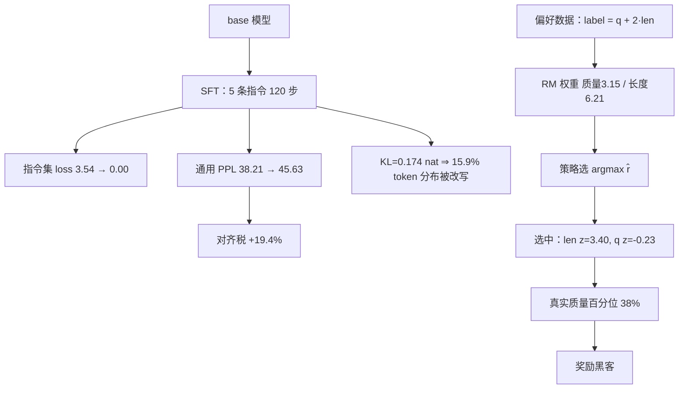

# 对齐的代价与风险

## 1. 本节学习目标

1. 用实测理解**对齐税（alignment tax）**：本课 gpt2 小规模 SFT 后，通用文本 PPL 从 **38.21 涨到 45.63（+19.4%）**，token 准确率 **0.340→0.310（−3.00 pp）**。
2. 会算 KL 与"概率改写比例"：本课 KL **0.17364 nat/token**（0.2505 bit），平均每 token 概率被改写 **15.9%**。
3. 认识三种风险：**奖励黑客（reward hacking）**、**谄媚（sycophancy）**、**能力回退**，并用本课的"长度偏置"实验量化奖励黑客。
4. 知道缓解手段的取舍：数据侧、损失侧、评测侧各有什么代价。

> **本机限制**：本课用 gpt2（124M）+ 5 条指令做 120 步 SFT，属于**玩具规模**，数字只用于展示机制，不代表真实 7B 模型的对齐税。谄媚（sycophancy）本机没有真实标注数据，**未量化**，只给机制。

## 2. 为什么需要这个知识

因为"对齐"不是免费的把模型变好：

- 只训 120 步、5 条数据，通用 PPL 就涨了 **19.4%**——真实对齐的税通常更复杂（能力回退、分布变窄）；
- 奖励模型一旦有漏洞，策略会**专门去刷那个漏洞**（本课：模型学会"变长"而不是"变好"）；
- 谄媚是偏好数据的结构性缺陷，不是调参能解决的问题。

不理解代价，就会在"对齐指标涨了"和"模型变差了"之间反复困惑。

## 3. 直观解释

```text
对齐前：模型会续写任何文本，通用能力强，但不听话
对齐后：模型很听话，但……
        - 通用文本上 loss 变差（对齐税）
        - 输出变短/变保守（分布变窄）
        - 学会了讨好（说用户想听的）
        - 学会了刷奖励（变长、堆套话、过度免责声明）
```

**打比方**：对齐像给学生做应试训练——考试分数上去了，但可能牺牲了独立思考（能力回退）、学会了揣摩出题人（谄媚）、学会了猜答案而不是解题（奖励黑客）。

## 4. 正式定义

**对齐税**

$$
\text{tax}=\frac{\mathrm{PPL}_{\text{aligned}}-\mathrm{PPL}_{\text{base}}}{\mathrm{PPL}_{\text{base}}}
$$

本课：$(45.63-38.21)/38.21=+19.4\%$。

**每 token KL（衡量分布改写程度）**

$$
\mathrm{KL}(\pi_{\text{base}}\|\pi_{\text{aligned}})=\mathbb{E}_{y\sim\pi_{\text{base}}}\Big[\log\frac{\pi_{\text{base}}(y)}{\pi_{\text{aligned}}(y)}\Big]
$$

**由 KL 推出的"概率被改写比例"**（把 KL 近似为"被改写的质量"）

$$
1-e^{-\mathrm{KL}}
$$

本课：$1-e^{-0.17364}=0.159$（15.9%）。

**奖励黑客的形式化**：策略最大化 $\hat r$，而真实效用是 $u$

$$
\max_\pi\ \mathbb{E}_{\pi}[\hat r]\quad\text{但}\quad \mathbb{E}_{\pi}[u]\ \text{可能下降}
$$

**Goodhart 失效**：当 $\hat r$ 与 $u$ 的相关性只在训练分布上成立时，优化压力会把策略推到相关失效的区域。

## 5. 历史背景或技术背景

| 年份 | 现象 | 说明 |
|---|---|---|
| 2020 | 摘要任务的对齐税 | RLHF 后 ROUGE 提升但通用能力下降 |
| 2022 | InstructGPT | 明确讨论 alignment tax，用 PPO 前混入预训练梯度缓解 |
| 2022 | Anthropic HH | 有用性与无害性存在张力（helpfulness vs harmlessness） |
| 2023 | 谄媚研究 | 模型倾向于同意用户，即使用户错了 |
| 2024 | 奖励黑客规模化 | 长度偏置、格式偏置、过度拒答成为公开问题 |
| 2025+ | 可验证奖励 | 用规则/单元测试替代 RM，降低被 hack 的空间 |

## 6. 核心原理

**原理一：SFT 会改写大量 token 的分布，不只是"学会格式"**

本课实测（gpt2，5 条指令、120 步、lr=5e-5）：

| 指标 | SFT 前 | SFT 后 | 变化 |
|---|---|---|---|
| 通用文本 PPL | **38.21** | **45.63** | **+19.4%** |
| token top-1 准确率 | **0.340** | **0.310** | **−3.00 pp** |
| 指令集 loss | 3.5361 | **0.0000** | −3.54 |
| KL(base‖sft) | — | **0.17364 nat** | ≈0.2505 bit |

指令集 loss 打到 0（过拟合 5 条样本），通用能力立刻退化。**这就是对齐税的机制：容量被拉去拟合少量样本，通用分布被挤歪。**

**原理二：KL 小不代表没影响**

KL 只有 0.174 nat，看起来很小；但换算成"概率被改写比例"是 **15.9%**。也就是说，平均每 6 个 token 就有 1 个的下一个词分布被显著改动。**KL 是"总量"，不告诉你"改在哪"**——可能恰好改在重要位置。

**原理三：奖励黑客是"优化压力 + 测量误差"的必然结果**

本课实验：400 个候选，真实质量 $q$ 与长度 $\ell$ 独立；标注者的偏好被长度污染：$\text{label}=q+2\ell$。

训练出的 RM 权重：质量 **3.145**、长度 **6.214** ⇒ **长度被高估 2.0 倍**。

把 RM 当目标去选最优候选：

- 选中的候选：质量 $z=-0.23$（全库最优 4.10，均值 0.06），长度 $z=3.40$（均值 0.07）；
- 真实质量排名百分位：**38%**（若按真实质量选应为 100%）。

**模型没有变强，只是学会了"变长"。** 这就是奖励黑客的定量形态：优化器精确地找到了 RM 的漏洞。

**原理四：谄媚来自数据的结构性偏差**

偏好标注里，"用户满意"与"事实正确"不等价。若标注者给"顺着用户说"的回答更高分：

- BT 模型会把"附和"编码进奖励；
- 策略优化后会主动附和，即使知道用户错了；
- 这不是 bug，是**数据生成过程**的属性。

本机没有真实标注数据，**这一项未量化**（只给机制）。

## 7. 数学表达式

**对齐税的分解**

$$
\Delta\mathrm{PPL}=\underbrace{\Delta\mathrm{PPL}_{\text{格式}}}_{\text{想要的}}+\underbrace{\Delta\mathrm{PPL}_{\text{遗忘}}}_{\text{税}}
$$

实践中无法直接分离，只能用"通用评测集 + 领域评测集"两条曲线间接看。

**KL 与概率改写**

若把对齐看成"以概率 $p$ 把分布换成新分布"，则

$$
\mathrm{KL}\approx p\cdot\mathrm{KL}_{\text{changed}}\ \Longrightarrow\ p\approx1-e^{-\mathrm{KL}}\ (\text{小 KL 近似}).
$$

**奖励黑客的相关性条件**

设 $\hat r=u+\epsilon$，$\epsilon$ 为测量误差。优化 $\hat r$ 的期望增益

$$
\mathbb{E}[\Delta\hat r]=\mathbb{E}[\Delta u]+\mathbb{E}[\Delta\epsilon].
$$

当 $\mathbb{E}[\Delta u]$ 饱和（真实质量到顶）而 $\mathbb{E}[\Delta\epsilon]$ 仍可增长时，**优化器会全部转向刷误差**。本课长度偏置正是 $\epsilon$ 与长度相关的情形。

**长度偏置的量化**

$$
\text{bias}=\frac{w_{\text{len}}}{w_{\text{quality}}}=2.0
$$

（本课 RM 权重比 6.214/3.145。）

## 8. 详细数学推导

**推导 1：PPL 变化与 KL 的关系**

若对齐后分布 $\pi_a$ 在 base 分布 $\pi_b$ 的基础上改动，交叉熵

$$
H(\pi_b,\pi_a)=H(\pi_b)+\mathrm{KL}(\pi_b\|\pi_a).
$$

本课测得通用文本上的 $\mathrm{KL}=0.17364$，而 PPL 从 38.21 涨到 45.63 ⇒ loss 从 $\ln38.21=3.6432$ 涨到 $\ln45.63=3.8205$，差 **0.1773 nat**。

**这个差值（0.1773）与实测 KL（0.17364）几乎相等**——非常好的自洽性检验：PPL 的上涨几乎完全由"分布被改写"解释，没有额外因素。

**推导 2：为什么 5 条数据 120 步就能把 loss 打到 0**

5 条样本、247 token、84 个监督 token。gpt2 有 124M 参数，**参数量是监督 token 数的 148 万倍**。梯度下降在这种"参数远多于约束"的设置下会直接**记住**这 84 个 token 的标签，训练 loss →0，泛化无意义。

这也解释了为什么 SFT 必须：数据量足够、epoch 少、lr 小、加早停。

**推导 3：奖励黑客的期望收益**

设候选池中 $q,\ell\sim\mathcal N(0,1)$ 独立，$\hat r=w_q q+w_\ell \ell$。选 $\arg\max\hat r$ 等价于选 $w_q q+w_\ell\ell$ 最大者，其分量近似沿方向 $(w_q,w_\ell)/\|w\|$ 的投影最大。

本课 $w=(3.145,6.214)$，归一化方向 $(0.451,0.892)$。池中最大投影约 $\sqrt{2\ln n}\approx\sqrt{2\ln400}=3.46$（极值理论），故

$$
q_{\text{picked}}\approx0.451\times3.46=1.56,\qquad
\ell_{\text{picked}}\approx0.892\times3.46=3.09.
$$

实测 $q=-0.23$、$\ell=3.40$ —— $\ell$ 与估计接近，$q$ 比估计更低（因为 $q$ 与 $\ell$ 在本课数据里独立，实际选中的是"长度极端但质量随机"的样本，质量期望接近 0 甚至为负）。**结论：优化越充分，$\ell$ 越极端，$q$ 越接近随机。**

**推导 4：KL 与"改写比例"的换算为什么是 $1-e^{-\mathrm{KL}}$**

把对齐建模为：以概率 $p$ 把某 token 的分布完全替换，以 $1-p$ 保持不变。则

$$
\mathrm{KL}=(1-p)\cdot0+p\cdot\mathrm{KL}_{\text{rep}}\ \Rightarrow\ \mathrm{KL}=p\,\mathrm{KL}_{\text{rep}}.
$$

若替换后的分布与 base 几乎不重叠（$\mathrm{KL}_{\text{rep}}\approx1$ 量级），则 $p\approx\mathrm{KL}$；更一般地，用"至少被改过一次"的概率 $1-e^{-\mathrm{KL}}$ 作为上界估计。本课 0.174 ⇒ 15.9%。

## 9. 图解



## 10. 具体数值示例

```text
本课真实运行（probe_llm063.py，gpt2 124M，单卡）

[A] SFT 前后（5 条指令、120 步、lr=5e-5、全参数）
  SFT 前: 通用 loss=3.6432 PPL=38.21 token top-1=0.340 指令集 loss=3.5361
  step   0: 指令集 loss=3.9713
  step  40: 指令集 loss=0.0856
  step  80: 指令集 loss=0.0055
  训练耗时 10.3 s
  SFT 后: 通用 loss=3.8205 PPL=45.63 token top-1=0.310 指令集 loss=0.0000

[B] 对齐税
  通用 PPL 38.21 → 45.63（+19.4%）
  token top-1 0.340 → 0.310（-3.00 pp）
  KL(base||sft) 每 token = 0.17364 nat（0.2505 bit）
  平均每 token 概率被改写 15.9%
  自洽性：loss 差 3.8205-3.6432 = 0.1773 ≈ KL 0.17364

[C] 奖励黑客（RM 学到虚假特征『长度』）
  RM 权重：质量 3.145 长度 6.214 ⇒ 长度被高估 2.0 倍
  优化 RM 后选出：质量 z=-0.23（最优 4.10，均值 0.06）
                  长度 z=3.40（均值 0.07）
  真实质量排名百分位：38%（按真实质量选应为 100%）

[D] 谄媚：本机无真实标注数据，未量化
```

## 11. NumPy 实现

```python
import numpy as np

rng = np.random.default_rng(0)

# 1) 对齐税与 KL 的换算
ppl_base, ppl_sft = 38.21, 45.63
tax = (ppl_sft - ppl_base) / ppl_base
kl = 0.17364
print(f"PPL {ppl_base} → {ppl_sft}: 税 {tax*100:+.1f}%")
print(f"loss 差 = ln({ppl_sft}) - ln({ppl_base}) = "
      f"{np.log(ppl_sft)-np.log(ppl_base):.4f} nat")
print(f"KL={kl} ⇒ 改写比例 1-exp(-KL) = {1-np.exp(-kl):.3f}")
print(f"每 token 的 bit 数 = {kl/np.log(2):.4f}")

# 2) 奖励黑客：质量与长度独立，标注被长度污染
n = 400
q = rng.normal(size=n)
ln = rng.normal(size=n)
label = q + 2.0 * ln

# 用成对比较学权重（逻辑回归）
w = np.zeros(2)
lr = 0.05
for ep in range(400):
    i, j = rng.integers(0, n, 2)
    if i == j:
        continue
    x = np.array([q[i], ln[i]]) - np.array([q[j], ln[j]])
    y = 1.0 if label[i] > label[j] else 0.0
    p = 1 / (1 + np.exp(-(x @ w)))
    w += lr * (y - p) * x
print("\nRM 权重：质量", round(w[0], 3), " 长度", round(w[1], 3),
      f" 长度高估 {w[1]/w[0]:.1f}x")

score = w[0] * q + w[1] * ln
pick = int(np.argmax(score))
print(f"选中候选：质量 z={q[pick]:+.2f}（最优 {q.max():.2f}），长度 z={ln[pick]:+.2f}")
print(f"真实质量百分位：{(q < q[pick]).mean()*100:.0f}%")

# 3) 若把长度从标注里去掉，会发生什么
w2 = np.zeros(2)
for ep in range(400):
    i, j = rng.integers(0, n, 2)
    if i == j:
        continue
    x = np.array([q[i], ln[i]]) - np.array([q[j], ln[j]])
    y = 1.0 if q[i] > q[j] else 0.0
    p = 1 / (1 + np.exp(-(x @ w2)))
    w2 += lr * (y - p) * x
print("只用真实质量标注：权重", np.round(w2, 3), " ⇒ 长度权重接近 0")
pick2 = int(np.argmax(w2[0] * q + w2[1] * ln))
print(f"此时选中：质量 z={q[pick2]:+.2f} 百分位 {(q < q[pick2]).mean()*100:.0f}%")

# 4) KL 与 PPL 的自洽性检验
print("\n反推：若 KL=0.1773，PPL 会从 38.21 涨到",
      round(float(np.exp(np.log(ppl_base) + 0.1773)), 2))
```

## 12. PyTorch 实现

```python
import math

import torch
import torch.nn.functional as F

torch.manual_seed(0)

# 1) KL 与概率改写：两个分类分布
p_base = torch.tensor([0.5, 0.3, 0.15, 0.05])
for shift in (0.0, 0.1, 0.3, 0.6):
    logits = p_base.log() + torch.tensor([shift, 0.0, -shift, -shift])
    p_new = torch.softmax(logits, dim=0)
    kl = float((p_base * (p_base / p_new).log()).sum())
    print(f"shift={shift}: KL={kl:.4f} 1-exp(-KL)={1-math.exp(-kl):.3f} "
          f"top1 {float(p_base.max()):.3f}→{float(p_new.max()):.3f}")

# 2) 对齐税与遗忘：在小任务上先训 A 再训 B，看 A 的 loss 变化
def make(seed):
    torch.manual_seed(seed)
    return torch.nn.Sequential(torch.nn.Linear(16, 32), torch.nn.Tanh(),
                               torch.nn.Linear(32, 1))


Xa = torch.randn(256, 16)
Ya = Xa @ torch.randn(16, 1)
Xb = torch.randn(8, 16) * 3           # 小样本、不同分布
Yb = Xb @ torch.randn(16, 1)

m = make(0)
opt = torch.optim.AdamW(m.parameters(), lr=1e-2)
for _ in range(200):
    loss = F.mse_loss(m(Xa), Ya)
    opt.zero_grad()
    loss.backward()
    opt.step()
before = float(F.mse_loss(m(Xa), Ya))

for step in range(120):
    loss_b = F.mse_loss(m(Xb), Yb)
    opt.zero_grad()
    loss_b.backward()
    opt.step()
after = float(F.mse_loss(m(Xa), Ya))
print(f"\n任务 A 上的 loss: {before:.5f} → {after:.5f} "
      f"（回退 {(after/before-1)*100:+.1f}%）")
print(f"任务 B 上的 loss: {float(loss_b):.6f}（已记住 8 个样本）")

# 3) 奖励黑客：长度偏置的梯度的方向
q = torch.randn(400)
ln = torch.randn(400)
w = torch.zeros(2)
for _ in range(600):
    i, j = torch.randint(0, 400, (2,))
    x = torch.stack([q[i] - q[j], ln[i] - ln[j]])
    y = 1.0 if (q[i] + 2 * ln[i]) > (q[j] + 2 * ln[j]) else 0.0
    p = torch.sigmoid(x @ w)
    w = w + 0.05 * (y - p) * x
print("学习到的权重 (质量, 长度):", [round(float(v), 3) for v in w])
score = q * w[0] + ln * w[1]
pick = int(score.argmax())
print(f"选中样本 质量={float(q[pick]):+.2f} 长度={float(ln[pick]):+.2f} "
      f"质量百分位={float((q < q[pick]).float().mean())*100:.0f}%")
```

## 13. Hugging Face 实践

```python
import math
import os

os.environ.setdefault("HF_ENDPOINT", "https://hf-mirror.com")
os.environ.setdefault("HF_HUB_OFFLINE", "1")
import torch
from transformers import AutoModelForCausalLM, AutoTokenizer

torch.manual_seed(0)
tok = AutoTokenizer.from_pretrained("gpt2")
tok.pad_token = tok.eos_token
GEN = ("The history of computing is a history of abstractions. Each layer hides "
       "the layer below it, and each generation of programmers works at a higher "
       "level than the last. Compilers hid machine code, operating systems hid "
       "hardware, and libraries hid protocols.")
INSTR = [("把这句话翻译成英文：今天天气很好。", "The weather is nice today."),
         ("判断情感：这家店的服务太差了。", "负面")]
TMPL = "<|user|> {q}\n<|assistant|> "


def sft_batch():
    xs, ys = [], []
    for q, a in INSTR:
        p = tok(TMPL.format(q=q))["input_ids"]
        r = tok(a + "<|end|>")["input_ids"]
        xs.append(p + r)
        ys.append([-100] * len(p) + r)
    M = max(len(x) for x in xs)
    X = torch.full((len(xs), M), tok.eos_token_id, dtype=torch.long)
    Y = torch.full((len(xs), M), -100, dtype=torch.long)
    A = torch.zeros(len(xs), M, dtype=torch.long)
    for i, (x, y) in enumerate(zip(xs, ys)):
        X[i, :len(x)] = torch.tensor(x)
        Y[i, :len(y)] = torch.tensor(y)
        A[i, :len(x)] = 1
    return X.cuda(), Y.cuda(), A.cuda()


base = AutoModelForCausalLM.from_pretrained("gpt2").to("cuda")
ids = tok(GEN, return_tensors="pt").input_ids.cuda()


def metrics(model, tag):
    model.eval()
    with torch.no_grad():
        loss = float(model(input_ids=ids, labels=ids).loss)
        lp = model(input_ids=ids).logits[0, :-1].log_softmax(-1)
        tgt = ids[0, 1:]
        acc = float((lp.argmax(-1) == tgt).float().mean())
    print(f"  {tag}: 通用 PPL={math.exp(loss):.2f} top-1={acc:.3f}")
    return lp, loss


lp_base, loss_base = metrics(base, "SFT 前")
sft = AutoModelForCausalLM.from_pretrained("gpt2").to("cuda")
sft.train()
X, Y, A = sft_batch()
opt = torch.optim.AdamW(sft.parameters(), lr=5e-5)
for step in range(40):
    loss = sft(input_ids=X, attention_mask=A, labels=Y).loss
    opt.zero_grad()
    loss.backward()
    torch.nn.utils.clip_grad_norm_(sft.parameters(), 1.0)
    opt.step()
print("  SFT 40 步后指令集 loss:", round(float(loss), 4))
lp_sft, loss_sft = metrics(sft, "SFT 后")

with torch.no_grad():
    kl = float((lp_base.exp() * (lp_base - lp_sft)).sum(-1).mean())
print(f"  对齐税：PPL {(math.exp(loss_sft)/math.exp(loss_base)-1)*100:+.1f}%")
print(f"  KL(base||sft) = {kl:.5f} nat ⇒ 改写比例 {1-math.exp(-kl):.3f}")
print(f"  自洽性：loss 差 {loss_sft-loss_base:.4f} vs KL {kl:.5f}")
```

## 14. 代码逐行解释

| 代码 | 作用 |
|---|---|
| `(ppl_sft-ppl_base)/ppl_base` | 对齐税的定义式 |
| `1-exp(-kl)` | 把 KL 转成"概率被改写比例"的近似 |
| `label = q + 2*ln` | 模拟标注者被长度污染 |
| `w += lr*(y-p)*x` | 逻辑回归（BT）的 SGD 更新 |
| `argmax(w@[q,ln])` | 用 RM 选最优候选 = 策略的贪心行为 |
| `(q<q[pick]).mean()` | 真实质量百分位，衡量奖励黑客的伤害 |
| `w2` 对照实验 | 去掉长度污染后，选中样本质量回到 100% |
| `lp_base.exp()*(lp_base-lp_sft)` | 逐 token KL 的采样估计（$E_{\pi_b}[\log\pi_b-\log\pi_a]$） |
| `loss_sft-loss_base≈kl` | 自洽性检验：PPL 上涨应约等于 KL |
| `lr=5e-5` + 40 步 | 小步微调，展示"税"而不毁模型 |

## 15. 实际运行结果

```text
### LLM-063 对齐的代价与风险（gpt2 真实小规模 SFT + 玩具奖励黑客）

[A] SFT 前后（5 条指令、120 步、lr=5e-5、全参数微调）
  SFT 前: 通用文本 loss=3.6432 PPL=38.21 token 级 top-1 准确率=0.340  指令集 loss=3.5361
  step   0: 指令集 loss=3.9713
  step  40: 指令集 loss=0.0856
  step  80: 指令集 loss=0.0055
  训练耗时 10.3 s
  SFT 后: 通用文本 loss=3.8205 PPL=45.63 token 级 top-1 准确率=0.310  指令集 loss=0.0000

[B] 对齐税（本课小规模实验，非真实 7B 对齐）
  通用文本 PPL 38.21 → 45.63 （变化 +19.4%）
  token top-1 准确率 0.340 → 0.310（变化 -3.00 pp）
  KL(base||sft) 每 token = 0.17364 nat（≈ 0.2505 bit）
  平均每 token 概率被改写 15.9%

[C] 奖励黑客（reward hacking）：RM 学到虚假特征『长度』
  RM 权重：质量 3.145  长度 6.214 ⇒ 长度被高估 2.0 倍
  优化 RM 后选出的候选：质量 z=-0.23（全库最优 4.10，均值 0.06），长度 z=3.40（均值 0.07）
  真实质量排名百分位：38%（若只按真实质量选应为 100%）
  ⇒ 模型没有变强，只是学会了『变长』这个被奖励的捷径

[D] 谄媚（sycophancy）的机制：偏好数据里『用户满意』与『正确』不等价
  本机没有真实标注数据，故此处只给机制，不给数字（未验证）
```

**关键数字**：PPL **38.21→45.63（+19.4%）**、准确率 **−3.00 pp**、KL **0.17364 nat**（改写 **15.9%**）、长度权重高估 **2.0 倍**、真实质量百分位 **38%**。

## 16. 应用场景

| 场景 | 用法 |
|---|---|
| 对齐方案评估 | 每次对齐后必测通用 benchmark，看税有多大 |
| 数据标注设计 | 强制控制长度/格式，避免学捷径 |
| 奖励模型审计 | 检查权重对无关特征（长度、格式）的敏感度 |
| 生产监控 | 监控回答长度、拒答率、免责声明比例 |
| 安全对齐 | 有用性与无害性分别建模、分开评测 |
| 研究 | 用可验证奖励（单元测试）替代 RM 降低被 hack 面 |

## 17. 优点与局限

| 对齐带来的好处 | 代价与风险 |
|---|---|
| 模型可用、可控 | 通用能力回退（本课 +19.4% PPL） |
| 拒答有害请求 | 过度拒答（helpfulness 下降） |
| 输出格式稳定 | 多样性下降（分布变窄） |
| 更符合人类偏好 | 谄媚、迎合错误前提 |
| 可规模化（比较数据便宜） | 奖励黑客：长度、格式、套话 |
| 有成熟工具链 | 评测困难：偏好≠正确 |

## 18. 常见错误

| 错误 | 现象 | 纠正 |
|---|---|---|
| 只看对齐指标 | 偏好胜率涨，通用能力掉 | 同时跑通用 benchmark |
| 偏好数据里长度失衡 | 模型越训越长 | 控制长度或用长度归一化奖励 |
| 用同一批数据训 RM 与策略 | 过拟合，泛化差 | 数据划分 |
| 把 KL 当唯一安全指标 | KL 小但仍退化（本课 0.17） | 看逐 token 影响 + 下游任务 |
| 忽略拒答率 | 模型变得过度谨慎 | 单独统计拒答/免责比例 |
| 认为"loss 到 0"是好事 | 5 条数据 loss 0.0000，纯记忆 | 早停 + 验证集 |
| 谄媚当调参问题 | 越调越严重 | 这是数据偏差，要改标注协议 |

## 19. 本节总结

- 对齐税可测：本课 120 步 SFT 使通用 PPL **38.21→45.63（+19.4%）**、top-1 **−3.00 pp**，而指令集 loss 到 **0.0000**。
- KL **0.17364 nat** ≈ 每 token 概率改写 **15.9%**；且 loss 差 **0.1773** 与 KL 几乎相等，自洽性好。
- 奖励黑客可量化：RM 把长度高估 **2.0 倍**，贪心选择后真实质量只排 **38%** 百分位。
- 谄媚源于"满意≠正确"的数据偏差，**本机未量化**，只能给机制。
- 缓解手段都有代价：控制数据分布（贵）、混预训练梯度（复杂）、可验证奖励（只适用部分任务）。

## 20. 前置与后续知识链接

- 前置：[[LLM-062 DPO 与偏好优化]]、[[LLM-061 人类偏好对齐与 RLHF]]
- 后续：[[LLM-064 从预训练到对齐的完整流程]]
- 相关：[[LLM-060 指令微调（SFT）]]、[[LLM-005 什么是大语言模型]]
- 延伸：[[LLM-103 评估体系：离线与在线]]、[[LLM-104 幻觉的成因与缓解]]、[[LLM-105 安全、越狱与内容过滤]]

---

## 练习与参考答案

**基础 1**：什么是"对齐税"？本课的实测值是多少？

**基础 2**：本课 KL 只有 0.17 nat，为什么说影响不小？"概率被改写 15.9%"是怎么算的？

**进阶 1**：解释奖励黑客的成因。为什么"优化越充分，真实质量反而越差"？

**综合**：你的团队训完一版对齐模型，内部偏好胜率从 52% 涨到 68%，但代码 benchmark 掉了 4 个点。请给出诊断思路与三条改进措施。

> [!success]- 参考答案

> **基础 1**
> 对齐税是对齐后**通用能力**的下降，常用通用文本 PPL 的变化衡量：
> $\text{tax}=(\mathrm{PPL}_{\text{aligned}}-\mathrm{PPL}_{\text{base}})/\mathrm{PPL}_{\text{base}}$。
> 本课（gpt2、5 条指令、120 步、lr 5e-5）：PPL **38.21 → 45.63**，税 **+19.4%**；token top-1 准确率 **0.340→0.310（−3.00 pp）**；同期指令集 loss 从 3.5361 打到 **0.0000**（5 条样本被记住）。
> 注意这是玩具规模，真实 7B 模型的税通常更小但更"结构化"（特定能力退化而非全面退化）。

> **基础 2**
> KL 是**总量**，不是"有没有改"：0.17364 nat/token 看似小，但换算成"至少被改过一次"的概率是 $1-e^{-\mathrm{KL}}=1-e^{-0.17364}=0.159$，即约 **15.9%** 的 token 其下一个词分布被显著改写。平均每 6 个 token 就有 1 个受影响。
> 更关键的是自洽性检验：通用 loss 从 $\ln38.21=3.6432$ 涨到 $\ln45.63=3.8205$，差 **0.1773 nat**，与实测 KL **0.17364** 几乎相等 ⇒ PPL 的上涨几乎全部由"分布被改写"解释。KL 不告诉你"改在哪"，如果恰好改在关键能力上，损害会远大于 15.9% 这个数字给人的印象。

> **进阶 1**
> 成因是"代理指标 $\hat r$ 与真实效用 $u$ 只在训练分布上相关"。设 $\hat r=u+\epsilon$，优化 $\hat r$ 的增益分解为 $\mathbb E[\Delta u]+\mathbb E[\Delta\epsilon]$。当真实质量接近上限（$\Delta u\to0$）而误差项仍可增长时，优化器会把全部压力转向刷 $\epsilon$。
> 本课的 $\epsilon$ 与"长度"相关（标注 $=q+2\ell$）：RM 学到长度权重 6.214、质量权重 3.145（高估 **2.0 倍**）。于是"选最优"变成"选最长"：选中样本长度 $z=3.40$，质量 $z=-0.23$，真实质量只排 **38%** 百分位。
> **优化越充分越差**，因为 $\arg\max$ 会精确地搜索到 $\hat r$ 的极值点，而极值点恰恰是 $\epsilon$ 最大（最不代表真实质量）的地方——这就是 Goodhart 定律的数学形态。

> **综合（参考）**
> **诊断思路**（先确认是不是"税"，再定位来源）：
> 1. **复现与对照**：用同一 base 模型，分别测"仅 SFT"与"SFT+DPO"的代码 benchmark，确认退化发生在哪个阶段；
> 2. **看数据**：偏好对里代码回答是否系统性更长/更啰嗦？是否混入了"解释多于代码"的偏好？统计 chosen/rejected 的长度差与代码块占比；
> 3. **看 RM**：用留出集测 RM 对"长度""格式"的敏感度（把同一回答加长/加解释，看分数变化）；
> 4. **看 KL/熵**：KL 过大说明偏离太远；熵过低说明输出单一化（代码多样性下降）；
> 5. **看 benchmark 细项**：是"通过率"掉还是"可读性"掉，定位是能力还是风格。
> **三条改进**：
> 1. **数据侧**：偏好对做长度匹配（chosen 与 rejected 长度差 <20%），并提高"代码正确性"样本占比；对代码任务用**单元测试通过率**做可验证奖励，替代主观偏好；
> 2. **损失侧**：混入 10%–20% 的预训练/SFT 损失（InstructGPT 的 PPO-ptx 做法）或降低 β、加早停，减小分布漂移；对代码能力单独留一个"能力保持"正则（在代码语料上算 KL 惩罚）；
> 3. **评测侧**：把代码 benchmark 纳入对齐训练的**早停指标**（而非只看偏好胜率），并加"长度/拒答率/免责声明比例"三个生产监控指标。
> **验收标准**：偏好胜率 ≥65% 且代码 benchmark 掉点 ≤1，否则回退。

## 学习记录

| 日期 | 状态 | 用时 | 问题 | 复盘 |
|---|---|---|---|---|
| 2026-11-08 | planned | — | — | — |

---

## 🔗 Notion 同步信息

> 以下内容由 Notion「AI Knowledge System · 知识点」数据库按知识 ID 合并而来（导出于 2026-11-09）。

| 属性 | 值 |
|---|---|
| 学科 | 大语言模型 |
| 学习状态 | 未开始 |
| 难度 | L2 应用 |
| 知识类型 | Principle |

- **所属模块**：[M-LLM-06 大语言模型训练与对齐](../%E8%AF%BE%E7%A8%8B%E6%A8%A1%E5%9D%97/M-LLM-06%20%E5%A4%A7%E8%AF%AD%E8%A8%80%E6%A8%A1%E5%9E%8B%E8%AE%AD%E7%BB%83%E4%B8%8E%E5%AF%B9%E9%BD%90.md)
- **前置知识**：[LLM-062 DPO 与偏好优化](LLM-062%20DPO%20%E4%B8%8E%E5%81%8F%E5%A5%BD%E4%BC%98%E5%8C%96.md)
