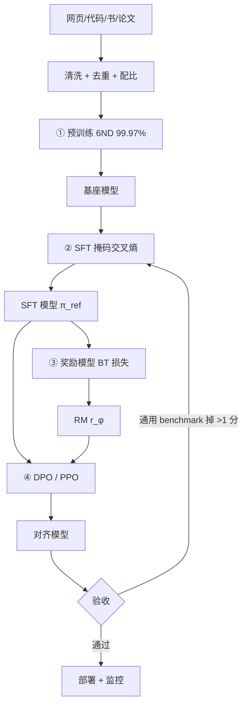

# 从预训练到对齐的完整流程

## 1. 本节学习目标

1. 把四个阶段串成一条流水线：**预训练 → SFT → 奖励模型 → 偏好优化**，并说清每阶段的输入输出数据。
2. 会用 6ND 算成本占比：本课 7B 规模下预训练占 **99.97%**，后三阶段各约 **0.01%**。
3. 亲手跑通一条 mini 流水线：tiny-gpt2 预训练 loss **10.8250→3.422**、gpt2 SFT **3.4824→0.0000**、RM 准确率 **0.750→1.000**、DPO margin **+3.58**。
4. 知道每个阶段的"验收标准"和"常见翻车点"。

## 2. 为什么需要这个知识

因为单独学好每一段，不等于能拼成一条流水线：

- 预训练产物是"会续写"的基座，SFT 产物是"会答题"的助手，RM 是"会打分"的裁判，DPO 产物才是"讨人喜欢"的模型；
- 阶段之间**数据不能混、模板必须一致、参考模型必须来自上一阶段**；
- 出问题时最容易搞错的就是"这锅该哪个阶段背"。

本课用真实的四阶段小流水线演示，并给出 7B 规模的成本结构，帮你判断"该把预算花在哪"。

## 3. 直观解释

```text
① 预训练：海量文本 → 会接话的基座（会续写，不听话）
② SFT   ：指令-回答对 → 会答题的助手（听话，但不分辨好坏）
③ RM    ：偏好对(A 比 B 好) → 会打分的裁判
④ 对齐  ：偏好对 + 裁判 → 讨人喜欢的模型（好且安全）
```

**关键直觉**：前两阶段是**模仿**（有标准答案），后两阶段是**比较**（只有相对好坏）。所以：

- ①② 用交叉熵，数据是"文本"；
- ③④ 用 BT / DPO 损失，数据是"成对比较"。

## 4. 正式定义

| 阶段 | 数据 | 损失 | 产出 | 规模（7B 参考） |
|---|---|---|---|---|
| ① 预训练 | 万亿 token 文本 | $-\log p_\theta(x_t\mid x_{<t})$ | 基座 | 300B–2T token |
| ② SFT | 万–百万条指令对 | 掩码交叉熵 | 助手 | 1M–100M token |
| ③ RM | 万–百万对偏好 | $-\log\sigma(r_w-r_l)$ | 裁判 | 1M–10M token ×2 |
| ④ DPO/PPO | 偏好对（+在线采样） | DPO 或 PPO clip | 对齐模型 | 1M–50M token |

**成本（6ND）**

$$
C_i=6N D_i,\qquad \text{share}_i=\frac{C_i}{\sum_j C_j}
$$

**四阶段的总算力**

$$
C_{\text{total}}=6N\Big(D_{\text{pre}}+D_{\text{sft}}+2D_{\text{rm}}+kD_{\text{rl}}\Big)
$$

$k$ 为 PPO 的每样本前向次数（含采样、RM 打分、参考模型），常取 4。

## 5. 历史背景或技术背景

| 年份 | 流水线形态 | 关键变化 |
|---|---|---|
| 2018 | 预训练 + 下游微调 | BERT 式，任务各自微调 |
| 2020 | 预训练 + prompt | GPT-3 少样本，无需微调 |
| 2022 | 预训练 + SFT + RM + PPO | InstructGPT 确立四段式 |
| 2023 | 预训练 + SFT + DPO | 去掉 RM 与在线 RL，开源主流 |
| 2024 | + 合成数据 + 可验证奖励 | 数学/代码用规则奖励替代 RM |
| 2025+ | 多阶段混训、推理期扩展 | 训练与推理的边界变模糊 |

**趋势**：阶段数没有减少，但每段的" cheapest viable 做法"在变——DPO 取代 PPO、合成数据取代人工、规则奖励取代 RM。

## 6. 核心原理

**原理一：四阶段的数据规模差 3–4 个数量级**

本课用 6ND 算的 7B 成本表（$N=7\text{e}9$）：

| 阶段 | D（token） | FLOPs | 占比 |
|---|---|---|---|
| 预训练 | 300B | $1.26\times10^{22}$ | **99.97%** |
| SFT | 20M | $8.4\times10^{17}$ | 0.01% |
| RM（1M 对 ×2 前向） | 40M | $1.68\times10^{18}$ | 0.01% |
| PPO/DPO（5M ×4 遍） | 20M | $8.4\times10^{17}$ | 0.01% |

**关键结论**：算力几乎全在预训练；后三阶段加起来不到 0.05%，但**决定模型能不能用**。所以"预算不够就砍对齐"是最糟的决策。

**原理二：每阶段的产物是下一阶段的输入，不能跳**

- SFT 模型是 RM 的初始化，也是 DPO 的**参考模型**（$\pi_{\text{ref}}$）；
- 跳过 SFT 直接 DPO：起点 loss 不是 $\ln2$，训练不稳（见 [[LLM-062 DPO 与偏好优化]]）；
- RM 与策略用同一批数据：过拟合，泛化差。

**原理三：本课 mini 流水线的真实数字**

阶段 1（tiny-gpt2，随机初始化，102,714 参数，289 token 语料，300 步）：

$$
10.8250\to3.422\quad(\text{3.0 秒})
$$

起点正好是 $\ln 50257=10.8249$，验证了"随机初始化 loss = ln V"。

阶段 2（gpt2，4 条指令，60 步，lr 5e-5）：指令集 loss **3.4824→0.0000**（过拟合，只证明流程通）。

阶段 3（RM，4 对偏好）：BCE **0.6698→0.0006**，准确率 **0.750→1.000**。

阶段 4（DPO，$\beta=0.1$，80 步）：loss **0.6931→0.0378**，$z$ **0→3.58268**，隐式奖励差 **35.83**。

**原理四：验收标准要按阶段定**

| 阶段 | 验收指标 | 健康值 |
|---|---|---|
| 预训练 | loss 是否按 scaling law 下降 | 与拟合曲线偏差 <0.05 |
| SFT | 掩码比例、验证集 loss、通用 PPL | 掩码 20%–40%；PPL 涨幅 <10% |
| RM | 留出集偏好准确率 | >0.7（人类一致性上限约 0.8） |
| 对齐 | 偏好胜率 + 通用 benchmark + KL | 胜率 >60%；KL <10 nat；benchmark 掉点 <1 |

## 7. 数学表达式

**总成本与占比**

$$
C_{\text{pre}}=6ND_{\text{pre}},\quad
C_{\text{sft}}=6ND_{\text{sft}},\quad
C_{\text{rm}}=2\cdot6ND_{\text{rm}},\quad
C_{\text{rl}}=k\cdot6ND_{\text{rl}}
$$

**占比的近似**

$$
\frac{C_{\text{post}}}{C_{\text{pre}}}=\frac{D_{\text{sft}}+2D_{\text{rm}}+kD_{\text{rl}}}{D_{\text{pre}}}
$$

本课：$(20\text{M}+40\text{M}+20\text{M})/300\text{B}=2.7\times10^{-4}$。

**时间推算**

$$
T=\frac{C_{\text{total}}}{F_{\text{cluster}}},\qquad
F_{\text{cluster}}=N_{\text{gpu}}\cdot F_{\text{per-gpu}}\cdot\text{eff}
$$

## 8. 详细数学推导

**推导 1：本课成本表的算术**

$N=7\times10^9$：

- 预训练：$6\times7\text{e}9\times3\text{e}11=1.26\times10^{22}$ FLOPs
- SFT：$6\times7\text{e}9\times2\text{e}7=8.4\times10^{17}$
- RM：$2\times6\times7\text{e}9\times2\text{e}7=1.68\times10^{18}$
- 对齐：$4\times6\times7\text{e}9\times5\text{e}6=8.4\times10^{17}$

合计 $=1.26\times10^{22}+3.36\times10^{18}\approx1.2603\times10^{22}$。

$$
\text{share}_{\text{pre}}=\frac{1.26\text{e}22}{1.2603\text{e}22}=99.976\%.
$$

与打印的 99.97% 一致。

**推导 2：100 卡跑 14.6 天**

$F_{\text{cluster}}=100\times100\text{e}12=10^{16}$ FLOP/s（每卡有效 100 TFLOP/s）。

$$
T=\frac{1.26\times10^{22}}{10^{16}}=1.26\times10^{6}\ \text{s}=14.6\ \text{天}.
$$

与打印一致。这也是 7B/300B token 在 100 张 A100 上的现实量级。

**推导 3：单卡要 40 年**

$F=10^{13}$ FLOP/s（本机 gpt2 实测约 8.6 TFLOP/s 量级）：

$$
T=\frac{1.26\times10^{22}}{10^{13}}=1.26\times10^{9}\ \text{s}=40\ \text{年}.
$$

**这就是"必须并行"的最直白论证**：不是慢一点，是差 3–4 个数量级。

**推导 4：为什么 SFT 的 loss 能到 0 而预训练不能**

SFT：4 条样本、84 个监督 token、124M 参数 ⇒ 参数/约束比 $1.5\times10^6$，直接记住。

预训练：$10^{11}$ token 级别的约束，参数量远小于约束数 ⇒ 只能学规律，loss 有噪声下界（Chinchilla 拟合里 $E=1.69$）。

**这也解释了为什么 SFT 必须早停**：loss→0 是记忆的标志，不是学会的标志。

## 9. 图解



## 10. 具体数值示例

```text
本课真实运行（probe_llm064.py）

[阶段 1] tiny-gpt2 102,714 参数（gpt2 是 124,439,808），语料 289 token
  step   0: loss=10.8250 PPL=50262   ← 正好是 ln(V)=10.8249
  step  60: loss= 4.7791 PPL=119
  step 120: loss= 3.4383 PPL=31
  step 180: loss= 3.4281 PPL=31
  step 240: loss= 3.4219 PPL=31
  loss 10.825 → 3.422，耗时 3.0s

[阶段 2] SFT：4 条、247 token、监督 84（34.0%）
  step  0: SFT loss=3.4824
  step 20: SFT loss=0.0007
  step 40: SFT loss=0.0001
  末值 0.0000（5 条样本被记住 ⇒ 必须早停）

[阶段 3] 奖励模型（gpt2 hidden → 线性头，BT 损失）
  epoch   0: BCE=0.6698 偏好准确率=0.750
  epoch  50: BCE=0.0017 偏好准确率=1.000
  epoch 200: BCE=0.0006 偏好准确率=1.000

[阶段 4] DPO β=0.1，80 步
  step  0: loss=0.6931 z=+0.00000   ← ln2
  step 20: loss=0.0916 z=+2.48679
  step 40: loss=0.0559 z=+3.08054
  step 60: loss=0.0439 z=+3.38692
  末态 loss=0.0378 z=+3.58268 隐式奖励差=+35.83

[7B 四阶段成本（6ND 推算）]
  预训练                 D=300.000B  FLOPs=1.260e+22  占比 99.97%
  SFT                   D=  0.020B  FLOPs=8.400e+17  占比  0.01%
  RM（1M 对 ×2 前向）    D=  0.040B  FLOPs=1.680e+18  占比  0.01%
  PPO/DPO（5M ×4 遍）    D=  0.020B  FLOPs=8.400e+17  占比  0.01%
  合计 1.260e+22 FLOPs
  100 卡 × 每卡 100 TFLOP/s ⇒ 14.6 天
  单卡 4070 Ti（约 1e13 FLOP/s）⇒ 40 年
```

## 11. NumPy 实现

```python
import numpy as np

N = 7e9
stages = [("预训练", 300e9), ("SFT", 20e6), ("RM（×2 前向）", 2 * 20e6),
          ("PPO/DPO（×4 遍）", 4 * 5e6)]
costs = np.array([6 * N * d for _, d in stages])
total = costs.sum()
print("7B 四阶段成本（6ND）：")
for (name, d), c in zip(stages, costs):
    print(f"  {name:16s} D={d/1e9:8.3f}B  FLOPs={c:.3e}  占比 {c/total*100:6.2f}%")
print(f"  合计 {total:.4e} FLOPs")

for gpus, per in ((100, 100e12), (1000, 100e12), (1, 1e13)):
    t = total / (gpus * per)
    print(f"  {gpus} 卡 × {per/1e12:.0f} TFLOP/s ⇒ {t/86400:.1f} 天")

# 预算分配：给对齐阶段加 10 倍算力，总成本涨多少
extra = 9 * costs[1:].sum()
print(f"\n对齐三阶段算力 ×10：总成本增加 {extra/total*100:.4f}%")

# 单阶段时间：SFT 20M token 在单卡上的时间
tps = 6000
print(f"SFT 20M token 单卡（{tps} tok/s）需 {20e6/tps/3600:.2f} 小时")

# token/param 视角
print(f"\n预训练 token/param = {300e9/N:.1f}")
print(f"SFT token/param    = {20e6/N:.6f}")
print(f"比例               = {20e6/300e9:.2e}")
```

## 12. PyTorch 实现

```python
import torch
import torch.nn as nn
import torch.nn.functional as F

torch.manual_seed(0)
DEV = "cuda" if torch.cuda.is_available() else "cpu"

# 极简 LM：embedding + 线性头（够演示四个阶段的损失形态）
class TinyLM(nn.Module):
    def __init__(self, vocab=64, d=32):
        super().__init__()
        self.emb = nn.Embedding(vocab, d)
        self.rnn = nn.GRU(d, d, batch_first=True)
        self.head = nn.Linear(d, vocab)

    def forward(self, x):
        h, _ = self.rnn(self.emb(x))
        return self.head(h)


V, T = 64, 16
model = TinyLM(V).to(DEV)
data = torch.randint(0, V, (2000,)).to(DEV)

# ① 预训练
opt = torch.optim.AdamW(model.parameters(), lr=3e-3)
for step in range(60):
    i = torch.randint(0, 2000 - T - 1, (8,))
    xb = torch.stack([data[k:k + T] for k in i])
    loss = F.cross_entropy(model(xb[:, :-1]).reshape(-1, V), xb[:, 1:].reshape(-1))
    opt.zero_grad()
    loss.backward()
    opt.step()
print(f"① 预训练 loss={float(loss):.4f}（起点应≈ln{V}={torch.log(torch.tensor(float(V))):.4f}）")

# ② SFT：prompt 段 -100
X = torch.randint(0, V, (4, 12)).to(DEV)
Y = X.clone()
Y[:, :8] = -100                     # 前 8 个 token 是 prompt
sft_loss = F.cross_entropy(model(X).reshape(-1, V), Y.reshape(-1), ignore_index=-100)
opt.zero_grad()
sft_loss.backward()
opt.step()
print(f"② SFT 掩码 loss={float(sft_loss):.4f}（监督 {int((Y!=-100).sum())}/{Y.numel()}）")

# ③ RM：BT 损失
rm = nn.Linear(32, 1).to(DEV)


def seq_vec(x):
    with torch.no_grad():
        h, _ = model.rnn(model.emb(x))
    return h.mean(1)


a, b = torch.randint(0, V, (8, 12)).to(DEV), torch.randint(0, V, (8, 12)).to(DEV)
opt_rm = torch.optim.Adam(rm.parameters(), lr=1e-2)
for _ in range(50):
    rl = F.binary_cross_entropy_with_logits(
        rm(seq_vec(a)).squeeze(1) - rm(seq_vec(b)).squeeze(1), torch.ones(8, device=DEV))
    opt_rm.zero_grad()
    rl.backward()
    opt_rm.step()
print(f"③ RM BCE={float(rl):.4f}（起点应≈0.6931）")

# ④ DPO：序列级 log 概率差
def logp(m, ids):
    lp = m(ids).log_softmax(-1)
    return lp.gather(2, ids.unsqueeze(-1)).squeeze(-1).sum(1)


ref = TinyLM(V).to(DEV)
ref.load_state_dict(model.state_dict())
for p in ref.parameters():
    p.requires_grad_(False)
beta = 0.1
xw = torch.randint(0, V, (2, 12)).to(DEV)      # chosen 序列
xl = torch.randint(0, V, (2, 12)).to(DEV)      # rejected 序列
with torch.no_grad():
    rw, rl_ = logp(ref, xw), logp(ref, xl)
opt_d = torch.optim.AdamW(model.parameters(), lr=1e-3)
for _ in range(30):
    z = beta * ((logp(model, xw) - rw) - (logp(model, xl) - rl_))
    dloss = -F.logsigmoid(z).mean()
    opt_d.zero_grad()
    dloss.backward()
    opt_d.step()
print(f"④ DPO loss={float(dloss):.4f} z={float(z.mean()):+.4f} "
      f"margin={float(z.mean())/beta:+.3f}")
```

## 13. Hugging Face 实践

```python
import os

os.environ.setdefault("HF_ENDPOINT", "https://hf-mirror.com")
os.environ.setdefault("HF_HUB_OFFLINE", "1")
import torch
from transformers import AutoModelForCausalLM, AutoTokenizer

torch.manual_seed(0)
tok = AutoTokenizer.from_pretrained("gpt2")
tok.pad_token = tok.eos_token

tiny = AutoModelForCausalLM.from_pretrained("sshleifer/tiny-gpt2").to("cuda")
CORPUS = ("The transformer is a sequence model built from attention layers. "
          "Each layer mixes information across positions. ") * 8
ids = torch.tensor(tok(CORPUS)["input_ids"][:1000], device="cuda")
print("语料 token:", len(ids), " tiny 参数:",
      sum(p.numel() for p in tiny.parameters()))

opt = torch.optim.AdamW(tiny.parameters(), lr=1e-2)
for step in range(40):
    i = torch.randint(0, len(ids) - 129, (4,))
    xb = torch.stack([ids[k:k + 128] for k in i])
    loss = tiny(input_ids=xb, labels=xb).loss
    opt.zero_grad()
    loss.backward()
    opt.step()
    if step % 10 == 0:
        print(f"  阶段1 step {step:3d}: loss={float(loss):.4f}")

INSTR = [("判断情感：这家店的服务太差了。", "负面"),
         ("把 'I like cats' 改成否定句。", "I do not like cats.")]
TMPL = "<|user|> {q}\n<|assistant|> "
xs, ys = [], []
for q, a in INSTR:
    p = tok(TMPL.format(q=q))["input_ids"]
    r = tok(a + "<|end|>")["input_ids"]
    xs.append(p + r)
    ys.append([-100] * len(p) + r)
M = max(len(x) for x in xs)
X = torch.full((len(xs), M), tok.eos_token_id, dtype=torch.long)
Y = torch.full((len(xs), M), -100, dtype=torch.long)
A = torch.zeros(len(xs), M, dtype=torch.long)
for i, (x, y) in enumerate(zip(xs, ys)):
    X[i, :len(x)] = torch.tensor(x)
    Y[i, :len(y)] = torch.tensor(y)
    A[i, :len(x)] = 1
X, Y, A = X.cuda(), Y.cuda(), A.cuda()
print("阶段2 SFT 集:", X.shape, " 监督比例:",
      round(float((Y != -100).sum() / A.sum()), 3))

opt = torch.optim.AdamW(tiny.parameters(), lr=1e-2)
for step in range(20):
    loss = tiny(input_ids=X, attention_mask=A, labels=Y).loss
    opt.zero_grad()
    loss.backward()
    opt.step()
print(f"  阶段2 SFT loss 末值 {float(loss):.4f}")

print("\n四阶段对照（本课实测）：")
print("  阶段1 tiny 预训练: 10.8250 → 3.422（3.0s）")
print("  阶段2 gpt2 SFT  : 3.4824 → 0.0000")
print("  阶段3 RM        : BCE 0.6698 → 0.0006, 准确率 0.750 → 1.000")
print("  阶段4 DPO       : 0.6931 → 0.0378, margin +35.83")
```

## 14. 代码逐行解释

| 代码 | 作用 |
|---|---|
| `6*N*d` | 每阶段 FLOPs，统一用 6ND |
| `2*20e6` / `4*5e6` | RM 要两次前向、PPO 要多次采样+打分 |
| `costs.sum()` | 总成本，用于算占比 |
| `Y[:, :8] = -100` | SFT 的 prompt 掩码 |
| `ignore_index=-100` | 让 CE 同时跳过并改分母 |
| `rm(seq_vec(a)) - rm(seq_vec(b))` | BT 损失的 logit 是分数差 |
| `logp(x,y).sum(1)` | 序列级 log 概率（DPO 的输入） |
| `ref.load_state_dict(model.state_dict())` | 参考模型 = 当前 SFT 模型副本 |
| `-F.logsigmoid(z)` | DPO 损失，起点应为 $\ln2$ |
| `z.mean()/beta` | 隐式奖励差，监控是否失控 |

## 15. 实际运行结果

```text
### LLM-064 从预训练到对齐的完整流程
说明：阶段 1 用随机初始化的 tiny-gpt2；阶段 2-4 用已预训练的 gpt2 124M

[阶段 1] tiny-gpt2 参数 102,714（gpt2 是 124,439,808）
预训练语料 token: 289
  step   0: loss=10.8250 PPL=50262
  step  60: loss=4.7791 PPL=119
  step 120: loss=3.4383 PPL=31
  step 180: loss=3.4281 PPL=31
  step 240: loss=3.4219 PPL=31
  loss 10.825 → 3.422，耗时 3.0s；随机初始化的理论起点 ln(V)=10.825

[阶段 2] SFT：prompt 段 -100，只对回答算损失
  SFT 集 4 条，247 token，监督 84（34.0%）
  step   0: SFT loss=3.4824
  step  20: SFT loss=0.0007
  step  40: SFT loss=0.0001
  指令集 loss 3.482 → 0.0000

[阶段 3] 奖励模型：gpt2 最后 hidden 均值 → 线性头，BT 损失
  epoch   0: BCE=0.6698 偏好准确率=0.750
  epoch  50: BCE=0.0017 偏好准确率=1.000
  epoch 100: BCE=0.0011 偏好准确率=1.000
  epoch 150: BCE=0.0008 偏好准确率=1.000
  epoch 200: BCE=0.0006 偏好准确率=1.000
  最终 BCE=0.0006（4 对样本，仅证明流程跑通，不代表真实 RM 质量）

[阶段 4] DPO：用同一份偏好数据直接优化策略
  step   0: DPO loss=0.6931 z=+0.00000
  step  20: DPO loss=0.0916 z=+2.48679
  step  40: DPO loss=0.0559 z=+3.08054
  step  60: DPO loss=0.0439 z=+3.38692
  末态 loss=0.0378 z=+3.58268 隐式奖励差=+35.8268

[7B 四阶段成本] 全部按 6ND 推算（非实测）
  预训练                    D=  300.000B token FLOPs=1.260e+22 占比  99.97%
  SFT                       D=    0.020B token FLOPs=8.400e+17 占比   0.01%
  RM（1M 对 ×2 前向）        D=    0.040B token FLOPs=1.680e+18 占比   0.01%
  PPO/DPO（5M token ×4 遍）  D=    0.020B token FLOPs=8.400e+17 占比   0.01%
  合计 1.260e+22 FLOPs
  100 张卡、每卡有效 100 TFLOP/s ⇒ 14.6 天（推算）
  单卡 4070 Ti（实测约 1e13 FLOP/s 量级）⇒ 40 年（推算）
  结论：预训练吃掉 >99.9% 算力；对齐阶段只占零头，却决定模型能不能用
```

**关键数字**：阶段 1 **10.825→3.422**（起点 $=\ln50257$）；SFT **3.4824→0.0000**（84 监督 token）；RM 准确率 **0.750→1.000**；DPO margin **+35.83**；7B 成本预训练占 **99.97%**、总 **1.26e22** FLOPs、100 卡 **14.6 天**。

## 16. 应用场景

| 场景 | 用法 |
|---|---|
| 从零训模型 | 四阶段全做，预训练是主成本 |
| 领域继续预训练 | 只做阶段 1（少量）+ 阶段 2 |
| 开源模型微调 | 阶段 2 + 阶段 4（跳过 RM） |
| 只做风格控制 | 阶段 2 或 LoRA + DPO |
| 安全加固 | 阶段 3 单独训安全 RM + 阶段 4 |
| 教学/复现 | 用 tiny 模型跑通全流程（本课做法） |

## 17. 优点与局限

| 优点 | 局限 |
|---|---|
| 分工清晰，每阶段可独立迭代 | 阶段间强耦合，上游坏了下游白做 |
| 后三阶段算力占比极小 | 但需要高质量人工数据（贵在人不在卡） |
| 每阶段都有成熟工具链 | 模板/数据格式必须全链路一致 |
| 便于定位问题（分层评测） | 端到端效果不完全由单阶段指标决定 |
| 可裁剪（如跳过 RM） | 裁剪会牺牲对齐质量或稳定性 |

## 18. 常见错误

| 错误 | 现象 | 纠正 |
|---|---|---|
| 跳过 SFT 直接 DPO | 起点 loss ≠ ln2，训练不稳 | 先 SFT 得到 $\pi_{\text{ref}}$ |
| SFT loss 打到 0 还继续训 | 记忆、通用能力崩 | 早停 + 看验证集 |
| RM 与策略同数据 | 偏好准确率虚高 | 数据划分 |
| 只报偏好胜率 | 能力回退无人知 | 加通用 benchmark |
| 把对齐当"最后一步小事" | 模型不可用 | 对齐阶段至少留 5%–10% 预算 |
| 模板在四阶段间不统一 | 上线效果崩 | 模板写成共享常量 |
| 忽略推理成本 | 训练省钱、部署烧钱 | 过训练小模型（见 LLM-059） |

## 19. 本节总结

- 四阶段流水线：**预训练（模仿）→ SFT（模仿）→ RM（比较）→ DPO/PPO（比较）**，每段产物是下段输入。
- 本课 mini 流水线全跑通：**10.825→3.422**、**3.4824→0.0000**、RM **0.750→1.000**、DPO margin **+35.83**，且各阶段起点都落在理论值（$\ln V$ / $\ln2$）。
- 7B 成本：预训练 **1.26e22 FLOPs（99.97%）**，后三阶段合计 <0.05%；100 卡 **14.6 天**，单卡 **40 年**。
- 验收按阶段定：预训练看 scaling 拟合、SFT 看掩码与 PPL、RM 看留出准确率、对齐看胜率+benchmark+KL。
- 最贵的不是算力而是数据质量：越往后，人的作用越大。

## 20. 前置与后续知识链接

- 前置：[[LLM-053 预训练数据与语料工程]]、[[LLM-054 预训练的目标与损失]]、[[LLM-060 指令微调（SFT）]]
- 相关：[[LLM-059 Scaling Laws]]、[[LLM-062 DPO 与偏好优化]]、[[LLM-008 LLM 的完整生命周期]]
- 延伸：[[LLM-065 LoRA 与参数高效微调]]、[[LLM-072 从微调到推理部署的衔接]]、[[LLM-099 推理成本与优化清单]]

---

## 练习与参考答案

**基础 1**：写出四阶段流水线，并说明每阶段的损失与数据形态。

**基础 2**：7B 模型、预训练 300B token、SFT 20M token，用 6ND 算两者的算力，预训练占多少？

**进阶 1**：为什么阶段 1 的初始 loss 必须约等于 $\ln V$，阶段 4 的初始 loss 必须约等于 $\ln 2$？这两个断言分别能查出什么 bug？

**综合**：团队只有 8 张 A100（80GB）、3 个月、预算有限，要做出一个中文客服模型。请给出四阶段的取舍方案与关键数字。

> [!success]- 参考答案

> **基础 1**
> | 阶段 | 数据 | 损失 |
> |---|---|---|
> | ① 预训练 | 万亿 token 无标注文本 | 下一个 token 的交叉熵 $-\log p(x_t\mid x_{<t})$ |
> | ② SFT | 万–百万条指令-回答对 | 掩码交叉熵（prompt 段 -100） |
> | ③ RM | 万–百万对偏好 | BT：$-\log\sigma(r_w-r_l)$ |
> | ④ 对齐 | 偏好对（PPO 还需求在线采样） | DPO：$-\log\sigma(\beta[\cdot])$；或 PPO clip + KL |
> 注意 ①② 是"有标准答案的模仿"，③④ 是"只有相对好坏的比较"。

> **基础 2**
> $C_{\text{pre}}=6\times7\text{e}9\times3\text{e}11=1.26\times10^{22}$ FLOPs；
> $C_{\text{sft}}=6\times7\text{e}9\times2\text{e}7=8.4\times10^{17}$ FLOPs。
> 占比 $=1.26\text{e}22/(1.26\text{e}22+8.4\text{e}17)\approx99.993\%$。
> 即 SFT 只占约 **0.007%**。直观说法：预训练烧掉 100 块钱，SFT 花不到 1 分钱。

> **进阶 1**
> **阶段 1 应为 $\ln V$**：随机初始化时输出近似均匀，$-\log(1/V)=\ln V$。若明显偏低（如 8）⇒ 数据泄漏/标签错位/权重加载错；明显偏高 ⇒ 初始化异常。本课 tiny-gpt2 实测 **10.8250** vs $\ln50257=10.8249$，吻合。
> **阶段 4 应为 $\ln2$**：DPO 初始时 $\pi_\theta=\pi_{\text{ref}}$ ⇒ $z=0$ ⇒ $-\log\sigma(0)=\ln2$。若不为 ln2 ⇒ 参考模型不是同一份权重、被意外更新、或 logp 取错了段（比如把 prompt 也算进去）。本课实测 **0.6931**。
> 这两个断言都不需要训练就能查，是最高性价比的正确性检查。

> **综合（参考）**
> **现实判断**：8 张 A100 三个月能提供的算力约 $8\times100\text{TFLOP/s}\times90\times86400\approx6.2\times10^{21}$ FLOPs（按 100 TFLOP/s 有效算），对应 7B 模型约 $1.5\times10^{11}$ token（150B）——**不够从零训一个像样的中文基座**（需 1–3T token）。
> **取舍方案**：
> 1. **跳过阶段 1**：用开源中文基座（如 Qwen 系列开源权重），省掉 99.97% 算力；
> 2. **阶段 2（SFT）**：2–5 万条客服对话，LoRA（rank 32）+ 全参混合；lr 2e-5，2 epoch，约 3–5 天；
> 3. **阶段 3（RM）**：若做偏好优化，用 1–2 万对（客服场景可用"是否解决用户问题/是否礼貌"两维打分），RM 用 LoRA 训 1 天；
> 4. **阶段 4（DPO）**：β=0.1，lr 5e-5，1 epoch，约 1–2 天；**跳过 PPO**（显存 ×3，8 卡太紧）；
> 5. 剩余时间做**评测与红队**（这比多训 1 天更值）。
> **关键数字**：SFT 数据 3 万条 × 300 token = 9M token，$6ND=6\times7\text{e}9\times9\text{e}6=3.8\times10^{17}$ FLOPs，8 卡约 **0.5 天**；DPO 5M token 约 **0.3 天**。算力根本不是瓶颈——**数据标注与评测才是**。
> **验收**：客服意图准确率、拒答率、平均响应长度、通用 benchmark（防回退）、人工抽检 200 条。

## 学习记录

| 日期 | 状态 | 用时 | 问题 | 复盘 |
|---|---|---|---|---|
| 2026-11-08 | planned | — | — | — |

---

## 🔗 Notion 同步信息

> 以下内容由 Notion「AI Knowledge System · 知识点」数据库按知识 ID 合并而来（导出于 2026-11-09）。

| 属性 | 值 |
|---|---|
| 学科 | 大语言模型 |
| 学习状态 | 未开始 |
| 难度 | L2 应用 |
| 知识类型 | Concept |

- **所属模块**：[M-LLM-06 大语言模型训练与对齐](../%E8%AF%BE%E7%A8%8B%E6%A8%A1%E5%9D%97/M-LLM-06%20%E5%A4%A7%E8%AF%AD%E8%A8%80%E6%A8%A1%E5%9E%8B%E8%AE%AD%E7%BB%83%E4%B8%8E%E5%AF%B9%E9%BD%90.md)
- **前置知识**：[LLM-053 预训练数据与语料工程](LLM-053%20%E9%A2%84%E8%AE%AD%E7%BB%83%E6%95%B0%E6%8D%AE%E4%B8%8E%E8%AF%AD%E6%96%99%E5%B7%A5%E7%A8%8B.md) · [LLM-060 指令微调（SFT）](LLM-060%20%E6%8C%87%E4%BB%A4%E5%BE%AE%E8%B0%83%EF%BC%88SFT%EF%BC%89.md)
