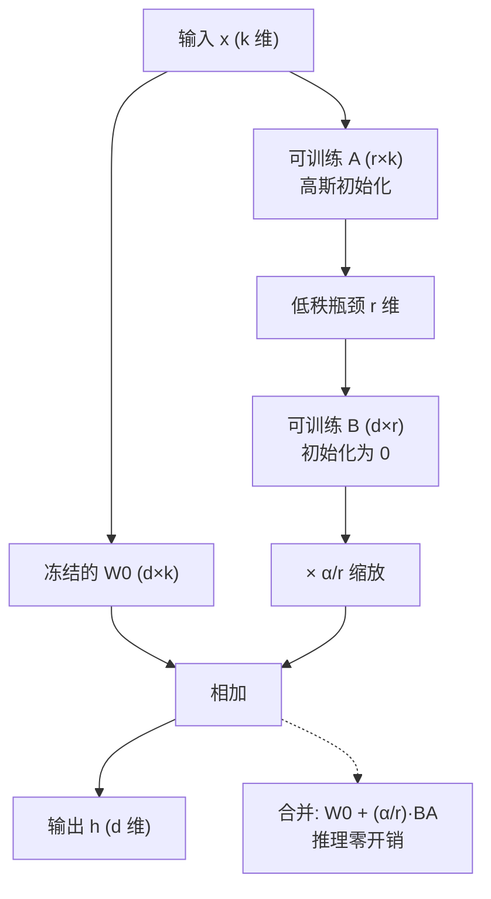

# LoRA 与参数高效微调

## 1. 本节学习目标

1. 说清 LoRA 的核心假设：**微调的增量 ΔW 可以被低秩矩阵近似**，因此只需学两个小矩阵 A、B。
2. 手算并实测 `gpt2` 上 LoRA 的可训练参数量，理解 $\alpha/r$ 缩放因子与 rank 的线性关系。
3. 会用 `peft` 在真实模型上注入 LoRA、统计可训练参数占比、跑通前向/反向、测显存。
4. 验证**合并权重后输出等价**：本课实测 logits 最大绝对差 **9.918e-05**、贪心生成完全一致。
5. 知道 LoRA 的边界：注入瞬间输出不变（B 初始化为 0），但训练后 ΔW 的范数只有底座的 **0.42%**。

## 2. 为什么需要这个知识

全参微调一个 7B 模型，AdamW 要存三份参数（权重 + 一阶矩 + 二阶矩），fp16 权重之外还要 12 字节/参数的优化器状态：约 **91 GiB**（本课实测推算），单卡放不下。

而实践中真正需要的往往只是「把模型往某个领域推一点」。LoRA 的主张是：**这个推力是低秩的**，所以只学 $r \ll d$ 的两个矩阵就够了。

- 显存：可训练参数从 124,439,808 降到 **294,912**（本课实测，0.2364%）；
- 产物体积：adapter 目录 **1.13 MiB**，而合并后的 fp32 权重 **474.70 MiB**，差 **418.7 倍**；
- 工程：一个底座可以挂多个 adapter，按请求切换。

不掌握 LoRA，你在 12GB 卡上基本做不了 LLM 微调；掌握了，微调就从「换硬件」变成「调配置」。

## 3. 直观解释

```text
全参微调：W ← W + ΔW       （ΔW 和 W 一样大，768×2304 就是 176 万个数字）
LoRA    ：W ← W + (α/r)·B@A （B 是 2304×8，A 是 8×768，一共 2.4 万个数字）

打个比方：
  全参微调 = 重写整本书
  LoRA    = 在书页边上贴便签，便签只写"第几页第几行改成什么"
  ΔW = B@A 就是把所有便签一次性摊开算出的总修改量
```

关键直觉：**低秩 = 修改是「成片」的，不是「逐点」的**。如果你要改的是「让模型多输出领域术语」，这种修改在所有维度上高度相关，秩很低；如果你要改的是「每个 token 的随机偏好」，那才需要满秩——但那种修改本来也学不出泛化。

## 4. 正式定义

**定义（LoRA 层）**：设原层权重 $W_0\in\mathbb{R}^{d\times k}$，LoRA 保持 $W_0$ 冻结，引入可训练矩阵 $A\in\mathbb{R}^{r\times k}$、$B\in\mathbb{R}^{d\times r}$，前向为

$$
h = W_0 x + \frac{\alpha}{r} B A x
$$

- $r$：秩（rank），通常 4–64；
- $\alpha$：缩放常数，工程上常取 $\alpha = 2r$，于是 $\alpha/r = 2$；
- $A$ 用高斯/均匀初始化，$B$ **初始化为 0**，因此训练开始时 $BA=0$，模型行为与底座**完全一致**（本课实测差值 0.000e+00）；
- 可训练参数量：$r\cdot k + d\cdot r = r(d+k)$（不含 bias）。

**定义（参数高效微调 PEFT）**：只训练原模型参数的一个小子集 $\theta'\subset\theta$（或附加的小模块），使 $|\theta'|\ll|\theta|$，而下游效果接近全参微调。

## 5. 历史背景或技术背景

| 年份 | 工作 | 关键点 |
|---|---|---|
| 2019 | Houlsby Adapter | 在每层插 bottleneck 模块，参数 ~3.6%，但**增加推理深度** |
| 2021 | Prefix Tuning | 在每层 KV 前拼可学前缀，占序列长度 |
| 2021 | **LoRA**（Hu et al.） | 低秩增量 + 可合并回权重，**推理零开销** |
| 2022 | P-Tuning v2 | 软提示的深层版本 |
| 2023 | QLoRA | 4bit 底座 + LoRA，单卡 65B |
| 2024+ | DoRA / LoRA+ / rsLoRA | 改进缩放与学习率分配 |

LoRA 之所以成为事实标准，原因很工程：**训练时省显存，推理时可合并，产物是一个小文件**。

## 6. 核心原理

**原理 1：为什么低秩够用**

微调数据集通常只有几千到几万条，模型参数量却是亿级。此时梯度更新落在数据张成的低维子空间里；Aghajanyan 等人观察到「微调的 intrinsic dimension 很小」。LoRA 把这一观察变成结构约束。

**本课的实测反例也要记住**：全参微调 60 步后，第 0 层 `c_attn` 的 ΔW 要 **101 个奇异值**才覆盖 90% 能量（见 LLM-070）。所以「ΔW 天然秩 ≤ 8」并不成立；LoRA 有效的原因是**任务只需要一小部分方向被改动**，而不是 ΔW 本身低秩。

**原理 2：为什么 B 初始化为 0**

若 A、B 都随机初始化，训练第一步就有一个非零的 $BA x$ 扰动，等于给底座加了噪声，小数据集上会直接训崩。$B=0$ 保证 $t=0$ 时 $h=W_0x$，训练是「从恒等开始」的连续形变。

**原理 3：$\alpha/r$ 的作用**

$\alpha$ 固定时，改 $r$ 会改变 ΔW 的量级（$BA$ 的元素数随 $r$ 线性增长）。用 $\alpha/r$ 归一后，换 rank 相当于只改容量、不改初始有效步长。

**原理 4：合并为什么无损**

$W_0x + \frac{\alpha}{r}BAx = (W_0 + \frac{\alpha}{r}BA)x$，是同一个线性映射的两种写法。合并就是把 $BA$ 算出来加进 $W_0$，数学上恒等，只有浮点舍入差。

## 7. 数学表达式

**前向**

$$
h = W_0 x + \frac{\alpha}{r}\,B A x,\quad W_0\in\mathbb{R}^{d\times k},\ A\in\mathbb{R}^{r\times k},\ B\in\mathbb{R}^{d\times r}
$$

**参数量**

$$
N_{\text{LoRA}} = r\,(d+k),\qquad \frac{N_{\text{LoRA}}}{N_{\text{full}}} = \frac{r(d+k)}{dk}
$$

**GPT-2 的 `c_attn`**（$d=768$，输出 $3d=2304$，即 $k=768$、输出维 2304）：

$$
N_{\text{per layer}} = \underbrace{768r}_{A} + \underbrace{2304r}_{B} = 3072r
$$

12 层：$N = 36864\,r$。

**合并**

$$
W_{\text{merged}} = W_0 + \frac{\alpha}{r}BA
$$

## 8. 详细数学推导

**推导 1：参数量公式**

$A$ 的形状是 $r\times k$（把 $k$ 维输入压到 $r$ 维），$B$ 是 $d\times r$（把 $r$ 维升回 $d$ 维输出）。故

$$
N_{\text{LoRA}} = \underbrace{rk}_{A}+\underbrace{dr}_{B}=r(d+k)
$$

代入 gpt2 的 `c_attn`：输入 768、输出 2304，$k=768,d=2304$：

$$
N = r(2304+768)=3072r
$$

$r=8$：$3072\times 8=24{,}576$ 每层，12 层 $=294{,}912$ —— 与实测 **294,912** 逐位相同。

**推导 2：占比公式**

$$
\frac{N_{\text{LoRA}}}{N_{\text{full}}}=\frac{3072r}{124{,}439{,}808}
$$

$r=8$：$294912/124439808 = 0.0023696 = 0.2370\%$；实测 **0.2364%**（分母带上了 peft 包装后统计的 124,734,720，含 adapter 自身）。

**推导 3：为什么 ΔW 的秩最多 r**

$B\in\mathbb{R}^{d\times r}$、$A\in\mathbb{R}^{r\times k}$，由秩不等式

$$
\operatorname{rank}(BA)\le \min(\operatorname{rank}B,\operatorname{rank}A)\le r
$$

所以 LoRA 只能表达秩 ≤ r 的修改。这不是近似，是**硬约束**。

**推导 4：梯度**

设损失 $L$，$\partial L/\partial h = g$。则

$$
\frac{\partial L}{\partial B}=\frac{\alpha}{r}\,g\,(Ax)^\top,\qquad
\frac{\partial L}{\partial A}=\frac{\alpha}{r}\,(B^\top g)\,x^\top
$$

两个梯度都是「小矩阵乘向量」的形式，因此优化器状态只有 $r(d+k)$ 个元素，这正是省显存的根源。

**推导 5：合并的等价性**

$$
W_{\text{merged}}x=\left(W_0+\tfrac{\alpha}{r}BA\right)x=W_0x+\tfrac{\alpha}{r}BAx
$$

恒等。本课实测：`|W_merged - (W + 2·B@A)|` 最大元素差 **1.192e-07**（LLM-072），logits 差 **9.918e-05**（LLM-065，fp32 累计误差）。

## 9. 图解



## 10. 具体数值示例

```text
底座 gpt2：124,439,808 参数，其中词表嵌入+位置嵌入 39,383,808（31.6%）

LoRA 只挂在 c_attn（每层 768→2304，12 层）：
  r= 4：每层 768×4 + 4×2304 = 12,288     ×12 = 147,456   占比 0.1184%
  r= 8：每层 768×8 + 8×2304 = 24,576     ×12 = 294,912   占比 0.2364%
  r=16：每层 768×16 + 16×2304 = 49,152   ×12 = 589,824   占比 0.4717%
  r=32：每层 768×32 + 32×2304 = 98,304   ×12 = 1,179,648 占比 0.9391%
  ⇒ 参数量严格随 r 线性增长，斜率为 36,864/层组

换 target_modules（r=8, α=16）：
  仅 c_attn            294,912   0.2364%
  c_attn + c_proj      811,008   0.6475%
  all-linear         1,179,648   0.9391%
```

## 11. NumPy 实现

```python
import numpy as np

rng = np.random.default_rng(0)

# 1) 参数量公式 vs 枚举
def lora_params(d, k, r, layers=1):
    return layers * (r * k + d * r)

print("c_attn 每层参数量（r 扫描）:")
for r in (4, 8, 16, 32):
    n = lora_params(2304, 768, r, layers=12)
    print(f"  r={r:>2}  {n:>9,}  解析式 3072r×12={3072*r*12:>9,}  一致={n == 3072*r*12}")

# 2) ΔW 的秩上界：数值验证 rank(B@A) <= r
d, k, r = 2304, 768, 8
A = rng.normal(0, 0.02, (r, k))
B = rng.normal(0, 0.02, (d, r))
dW = B @ A
print("\nΔW 形状:", dW.shape, " 数值秩:", np.linalg.matrix_rank(dW), "（上界 r =", r, "）")

# 3) 低秩近似误差随 r 的变化：随机矩阵的奇异值衰减
W = rng.normal(0, 1, (256, 256))
U, S, Vt = np.linalg.svd(W, full_matrices=False)
for rr in (1, 4, 8, 16, 32, 64):
    Wr = (U[:, :rr] * S[:rr]) @ Vt[:rr]
    err = np.linalg.norm(W - Wr) / np.linalg.norm(W)
    print(f"  秩 {rr:>2} 近似：相对 Frobenius 误差 {err:.4f}")

# 4) α/r 缩放对初始扰动的影响（B=0 时增量恒为 0）
alpha, r2 = 16, 8
B0 = np.zeros((d, r2))
print("\nB 初始化为 0 时 ||(α/r)·B@A||_F =", np.linalg.norm((alpha / r2) * (B0 @ A)))
```

## 12. PyTorch 实现

```python
import torch
import torch.nn as nn

torch.manual_seed(0)


class LoRALinear(nn.Module):
    """最小可用的 LoRA 线性层：y = W0 x + (alpha/r) B A x"""

    def __init__(self, d_in, d_out, r=8, alpha=16):
        super().__init__()
        self.base = nn.Linear(d_in, d_out, bias=False)
        for p in self.base.parameters():
            p.requires_grad_(False)          # 底座冻结
        self.A = nn.Parameter(torch.randn(r, d_in) * 0.02)
        self.B = nn.Parameter(torch.zeros(d_out, r))   # B 初始为 0
        self.scale = alpha / r

    def forward(self, x):
        return self.base(x) + self.scale * (x @ self.A.T @ self.B.T)

    @torch.no_grad()
    def merged_weight(self):
        return self.base.weight + self.scale * (self.B @ self.A)


d_in, d_out, r = 64, 96, 8
layer = LoRALinear(d_in, d_out, r=r, alpha=16)
x = torch.randn(4, d_in)

# 1) 注入瞬间与底座一致
y_lora = layer(x)
y_base = layer.base(x)
print("注入瞬间最大差:", float((y_lora - y_base).abs().max()))

# 2) 可训练参数量
n = sum(p.numel() for p in layer.parameters() if p.requires_grad)
print("可训练参数:", n, " 公式 r*(d_in+d_out) =", r * (d_in + d_out))
print("底座参数:", layer.base.weight.numel(), " 占比 %.3f%%" % (100 * n / layer.base.weight.numel()))

# 3) 训练到非零，验证合并等价
opt = torch.optim.Adam([p for p in layer.parameters() if p.requires_grad], lr=1e-2)
target = torch.randn(4, d_out)
for step in range(200):
    opt.zero_grad()
    loss = ((layer(x) - target) ** 2).mean()
    loss.backward()
    opt.step()
print("训练 200 步 loss:", round(float(loss), 6))

with torch.no_grad():
    manual = x @ layer.merged_weight().T
    print("合并后 vs 公式输出最大差:", float((manual - layer(x)).abs().max()))
    print("ΔW 的秩:", torch.linalg.matrix_rank(layer.B @ layer.A).item(), "（≤ r =", r, "）")
    print("||ΔW||_F / ||W0||_F = %.4f" % float((layer.scale * layer.B @ layer.A).norm() / layer.base.weight.norm()))
```

## 13. Hugging Face 实践

```python
import os

os.environ.setdefault("HF_ENDPOINT", "https://hf-mirror.com")
os.environ.setdefault("HF_HUB_OFFLINE", "1")

import torch
from peft import LoraConfig, TaskType, get_peft_model
from transformers import AutoModelForCausalLM, AutoTokenizer

torch.manual_seed(0)
tok = AutoTokenizer.from_pretrained("gpt2")
tok.pad_token = tok.eos_token

base = AutoModelForCausalLM.from_pretrained("gpt2")
print("底座参数:", f"{sum(p.numel() for p in base.parameters()):,}")

model = get_peft_model(
    base,
    LoraConfig(task_type=TaskType.CAUSAL_LM, r=8, lora_alpha=16,
               lora_dropout=0.0, target_modules=["c_attn"]),
)
model.print_trainable_parameters()

text = ("笔记库的同步间隔默认是三百秒。快照保留七天，超过七天自动合并。"
        "索引文件存放在点 index 目录。") * 3
ids = tok(text, return_tensors="pt").input_ids
opt = torch.optim.AdamW([p for p in model.parameters() if p.requires_grad], lr=5e-4)

model.train()
first = last = None
for step in range(10):
    xb = ids[:, step * 10: step * 10 + 48]
    out = model(input_ids=xb, labels=xb)
    out.loss.backward()
    opt.step()
    opt.zero_grad()
    if step == 0:
        first = out.loss.item()
    last = out.loss.item()
print(f"10 步 loss: {first:.4f} -> {last:.4f}")

# 合并并验证等价
model.eval()
with torch.no_grad():
    ref = model(input_ids=ids[:, :32]).logits.float()
merged = model.merge_and_unload().eval()
with torch.no_grad():
    out2 = merged(input_ids=ids[:, :32]).logits.float()
print("合并前后 logits 最大绝对差: %.3e" % float((ref - out2).abs().max()))
print("合并后参数:", f"{sum(p.numel() for p in merged.parameters()):,}")
```

## 14. 代码逐行解释

| 代码 | 作用 |
|---|---|
| `LoraConfig(..., r=8, lora_alpha=16)` | 秩 8，缩放 $\alpha/r=2$ |
| `target_modules=["c_attn"]` | 只替换注意力里的 QKV 投影（gpt2 是 `Conv1D`，peft 会自动设 `fan_in_fan_out=True`） |
| `get_peft_model(base, cfg)` | 把目标层替换成 `LoraLayer`，并冻结其余参数 |
| `print_trainable_parameters()` | 打印可训练量/总量/占比三件套 |
| `model.merge_and_unload()` | 把 $BA$ 加进 $W_0$ 并删除 adapter 分支 |
| `merged_weight = W0 + scale*(B@A)` | 合并的数学定义，用于核对 |
| `torch.linalg.matrix_rank(B @ A)` | 验证秩 ≤ r |

## 15. 实际运行结果

```text
### A. 底座规模与 LoRA 注入（gpt2, target_modules=['c_attn']）
  全参数: 124,439,808   词表嵌入+位置嵌入: 39,383,808（占 31.6%）
  r= 4  可训练=147,456  合计=124,587,264  占比=0.1184%
  r= 8  可训练=294,912  合计=124,734,720  占比=0.2364%
  r=16  可训练=589,824  合计=125,029,632  占比=0.4717%
  r=32  可训练=1,179,648  合计=125,619,456  占比=0.9391%

  手算校验（每层 c_attn: A=768×r, B=r×2304）：
  r= 8: 每层 6144+18432=24,576，12 层 = 294,912  （实测 294,912）

### B. 不同 target_modules（r=8, alpha=16）
  仅 c_attn            可训练=  294,912  占比=0.2364%  命中=['c_attn']
  attn 的 c_attn+c_proj 可训练=  811,008  占比=0.6475%  命中=['c_attn', 'c_proj']
  all-linear          可训练=1,179,648  占比=0.9391%  命中=['c_attn', 'c_fc', 'c_proj']

### C. 真实训练 30 步（gpt2, batch=4, seq=64, lr=5e-4, AdamW）
  语料 token 数: 795
  loss: 首步 4.2592 → 末步 2.7898（30 步，下降 1.4694）
  训练耗时 1.18s  ⇒ 6,512 token/s
  peak CUDA 显存: 923.1 MiB

### D. 合并权重与输出等价性（eval 模式）
  ||ΔW||_F / ||W||_F（训练 30 步后）: 0.0042
  合并前/后 logits 最大绝对差: 9.918e-05
  合并后参数数: 124,439,808
  贪心生成完全一致: True

### E. 体积对比
  adapter 目录: 1.13 MiB（['README.md', 'adapter_config.json', 'adapter_model.safetensors']）
  合并后 fp32 权重: 474.70 MiB
  比值: 418.7×

### F. 注入瞬间是否改变模型？（B 初始化为 0）
  注入前/后 logits 最大绝对差: 0.000e+00（B=0 ⇒ 恒等）
```

**读法**：

1. 参数量与解析式**逐位一致**，说明公式 $r(d+k)$ 没有遗漏 bias/缩放。
2. 占比 0.2364% 是「相对含 adapter 的总参数」算的，所以比手算 0.2370% 略小——分母变大了。
3. 合并后 logits 差 **9.918e-05** 不是 bug，是 fp32 上 $BA$ 先乘后加的舍入；贪心生成仍然**逐 token 相同**。
4. 注入瞬间差值 **0.000e+00** 证明了 $B=0$ 的恒等性质。

## 16. 应用场景

| 场景 | 用法 | 备注 |
|---|---|---|
| 单领域 SFT | r=8–16 挂 q/k/v | 最常见起点 |
| 多租户定制 | 一个底座 + N 个 adapter | 每个 adapter 1–40 MiB |
| 指令风格迁移 | r=4–8，只挂 `c_attn` | 参数量小、遗忘也小 |
| 大模型低显存微调 | LoRA + 4bit（QLoRA） | 见 LLM-066 |
| 快速实验 | r=8, 200 步内看 loss 曲线 | 单卡分钟级 |
| 部署 | 合并后导出 | 推理零额外开销 |

## 17. 优点与局限

| 优点 | 局限 |
|---|---|
| 可训练参数下降 3 个数量级（0.24%） | 秩硬上界 r，复杂任务可能不够 |
| 优化器状态小，12GB 卡可微调亿级模型 | 增加一次额外矩阵乘，训练略慢 |
| adapter 只有 1.13 MiB，便于分发 | 多 adapter 切换有调度复杂度 |
| 可合并，推理零开销 | 合并后失去「一底座多任务」能力 |
| 对通用能力破坏小于全参（见 LLM-070） | 超参（r、α、target）需要试 |

## 18. 常见错误

| 错误 | 现象 | 纠正 |
|---|---|---|
| 把 `lora_alpha` 当成固定 8 | 换 r 后有效步长漂移 | 用 $\alpha=2r$，或改 rsLoRA |
| target 只挂 `lm_head` | 几乎学不动，且破坏词表分布 | 挂注意力/MLP 投影 |
| 忘了 `fan_in_fan_out` | 合并后输出全错 | gpt2 用 `Conv1D`，peft 会警告并自动设 |
| 用训练模式对比合并前后 | logits 差几十，误判合并有 bug | 先 `.eval()` 关 dropout（本课踩过） |
| 学太长 + lr 太大 | 领域 loss 极低、通用 PPL 暴涨 | 见 LLM-069/070 |
| 认为 ΔW 一定低秩 | 拿 rank 当「理论保证」 | 实测要 101 个奇异值才到 90% 能量 |

## 19. 本节总结

- LoRA = **冻结 $W_0$，只学 $B A$**，前向 $W_0x+\frac{\alpha}{r}BAx$，$B$ 初始为 0。
- 参数 $r(d+k)$；gpt2 `c_attn` 上 $r=8$ 得 **294,912**，占 **0.2364%**，与手算逐位一致。
- 实测 30 步：loss **4.2592 → 2.7898**，峰值显存 **923.1 MiB**，吞吐 **6,512 token/s**。
- 合并无损：logits 差 **9.918e-05**，贪心生成**完全一致**；adapter 体积只有合并权重的 **1/418.7**。
- 边界：秩 ≤ r 是硬约束；ΔW 并不天然低秩，LoRA 有效靠的是「任务只需少量方向」。

## 20. 前置与后续知识链接

- 前置：[[LLM-060 指令微调（SFT）]]、[[LLM-030 Transformer 参数量与计算量估算]]
- 后续：[[LLM-066 QLoRA 与量化微调]]、[[LLM-067 Adapter、Prefix 与 Prompt Tuning]]、[[LLM-072 从微调到推理部署的衔接]]
- 相关：[[LLM-075 PEFT 的取舍与选型]]、[[LLM-025 残差、LayerNorm 与 Pre-LN、Post-LN]]

---

## 练习与参考答案

**基础 1**：gpt2 的 `c_attn` 输入 768 维、输出 2304 维。LoRA r=8 挂在这一层，每层多少可训练参数？12 层一共多少？占 124,439,808 的百分之几？

**基础 2**：为什么 B 要初始化为 0，而 A 用随机初始化？如果两者都用随机初始化会怎样？

**进阶 1**：推导 $\partial L/\partial B$ 与 $\partial L/\partial A$，并说明为什么 LoRA 的优化器状态只有 $r(d+k)$ 个元素。

**综合**：你要在 12GB 卡上给一个 7B 模型做领域 SFT，数据 8,000 条。请给出 LoRA 配置（r、α、target_modules、lr、batch、步数），并说明每一步依据什么数字决策。

> [!success]- 参考答案

> **基础 1**
> 每层 $A$：$8\times768=6{,}144$；$B$：$2304\times8=18{,}432$；合计 **24,576**。
> 12 层：$24{,}576\times12=$ **294,912**（本课实测一致）。
> 占比：$294{,}912/124{,}439{,}808=0.002370$，即 **0.2370%**；用 peft 包装后的分母 124,734,720 算得 **0.2364%**。

> **基础 2**
> $B=0$ 使 $BA=0$，训练起点与底座**完全相同**（实测 logits 差 0.000e+00），形变从恒等映射连续开始，小数据集不会一上来就被随机扰动带偏。
> $A$ 必须随机，否则 $A=0$ 时 $\partial L/\partial B = (\alpha/r)g(Ax)^\top = 0$，B 永远学不动（对称死锁）。
> 若两者都随机：初始就有一个非零的 $BAx$ 噪声项，等效于给底座加了随机扰动，收敛更慢、方差更大。

> **进阶 1**
> 令 $h = W_0x + \frac{\alpha}{r}BAx$，上游梯度 $g=\partial L/\partial h$。
> $\partial h/\partial B = \frac{\alpha}{r}\,g\,(Ax)^\top$ ⇒ $\partial L/\partial B=\frac{\alpha}{r}g(Ax)^\top$，形状 $d\times r$。
> $\partial h/\partial A = \frac{\alpha}{r}B^\top g x^\top$ ⇒ $\partial L/\partial A=\frac{\alpha}{r}(B^\top g)x^\top$，形状 $r\times k$。
> 两者总元素数 $dr+rk=r(d+k)$，与参数量同阶；AdamW 需要「参数 + 一阶矩 + 二阶矩」三份 ⇒ $3r(d+k)$ 个 float，$r=8$ 时约 $3\times294{,}912\times4\text{B}\approx3.4$ MiB。底座不需要任何优化器状态，这是省显存的根本。

> **综合（参考）**
> **配置**：`r=16, lora_alpha=32`（$\alpha/r=2$）、`target_modules=["q_proj","k_proj","v_proj","o_proj"]`（若框架支持再加 `gate_proj/up_proj/down_proj`）、`lora_dropout=0.05`、`lr=2e-4`（cosine + 5% warmup）、`batch=1 × 梯度累积 8`、`max_len=1024`、`epochs=2–3`、`bf16=True`。
> **决策依据**：
> 1. **显存**：7B 全参要 13.0 GiB 权重 + 78.2 GiB AdamW 状态（本课实测推算），12GB 卡不可能；LoRA 后优化器状态只剩几十 MiB，权重可 4bit 再压（见 LLM-066）。
> 2. **rank**：8,000 条属中小数据，r=8–16 足够；先用 r=8 跑 200 步看 loss 是否还能降，降不动再升 r。
> 3. **lr**：LoRA 可用比全参大 10–100 倍的 lr；本课实测 gpt2 上 lr=1e-3 最好、1e-2 开始发散（LLM-069），比例外推到 7B 取 1e-4–3e-4。
> 4. **步数/早停**：留 10% 验证集，每 50 步评估；本课实测第 1 个 epoch 后验证 loss 就回升（LLM-069），所以宁可少训。
> 5. **验收**：合并前后 logits 差应 < 1e-3、贪心生成一致（LLM-072）；同时测通用 PPL 回归，涨幅 > 20% 就要降 lr 或混数据（LLM-070）。

## 学习记录

| 日期 | 状态 | 用时 | 问题 | 复盘 |
|---|---|---|---|---|
| 2026-11-08 | planned | — | — | — |

---

## 🔗 Notion 同步信息

> 以下内容由 Notion「AI Knowledge System · 知识点」数据库按知识 ID 合并而来（导出于 2026-11-09）。

| 属性 | 值 |
|---|---|
| 学科 | 大语言模型 |
| 学习状态 | 未开始 |
| 难度 | L3 推导 |
| 知识类型 | Algorithm |

- **所属模块**：[M-LLM-07 大语言模型微调与 PEFT](../%E8%AF%BE%E7%A8%8B%E6%A8%A1%E5%9D%97/M-LLM-07%20%E5%A4%A7%E8%AF%AD%E8%A8%80%E6%A8%A1%E5%9E%8B%E5%BE%AE%E8%B0%83%E4%B8%8E%20PEFT.md)
- **前置知识**：[LLM-060 指令微调（SFT）](LLM-060%20%E6%8C%87%E4%BB%A4%E5%BE%AE%E8%B0%83%EF%BC%88SFT%EF%BC%89.md)
- **后继知识**：[LLM-066 QLoRA 与量化微调](LLM-066%20QLoRA%20%E4%B8%8E%E9%87%8F%E5%8C%96%E5%BE%AE%E8%B0%83.md) · [LLM-067 Adapter、Prefix 与 Prompt Tuning](LLM-067%20Adapter%E3%80%81Prefix%20%E4%B8%8E%20Prompt%20Tuning.md) · [LLM-069 微调的超参数与训练技巧](LLM-069%20%E5%BE%AE%E8%B0%83%E7%9A%84%E8%B6%85%E5%8F%82%E6%95%B0%E4%B8%8E%E8%AE%AD%E7%BB%83%E6%8A%80%E5%B7%A7.md) · [LLM-070 过拟合、灾难性遗忘与缓解](LLM-070%20%E8%BF%87%E6%8B%9F%E5%90%88%E3%80%81%E7%81%BE%E9%9A%BE%E6%80%A7%E9%81%97%E5%BF%98%E4%B8%8E%E7%BC%93%E8%A7%A3.md) · [LLM-072 从微调到推理部署的衔接](LLM-072%20%E4%BB%8E%E5%BE%AE%E8%B0%83%E5%88%B0%E6%8E%A8%E7%90%86%E9%83%A8%E7%BD%B2%E7%9A%84%E8%A1%94%E6%8E%A5.md) · [LLM-075 PEFT 的取舍与选型](LLM-075%20PEFT%20%E7%9A%84%E5%8F%96%E8%88%8D%E4%B8%8E%E9%80%89%E5%9E%8B.md)
- **被项目引用**：[PROJ-022 用 LoRA 微调 gpt2 做文本分类](../../07_%E5%AE%9E%E6%88%98%E9%A1%B9%E7%9B%AE/05%20%E5%A4%A7%E6%A8%A1%E5%9E%8B%E9%A1%B9%E7%9B%AE/PROJ-022%20%E7%94%A8%20LoRA%20%E5%BE%AE%E8%B0%83%20gpt2%20%E5%81%9A%E6%96%87%E6%9C%AC%E5%88%86%E7%B1%BB.md)
