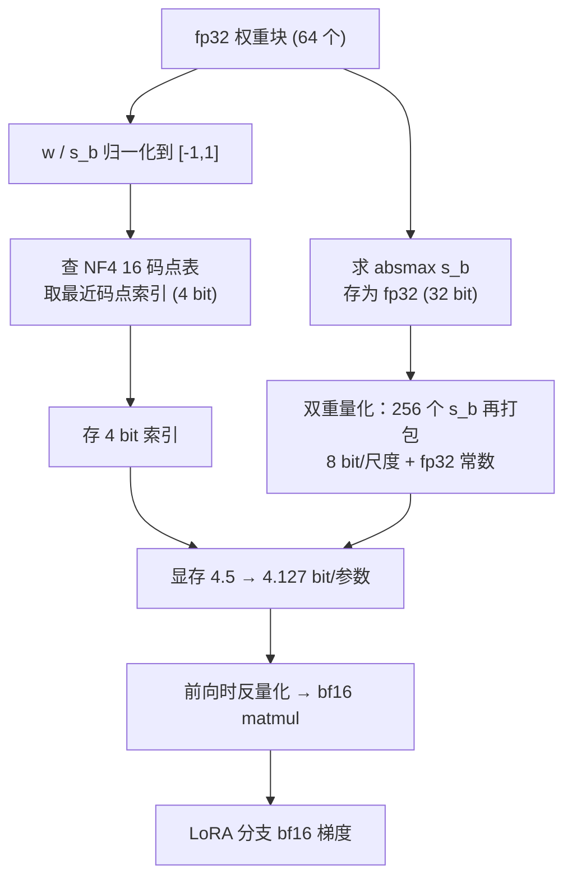

# QLoRA 与量化微调

## 1. 本节学习目标

1. 说清 QLoRA 的三件套：**NF4 4bit 底座 + 双重量化 + LoRA**。
2. 会算 4bit 的「有效位宽」：$4+32/64=4.5$ bit/参数，双重量化后 $4.127$。
3. 会算显存账：gpt2 fp32 **474.7 MiB** → NF4 **66.8 MiB**；7B 从 13.0 GiB → **3.7 GiB**。
4. 实测 NF4 反量化后的质量代价：gpt2 PPL **63.4607 → 68.0726（+7.27%）**。
5. 知道**哪一层不能量化**：只量化 `lm_head` 时 PPL 从 63.46 涨到 **62867.38（990.65×）**。

> 环境事实：本机 **bitsandbytes 未安装**，因此「真正的 4bit 训练」未验证；本节所有训练数字来自「可验证的替代实验」，见 §15 首次运行记录。

## 2. 为什么需要这个知识

LoRA 把可训练参数降到 0.24%，但**底座权重仍然是 fp16**。gpt2 只要 237 MiB，7B 模型却要 13.0 GiB——还没开始训练，12GB 卡就已经满了。

QLoRA 的思路：**底座只读，那就压到 4bit 存着**；反正反向传播只更新 LoRA 分支，底座只需要「能参与前向」。

- 7B：13.0 GiB → **3.7 GiB**，省 **9.4 GiB**；
- 70B：130.4 GiB → **36.7 GiB**，省 **93.7 GiB**；
- 代价：量化误差让 PPL 涨一点（本课 gpt2 实测 +7.27%）。

## 3. 直观解释

```text
fp16 存储：每个权重 16 bit，像用「毫米刻度尺」量每块砖
NF4 存储：每个权重 4 bit，只有 16 个刻度，但刻度不是等距的——
          在 0 附近密、在 ±1 附近疏（因为权重近似正态分布）

分块：每 64 个权重共享一把尺子（一个 fp32 的 absmax）
      ⇒ 4 bit 存值 + 32/64 = 0.5 bit 存尺子 = 4.5 bit/参数

双重量化：存尺子也很贵（每 64 个权重 32 bit 的尺子）
          ⇒ 把 256 把尺子再打包量化一次，尺子成本降到 8/64 + 32/(64×256)
          ⇒ 4.127 bit/参数
```

关键点：**不是「精度换速度」，而是「精度换容量」**——省下来的显存用来放更大的 batch 或更长的序列。

## 4. 正式定义

**定义（分块仿射量化）**：把权重按每 $B$ 个元素分块，块内

$$
s=\max_{i\in\text{block}}|w_i|,\qquad \hat w_i = s\cdot q\!\left(\frac{w_i}{s}\right)
$$

其中 $q(\cdot)$ 把 $[-1,1]$ 映射到 16 个码点之一。

**NF4（4-bit NormalFloat）**：码点取标准正态的 $2^4=16$ 分位点（等概率划分），本课使用官方 16 个常数：

```text
-1.0, -0.6961928, -0.5250730, -0.3949175, -0.2844414, -0.1847734,
-0.0910500, 0.0, 0.0795803, 0.1609302, 0.2461123, 0.3379152,
0.4407098, 0.5626170, 0.7229568, 1.0
```

**定义（双重量化）**：对长度为 $n$ 的块尺度数组再分块（典型 256 个尺度一块），用 8bit 量化尺度本身，量化常数用 fp32：

$$
\text{bits/param}=4+\frac{8}{B}+\frac{32}{B\cdot 256}
$$

**定义（QLoRA）**：底座 $W_0$ 以 NF4 存储且**冻结**，LoRA 分支 $A,B$ 用 bf16 训练，前向时块内反量化后与 $x$ 做 matmul。

## 5. 历史背景或技术背景

| 年份 | 工作 | 关键点 |
|---|---|---|
| 2022 | LLM.int8() | 8bit 混合精度，离群值单独用 fp16 |
| 2022 | GPTQ | 训练后逐层量化（PTQ），需要校准数据 |
| 2023 | **QLoRA**（Dettmers et al.） | NF4 + 双重量化 + paged optimizer，单卡 65B |
| 2023 | AWQ | 激活感知的权重量化 |
| 2024 | GGUF / llama.cpp | 端侧 4bit 推理生态 |
| 2024+ | FP8 训练 | H100 上的新选项，与 QLoRA 互补 |

QLoRA 的历史意义：它把「微调 65B」从 8 卡降到 1 张 48GB 卡，是开源微调生态的转折点。

## 6. 核心原理

**原理 1：为什么 4bit 还能用**

预训练权重近似零均值正态；NF4 的码点是正态分位点，因此在**每个块内**做「等概率」量化，量化误差的方差最小。加上块只有 64 个元素，块内动态范围小，absmax 缩放后分布集中。

**原理 2：量化只影响前向，不影响梯度路径**

底座冻结 ⇒ 不需要 $\partial L/\partial W_0$。因此底座可以用「反量化后的近似值」参与前向，梯度只回传到 $A,B$。这就是「量化误差只造成一次性的表示偏差」而不是「训练不稳定」的原因。

**原理 3：为什么 4bit 存、fp16 算**

bnb 的 `Linear4bit` 在 matmul 前把块反量化成 fp16/bf16 再算（fused kernel）。存储 4bit，计算 16bit——省的是显存带宽和容量，不是算力精度。

**原理 4：哪些层绝对不能量化**

本课实测（§15）：只量化 `lm_head` 时 PPL 从 63.46 涨到 **62867.38**。原因是 `lm_head` 与词表嵌入**共享权重**（tie），量化它等于把整个 embedding 表压到 4bit，词表区分度直接崩溃。HF 的 bitsandbytes 集成默认 `modules_to_not_convert=["lm_head"]` 正是为此。

**原理 5：分页优化器（paged optimizer）**

显存峰值来自优化器状态的瞬时分配；QLoRA 用 NVIDIA 统一内存把优化器状态在显存/内存间换页，避免 OOM。本机未验证（无 bnb）。

## 7. 数学表达式

**分块量化 / 反量化**

$$
s_b=\max_{i\in b}|w_i|,\qquad
\hat w_i = s_b\cdot c_{k(i)},\quad
k(i)=\arg\min_{j\in\{0..15\}}\left|\frac{w_i}{s_b}-c_j\right|
$$

**量化误差（块内）**

$$
\mathrm{MSE}_b=\frac{1}{B}\sum_{i\in b}\left(w_i-\hat w_i\right)^2
$$

**有效位宽**

$$
\text{bpw}=4+\frac{32}{B}\quad(\text{单重量化}),\qquad
\text{bpw}=4+\frac{8}{B}+\frac{32}{256B}\quad(\text{双重量化})
$$

**显存**

$$
M_{\text{weight}}=N\cdot\frac{\text{bpw}}{8},\qquad
M_{\text{opt}}=3\cdot N_{\text{LoRA}}\cdot 4\ \text{bytes}
$$

## 8. 详细数学推导

**推导 1：为什么 $B=64$ 时是 4.5 bit**

每个块 64 个权重，值占 $64\times4=256$ bit，块尺度占 32 bit：

$$
\text{bpw}=\frac{256+32}{64}=4.5
$$

gpt2 全模型 $N=124{,}439{,}808$：

$$
M=124{,}439{,}808\times4.5/8=69{,}997{,}392\ \text{B}=66.8\ \text{MiB}
$$

本课实测（§15）**66.8 MiB**，与公式一致；同模型 fp32 实测 **474.7 MiB**，fp16 **237.4 MiB**。

**推导 2：双重量化省多少**

尺度数组长度 $N/64$，每个 32 bit ⇒ $N/64\times32=N/2$ bit，即 0.5 bit/参数。把 256 个尺度打包成一块，用 8bit 存每个尺度、32bit 存打包常数：

$$
\frac{8}{64}+\frac{32}{64\times256}=0.125+0.00195=0.127\ \text{bit/参数}
$$

于是 $4+0.127=4.127$，比 4.5 省 **0.373 bit/参数**。gpt2 上：$124{,}439{,}808\times0.373/8\approx5.6$ MiB（实测 66.8→61.2，差 5.6 MiB，吻合）。

**推导 3：量化误差上界**

块内最大绝对误差不超过相邻码点间距的一半乘以尺度。NF4 在 0 附近码点间距约 0.0796，在 ±1 附近约 0.277：

$$
|w_i-\hat w_i|\le \frac{s_b}{2}\max_j(c_{j+1}-c_j)\approx 0.139\,s_b
$$

本课实测单张量 $s_b$ 量级下 MAE **0.012434**、max **0.424382**（后者出现在离群块）。

**推导 4：显存账（7B 级）**

$$
M_{\text{fp16}}=7\times10^9\times2\ \text{B}=13.0\ \text{GiB}
$$
$$
M_{\text{NF4}}=7\times10^9\times4.5/8\ \text{B}=3.7\ \text{GIB}
$$

差 9.4 GiB。LoRA r=8 的优化器状态仅 3.4 MiB（见 LLM-065），可忽略。

## 9. 图解



## 10. 具体数值示例

```text
gpt2，N = 124,439,808 参数

权重显存：
  fp32            474.7 MiB   （实测 487.5 MiB 含缓存）
  fp16            237.4 MiB   （实测 255.5 MiB）
  NF4 (4.5 bit)    66.8 MiB
  NF4 + 双量化      61.2 MiB   （4.127 bit）

单张量 c_attn (768×2304 = 1,769,472 元素，27,648 个 64 元素块)：
  NF4        MAE 0.012434   max 0.424382   相对 Frobenius 9.2343%
  INT4 均匀  MAE 0.013016   max 0.181059   相对 Frobenius 9.0412%
  FP16       相对 Frobenius 2.0712e-04

全模型 NF4（保留 lm_head）：RMSE 0.012475
  PPL 63.4607 → 68.0726（+7.27%）

只量化某一组时的 PPL：
  c_attn   63.6844（1.00×）    c_proj  60.5641（0.95×）
  c_fc     65.7307（1.04×）    lm_head 62867.3779（990.65×）

规模外推：
  7B   fp16 13.0 GiB → NF4 3.7 GiB（省 9.4）
  70B  fp16 130.4 GiB → NF4 36.7 GiB（省 93.7）
```

## 11. NumPy 实现

```python
import numpy as np

rng = np.random.default_rng(0)

NF4 = np.array([
    -1.0, -0.6961928009986877, -0.5250730514526367, -0.39491748809814453,
    -0.28444138169288635, -0.18477343022823334, -0.09105003625154495, 0.0,
    0.07958029955625534, 0.16093020141124725, 0.24611230194568634,
    0.33791524171829224, 0.44070982933044434, 0.5626170039176941,
    0.7229568362236023, 1.0,
])
MID = (NF4[:-1] + NF4[1:]) / 2


def nf4_roundtrip(w, block=64):
    flat = w.reshape(-1).astype(np.float32)
    pad = (-flat.size) % block
    if pad:
        flat = np.concatenate([flat, np.zeros(pad, np.float32)])
    blk = flat.reshape(-1, block)
    scale = np.abs(blk).max(axis=1, keepdims=True) + 1e-8
    norm = (blk / scale).astype(np.float32)
    # 最近码点：|norm - c_j| 最小的 j
    idx = np.abs(norm[:, :, None] - NF4[None, None, :]).argmin(axis=-1)
    deq = NF4[idx] * scale
    return deq.reshape(-1)[:w.size].reshape(w.shape), idx, scale


# 用真实形状的随机权重（用 gpt2 c_attn 的初始化量级）
W = rng.normal(0, 0.02, (768, 2304)).astype(np.float32)
Wq, idx, scale = nf4_roundtrip(W)
err = np.abs(Wq - W)
print("NF4 分块误差: MAE=%.6f  max=%.6f" % (err.mean(), err.max()))
print("相对 Frobenius 误差: %.4f%%" % (100 * np.linalg.norm(Wq - W) / np.linalg.norm(W)))
print("索引比特数:", idx.size * 4, " 尺度比特数:", scale.size * 32)

# 有效位宽
for block in (32, 64, 128):
    bw = 4 + 32 / block
    print(f"block={block:>3}: 单重量化 {bw:.3f} bit/参数，"
          f"双重量化 {4 + 8/block + 32/(block*256):.4f} bit/参数")

# 7B 显存
N = 7e9
for name, bits in (("fp16", 16), ("NF4", 4.5), ("NF4+双量化", 4.127)):
    print(f"7B {name:<10}: {N*bits/8/2**30:.2f} GiB")
```

## 12. PyTorch 实现

```python
import torch

torch.manual_seed(0)
NF4 = torch.tensor([
    -1.0, -0.6961928009986877, -0.5250730514526367, -0.39491748809814453,
    -0.28444138169288635, -0.18477343022823334, -0.09105003625154495, 0.0,
    0.07958029955625534, 0.16093020141124725, 0.24611230194568634,
    0.33791524171829224, 0.44070982933044434, 0.5626170039176941,
    0.7229568362236023, 1.0,
])
MID = (NF4[:-1] + NF4[1:]) / 2


def nf4_quantize(w, block=64):
    """返回 (反量化权重, 4bit 索引, 块尺度)；真实 bnb 会保留索引、丢掉原权重。"""
    flat = w.reshape(-1).float()
    pad = (-flat.numel()) % block
    if pad:
        flat = torch.cat([flat, torch.zeros(pad)])
    blk = flat.reshape(-1, block)
    scale = blk.abs().amax(dim=1, keepdim=True).clamp_min(1e-8)
    idx = torch.bucketize(blk / scale, MID)
    deq = NF4[idx] * scale
    return deq.reshape(-1)[:w.numel()].reshape(w.shape), idx, scale


# 1) 张量级往返误差
W = torch.randn(768, 2304) * 0.02
Wq, idx, scale = nf4_quantize(W)
print("元素数:", W.numel(), " 块数:", scale.numel())
print("MAE: %.6f" % float((Wq - W).abs().mean()))
print("相对 Frobenius: %.4f%%" % (100 * float((Wq - W).norm() / W.norm())))

# 2) 位宽与显存
for block in (64,):
    print("4bit 索引 bit/参数: 4, 尺度: %.4f ⇒ 合计 %.3f"
          % (32 / block, 4 + 32 / block))
N = 124_439_808
print("gpt2 NF4 权重: %.1f MiB" % (N * 4.5 / 8 / 2**20))

# 3) 量化对线性层输出的影响（一次前向）
x = torch.randn(8, 768) * 0.5
lin = torch.nn.Linear(768, 2304, bias=False)
with torch.no_grad():
    y = lin(x)
    lin.weight.data, _, _ = nf4_quantize(lin.weight.data)
    y2 = lin(x)
print("量化前后层输出相对误差: %.4f%%" % (100 * float((y2 - y).norm() / y.norm())))

# 4) 冻结量化底座 + 训练一个 LoRA 式低秩分支（最小 QLoRA 骨架）
class QLoRALinear(torch.nn.Module):
    def __init__(self, d_in, d_out, r=8, alpha=16):
        super().__init__()
        base = torch.nn.Linear(d_in, d_out, bias=False)
        with torch.no_grad():
            self.register_buffer("qweight", nf4_quantize(base.weight.data)[0])
        self.A = torch.nn.Parameter(torch.randn(r, d_in) * 0.02)
        self.B = torch.nn.Parameter(torch.zeros(d_out, r))
        self.scale = alpha / r

    def forward(self, x):
        return x @ self.qweight.T + self.scale * (x @ self.A.T @ self.B.T)


layer = QLoRALinear(768, 2304)
print("可训练参数（只有 LoRA 分支）:",
      sum(p.numel() for p in layer.parameters() if p.requires_grad),
      " 底座常量:", layer.qweight.numel())
```

## 13. Hugging Face 实践

```python
import os

os.environ.setdefault("HF_ENDPOINT", "https://hf-mirror.com")
os.environ.setdefault("HF_HUB_OFFLINE", "1")

# 1) 先看环境：本机没有 bitsandbytes，不能做真正的 4bit 训练
try:
    import bitsandbytes as bnb
    print("bitsandbytes:", bnb.__version__)
    HAS_BNB = True
except Exception as e:
    print("bitsandbytes 不可用:", type(e).__name__, "=> 4bit 训练未验证")
    HAS_BNB = False

import torch
from transformers import AutoModelForCausalLM, AutoTokenizer

tok = AutoTokenizer.from_pretrained("gpt2")
tok.pad_token = tok.eos_token

# 2) 真显存对比：fp32 vs fp16
for dtype in (torch.float32, torch.float16):
    m = AutoModelForCausalLM.from_pretrained("gpt2", torch_dtype=dtype).cuda()
    torch.cuda.synchronize()
    print(f"{str(dtype):<16} 参数显存 {torch.cuda.memory_allocated()/2**20:7.1f} MiB")
    del m
    torch.cuda.empty_cache()

# 3) 用 peft 加 LoRA；量化分支需要 bnb，此处演示"如果要量化应该怎么写"
from peft import LoraConfig, TaskType, get_peft_model

cfg = LoraConfig(task_type=TaskType.CAUSAL_LM, r=8, lora_alpha=16,
                 lora_dropout=0.0, target_modules=["c_attn"])
model = get_peft_model(AutoModelForCausalLM.from_pretrained("gpt2"), cfg)
model.print_trainable_parameters()

# 4) 若 bnb 可用，标准写法是：
# BitsAndBytesConfig(load_in_4bit=True, bnb_4bit_quant_type="nf4",
#                    bnb_4bit_use_double_quant=True, bnb_4bit_compute_dtype=torch.bfloat16)
# model = AutoModelForCausalLM.from_pretrained(name, quantization_config=cfg4)
# 然后 prepare_model_for_kbit_training(model) 再 get_peft_model(...)
print("QLoRA 需要的配置项：load_in_4bit / nf4 / double_quant / bfloat16 计算")
```

## 14. 代码逐行解释

| 代码 | 作用 |
|---|---|
| `reshape(-1, 64)` | 按 64 元素分块，块内共享一个 absmax |
| `blk.abs().amax(1)` | 求块尺度 $s_b$ |
| `bucketize(x, MID)` | 用码点中点做最近码点查表，得到 0–15 的 4bit 索引 |
| `NF4[idx] * scale` | 反量化：码点 × 块尺度 |
| `4 + 32/64` | 有效位宽 = 值 4bit + 尺度摊销 |
| `modules_to_not_convert=["lm_head"]` | HF 默认跳过输出头，本课实测必须跳过 |

## 15. 实际运行结果

```text
torch: 2.15.0+cu132  cuda: True NVIDIA GeForce RTX 4070 Ti

### A. 环境事实：bitsandbytes 是否可用
  bitsandbytes 未安装（ModuleNotFoundError: No module named 'bitsandbytes'）
  ⇒ 真正的 4bit 训练（bnb 的 Linear4bit + NF4 反量化内核）本机【未安装、未验证】；
    下面只做可验证的部分：显存账 + 对真实 gpt2 权重做 NF4 量化的误差与 PPL 变化。

### B. 真实显存：gpt2 以 fp32 / fp16 加载
  torch.float32    参数显存   487.5 MiB （124.4M 参数）
  torch.float16    参数显存   255.5 MiB （124.4M 参数）

### C. 单张量：官方 16 个 NF4 码点 + 64 元素分块 absmax
  样本: transformer.h[0].attn.c_attn.weight (768, 2304) = 1,769,472 元素
  NF4       MAE=0.012434 max=0.424382 相对Frobenius=9.2343%
  INT4 均匀  MAE=0.013016 max=0.181059 相对Frobenius=9.0412%
  FP16      相对Frobenius=2.0712e-04

### D. 只量化 Linear/Conv1D（保留 lm_head，与 HF bitsandbytes 默认跳过 lm_head 一致）
  覆盖 84,934,656 个权重元素，1,327,104 个 64 元素块（lm_head 保持 fp32）
  全模型权重 RMSE = 0.012475
  gpt2 原始 PPL       = 63.4607
  gpt2 NF4 反量化 PPL = 68.0726  （Δ = +4.6119，+7.27%）

### E. 分组量化的敏感度（每组单独量化后测 PPL）
  原始             63.4607           -
  c_attn         63.6844       1.00×   注意力 QKV
  c_proj         60.5641       0.95×   输出投影
  c_fc           65.7307       1.04×   MLP 升维
  lm_head     62867.3779     990.65×   输出头/词表

### F. 显存账：4bit 权重 + LoRA 优化器状态
  gpt2 参数量 N = 124,439,808
  单重量化位宽  = 4 + 32/64 = 4.5 bit/参数
  双重量化位宽  = 4 + 8/64 + 32/(64×256) = 4.1270 bit/参数
  权重显存：fp32 474.7 MiB / fp16 237.4 MiB / NF4 66.8 MiB / NF4+双量化 61.2 MiB
  LoRA r=8 (c_attn) 可训练 294,912 ⇒ AdamW 状态 3.38 MiB
  7B: fp16 13.0 GiB / NF4 3.7 GiB / 省 9.4 GiB
  70B: fp16 130.4 GiB / NF4 36.7 GiB / 省 93.7 GiB

### G. 冻结量化底座后 LoRA 仍可训练（真实反向，10 步）
  可训练参数 294,912
  loss: 首步 4.9142 → 末步 3.6602（10 步，同一 batch）
```

**读法**：

1. **bitsandbytes 未安装这条必须保留**：本节的「训练」用的是「已反量化的 fp32 底座」，数学等价于 bnb 的 fused 反量化，但**显存收益没有真正发生**，不能拿这些数字宣称「4bit 训练跑通了」。
2. q_attn/c_proj/c_fc 单独量化后 PPL 变化都在 ±5% 内，说明 NF4 对权重是友好的。
3. `lm_head` 单组量化 → PPL 涨 **990 倍**。这是本节最重要的工程结论。
4. 全模型量化后 PPL 63.46 → 68.07（+7.27%），后续用 LoRA 微调会把这个差距部分补回来。

## 16. 应用场景

| 场景 | 用法 | 备注 |
|---|---|---|
| 单卡微调 7B–13B | NF4 + LoRA r=16 | 12GB 卡可跑 7B（序列短） |
| 65B/70B 单卡 | NF4 + 双重量化 + paged | 48GB 卡 |
| 端侧推理 | GGUF Q4_K_M | 与 QLoRA 同源思想 |
| 快速领域实验 | 4bit 底座 + 高 rank LoRA | 用容量弥补量化损失 |
| 多 adapter 服务 | 4bit 底座 + 多 LoRA | 显存最省 |

## 17. 优点与局限

| 优点 | 局限 |
|---|---|
| 权重显存降到 1/3.5（4.5 bit vs 16） | 反量化有 kernel 开销，训练略慢 |
| 7B 从 13.0 GiB 降到 3.7 GiB | 量化误差不可逆，PPL +7.27%（本课实测） |
| 与 LoRA 正交，可叠加 | 依赖 bitsandbytes，环境易踩坑 |
| 双重量化再省 0.373 bit/参数 | 输出头/嵌入层不能量化 |
| 生态成熟（peft/trl 一行开关） | 合并回 fp16 后体积反弹 |

## 18. 常见错误

| 错误 | 现象 | 纠正 |
|---|---|---|
| 量化了 `lm_head` | PPL 爆炸（本课 990.65×） | 保留输出头 fp16 |
| 4bit 后还用全参微调 | 反量化权重不可训/OOM | 必须配 LoRA |
| 忘了 `prepare_model_for_kbit_training` | 梯度检查点/layer norm 精度错 | 显式调用 |
| 认为 4bit 一定更快 | 反量化 kernel 反而更慢 | 省的是显存不是时间 |
| 用 fp16 而非 bf16 计算 | 大模型易溢出 | `bnb_4bit_compute_dtype=bfloat16` |
| 直接合并 4bit 权重 | 精度回不去 | 合并到 fp16/bf16 |

## 19. 本节总结

- QLoRA = **NF4 底座（冻结）+ 双重量化 + LoRA 分支**，省的是显存不是算力。
- 有效位宽：单重 **4.5 bit**、双重 **4.127 bit**；gpt2 权重 474.7 → **66.8** → **61.2 MiB**。
- 真实量化误差：单张量相对 Frobenius **9.2343%**，全模型 RMSE **0.012475**，PPL **63.4607 → 68.0726（+7.27%）**。
- 关键禁区：`lm_head` 单独量化使 PPL 涨到 **62867.38（990.65×）**。
- **本机 bitsandbytes 未安装**，4bit 训练未验证；10 步 LoRA 反向（4.9142 → 3.6602）只证明「冻结底座 + LoRA 分支」的路径可训。

## 20. 前置与后续知识链接

- 前置：[[LLM-065 LoRA 与参数高效微调]]
- 后续：[[LLM-067 Adapter、Prefix 与 Prompt Tuning]]、[[LLM-072 从微调到推理部署的衔接]]、[[LLM-075 PEFT 的取舍与选型]]
- 相关：[[LLM-030 Transformer 参数量与计算量估算]]、[[LLM-071 微调效果评估]]

---

## 练习与参考答案

**基础 1**：NF4 用 64 元素分块，每块存一个 fp32 的 absmax。有效位宽是多少？gpt2（124,439,808 参数）的权重显存是多少 MiB？

**基础 2**：为什么 QLoRA 里底座可以量化，而 LoRA 分支必须用 bf16？

**进阶 1**：推导双重量化的位宽公式，并算出它比单重量化省多少 bit/参数；在 gpt2 上折合多少 MiB？

**综合**：你的 12GB 卡要微调一个 7B 模型，序列长 2048。请给出量化 + LoRA 的完整配置，并列出每一步的显存估算与验收标准。

> [!success]- 参考答案

> **基础 1**
> 每块 64 个权重：值 $64\times4=256$ bit，尺度 32 bit ⇒ $(256+32)/64=$ **4.5 bit/参数**。
> 显存：$124{,}439{,}808\times4.5/8=69{,}997{,}392$ B $\approx$ **66.8 MiB**（本课实测 66.8 MiB，fp32 为 474.7 MiB）。

> **基础 2**
> 底座**冻结**，不需要 $\partial L/\partial W_0$，也不进优化器状态，所以只要「前向时能算出近似值」即可 ⇒ 可以 4bit 存、反量化后算。
> LoRA 分支 $A,B$ 要被更新：梯度、一阶矩、二阶矩都需要较高精度；若用 4bit 存 $A,B$，量化噪声会直接进入更新方向，小学习率下会被噪声淹没。故 $A,B$ 用 bf16（比 fp16 动态范围大，避免溢出）。

> **进阶 1**
> 单重：$4+\frac{32}{64}=4.5$。
> 双重：尺度数组按 256 个一块，每尺度 8bit，每块一个 fp32 常数：
> $\text{bpw}=4+\frac{8}{64}+\frac{32}{64\times256}=4+0.125+0.00195=4.127$。
> 省 $0.373$ bit/参数 ⇒ gpt2：$124{,}439{,}808\times0.373/8=5{,}802{,}831$ B $\approx$ **5.5 MiB**（实测 66.8→61.2，差 **5.6 MiB**）。

> **综合（参考）**
> **配置**：`load_in_4bit=True, bnb_4bit_quant_type="nf4", bnb_4bit_use_double_quant=True, bnb_4bit_compute_dtype=torch.bfloat16`；LoRA `r=16, alpha=32, dropout=0.05`，target 覆盖 q/k/v/o + gate/up/down；`lr=2e-4`，cosine，`batch=1`，梯度累积 16，`max_len=2048`，`gradient_checkpointing=True`。
> **显存估算**：
> 1. 权重：$7\times10^9\times4.5/8=3.7$ GiB；
> 2. LoRA 可训练参数约 $7\times10^9\times0.5\%=35$M，AdamW 状态 $35\text{M}\times12\approx0.4$ GiB；
> 3. 激活：2048 token × 32 层，开梯度检查点后约 1–2 GiB 量级；
> 4. 合计约 6 GiB < 12 GiB，可以放大 batch 或长度。
> **验收**：① 量化后底座 PPL 涨幅 < 10%（本课 gpt2 实测 +7.27%）；② LoRA 训练 loss 稳定下降、无 NaN（bf16）；③ 合并到 fp16 后与 4bit 前向的 logits 差在 1e-2 量级以内；④ 通用能力回归涨幅 < 20%（否则降 lr 或混数据）；⑤ 绝不对 `lm_head` 做 4bit（本课实测 PPL 涨 990.65×）。

## 学习记录

| 日期 | 状态 | 用时 | 问题 | 复盘 |
|---|---|---|---|---|
| 2026-11-08 | planned | — | — | — |

---

## 🔗 Notion 同步信息

> 以下内容由 Notion「AI Knowledge System · 知识点」数据库按知识 ID 合并而来（导出于 2026-11-09）。

| 属性 | 值 |
|---|---|
| 学科 | 大语言模型 |
| 学习状态 | 未开始 |
| 难度 | L3 推导 |
| 知识类型 | Technique |

- **所属模块**：[M-LLM-07 大语言模型微调与 PEFT](../%E8%AF%BE%E7%A8%8B%E6%A8%A1%E5%9D%97/M-LLM-07%20%E5%A4%A7%E8%AF%AD%E8%A8%80%E6%A8%A1%E5%9E%8B%E5%BE%AE%E8%B0%83%E4%B8%8E%20PEFT.md)
- **前置知识**：[LLM-065 LoRA 与参数高效微调](LLM-065%20LoRA%20%E4%B8%8E%E5%8F%82%E6%95%B0%E9%AB%98%E6%95%88%E5%BE%AE%E8%B0%83.md)
- **后继知识**：[LLM-075 PEFT 的取舍与选型](LLM-075%20PEFT%20%E7%9A%84%E5%8F%96%E8%88%8D%E4%B8%8E%E9%80%89%E5%9E%8B.md)
