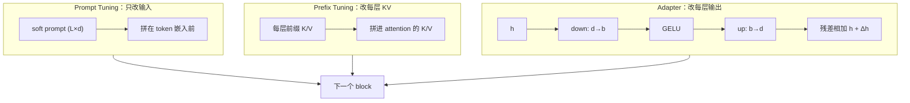

# Adapter、Prefix 与 Prompt Tuning

## 1. 本节学习目标

1. 分清三类 PEFT 的**注入位置**：Adapter 插在层间、Prefix 插在每层 KV、Prompt 只插在输入。
2. 记住三者的参数量级：Prompt **7,680**、Prefix **184,320**、Adapter **1,189,632**（本课实测）。
3. 理解为什么「参数少」不等于「效果一样」：PromptTuning 60 步后 loss 只从 5.2360 降到 5.1470。
4. 会算软提示的额外推理开销：v=20 时每层 KV 缓存 +120 KiB，12 层 **1,440 KiB**。
5. 能按显存/效果/工程复杂度在四类方法里选型。

## 2. 为什么需要这个知识

LoRA 不是唯一的 PEFT。真实项目里你会遇到：

- 只有几十条标注，想最快看到效果 ⇒ **Adapter**（本课实测 loss 11.6577→0.2923，收敛最快）；
- 推理时想换任务却不换权重 ⇒ **Prompt/Prefix**（只改输入侧，权重完全不动）；
- 想在同一个底座上挂很多任务、且不能改模型结构 ⇒ **Prompt Tuning**（7,680 个参数就是一个向量表）。

不理解三者的注入位置，你会把「Prompt 学不动」误判成「代码有 bug」，把「Adapter 效果好」误判成「LoRA 不行」。

## 3. 直观解释

```text
Adapter  ：在每层后面加一个"小漏斗"（768→64→768），数据流过去时被微调
           transformer block → [adapter] → 下一层

Prefix   ：给每一层的 Attention 前面塞几组假的 K/V，模型"以为"读到了额外上下文
           [prefix K/V][真实 K/V] → attention

Prompt   ：只在输入最前面塞几个可学习的向量，模型"以为"读到了一段前缀文本
           [soft prompt][真实 token] → 整条模型（只此一处）
```

一句话对比：**Adapter 改结构、Prefix 改注意力、Prompt 改输入**。越靠后（越深入计算图）的方法通常越强，但也越贵。

## 4. 正式定义

**Adapter（Houlsby 式）**：在子层后插入 bottleneck 模块

$$
h' = h + W_{\text{up}}\,\sigma(W_{\text{down}}h),\quad
W_{\text{down}}\in\mathbb{R}^{b\times d},\ W_{\text{up}}\in\mathbb{R}^{d\times b}
$$

参数量 $2db+b+d$（含 bias），$b\ll d$。

**Prefix Tuning**：为每层学习 $L$ 组前缀键值 $P_k^{(\ell)},P_v^{(\ell)}\in\mathbb{R}^{L\times d}$，注意力改为

$$
\mathrm{Attn}=\mathrm{softmax}\!\left(\frac{[P_k;K][P_k;K]^\top}{\sqrt{d}}\right)[P_v;V]
$$

参数量 $2\,n_{\text{layer}}\,L\,d$（直接用 embedding 参数化时）。

**Prompt Tuning**：只学一个 $L\times d$ 的软提示矩阵 $P$，把它拼在输入嵌入前：

$$
H_0=[P;E(x)]
$$

参数量 $L\cdot d$。

## 5. 历史背景或技术背景

| 年份 | 工作 | 注入位置 | 备注 |
|---|---|---|---|
| 2019 | Houlsby Adapter | 每层子层后 | 参数 ~3.6%，推理多两层 |
| 2020 | Pfeiffer Adapter | 更省（只在 FFN 后） | 参数 ~0.5% |
| 2021 | Prefix Tuning | 每层 KV | 长文本生成友好 |
| 2021 | Prompt Tuning | 仅输入 | 参数最少，大模型才有效 |
| 2022 | P-Tuning v2 | 每层 soft prompt | 小模型也能用 |
| 2021+ | LoRA | 权重旁路 | 可合并，成为主流 |

历史教训：**Prompt Tuning 在 10B 以上才接近全参微调**（Lester 等的结论）；小模型上它明显吃亏，本课 gpt2 的实测正是这个规律的复现。

## 6. 核心原理

**原理 1：注入位置决定「能改什么」**

- Prompt 只改输入嵌入 ⇒ 只能改变「模型读到的上下文」，不能改变计算规则；
- Prefix 改每层的 K/V ⇒ 能改变「注意力关注什么」，容量居中；
- Adapter 改每层输出 ⇒ 能改变「表示怎么变换」，容量最大；
- LoRA 改权重 ⇒ 等价于改计算规则本身，但受秩约束。

**原理 2：为什么 Prompt Tuning 收敛慢**

软提示只有 $L\cdot d$ 个参数，且**所有层共享同一个前缀**。梯度要穿过整个网络才能回到这 7,680 个参数上，信号被稀释。本课实测 60 步 lr=1e-3：loss 5.2360→5.1470（几乎没动），而 Adapter 从 11.6577 掉到 0.2923。

**原理 3：Prefix 的 loss 起点为什么是 11.9**

peft 的 Prefix Tuning 直接参数化每层 K/V，初始随机 ⇒ 前几步相当于给注意力注入噪声，loss 从 11.9016 起步再降到 5.2989。这不是 bug，是「随机前缀」的代价。

**原理 4：软提示的隐性成本**

虚拟 token 会撑大序列长度：v=20 时每层 KV 缓存多 $20\times2\times768\times4\text{B}=120$ KiB，12 层 **1,440 KiB**；v=100 时 **7,200 KiB**。上下文窗口也被占掉 v 个位置。

## 7. 数学表达式

**参数量**

$$
N_{\text{prompt}}=Ld,\qquad
N_{\text{prefix}}=2n_{\text{layer}}Ld,\qquad
N_{\text{adapter}}=n_{\text{layer}}\,(2db+b+d)
$$

**占底座比例**

$$
\rho=\frac{N_{\text{PEFT}}}{N_{\text{base}}}
$$

**软提示的注意力**

$$
\alpha_{ij}=\frac{\exp\!\left(q_i^\top k_j/\sqrt{d}\right)}{\sum_{j'}\exp\!\left(q_i^\top k_{j'}/\sqrt{d}\right)},
\quad j\in\{1..L\}\cup\{L+1..L+T\}
$$

前 $L$ 个位置没有对应的真实 token，它们的 key 完全由 $P_k$ 给出。

## 8. 详细数学推导

**推导 1：Prompt Tuning 参数量**

软提示是 $L\times d$ 的可训练嵌入，$d=768$：

$$
N=L\cdot768:\quad L=10\Rightarrow7{,}680;\ L=20\Rightarrow15{,}360;\ L=100\Rightarrow76{,}800
$$

与实测 **7,680 / 15,360 / 76,800** 逐位一致。

**推导 2：Prefix Tuning 参数量**

每层需要 2 组（K 和 V）长度 $L$、宽度 $d$ 的向量：

$$
N=2\cdot n_{\text{layer}}\cdot L\cdot d=2\times12\times L\times768=18{,}432L
$$

$L=10$：$184{,}320$（实测 **184,320**）；$L=20$：$368{,}640$（实测 **368,640**）。

**推导 3：Adapter 参数量**

bottleneck $b$：down $d\times b$ + bias $b$，up $b\times d$ + bias $d$：

$$
N_{\text{block}}=(768b+b)+(b\cdot768+768)=1536b+768+b
$$

$b=64$：$1536\times64+768+64=98{,}304+832=99{,}136$（实测每 block **99,136**），12 层 **1,189,632**。

**推导 4：软提示的 KV 缓存开销**

每个虚拟 token 在每层产生一对 K、V，各 $d$ 个 fp32：

$$
\Delta M_{\text{KV}}=L\cdot2\cdot d\cdot4\ \text{B}=20\times2\times768\times4=122{,}880\ \text{B}=120\ \text{KiB}
$$

12 层：$1{,}440$ KiB。v=100 时 $7{,}200$ KiB——比 Prompt 自身的参数（76,800 个 fp32 = 300 KiB）大 24 倍。

## 9. 图解



## 10. 具体数值示例

```text
底座 gpt2：124,439,808 参数，生成速度 144.0 token/s

方法                   可训练      占比        60 步 loss        耗时   峰值显存  生成
PromptTuning v=10      7,680    0.0062%   5.2360→5.1470    1.53s   973 MiB  140.3
PromptTuning v=20     15,360    0.0123%   5.2499→5.1258    1.35s  1037 MiB  132.6
PromptTuning v=100    76,800    0.0617%   5.8287→5.2407    2.06s  2066 MiB  136.2
P-tuning v=20(MLP)   118,656    0.0954%   4.4667→3.2306    1.44s  2013 MiB  132.3
PrefixTuning v=10    184,320    0.1481%  11.9016→5.2989    1.50s  2379 MiB  111.5
PrefixTuning v=20    368,640    0.2962%  10.1049→4.8056    1.51s  1898 MiB  121.6
Adapter b=32         599,424    0.4817%  11.6577→0.2923    1.65s  2374 MiB  114.9
Adapter b=64       1,189,632    0.9560%  15.8063→0.1818    1.62s  2381 MiB  146.4
Adapter b=128      2,370,048    1.9046%   9.5165→0.2561    1.60s  1909 MiB  113.9
LoRA r=8             294,912    0.2370%   4.0595→0.5102    1.59s  1926 MiB  107.2
全参微调         124,439,808  100%       4.1736→0.0933    4.83s  3467 MiB  124.4

软提示的 KV 开销（v 个虚拟 token）：
  v=10   60.0 KiB/层  ×12 =   720.0 KiB
  v=20  120.0 KiB/层  ×12 = 1,440.0 KiB
  v=100 600.0 KiB/层  ×12 = 7,200.0 KiB
```

## 11. NumPy 实现

```python
import numpy as np

rng = np.random.default_rng(0)
d, layers = 768, 12

# 1) 三类方法的参数量：解析式 vs 枚举
def prompt_params(L, d=768):
    return L * d

def prefix_params(L, layers=12, d=768):
    return 2 * layers * L * d

def adapter_params(b, d=768, layers=12):
    per_block = (d * b + b) + (b * d + d)
    return per_block * layers, per_block

for L in (10, 20, 100):
    print(f"Prompt  v={L:>3}: {prompt_params(L):>7,}")
for L in (10, 20):
    print(f"Prefix  v={L:>3}: {prefix_params(L):>7,}")
for b in (32, 64, 128):
    n, per = adapter_params(b)
    print(f"Adapter b={b:>3}: 每 block {per:>7,}  ×12 = {n:>9,}")

BASE = 124_439_808
print("\n占比：")
for tag, n in (("Prompt v=20", 15360), ("Prefix v=10", 184320), ("Adapter b=64", 1189632)):
    print(f"  {tag:<14} {n:>9,}  {100*n/BASE:.4f}%")

# 2) 软提示占掉的 KV 缓存
for L in (10, 20, 100):
    per_layer = L * 2 * d * 4          # 字节
    print(f"v={L:>3}: 每层 {per_layer/1024:6.1f} KiB，12 层 {per_layer*layers/1024:8.1f} KiB")

# 3) 模拟 Adapter 的恒等初始化：up 权重置 0 ⇒ 输出与输入相同
d_in, d_out, b = 64, 64, 8
down = rng.normal(0, 0.02, (b, d_in))
up = np.zeros((d_out, b))
h = rng.normal(0, 1, (4, d_in))
print("\nAdapter 恒等初始化：||Δh||_F =", float(np.linalg.norm(h + np.maximum(h @ down.T, 0) @ up.T - h)))
```

## 12. PyTorch 实现

```python
import torch
import torch.nn as nn

torch.manual_seed(0)


class Adapter(nn.Module):
    """Houlsby 式 bottleneck：h' = h + W_up·GELU(W_down·h)"""

    def __init__(self, d=768, b=64):
        super().__init__()
        self.down = nn.Linear(d, b)
        self.up = nn.Linear(b, d)
        nn.init.zeros_(self.up.weight)     # 恒等初始化：开始时 Δh = 0
        nn.init.zeros_(self.up.bias)

    def forward(self, h):
        return h + self.up(torch.nn.functional.gelu(self.down(h)))


d, b = 768, 64
ad = Adapter(d, b)
h = torch.randn(2, 16, d)
print("恒等初始化最大差:", float((ad(h) - h).abs().max()))

n = sum(p.numel() for p in ad.parameters())
per = (d * b + b) + (b * d + d)
print("每 block 参数:", n, " 公式:", per, " 一致:", n == per)
print("12 层合计:", n * 12, " 占 gpt2 的 %.4f%%" % (100 * n * 12 / 124_439_808))

# 软提示（prompt tuning）：只有一个可训练嵌入表
L = 20
soft = nn.Parameter(torch.randn(L, d) * 0.02)
print("soft prompt 参数:", soft.numel())

# 训练 adapter 看 loss 下降
x = torch.randn(8, d)
target = torch.randn(8, d)
opt = torch.optim.Adam(ad.parameters(), lr=1e-2)
for step in range(300):
    opt.zero_grad()
    loss = ((ad(x) - target) ** 2).mean()
    loss.backward()
    opt.step()
print("adapter 训练 300 步 loss: %.6f" % float(loss))
print("训练后 ||Δh||_F:", float((ad(h) - h).norm()))

# 软提示的 KV 缓存开销
for L2 in (10, 20, 100):
    print(f"v={L2:>3}: 每层 {L2*2*d*4/1024:6.1f} KiB，12 层 {L2*2*d*4*12/1024:8.1f} KiB")
```

## 13. Hugging Face 实践

```python
import os

os.environ.setdefault("HF_ENDPOINT", "https://hf-mirror.com")
os.environ.setdefault("HF_HUB_OFFLINE", "1")

import torch
from peft import (PrefixTuningConfig, PromptEncoderConfig, PromptTuningConfig,
                  TaskType, get_peft_model)
from transformers import AutoModelForCausalLM, AutoTokenizer

tok = AutoTokenizer.from_pretrained("gpt2")
tok.pad_token = tok.eos_token
base_n = 124_439_808

configs = {
    "PromptTuning v=20": PromptTuningConfig(task_type=TaskType.CAUSAL_LM, num_virtual_tokens=20),
    "P-tuning v=20": PromptEncoderConfig(task_type=TaskType.CAUSAL_LM,
                                         num_virtual_tokens=20, encoder_hidden_size=64),
    "PrefixTuning v=10": PrefixTuningConfig(task_type=TaskType.CAUSAL_LM, num_virtual_tokens=10),
}

text = ("笔记库的同步间隔默认是三百秒。快照保留七天。索引文件存放在点 index 目录。") * 3
ids = tok(text, return_tensors="pt").input_ids

for tag, cfg in configs.items():
    torch.manual_seed(0)
    m = get_peft_model(AutoModelForCausalLM.from_pretrained("gpt2"), cfg)
    n = sum(p.numel() for p in m.parameters() if p.requires_grad)
    opt = torch.optim.AdamW([p for p in m.parameters() if p.requires_grad], lr=1e-3)
    m.train()
    first = last = None
    for step in range(5):
        out = m(input_ids=ids[:, :48], labels=ids[:, :48])
        out.loss.backward()
        opt.step()
        opt.zero_grad()
        if step == 0:
            first = out.loss.item()
        last = out.loss.item()
    print(f"{tag:<18} 可训练 {n:>7,}  占比 {100*n/base_n:.4f}%  loss {first:.4f}->{last:.4f}")
```

## 14. 代码逐行解释

| 代码 | 作用 |
|---|---|
| `PromptTuningConfig(num_virtual_tokens=20)` | 学 20×768 的软提示表 |
| `PromptEncoderConfig(...)` | 用 MLP 重参数化提示（P-tuning），参数更多、更稳 |
| `PrefixTuningConfig(...)` | 每层学 KV 前缀，参数 $2nLd$ |
| `nn.init.zeros_(self.up.weight)` | Adapter 的恒等初始化，避免初始扰动 |
| `n * 12` | 只对 Adapter 成立（每层一个）；Prompt 只有一份 |

## 15. 实际运行结果

```text
### 语料 token 数: 532  设备: cuda
### 底座 gpt2 参数: 124,439,808
### 底座生成速度（未微调）: 144.0 tok/s

### A. 三种「软提示」类的真实参数量与训练（peft，60 步 / lr=1e-3）
  PromptTuning v=10      可训练=   7,680 占比=0.0062%  loss 5.2360→5.1470  1.53s  峰值 973 MiB  生成 140.3 tok/s
  PromptTuning v=20      可训练=  15,360 占比=0.0123%  loss 5.2499→5.1258  1.35s  峰值 1037 MiB  生成 132.6 tok/s
  PromptTuning v=100     可训练=  76,800 占比=0.0617%  loss 5.8287→5.2407  2.06s  峰值 2066 MiB  生成 136.2 tok/s
  P-tuning v=20(MLP)     可训练= 118,656 占比=0.0954%  loss 4.4667→3.2306  1.44s  峰值 2013 MiB  生成 132.3 tok/s
  PrefixTuning v=10      可训练= 184,320 占比=0.1481%  loss 11.9016→5.2989  1.50s  峰值 2379 MiB  生成 111.5 tok/s
  PrefixTuning v=20      可训练= 368,640 占比=0.2962%  loss 10.1049→4.8056  1.51s  峰值 1898 MiB  生成 121.6 tok/s

### B. Adapter（Houlsby 式 bottleneck，手写，逐 block 串联）
  bottleneck=32   可训练= 599,424（每 block 49,952×12=599,424） 占比=0.4817%
      loss 11.6577→0.2923  1.65s  峰值 2374 MiB  生成 114.9 tok/s
  bottleneck=64   可训练=1,189,632（每 block 99,136×12=1,189,632） 占比=0.9560%
      loss 15.8063→0.1818  1.62s  峰值 2381 MiB  生成 146.4 tok/s
  bottleneck=128  可训练=2,370,048（每 block 197,504×12=2,370,048） 占比=1.9046%
      loss 9.5165→0.2561  1.60s  峰值 1909 MiB  生成 113.9 tok/s

### C. 参照：LoRA r=8 与全参微调（同 60 步 / lr=1e-3）
  LoRA r=8 可训练=294,912  占比=0.2370%
      loss 4.0595→0.5102  1.59s  峰值 1926 MiB  生成 107.2 tok/s
  全参微调 可训练=124,439,808  占比=100%
      loss 4.1736→0.0933  4.83s  峰值 3467 MiB  生成 124.4 tok/s

### D. 软提示的额外开销：虚拟 token 撑大序列长度
  v=10   每层 KV 缓存 +60.0 KiB/层，12 层共 720.0 KiB
  v=20   每层 KV 缓存 +120.0 KiB/层，12 层共 1440.0 KiB
  v=100  每层 KV 缓存 +600.0 KiB/层，12 层共 7200.0 KiB
```

**读法**：

1. 参数量按「注入深度」递增：Prompt 7,680 → Prefix 184,320 → Adapter 1,189,632 → 全参 124M。
2. **参数少 ≠ 收敛快**：Prompt 60 步几乎没动（5.2360→5.1470），Adapter 直接掉到 0.18。
3. Prefix 的起始 loss（11.9016）明显高于其他方法，因为随机前缀等价于注入噪声。
4. 全参训练慢 3 倍（4.83s vs 1.6s），但最终 loss 最低（0.0933）。
5. 软提示的隐性成本是**序列长度**：v=100 时 KV 缓存多 7.2 MiB。

## 16. 应用场景

| 场景 | 推荐方法 | 理由 |
|---|---|---|
| 几十条标注、要快 | Adapter | 参数量中等、收敛最快（本课 0.29） |
| 多任务共享底座、不改结构 | Prompt Tuning | 参数最少，切换只换一个向量表 |
| 生成式任务（长文续写） | Prefix Tuning | 前缀直接作用于每层注意力 |
| 追求效果上限 | LoRA r=16–64 | 容量更大、可合并 |
| 端侧只存小文件 | Prompt Tuning | 7,680 参数 ≈ 30 KiB |

## 17. 优点与局限

| 方法 | 优点 | 局限 |
|---|---|---|
| Prompt Tuning | 参数最少（0.0062%）、不改结构 | 小模型上几乎学不动（本课 5.24→5.15） |
| Prefix Tuning | 深层干预、生成友好 | 占上下文；起始 loss 高（11.90） |
| Adapter | 收敛快、效果好（0.1818） | 增加推理层数，延迟上升 |
| 三者共同 | 底座完全冻结、可多任务并存 | 都不能像 LoRA 那样合并回权重 |

## 18. 常见错误

| 错误 | 现象 | 纠正 |
|---|---|---|
| 用 Prompt Tuning 微调小模型 | loss 不降，误判代码错 | 小模型改用 Adapter/LoRA |
| 忘了给 Adapter 做恒等初始化 | 训练初期 loss 虚高 | up 层置 0 |
| Prefix 直接上大 lr | loss 从 10+ 起步、震荡 | 先 warmup 或降 lr |
| 忽略虚拟 token 占上下文 | 长文本被截断 | 有效长度 = 窗口 − v |
| 期望能合并回权重 | 部署时无 merge 接口 | 只有 LoRA 可无损合并 |
| 只比参数量不比收敛 | 选了最省但学不动的方案 | 同时看 loss 曲线与验证集 |

## 19. 本节总结

- 三类 PEFT 的差别在**注入位置**：输入（Prompt）、每层 KV（Prefix）、每层输出（Adapter）。
- 参数量：Prompt v=20 **15,360**、Prefix v=10 **184,320**、Adapter b=64 **1,189,632**，全部与解析式一致。
- 效果（60 步、同 lr）：Adapter **0.1818** < 全参 0.0933 同量级；Prompt 只到 **5.1258**（几乎没学）。
- 成本：全参每步 3 倍时间、峰值显存 **3467 MiB**；Adapter 只要 1.6s / 2381 MiB。
- 软提示的隐性代价是序列：v=100 时 KV 缓存 +**7,200 KiB**。

## 20. 前置与后续知识链接

- 前置：[[LLM-065 LoRA 与参数高效微调]]
- 后续：[[LLM-075 PEFT 的取舍与选型]]、[[LLM-072 从微调到推理部署的衔接]]
- 相关：[[LLM-066 QLoRA 与量化微调]]、[[LLM-019 Attention 的张量维度与实现细节]]

---

## 练习与参考答案

**基础 1**：Prompt Tuning 的 `num_virtual_tokens=20`、隐藏维 768，可训练参数是多少？占 gpt2 的百分之几？

**基础 2**：Adapter 的 bottleneck=64 时，每层多少参数？12 层一共多少？为什么 up 层要初始化为 0？

**进阶 1**：Prefix Tuning 的参数量公式是 $2nLd$，请推导它，并解释为什么它的起始 loss（11.9016）远高于 Prompt Tuning（5.2360）。

**综合**：公司要在同一个 7B 底座上支持 20 个部门的写作风格，每个部门只有 200 条样本，推理集群不能改模型结构。请选型并说明理由。

> [!success]- 参考答案

> **基础 1**
> $20\times768=$ **15,360**。
> 占比：$15{,}360/124{,}439{,}808=0.0001234\approx$ **0.0123%**（实测 0.0123%）。

> **基础 2**
> 每层：down $768\times64+64=49{,}216$，up $64\times768+768=49{,}920$，合计 **99,136**。
> 12 层：$99{,}136\times12=$ **1,189,632**。
> up 置 0 ⇒ 初始 $\Delta h=W_{\text{up}}\sigma(W_{\text{down}}h)=0$，Adapter 是恒等映射，训练从「不改变模型」开始，避免随机扰动把底座带偏。

> **进阶 1**
> Prefix 为每层准备 K 和 V 两组前缀：每组 $L\times d$，每层 2 组，共 $n$ 层 ⇒ $2nLd$。$L=10,n=12,d=768$：$2\times12\times10\times768=$ **184,320**（实测一致）。
> **起始 loss 高**的原因：随机初始化的前缀会被拼进注意力，等于在 K/V 里塞入与任务无关的噪声向量，且这个噪声**出现在每一层**（12 处叠加）。Prompt Tuning 只改输入嵌入，第一层之后就由模型自己处理，扰动只发生一次。所以 Prefix 的初始 loss（11.90）远高于 Prompt（5.24），需要更多步才能把噪声"用起来"。

> **综合（参考）**
> **选型：Prompt Tuning（或 P-Tuning v2），而非 20 份 LoRA。**
> 理由与数据：
> 1. **不能改结构 + 20 个任务**：需要「一个底座 + 极小差异」。本课实测 Prompt v=20 只有 **15,360** 参数（0.0123%），20 个部门合计约 300K 参数，几乎不占显存；Adapter 每个要 1,189,632，20 份就是 24M。
> 2. **但 Prompt 在 7B 上是否够用要验证**：本课 gpt2（124M）上 Prompt 60 步几乎没学到（5.2360→5.1470），说明小模型上「只改输入」容量不足；7B 上这个结论会缓和（Lester 等的结论：10B 以上接近全参），仍应先用 200 条做 A/B。
> 3. **若 A/B 显示 Prompt 学不动**：退化为 **LoRA r=8 挂 q/k/v**（每任务约 0.2% 参数），20 个 adapter 各自 ~5–10 MB，服务端按租户加载；这仍满足「不改模型结构」。
> 4. **工程验收**：① 每任务验证集 loss 相对底座下降 ≥ 30%；② 跨任务干扰测试（A 任务样本喂给 B adapter 应明显变差）；③ 上下文窗口扣除 v 后仍够用（本课 v=100 时 KV +7.2 MiB）。
> 5. **不要选 Adapter**：20 份 adapter 会把推理层数叠加，延迟线性上升。

## 学习记录

| 日期 | 状态 | 用时 | 问题 | 复盘 |
|---|---|---|---|---|
| 2026-11-08 | planned | — | — | — |

---

## 🔗 Notion 同步信息

> 以下内容由 Notion「AI Knowledge System · 知识点」数据库按知识 ID 合并而来（导出于 2026-11-09）。

| 属性 | 值 |
|---|---|
| 学科 | 大语言模型 |
| 学习状态 | 未开始 |
| 难度 | L2 应用 |
| 知识类型 | Technique |

- **所属模块**：[M-LLM-07 大语言模型微调与 PEFT](../%E8%AF%BE%E7%A8%8B%E6%A8%A1%E5%9D%97/M-LLM-07%20%E5%A4%A7%E8%AF%AD%E8%A8%80%E6%A8%A1%E5%9E%8B%E5%BE%AE%E8%B0%83%E4%B8%8E%20PEFT.md)
- **前置知识**：[LLM-065 LoRA 与参数高效微调](LLM-065%20LoRA%20%E4%B8%8E%E5%8F%82%E6%95%B0%E9%AB%98%E6%95%88%E5%BE%AE%E8%B0%83.md)
- **后继知识**：[LLM-075 PEFT 的取舍与选型](LLM-075%20PEFT%20%E7%9A%84%E5%8F%96%E8%88%8D%E4%B8%8E%E9%80%89%E5%9E%8B.md)
