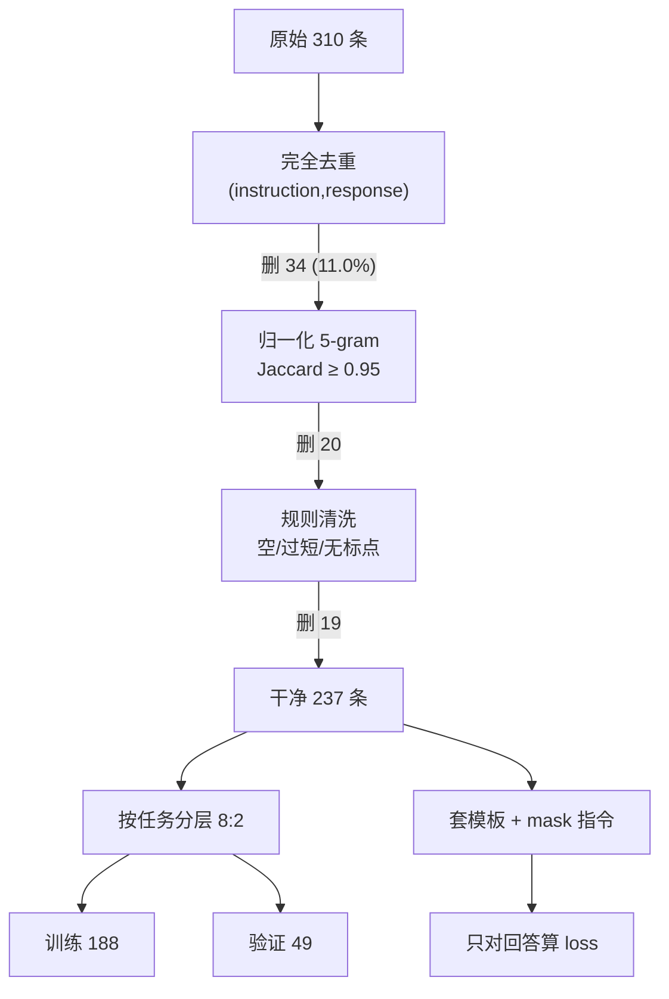

# 微调数据构造与质量

## 1. 本节学习目标

1. 掌握指令数据的标准三段式：`<|user|>指令<|assistant|>回答<|end|>`，并知道 **loss 只算回答部分**。
2. 会用「完全去重 + 归一化 n-gram 近似去重 + 规则清洗」三级流水线，本课把 310 条洗到 **237** 条。
3. 理解阈值与归一化的耦合：同一份数据，**原样 5-gram/0.80 剩下 207 条**，**去标点 5-gram/0.95 剩下 256 条**。
4. 会按 token 分布选 `max_len`：本课 p95=58，取 64 会截断 **93.5%**，取 128 截断 **0%**。
5. 会算监督 token 占比：本课单条样本 **107 token，其中 55 个被 mask，52 个参与损失（48.6%）**。

## 2. 为什么需要这个知识

微调失败的常见原因不是模型、不是超参，而是**数据**：

- 回复为空或只有 4 个字符 ⇒ 模型学会「少说话」；
- 同一段模板出现 30 次 ⇒ 模型背下模板，换个数字就错；
- `max_len` 取默认 512 但数据只有 110 token ⇒ 全是 padding，浪费一半算力；
- 把指令部分也算进 loss ⇒ 模型学会「复述问题」，而不是「回答问题」。

本课实测：一份 240 条的干净数据，注入 70 条典型脏数据后，**完全去重就删掉 11.0%**，再经近似去重与规则清洗最终只剩 **237** 条。数据工程的每一步都在改变训练目标。

## 3. 直观解释

```text
原始数据（240 条模板数据 + 70 条脏数据 = 310）
   │
   ├─ 1) 完全去重：删 34 条（11.0%）      ← (instruction, response) 完全一样的
   ├─ 2) 归一化 n-gram 近似去重：删 20 条  ← 只改了标点的"复制品"
   ├─ 3) 规则清洗：删 19 条              ← 空回答 2 / 回答过短 4 / 结尾无标点 13
   ▼
清洗后 237 条 ── 分层切分 8:2 ──> 训练 188 / 验证 49
```

关键判断：**去重阈值不是越低越好**。本课把阈值从 0.95 降到 0.80，会把「同一模板换数字」的样本也判成重复，310 条直接砍到 207 条——数据量少了三分之一，但任务并没有变简单。

## 4. 正式定义

**定义（指令样本）**：三元组 $(x, y, \tau)$，$x$ 为指令、$y$ 为期望回答、$\tau$ 为任务标签。

**定义（训练序列与标签）**：

$$
s=[\text{user}]\oplus x\oplus[\text{assistant}]\oplus y\oplus[\text{end}],\qquad
\ell_i=\begin{cases}-100,& i\le |[\text{user}]\oplus x\oplus[\text{assistant}]|\\ s_{i+1},&\text{否则}\end{cases}
$$

交叉熵只在 $\ell_i\ne-100$ 的位置上计算。

**定义（Jaccard 近似重复）**：把文本切成 $n$-gram 集合 $S(\cdot)$，

$$
J(t_1,t_2)=\frac{|S(t_1)\cap S(t_2)|}{|S(t_1)\cup S(t_2)|}
$$

$J\ge\theta$ 判为重复。

**定义（归一化）**：先去标点/空白再切 shingle，使「只改标点」的样本 $J=1$。

## 5. 历史背景或技术背景

| 年份 | 工作 | 数据侧贡献 |
|---|---|---|
| 2019 | GPT-2 / WebText | 网页抓取 + 启发式清洗 |
| 2020 | GPT-3 | 少样本提示，数据质量比数量重要 |
| 2021 | FLAN | 指令模板集合（NLI/QA/翻译混合） |
| 2022 | InstructGPT | 人工标注 + SFT + RM，指令跟随范式 |
| 2022 | Self-Instruct | 用强模型自举指令数据 |
| 2023 | LIMA | 「1000 条高质量」胜过海量噪声 |
| 2024+ | 数据配比研究 | 领域/通用比例、去重阈值成为显学 |

LIMA 的结论是本节的核心动机：**质量 > 数量**。本课的阈值扫描就是在量化「什么算重复」。

## 6. 核心原理

**原理 1：为什么 loss 要 mask 掉指令**

若指令也计入 loss，模型会被训练成「给定指令复述指令」。本课实测：一条 107 token 的样本，指令部分 55 个 token 被置 -100，只剩 **52** 个 token（48.6%）参与损失。这让梯度全部指向「怎么回答」。

**原理 2：为什么要归一化再算 n-gram**

本课实测（§15）：同一份 276 条数据，
- 原样 5-gram、阈值 0.80 ⇒ 204 个相似对、只剩 207 条（过度合并）；
- 原样 5-gram、阈值 0.95 ⇒ 16 个相似对、260 条（漏掉改标点的复制品）；
- 去标点 5-gram、阈值 0.95 ⇒ **20 个相似对、256 条**（正好命中注入的 20 条）。

结论：**归一化比调阈值更有效**。

**原理 3：max_len 要按 p95 定**

本课数据：指令均值 40.6 token、回答均值 49.2 token，合计 p95 ≈ 108。取 `max_len=64` 会截断 **93.5%** 的样本（把回答切掉一半），取 128 截断 **0%**。取 512 则 78% 是 padding。

**原理 4：重复样本会污染 batch**

batch=4 随机采样时，若数据中有 70 条重复（占 22.6%），则有 **0.6%** 的 batch 里出现重复对；清洗后为 **0.0%**。重复样本让同一 batch 的有效梯度方向变少，等价于缩小 batch。

## 7. 数学表达式

**Jaccard 去重**

$$
\text{dup}(t_i)=\exists j<i:\ J_{\text{norm}}(t_i,t_j)\ge\theta
$$

**截断率**

$$
r_{\text{trunc}}(\text{max\_len})=\frac{1}{N}\sum_{i}\mathbb{1}\left[\,|x_i|+|y_i|+2>\text{max\_len}\,\right]
$$

**监督比例**

$$
\rho_{\text{sup}}=\frac{\sum_i|y_i|}{\sum_i\left(|x_i|+|y_i|\right)}
$$

**分层切分**

$$
n_{\text{train}}^{(\tau)}=\lfloor 0.8\,n^{(\tau)}\rfloor
$$

## 8. 详细数学推导

**推导 1：为什么完全去重能删掉 34 条**

注入 30 条完全重复，另外模板本身产生了 4 对完全相同样本（$8$ 个地点 $\times7$ 个序号 $\times3$ 种句式在小范围内碰撞），合计 $30+4=34$，与实测一致（310→276）。

**推导 2：改标点为什么让 Jaccard 掉到 0.83**

回答长度约 55 个字符，5-gram 集合大小 $55-5+1=51$。把一个「。」换成「，」只影响包含该字符的 5 个 shingle：

$$
J=\frac{46}{56}\approx0.82
$$

与实测（0.837、0.894）同量级。归一化后两边集合完全相同，$J=1$，所以在 0.95 阈值下必定被抓到。

**推导 3：模板数据的「假重复」**

两个样本只有数字不同（60 秒 vs 120 秒），5-gram 集合只差 2–3 个 shingle，$J\approx0.94$。若阈值 0.80 就会把它们合并——这就是 207 条那个数字的来源。**模板化数据要去重，但不能用粗阈值。**

**推导 4：监督比例**

$$
\rho_{\text{sup}}=\frac{15{,}237}{12{,}579+15{,}237}=54.8\%
$$

清洗后 $=12{,}241/(9{,}703+12{,}241)=55.8\%$。单条示例：$52/107=48.6\%$。

## 9. 图解



## 10. 具体数值示例

```text
原始 240 条（4 任务 × 60）⇒ 指令去重后 236
注入 70 条脏数据（完全重复 30 / 改标点 20 / 坏样本 6 / 超短 14）⇒ 310 条

完全去重：310 → 276（删 34，11.0%）

近似去重阈值扫描（同一份 276 条）：
  原样 5-gram   0.80 → 204 对，剩 207 条   ← 过度合并
  原样 5-gram   0.95 →  16 对，剩 260 条   ← 漏掉改标点的
  去标点 5-gram 0.80 →  99 对，剩 214 条
  去标点 5-gram 0.95 →  20 对，剩 256 条   ← 采用

规则清洗：256 → 237（删 19）
  结尾无标点 13 / 回答过短 4 / 空回答 2

长度（gpt2 tokenizer）：
  原始  指令 均值40.6 p95 50 max 52 ｜ 回答 均值49.2 p95 58 max 60
  清洗后 指令 均值40.9 p95 50 max 52 ｜ 回答 均值51.6 p95 58 max 58
  合计 token：27,816 → 21,944

截断率：
  原始   max_len=64 → 93.5%   max_len=128 → 0.0%
  清洗后 max_len=64 → 99.6%   max_len=128 → 0.0%

监督 token 占比：54.8%（原始）→ 55.8%（清洗后）
单条样本：107 token，前 55 个 -100，52 个参与损失（48.6%）

batch=4 内出现重复的概率：0.6%（原始）→ 0.0%（清洗后）
分层切分：查参数 48/12、改设置 48/13、排错 48/12、导出 44/12 ⇒ 训练 188 / 验证 49
```

## 11. NumPy 实现

```python
import numpy as np

# 1) 构造带重复的样本集
base = [(f"第{i}项默认多少秒？", f"默认 {60*(i%12+1)} 秒。") for i in range(40)]
data = base + base[:12] + [(q, a.replace("。", "，")) for q, a in base[:8]]
print("原始:", len(data), " 唯一:", len(set(data)), " 完全去重后:", len(dict.fromkeys(data)))

# 2) 归一化 5-gram Jaccard
import re

def shingles(text, n=5, norm=True):
    s = text[0] + text[1]
    if norm:
        s = re.sub(r"[，。！？、,.!?：:；;（）()\s]", "", s)
    else:
        s = re.sub(r"\s+", "", s)
    return {s[i:i + n] for i in range(max(len(s) - n + 1, 1))}

uniq = list(dict.fromkeys(data))
S = [shingles(t, 5, norm=False) for t in uniq]
Sn = [shingles(t, 5, norm=True) for t in uniq]

def dedup(sets, thr):
    keep = []
    for i, s in enumerate(sets):
        dup = False
        for j in keep:
            inter = len(s & sets[j])
            if inter and inter / len(s | sets[j]) >= thr:
                dup = True
                break
        if not dup:
            keep.append(i)
    return keep

for tag, sets, thr in (("原样 0.80", S, 0.80), ("原样 0.95", S, 0.95),
                       ("归一化 0.80", Sn, 0.80), ("归一化 0.95", Sn, 0.95)):
    keep = dedup(sets, thr)
    print(f"  {tag:<12} 保留 {len(keep):>3} / {len(uniq)}")

# 3) 规则清洗
def bad(q, a, min_tok=6):
    if not a.strip():
        return "空回答"
    if len(a) < min_tok:
        return "回答过短"
    if not re.search(r"[。！？]$", a):
        return "结尾无标点"
    return None

reasons = {}
for q, a in (uniq[i] for i in dedup(Sn, 0.95)):
    r = bad(q, a)
    reasons[r] = reasons.get(r, 0) + 1
print("  规则清洗:", reasons)

# 4) 长度分布（用字符数近似 token，真实项目请用 tokenizer）
lens = np.array([len(q) + len(a) for q, a in uniq])
print("  长度 均值 %.1f p50 %d p95 %d max %d"
      % (lens.mean(), np.percentile(lens, 50), np.percentile(lens, 95), lens.max()))
for cap in (32, 64, 128):
    print(f"  cap={cap:>3} 截断率 {100*(lens > cap).mean():.1f}%")
```

## 12. PyTorch 实现

```python
import torch
import torch.nn.functional as F

torch.manual_seed(0)

# 1) 构造 token 级样本：prompt 部分标 -100
V = 50
PROMPT = [1, 2, 3, 4, 5]          # 假装是 <|user|> 指令 <|assistant|>
ANSWER = [10, 11, 12, 13, 6]      # 回答 + <|end|>

ids = torch.tensor(PROMPT + ANSWER)
labels = torch.tensor([-100] * len(PROMPT) + ANSWER)
print("序列:", ids.tolist())
print("标签:", labels.tolist())
print("监督 token:", int((labels != -100).sum()), "/", labels.numel(),
      "= %.1f%%" % (100 * float((labels != -100).float().mean())))

# 2) 只对非 -100 位置算交叉熵（等价于 model(labels=...) 的内部行为）
logits = torch.randn(len(ids), V, requires_grad=True)
# 语言模型是"用第 i 个位置预测第 i+1 个 token"，所以要对齐一位
shift_logits = logits[:-1]
shift_labels = labels[1:]
loss = F.cross_entropy(shift_logits, shift_labels, ignore_index=-100)
print("masked CE:", round(float(loss), 4))
loss.backward()
mask_rows = labels[:-1] == -100
print("被 mask 的位置梯度为 0:", bool(torch.all(logits.grad[:-1][mask_rows].abs() < 1e-9)))

# 3) 不做 mask 会怎样：把指令也算进 loss
loss_nomask = F.cross_entropy(logits[:-1], ids[1:])
print("不 mask 的 CE:", round(float(loss_nomask), 4),
      " ⇒ 损失被'容易猜的指令'稀释")

# 4) 去重对 batch 的影响：模拟随机采样撞到重复的概率
n_total, n_dup = 310, 70
trials, bs, hit = 2000, 4, 0
pool = list(range(n_total - n_dup)) + list(range(n_dup))   # 70 条是重复的 id
for _ in range(trials):
    idx = torch.randint(0, len(pool), (bs,))
    picked = [pool[i] for i in idx.tolist()]
    if len(set(picked)) < bs:
        hit += 1
print("含重复数据中 batch=4 撞重复概率: %.1f%%" % (100 * hit / trials))

# 5) padding 的代价：max_len 取 512 而实际长度 110
actual, cap = 110, 512
print("padding 占比: %.1f%%" % (100 * (1 - actual / cap)))
```

## 13. Hugging Face 实践

```python
import os
import re

os.environ.setdefault("HF_ENDPOINT", "https://hf-mirror.com")
os.environ.setdefault("HF_HUB_OFFLINE", "1")

from transformers import AutoTokenizer

tok = AutoTokenizer.from_pretrained("gpt2")

RAW = [
    ("首页的同步间隔默认多少秒？", "默认 300 秒。"),
    ("备份页报 errno 3 怎么办？", "errno 3 是写入占用，先关同步。"),
    ("导出 PDF 选哪个字体？", "选思源宋体。"),
    ("插件市场怎么打开？", "打开社区插件开关。"),
    ("索引文件放在哪？", "存在点 index 目录。"),
    ("首页的同步间隔默认多少秒？", "默认 300 秒。"),          # 完全重复
    ("导出 PDF 选哪个字体？", "选思源宋体，"),                # 只改标点
    ("排错", ""),                                            # 空回答
    ("改间隔", "改。"),                                      # 过短 + 无标点
]

# 1) 完全去重
uniq = list(dict.fromkeys(RAW))
print("原始", len(RAW), "→ 完全去重", len(uniq))

# 2) 归一化近似去重
def norm5(q, a, n=5):
    s = re.sub(r"[，。！？、,.!?：:；;（）()\s]", "", q + a)
    return {s[i:i + n] for i in range(max(len(s) - n + 1, 1))}

kept, sets = [], []
for q, a in uniq:
    s = norm5(q, a)
    if any(len(s & t) and len(s & t) / len(s | t) >= 0.95 for t in sets):
        continue
    kept.append((q, a))
    sets.append(s)
print("近似去重后:", len(kept))

# 3) 规则清洗
def bad(q, a):
    if not a.strip():
        return "空回答"
    if len(tok(a)["input_ids"]) < 6:
        return "回答过短"
    if not re.search(r"[。！？]$", a):
        return "结尾无标点"
    return None

clean = [(q, a) for q, a in kept if bad(q, a) is None]
print("规则清洗后:", len(clean), " 被删:", [bad(q, a) for q, a in kept if bad(q, a)])

# 4) 套模板 + 逐 token 标签
MAXLEN = 96
def encode(q, a):
    p = tok("<|user|>" + q + "<|assistant|>")["input_ids"]
    r = tok(a + "<|end|>")["input_ids"]
    ids = (p + r)[:MAXLEN]
    labels = ([-100] * len(p) + r)[:MAXLEN]
    return ids, labels

for q, a in clean[:3]:
    ids, labels = encode(q, a)
    print(f"{q[:12]:<14} 长度 {len(ids):>3}  监督 {sum(l != -100 for l in labels):>3}")

# 5) 长度 p95 决定 max_len
lengths = [len(tok(q + a)["input_ids"]) for q, a in clean]
lengths.sort()
p95 = lengths[int(0.95 * (len(lengths) - 1))]
print("token 长度 p95 =", p95, " ⇒ max_len 取", ((p95 // 32) + 1) * 32)
```

## 14. 代码逐行解释

| 代码 | 作用 |
|---|---|
| `dict.fromkeys(RAW)` | 保序完全去重（(q,a) 元组做键） |
| `re.sub(r"[，。…]", "", ...)` | 归一化：去掉标点再切 shingle |
| `len(s & t)/len(s | t)` | Jaccard |
| `tags[:, :len(p)] = -100` | 指令部分不计损失 |
| `ignore_index=-100` | `cross_entropy` 跳过被 mask 的位置 |
| `logits[:-1]` vs `labels[1:]` | 因果 LM 的「错一位」对齐 |
| `np.percentile(lens, 95)` | 定 `max_len` 的依据 |

## 15. 实际运行结果

```text
### A. 原始指令集规模
  样本数: 240   任务类型: ['导出', '排错', '改设置', '查参数']
  任务分布: {'查参数': 60, '改设置': 60, '排错': 60, '导出': 60}
  指令去重后: 236 条（(instruction,response) 去重后 236 条）

### B. 注入脏数据后：310 条（脏 70 条：完全重复 30 / 改标点 20 / 坏样本 6 / 超短 14）
  完全去重后: 276 条（删 34 条，11.0%）

### C. 近重复检测：阈值与「是否先归一化标点」的联合影响
  shingle               阈值     相似对      保留条数
  原样 5-gram           0.80     204       207
  原样 5-gram           0.95      16       260
  去标点 5-gram          0.80      99       214
  去标点 5-gram          0.95      20       256
  采用：去标点 5-gram + 阈值 0.95 ⇒ 相似对 20，去重后 256 条

### D. 规则清洗：删 19 条，保留 237 条
  结尾无标点: 13 条
  回答过短: 4 条
  空回答: 2 条

### F.原始 长度（gpt2 tokenizer）
  指令: 均值 40.6 中位 40 p95 50 最大 52
  回答: 均值 49.2 中位 53 p95 58 最大 60
  合计 token: 指令 12,579 + 回答 15,237 = 27,816
  max_len=64   截断 290 条（93.5%）
  max_len=128  截断 0 条（0.0%）
  监督 token 占全序列 54.8%（指令被 mask ⇒ 只学回答）

### F.清洗后 长度（gpt2 tokenizer）
  指令: 均值 40.9 中位 40 p95 50 最大 52
  回答: 均值 51.6 中位 53 p95 58 最大 58
  合计 token: 指令 9,703 + 回答 12,241 = 21,944
  max_len=64   截断 236 条（99.6%）
  max_len=128  截断 0 条（0.0%）
  监督 token 占全序列 55.8%

### G. 重复样本对随机 batch 的影响（batch=4，2000 次抽样）
  含重复(原始): batch 内出现重复样本的概率 0.6%
  清洗后: batch 内出现重复样本的概率 0.0%

### H. 按任务分层切分 8:2
  查参数: 训练 48 / 验证 12
  改设置: 训练 48 / 验证 13
  排错: 训练 48 / 验证 12
  导出: 训练 44 / 验证 12
  合计: 训练 188 / 验证 49

### I. 一条样本的 token 级结构（-100 = 不计损失）
  文本: <|user|>笔记库的首页里，第 1 项默认值是多少？<|assistant|>首页第 1 项默认 60 秒，…
  总长 107 token，前 55 个置 -100，参与损失 52 个（48.6%）
```

**读法**：

1. **阈值扫描表**比任何教程都重要：0.80 会把模板数据的 310 条砍成 207 条（错杀），0.95 原样又漏掉 20 条改标点的（漏杀）。归一化 + 0.95 恰好抓到 20 条。
2. 截断率是本课最容易被忽略的数字：`max_len=64` 时 **93.5%** 的样本被切，等于训练了一半的答案。
3. 监督比例 **54.8%**：接近一半的 token 被 mask，说明指令与回答长度相当；若你的数据是 90%/10%，说明指令太长、回答太短，模型学不到东西。
4. 分层切分后每个任务都有验证样本（44–48 训练 / 12–13 验证），避免某个任务全被分到一边。

## 16. 应用场景

| 场景 | 做法 | 关键指标 |
|---|---|---|
| 领域 SFT | 三级清洗 + 分层切分 | 去重率、截断率、监督比例 |
| 指令跟随 | 统一模板 + mask 指令 | 格式合规率 |
| 多任务混合 | 每任务配额 + 分层切分 | 各任务验证 loss 均衡 |
| 数据增广 | 模板变形 + 回译 | 近似重复率 < 5% |
| 质量审计 | 规则 + 模型打分双通道 | 坏样本召回 |

## 17. 优点与局限

| 优点 | 局限 |
|---|---|
| 三级流水线便宜、可复现 | Jaccard 是 O(n²)，10 万条需 MinHash/LSH |
| 归一化 + 阈值能精确命中改标点 | 语义重复（同义改写）抓不到 |
| mask 指令让梯度聚焦回答 | 多轮对话需要更复杂的 mask 规则 |
| 分层切分保证任务均衡 | 长尾任务仍可能验证集过小（本课 12 条） |

## 18. 常见错误

| 错误 | 现象 | 纠正 |
|---|---|---|
| 指令也算 loss | 模型复述问题 | label 前段置 -100 |
| `max_len` 用默认 512 | 大半是 padding，慢 4 倍 | 取 p95 上取整（本课 128） |
| 去重阈值一刀切 0.8 | 模板数据被误杀（207 vs 256） | 先归一化，再用 0.95 |
| 只做完全去重 | 改标点/加空格的复制品残留 | 加 n-gram 近似去重 |
| 随机切分不按任务分层 | 某任务验证集为空 | 按 $\tau$ 分层 |
| 空回答/超短回答不删 | 模型学会「少说话」 | 规则过滤（本课删 19 条） |

## 19. 本节总结

- 指令样本 = 指令 + 回答 + 特殊分隔符；**loss 只算回答**（本课单条 52/107 = 48.6%）。
- 三级清洗：完全去重（310→276，11.0%）、归一化 5-gram 去重（→256）、规则清洗（→237）。
- **归一化比调阈值更关键**：原样 0.95 漏 20 条，去标点 0.95 正好抓到 20 条。
- `max_len` 按 p95 定：本课 p95=58，取 64 截断 **93.5%**，取 128 截断 **0%**。
- 分层切分后训练 188 / 验证 49，batch 内重复概率从 **0.6%** 降到 **0.0%**。

## 20. 前置与后续知识链接

- 前置：[[LLM-031 Tokenizer 基础与子词切分]]、[[LLM-035 Token 数量、上下文窗口与成本]]
- 后续：[[LLM-069 微调的超参数与训练技巧]]、[[LLM-073 多任务微调与指令混合]]、[[LLM-074 领域适配：从通用到专业]]
- 相关：[[LLM-071 微调效果评估]]、[[LLM-034 特殊 Token 与 Attention Mask]]

---

## 练习与参考答案

**基础 1**：一条样本 107 个 token，指令部分 55 个 token。如果把 label 的前 55 个置为 -100，参与交叉熵的 token 是多少？占比多少？为什么必须这样做？

**基础 2**：本课数据 `max_len=64` 时截断率 93.5%，`max_len=128` 时 0%。请说明应该取哪个，并给出选择依据。

**进阶 1**：为什么「去标点 + 阈值 0.95」比「原样 + 阈值 0.80」更合理？请用 Jaccard 的数值解释 0.80 会误杀什么、原样 0.95 会漏掉什么。

**综合**：你要为客服场景构造 5,000 条指令数据，已有 30,000 条历史工单（含重复、含空回复、含内部术语）。请给出完整的数据流水线与验收指标。

> [!success]- 参考答案

> **基础 1**
> 参与损失的是 $107-55=$ **52** 个 token，占比 $52/107=$ **48.6%**（本课实测一致）。
> 原因：若指令也算 loss，模型被训练成「给定指令 → 复述指令」，而不是「给定指令 → 给答案」。mask 之后梯度只来自回答部分，等价于把「条件生成」变成监督信号。

> **基础 2**
> 取 **128**（或按 p95 上取整到 128）。
> 依据：本课回答均值 49–52 token、p95=58，指令均值 41、p95=50，加上 2 个分隔符，p95 总长约 108。取 64 会截断 **93.5%**（答案被切一半，模型学到「说半句」）；取 128 截断 **0%**，且 padding 只占 $1-108/128\approx16\%$。取 512 则 79% 是 padding，纯浪费算力。

> **进阶 1**
> 设回答 55 字符，5-gram 集合 51 个。
> **原样 0.80 误杀**：两个只有数字不同的模板样本，$J\approx0.94$，被 0.80 判为重复 ⇒ 310 条被砍到 **207** 条，数据量少 1/3，任务却没变简单。
> **原样 0.95 漏杀**：只把「。」改成「，」的复制品，只有 5 个 shingle 变化，$J=46/56\approx0.82<0.95$ ⇒ 漏掉 16–20 条（实测原样 0.95 只抓到 16 对）。
> **归一化后**：标点被删，两边集合完全相同，$J=1.0$，在 0.95 下必定被抓到（实测 20 对）；而数字不同的样本仍保持 $J\approx0.94$，不会被误杀。所以先归一化，再放宽阈值，才能同时避免误杀与漏杀。

> **综合（参考）**
> **流水线**：
> 1. **抽取**：从工单系统导出「客户问题 → 客服最终回复」，丢弃内部备注字段；只保留已解决且客户确认的工单。
> 2. **规范化**：去 HTML/签名/客服工号，统一全角半角，脱敏手机号与订单号（替换为占位符）。
> 3. **完全去重**：按 `(问题, 回复)` 去重（预计能删 20–40%）。
> 4. **近似去重**：归一化（去标点、去空白）+ 5-gram MinHash/LSH，阈值 0.9–0.95；**先抽样 500 对人工核对误杀率**再全量跑。
> 5. **规则清洗**：空回复、回复 < 6 token、纯模板（"您好，已处理"）、纯链接、含内部术语黑名单。
> 6. **质量打分**：用强模型或人工抽检 200 条打 1–5 分，只保留 ≥4 分；建立「坏样本 20 例」回归集。
> 7. **脱敏复核**：正则 + 人工抽检，确保无手机号/地址。
> 8. **分层切分**：按问题类型（退款/物流/账户/技术）分层 8:2，验证集每类 ≥ 30 条。
> **验收指标**：① 去重率与误杀率（人工抽 200 对，误杀 < 2%）；② `max_len` 由 p95 决定，截断率 < 1%；③ 监督 token 占比 40–70%（过低说明回复太短）；④ 验证集 EM/F1 提升 ≥ 20 个点；⑤ 通用能力回归涨幅 < 10%（见 LLM-070/071）。
> **注意**：30,000 条原始数据清洗后可能只剩 5,000–8,000 条，属正常；本课 310→237（保留 76.5%）可作参考。

## 学习记录

| 日期 | 状态 | 用时 | 问题 | 复盘 |
|---|---|---|---|---|
| 2026-11-08 | planned | — | — | — |

---

## 🔗 Notion 同步信息

> 以下内容由 Notion「AI Knowledge System · 知识点」数据库按知识 ID 合并而来（导出于 2026-11-09）。

| 属性 | 值 |
|---|---|
| 学科 | 大语言模型 |
| 学习状态 | 未开始 |
| 难度 | L2 应用 |
| 知识类型 | Technique |

- **所属模块**：[M-LLM-07 大语言模型微调与 PEFT](../%E8%AF%BE%E7%A8%8B%E6%A8%A1%E5%9D%97/M-LLM-07%20%E5%A4%A7%E8%AF%AD%E8%A8%80%E6%A8%A1%E5%9E%8B%E5%BE%AE%E8%B0%83%E4%B8%8E%20PEFT.md)
- **前置知识**：[LLM-031 Tokenizer 基础与子词切分](../02%20Token%E4%B8%8EEmbedding/LLM-031%20Tokenizer%20%E5%9F%BA%E7%A1%80%E4%B8%8E%E5%AD%90%E8%AF%8D%E5%88%87%E5%88%86.md) · [LLM-035 Token 数量、上下文窗口与成本](../02%20Token%E4%B8%8EEmbedding/LLM-035%20Token%20%E6%95%B0%E9%87%8F%E3%80%81%E4%B8%8A%E4%B8%8B%E6%96%87%E7%AA%97%E5%8F%A3%E4%B8%8E%E6%88%90%E6%9C%AC.md)
- **后继知识**：[LLM-073 多任务微调与指令混合](LLM-073%20%E5%A4%9A%E4%BB%BB%E5%8A%A1%E5%BE%AE%E8%B0%83%E4%B8%8E%E6%8C%87%E4%BB%A4%E6%B7%B7%E5%90%88.md) · [LLM-074 领域适配：从通用到专业](LLM-074%20%E9%A2%86%E5%9F%9F%E9%80%82%E9%85%8D%EF%BC%9A%E4%BB%8E%E9%80%9A%E7%94%A8%E5%88%B0%E4%B8%93%E4%B8%9A.md)
