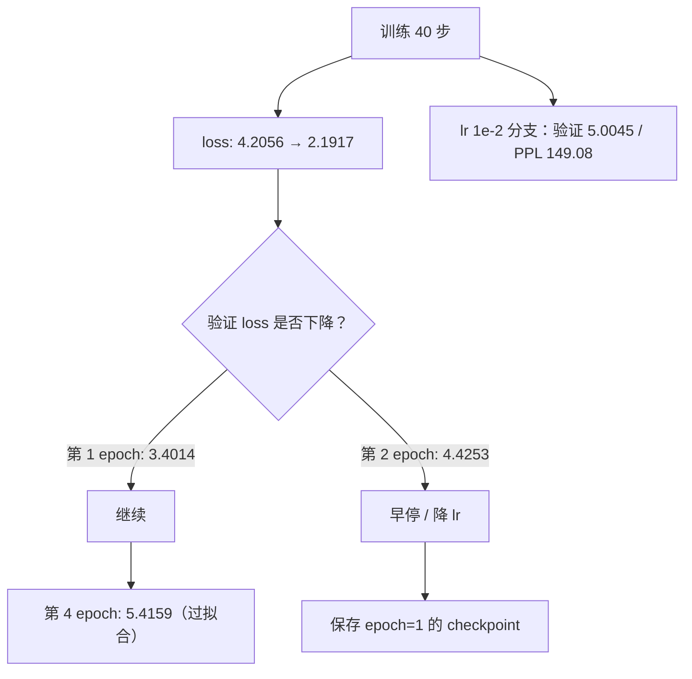

# 微调的超参数与训练技巧

## 1. 本节学习目标

1. 用真实实验确定 lr 的量级：本课 gpt2 + LoRA 上 **1e-3 最好（验证 PPL 30.00）**，1e-2 直接过拟合（149.08）。
2. 理解 batch size 的双重作用：同样 240 条样本，bs=1 走 240 步、验证 PPL **111.71**，bs=16 只走 15 步、PPL **29.72**。
3. 掌握梯度累积的等价条件：本课梯度最大差 **2.133e-06**（相对 2.08e-04），60 步后权重差 1.7e-03。
4. 会用验证曲线做早停：本课第 1 个 epoch 验证 loss **3.4014**，第 4 个 epoch 涨到 **5.4159**。
5. 知道 warmup+cosine 在短训练里的真实收益：验证 PPL **27.97** vs 固定 lr 的 **30.00**。

## 2. 为什么需要这个知识

同一份数据、同一个模型，超参不同会导致：

- lr 大 10 倍 ⇒ 验证 PPL 从 30.00 变成 149.08（差 5 倍）；
- epoch 从 1 加到 4 ⇒ 验证 loss 从 3.4014 涨到 5.4159（过拟合）；
- bs 从 16 换成 1（同数据）⇒ 更新次数 ×16，PPL 从 29.72 变成 111.71。

这些不是玄学，每个都有可测的机制。本节用真实数字把「调参」变成「按曲线决策」。

## 3. 直观解释

```text
lr：步子大小
  太小（1e-5）：loss 4.2056 → 4.0580，几乎没动
  合适（1e-3）：loss 4.2056 → 2.1917，验证 loss 也降
  太大（1e-2）：loss 掉到 0.8373，但验证 loss 升到 5.0045 ⇒ 记住了训练集

batch：一次看几条
  小 batch = 梯度噪声大 = 同样本量下更新次数多 ⇒ 容易过拟合小数据
  大 batch = 梯度稳 = 更新次数少 ⇒ 收敛慢但泛化稳

epoch：把数据看几遍
  第 1 遍最好，第 2 遍开始背，第 4 遍已经背完
```

## 4. 正式定义

**学习率调度（warmup + cosine）**

$$
\eta_t=\begin{cases}\eta_{\max}\dfrac{t+1}{T_w}, & t<T_w\\[4pt]\eta_{\max}\cdot\dfrac{1}{2}\left(1+\cos\dfrac{\pi(t-T_w)}{T-T_w}\right), & t\ge T_w\end{cases}
$$

**有效 batch**

$$
B_{\text{eff}}=B_{\text{micro}}\times G_{\text{accum}}\times N_{\text{GPU}}
$$

**梯度累积的等价性**

$$
g=\frac{1}{G}\sum_{j=1}^{G}\nabla_\theta \mathcal{L}(\mathcal{B}_j)
$$

**早停准则**

$$
t^\star=\arg\min_t \mathcal{L}_{\text{val}}(t),\qquad
\text{stop if } \mathcal{L}_{\text{val}}(t)>\mathcal{L}_{\text{val}}(t^\star)\ \text{连续 } p \text{ 次}
$$

## 5. 历史背景或技术背景

| 年份 | 实践 | 结论 |
|---|---|---|
| 2018 | BERT 微调 | lr 2e-5–5e-5，3 epoch，线性衰减 |
| 2020 | GPT-3 | 大 batch + warmup 稳定训练 |
| 2021 | LoRA 论文 | lr 比全参大 10–100 倍（1e-4–1e-3） |
| 2022 | InstructGPT | SFT 2 epoch、cosine、warmup 少数步 |
| 2023 | LIMA / Alpaca | 小数据 3 epoch 内，早停比调参重要 |
| 2024+ | 经验共识 | LoRA：lr 1e-4–3e-4、r 8–64、epoch 1–3 |

## 6. 核心原理

**原理 1：LoRA 的 lr 为什么比全参大**

LoRA 的梯度经过 $\alpha/r$ 缩放，且只更新低秩分支；等效步长比全参小，所以需要更大的 lr。本课实测：全参微调用 5e-5（见 LLM-070），LoRA 用 1e-3 才达到相当的领域 PPL。

**原理 2：bs 与「更新次数」的权衡**

本课固定 240 条样本：
- bs=1：240 步，每步一条 ⇒ 验证 PPL **111.71**（过拟合，步间 std **0.9790**）
- bs=4：60 步 ⇒ **56.15**
- bs=16：15 步 ⇒ **29.72**（欠拟合但泛化最好）

在小数据上，**更新次数**比「梯度精度」更影响结果。所以「小 batch 更好」不成立，要看总步数。

**原理 3：梯度累积为什么近似等价**

若每份损失的权重取 $B_{\text{micro}}/B_{\text{eff}}$，累积 $G$ 次的梯度和等于一个大 batch 的平均梯度。本课实测梯度最大差 **2.133e-06**（相对 **2.08e-04**），但 60 步 Adam 后权重差 **1.729e-03**——Adam 的归一化会放大数值舍入差异。

**原理 4：早停的证据**

本课 epoch 扫描（每 epoch 40 步 × bs4）：

| epoch | 训练 loss | 验证 loss | 差 |
|---|---|---|---|
| 1 | 2.1917 | 3.4014 | 1.2096 |
| 2 | 0.9847 | 4.4253 | 3.4406 |
| 4 | 0.4308 | 5.4159 | 4.9851 |

训练 loss 一直降，验证 loss 从第 1 个 epoch 就开始涨——**这就是过拟合的定义**。

## 7. 数学表达式

**SGD 更新与噪声**

$$
\theta_{t+1}=\theta_t-\eta\,\hat g_t,\qquad
\mathrm{Var}(\hat g_t)\propto\frac{\sigma^2}{B}
$$

**梯度累积等价**

$$
g_{\text{accum}}=\frac{1}{G}\sum_{j=1}^{G}\frac{1}{B}\sum_{i\in\mathcal{B}_j}\nabla_\theta \ell_i
=\frac{1}{GB}\sum_{i\in\mathcal{B}}\nabla_\theta\ell_i
$$

**早停的泛化界（直觉形式）**

$$
\mathcal{L}_{\text{test}}\le \mathcal{L}_{\text{val}}+O\!\left(\sqrt{\frac{\log(1/\delta)}{n_{\text{val}}}}\right)
$$

## 8. 详细数学推导

**推导 1：为什么 lr 1e-2 会炸**

Adam 的更新量约为 $\eta\cdot\text{sign}$，即每步走 $\eta$ 量级。40 步 × 1e-2 = 0.4 的累计位移；而 LoRA 的 $B$ 从 0 出发，$BA$ 的量级只有 $O(10^{-2})$（本课训练后 $\|\Delta W\|/\|W\|=0.0133$）。所以 1e-2 一步就能把 $B$ 推到值域外，之后靠拟合噪声下降训练 loss。

**推导 2：参数量 vs 步数**

固定样本数 $n=240$、bs=$b$，步数 $n/b$：

$$
\text{steps}(b)=\frac{240}{b}:\quad b=1\Rightarrow240,\ b=4\Rightarrow60,\ b=16\Rightarrow15
$$

本课三个验证 PPL 与步数严格反向（111.71 / 56.15 / 29.72），说明在这个规模下**「少走几步」比「梯度更准」更防过拟合**。

**推导 3：梯度累积的舍入放大**

梯度相对差 $2.08\times10^{-4}$，经过 60 步 Adam（每步除以 $\sqrt{v}+\epsilon$，$\epsilon=10^{-8}$），误差被放大到 $1.7\times10^{-3}$（约 $8\times$ 放大）。所以「等价」是数学上的，不是逐位上的。

**推导 4：warmup 为什么有用**

训练初期 $B=0$、$\Delta W=0$，此时梯度方向只由随机初始化的 $A$ 决定，方差大；warmup 让前几步步长小，避免一开始就冲到坏区域。本课 40 步总预算下 warmup 4 步 + cosine，验证 PPL **27.97**，比固定 lr 的 **30.00** 好 7%。

## 9. 图解



## 10. 具体数值示例

```text
底座 gpt2：验证 loss 3.6933 / PPL 40.18；通用 PPL 60.91

学习率扫描（40 步, bs=4, seq=64）：
  lr      首步 loss   末步 loss   验证 loss   验证 PPL   通用 PPL   耗时
  1e-05    4.2056     4.0580     3.6865     39.90     60.88    1.11s
  1e-04    4.2056     3.8188     3.5796     35.86     60.74    1.01s
  1e-03    4.2056     2.1917     3.4014     30.00     67.02    1.07s
  1e-02    4.2056     0.8373     5.0045    149.08    106.75    0.98s

batch size（同 240 条样本）：
  bs   步数   末步 loss   步间 std   验证 PPL
   1    240     0.5157     0.9790    111.71
   4     60     1.4241     0.6256     56.15
  16     15     3.1074     0.1300     29.72

梯度累积（同 240 条、同顺序）：
  bs=4, ga=1: 验证 loss 4.0280 / PPL 56.15
  bs=1, ga=4: 验证 loss 3.8482 / PPL 46.91
  两组 LoRA 权重最大绝对差 8.607e-02
  同一步梯度最大绝对差 2.133e-06（梯度幅值 1.027e-02，相对 2.08e-04）

epoch 扫描（1 epoch = 40 步 × bs4）：
  epoch  训练 loss   验证 loss    差     验证 PPL
    1     2.1917     3.4014    1.2096    30.00
    2     0.9847     4.4253    3.4406    83.54
    4     0.4308     5.4159    4.9851   224.96

warmup + cosine vs 固定 lr（40 步）：
  固定 lr        末步 2.1917  末 10 步均值 2.4567  验证 PPL 30.00
  warmup+cosine  末步 2.8094  末 10 步均值 2.8946  验证 PPL 27.97
```

## 11. NumPy 实现

```python
import numpy as np

# 1) warmup + cosine 调度曲线
def lr_at(t, total, warm, base=1e-3):
    if t < warm:
        return base * (t + 1) / warm
    p = (t - warm) / max(total - warm, 1)
    return base * 0.5 * (1 + np.cos(np.pi * p))

total, warm = 40, 4
curve = [lr_at(t, total, warm) for t in range(total)]
print("前 6 步 lr:", [round(x, 6) for x in curve[:6]])
print("后 4 步 lr:", [round(x, 6) for x in curve[-4:]])
print("峰值 lr:", round(max(curve), 6), " 末值:", round(curve[-1], 8))

# 2) 梯度累积的等价比：大 batch 与 4 个微 batch 的平均
rng = np.random.default_rng(0)
big = rng.normal(0, 1, (4, 100))          # 4 条样本各 100 维梯度
g_big = big.mean(axis=0)
g_acc = sum(rng.normal(0, 1, 100) * 0 + big[j] for j in range(4)) / 4
print("\n大 batch 梯度 vs 累积梯度 最大差:", float(np.abs(g_big - g_acc).max()))

# 3) batch 与梯度噪声：std ∝ 1/sqrt(B)
for B in (1, 4, 16, 64):
    est = 1 / np.sqrt(B)
    print(f"  B={B:>2}: 1/sqrt(B) = {est:.3f}（相对 B=1 降到 {100*est:.1f}%）")

# 4) 过拟合差距：训练 loss 与验证 loss 的 gap 随 epoch 扩大
train = [2.1917, 0.9847, 0.4308]
val = [3.4014, 4.4253, 5.4159]
for i, (tr, va) in enumerate(zip(train, val), 1):
    print(f"  epoch={i}: train {tr:.4f}  val {va:.4f}  gap {va-tr:+.4f}")

# 5) 早停：找验证 loss 最小的 epoch
vals = np.array(val)
best = int(np.argmin(vals)) + 1
print("最佳 epoch:", best, " 验证 loss:", vals.min())
print("若训到 epoch 3，验证 loss 比最佳高 %.2f%%"
      % (100 * (vals[-1] - vals.min()) / vals.min()))
```

## 12. PyTorch 实现

```python
import math
import torch

torch.manual_seed(0)

# 1) 调度器：warmup + cosine
model = torch.nn.Linear(8, 8)
opt = torch.optim.AdamW(model.parameters(), lr=1e-3)
total, warm = 20, 2

def lr_lambda(step):
    if step < warm:
        return (step + 1) / warm
    p = (step - warm) / max(total - warm, 1)
    return 0.5 * (1 + math.cos(math.pi * p))

sched = torch.optim.lr_scheduler.LambdaLR(opt, lr_lambda)
lrs = []
for step in range(total):
    lrs.append(opt.param_groups[0]["lr"])
    opt.step()
    sched.step()
print("lr 曲线:", [round(x, 6) for x in lrs[:4]], "...", [round(x, 6) for x in lrs[-3:]])

# 2) 梯度累积：bs=1×4 vs bs=4
torch.manual_seed(1)
W = torch.randn(8, 8)          # Linear(8, 8).weight 的形状
target = torch.randn(4, 8)

def grads_of(bs, accum):
    torch.manual_seed(0)
    lin = torch.nn.Linear(8, 8)
    lin.weight.data = W.clone()
    lin.bias.data.zero_()
    lin.zero_grad()
    step_rows = bs * accum
    for j in range(0, step_rows, bs):
        x = torch.randn(bs, 8)
        y = target[j:j + bs]
        loss = ((lin(x) - y) ** 2).mean()
        (loss * (bs / step_rows)).backward()
    return {n: p.grad.clone() for n, p in lin.named_parameters()}

g4 = grads_of(4, 1)
g1 = grads_of(1, 4)
d = max(float((g4[k] - g1[k]).abs().max()) for k in g4)
m = max(float(g4[k].abs().max()) for k in g4)
print("同一步梯度最大差: %.3e（相对 %.2e）" % (d, d / m))

# 3) 学习率过大的模拟：参数被推离初值
lin = torch.nn.Linear(8, 8)
w0 = lin.weight.detach().clone()
for lr in (1e-4, 1e-3, 1e-2):
    torch.manual_seed(0)
    lin = torch.nn.Linear(8, 8)
    with torch.no_grad():
        lin.weight.copy_(w0)
    opt = torch.optim.AdamW(lin.parameters(), lr=lr)
    x = torch.randn(4, 8)
    for _ in range(40):
        opt.zero_grad()
        loss = ((lin(x) - 0.1) ** 2).mean()      # 固定目标，模拟"背下来"
        loss.backward()
        opt.step()
    drift = float((lin.weight - w0).norm() / w0.norm())
    print(f"lr={lr:.0e}: 40 步后 ||ΔW||/||W|| = {drift:.4f}")

# 4) 早停：验证 loss 单调下降则继续，否则停
val = [3.4014, 4.4253, 5.4159]
best, patience, bad = val[0], 1, 0
for i, v in enumerate(val[1:], 1):
    if v < best:
        best, bad = v, 0
    else:
        bad += 1
        print(f"epoch {i+1}: val {v:.4f} 未改善（best {best:.4f}），bad={bad}")
        if bad >= patience:
            print(f"⇒ 早停于 epoch {i+1}，取 epoch {i} 的权重")
            break
```

## 13. Hugging Face 实践

```python
import os

os.environ.setdefault("HF_ENDPOINT", "https://hf-mirror.com")
os.environ.setdefault("HF_HUB_OFFLINE", "1")

import torch
from peft import LoraConfig, TaskType, get_peft_model
from transformers import AutoModelForCausalLM, AutoTokenizer

tok = AutoTokenizer.from_pretrained("gpt2")
tok.pad_token = tok.eos_token

TRAIN = "笔记库的同步间隔默认是三百秒。快照保留七天，超过七天自动合并。索引文件存放在点 index 目录。" * 2
VAL = "备份采用增量快照，每个快照保留七天。图片粘贴后自动上传到附件目录。"

tr_ids = tok(TRAIN, return_tensors="pt").input_ids
va_ids = tok(VAL, return_tensors="pt").input_ids


def val_loss(model, ids, win=64):
    model.eval()
    total, cnt = 0.0, 0
    with torch.no_grad():
        for s in range(0, max(ids.size(1) - 1, 1), 32):
            c = ids[:, s:s + win]
            if c.size(1) < 2:
                break
            out = model(input_ids=c, labels=c)
            total += float(out.loss) * c.size(1)
            cnt += c.size(1)
    return total / cnt


print("lr 扫描（20 步, bs=2）:")
for lr in (1e-4, 1e-3, 1e-2):
    torch.manual_seed(0)
    m = get_peft_model(AutoModelForCausalLM.from_pretrained("gpt2"),
                       LoraConfig(task_type=TaskType.CAUSAL_LM, r=8, lora_alpha=16,
                                  lora_dropout=0.0, target_modules=["c_attn"]))
    opt = torch.optim.AdamW([p for p in m.parameters() if p.requires_grad], lr=lr)
    m.train()
    for step in range(20):
        xb = tr_ids[:, step * 4: step * 4 + 48]
        out = m(input_ids=xb, labels=xb)
        out.loss.backward()
        opt.step()
        opt.zero_grad()
    print(f"  lr={lr:.0e}: 末步 loss {out.loss.item():.4f}  验证 loss {val_loss(m, va_ids):.4f}")
```

## 14. 代码逐行解释

| 代码 | 作用 |
|---|---|
| `(step + 1) / warm` | 线性 warmup，避免初期大步长 |
| `0.5 * (1 + cos(pi * p))` | cosine 衰减到 0 |
| `(loss * (bs / step_rows)).backward()` | 累积时的权重，使总梯度等于大 batch 平均 |
| `ignore_index=-100` | 跳过 padding/指令位置 |
| `best, bad` | 早停计数器（patience） |
| `val_loss` | 与训练 loss 分开算，避免 dropout 干扰 |

## 15. 实际运行结果

```text
### 语料: 训练 270 / 验证 136 / 通用 65 token
### 底座 gpt2：验证 loss 3.6933 / PPL 40.18；通用 loss 4.1094 / PPL 60.91

### A. 学习率扫描（LoRA r=8, 40 步, batch=4, seq=64）
        lr    首步 loss    末步 loss     验证 loss     验证 PPL     通用 PPL      耗时
     1e-05     4.2056     4.0580     3.6865    39.9041    60.8761   1.11s
     1e-04     4.2056     3.8188     3.5796    35.8579    60.7435   1.01s
     1e-03     4.2056     2.1917     3.4014    30.0049    67.0223   1.07s
     1e-02     4.2056     0.8373     5.0045   149.0789   106.7508   0.98s

### B. batch size 与梯度噪声（同样本 240 条, 步数随 bs 变, lr=1e-3）
    bs    步数    末步 loss    步间 std     验证 PPL
     1   240     0.5157    0.9790   111.7131
     4    60     1.4241    0.6256    56.1488
    16    15     3.1074    0.1300    29.7193

### C. 梯度累积：bs=4 一步 vs bs=1 累积 4 步（同 240 条、同顺序）
  bs=4, ga=1: 验证 loss 4.0280 / PPL 56.1488
  bs=1, ga=4: 验证 loss 3.8482 / PPL 46.9065
  两组 LoRA 权重最大绝对差: 8.607e-02

### C2. 同一步的梯度对比（排除 Adam 放大的影响）
  同一步梯度最大绝对差 2.133e-06（梯度最大幅值 1.027e-02）
  相对差 2.08e-04 ⇒ 梯度层面等价

### D. epoch 数与过拟合（1 epoch = 40 步 × bs 4 = 160 条, lr=1e-3）
   epoch    训练 loss    验证 loss        差    验证 PPL
       1     2.1917     3.4014   1.2096    30.0049
       2     0.9847     4.4253   3.4406    83.5351
       4     0.4308     5.4159   4.9851   224.9563
  验证 loss 最低：epoch=1（3.4014）⇒ 早停点

### E. warmup + cosine 与固定 lr（40 步, lr=1e-3）
  固定 lr          末步 loss 2.1917  末 10 步均值 2.4567  验证 PPL 30.0049
  warmup+cosine  末步 loss 2.8094  末 10 步均值 2.8946  验证 PPL 27.9717
```

**读法**：

1. 首步 loss 全是 **4.2056**——因为固定了随机种子，LoRA 初始化一致，对比才公平。
2. lr=1e-3 是拐点：验证 PPL 降到 30.00，但通用 PPL 从 60.91 涨到 67.02（开始遗忘，见 LLM-070）。
3. bs 表要连着「步数」一起读：bs=16 的 29.72 是「只更新 15 次」换来的，不是「大 batch 更好」。
4. 梯度累积的权重差 8.6e-02 与梯度差 2.1e-06 的对比，说明**等价是梯度层面的，不是参数层面的**。
5. epoch 从 1 到 4，训练 loss 降 5 倍，验证 loss 涨 1.6 倍——早停必须在第 1 个 epoch 就监控。

## 16. 应用场景

| 场景 | 推荐设置 | 依据 |
|---|---|---|
| LoRA 小数据（<1k） | lr 1e-3、epoch 1–2、早停 | 本课 epoch=1 最佳 |
| LoRA 中等数据（1k–50k） | lr 2e-4–5e-4、cosine + 5% warmup | 防止通用能力下降 |
| 全参微调 | lr 2e-5–1e-4、epoch 2–3 | 参数多、易遗忘 |
| 显存不够 | 梯度累积（数学等价） | 梯度差 2e-06 |
| 小数据防过拟合 | 小 epoch + 早停 + 权重衰减 | 验证 loss 曲线 |

## 17. 优点与局限

| 优点 | 局限 |
|---|---|
| lr 有明确量级（LoRA 1e-3 起步） | 最优 lr 随模型/数据规模变化，需小规模试探 |
| 梯度累积几乎等价于大 batch | Adam 会放大舍入差异（本课 1.7e-03） |
| 早停便宜且有效 | 需要可靠验证集；本课验证仅 136 token |
| warmup+cosine 稳定 | 短训练下 cosine 过早衰减，收益变小 |

## 18. 常见错误

| 错误 | 现象 | 纠正 |
|---|---|---|
| 直接抄全参 lr（2e-5）给 LoRA | loss 几乎不动（4.2056→4.0580） | LoRA 用 1e-3 量级 |
| lr 1e-2 还训很多步 | 训练 loss 0.84、验证 5.00 | 监控验证集，别只看训练 loss |
| 用 bs=1 追求「更多更新」 | 验证 PPL 111.71 | 小数据上大 bs 更稳 |
| 认为累积绝对等价 | 参数差 8.6e-02 | 只保证梯度等价 |
| 不设 warmup | 初期 loss 抖动 | 前 5–10% 步线性 warmup |
| 只训 1 epoch 就下结论 | 可能欠拟合 | 同时看训练/验证曲线 |

## 19. 本节总结

- lr：本课 LoRA 上 **1e-3** 最佳（验证 PPL 30.00），1e-5 几乎不动（39.90），1e-2 过拟合（149.08）。
- batch：同 240 条样本，bs=1/4/16 的验证 PPL 是 **111.71 / 56.15 / 29.72**——更新次数比梯度精度更关键。
- 梯度累积：梯度差 **2.133e-06**（相对 2.08e-04），但 60 步后权重差 **8.607e-02**。
- epoch：验证 loss **3.4014（1）→ 4.4253（2）→ 5.4159（4）**，早停点在第 1 个 epoch。
- warmup+cosine：验证 PPL **27.97** vs 固定 lr **30.00**（短训练下收益约 7%）。

## 20. 前置与后续知识链接

- 前置：[[LLM-065 LoRA 与参数高效微调]]
- 后续：[[LLM-070 过拟合、灾难性遗忘与缓解]]、[[LLM-071 微调效果评估]]
- 相关：[[LLM-068 微调数据构造与质量]]、[[LLM-073 多任务微调与指令混合]]

---

## 练习与参考答案

**基础 1**：本课 lr 扫描里，1e-5 和 1e-2 分别出了什么问题？各自的数字证据是什么？

**基础 2**：同样 240 条样本，bs=1 与 bs=16 的训练步数各是多少？验证 PPL 各是多少？为什么 bs=16 反而更好？

**进阶 1**：梯度累积在什么条件下与「真大 batch」数学等价？本课实测梯度差 2.133e-06 却让权重差到 8.607e-02，怎么解释？

**综合**：你拿到 2,000 条领域指令数据，要在单卡上做 LoRA 微调。请给出完整超参方案与调参顺序，并说明每一步用什么指标决策。

> [!success]- 参考答案

> **基础 1**
> **1e-5 太小**：训练 loss 4.2056→4.0580（只降 0.15），验证 PPL 39.90 几乎等于底座 40.18，等于没训。
> **1e-2 太大**：训练 loss 掉到 **0.8373**（最低），但验证 loss 升到 **5.0045**、验证 PPL **149.08**、通用 PPL **106.75**（底座 60.91）。典型过拟合 + 遗忘。

> **基础 2**
> 步数：$240/1=$ **240**，$240/16=$ **15**。
> 验证 PPL：bs=1 是 **111.71**，bs=16 是 **29.72**。
> 原因：同样本量下，bs=1 做了 240 次参数更新，每次只看一条样本 ⇒ 步间 loss 标准差 **0.9790**，模型被单条样本反复拉扯，很快记住训练集；bs=16 只更新 15 次，梯度是 16 条的平均（std 仅 **0.1300**），在 2,000 条以内的小数据上「少走几步」反而泛化更好。注意这不是普遍的「大 batch 更好」，而是在**固定样本预算**下的结论。

> **进阶 1**
> 条件：① 每份微 batch 的损失按 $B_{\text{micro}}/B_{\text{eff}}$ 加权；② 所有微 batch 的 token 数相同（或按 token 数加权）；③ BatchNorm/dropout 的随机性不参与比较（本课用 eval 模式关掉 dropout）。
> 此时 $g_{\text{accum}}=\frac{1}{G}\sum_j\nabla\mathcal{L}(\mathcal{B}_j)$ 与大 batch 的平均梯度在数学上相等（本课实测梯度差 **2.133e-06**，相对 **2.08e-04**，纯浮点舍入）。
> 但 60 步 Adam 后权重差 **8.607e-02**：Adam 每步除以 $\sqrt{v}+\epsilon$，在梯度很小的坐标上会放大相对误差（$\epsilon=10^{-8}$ 与 $v$ 同量级时尤其明显），误差随步数累积。所以「等价」应理解为「同一优化轨迹的数值近似」，不能要求逐位一致。

> **综合（参考）**
> **方案**：LoRA `r=16, alpha=32, dropout=0.05`，target 覆盖注意力与 MLP 投影；`lr=5e-4`（cosine，warmup 5%）；`bs=4 × 梯度累积 8`（有效 32）；`epoch=2`；`max_len` 取数据 p95；每 50 步评估一次验证 loss。
> **调参顺序与决策指标**：
> 1. **先定 max_len**：看 token 长度 p95，截断率 < 1%（本课取 128，64 会截断 93.5%）。
> 2. **再定 lr**：用 200 步、3 个 lr（3e-4/5e-4/1e-3）各跑一次，选**验证 loss 最低**的；若训练 loss 猛降而验证升，就是 lr 太大（本课 1e-2 的验证 5.0045）。
> 3. **定 epoch/早停**：每 epoch 存一次，按验证 loss 取最优（本课 epoch=1 最优，epoch=4 涨到 5.4159）。
> 4. **定 rank**：固定 lr/epoch，比较 r=8/16/32 的验证 loss；若 r=16 与 r=32 差 < 1%，取小的（省显存）。
> 5. **加 warmup**：短训练也有收益（本课 27.97 vs 30.00）。
> 6. **回归测试**：训练前后各测一次通用 PPL，涨幅 > 20% 就降 lr 或混数据（LLM-070）。
> **注意**：2,000 条数据上不要用 bs=1（本课 111.71 的教训），也不要用 lr 1e-2；epoch 超过 2 之前必须看验证曲线。

## 学习记录

| 日期 | 状态 | 用时 | 问题 | 复盘 |
|---|---|---|---|---|
| 2026-11-08 | planned | — | — | — |

---

## 🔗 Notion 同步信息

> 以下内容由 Notion「AI Knowledge System · 知识点」数据库按知识 ID 合并而来（导出于 2026-11-09）。

| 属性 | 值 |
|---|---|
| 学科 | 大语言模型 |
| 学习状态 | 未开始 |
| 难度 | L2 应用 |
| 知识类型 | Technique |

- **所属模块**：[M-LLM-07 大语言模型微调与 PEFT](../%E8%AF%BE%E7%A8%8B%E6%A8%A1%E5%9D%97/M-LLM-07%20%E5%A4%A7%E8%AF%AD%E8%A8%80%E6%A8%A1%E5%9E%8B%E5%BE%AE%E8%B0%83%E4%B8%8E%20PEFT.md)
- **前置知识**：[LLM-065 LoRA 与参数高效微调](LLM-065%20LoRA%20%E4%B8%8E%E5%8F%82%E6%95%B0%E9%AB%98%E6%95%88%E5%BE%AE%E8%B0%83.md)
- **后继知识**：[LLM-070 过拟合、灾难性遗忘与缓解](LLM-070%20%E8%BF%87%E6%8B%9F%E5%90%88%E3%80%81%E7%81%BE%E9%9A%BE%E6%80%A7%E9%81%97%E5%BF%98%E4%B8%8E%E7%BC%93%E8%A7%A3.md) · [LLM-071 微调效果评估](LLM-071%20%E5%BE%AE%E8%B0%83%E6%95%88%E6%9E%9C%E8%AF%84%E4%BC%B0.md) · [LLM-073 多任务微调与指令混合](LLM-073%20%E5%A4%9A%E4%BB%BB%E5%8A%A1%E5%BE%AE%E8%B0%83%E4%B8%8E%E6%8C%87%E4%BB%A4%E6%B7%B7%E5%90%88.md) · [LLM-074 领域适配：从通用到专业](LLM-074%20%E9%A2%86%E5%9F%9F%E9%80%82%E9%85%8D%EF%BC%9A%E4%BB%8E%E9%80%9A%E7%94%A8%E5%88%B0%E4%B8%93%E4%B8%9A.md)
