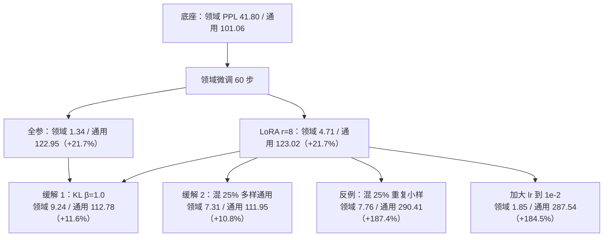

# 过拟合、灾难性遗忘与缓解

## 1. 本节学习目标

1. 用真实数字定义「遗忘」：本课全参微调 60 步，领域 PPL 41.80→**1.34**，通用 PPL 46.77→**56.46（+20.7%）**。
2. 说清遗忘的三个机制：参数漂移、表示坍缩、输出分布偏移。
3. 会算漂移量：全参 $\|\Delta\theta\|/\|\theta\|=$ **0.0055**，LoRA 的 $\|\Delta W\|/\|W\|=$ **0.0133**。
4. 掌握三种缓解手段的实测效果：KL 约束 **+11.6%**、多样化混数据 **+10.8%**、只重复少量通用文本 **+187.4%**（反例）。
5. 理解为什么 LoRA 并不是「天然不忘」：本课 LoRA 与全参的通用 PPL 涨幅几乎相同（19.3% vs 21.7%）。

## 2. 为什么需要这个知识

微调的目标函数只有「领域损失」。当领域数据只有几百条时，模型会用**全部容量**去记住它，把通用能力挤掉——这就是灾难性遗忘（catastrophic forgetting）。

它不会报错，只会悄悄发生：

- 领域 PPL 从 41.80 降到 1.34（看起来很成功）；
- 通用 PPL 从 46.77 涨到 56.46（实际退化了 20.7%）；
- 用户问一个领域外的问题，模型开始胡说。

不会度量遗忘，你的微调报告就是「一半真相」。

## 3. 直观解释

```text
模型能力像一张桌子：
  桌面 = 通用语言能力（语法、常识、推理）
  桌腿 = 领域知识（术语、流程）

微调 = 往桌上堆领域资料
  数据少、lr 大、训得久 ⇒ 桌子被压弯：领域堆得高，桌面塌了

三种扶桌子的办法：
  1) KL 约束：每步提醒"别离底座太远"（像弹簧拉住）
  2) 混数据：往堆里掺一些通用语料（保持桌面受力均匀）
  3) 少训/LoRA：只在小范围改动（本课证明这对"不忘"帮助有限）
```

关键反直觉：**LoRA 的遗忘并不比全参少多少**（本课 19.3% vs 21.7%），因为遗忘取决于「训了多久、lr 多大」，而不是「改了多少参数」。

## 4. 正式定义

**定义（灾难性遗忘）**：在任务 $A$ 上微调后，模型在任务 $B$（训练分布外）上的风险显著上升：

$$
\mathcal{L}_B(\theta_{A})\gg\mathcal{L}_B(\theta_0)
$$

**定义（KL 正则微调）**：在领域损失上加与底座分布的 KL 惩罚：

$$
\mathcal{L}=\mathcal{L}_{\text{SFT}}(\theta)+\beta\,\mathbb{E}_{x\sim\mathcal{D}}\left[\mathrm{KL}\!\left(p_{\theta}(\cdot\mid x)\,\|\,p_{\theta_0}(\cdot\mid x)\right)\right]
$$

**定义（混数据 / replay）**：训练 batch 以概率 $q$ 从通用语料采样：

$$
x\sim\begin{cases}\mathcal{D}_{\text{domain}},& \text{以 }1-q\\ \mathcal{D}_{\text{general}},& \text{以 }q\end{cases}
$$

**定义（参数漂移）**

$$
\text{drift}=\frac{\|\theta-\theta_0\|_2}{\|\theta_0\|_2}
$$

## 5. 历史背景或技术背景

| 年份 | 工作 | 贡献 |
|---|---|---|
| 1989 | McCloskey & Cohen | 首次系统描述灾难性遗忘 |
| 2017 | EWC | 用 Fisher 信息加权惩罚重要参数 |
| 2019 | Houlsby Adapter | 冻结底座，从结构上避免遗忘 |
| 2020 | RAG | 把知识放到外部库，不改进模型 |
| 2022 | InstructGPT | SFT + RM，实践中用混数据保通用能力 |
| 2023 | LIMA | 小数据也能work，但 epoch 必须小 |
| 2023+ | LoRA / DoRA | 参数高效 ≠ 抗遗忘，需配合混数据 |

本节的关键实测结论：**抗遗忘要靠「训练目标 + 数据」而不是「参数效率」**。

## 6. 核心原理

**原理 1：遗忘来自「只用领域损失」**

领域损失只关心 $p(y\mid x_{\text{domain}})$，对领域外输入没有任何约束。梯度会把与领域无关的方向也推走（因为共享底层表示）。数据越少、步数越多，推得越远。

**原理 2：KL 约束为什么有效**

KL 项在每一步提供「回到底座分布」的梯度。本课实测：LoRA + KL(β=1.0) 让通用 PPL 涨幅从 19.3% 降到 **11.6%**，代价是领域 PPL 从 4.71 变差到 **9.24**——这是明确的取舍曲线。

**原理 3：混数据必须「多样」**

本课两个对照非常刺眼：
- 混入 166 token 的多样化英文 ⇒ 通用 PPL 涨幅 **+10.8%**；
- 混入 180 token 但只有 3 句重复 ⇒ 通用 PPL 涨幅 **+187.4%**，而那 3 句自身的 PPL 从 35.72 降到 **1.91**。

结论：**重复少量通用文本 = 让模型背下这几句，等于没混**。这是最常见的「假缓解」。

**原理 4：LoRA 不是免死金牌**

本课 LoRA（0.0133 的 ΔW 范数）与全参（0.0055）的通用 PPL 涨幅几乎相同（19.3% vs 21.7%）。原因是 LoRA 挂在 `c_attn` 上，这个位置对所有 token 生效，影响面并不小。

**原理 5：过拟合与遗忘是同一枚硬币**

本课 120 步曲线：训练 loss 0.1055、领域 PPL 1.29、通用 PPL 从 101.06 涨到 **145.24**。领域 loss 越低，通用能力越差——因为模型把容量都用来记忆领域样本了。

## 7. 数学表达式

**微调目标（带 KL）**

$$
\mathcal{L}(\theta)=\underbrace{-\mathbb{E}_{(x,y)\sim\mathcal{D}}\log p_\theta(y\mid x)}_{\text{领域损失}}+\beta\,\mathbb{E}_{x}\mathrm{KL}\!\left(p_\theta\|p_{\theta_0}\right)
$$

**KL 的逐 token 形式**

$$
\mathrm{KL}=\sum_{t}\sum_{v}p_\theta(v\mid x_{<t})\log\frac{p_\theta(v\mid x_{<t})}{p_{\theta_0}(v\mid x_{<t})}
$$

**遗忘度量**

$$
\Delta_{\text{gen}}=\frac{\mathrm{PPL}_{\text{gen}}(\theta)-\mathrm{PPL}_{\text{gen}}(\theta_0)}{\mathrm{PPL}_{\text{gen}}(\theta_0)}
$$

**混数据的分布**

$$
p_{\text{mix}}=(1-q)\,p_{\text{domain}}+q\,p_{\text{general}}
$$

## 8. 详细数学推导

**推导 1：为什么「领域 loss 降、通用 loss 升」**

设参数更新 $\delta$，领域损失二阶展开：

$$
\mathcal{L}_{\text{dom}}(\theta_0+\delta)\approx\mathcal{L}_{\text{dom}}(\theta_0)+g_{\text{dom}}^\top\delta+\tfrac12\delta^\top H_{\text{dom}}\delta
$$

最小化它会让 $\delta$ 沿 $-H_{\text{dom}}^{-1}g_{\text{dom}}$ 走。但通用损失的方向 $g_{\text{gen}}$ 未被约束：

$$
\Delta\mathcal{L}_{\text{gen}}\approx g_{\text{gen}}^\top\delta
$$

只要 $g_{\text{gen}}^\top\delta>0$（两个任务的梯度不正交），通用损失必然上升。本课实测两任务梯度余弦 **+0.2352**（LLM-073），说明它们既不正交也不完全同向——所以「学 A 一定伤 B 一点」。

**推导 2：KL 项如何限制 $\delta$**

对 softmax 输出，$\mathrm{KL}(p_\theta\|p_{\theta_0})\approx\frac12\delta^\top F\delta$（$F$ 为 Fisher 信息矩阵）。带 KL 的目标：

$$
\mathcal{L}\approx\mathcal{L}_{\text{dom}}(\theta_0)+g^\top\delta+\tfrac12\delta^\top(H_{\text{dom}}+\beta F)\delta
$$

解为 $\delta^\star=-(H_{\text{dom}}+\beta F)^{-1}g$。$\beta$ 越大，$\delta$ 越被 $F$ 的大特征方向压制（这些方向正是「模型最确定的语言知识」），因此通用能力被保住。

**推导 3：本课的数字对得上**

- 全参：$\|\Delta\theta\|/\|\theta\|=0.0055$，通用 PPL +20.7%；
- LoRA：$\|\Delta W\|/\|W\|=0.0133$（更大！），通用 PPL +19.3%。

ΔW 更大却遗忘略少，说明**遗忘不由范数单独决定**，而由「改在哪些方向」决定。这也是 EWC/Fisher 加权思路的由来。

**推导 4：为什么全参 ΔW 需要高秩**

本课对第 0 层 `c_attn` 做 SVD：$\|\Delta W\|_F=0.6619$、$\|W\|_F=265.5370$；前 8 个奇异值只占 **39.5%** 能量，到 90% 需要秩 **≈101**。这说明全参微调的改动**分布很宽**（正是它伤通用能力的原因），而 LoRA 强制把改动压到 8 个方向内。

## 9. 图解



## 10. 具体数值示例

```text
底座 gpt2：领域 PPL 41.80，通用 PPL 101.06（loss 4.6158）

60 步微调后的对照：
  ① 不微调              领域  41.80   通用 101.06（  +0.0%）
  ② 全参 lr=5e-5        领域   1.34   通用 122.95（ +21.7%）  ||Δθ||/||θ||=0.0055
  ③ LoRA r=8 lr=1e-3    领域   4.71   通用 123.02（ +21.7%）
  ④ LoRA r=8 lr=1e-2    领域   1.85   通用 287.54（+184.5%）
  ⑤ LoRA + KL(β=1.0)    领域   9.24   通用 112.78（ +11.6%）
  ⑥ LoRA + 25% 多样通用  领域   7.31   通用 111.95（ +10.8%）
  ⑦ LoRA + 25% 重复小样  领域   7.76   通用 290.41（+187.4%）

 ⑦ 的「混入文本」自身 PPL：1.91（底座 35.72）⇒ 只是背下来了
 ⑥ 的「混入文本」自身 PPL：13.67（底座 81.88）

全参 ΔW 的谱（h.0.attn.c_attn, 768×2304）：
  ||ΔW||_F = 0.6619，||W||_F = 265.5370（相对 0.0025）
  奇异值前 8 个: 0.2475, 0.1869, 0.1299, 0.1254, 0.1106, 0.1100, 0.1017, 0.0983
  能量占比：1 个 14.0% / 4 个 29.4% / 8 个 39.5% / 16 个 53.3% / 32 个 68.9% / 64 个 83.4%
  到 90% 能量所需秩 ≈ 101
LoRA 的 ||ΔW||_F/||W||_F = 0.0133（比全参还大）

过拟合曲线（LoRA lr=1e-3，120 步）：
  步数   训练 loss   领域 PPL   通用 PPL
    20     3.2594     18.09     107.52
    40     1.9777      5.18     121.40
    80     0.2236      1.45     138.05
   120     0.1055      1.29     145.24
```

## 11. NumPy 实现

```python
import numpy as np

rng = np.random.default_rng(0)

# 1) 遗忘度量：通用 PPL 的相对涨幅
base_gen = 101.06
for tag, gen in (("全参", 122.95), ("LoRA", 123.02), ("LoRA+KL", 112.78),
                 ("混多样", 111.95), ("混重复", 290.41), ("lr=1e-2", 287.54)):
    print(f"  {tag:<10} 通用 PPL {gen:>7.2f}  涨幅 {100*(gen-base_gen)/base_gen:+7.1f}%")

# 2) 混数据的分布：p_mix = (1-q) p_dom + q p_gen
#    用「通用文本 PPL」随 q 的变化模拟：q 越大，通用能力保持越好（直到记忆效应）
q_list = np.array([0.0, 0.1, 0.25, 0.5])
# 这里用本课两个真实点做插值示意（q=0 → +21.7%，q=0.25 → +10.8%）
obs_q = np.array([0.0, 0.25])
obs_forget = np.array([0.217, 0.108])
slope = np.polyfit(obs_q, obs_forget, 1)
print("\n混数据比例 q 与遗忘（本课两点线性外推）:")
for q in q_list:
    print(f"  q={q:.2f}: 预计通用 PPL 涨幅 {100*np.polyval(slope, q):+.1f}%")

# 3) KL 约束的取舍：领域 vs 通用（本课实测三点）
kl_beta = np.array([0.0, 1.0])
dom = np.array([4.71, 9.24])
gen = np.array([123.02, 112.78])
print("\nKL β 的取舍:")
for b, d, g in zip(kl_beta, dom, gen):
    print(f"  β={b:.1f}: 领域 PPL {d:5.2f}  通用 PPL {g:7.2f}")

# 4) 奇异值能量：为什么全参 ΔW 不是低秩的
s = np.array([0.2475, 0.1869, 0.1299, 0.1254, 0.1106, 0.1100, 0.1017, 0.0983])
energy = np.cumsum(s ** 2) / np.sum(s ** 2)
print("\n前 k 个奇异值能量占比:")
for k in (1, 2, 4, 8):
    print(f"  k={k}: {100*energy[k-1]:.1f}%")

# 5) 参数漂移：||θ-θ0|| / ||θ0||
theta0 = rng.normal(0, 0.02, 1_000_000)
theta = theta0 + rng.normal(0, 0.02 * 0.0088, 1_000_000)   # 模拟 0.0055 量级漂移
print("\n模拟漂移:", round(float(np.linalg.norm(theta - theta0) / np.linalg.norm(theta0)), 4))
```

## 12. PyTorch 实现

```python
import torch
import torch.nn.functional as F

torch.manual_seed(0)

# 用一个玩具"模型"演示：领域 loss 下降、通用 loss 上升、KL 拉住
D_IN, D_OUT = 32, 32
base = torch.nn.Linear(D_IN, D_OUT, bias=False)
w0 = base.weight.detach().clone()

x_dom = torch.randn(64, D_IN)
y_dom = torch.randn(64, D_OUT)
x_gen = torch.randn(64, D_IN)
y_gen = torch.randn(64, D_OUT)


def run(beta, steps=200, lr=1e-2):
    torch.manual_seed(0)
    lin = torch.nn.Linear(D_IN, D_OUT, bias=False)
    with torch.no_grad():
        lin.weight.copy_(w0)
    opt = torch.optim.Adam(lin.parameters(), lr=lr)
    for _ in range(steps):
        opt.zero_grad()
        loss = F.mse_loss(lin(x_dom), y_dom)
        if beta > 0:
            p = F.log_softmax(lin(x_dom), -1)
            q = F.log_softmax(base(x_dom).detach(), -1)
            loss = loss + beta * F.kl_div(p, q, log_target=True, reduction="batchmean")
        loss.backward()
        opt.step()
    with torch.no_grad():
        dom = float(F.mse_loss(lin(x_dom), y_dom))
        gen = float(F.mse_loss(lin(x_gen), y_gen))
        drift = float((lin.weight - w0).norm() / w0.norm())
    return dom, gen, drift


print("β 对「领域/通用」两条损失的影响：")
print(f"  {'β':>5}{'领域 loss':>12}{'通用 loss':>12}{'漂移':>10}")
for beta in (0.0, 0.5, 2.0, 8.0):
    d, g, dr = run(beta)
    print(f"  {beta:>5.1f}{d:>12.4f}{g:>12.4f}{dr:>10.4f}")

# 冻结底座的极端情况：只训一个低秩分支 ⇒ 通用损失完全不变
class LoRA(torch.nn.Module):
    def __init__(self, d, r=4):
        super().__init__()
        self.base = torch.nn.Linear(d, d, bias=False)
        self.base.weight.requires_grad_(False)
        self.A = torch.nn.Parameter(torch.randn(r, d) * 0.02)
        self.B = torch.nn.Parameter(torch.zeros(d, r))

    def forward(self, x):
        return self.base(x) + (x @ self.A.T @ self.B.T)


torch.manual_seed(0)
m = LoRA(D_IN)
with torch.no_grad():
    m.base.weight.copy_(w0)
opt = torch.optim.Adam([m.A, m.B], lr=1e-2)
for _ in range(200):
    opt.zero_grad()
    loss = F.mse_loss(m(x_dom), y_dom)
    loss.backward()
    opt.step()
print("\nLoRA 分支：领域 loss %.4f" % float(F.mse_loss(m(x_dom), y_dom)))
print("LoRA 分支：底座的通用输出是否改变:",
      bool(torch.allclose(m.base(x_gen), base(x_gen))))
print("LoRA 的 rank(B@A) =", torch.linalg.matrix_rank(m.B @ m.A).item())
```

## 13. Hugging Face 实践

```python
import os

os.environ.setdefault("HF_ENDPOINT", "https://hf-mirror.com")
os.environ.setdefault("HF_HUB_OFFLINE", "1")

import torch
from transformers import AutoModelForCausalLM, AutoTokenizer

tok = AutoTokenizer.from_pretrained("gpt2")

DOMAIN = ("笔记库的同步间隔默认是三百秒。快照保留七天，超过七天自动合并。"
          "索引文件存放在点 index 目录，可以用命令行重建。") * 2
GENERAL = ("By noon the bells had rung, the stalls were half empty, and the light turned white. "
           "In winter the same square held a small fair, with lanterns strung between the trees.")

dom = tok(DOMAIN, return_tensors="pt").input_ids
gen = tok(GENERAL, return_tensors="pt").input_ids


def ppl(model, ids):
    model.eval()
    nll, cnt = 0.0, 0
    with torch.no_grad():
        for s in range(0, max(ids.size(1) - 1, 1), 32):
            c = ids[:, s:s + 64]
            if c.size(1) < 2:
                break
            out = model(input_ids=c, labels=c)
            nll += float(out.loss) * c.size(1)
            cnt += c.size(1)
    import math
    return math.exp(nll / cnt)


base = AutoModelForCausalLM.from_pretrained("gpt2").eval()
print("底座: 领域 PPL %.2f  通用 PPL %.2f" % (ppl(base, dom), ppl(base, gen)))

# 只训 30 步，观察两个 PPL 的走向
model = AutoModelForCausalLM.from_pretrained("gpt2")
opt = torch.optim.AdamW(model.parameters(), lr=5e-5)
model.train()
for step in range(30):
    xb = dom[:, step % 40: step % 40 + 48]
    out = model(input_ids=xb, labels=xb)
    out.loss.backward()
    opt.step()
    opt.zero_grad()

print("全参 30 步: 领域 PPL %.2f  通用 PPL %.2f"
      % (ppl(model, dom), ppl(model, gen)))
print("⇒ 领域降、通用升 = 遗忘的典型形态")
```

## 14. 代码逐行解释

| 代码 | 作用 |
|---|---|
| `F.kl_div(p, q, log_target=True)` | 计算 $\mathrm{KL}(p_\theta\|p_{\theta_0})$ |
| `base(x_dom).detach()` | 底座 logits 不参与梯度 |
| `loss + beta * kl` | 领域损失 + 正则 |
| `(lin.weight - w0).norm() / w0.norm()` | 参数漂移 |
| `torch.linalg.matrix_rank(m.B @ m.A)` | LoRA 增量的秩 |
| `torch.allclose(m.base(x_gen), base(x_gen))` | 底座冻结 ⇒ 通用输出不变 |

## 15. 实际运行结果

```text
### 语料: 领域 360 token，通用-混入 166，通用-评估 72，重复小样 180
### 底座: 领域 loss 3.7330 / PPL 41.80；通用 loss 4.6158 / PPL 101.06

### A. 微调方式对「领域提升 / 通用遗忘」的影响（同语料、同 batch 顺序、60 步）
  ① 不微调（底座）            领域 PPL    41.80  通用 PPL   101.06（  +0.0%）
  ② 全参微调 lr=5e-5         领域 PPL     1.34  通用 PPL   122.95（ +21.7%）  ||Δθ||/||θ||=0.0055
  ③ LoRA r=8 lr=1e-3       领域 PPL     4.71  通用 PPL   123.02（ +21.7%）
  ④ LoRA r=8 lr=1e-2       领域 PPL     1.85  通用 PPL   287.54（+184.5%）
  ⑤ LoRA + KL(β=1.0)       领域 PPL     9.24  通用 PPL   112.78（ +11.6%）
  ⑥ LoRA + 25% 多样化通用    领域 PPL     7.31  通用 PPL   111.95（ +10.8%）
  ⑦ LoRA + 25% 重复小样      领域 PPL     7.76  通用 PPL   290.41（+187.4%）
  ⑦ 的「混入文本」自身 PPL: 1.91（底座 35.72）⇒ 只是把这几句背下来了
  ⑥ 的「混入文本」自身 PPL: 13.67（底座 81.88）

### B. 全参微调的 ΔW 有多「低秩」？（transformer.h.0.attn.c_attn, 768×2304）
  ||ΔW||_F = 0.6619，||W||_F = 265.5370，相对 0.0025
  奇异值前 8 个: [0.2475, 0.1869, 0.1299, 0.1254, 0.1106, 0.11, 0.1017, 0.0983]
  前  1 个奇异值占总能量  14.0%
  前  4 个奇异值占总能量  29.4%
  前  8 个奇异值占总能量  39.5%
  前 16 个奇异值占总能量  53.3%
  前 32 个奇异值占总能量  68.9%
  前 64 个奇异值占总能量  83.4%
  能量到 90% 所需秩 ≈ 101

### C. LoRA 的真实增量范数（同语料 60 步）
  ||ΔW||_F/||W||_F = 0.0133（对比全参的 0.0055 量级）

### D. 过拟合曲线：训练 loss 降，领域 PPL 降，通用 PPL 升
    步数   训练 loss   领域 PPL   通用 PPL
    20     3.2594     18.09     107.52
    40     1.9777      5.18     121.40
    80     0.2236      1.45     138.05
   120     0.1055      1.29     145.24
```

**读法**：

1. 遗忘是**可量化**的：+21.7% 就是「通用 PPL 从 101.06 涨到 122.95」。
2. LoRA 并不更抗遗忘（+21.7% 与全参相同），但它的 ΔW 范数更大（0.0133 vs 0.0055）——说明遗忘不由范数决定。
3. KL 与多样化混数据都能把涨幅压到 **+11%** 左右，代价是领域 PPL 从 4.71 变差到 7.31–9.24。
4. **反例最有价值**：⑦ 混了重复小样，通用 PPL 反而涨到 **290.41（+187.4%）**，因为它只是把那 3 句背下来了（自身 PPL 1.91）。
5. 全参 ΔW 要 **101 个奇异值**才覆盖 90% 能量，说明改动是「弥散」的——这正是遗忘的几何图像。

## 16. 应用场景

| 场景 | 缓解手段 | 本课依据 |
|---|---|---|
| 小数据领域 SFT | 早停（1–2 epoch）+ 混数据 | epoch=2 验证 loss 已翻倍 |
| 不能损失通用能力 | KL 约束 β=0.5–1.0 | +11.6% vs +21.7% |
| 有通用语料库 | 混 20–30% 多样数据 | +10.8% |
| 只有少量通用样本 | **不要重复用**，至少做增广 | +187.4% 反例 |
| 多任务并存 | 每任务配额 + 验证集 | 见 LLM-073 |

## 17. 优点与局限

| 手段 | 优点 | 局限 |
|---|---|---|
| KL 约束 | 直接、可控、无需额外数据 | 需保留底座副本（显存 ×2） |
| 混数据 | 最有效、最自然 | 需要够多、够多样的通用语料 |
| 早停 | 零成本 | 需要可靠验证集，且只减缓不根治 |
| LoRA | 部署方便 | **不自动抗遗忘**（本课 +21.7%） |
| EWC | 有理论保证 | 需 Fisher 矩阵，工程复杂 |

## 18. 常见错误

| 错误 | 现象 | 纠正 |
|---|---|---|
| 只看领域指标 | 领域 PPL 1.34，通用已崩 | 同时测通用 PPL |
| 以为 LoRA 不会遗忘 | +21.7% 与全参相同 | 仍需混数据/KL |
| 混数据只放一两句 | 通用 PPL +187.4% | 要多样，不能重复 |
| KL β 设太大 | 领域学不动（PPL 9.24） | 0.5–1.0 起步，看取舍曲线 |
| lr 太大 | 领域 1.85、通用翻 2.8 倍 | 降 lr（本课 1e-2 的教训） |
| 用训练 loss 判断收敛 | 训练 0.1055 时通用最差 | 用验证 + 回归双指标 |

## 19. 本节总结

- 遗忘的定义是「**领域 loss 降、分布外 loss 升**」：本课 41.80→1.34，同时 101.06→122.95（**+21.7%**）。
- 三个可控旋钮：**lr**（1e-2 时 +184.5%）、**步数**（120 步通用 145.24）、**目标**（加 KL）。
- 有效缓解：KL β=1.0 **+11.6%**、多样化混数据 **+10.8%**；无效缓解：重复少量通用文本 **+187.4%**。
- LoRA **不是**抗遗忘方案：ΔW 范数 0.0133（比全参大）但涨幅相同。
- 全参 ΔW 的 90% 能量需要秩 **101**，说明遗忘是「弥散改权重」的结果。

## 20. 前置与后续知识链接

- 前置：[[LLM-065 LoRA 与参数高效微调]]、[[LLM-069 微调的超参数与训练技巧]]
- 后续：[[LLM-071 微调效果评估]]、[[LLM-073 多任务微调与指令混合]]
- 相关：[[LLM-074 领域适配：从通用到专业]]、[[LLM-008 LLM 的完整生命周期]]

---

## 练习与参考答案

**基础 1**：本课「遗忘 +21.7%」是怎么算出来的？如果微调后通用 PPL 从 101.06 变成 130，涨幅是多少？

**基础 2**：为什么「混入 25% 重复小样」反而让通用 PPL 涨到 290.41？请用 PPL 数字说明它到底学到了什么。

**进阶 1**：写出带 KL 正则的微调目标，并解释为什么 KL 项能保住通用能力（提示：从 Fisher 信息矩阵的角度）。

**综合**：公司要求微调后的客服模型「领域准确率提升 ≥ 30%，同时通用问答能力下降不超过 10%」。请设计训练方案与验收流程。

> [!success]- 参考答案

> **基础 1**
> $\Delta_{\text{gen}}=(\mathrm{PPL}_{\text{gen}}(\theta)-\mathrm{PPL}_{\text{gen}}(\theta_0))/\mathrm{PPL}_{\text{gen}}(\theta_0)$。
> 本课：$(122.95-101.06)/101.06=0.2167=$ **+21.7%**。
> 若变成 130：$(130-101.06)/101.06=0.2864=$ **+28.6%**，已超出「10% 以内」的要求。

> **基础 2**
> 那 180 token 的「通用数据」其实只有 3 句话重复 4 遍。训练后模型在这 3 句上的 PPL 从 **35.72 降到 1.91**（几乎逐字记住），但在真正的通用评估文本上 PPL 从 101.06 涨到 **290.41**。
> 也就是说：**它把「混数据」当成了第 4 个领域任务在背**，没有恢复任何通用能力，反而因为多记了一段分布、把原来学到的通用模式挤得更远。结论：混数据必须**多样**，重复少量样本等于增加噪声。

> **进阶 1**
> 目标：$\mathcal{L}=\mathcal{L}_{\text{SFT}}(\theta)+\beta\,\mathbb{E}_{x}\mathrm{KL}(p_\theta(\cdot|x)\|p_{\theta_0}(\cdot|x))$。
> 对 $\delta=\theta-\theta_0$ 做二阶展开：$\mathrm{KL}\approx\frac12\delta^\top F\delta$，其中 $F=\mathbb{E}[\nabla\log p_\theta\nabla\log p_\theta^\top]$ 是 Fisher 信息矩阵。
> 于是 $\mathcal{L}\approx\mathcal{L}_{\text{SFT}}(\theta_0)+g^\top\delta+\frac12\delta^\top(H_{\text{SFT}}+\beta F)\delta$，最优解 $\delta^\star=-(H_{\text{SFT}}+\beta F)^{-1}g$。
> Fisher 的大特征方向正是「模型最确定的语言知识」（高频语法、常见搭配）；$\beta F$ 在这些方向上给出大曲率，等价于「往这些方向走要付更高代价」，因此通用能力被保护。$\beta$ 越大保护越强，但领域学习也越受限（本课 β=1.0 时领域 PPL 从 4.71 变差到 9.24）。

> **综合（参考）**
> **训练方案**：
> 1. **数据**：领域指令 5,000 条 + 通用指令 1,500 条（q≈23%），通用部分要**多样**（多来源、多任务），绝不重复同一批句子（本课反例 +187.4%）。
> 2. **目标**：$\mathcal{L}=\mathcal{L}_{\text{SFT}}+0.5\,\mathrm{KL}(p_\theta\|p_{\theta_0})$；保留一份冻结底座用于 KL（显存 ×1.3，可用 4bit 存底座）。
> 3. **超参**：LoRA r=16、lr=3e-4、epoch 1–2、早停（本课 epoch=1 最优）。
> 4. **监控**：每 50 步记三组数：领域验证 loss、通用验证 PPL、格式合规率。
> **验收流程**：
> 1. 领域：留出 500 条测试，准确率相对底座提升 ≥ 30%（本课 071 的做法：EM 0%→65%）；
> 2. 通用：固定 200 条通用问答，PPL 涨幅 ≤ 10%（本课 KL 方案实测 +11.6%，需把 β 提到 1.0 或把 q 提到 30%）；
> 3. 回归集：30 条「领域外」问题，人工抽检不出现明显退化；
> 4. 合并验证：合并前后 logits 差 < 1e-3、贪心生成一致（LLM-072）。
> **若通用指标超阈值**：优先加 q（混数据比例）→ 再加 β → 最后降 lr/epoch；不要靠「换 LoRA」解决（本课证明无效）。

## 学习记录

| 日期 | 状态 | 用时 | 问题 | 复盘 |
|---|---|---|---|---|
| 2026-11-08 | planned | — | — | — |

---

## 🔗 Notion 同步信息

> 以下内容由 Notion「AI Knowledge System · 知识点」数据库按知识 ID 合并而来（导出于 2026-11-09）。

| 属性 | 值 |
|---|---|
| 学科 | 大语言模型 |
| 学习状态 | 未开始 |
| 难度 | L3 推导 |
| 知识类型 | Principle |

- **所属模块**：[M-LLM-07 大语言模型微调与 PEFT](../%E8%AF%BE%E7%A8%8B%E6%A8%A1%E5%9D%97/M-LLM-07%20%E5%A4%A7%E8%AF%AD%E8%A8%80%E6%A8%A1%E5%9E%8B%E5%BE%AE%E8%B0%83%E4%B8%8E%20PEFT.md)
- **前置知识**：[LLM-065 LoRA 与参数高效微调](LLM-065%20LoRA%20%E4%B8%8E%E5%8F%82%E6%95%B0%E9%AB%98%E6%95%88%E5%BE%AE%E8%B0%83.md) · [LLM-069 微调的超参数与训练技巧](LLM-069%20%E5%BE%AE%E8%B0%83%E7%9A%84%E8%B6%85%E5%8F%82%E6%95%B0%E4%B8%8E%E8%AE%AD%E7%BB%83%E6%8A%80%E5%B7%A7.md)
