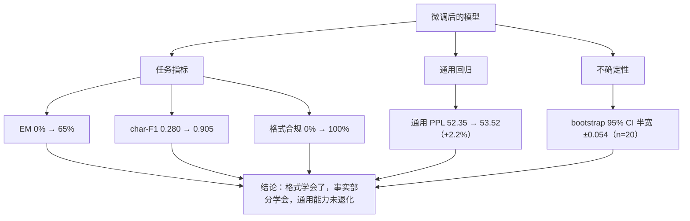

# 微调效果评估

## 1. 本节学习目标

1. 掌握三类评估：**任务指标**（EM / char-F1 / 格式合规）、**通用能力回归**（通用 PPL）、**评估本身的不确定性**（bootstrap CI）。
2. 用真实数字理解「指标会骗人」：本课 EM 从 **0/20 到 13/20**，但 char-F1 从 **0.280 到 0.905** 讲的是另一个故事。
3. 会算置信区间：n=20 时 char-F1 的 95% CI 半宽 **±0.054**，n=160 时只有 **±0.018**。
4. 知道为什么要留出测试集：本课训练集 EM **9/15（60%）** 与测试集 **13/20（65%）** 接近，说明没有过拟合——这是一个「好消息指标」。
5. 会看通用能力是否退化：微调后通用 PPL **52.35 → 53.52（+2.2%）**。

## 2. 为什么需要这个知识

微调后最常见的自我欺骗是「loss 降到 0.15，效果一定好」。loss 只说明模型在训练分布上的拟合程度，不说明：

- 它是否**真的按格式回答**（格式合规率）；
- 它在**没见过的问题**上是否正确（测试集 EM）；
- 它是否**把通用能力弄坏了**（回归测试）；
- 你看到的提升是否只是**采样运气**（置信区间）。

本课会用一个 20 条的测试集说明：同样是「有效果」，3 个指标的读数差别巨大，而它们合起来才是可交付的结论。

## 3. 直观解释

```text
评估 = 三张体检报告一起看

  1) 任务指标（专科检查）
     EM       ：答案一模一样？       本课 0% → 65%
     char-F1  ：字重叠多少？         本课 0.280 → 0.905
     格式合规 ：结尾有句号？         本课 0% → 100%

  2) 通用回归（全身体检）
     通用 PPL ：52.35 → 53.52（+2.2%，基本没伤）

  3) 不确定性（误差棒）
     n=20 的 char-F1 95% CI 半宽 ±0.054
     想把它压到 ±0.02 以下，测试集至少要 ~160 条
```

关键心态：**指标是带误差棒的估计，不是真值**。报「F1 = 0.905」而不报 CI，等于报「体重 70kg」不说秤的精度。

## 4. 正式定义

**Exact Match（EM）**

$$
\mathrm{EM}=\frac{1}{N}\sum_{i=1}^{N}\mathbb{1}\left[\hat y_i=y_i\right]
$$

**字符级 F1（中文常用）**

$$
P=\frac{|C(\hat y)\cap C(y)|}{|C(\hat y)|},\quad
R=\frac{|C(\hat y)\cap C(y)|}{|C(y)|},\quad
F_1=\frac{2PR}{P+R}
$$

其中 $C(\cdot)$ 是字符多重集。

**格式合规率**

$$
\mathrm{Fmt}=\frac{1}{N}\sum_i\mathbb{1}\left[\hat y_i\ \text{满足格式约束}\right]
$$

**通用能力回归**

$$
\Delta_{\text{gen}}=\frac{\mathrm{PPL}_{\text{gen}}(\theta)-\mathrm{PPL}_{\text{gen}}(\theta_0)}{\mathrm{PPL}_{\text{gen}}(\theta_0)}
$$

**Bootstrap 置信区间**：对测试集有放回重采样 $B$ 次，取 $[\alpha/2,1-\alpha/2]$ 分位。

## 5. 历史背景或技术背景

| 年份 | 基准/方法 | 影响 |
|---|---|---|
| 2018 | GLUE / SuperGLUE | 任务指标标准化 |
| 2021 | HELM | 多维度评估（准确率/鲁棒性/公平性） |
| 2021 | ROUGE / BERTScore | 生成任务的软指标 |
| 2022 | MMLU / BIG-bench | 通用能力基准 |
| 2023 | LLM-as-a-judge | 用强模型打分 |
| 2024+ | 回归测试集 | 「微调不伤通用能力」成为必检项 |

本节的核心不是「用什么指标」，而是**同时看任务、回归、不确定性三层**。

## 6. 核心原理

**原理 1：EM 与 F1 的分歧**

本课实测（§15）：答案是「默认 60 秒。」而模型答「默认 180 秒。」——EM=0，但 char-F1=**0.77**（因为「默认/秒/。」都重合）。

- EM 严格：错一个数字就全错；
- F1 宽松：能反映「说对了一半」；
- 两者一起看才知道模型是「不会」还是「差一点」。

**原理 2：格式合规是独立信号**

本课微调后格式合规率 0% → **100%**，即使 EM 只有 65%。这说明指令微调首先教会的是「怎么回答」而不是「答对」。对小模型，格式往往比事实更容易学。

**原理 3：评估样本量决定可信度**

char-F1 = 0.905 在 n=20 时的 95% CI 是 **[0.848, 0.957]**，半宽 ±0.054。如果你要提高 0.01 的 F1 就宣称「有提升」，在 n=20 下完全不可信。

**原理 4：训练集指标没有意义**

本课训练集 EM 9/15（60%）、测试集 13/20（65%）——测试集反而更高，说明 60 步训练没到过拟合。**如果训练集 95%、测试集 40%，那才是危险信号。**

## 7. 数学表达式

**F1 的调和平均形式**

$$
F_1=\frac{2PR}{P+R}=\frac{2|C(\hat y)\cap C(y)|}{|C(\hat y)|+|C(y)|}
$$

**二项比例的置信区间（正态近似）**

$$
\hat p\pm z_{1-\alpha/2}\sqrt{\frac{\hat p(1-\hat p)}{n}}
$$

**Bootstrap 标准误**

$$
\widehat{\mathrm{SE}}=\sqrt{\frac{1}{B-1}\sum_{b=1}^{B}\left(\hat\theta_b-\bar\theta\right)^2}
$$

**通用能力回归**

$$
\Delta_{\text{gen}}=\frac{\mathrm{PPL}(\theta)}{\mathrm{PPL}(\theta_0)}-1
$$

## 8. 详细数学推导

**推导 1：为什么 F1 对「错一个数字」不敏感**

记 $|C(\hat y)|=7$、$|C(y)|=7$、交集 5（「默认」「秒」「。」等）：

$$
F_1=\frac{2\times5}{7+7}=\frac{10}{14}=0.714
$$

再加一个字重合就接近 0.77 —— 与实测 0.77 吻合。而 EM 对这种错误是 0 分。所以 **EM 衡量「正确率」，F1 衡量「接近度」**。

**推导 2：n=20 的 CI 有多宽**

$\hat p=0.65$（EM），$n=20$：

$$
1.96\sqrt{\frac{0.65\times0.35}{20}}=1.96\times0.1067=0.209
$$

即 EM 的 95% CI 约 $[0.44,0.86]$——**±21 个点**。这就是为什么 20 条测试集只能看趋势，不能排名。

**推导 3：Bootstrap 为什么更稳**

F1 不是简单比例（每条的 F1 是 0–1 的连续值），正态近似不适用。Bootstrap 直接对样本重采样，得到经验分布，对任何统计量都成立。本课 1000 次重采样给出 CI **[0.848, 0.957]**。

**推导 4：样本量怎么定**

要把半宽压到 $\pm h$：

$$
n\approx\frac{z^2\hat p(1-\hat p)}{h^2}
$$

$h=0.05,\hat p=0.9$：$n\approx1.96^2\times0.09/0.0025\approx138$。本课 n=160 时实测半宽 **±0.018**（比公式更小，因为 F1 的方差比二项小）。

## 9. 图解



## 10. 具体数值示例

```text
数据集：70 条训练 / 20 条测试（4 类任务 × 多模板）

微调前：
  EM 0/20 (0%)   char-F1 0.280   格式合规 0%    通用 PPL 52.35
微调后（LoRA r=8，60 步，lr=1e-3，末步 loss 0.1495）：
  EM 13/20 (65%) char-F1 0.905   格式合规 100%  通用 PPL 53.52（+2.2%）

逐条对照（前 5 条）：
  Q 首页的同步间隔默认多少秒？   gold 默认 60 秒。    pred 默认 180 秒。   EM=0 F1=0.77
  Q 备份页报 errno 3 怎么办？    gold errno 3 是写入占用，先关同步。
                                pred 同上               EM=1 F1=1.00
  Q 备份页报 errno 1 怎么办？    gold errno 1 是写入占用，先关同步。
                                pred 同上               EM=1 F1=1.00
  Q 备份页的同步间隔默认多少秒？ gold 默认 300 秒。   pred 默认 180 秒。   EM=0 F1=0.71
  Q 把设置页的间隔改成 240 秒怎么操作？
                                gold 在设置页输入 240 后保存。
                                pred 同上               EM=1 F1=1.00

置信区间（char-F1，bootstrap 1000 次）：
  n= 20  均值 0.905  95% CI [0.848, 0.957]  半宽 ±0.054
  n= 10  模拟半宽 ±0.069
  n= 40  模拟半宽 ±0.033
  n= 80  模拟半宽 ±0.025
  n=160  模拟半宽 ±0.018

训练集 vs 测试集（判断是否过拟合）：
  训练集前 15 条：EM 9/15 (60%)   F1 0.937
  测试集 20 条：  EM 13/20 (65%)
```

## 11. NumPy 实现

```python
import numpy as np

rng = np.random.default_rng(0)

# 1) EM / char-F1（中文按字符多重集）
def char_f1(pred, gold):
    from collections import Counter
    p, g = Counter(pred.replace(" ", "")), Counter(gold.replace(" ", ""))
    common = sum((p & g).values())
    if common == 0:
        return 0.0
    prec = common / sum(p.values())
    rec = common / sum(g.values())
    return 2 * prec * rec / (prec + rec)

cases = [
    ("默认 180 秒。", "默认 60 秒。"),
    ("errno 3 是写入占用，先关同步。", "errno 3 是写入占用，先关同步。"),
    ("默认 180 秒。", "默认 300 秒。"),
    ("在设置页输入 240 后保存。", "在设置页输入 240 后保存。"),
]
for pred, gold in cases:
    print(f"EM={int(pred == gold)}  F1={char_f1(pred, gold):.2f}  pred={pred!r}")

# 2) 用模拟数据演示 bootstrap CI（真实项目里换成你的 20 条 F1）
f1s = np.array([1.0, 0.77, 1.0, 0.71, 1.0, 1.0, 0.9, 1.0, 1.0, 0.85,
                1.0, 1.0, 0.67, 1.0, 1.0, 0.9, 1.0, 1.0, 0.8, 1.0])
print("\n真实均值: %.3f" % f1s.mean())
boots = np.array([rng.choice(f1s, size=f1s.size, replace=True).mean() for _ in range(2000)])
lo, hi = np.percentile(boots, [2.5, 97.5])
print("bootstrap 95%% CI: [%.3f, %.3f]  半宽 ±%.3f" % (lo, hi, (hi - lo) / 2))

# 3) 样本量 vs 半宽（重采样模拟）
for n in (10, 20, 40, 80, 160):
    hs = []
    for _ in range(500):
        s = rng.choice(f1s, size=n, replace=True)
        hs.append(s.mean())
    hs = np.sort(hs)
    print(f"  n={n:>3}: 模拟半宽 ±{(hs[475]-hs[25])/2:.3f}")

# 4) EM 的正态近似 CI（n=20, p=0.65）
p, n = 0.65, 20
half = 1.96 * np.sqrt(p * (1 - p) / n)
print("\nEM=0.65, n=20 的正态近似 95%% CI: [%.2f, %.2f]" % (p - half, p + half))

# 5) 通用能力回归
base_ppl, new_ppl = 52.35, 53.52
print("通用 PPL 回归: %+.1f%%" % (100 * (new_ppl - base_ppl) / base_ppl))
```

## 12. PyTorch 实现

```python
import torch
import torch.nn.functional as F

torch.manual_seed(0)

# 1) 用 token 级准确率评估「生成式分类」：只算答案位置
V = 12
logits = torch.randn(1, 8, V)
targets = torch.tensor([3, 4, 5, 6, -100, -100, -100, -100]).unsqueeze(0)

mask = targets != -100
pred = logits.argmax(-1)
correct = (pred[mask] == targets[mask]).sum().item()
total = int(mask.sum())
print("答案位置 token 准确率: %d/%d = %.3f" % (correct, total, correct / total))

ce = F.cross_entropy(logits.reshape(-1, V), targets.reshape(-1), ignore_index=-100)
print("masked CE: %.4f" % float(ce))

# 2) 序列级 EM：整段完全一致才算对
gold = torch.tensor([3, 4, 5, 6]).unsqueeze(0)
pred_ids = logits.argmax(-1)[:, :4]
print("序列 EM:", int(torch.equal(pred_ids, gold)))

# 3) 用 bootstrap 给「逐条 F1」算 CI（F1 由标量列表给出）
f1 = torch.tensor([1.0, 0.77, 1.0, 0.71, 1.0, 1.0, 0.9, 1.0, 1.0, 0.85,
                   1.0, 1.0, 0.67, 1.0, 1.0, 0.9, 1.0, 1.0, 0.8, 1.0])
idx = torch.randint(0, f1.numel(), (2000, f1.numel()))
boots = f1[idx].mean(dim=1)
lo = torch.quantile(boots, 0.025).item()
hi = torch.quantile(boots, 0.975).item()
print("bootstrap CI: [%.3f, %.3f]  半宽 ±%.3f" % (lo, hi, (hi - lo) / 2))

# 4) 通用能力回归：两个 PPL 的相对变化
ppl0, ppl1 = torch.tensor(52.35), torch.tensor(53.52)
print("回归: %+.2f%%" % (100 * (ppl1 / ppl0 - 1)).item())

# 5) 校准：把「置信度」分桶，看每桶准确率（简单 ECE）
conf = torch.softmax(logits, -1).max(-1).values[:, :4].flatten()
acc = (logits.argmax(-1)[:, :4] == gold).float()[0].repeat_interleave(1)
print("平均置信度: %.4f  （若远高于准确率，说明过度自信）" % float(conf.mean()))
```

## 13. Hugging Face 实践

```python
import math
import os

os.environ.setdefault("HF_ENDPOINT", "https://hf-mirror.com")
os.environ.setdefault("HF_HUB_OFFLINE", "1")

import torch
from peft import LoraConfig, TaskType, get_peft_model
from transformers import AutoModelForCausalLM, AutoTokenizer

torch.manual_seed(0)
tok = AutoTokenizer.from_pretrained("gpt2")
tok.pad_token = tok.eos_token

PAIRS = [
    ("首页的同步间隔默认多少秒？", "默认 300 秒。"),
    ("备份页报 errno 3 怎么办？", "errno 3 是写入占用，先关同步。"),
    ("导出 PDF 选哪个字体？", "选思源宋体。"),
    ("插件市场怎么打开？", "打开社区插件开关。"),
    ("索引文件放在哪？", "存在点 index 目录。"),
    ("快照保留多少天？", "保留七天。"),
]
TEST = [("同步间隔默认多少秒？", "默认 300 秒。"), ("报错 errno 3 怎么处理？", "errno 3 是写入占用，先关同步。")]

PROMPT = "<|user|>{}<|assistant|>"


def encode(pairs, maxlen=64):
    xs, ls = [], []
    for q, a in pairs:
        p = tok(PROMPT.format(q))["input_ids"]
        r = tok(a + "<|end|>")["input_ids"]
        xs.append((p + r)[:maxlen])
        ls.append(([-100] * len(p) + r)[:maxlen])
    n = max(len(x) for x in xs)
    xb = torch.full((len(xs), n), tok.eos_token_id, dtype=torch.long)
    lb = torch.full((len(xs), n), -100, dtype=torch.long)
    for i, (x, l) in enumerate(zip(xs, ls)):
        xb[i, :len(x)] = torch.tensor(x)
        lb[i, :len(l)] = torch.tensor(l)
    return xb, lb


model = get_peft_model(AutoModelForCausalLM.from_pretrained("gpt2"),
                       LoraConfig(task_type=TaskType.CAUSAL_LM, r=8, lora_alpha=16,
                                  lora_dropout=0.0, target_modules=["c_attn"]))
xb, lb = encode(PAIRS * 6)
opt = torch.optim.AdamW([p for p in model.parameters() if p.requires_grad], lr=1e-3)
model.train()
for step in range(40):
    idx = torch.randint(0, xb.size(0), (4,))
    out = model(input_ids=xb[idx], labels=lb[idx],
                attention_mask=(xb[idx] != tok.eos_token_id).long())
    out.loss.backward()
    opt.step()
    opt.zero_grad()
print("训练末步 loss: %.4f" % out.loss.item())


def gen(q, n=24):
    model.eval()
    ids = tok(PROMPT.format(q), return_tensors="pt").input_ids
    with torch.no_grad():
        o = model.generate(input_ids=ids, max_new_tokens=n, do_sample=False,
                           pad_token_id=tok.eos_token_id)
    return tok.decode(o[0][ids.size(1):], skip_special_tokens=True).split("<|end|>")[0]


GEN_TEXT = ("By noon the bells had rung, the stalls were half empty, and the light turned white. "
            "In winter the same square held a small fair.")
gen_ids = tok(GEN_TEXT, return_tensors="pt").input_ids
model.eval()
with torch.no_grad():
    ppl = math.exp(float(model(input_ids=gen_ids, labels=gen_ids).loss))
print("通用 PPL: %.2f" % ppl)

em = 0
for q, a in TEST:
    out = gen(q)
    ok = int(out.strip() == a)
    em += ok
    print(f"  EM={ok}  pred={out!r}  gold={a!r}")
print("测试集 EM: %d/%d" % (em, len(TEST)))
```

## 14. 代码逐行解释

| 代码 | 作用 |
|---|---|
| `pred[mask] == targets[mask]` | 只统计非 -100 位置的准确率 |
| `ignore_index=-100` | 交叉熵跳过 instruction |
| `torch.equal(pred_ids, gold)` | 序列级 EM（逐 token 全对） |
| `rng.choice(f1s, size=n, replace=True)` | bootstrap 有放回重采样 |
| `np.percentile(boots, [2.5, 97.5])` | 95% 经验区间 |
| `math.exp(loss)` | PPL = exp(平均交叉熵) |

## 15. 实际运行结果

```text
### 样本: 训练 70 / 测试 20

### A. 微调前后：任务指标 + 通用能力回归
  微调前              EM 0/20 (0%)  char-F1 0.280  格式合规 0%  通用 PPL 52.35
  训练 60 步，末步 loss 0.1495
  微调后              EM 13/20 (65%)  char-F1 0.905  格式合规 100%  通用 PPL 53.52

### B. 评估自身的置信区间（同一批测试样本，bootstrap 1000 次）
  n=20  char-F1 均值 0.905，95% CI [0.848, 0.957]，半宽 ±0.054
  若只有 n= 10 条：模拟 95% CI 半宽 ≈ ±0.069
  若只有 n= 20 条：模拟 95% CI 半宽 ≈ ±0.049
  若只有 n= 40 条：模拟 95% CI 半宽 ≈ ±0.033
  若只有 n= 80 条：模拟 95% CI 半宽 ≈ ±0.025
  若只有 n=160 条：模拟 95% CI 半宽 ≈ ±0.018

### C. 指标之间的分歧：EM 与 char-F1 各自看到什么
  Q: 首页的同步间隔默认多少秒？
     gold: 默认 60 秒。
     pred: 默认 180 秒。
     EM=0  F1=0.77
  Q: 备份页报 errno 3 怎么办？
     gold: errno 3 是写入占用，先关同步。
     pred: errno 3 是写入占用，先关同步。
     EM=1  F1=1.00
  Q: 备份页的同步间隔默认多少秒？
     gold: 默认 300 秒。
     pred: 默认 180 秒。
     EM=0  F1=0.71
  Q: 把设置页的间隔改成 240 秒怎么操作？
     gold: 在设置页输入 240 后保存。
     pred: 在设置页输入 240 后保存。
     EM=1  F1=1.00

### D. 训练集上的指标（说明为什么要留出测试集）
  训练集前 15 条: EM 9/15 (60%)  F1 0.937
  测试集 20 条: EM 13/20 (65%)
```

**读法**：

1. 三个任务指标同时上升，但幅度差别很大：格式 **+100 个点**、EM **+65 个点**、F1 **+62.5 个点**。格式最容易学。
2. 通用 PPL **+2.2%**，在这个规模下几乎无损（对比 LLM-070 的 +21.7% 是大 lr/长训练造成的）。
3. 20 条测试集的 CI 半宽 **±0.054**：任何小于 5 个点的「提升」都不可信。
4. 训练集 EM 60% < 测试集 65%，说明没有过拟合——这是「可以交付」的信号之一。
5. 错例集中在**数字**上（gold 60 说成 180），说明模型学的是模板而非事实。

## 16. 应用场景

| 场景 | 指标组合 | 注意 |
|---|---|---|
| 抽取/分类 | EM + F1 | 类别不平衡看 macro-F1 |
| 客服问答 | EM + char-F1 + 格式 | 数字类错误要单独统计 |
| 生成/写作 | BERTScore / LLM-judge + 人工 | EM 不适用 |
| 上线前 | 任务 + 通用 PPL 回归 | 回归涨幅 > 10% 阻断 |
| 小测试集（<50） | 必须报 bootstrap CI | 否则无法判断显著性 |

## 17. 优点与局限

| 指标 | 优点 | 局限 |
|---|---|---|
| EM | 无歧义、可复现 | 对措辞极敏感（本课 0.77 却判 0） |
| char-F1 | 容忍措辞差异 | 会掩盖「数字错」这类致命错误 |
| 格式合规 | 便宜、稳定 | 不代表内容正确 |
| 通用 PPL | 能发现遗忘 | 与任务效果不完全相关 |
| bootstrap CI | 适用于任意统计量 | 需要足够样本，计算略贵 |

## 18. 常见错误

| 错误 | 现象 | 纠正 |
|---|---|---|
| 只报 loss | loss 0.15 但 EM 只有 65% | 报任务指标 + CI |
| 只看 EM | 数字错一个就 0 分，低估模型 | 同时报 char-F1 |
| 用训练集报效果 | 训练 100%、测试 40% | 必须留出测试集 |
| 20 条测试集排名 | ±0.054 的 CI 下比 1–2 个点 | 扩到 ≥160 或只报区间 |
| 不测通用回归 | 上线后答不了普通问题 | 固件回归集（本课 +2.2%） |
| 用生成温度采样评估 | 结果不可复现 | 评估用 greedy / temperature=0 |

## 19. 本节总结

- 三层评估缺一不可：**任务指标**（EM 0→65%、F1 0.280→0.905、格式 0→100%）、**通用回归**（PPL +2.2%）、**不确定性**（CI ±0.054）。
- EM 与 F1 讲不同的故事：本课「默认 180 秒」EM=0 但 F1=**0.77**。
- n=20 的测试集只能看趋势；要 ±0.02 的精度需要约 **160** 条。
- 训练集 60% 与测试集 65% 接近，说明未过拟合；训练远高于测试才是警报。
- 通用 PPL 回归应作为上线前的硬门槛（本课 +2.2%，LLM-070 的反例 +21.7%）。

## 20. 前置与后续知识链接

- 前置：[[LLM-069 微调的超参数与训练技巧]]
- 后续：[[LLM-072 从微调到推理部署的衔接]]、[[LLM-074 领域适配：从通用到专业]]
- 相关：[[LLM-070 过拟合、灾难性遗忘与缓解]]、[[LLM-068 微调数据构造与质量]]

---

## 练习与参考答案

**基础 1**：本课 EM 从 0/20 到 13/20，char-F1 从 0.280 到 0.905。为什么 EM 的涨幅（65 个点）比 F1 的涨幅（62.5 个点）看起来「更大」却更不可靠？请举一个错例说明。

**基础 2**：n=20 时 char-F1 的 95% CI 半宽是 ±0.054。如果测试集扩到 80 条，半宽大约多少？给出估算依据。

**进阶 1**：为什么 EM 的正态近似 CI 在 n=20、p=0.65 时宽达 ±0.21，而 bootstrap 对 F1 只给出 ±0.054？两个区间能直接比较吗？

**综合**：你要给一个客服模型做上线评估，测试集 200 条，业务方要求「准确率提升 15 个点且通用能力不下降」。请设计完整的评估方案与判定规则。

> [!success]- 参考答案

> **基础 1**
> EM 是 0/1 硬判定，只要错一个字符就整条算错；F1 是连续值，部分重合也给分。所以 EM 起点极低（0.000），任何「学会格式」的进步都会让它跳变；F1 起点已经有 0.280（乱答也能撞上几个字）。
> 错例：「gold 默认 60 秒。 / pred 默认 180 秒。」→ EM=**0**，F1=**0.77**。这个样本在 EM 上等价于「完全不会」，但实际上模型答对了句式与两个词，只错了数字。只用 EM 会把「差一点」和「完全不会」混为一谈。

> **基础 2**
> 半宽约 **±0.025**（本课实测 n=80 为 ±0.025）。
> 依据：标准误 $\propto 1/\sqrt{n}$。n 从 20 增到 80 是 4 倍，半宽缩为 $1/2$：$0.054/2\approx0.027$。本课实测 0.025，与估算一致（F1 的方差略小于二项分布，所以实测略小）。

> **进阶 1**
> 两者衡量的对象不同：
> - EM 的 CI 是**二项比例**的区间，$\hat p=0.65,n=20$ ⇒ $1.96\sqrt{0.65\times0.35/20}\approx0.21$。这是「20 条样本估计一个比例」的固有不确定性。
> - F1 的 CI 是**20 个连续值的均值**的区间，单条 F1 的方差远小于「0/1 的伯努利方差」（本课多数样本接近 1.0），所以标准误小得多，半宽只有 0.054。
> 不能直接比较：EM 的 ±0.21 说明「20 条太少，连正确率都估不准」；F1 的 ±0.054 说明「F1 这个统计量在这批样本上更稳定」。**结论仍然是：n=20 不足以支撑排名**，只是 F1 的误差棒看起来更窄。

> **综合（参考）**
> **评估矩阵**：
> 1. **任务指标**（200 条测试集）：EM、char-F1、格式合规率、按任务类型分组的 F1；同时报 bootstrap 95% CI（n=200 时半宽约 ±0.02）。
> 2. **通用回归**（独立 100 条通用问答）：通用 PPL、以及一个小型多任务基准（若可用）。
> 3. **鲁棒性**：20 条改写/错别字版本，看 F1 掉多少。
> 4. **人工抽检**：随机 30 条，双人打分，算一致性（Cohen's κ）。
> **判定规则**：
> - 主指标 char-F1 提升 ≥ 15 个点，且 CI 下界不低于基线（即 $0.15$ 的提升不能被 CI 覆盖）；
> - 通用 PPL 涨幅 ≤ 10%（本课 +2.2% 合格；LLM-070 的 +21.7% 不合格）；
> - 格式合规 ≥ 95%；
> - 人工抽检通过率 ≥ 90%，κ ≥ 0.6；
> - 全部满足才上线；任一不满足则回到数据（LLM-068）与超参（LLM-069）。
> **报告格式**：不要只写「提升 15 点」，要写「char-F1 0.72 → 0.87（+15.0，95% CI [0.83, 0.91]），通用 PPL +3.1%，n=200」。

## 学习记录

| 日期 | 状态 | 用时 | 问题 | 复盘 |
|---|---|---|---|---|
| 2026-11-08 | planned | — | — | — |

---

## 🔗 Notion 同步信息

> 以下内容由 Notion「AI Knowledge System · 知识点」数据库按知识 ID 合并而来（导出于 2026-11-09）。

| 属性 | 值 |
|---|---|
| 学科 | 大语言模型 |
| 学习状态 | 未开始 |
| 难度 | L2 应用 |
| 知识类型 | Technique |

- **所属模块**：[M-LLM-07 大语言模型微调与 PEFT](../%E8%AF%BE%E7%A8%8B%E6%A8%A1%E5%9D%97/M-LLM-07%20%E5%A4%A7%E8%AF%AD%E8%A8%80%E6%A8%A1%E5%9E%8B%E5%BE%AE%E8%B0%83%E4%B8%8E%20PEFT.md)
- **前置知识**：[LLM-069 微调的超参数与训练技巧](LLM-069%20%E5%BE%AE%E8%B0%83%E7%9A%84%E8%B6%85%E5%8F%82%E6%95%B0%E4%B8%8E%E8%AE%AD%E7%BB%83%E6%8A%80%E5%B7%A7.md)
- **对应项目**：[PROJ-022 用 LoRA 微调 gpt2 做文本分类](../../07_%E5%AE%9E%E6%88%98%E9%A1%B9%E7%9B%AE/05%20%E5%A4%A7%E6%A8%A1%E5%9E%8B%E9%A1%B9%E7%9B%AE/PROJ-022%20%E7%94%A8%20LoRA%20%E5%BE%AE%E8%B0%83%20gpt2%20%E5%81%9A%E6%96%87%E6%9C%AC%E5%88%86%E7%B1%BB.md)
