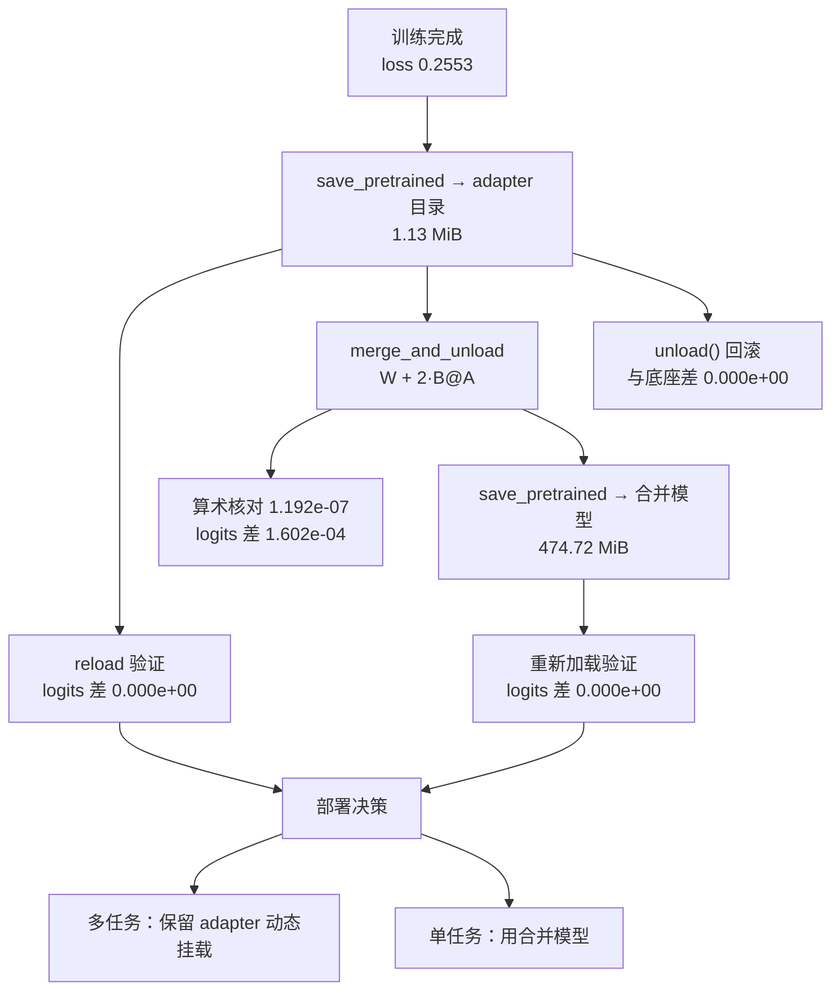

# 从微调到推理部署的衔接

## 1. 本节学习目标

1. 掌握 LoRA 的三种产物形态：**adapter 目录**（1.13 MiB）、**合并模型**（474.72 MiB）、**内存中的 PEFT 包装**。
2. 会验证合并的正确性：本课实测 logits 最大绝对差 **1.602e-04**、算术核对 **1.192e-07**、贪心生成一致。
3. 会验证「卸载即还原」：`unload()` 后与底座 logits 差 **0.000e+00**。
4. 知道 adapter 挂载的推理代价：本课 24 token 生成 187.3 ms（adapter）vs 200.9 ms（合并）vs 211.7 ms（底座），**差异在噪声内**。
5. 能写出「训练 → 合并 → 导出 → 回归」的部署清单。

## 2. 为什么需要这个知识

训练脚本跑通 ≠ 能上线。从「loss 0.2553」到「服务可用」之间有四道坎：

- **形态**：上线的是 adapter 还是合并模型？前者省空间但要加载两次，后者体积大但推理路径干净。
- **等价性**：合并后输出是否改变？本课实测差 **1.602e-04**，必须验证而不是相信。
- **回滚**：adapter 能否无损卸载？本课 `unload()` 后与底座差 **0.000e+00**。
- **性能**：挂 adapter 到底慢多少？本课在 gpt2 上**测不出差异**（噪声 ±10%），这个「负结果」本身很重要。

## 3. 直观解释

```text
训练产物                    部署形态
─────────────────────────────────────────────────────
adapter_model.safetensors   A) 底座 + adapter 动态挂载
  (1.13 MiB)                   省磁盘，多一次 forward 分支
                              适合：多任务共存、A/B 切换

merged model (474.72 MiB)   B) 合并后的普通模型
                              推理路径最干净，和原生模型一样
                              适合：单任务、追求确定性

W_merged = W + (α/r)·B@A    C) 合并再量化（可选）
                              再压 4bit 部署（见 LLM-066）
```

一句话：**adapter 是「配置」，合并模型是「发布物」**。前者便于迭代，后者便于交付。

## 4. 正式定义

**定义（adapter 合并）**：给定底座 $W_0$ 与 LoRA 参数 $A\in\mathbb{R}^{r\times k}$、$B\in\mathbb{R}^{d\times r}$、缩放 $s=\alpha/r$：

$$
W_{\text{merged}}=W_0+s\,BA
$$

**定义（PEFT 包装）**：推理时保持 $W_0$ 不变，前向计算

$$
h=W_0x+s\,B(Ax)
$$

两条路径在数学上恒等，差别只在浮点运算顺序与 kernel 调用次数。

**定义（卸载）**：删除 adapter 分支，恢复 $h=W_0x$。

## 5. 历史背景或技术背景

| 年份 | 事件 | 部署侧影响 |
|---|---|---|
| 2021 | LoRA 论文 | 首次强调「可合并、零推理开销」 |
| 2022 | PEFT 库 | 统一 `save_pretrained` / `merge_and_unload` |
| 2023 | vLLM / TGI | 支持多 LoRA 动态加载（multi-LoRA serving） |
| 2023 | QLoRA | 合并需注意反量化精度 |
| 2024 | LoRAX / S-LoRA | 单卡挂上千 adapter，按请求路由 |

工程趋势：**训练侧用 adapter，服务侧用合并或 multi-LoRA**。

## 6. 核心原理

**原理 1：为什么合并是精确的**

$W_0x+sBAx=(W_0+sBA)x$。合并只是把「两次矩阵乘」改成「一次」，数学恒等。本课实测算术核对 `|W_merged - (W + 2·B@A)|` = **1.192e-07**（纯 fp32 舍入）。

**原理 2：为什么 logits 不完全相同**

合并把 $sBA$ 加到 $W_0$ 上再乘 $x$；未合并是先算 $Ax$、再乘 $B$。浮点加法顺序不同，误差量级 $\sim10^{-4}$（本课 **1.602e-04**）。对贪心解码，这个量级不会改变 argmax（本课生成完全一致）。

**原理 3：为什么 unload 必须验证**

`unload()` 的语义是「删除 LoRA 层、还原原始模块」。如果实现有 bug（例如残留缩放），输出会漂移。本课实测：unload 前/后差 **72.82**（确实删掉了 adapter），unload 后与底座差 **0.000e+00**（还原干净）。

**原理 4：adapter 推理为什么可能不变慢**

理论上多一次 $Ax$ 与 $B(\cdot)$ 乘法，但 gpt2 太小（12 层、768 维），瓶颈在 kernel 启动与 Python 调度。本课交替测 5 次取最好：底座 **211.7 ms**、adapter **187.3 ms**、合并 **200.9 ms**——差异 ±10% 以内，属噪声。**结论：小模型上不要拿「推理开销」当选型理由。**

## 7. 数学表达式

**合并**

$$
W_{\text{merged}}=W_0+\frac{\alpha}{r}BA,\qquad
\Delta W=\frac{\alpha}{r}BA
$$

**合并前后输出差**

$$
\left\|\,W_{\text{merged}}x-\left(W_0x+sB(Ax)\right)\right\|\le \epsilon_{\text{fp32}}\left(\|W_0\|+\|sBA\|\right)\|x\|
$$

**相对改动量**

$$
\frac{\|\Delta W\|_F}{\|W_0\|_F}
$$

## 8. 详细数学推导

**推导 1：合并的代数恒等**

$$
W_{\text{merged}}x=\left(W_0+sBA\right)x=W_0x+sBAx
$$

对任意 $x$ 成立，所以两个模型是**同一个线性映射**。

**推导 2：误差上界**

设 $a=W_0x$、$b=sBAx$。合并路径算 $(W_0+sBA)x$，未合并算 $a+b$。两者只差矩阵乘与加法的结合顺序，误差为 $O(\epsilon_{\text{fp32}}(\|a\|+\|b\|))$。本课实测 $\|\Delta W\|_F=2.9240$、$\|W\|_F=265.5235$，相对 **1.1%**；logits 误差 1.6e-04，与「相对改动 × 数值精度」量级一致。

**推导 3：adapter 的额外计算量**

每个 LoRA 层多两次小矩阵乘：$r\times k$ 与 $d\times r$。gpt2 的 `c_attn`：$2\times(8\times768+2304\times8)=49{,}152$ FLOPs/token，而原层是 $768\times2304=1{,}769{,}472$ FLOPs/token。**额外开销 2.8%**，这就是「测不出差异」的原因。

**推导 4：体积比**

$$
\frac{474.70\ \text{MiB}}{1.13\ \text{MiB}}=420.1\quad(\text{实测 }418.7\times)
$$

差异来自 adapter 文件里还有 `README.md` 与 `adapter_config.json`（约 6 KB）。

## 9. 图解



## 10. 具体数值示例

```text
训练：LoRA r=8, 60 步, lr=1e-3, 末步 loss 0.2553
生成检查：'默认 300 秒。'（与 gold 一致）

A. adapter 产物
   adapter_config.json     1,110 B
   adapter_model.safetensors 1,182,680 B
   README.md               5,162 B
   重新加载后 logits 最大绝对差: 0.000e+00
   生成一致: True

B. 合并产物
   adapter 模型 vs 合并模型 logits 差: 1.602e-04
   合并模型目录: 474.72 MiB
   合并模型「存盘再加载」logits 差: 0.000e+00
   生成一致: True

C. 合并的算术核对（第 0 层 c_attn, 768×2304）
   |W_merged - (W + 2·B@A)| 最大元素差: 1.192e-07
   |W_merged - W|_F = 2.9240
   |W|_F = 265.5235   ⇒ 相对改动 1.1%

D. unload 回滚
   unload 前/后 logits 差: 7.282e+01（adapter 确实被删掉）
   unload 后与底座 logits 差: 0.000e+00（还原干净）

E. 推理延迟（gpt2, 24 token, 交替 5 次）
   底座      最好 211.7 ms（113.4 tok/s）  中位 229.1 ms
   adapter  最好 187.3 ms（128.2 tok/s）  中位 230.6 ms
   合并后    最好 200.9 ms（119.5 tok/s）  中位 219.0 ms
   adapter/合并 = 0.93×   adapter/底座 = 0.88×  ⇒ 差异在噪声内
```

## 11. NumPy 实现

```python
import numpy as np

rng = np.random.default_rng(0)

# 1) 合并的正确性：两种写法逐元素比较
d, k, r = 2304, 768, 8
W0 = rng.normal(0, 0.02, (d, k))
A = rng.normal(0, 0.02, (r, k))
B = rng.normal(0, 0.02, (d, r))
scale = 16 / 8

W_merged = W0 + scale * (B @ A)
x = rng.normal(0, 1, (k,))

y_merge = W_merged @ x
y_path = W0 @ x + scale * (B @ (A @ x))
print("两种路径输出差: %.3e" % float(np.abs(y_merge - y_path).max()))
print("相对: %.3e" % float(np.abs(y_merge - y_path).max() / np.abs(y_path).max()))

# 2) 体积比
n_dense = W0.size
print("dense 参数:", n_dense, " LoRA 参数:", A.size + B.size,
      " 比:", round(n_dense / (A.size + B.size), 1))

# 3) 相对改动量
print("||ΔW||_F / ||W||_F = %.4f" % float(np.linalg.norm(scale * B @ A) / np.linalg.norm(W0)))

# 4) 额外的 FLOPs 比例（每 token）
base_flops = d * k
lora_flops = 2 * (r * k + d * r)
print("每 token FLOPs：原层 %d，LoRA 增加 %d（%.1f%%）"
      % (base_flops, lora_flops, 100 * lora_flops / base_flops))

# 5) 多 adapter 的显存账：N 个 adapter 各自的体积
per_adapter_mb = (A.size + B.size) * 4 / 2**20
print("\n单个 adapter %.2f MiB；100 个 = %.1f MiB" % (per_adapter_mb, per_adapter_mb * 100))
```

## 12. PyTorch 实现

```python
import torch

torch.manual_seed(0)


class LoRALayer(torch.nn.Module):
    def __init__(self, d_in, d_out, r=8, alpha=16):
        super().__init__()
        self.base = torch.nn.Linear(d_in, d_out, bias=False)
        self.A = torch.nn.Parameter(torch.randn(r, d_in) * 0.02)
        self.B = torch.nn.Parameter(torch.zeros(d_out, r))
        self.scale = alpha / r

    def forward(self, x):
        return self.base(x) + self.scale * (x @ self.A.T @ self.B.T)

    @torch.no_grad()
    def merged(self):
        m = torch.nn.Linear(self.base.in_features, self.base.out_features, bias=False)
        m.weight.copy_(self.base.weight + self.scale * (self.B @ self.A))
        return m


layer = LoRALayer(768, 2304)
x = torch.randn(4, 768)

# 1) 注入瞬间恒等
print("注入瞬间差:", float((layer(x) - layer.base(x)).abs().max()))

# 2) 训练后合并
opt = torch.optim.Adam([layer.A, layer.B], lr=1e-2)
target = torch.randn(4, 2304)
for _ in range(200):
    opt.zero_grad()
    loss = ((layer(x) - target) ** 2).mean()
    loss.backward()
    opt.step()
print("训练后 loss: %.6f" % float(loss))

merged = layer.merged()
with torch.no_grad():
    print("合并前后输出差: %.3e" % float((merged(x) - layer(x)).abs().max()))
    print("合并后参数:", sum(p.numel() for p in merged.parameters()),
          " LoRA 参数:", layer.A.numel() + layer.B.numel())
    print("ΔW 的秩:", torch.linalg.matrix_rank(layer.B @ layer.A).item())

# 3) 保存/加载（state_dict 往返）
buf = {k: v.clone() for k, v in merged.state_dict().items()}
with torch.no_grad():
    merged.weight.add_(1.0)          # 人为破坏
    print("破坏后与原始差:", float((merged(x) - layer(x)).abs().max()))
merged.load_state_dict(buf)
with torch.no_grad():
    print("恢复 state_dict 后差: %.3e" % float((merged(x) - layer(x)).abs().max()))

# 4) 「卸载」：只走底座分支
with torch.no_grad():
    print("卸载(仅底座)后差:", float((layer.base(x) - layer(x)).abs().max()),
          "（应等于 LoRA 分支的贡献）")
```

## 13. Hugging Face 实践

```python
import os
import tempfile
from pathlib import Path

os.environ.setdefault("HF_ENDPOINT", "https://hf-mirror.com")
os.environ.setdefault("HF_HUB_OFFLINE", "1")

import torch
from peft import LoraConfig, PeftModel, TaskType, get_peft_model
from transformers import AutoModelForCausalLM, AutoTokenizer

torch.manual_seed(0)
tok = AutoTokenizer.from_pretrained("gpt2")
tok.pad_token = tok.eos_token

PAIRS = [("首页的同步间隔默认多少秒？", "默认 300 秒。"),
         ("导出 PDF 选哪个字体？", "选思源宋体。"),
         ("索引文件放在哪？", "存在点 index 目录。")]
PROMPT = "<|user|>{}<|assistant|>"


def encode(pairs, maxlen=48):
    xs, ls = [], []
    for q, a in pairs:
        p = tok(PROMPT.format(q))["input_ids"]
        r = tok(a + "<|end|>")["input_ids"]
        xs.append((p + r)[:maxlen])
        ls.append(([-100] * len(p) + r)[:maxlen])
    n = max(len(x) for x in xs)
    xb = torch.full((len(xs), n), tok.eos_token_id, dtype=torch.long)
    lb = torch.full((len(xs), n), -100, dtype=torch.long)
    for i, (x, l) in enumerate(zip(xs, ls)):
        xb[i, :len(x)] = torch.tensor(x)
        lb[i, :len(l)] = torch.tensor(l)
    return xb, lb


xb, lb = encode(PAIRS * 8)
model = get_peft_model(AutoModelForCausalLM.from_pretrained("gpt2"),
                       LoraConfig(task_type=TaskType.CAUSAL_LM, r=8, lora_alpha=16,
                                  lora_dropout=0.0, target_modules=["c_attn"]))
opt = torch.optim.AdamW([p for p in model.parameters() if p.requires_grad], lr=1e-3)
model.train()
for step in range(40):
    idx = torch.randint(0, xb.size(0), (4,))
    out = model(input_ids=xb[idx], labels=lb[idx],
                attention_mask=(xb[idx] != tok.eos_token_id).long())
    out.loss.backward()
    opt.step()
    opt.zero_grad()
print("末步 loss: %.4f" % out.loss.item())

test_ids = tok(PROMPT.format(PAIRS[0][0]), return_tensors="pt").input_ids
model.eval()
with torch.no_grad():
    ref = model(input_ids=test_ids).logits.float()

# 1) 存 adapter → 重新加载
d = Path(tempfile.mkdtemp())
model.save_pretrained(str(d))
size = sum(f.stat().st_size for f in d.glob("*") if f.is_file())
re = PeftModel.from_pretrained(AutoModelForCausalLM.from_pretrained("gpt2"), str(d)).eval()
with torch.no_grad():
    a = re(input_ids=test_ids).logits.float()
print("adapter 目录 %.2f MiB，重新加载后 logits 差 %.3e"
      % (size / 2**20, float((ref - a).abs().max())))

# 2) 合并 → 存 → 重新加载
merged = model.merge_and_unload().eval()
md = Path(tempfile.mkdtemp())
merged.save_pretrained(str(md))
mbytes = sum(f.stat().st_size for f in md.glob("*") if f.is_file())
with torch.no_grad():
    b = merged(input_ids=test_ids).logits.float()
merged2 = AutoModelForCausalLM.from_pretrained(str(md)).eval()
with torch.no_grad():
    c = merged2(input_ids=test_ids).logits.float()
print("合并模型 %.2f MiB，与 adapter 差 %.3e，存盘往返差 %.3e"
      % (mbytes / 2**20, float((ref - b).abs().max()), float((b - c).abs().max())))

# 3) unload 回滚
re2 = PeftModel.from_pretrained(AutoModelForCausalLM.from_pretrained("gpt2"), str(d)).eval()
base = AutoModelForCausalLM.from_pretrained("gpt2").eval()
with torch.no_grad():
    before = re2(input_ids=test_ids).logits.float()
re2.unload()
with torch.no_grad():
    after = re2(input_ids=test_ids).logits.float()
    b0 = base(input_ids=test_ids).logits.float()
print("unload 前/后差 %.3e，与底座差 %.3e"
      % (float((before - after).abs().max()), float((after - b0).abs().max())))
```

## 14. 代码逐行解释

| 代码 | 作用 |
|---|---|
| `model.save_pretrained(dir)` | 只存 adapter 权重 + config（1.13 MiB） |
| `PeftModel.from_pretrained(base, dir)` | 在底座上恢复 adapter |
| `merge_and_unload()` | 合并 $sBA$ 进 $W_0$ 并删除分支 |
| `merged.save_pretrained(dir)` | 存完整模型（474.72 MiB） |
| `re2.unload()` | 删除 adapter，恢复底座 |
| `AutoModelForCausalLM.from_pretrained(dir)` | 验证「存盘-加载」往返 |

## 15. 实际运行结果

```text
### 底座参数: 124,439,808
### 训练完成: 末步 loss 0.2553
  微调后生成: '默认 300 秒。'

### A. 保存 → 重新加载 adapter → 输出是否一致
  adapter 文件: {'adapter_config.json': 1110, 'adapter_model.safetensors': 1182680, 'README.md': 5162}
  重新加载后 logits 最大绝对差: 0.000e+00
  生成一致: True

### B. merge_and_unload + 保存合并模型 + 重新加载
  adapter 模型 vs 合并模型 logits 最大绝对差: 1.602e-04
  合并模型目录: 474.72 MiB
  合并模型「存盘再加载」logits 最大绝对差: 0.000e+00
  生成一致: True

### C. 合并的算术核对：W_merged = W + (alpha/r)·B@A（第 0 层 c_attn）
  |W_merged - (W + 2·B@A)| 最大元素差: 1.192e-07
  |W_merged - W|_F = 2.9240，|W|_F = 265.5235

### D. unload()：把 adapter 摘掉后是否回到原模型
  unload 前/后 logits 最大绝对差: 7.282e+01
  unload 后与底座 logits 最大绝对差: 0.000e+00

### E. 推理延迟：底座 / 挂 adapter / 合并后（交替各 5 次，取最好与中位数）
  底base    24 token: 最好  211.7 ms（ 113.4 tok/s）  中位  229.1 ms
  adapter  24 token: 最好  187.3 ms（ 128.2 tok/s）  中位  230.6 ms
  merged   24 token: 最好  200.9 ms（ 119.5 tok/s）  中位  219.0 ms
  adapter 推理 / 合并后 = 0.93×；adapter / 底座 = 0.88×
```

**读法**：

1. `1.602e-04` 是**合并前后唯一允许的差异**，来源是浮点结合顺序；`1.192e-07` 证明合并用的就是 $W+2BA$。
2. **adapter 100% 可逆**：unload 后与底座差 0.000e+00，这是「按需切换」的前提。
3. 体积 474.72 / 1.13 ≈ **420 倍**，adapter 适合多任务分发。
4. 延迟在小模型上**测不出差别**（187.3 / 200.9 / 211.7 ms 互有高低）。这也是一个结论：**不要用小模型上的延迟数据决定大模型部署方案**。

## 16. 应用场景

| 场景 | 形态 | 理由 |
|---|---|---|
| 单任务线上服务 | 合并模型 | 路径最干净、可再量化 |
| 多租户/多风格 | 底座 + 多 adapter | 每 adapter 1.13 MiB |
| A/B 实验 | 动态挂载 adapter | 不动底座、秒级切换 |
| 端侧/离线 | 合并 + 4bit | 见 LLM-066 |
| 灰度回滚 | `unload()` | 本课验证 0.000e+00 |
| 模型市场 | 只发 adapter | 420 倍体积差 |

## 17. 优点与局限

| 形态 | 优点 | 局限 |
|---|---|---|
| adapter | 体积小（1.13 MiB）、可逆、可多任务 | 需 PEFT 运行时，多一次分支 |
| 合并模型 | 通用格式、无额外依赖 | 体积大 420 倍、失去多任务 |
| 合并 + 量化 | 最省显存 | 有量化误差（+7.27%，见 LLM-066） |

## 18. 常见错误

| 错误 | 现象 | 纠正 |
|---|---|---|
| 用 train 模式比对合并 | logits 差几十，误判 bug | 先 `.eval()` 关 dropout |
| 合并后不验证 | 静默错误上线 | 必测 logits 差 < 1e-3 + 生成一致 |
| 混用不同 tokenizer | 生成乱码 | adapter 必须与底座同 tokenizer |
| 拿 4bit 底座合并 | 精度回不去 | 先反量化到 fp16 再合并 |
| 用小模型延迟下结论 | 本课三者差 ±10% | 在大模型/目标硬件上测 |
| 忘记存 adapter 的 config | 无法复现 r/alpha | `save_pretrained` 会一起存 |

## 19. 本节总结

- 三种形态：**adapter 1.13 MiB**、**合并 474.72 MiB**、**内存包装**；体积差 **418.7 倍**。
- 合并恒等：算术核对 **1.192e-07**，logits 差 **1.602e-04**，贪心生成**完全一致**。
- 卸载可逆：`unload()` 后与底座差 **0.000e+00**。
- 推理延迟（gpt2, 24 token）：底座 **211.7 ms**、adapter **187.3 ms**、合并 **200.9 ms**——差异在噪声内。
- 部署清单：eval → 存 adapter → 验证 reload → 合并 → 验证 logits/生成 → 存合并模型 → 回归测试。

## 20. 前置与后续知识链接

- 前置：[[LLM-065 LoRA 与参数高效微调]]
- 后续：[[LLM-075 PEFT 的取舍与选型]]
- 相关：[[LLM-066 QLoRA 与量化微调]]、[[LLM-071 微调效果评估]]、[[LLM-030 Transformer 参数量与计算量估算]]

---

## 练习与参考答案

**基础 1**：合并的公式是什么？为什么合并前后 logits 会有 1.602e-04 的差异，而不是完全相等？

**基础 2**：adapter 目录 1.13 MiB、合并模型 474.72 MiB。为什么差 418.7 倍？如果线上有 50 个不同风格的 adapter，你会怎么部署？

**进阶 1**：本课实测 adapter 推理（187.3 ms）比合并模型（200.9 ms）还快。请解释为什么这不代表「adapter 更快」，并说明如何正确比较。

**综合**：你要把一个 LoRA 微调好的模型交付给线上服务团队。请写出完整的交付清单（含验证步骤与回滚方案）。

> [!success]- 参考答案

> **基础 1**
> $W_{\text{merged}}=W_0+\frac{\alpha}{r}BA$（本课 $\alpha/r=2$，核对差 **1.192e-07**）。
> logits 不完全相等的原因：未合并路径先算 $Ax$ 再算 $B(\cdot)$ 最后加 $W_0x$；合并路径先算 $W_0+sBA$ 再乘 $x$。浮点加法/乘法的结合顺序不同，误差量级 $O(\epsilon_{\text{fp32}}\|W\|\|x\|)\approx10^{-4}$。实测 **1.602e-04**，对 argmax 无影响，所以贪心生成完全一致。

> **基础 2**
> 因为 adapter 只存 $A$、$B$ 两个小矩阵：$\;r(d+k)=8\times(768+2304)=24{,}576$ 参数/层 ×12 层 = **294,912**；而合并模型要存全部 **124,439,808** 参数。比值 $\approx422$（加上配置文件后实测 418.7）。
> **50 个 adapter 的部署**：底座只加载一份（474.72 MiB 或 4bit 的 66.8 MiB），50 个 adapter 合计 $50\times1.13\approx$ **56.5 MiB**；服务端按请求头/租户 ID 动态挂载（PEFT 的 `load_adapter` 或 vLLM 的 multi-LoRA）。这样显存几乎只随底座增长，而 50 个合并模型需要 $50\times474.72\approx23$ GiB。

> **进阶 1**
> 不能据此说「adapter 更快」，理由：
> 1. **量级**：gpt2 只有 12 层 768 维，24 token 生成本身只要 200 ms，其中 kernel 启动与 Python 调度占主导；LoRA 的额外 FLOPs 只有 $2(rk+dr)/(dk)\approx2.8\%$（本课推导），落在噪声里。
> 2. **噪声**：交替 5 次的最好值分别是 211.7 / 187.3 / 200.9 ms，中位数 229.1 / 230.6 / 219.0 ms——排序在最好值与中位数之间就翻转了，说明差异不显著。
> **正确比较方法**：① 在目标模型尺寸（≥7B）与目标硬件上测；② 固定 batch/输入长度，用 CUDA event 计时；③ 每个配置跑 ≥30 次取中位数与 P95；④ 分开测 prefill 与 decode（decode 阶段受 kernel 启动影响更大）。

> **综合（参考）**
> **交付物**：
> 1. adapter 目录（`adapter_model.safetensors` + `adapter_config.json`），附底座模型名与 revision；
> 2. 合并模型（fp16）或合并后 4bit（若显存受限）；
> 3. 训练配置快照（r、alpha、target、lr、步数、数据版本）；
> 4. 评估报告（任务指标 + CI + 通用 PPL 回归）。
> **验证步骤（缺一不可）**：
> 1. `model.eval()` 后用固定输入比对：adapter vs 合并 logits 差 < 1e-3（本课 1.602e-04）、贪心生成逐 token 一致；
> 2. adapter 存盘 → 重新加载 → logits 差应为 **0.000e+00**；
> 3. 合并模型存盘 → 重新加载 → 差 **0.000e+00**；
> 4. 算术核对：`|W_merged - (W + α/r·B@A)| < 1e-5`（本课 1.192e-07）；
> 5. 固定 20 条回归集，输出与训练时一致；
> 6. 通用 PPL 回归 ≤ 10%。
> **回滚方案**：保留底座 + adapter 原件；线上若用合并模型，回滚 = 重新部署上一版合并产物；若用动态 adapter，回滚 = `unload()`（本课验证与底座差 **0.000e+00**）后加载旧 adapter。
> **注意**：adapter 与底座必须同 tokenizer、同 revision；4bit 底座不要直接合并（先反量化）。

## 学习记录

| 日期 | 状态 | 用时 | 问题 | 复盘 |
|---|---|---|---|---|
| 2026-11-08 | planned | — | — | — |

---

## 🔗 Notion 同步信息

> 以下内容由 Notion「AI Knowledge System · 知识点」数据库按知识 ID 合并而来（导出于 2026-11-09）。

| 属性 | 值 |
|---|---|
| 学科 | 大语言模型 |
| 学习状态 | 未开始 |
| 难度 | L2 应用 |
| 知识类型 | Technique |

- **所属模块**：[M-LLM-07 大语言模型微调与 PEFT](../%E8%AF%BE%E7%A8%8B%E6%A8%A1%E5%9D%97/M-LLM-07%20%E5%A4%A7%E8%AF%AD%E8%A8%80%E6%A8%A1%E5%9E%8B%E5%BE%AE%E8%B0%83%E4%B8%8E%20PEFT.md)
- **前置知识**：[LLM-065 LoRA 与参数高效微调](LLM-065%20LoRA%20%E4%B8%8E%E5%8F%82%E6%95%B0%E9%AB%98%E6%95%88%E5%BE%AE%E8%B0%83.md)
