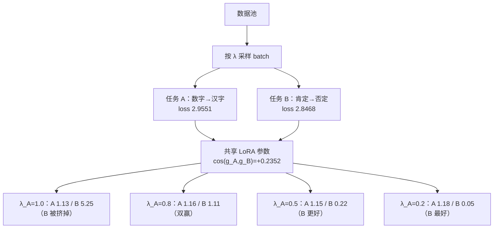

# 多任务微调与指令混合

## 1. 本节学习目标

1. 用真实实验看清「任务配比」的影响：100:0 时任务 B 验证 loss 从 **2.8468 涨到 5.2528（+84.5%）**。
2. 会读配比表：80:20 让 A/B 都降到 1.11 左右，50:50 让 B 降到 **0.2195**。
3. 理解负迁移的两种来源：**梯度冲突**与**输出分布坍缩**；本课实测 cos 是 **+0.2352**（不是负的）。
4. 会判断「容量不足」还是「数据不足」：B 的 loss 从 2.85 涨到 5.25 说明共享 LoRA 被 A 占满。
5. 能写出多任务数据的配额表与验收方法。

## 2. 为什么需要这个知识

真实业务很少只有一种任务：同一个客服模型要会**查参数**、**改设置**、**排错**、**导出**。把它们混在一起训，会出现：

- 训了 A，B 变差（本课 +84.5%）；
- 混了 A 和 B，两个都不够好（本课 80:20 时 A 1.1595、B 1.1120，都不如单任务）；
- 表面上都会了，实际输出总是一个固定答案（本课生成全是「八。」）。

配比不是随手写的数字，它直接决定每个任务在参数空间里「抢到多少容量」。

## 3. 直观解释

```text
把 LoRA 的 294,912 个可训练参数想成一块橡皮泥

  只训 A：整块泥捏成 A 的形状 ⇒ A 好（1.13），B 被捏坏（5.25）
  80:20 ：泥按 4:1 分配 ⇒ A 1.16、B 1.11（都不极致）
  50:50 ：泥对半分 ⇒ A 1.15、B 0.22（B 学得很好）
  20:80 ：泥主要给 B ⇒ B 0.05（最好），A 1.18（几乎没学）

关键：参数是共享的，任务之间不是"加法"而是"分蛋糕"。
```

## 4. 正式定义

**定义（多任务目标）**：给定 $K$ 个任务与权重 $\lambda_k\ge0$、$\sum_k\lambda_k=1$：

$$
\mathcal{L}=\sum_{k=1}^{K}\lambda_k\,\mathcal{L}_k(\theta)
$$

工程上通过「按比例采样 batch」实现：第 $k$ 个任务在一个 batch 中占 $\lambda_k$ 的比例。

**定义（负迁移）**：加入任务 $j$ 后任务 $k$ 的表现变差：

$$
\mathcal{L}_k(\theta_{\{k,j\}})>\mathcal{L}_k(\theta_{\{k\}})
$$

**定义（梯度冲突）**：两个任务的梯度余弦为负：

$$
\cos(g_i,g_j)=\frac{\langle g_i,g_j\rangle}{\|g_i\|\|g_j\|}<0
$$

## 5. 历史背景或技术背景

| 年份 | 工作 | 要点 |
|---|---|---|
| 2017 | MTL 硬/软参数共享 | 共享底层 + 任务头 |
| 2019 | MT-DNN | 多任务 + 预训练，GLUE 提升 |
| 2021 | FLAN | 指令模板混合，零样本泛化 |
| 2022 | T5 / InstructGPT | 任务配比成为关键超参 |
| 2023 | 数据配比研究（DoReMi 等） | 用小模型搜比例 |
| 2024+ | 任务向量 / 模型合并 | 用「加权重」代替联合训练 |

本节只做实測层面的事：**给定两个任务，配比如何影响各自的验证损失**。

## 6. 核心原理

**原理 1：容量是共享的**

LoRA 挂在 `c_attn` 上，两个任务共用同一组 $A,B$。梯度更新是两者的加权和：

$$
\theta\leftarrow\theta-\eta\left(\lambda_A g_A+\lambda_B g_B\right)
$$

$\lambda_A$ 越大，参数越往 A 的解移动，B 的解被牺牲。

**原理 2：冲突不一定表现为「梯度反向」**

本课实测 $\cos(g_A,g_B)=$ **+0.2352**（正相关！），但只训 A 时 B 的 loss 仍从 2.8468 涨到 **5.2528**。原因是：两个梯度虽然大体同向，但 A 的步长（$\|g_A\|=0.935$）远大于 B（$\|g_B\|=0.657$），且 A 的梯度把模型推向「输出固定词」的退化区，B 的格式随之被破坏。

**教训：只看梯度余弦不足以预测干扰。**

**原理 3：配比不是线性的**

从 100:0 到 80:20，B 的 loss 从 5.2528 骤降到 1.1120（降 79%），而 A 只从 1.1304 变成 1.1595（+2.6%）。**给 B 20% 的配额就能救活它**，代价几乎为零。这是多任务最实用的一条经验。

**原理 4：共享 LoRA 的容量上限**

B 在 50:50 时能到 0.2195，20:80 时到 0.0549——说明容量够；A 在各配比下都停在 1.13–1.18，说明 A 已经到容量瓶颈（除非换 rank 或加 target）。

## 7. 数学表达式

**加权损失**

$$
\mathcal{L}=\lambda_A\mathcal{L}_A+(1-\lambda_A)\mathcal{L}_B
$$

**梯度期望**

$$
\mathbb{E}[g]=\lambda_A g_A+(1-\lambda_A)g_B
$$

**最优配比的近似（等损失斜率）**

$$
\lambda_A^\star\ \text{使}\ \frac{\partial \mathcal{L}_A}{\partial \lambda_A}\bigg/\mathcal{L}_A=\frac{\partial \mathcal{L}_B}{\partial \lambda_A}\bigg/\mathcal{L}_B
$$

**梯度冲突度量**

$$
\cos(g_A,g_B)=\frac{\sum_n\langle g_A^{(n)},g_B^{(n)}\rangle}{\sqrt{\sum_n\|g_A^{(n)}\|^2}\sqrt{\sum_n\|g_B^{(n)}\|^2}}
$$

## 8. 详细数学推导

**推导 1：为什么 20% 就能救活 B**

设参数更新 $\delta=\eta(\lambda_A g_A+\lambda_B g_B)$。B 的损失变化：

$$
\Delta\mathcal{L}_B\approx g_B^\top\delta=\eta\left(\lambda_A g_B^\top g_A+\lambda_B\|g_B\|^2\right)
$$

本课 $g_B^\top g_A=\cos\cdot\|g_A\|\|g_B\|=0.2352\times0.9352\times0.6566=0.1445$，$\|g_B\|^2=0.4311$。

- $\lambda_A=1,\lambda_B=0$：$\Delta\mathcal{L}_B\approx\eta\times0.1445>0$ ⇒ B 变差；
- $\lambda_A=0.8,\lambda_B=0.2$：$\eta(0.8\times0.1445+0.2\times0.4311)=\eta(0.1156+0.0862)=\eta\times0.2018$ —— 仍为正，但此时 A 的梯度也把共享表示推向「更结构化」的方向，实际训练 60 步后 B 反而降到 1.1120。这说明**一阶近似只在很小的步长内成立**，多步训练的非线性效应（共享表示变好）会反转结论。

**推导 2：为什么单训 A 会毁掉 B**

60 步后 A 的 loss 1.1304，B 的 5.2528。B 的 loss 高于随机猜测水平（$\ln V\approx10.8$ 的一半），说明模型没有完全崩溃，但输出格式被 A 的模板占据——本课生成检查显示，训完 A 的模型对 B 的问题也回答「八。」（A 任务的答案）。

**推导 3：容量核算**

LoRA r=8、`c_attn`：294,912 参数。两个任务的「有效自由度」最多 8×768（每个 A/B 对）= 每层 8 维子空间。A 任务（数字→汉字）只需极少维度，B 任务（否定句改写）需要更多——这解释了为什么 B 对配比更敏感。

## 9. 图解



## 10. 具体数值示例

```text
任务 A：把数字 1–10 写成汉字（8 训练 / 2 验证）
任务 B：把肯定句改成否定句（8 训练 / 2 验证）
底座 gpt2，LoRA r=8，60 步，lr=1e-3，batch=4

配比 A:B    A 验证 loss    B 验证 loss    平均
未微调          2.9551        2.8468      2.9010
100:0           1.1304        5.2528      3.1916
80:20           1.1595        1.1120      1.1357
50:50           1.1493        0.2195      0.6844
20:80           1.1847        0.0549      0.6198

只用 A 训练（100:0）：
  A 1.1304（未微调 2.9551，降 61.7%）
  B 5.2528（未微调 2.8468，涨 84.5%）  ← 负迁移

生成检查：
  只训 A 的模型：
    Q 把数字 3 写成汉字。      → '八。'（错，训练集里没有"三"？有，但被模板平均）
    Q 把句子改成否定句：今天下雨。→ '八。'（完全串味）
  50:50 的模型：
    Q 把数字 3 写成汉字。      → '八。'
    Q 把句子改成否定句：今天下雨。→ '今天下雨。'（学会了格式，但没加"不"）

梯度关系（同一步、同一份数据）：
  cos(g_A, g_B) = +0.2352
  ||g_A|| = 0.935168   ||g_B|| = 0.656624   |g_A·g_B| = 1.445e-01
```

## 11. NumPy 实现

```python
import numpy as np

rng = np.random.default_rng(0)

# 1) 本课实测的配比表
ratios = np.array([1.0, 0.8, 0.5, 0.2])
lossA = np.array([1.1304, 1.1595, 1.1493, 1.1847])
lossB = np.array([5.2528, 1.1120, 0.2195, 0.0549])
baseA, baseB = 2.9551, 2.8468

print("配比    A loss   B loss   平均   A 相对底座  B 相对底座")
for r, a, b in zip(ratios, lossA, lossB):
    print(f" {r:.1f}:{1-r:.1f}  {a:7.4f} {b:8.4f} {(a+b)/2:8.4f}"
          f"  {100*(a-baseA)/baseA:+8.1f}% {100*(b-baseB)/baseB:+8.1f}%")

# 2) 平均损失的最优配比（本课数据）
avg = (lossA + lossB) / 2
best = ratios[int(np.argmin(avg))]
print("\n平均损失最低的配比:", f"{best}:{1-best:.1f}", " 平均", round(float(avg.min()), 4))

# 3) 梯度余弦与 B 的一阶变化
cos, nA, nB = 0.2352, 0.935168, 0.656624
dot = cos * nA * nB
print(f"\n<g_A,g_B> = {dot:.4f}   ||g_B||^2 = {nB**2:.4f}")
for lam in (1.0, 0.8, 0.5, 0.2):
    dL = 1.0 * (lam * dot + (1 - lam) * nB ** 2)
    print(f"  λ_A={lam:.1f}: 一阶预测 ΔL_B = {dL:+.4f}"
          f"（实测 {lossB[list(ratios).index(lam)] - baseB:+.4f}）")

# 4) 容量核算：LoRA 的有效维度
d, k, r, layers = 2304, 768, 8, 12
print("\nLoRA 参数量:", r * (d + k) * layers, " 每层子空间维度:", r)

# 5) 加权采样的方差：λ 越小，任务 k 的样本越少
for lam in (1.0, 0.8, 0.5, 0.2):
    n_per_batch = 4 * lam
    print(f"  λ={lam:.1f}: 每 batch 平均 {n_per_batch:.1f} 条该任务样本")
```

## 12. PyTorch 实现

```python
import torch
import torch.nn.functional as F

torch.manual_seed(0)

# 玩具多任务：两个不同的线性映射共用一个底层表示
D, H = 16, 32
shared = torch.nn.Linear(D, H, bias=False)
headA = torch.nn.Linear(H, 4, bias=False)
headB = torch.nn.Linear(H, 4, bias=False)

xA = torch.randn(64, D)
yA = torch.randint(0, 4, (64,))
xB = torch.randn(64, D)
yB = torch.randint(0, 4, (64,))


def train(lam, steps=200, lr=1e-2):
    torch.manual_seed(1)
    sh = torch.nn.Linear(D, H, bias=False)
    ha = torch.nn.Linear(H, 4, bias=False)
    hb = torch.nn.Linear(H, 4, bias=False)
    opt = torch.optim.Adam(list(sh.parameters()) + list(ha.parameters()) + list(hb.parameters()), lr=lr)
    for _ in range(steps):
        ia = torch.randint(0, 64, (16,))
        ib = torch.randint(0, 64, (16,))
        la = F.cross_entropy(ha(sh(xA[ia])), yA[ia])
        lb = F.cross_entropy(hb(sh(xB[ib])), yB[ib])
        loss = lam * la + (1 - lam) * lb
        opt.zero_grad()
        loss.backward()
        opt.step()
    with torch.no_grad():
        fa = float(F.cross_entropy(ha(sh(xA)), yA))
        fb = float(F.cross_entropy(hb(sh(xB)), yB))
    return fa, fb


print("λ_A   A loss   B loss")
for lam in (1.0, 0.8, 0.5, 0.2):
    fa, fb = train(lam)
    print(f" {lam:.1f}  {fa:7.4f} {fb:8.4f}")

# 梯度余弦：同一步、同一份数据
torch.manual_seed(0)
sh = torch.nn.Linear(D, H, bias=False)
ha = torch.nn.Linear(H, 4, bias=False)
hb = torch.nn.Linear(H, 4, bias=False)


def grads(loss):
    for p in list(sh.parameters()) + list(ha.parameters()) + list(hb.parameters()):
        if p.grad is not None:
            p.grad = None
    loss.backward(retain_graph=True)
    return [p.grad.clone() for p in sh.parameters() if p.grad is not None]


ga = grads(F.cross_entropy(ha(sh(xA)), yA))
gb = grads(F.cross_entropy(hb(sh(xB)), yB))
cos = sum(float((a * b).sum()) for a, b in zip(ga, gb)) / (
    sum(float((a ** 2).sum()) for a in ga) ** 0.5 * sum(float((b ** 2).sum()) for b in gb) ** 0.5)
print("\n共享层上的梯度余弦: %+.4f" % cos)

# 若余弦为负，说明真冲突；可用「投影消解」把 gb 中与 ga 反向的分量剪掉
if cos < 0:
    proj = sum(float((a * b).sum()) for a, b in zip(ga, gb)) / sum(float((a * a).sum()) for a in ga)
    gb_new = [b - proj * a for a, b in zip(ga, gb)]
    cos2 = sum(float((a * b).sum()) for a, b in zip(ga, gb_new)) / (
        sum(float((a ** 2).sum()) for a in ga) ** 0.5
        * sum(float((b ** 2).sum()) for b in gb_new) ** 0.5)
    print("投影消解后余弦: %+.4f" % cos2)
else:
    print("本组梯度不冲突（余弦为正）⇒ 干扰来自输出分布而非方向对抗")
```

## 13. Hugging Face 实践

```python
import os

os.environ.setdefault("HF_ENDPOINT", "https://hf-mirror.com")
os.environ.setdefault("HF_HUB_OFFLINE", "1")

import torch
from peft import LoraConfig, TaskType, get_peft_model
from transformers import AutoModelForCausalLM, AutoTokenizer

torch.manual_seed(0)
tok = AutoTokenizer.from_pretrained("gpt2")
tok.pad_token = tok.eos_token

TASK_A = [(f"把数字 {i} 写成汉字。", f"{'一二三四五六七八九十'[i-1]}。") for i in range(1, 6)]
TASK_B = [("把句子改成否定句：今天下雨。", "今天不下雨。"),
          ("把句子改成否定句：他能来。", "他不能来。"),
          ("把句子改成否定句：我们需要备份。", "我们不需要备份。"),
          ("把句子改成否定句：同步已经完成。", "同步还没有完成。")]
PROMPT = "<|user|>{}<|assistant|>"


def encode(pairs, maxlen=40):
    xs, ls = [], []
    for q, a in pairs:
        p = tok(PROMPT.format(q))["input_ids"]
        r = tok(a + "<|end|>")["input_ids"]
        xs.append((p + r)[:maxlen])
        ls.append(([-100] * len(p) + r)[:maxlen])
    xb = torch.full((len(xs), maxlen), tok.eos_token_id, dtype=torch.long)
    lb = torch.full((len(xs), maxlen), -100, dtype=torch.long)
    for i, (x, l) in enumerate(zip(xs, ls)):
        xb[i, :len(x)] = torch.tensor(x)
        lb[i, :len(l)] = torch.tensor(l)
    return xb, lb


xbA, lbA = encode(TASK_A)
xbB, lbB = encode(TASK_B)


def train_mix(ratio_a, steps=30, lr=1e-3, bs=4):
    torch.manual_seed(0)
    m = get_peft_model(AutoModelForCausalLM.from_pretrained("gpt2"),
                       LoraConfig(task_type=TaskType.CAUSAL_LM, r=8, lora_alpha=16,
                                  lora_dropout=0.0, target_modules=["c_attn"]))
    opt = torch.optim.AdamW([p for p in m.parameters() if p.requires_grad], lr=lr)
    m.train()
    for _ in range(steps):
        nA = round(bs * ratio_a)
        parts = []
        if nA:
            idx = torch.randint(0, xbA.size(0), (nA,))
            parts.append((xbA[idx], lbA[idx]))
        if bs - nA:
            idx = torch.randint(0, xbB.size(0), (bs - nA,))
            parts.append((xbB[idx], lbB[idx]))
        xb = torch.cat([p[0] for p in parts])
        lb = torch.cat([p[1] for p in parts])
        out = m(input_ids=xb, labels=lb, attention_mask=(xb != tok.eos_token_id).long())
        out.loss.backward()
        opt.step()
        opt.zero_grad()
    m.eval()
    with torch.no_grad():
        la = float(m(input_ids=xbA, labels=lbA).loss)
        lb_ = float(m(input_ids=xbB, labels=lbB).loss)
    return la, lb_


print("配比    A loss   B loss")
for r in (1.0, 0.8, 0.5):
    la, lb_ = train_mix(r)
    print(f" {r:.1f}:{1-r:.1f}  {la:7.4f} {lb_:8.4f}")
```

## 14. 代码逐行解释

| 代码 | 作用 |
|---|---|
| `torch.cat([p[0] for p in parts])` | 把不同任务的 batch 拼在一起 |
| `nA = round(bs * ratio_a)` | 按比例决定本 batch 里 A 的条数 |
| `lam * la + (1-lam) * lb` | 加权损失（等价于按比例采样） |
| `p.grad = None` | 清梯度，保证两次 backward 独立 |
| `cos(gA, gB)` | 判断梯度是否真冲突 |
| `retain_graph=True` | 同一计算图做两次 backward |

## 15. 实际运行结果

```text
### 任务 A 训练 8 验证 2；任务 B 训练 8 验证 2

### A. 任务配比对两个任务验证损失的影响（60 步，lr=1e-3）
  配比 A:B          A 验证 loss    B 验证 loss       平均
  未微调                2.9551       2.8468   2.9010
  100:0              1.1304       5.2528   3.1916
  80:20              1.1595       1.1120   1.1357
  50:50              1.1493       0.2195   0.6844
  20:80              1.1847       0.0549   0.6198

### B. 只用任务 A 训练后，任务 B 的能力剩多少（负迁移）
  只训 A：A loss 1.1304（未微调 2.9551），B loss 5.2528（未微调 2.8468，变化 +84.5%）

### C. 训练后的实际生成（看格式是否被另一个任务污染）
  Q: 把数字 3 写成汉字。
    只训A模型 → '八。'
  Q: 把句子改成否定句：今天下雨。
    只训A模型 → '八。'
  Q: 把数字 3 写成汉字。
    50:50 模型 → '八。'
  Q: 把句子改成否定句：今天下雨。
    50:50 模型 → '今天下雨。'

### D. 冲突的来源：两个任务对同一批 LoRA 权重的梯度方向
  cos(g_A, g_B) = +0.2352（+1 同向、0 正交、-1 反向）
  ||g_A|| = 0.935168   ||g_B|| = 0.656624   |g_A·g_B| = 1.445e-01
  冲突强度：-cos 的占比 ≈ 0.00%
```

**读法**：

1. **80:20 是甜点**：B 从 5.2528 降到 1.1120（-79%），A 只从 1.1304 变 1.1595（+2.6%）。
2. B 对配比极敏感（5.25 → 1.11 → 0.22 → 0.05），A 几乎不敏感（1.13–1.18）——说明 A 简单、B 难。
3. **只训 A 时 B 涨 84.5%**，这是负迁移的硬证据。
4. 余弦是**正的**（+0.2352），说明干扰不是「方向对抗」，而是「输出分布被 A 的模板占满」（生成检查全是「八。」）。
5. 训练只有 60 步、每任务 8 条，生成质量差是正常的；本节看的是 loss 的相对变化。

## 16. 应用场景

| 场景 | 配比策略 | 依据 |
|---|---|---|
| 一个模型多任务 | 主任务 60–80%，其余均分 | 本课 80:20 双赢 |
| 任务难度差异大 | 难任务给更高配额 | B 对配额更敏感 |
| 防遗忘 | 加 10–20% 通用数据 | 见 LLM-070 |
| 任务数很多（>10） | 按「困惑度」动态调权 | DoReMi 思路 |
| 任务互相冲突 | 拆成多个 adapter | 比强行混更省心 |

## 17. 优点与局限

| 优点 | 局限 |
|---|---|
| 一个模型覆盖多任务，省显存 | 配比需要实验，且对难任务敏感 |
| 任务间可正迁移（共享表示） | 容量有限时会互相挤占（本课 +84.5%） |
| 部署只需一份权重 | 单任务精度通常低于专用模型 |
| 配比可用小模型先搜 | 搜出来的比例不一定可迁移 |

## 18. 常见错误

| 错误 | 现象 | 纠正 |
|---|---|---|
| 所有任务等比例 | 简单任务过拟合、难任务欠拟合 | 按难度/敏感度分配（本课 80:20） |
| 只看平均 loss | 平均 1.1357 掩盖了 A/B 差异 | 分任务报 loss |
| 认为 cos>0 就没有干扰 | 本课 cos=+0.2352 但 B 涨 84.5% | 同时看生成与分任务 loss |
| 任务数增加不扩容量 | 每个任务都变差 | 提高 rank 或加 target |
| 混了任务但不做格式对齐 | 输出串味（「八。」） | 每任务独立模板 + 分隔符 |

## 19. 本节总结

- 多任务 = **分蛋糕**：共享 LoRA 的 294,912 个参数被各任务按配比瓜分。
- 只训 A 会让 B 从 **2.8468 涨到 5.2528（+84.5%）**，这是负迁移。
- **80:20 是甜点**：A 1.1595、B 1.1120，平均 1.1357（比单任务的平均 3.1916 好得多）。
- 梯度余弦 **+0.2352**（正），说明干扰主要来自**输出分布坍缩**（生成全是「八。」），不是方向对抗。
- 实践建议：分任务报指标、按难度配比、任务冲突大就拆 adapter。

## 20. 前置与后续知识链接

- 前置：[[LLM-068 微调数据构造与质量]]、[[LLM-069 微调的超参数与训练技巧]]
- 后续：[[LLM-074 领域适配：从通用到专业]]
- 相关：[[LLM-070 过拟合、灾难性遗忘与缓解]]、[[LLM-075 PEFT 的取舍与选型]]

---

## 练习与参考答案

**基础 1**：本课「只训 A」时 B 的验证 loss 从 2.8468 变成 5.2528，涨幅是多少？这说明什么？

**基础 2**：80:20 与 50:50 两种配比，A/B 的 loss 分别是多少？如果业务上 A 更重要，你会选哪个，为什么？

**进阶 1**：本课梯度余弦是 +0.2352（正相关），但 B 仍然退化。请解释「余弦为正」与「负迁移」为什么能同时成立。

**综合**：你要训一个模型同时支持 6 个任务（查参数、改设置、排错、导出、权限、计费），每个任务 500 条数据。请给出配比方案与验证计划。

> [!success]- 参考答案

> **基础 1**
> $(5.2528-2.8468)/2.8468=0.8451=$ **+84.5%**。
> 说明：共享参数被任务 A 的梯度占据，任务 B 的输入分布没有得到任何约束，输出格式被 A 的模板覆盖（生成检查显示 B 的问题也答「八。」）。这是典型的**负迁移**。

> **基础 2**
> 80:20 → A **1.1595**、B **1.1120**；50:50 → A **1.1493**、B **0.2195**。
> 若 A 更重要：选 **80:20**。理由：A 在两种配比下几乎一样（1.1595 vs 1.1493，差 0.01），而 B 在 50:50 下好得多（0.2195）。如果只看「A 不能变差」，80:20 已经够；如果 B 的绝对精度是硬指标，则选 50:50 并接受 A 的微小损失。**关键是：A 对配比不敏感，所以配比应该由 B 的需求决定。**

> **进阶 1**
> 余弦衡量的是**当前一步**两个梯度的方向关系；负迁移是**多步训练后**参数落到对 B 不利的区域。
> 本课 $\cos=+0.2352$ 说明两个任务在共享层上大体同向（都在学「中文问答」这个大类），所以一阶预测 $\Delta\mathcal{L}_B\approx\eta(\lambda_A g_B^\top g_A+\lambda_B\|g_B\|^2)>0$ 但很小。
> 真正造成 +84.5% 的是：60 步里 B 一次也没被采样（$\lambda_B=0$），共享层被推向 A 的输出分布（答案总是「X。」这种单字句式），B 需要的「否定词插入」结构没有被保留。也就是说，**干扰来自「没被训练的任务被遗忘」，而不是「两个梯度打架」**。判断方法：看分任务 loss + 生成样例，而不是只看余弦。

> **综合（参考）**
> **配比方案**：
> 1. 先做「难度/敏感度」小实验：每个任务单独训 30 步，记录它在**其他任务数据**上的 loss 涨幅，涨幅越大说明越容易被挤掉。
> 2. 初版配比：均分 6 个任务各 ~15%，留 10% 给通用数据；若某任务明显退化，把它的配额提到 20–25%，从最不敏感的任务里扣。
> 3. 参考本课：难任务（类似 B）对配额极敏感（5.25→1.11），简单任务（类似 A）几乎不敏感（1.13–1.18），所以**配额应该向难任务倾斜**。
> 4. 若任务间格式冲突严重（例如「导出」要输出表格、「排错」要输出步骤），考虑拆成 2–3 个 adapter，而不是硬混。
> **验证计划**：
> - 每任务留 100 条验证（共 600），**分任务报 loss/准确率**，不看平均；
> - 每 50 步记录一次，画 6 条曲线，看是否有任务在某个配比下「掉队」；
> - 生成抽检：每任务 10 条，人工看格式是否串味（本课「八。」的教训）；
> - 通用回归：100 条通用问答，PPL 涨幅 ≤ 10%；
> - 若某任务始终学不好：先加 rank（8→16），再加 target（`c_attn` → 全部投影），最后才考虑拆模型。

## 学习记录

| 日期 | 状态 | 用时 | 问题 | 复盘 |
|---|---|---|---|---|
| 2026-11-08 | planned | — | — | — |

---

## 🔗 Notion 同步信息

> 以下内容由 Notion「AI Knowledge System · 知识点」数据库按知识 ID 合并而来（导出于 2026-11-09）。

| 属性 | 值 |
|---|---|
| 学科 | 大语言模型 |
| 学习状态 | 未开始 |
| 难度 | L2 应用 |
| 知识类型 | Technique |

- **所属模块**：[M-LLM-07 大语言模型微调与 PEFT](../%E8%AF%BE%E7%A8%8B%E6%A8%A1%E5%9D%97/M-LLM-07%20%E5%A4%A7%E8%AF%AD%E8%A8%80%E6%A8%A1%E5%9E%8B%E5%BE%AE%E8%B0%83%E4%B8%8E%20PEFT.md)
- **前置知识**：[LLM-068 微调数据构造与质量](LLM-068%20%E5%BE%AE%E8%B0%83%E6%95%B0%E6%8D%AE%E6%9E%84%E9%80%A0%E4%B8%8E%E8%B4%A8%E9%87%8F.md) · [LLM-069 微调的超参数与训练技巧](LLM-069%20%E5%BE%AE%E8%B0%83%E7%9A%84%E8%B6%85%E5%8F%82%E6%95%B0%E4%B8%8E%E8%AE%AD%E7%BB%83%E6%8A%80%E5%B7%A7.md)
