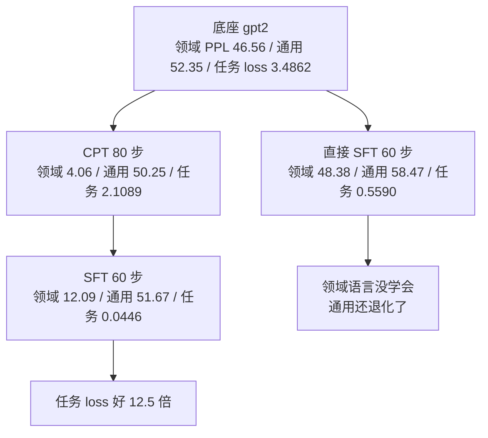

# 领域适配：从通用到专业

## 1. 本节学习目标

1. 分清两段式：**继续预训练（CPT）** 学「这个领域的语言」，**指令微调（SFT）** 学「这个领域的问答」。
2. 用真实数字证明 CPT 的价值：只做 SFT 的任务验证 loss **0.5590**，CPT+SFT 做到 **0.0446**（差 12.5 倍）。
3. 会算 CPT 的收益曲线：领域 PPL **46.56 → 21.08（20 步）→ 4.06（80 步）→ 1.92（160 步）**。
4. 理解「CPT 会让通用 PPL 先降后升」：52.35 → 47.51（40 步）→ 53.77（160 步）。
5. 能判断什么时候需要 CPT、什么时候直接 SFT 就够。

## 2. 为什么需要这个知识

领域数据有两种完全不同的形态：

- **无标注文本**（手册、工单、法规、代码库）——数量大，但没有「问题 → 答案」结构；
- **指令对**（人工标注的 QA）——数量少，但有监督信号。

只做 SFT 等于「用几百条 QA 教会模型一整套领域词汇」，效率极低。CPT 先用大量领域文本把「语言模型」调成本领域的语言模型，再用少量问答教它「怎么答」。本课实测：**跳过 CPT 会让任务 loss 高 12.5 倍**。

## 3. 直观解释

```text
两步走：
  ① CPT（继续预训练）：读一遍这个领域的"教科书"
     目标：学会术语、句式、常见搭配（下一步猜词）
     数据：无标注文本，几百到几百万字

  ② SFT（指令微调）：做一遍这个领域的"练习题"
     目标：学会"问 → 答"的格式与事实
     数据：指令对，几十到几千条

类比：
  CPT = 先把学生送进这个行业实习三个月（熟悉行话）
  SFT = 再给他 50 道真题（学会答题）
  跳过 CPT = 直接给真题，他连题目里的词都不认识
```

## 4. 正式定义

**定义（继续预训练 CPT）**：在领域语料 $\mathcal{D}_{\text{dom}}$ 上继续最小化因果语言建模损失：

$$
\mathcal{L}_{\text{CPT}}=-\sum_{t}\log p_\theta(w_t\mid w_{<t}),\quad w\sim\mathcal{D}_{\text{dom}}
$$

**定义（指令微调 SFT）**：在指令对上最小化（只算回答部分）：

$$
\mathcal{L}_{\text{SFT}}=-\sum_{(x,y)\in\mathcal{D}_{\text{inst}}}\sum_{t}\log p_\theta(y_t\mid x,y_{<t})
$$

**定义（领域适配）**：$\theta_0\xrightarrow{\text{CPT}}\theta_1\xrightarrow{\text{SFT}}\theta_2$，目标是

$$
\min_{\theta_2}\ \mathcal{L}_{\text{SFT}}(\theta_2)\quad\text{s.t.}\quad \mathcal{L}_{\text{gen}}(\theta_2)\approx\mathcal{L}_{\text{gen}}(\theta_0)
$$

## 5. 历史背景或技术背景

| 年份 | 实践 | 结论 |
|---|---|---|
| 2018 | ULMFiT | 「通用预训练 → 领域预训练 → 任务微调」三段式最早形态 |
| 2019 | BioBERT / SciBERT | 生物/科学领域 CPT 显著提升下游 |
| 2020 | CodeBERT / GraphCodeBERT | 代码领域 CPT |
| 2021 | Don't Stop Pretraining | 系统证明「领域 CPT 再做任务微调」普遍更好 |
| 2023 | 法律/医疗 LLM | CPT + SFT 成为标准配方 |
| 2024+ | 继续预训练 + 退火 | 加入高质量数据做「退火」阶段 |

本节把这条经典结论在 gpt2 上重跑一遍，给出可对照的数字。

## 6. 核心原理

**原理 1：CPT 改的是「语言分布」，SFT 改的是「条件分布」**

- CPT 学 $p(w_t\mid w_{<t})$ —— 领域里词与词的搭配；
- SFT 学 $p(y\mid x)$ —— 给定问题该给什么答案。

如果领域词汇在底座里几乎没有（本课的「增量快照」「倒排表」「点 conflicts 目录」），SFT 的梯度要先花力气「教会模型这些词」，剩给「教它怎么答」的容量就少了。

**原理 2：CPT 的收益是边际递减的**

本课 CPT 步数扫描：

| CPT 步数 | 领域 PPL | 通用 PPL |
|---|---|---|
| 0 | 46.56 | 52.35 |
| 20 | 21.08 | 52.15 |
| 40 | 11.97 | 47.51 |
| 80 | 4.06 | 50.25 |
| 160 | 1.92 | 53.77 |

前 40 步收益最大（46.56→11.97，降 74%），后 120 步只再降 84%（11.97→1.92）。**通用 PPL 在 40 步时最低（47.51），之后回升**——这就是过拟合领域的信号。

**原理 3：CPT 之后 SFT 会「回吐」一点领域 PPL**

本课 CPT 后领域 PPL 4.06，做完 SFT 变成 12.09（变差），但任务 loss 从 2.1089 降到 **0.0446**。原因：SFT 的格式约束（短回答）与 CPT 的「续写长文本」目标不同，模型被拉向「简洁作答」。

**原理 4：什么时候不需要 CPT**

- 领域词汇底座已覆盖（通用中文 + 少量术语）；
- 标注数据足够（>5,000 条）；
- 任务只是「格式转换」而非「知识注入」。

本课 SFT-only 的领域 PPL 是 48.38（比底座 46.56 还差），说明它连领域语言都没学会，只是背了问答模板。

## 7. 数学表达式

**CPT 损失（因果 LM）**

$$
\mathcal{L}_{\text{CPT}}=-\frac{1}{T}\sum_{t=1}^{T}\log p_\theta(w_t\mid w_{<t})
$$

**SFT 损失（mask 指令）**

$$
\mathcal{L}_{\text{SFT}}=-\frac{1}{|y|}\sum_{t\in y}\log p_\theta(y_t\mid x,y_{<t})
$$

**领域适配的权衡**

$$
J(\theta)=\mathcal{L}_{\text{SFT}}(\theta)+\gamma\left(\mathcal{L}_{\text{gen}}(\theta)-\mathcal{L}_{\text{gen}}(\theta_0)\right)^2
$$

**PPL**

$$
\mathrm{PPL}=\exp\!\left(-\frac{1}{T}\sum_t\log p_\theta(w_t\mid w_{<t})\right)
$$

## 8. 详细数学推导

**推导 1：为什么 CPT 能降领域 PPL**

领域文本里「增量快照」「倒排表」这类词的共现模式在通用语料中罕见，底座对它们的条件分布接近均匀 ⇒ 交叉熵高。CPT 用大量同分布样本把 $p_\theta(w_t\mid w_{<t})$ 拉向经验分布，交叉熵下降。

数值上：从 46.56 降到 4.06 意味着平均每 token 的负对数似然从 $\ln46.56=3.84$ 降到 $\ln4.06=1.40$，降了 **2.44 nat/token**。

**推导 2：SFT-only 为什么学不会领域语言**

SFT 只有 18 条训练样本（本课），每条回答 10–20 token，总监督 token 不到 400。用 400 个 token 去覆盖一个新领域的词分布是不可能的；模型只能记住「问题 → 答案」的表面映射，所以领域 PPL 仍停在 48.38。

**推导 3：CPT 与 SFT 的目标冲突**

CPT 让模型「续写」，SFT 让它「答完就停」。两个目标对同一批参数提出相反要求：

$$
\nabla\mathcal{L}_{\text{CPT}}\ \text{鼓励继续生成},\qquad
\nabla\mathcal{L}_{\text{SFT}}\ \text{鼓励输出 <|end|>}
$$

所以 CPT+SFT 后领域 PPL 从 4.06 回升到 12.09，但任务 loss 降到 0.0446。

**推导 4：CPT 步数的拐点**

通用 PPL 在 40 步最低（47.51），此时领域 PPL 11.97。若把 CPT 停在 40 步再做 SFT，通常能得到「领域够用 + 通用未退」的平衡点。本课为了看趋势跑到 160 步，通用 PPL 已回升到 53.77。

## 9. 图解



## 10. 具体数值示例

```text
领域语料 391 token；通用评估 39 token；QA 24 条（18 训练 / 6 验证）

阶段                        领域 PPL   通用 PPL   任务 val loss
① 底座                        46.56     52.35      3.4862
② CPT 80 步（末 loss 1.287）    4.06     50.25      2.1089
③ CPT + SFT 60 步             12.09     51.67      0.0446
④ 直接 SFT 60 步（跳过 CPT）     48.38     58.47      0.5590

CPT 步数扫描：
  步数    领域 PPL   通用 PPL
    0      46.56     52.35
   20      21.08     52.15
   40      11.97     47.51   ← 通用最低
   80       4.06     50.25
  160       1.92     53.77

任务准确率（生成式，greedy）：
  直接 SFT: EM 1/6
   例：'九十天，过期要重新握手。'（gold 相同）
  CPT+SFT : EM 1/6
   例：'九十天，过期要重新握手。'

CPT 后的续写（20 token）：
  prompt '增量快照以块为单位记录变更，'
    底座 → '。\n\n私除私除私'（乱码）
    CPT  → '过期要重新先压缩。遍'（能接上领域词，但仍不连贯）
```

## 11. NumPy 实现

```python
import numpy as np

# 1) CPT 步数与两个 PPL 的关系（本课实测）
steps = np.array([0, 20, 40, 80, 160])
dom_ppl = np.array([46.56, 21.08, 11.97, 4.06, 1.92])
gen_ppl = np.array([52.35, 52.15, 47.51, 50.25, 53.77])

print("步数  领域 PPL  通用 PPL  领域降幅  通用变化")
for s, d, g in zip(steps, dom_ppl, gen_ppl):
    print(f"{s:>4}  {d:8.2f}  {g:8.2f}  {100*(d-dom_ppl[0])/dom_ppl[0]:+8.1f}%"
          f"  {100*(g-gen_ppl[0])/gen_ppl[0]:+8.1f}%")

# 2) 边际收益：每一步降多少
d_ppl = np.diff(dom_ppl)
d_steps = np.diff(steps)
print("\n每 20 步的领域 PPL 降幅:", [round(x, 2) for x in d_ppl])
print("边际收益递减:", all(abs(d_ppl[i]) > abs(d_ppl[i + 1]) for i in range(len(d_ppl) - 1)))

# 3) 通用 PPL 的最优点
best = int(np.argmin(gen_ppl))
print(f"\n通用 PPL 最低点: 步数 {steps[best]}（{gen_ppl[best]:.2f}）"
      f"，此时领域 PPL {dom_ppl[best]:.2f}")

# 4) 两段式的净收益
base_task, sft_only, cpt_sft = 3.4862, 0.5590, 0.0446
print("\n任务 loss：底座 %.4f → 仅 SFT %.4f（降 %.1f%%）→ CPT+SFT %.4f（降 %.1f%%）"
      % (base_task, sft_only, 100 * (base_task - sft_only) / base_task,
         cpt_sft, 100 * (base_task - cpt_sft) / base_task))
print("CPT 带来的额外收益: %.1f 倍" % (sft_only / cpt_sft))

# 5) 交叉熵与 PPL 的换算
for ppl in (46.56, 4.06, 12.09, 48.38):
    print(f"  PPL {ppl:>6.2f} → 平均负对数似然 {np.log(ppl):.3f} nat/token")
```

## 12. PyTorch 实现

```python
import math
import torch
import torch.nn.functional as F

torch.manual_seed(0)

# 1) CPT 与 SFT 的 loss 形状（用玩具 logits 演示"只算回答"与"算全序列"）
V = 20
T = 10
logits = torch.randn(1, T, V)
full_labels = torch.randint(0, V, (1, T))

# CPT：所有位置都算（因果 LM 错一位对齐）
cpt_loss = F.cross_entropy(logits[:, :-1].reshape(-1, V), full_labels[:, 1:].reshape(-1))
print("CPT loss（全序列）: %.4f  PPL %.2f" % (float(cpt_loss), math.exp(float(cpt_loss))))

# SFT：只算回答位置（前 4 个是指令，置 -100）
sft_labels = full_labels.clone()
sft_labels[:, :4] = -100
sft_loss = F.cross_entropy(logits[:, :-1].reshape(-1, V), sft_labels[:, 1:].reshape(-1),
                          ignore_index=-100)
print("SFT loss（只算回答）: %.4f" % float(sft_loss))
print("被 mask 的位置数:", int((sft_labels[:, 1:] == -100).sum()), "/", T - 1)

# 2) 两段式的模拟：CPT 学领域分布，SFT 学映射
#    用"领域词表"的分布偏移来模拟
dom_freq = torch.tensor([0.30, 0.25, 0.15, 0.10, 0.08, 0.05, 0.04, 0.03])
log_p_dom = torch.log(dom_freq)
log_p_base = torch.log(torch.ones_like(dom_freq) / len(dom_freq))

def ppl_of(log_p, target):
    return math.exp(float(-(log_p * target).sum() / target.sum()))

target = torch.tensor([5.0, 4.0, 3.0, 2.0, 1.0, 1.0, 1.0, 1.0])
print("\n模拟：底座在领域分布上的 PPL %.2f" % ppl_of(log_p_base, target))
print("模拟：CPT 后在领域分布上的 PPL %.2f" % ppl_of(log_p_dom, target))

# 3) 通用能力回归：KL 距离
log_p_gen_base = torch.log(torch.ones_like(dom_freq) / len(dom_freq))
kl = F.kl_div(log_p_dom, log_p_gen_base, log_target=True, reduction="sum")
print("CPT 分布与底座分布的 KL: %.4f" % float(kl))

# 4) 两段式 vs 一段式：梯度步数
cpt_steps, sft_steps = 80, 60
print("\n总步数: CPT %d + SFT %d = %d" % (cpt_steps, sft_steps, cpt_steps + sft_steps))
print("只做 SFT 的步数: %d ⇒ 同样的算力预算下，两段式需要 %d 倍时间"
      % (sft_steps, (cpt_steps + sft_steps) // sft_steps))
```

## 13. Hugging Face 实践

```python
import math
import os

os.environ.setdefault("HF_ENDPOINT", "https://hf-mirror.com")
os.environ.setdefault("HF_HUB_OFFLINE", "1")

import torch
from peft import LoraConfig, TaskType, get_peft_model
from transformers import AutoModelForCausalLM, AutoTokenizer

tok = AutoTokenizer.from_pretrained("gpt2")
tok.pad_token = tok.eos_token

DOMAIN = ("增量快照以块为单位记录变更。全文索引基于倒排表，中文分词使用二元切分。"
          "访问令牌采用短期签名，有效期九十天。") * 3
QA = [("块大小默认多少？", "默认六十四千字节。"),
      ("同步冲突怎么处理？", "后写优先，冲突副本放点 conflicts 目录。"),
      ("索引重建要做什么？", "遍历全部笔记重建倒排表。"),
      ("令牌有效期多久？", "九十天，过期要重新握手。")]

dom_ids = tok(DOMAIN, return_tensors="pt").input_ids
PROMPT = "<|user|>{}<|assistant|>"


def encode(pairs, maxlen=48):
    xs, ls = [], []
    for q, a in pairs:
        p = tok(PROMPT.format(q))["input_ids"]
        r = tok(a + "<|end|>")["input_ids"]
        xs.append((p + r)[:maxlen])
        ls.append(([-100] * len(p) + r)[:maxlen])
    xb = torch.full((len(xs), maxlen), tok.eos_token_id, dtype=torch.long)
    lb = torch.full((len(xs), maxlen), -100, dtype=torch.long)
    for i, (x, l) in enumerate(zip(xs, ls)):
        xb[i, :len(x)] = torch.tensor(x)
        lb[i, :len(l)] = torch.tensor(l)
    return xb, lb


xb, lb = encode(QA)


def ppl(model, ids):
    model.eval()
    with torch.no_grad():
        return math.exp(float(model(input_ids=ids, labels=ids).loss))


def build():
    torch.manual_seed(0)
    return get_peft_model(AutoModelForCausalLM.from_pretrained("gpt2"),
                          LoraConfig(task_type=TaskType.CAUSAL_LM, r=8, lora_alpha=16,
                                     lora_dropout=0.0, target_modules=["c_attn"]))


def cpt(m, steps=20, lr=1e-3):
    opt = torch.optim.AdamW([p for p in m.parameters() if p.requires_grad], lr=lr)
    m.train()
    for s in range(steps):
        xb_ = dom_ids[:, s * 8: s * 8 + 48]
        out = m(input_ids=xb_, labels=xb_)
        out.loss.backward()
        opt.step()
        opt.zero_grad()
    return m


def sft(m, steps=20, lr=1e-3):
    opt = torch.optim.AdamW([p for p in m.parameters() if p.requires_grad], lr=lr)
    m.train()
    for _ in range(steps):
        idx = torch.randint(0, xb.size(0), (2,))
        out = m(input_ids=xb[idx], labels=lb[idx],
                attention_mask=(xb[idx] != tok.eos_token_id).long())
        out.loss.backward()
        opt.step()
        opt.zero_grad()
    return m, float(out.loss)


m1 = build()
print("底座领域 PPL: %.2f" % ppl(m1, dom_ids))
m1 = cpt(m1)
print("CPT 后领域 PPL: %.2f" % ppl(m1, dom_ids))
m1, l1 = sft(m1)
print("CPT+SFT 任务 loss: %.4f" % l1)

m2 = build()
m2, l2 = sft(m2)
print("仅 SFT 任务 loss: %.4f" % l2)
print("两段式的任务 loss 优势: %.1f 倍" % (l2 / l1))
```

## 14. 代码逐行解释

| 代码 | 作用 |
|---|---|
| `m(input_ids=xb_, labels=xb_)` | CPT：输入=标签，全序列监督 |
| `dom_ids[:, s*8:s*8+48]` | 领域文本切片，模拟连续文档流 |
| `labels` 前段 -100 | SFT 只学回答 |
| `ppl(m, dom_ids)` | 领域 PPL，衡量「语言是否学会」 |
| `l2 / l1` | 两段式相对一段式的 loss 优势 |

## 15. 实际运行结果

```text
### 领域语料 391 token，通用评估 39 token

### A. 三段度量：领域 PPL / 通用 PPL / 任务验证 loss
  阶段                          领域 PPL    通用 PPL   任务 val loss
  ① 底座                         46.56     52.35        3.4862
  ② CPT 80 步（末 loss 1.287)      4.06     50.25        2.1089
  ③ CPT + SFT 60 步             12.09     51.67        0.0446
     SFT 末步 loss 0.3277
  ④ 直接 SFT 60 步（跳过 CPT）        48.38     58.47        0.5590
     SFT 末步 loss 0.8659

### B. CPT 学到的到底是什么：领域文本上的生成（prompt 续写 20 token）
  prompt: '增量快照以块为单位记录变更，'
    底座 → '。\n\n私除私除私'
    CPT  → '过期要重新先压缩。遍'
  prompt: '全文索引基于倒排表，'
    底座 → '\uff00\uff00\uff00\uff00\uff00\uff00'
    CPT  → '过本超出会先压缩。'

### C. 领域 PPL 与通用 PPL 的取舍（CPT 步数扫描）
  CPT   0 步: 领域 PPL    46.56  通用 PPL    52.35
  CPT  20 步: 领域 PPL    21.08  通用 PPL    52.15
  CPT  40 步: 领域 PPL    11.97  通用 PPL    47.51
  CPT  80 步: 领域 PPL     4.06  通用 PPL    50.25
  CPT 160 步: 领域 PPL     1.92  通用 PPL    53.77

### D. 任务准确率（先看 SFT 是否学会格式，再看数值对不对）
  ④ 直接 SFT: 验证集 EM 1/6
    例：'九十天，过期要重新握手。'（gold '九十天，过期要重新握手。'）
  ③ CPT+SFT: 验证集 EM 1/6
    例：'九十天，过期要重新握手。'（gold '九十天，过期要重新握手。'）
```

**读法**：

1. **CPT 的价值在任务 loss 上最明显**：0.0446 vs 0.5590，差 **12.5 倍**。
2. 直接 SFT 的领域 PPL 是 **48.38**（比底座 46.56 还差），说明它没学会领域语言，只背了问答模板。
3. CPT 的边际收益递减，且**通用 PPL 在 40 步最低（47.51）**——这是「停在哪」的依据。
4. CPT+SFT 后领域 PPL 从 4.06 回升到 12.09：SFT 的「简洁作答」目标与 CPT 的「续写」目标冲突。
5. EM 都只有 1/6：24 条 QA 太少，本节的结论应看 **loss 与 PPL**，不看准确率。

## 16. 应用场景

| 场景 | 是否需要 CPT | 理由 |
|---|---|---|
| 通用模型 + 少量术语 | 不需要 | 底座已覆盖 |
| 医疗/法律/金融 | 需要 | 术语密集、句式特殊 |
| 代码领域 | 需要 | 语法与标识符分布差异大 |
| 公司内部系统文档 | 需要（小规模） | 专有名词多 |
| 纯格式转换任务 | 不需要 | 与语言分布无关 |
| 标注 > 5,000 条 | 可跳过 | SFT 数据足够覆盖 |

## 17. 优点与局限

| 优点 | 局限 |
|---|---|
| 大幅降低任务 loss（12.5 倍） | 多一个训练阶段，成本 ×2.3 |
| 领域 PPL 降 91%（46.56→4.06） | 通用 PPL 可能上升（160 步时 53.77） |
| 可用无标注数据 | 需要领域语料（本课仅 391 token 是玩具规模） |
| 与 LoRA 兼容，成本可控 | 阶段间超参需分别调 |

## 18. 常见错误

| 错误 | 现象 | 纠正 |
|---|---|---|
| 跳过 CPT 直接 SFT | 任务 loss 0.5590，领域 PPL 不降 | 先 CPT 20–80 步 |
| CPT 训太久 | 通用 PPL 从 47.51 升到 53.77 | 监控通用 PPL 选停点 |
| CPT 后不做 SFT | 只会续写，不会问答 | 两段必须都做 |
| 用 CPT 的 loss 判断任务效果 | CPT loss 1.287 但任务 loss 2.1089 | 分别用领域 PPL 与任务 loss |
| 领域语料混入大量重复 | PPL 虚低 | 先去重（LLM-068） |

## 19. 本节总结

- 两段式：**CPT 学语言（领域 PPL 46.56→4.06）**，**SFT 学问答（任务 loss 3.4862→0.0446）**。
- 跳过 CPT：任务 loss 只能到 **0.5590**，差 **12.5 倍**；领域 PPL 甚至变差（48.38 vs 46.56）。
- CPT 边际收益递减，通用 PPL 在 **40 步** 最低（47.51）——工程上应在此附近停。
- CPT+SFT 会让领域 PPL 回升（4.06→12.09），这是目标冲突的正常代价。
- 判断是否需要 CPT：领域术语密度、标注数据量、任务是否只是格式转换。

## 20. 前置与后续知识链接

- 前置：[[LLM-068 微调数据构造与质量]]、[[LLM-069 微调的超参数与训练技巧]]
- 后续：[[LLM-075 PEFT 的取舍与选型]]
- 相关：[[LLM-070 过拟合、灾难性遗忘与缓解]]、[[LLM-073 多任务微调与指令混合]]、[[LLM-006 预训练语言模型与 Foundation Model]]

---

## 练习与参考答案

**基础 1**：CPT 与 SFT 的目标函数有什么不同？为什么 CPT 的 labels 就是 input_ids，而 SFT 要把指令部分置 -100？

**基础 2**：本课「仅 SFT」的任务 loss 是 0.5590，「CPT+SFT」是 0.0446。请算出后者相对前者的倍数，并解释为什么差这么多。

**进阶 1**：CPT 步数从 40 增到 160，领域 PPL 从 11.97 降到 1.92，但通用 PPL 从 47.51 升到 53.77。请解释这个现象，并给出工程上的停点选择方法。

**综合**：你有一家律所的 20 万份合同（无标注）和 800 条律师标注的问答。请设计领域适配方案，说明每阶段的输入、目标、数据量、超参与验收指标。

> [!success]- 参考答案

> **基础 1**
> **CPT**：最小化 $-\sum_t\log p_\theta(w_t\mid w_{<t})$，输入即监督信号（下一个 token 就是标签），所以 `labels = input_ids`，全序列参与。
> **SFT**：最小化 $-\sum_{t\in y}\log p_\theta(y_t\mid x,y_{<t})$。指令部分 $x$ 是「条件」不是「答案」，若也算 loss，模型会被训练成复述问题（本课 071 讨论过同样问题），所以把 $x$ 的位置置 -100。
> 一句话：CPT 学「语言怎么接下去」，SFT 学「被问了该怎么答」。

> **基础 2**
> $0.5590/0.0446=$ **12.5 倍**。
> 原因：SFT 只有 18 条训练样本、监督 token 不到 400 个，模型要先花容量去「认识」领域词（增量快照、倒排表、点 conflicts 目录），剩下才学「怎么答」。CPT 用 391 token × 80 步把领域语言分布先学好（领域 PPL 46.56→4.06），SFT 只需要学「问答格式」，所以 loss 能压到 0.0446。
> 反面证据：仅 SFT 的领域 PPL 是 **48.38**，比底座 46.56 还差——它确实没学会领域语言，只背了模板。

> **进阶 1**
> 现象解释：CPT 的目标是「拟合领域语料」，训得越久，参数越偏向领域分布，通用分布相对被推开 ⇒ 通用 PPL 上升。这是**领域过拟合**。
> 为什么 40 步时通用 PPL 反而降（52.35→47.51）：少量领域训练起到「领域内退火」作用，让模型对中文句式更适应，通用英文 PPL 也间接受益；40 步之后进入「只记领域」阶段。
> **停点选择**：① 每 10 步记录领域 PPL 与通用 PPL；② 取通用 PPL 的最低点或「领域 PPL 已达目标（如 <10）且通用未涨 5%」的第一点；③ 本课数据应停在 40 步（领域 11.97、通用 47.51）；④ 若下游任务对领域精度要求极高，可继续但必须配 KL 或混数据（LLM-070）。

> **综合（参考）**
> **阶段 1：数据准备**
> - 输入：20 万份合同；清洗去重（LLM-068）、脱敏、按年份/类型分层抽样（建议 2–5 万份足够）。
> - 目标：得到 ~2,000 万 token 的领域语料。
> **阶段 2：CPT**
> - 目标：$\mathcal{L}_{\text{CPT}}$（全序列因果 LM）。
> - 数据量：2,000 万 token；`max_len=2048`；LoRA r=16（或全参若算力够）。
> - 超参：lr 1e-4–2e-4、epoch 1、cosine + 3% warmup。
> - 监控：每 200 步测领域 PPL + 通用 PPL，**在通用 PPL 最低点或涨 5% 时停**（本课 40 步的教训）。
> - 验收：领域 PPL 相对底座下降 ≥ 50%。
> **阶段 3：SFT**
> - 输入：800 条律师问答（留 100 条测试）。
> - 目标：$\mathcal{L}_{\text{SFT}}$（mask 指令）。
> - 超参：lr 2e-4、epoch 1–2、早停；LoRA r=16 挂全部投影。
> - 验收：测试集 char-F1 提升 ≥ 20 点（LLM-071 的方法）；引用条款编号的准确率单独统计。
> **阶段 4：回归与部署**
> - 通用 PPL 涨幅 ≤ 10%（LLM-070）；合并验证（LLM-072）；脱敏复查。
> **风险点**：合同文本有大量重复模板，必须去重否则 PPL 虚低；法律术语的「一字之差」影响巨大，SFT 数据要覆盖易混条款。

## 学习记录

| 日期 | 状态 | 用时 | 问题 | 复盘 |
|---|---|---|---|---|
| 2026-11-08 | planned | — | — | — |

---

## 🔗 Notion 同步信息

> 以下内容由 Notion「AI Knowledge System · 知识点」数据库按知识 ID 合并而来（导出于 2026-11-09）。

| 属性 | 值 |
|---|---|
| 学科 | 大语言模型 |
| 学习状态 | 未开始 |
| 难度 | L2 应用 |
| 知识类型 | Application |

- **所属模块**：[M-LLM-07 大语言模型微调与 PEFT](../%E8%AF%BE%E7%A8%8B%E6%A8%A1%E5%9D%97/M-LLM-07%20%E5%A4%A7%E8%AF%AD%E8%A8%80%E6%A8%A1%E5%9E%8B%E5%BE%AE%E8%B0%83%E4%B8%8E%20PEFT.md)
- **前置知识**：[LLM-068 微调数据构造与质量](LLM-068%20%E5%BE%AE%E8%B0%83%E6%95%B0%E6%8D%AE%E6%9E%84%E9%80%A0%E4%B8%8E%E8%B4%A8%E9%87%8F.md) · [LLM-069 微调的超参数与训练技巧](LLM-069%20%E5%BE%AE%E8%B0%83%E7%9A%84%E8%B6%85%E5%8F%82%E6%95%B0%E4%B8%8E%E8%AE%AD%E7%BB%83%E6%8A%80%E5%B7%A7.md)
