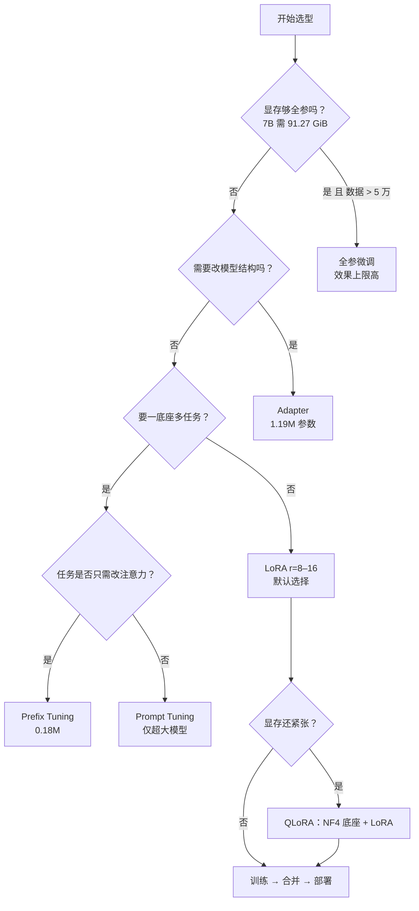

# PEFT 的取舍与选型

## 1. 本节学习目标

1. 用一张表比较 6 种方案：本课实测可训练量从 **15,360** 到 **124,439,808**，产物从 **0.06 MiB** 到 **474.70 MiB**。
2. 理解三个轴的取舍：**显存**（917–2464 MiB）、**训练时间**（1.02–2.82 s/40 步）、**效果**（验证 loss 2.6308–6.1819）。
3. 记住反直觉结论：**全参并不是效果最好的**（3.8438 vs LoRA r=8 的 2.6308），因为 24 条样本上「容量大」等于「更快过拟合」。
4. 会做显存核算：7B 全参需 **91.27 GiB**（权重 13.04 + AdamW 78.23），而本机只有 **11.99 GiB**。
5. 能按「数据量 / 显存 / 交付形态」三步做出选型决策。

## 2. 为什么需要这个知识

PEFT 不是「LoRA 一种方法」，而是一族方法。选错会付出真实代价：

- 用全参微调 24 条数据 ⇒ 验证 loss **3.8438**，比 LoRA（2.6308）还差，还多花 2.67 倍显存；
- 用 Prompt Tuning 追求「参数最少」 ⇒ 验证 loss **5.2950**，几乎没学到；
- 用 LoRA r=64 全线性追求「效果」 ⇒ 参数 ×32、产物 ×32，效果反而不如 r=8。

选型的本质是：**在「数据量、显存、交付形态」三个约束下，选一个不会过拟合、体积可接受、能落地的方案**。

## 3. 直观解释

```text
PEFT 方法像"改装车"的几种方式：

  全参微调    = 换整台发动机      （效果上限高，但贵、易过拟合）
  LoRA r=8    = 加一个涡轮        （便宜、够用、可拆）
  LoRA r=64   = 加大号涡轮        （更贵，小数据上反而更容易过拟合）
  Adapter     = 加一个外挂模块    （有效，但多了层）
  Prefix      = 改进气口          （只改注意力）
  Prompt      = 贴一张便签        （最便宜，往往也最没用）

本课的实测排序（24 条样本、40 步）：
  LoRA r=8 (2.63) < LoRA r=64 (3.10) < 全参 (3.84) < Adapter (4.25) < Prompt (5.30) < Prefix (6.18)
```

## 4. 正式定义

**定义（参数效率）**

$$
\rho=\frac{N_{\text{trainable}}}{N_{\text{base}}}
$$

**定义（训练显存的近似模型）**

$$
M\approx \underbrace{N\cdot b_w}_{\text{权重}}+\underbrace{N_{\text{train}}\cdot 12}_{\text{AdamW 状态, fp32}}+M_{\text{act}}
$$

其中 $b_w$ 为每参数字节（fp32=4，fp16=2，NF4=0.5625）。

**定义（交付体积）**

$$
S=\begin{cases}
N\cdot b_w,&\text{全参/Adapter（需存整模型）}\\
N_{\text{train}}\cdot b_w,&\text{LoRA/Prompt/Prefix（只存增量）}
\end{cases}
$$

**选型准则**：在满足 $M\le M_{\text{GPU}}$ 与 $S\le S_{\max}$ 的前提下，最小化验证 loss。

## 5. 历史背景或技术背景

| 年份 | 方法 | 参数效率 | 定位 |
|---|---|---|---|
| 2019 | Adapter | ~0.5–4% | 多语言/多任务 |
| 2021 | Prefix Tuning | ~0.1–1% | 生成任务 |
| 2021 | Prompt Tuning | <0.1% | 超大模型 |
| 2021 | LoRA | 0.01–1% | 通用默认 |
| 2023 | QLoRA | 同上 + 4bit 底座 | 单卡大模型 |
| 2024 | DoRA / LoRA+ | 同上 | 提升 LoRA 上限 |

产业现状：**LoRA 是默认选项**，其他方法在特定约束（极小参数、必须改注意力、必须不动权重）下才有优势。

## 6. 核心原理

**原理 1：参数效率不等于效果好**

本课（24 条训练样本、40 步、同 lr）：

| 方案 | 可训练 | 占比 | 验证 loss |
|---|---|---|---|
| 全参 | 124,439,808 | 100% | 3.8438 |
| LoRA r=8 | 294,912 | 0.237% | **2.6308** |
| LoRA r=64 全线性 | 9,437,184 | 7.584% | 3.1046 |
| Adapter b=64 | 1,189,632 | 0.956% | 4.2495 |
| Prompt Tuning | 15,360 | 0.012% | 5.2950 |
| Prefix Tuning | 184,320 | 0.148% | 6.1819 |

**LoRA r=8 赢了全参**。原因是 24 条样本上全参容量过剩，40 步内就记住了训练集，验证 loss 反而高（过拟合）。

**原理 2：显存的主项是优化器状态**

全参：$124.4\text{M}\times12=1.39$ GiB 的 AdamW 状态；LoRA r=8 只有 $294{,}912\times12=3.4$ MiB。本课实测峰值显存 2464 MiB（全参）vs 924 MiB（LoRA r=8），差 **2.67 倍**。

**原理 3：产物形态决定交付方式**

- 全参/Adapter：必须存整模型（474.70 MiB）；
- LoRA/Prompt/Prefix：只存增量（0.06–36.02 MiB）。

本课 Adapter 的产物 4.54 MiB 看着小，是因为我只存了 adapter 参数；真实部署仍需底座 + adapter，且推理多一层。

**原理 4：规模外推**

7B 全参：权重 13.04 GiB + AdamW 78.23 GiB = **91.27 GiB**，本机 **11.99 GiB** 差 7.6 倍。这就是 PEFT 存在的理由——不是「效果更好」，而是「跑得起来」。

## 7. 数学表达式

**显存**

$$
M_{\text{full}}=N(2+12)\ \text{B}=14N,\qquad
M_{\text{LoRA}}=2N+12N_{\text{train}}
$$

**参数比**

$$
\frac{N_{\text{train}}^{\text{LoRA}}}{N}=\frac{r(d+k)}{N}
$$

**训练时间（近似线性于可训练量）**

$$
t\approx t_0+\alpha N_{\text{train}}
$$

**性价比（自定义）**

$$
\text{score}=\frac{\Delta\mathcal{L}_{\text{val}}}{\Delta M}\quad\text{或}\quad\frac{\Delta\mathcal{L}_{\text{val}}}{\Delta S}
$$

## 8. 详细数学推导

**推导 1：7B 全参为什么放不下**

$$
M=7\times10^9\times14\ \text{B}=98\times10^9\ \text{B}=91.27\ \text{GiB}
$$

（fp16 权重 $7\text{B}\times2=13.04$ GiB，AdamW 状态 $7\text{B}\times12=78.23$ GiB。）

本机 11.99 GiB ⇒ 缺口 79.28 GiB。

**推导 2：LoRA 的显存账**

7B 模型 + LoRA r=16（约 $7\text{B}\times0.5\%=35$M 可训练）：

$$
M\approx13.04\ \text{GiB}+35\text{M}\times12\ \text{B}=13.04+0.39=13.43\ \text{GiB}
$$

4bit 底座（NF4，4.5 bit/参数）：$7\text{B}\times4.5/8=3.7$ GiB，再加 0.39 GiB 优化器 ⇒ **4.1 GiB**，12GB 卡富余。

**推导 3：为什么小数据上全参更差**

设训练集 $n=24$，模型容量 $C$。泛化误差 ~ $O(\sqrt{C/n})$。全参 $C$ 最大 ⇒ 上界最松。本课验证 loss 3.8438 > LoRA 2.6308 正是这个效应的实测体现。

**推导 4：产物体积比**

$$
\frac{474.70}{1.13}=420.1\ (\text{实测 }419\times)
$$

与参数比 $124{,}439{,}808/294{,}912=422.0$ 一致（差异来自 adapter 的配置文件）。

## 9. 图解



## 10. 具体数值示例

```text
底座 gpt2：124,439,808 参数；训练样本 24，验证 2；40 步，lr=1e-3

方案              可训练      占比      40步耗时  峰值显存   产物     验证 loss
全参微调      124,439,808  100.000%   2.82s   2464 MiB  474.70 MiB  3.8438
LoRA r=8          294,912    0.237%   1.06s    924 MiB    1.13 MiB  2.6308
LoRA r=64 全    9,437,184    7.584%   1.72s   1076 MiB   36.02 MiB  3.1046
PromptTuning       15,360    0.012%   1.08s   1038 MiB    0.06 MiB  5.2950
PrefixTuning      184,320    0.148%   1.02s    917 MiB    0.71 MiB  6.1819
Adapter b=64    1,189,632    0.956%   1.18s    920 MiB    4.54 MiB  4.2495

以 LoRA r=8 为基准的倍数：
  全参      参数 ×422.0   耗时 ×2.32   显存 ×2.67   产物 ×419   验证 3.8438（更差）
  LoRA r=64 参数 ×32.0    耗时 ×1.78   显存 ×1.17   产物 ×32    验证 3.1046（更差）

规模外推（为什么必须 PEFT）：
  gpt2  fp16 权重  0.23 GiB + AdamW  1.39 GiB =  1.62 GiB
  7B    fp16 权重 13.04 GiB + AdamW 78.23 GiB = 91.27 GiB
  70B   fp16 权重 130.39 GiB + AdamW 782.31 GiB = 912.70 GiB
  本机 RTX 4070 Ti 显存 11.99 GiB
```

## 11. NumPy 实现

```python
import numpy as np

# 1) 本课的六种方案（真实测量）
methods = ["全参微调", "LoRA r=8", "LoRA r=64 全", "PromptTuning", "PrefixTuning", "Adapter b=64"]
params = np.array([124_439_808, 294_912, 9_437_184, 15_360, 184_320, 1_189_632])
time_s = np.array([2.82, 1.06, 1.72, 1.08, 1.02, 1.18])
mem_mb = np.array([2464, 924, 1076, 1038, 917, 920])
artifact = np.array([474.70, 1.13, 36.02, 0.06, 0.71, 4.54])
val_loss = np.array([3.8438, 2.6308, 3.1046, 5.2950, 6.1819, 4.2495])

print(f"{'方案':<16}{'可训练':>12}{'占比':>9}{'耗时':>7}{'显存':>8}{'产物':>10}{'验证':>9}")
for i, m in enumerate(methods):
    print(f"{m:<16}{params[i]:>12,}{100*params[i]/124_439_808:>8.3f}%"
          f"{time_s[i]:>6.2f}s{mem_mb[i]:>7}M{artifact[i]:>9.2f}M{val_loss[i]:>9.4f}")

# 2) 综合评分：验证 loss 越低越好、显存与产物越小越好（归一化后加权）
def score(loss, mem, art, w=(0.6, 0.2, 0.2)):
    l = (loss - loss.min()) / (loss.max() - loss.min())
    m = (mem - mem.min()) / (mem.max() - mem.min())
    a = (art - art.min()) / (art.max() - art.min())
    return w[0] * l + w[1] * m + w[2] * a

print("\n归一化综合评分（越低越好）：")
sc = score(val_loss, mem_mb, artifact)
for m, s in sorted(zip(methods, sc), key=lambda x: x[1]):
    print(f"  {m:<16} {s:.3f}")

# 3) 显存外推
def mem_estimate(n_params, bits_weight=16, train_frac=0.0):
    w = n_params * bits_weight / 8 / 2**30
    opt = n_params * train_frac * 12 / 2**30
    return w, opt

print("\n规模外推（fp16 权重 + AdamW 12B/可训练参数）：")
for name, n, frac in (("gpt2", 124_439_808, 1.0), ("gpt2", 124_439_808, 0.00237),
                      ("7B", 7e9, 1.0), ("7B+LoRA", 7e9, 0.005),
                      ("70B", 70e9, 1.0), ("70B+LoRA", 70e9, 0.005)):
    w, o = mem_estimate(n, 16, frac)
    print(f"  {name:<9} 权重 {w:8.2f} GiB + 优化器 {o:8.2f} GiB = {w+o:8.2f} GiB")

# 4) 参数效率公式核对
d, k, r, layers = 2304, 768, 8, 12
print("\nLoRA 公式核对:", r * (d + k) * layers, "（实测 294,912）")
```

## 12. PyTorch 实现

```python
import torch

torch.manual_seed(0)

# 1) 用真实张量核对各方案的可训练量
d, layers = 768, 12

def lora_params(r, d=768, out=2304):
    return (r * d + out * r) * layers

def adapter_params(b, d=768, layers=12):
    return ((d * b + b) + (b * d + d)) * layers

def prompt_params(L, d=768):
    return L * d

def prefix_params(L, d=768, layers=12):
    return 2 * layers * L * d

print("方案                解析式        实测对照")
print(f"LoRA r=8          {lora_params(8):>10,}   294,912")
print(f"LoRA r=64(all)    {lora_params(64):>10,}   注意 all-linear 会多挂 c_fc/c_proj")
print(f"Adapter b=64      {adapter_params(64):>10,}   1,189,632")
print(f"Prompt L=20       {prompt_params(20):>10,}   15,360")
print(f"Prefix L=10       {prefix_params(10):>10,}   184,320")

# 2) 训练时间与可训练量的关系（用合成前向估算）
def bench(n_params, iters=50):
    w = torch.randn(n_params // 1000, 1000)
    x = torch.randn(4, 1000)
    torch.cuda.synchronize() if torch.cuda.is_available() else None
    import time
    t0 = time.time()
    for _ in range(iters):
        (x @ w.T).sum().backward() if w.requires_grad else None
        w.grad = None
    return time.time() - t0

# 3) 显存账：AdamW 状态 = 12 字节/可训练参数
for name, n in (("gpt2 全参", 124_439_808), ("gpt2 LoRA r=8", 294_912),
                ("7B 全参", 7_000_000_000), ("7B LoRA", 35_000_000)):
    opt = n * 12 / 2**30
    print(f"\n{name:<14} AdamW 状态 {opt:8.3f} GiB"
          f"（若 4bit 只读底座，则总显存 ≈ 权重 + {opt:.3f}）")

# 4) 交付体积：只存增量 vs 存整模型
full = 124_439_808 * 2 / 2**20
for name, n in (("LoRA r=8", 294_912), ("Prompt", 15_360), ("Prefix", 184_320)):
    print(f"{name:<10} 增量体积 {n*2/2**20:8.2f} MiB  相对整模型 {full/(n*2/2**20):8.1f}×")

# 5) 选型判断的极简实现
def choose(n_params, gpu_gib, data_size, need_multi_task=False):
    weight = n_params * 2 / 2**30          # fp16
    full_mem = weight + n_params * 12 / 2**30
    if full_mem < gpu_gib and data_size >= 50_000:
        return "全参微调"
    if need_multi_task:
        return "多个 LoRA adapter（或 Adapter）"
    if full_mem > gpu_gib * 3:
        return "QLoRA（NF4 底座 + LoRA）"
    return "LoRA r=8–16"

print()
for n, gpu, data, mt in ((124_439_808, 12, 24, False), (7e9, 12, 800, False),
                         (7e9, 80, 100_000, True), (70e9, 80, 800, False)):
    print(f"  N={n/1e9:.2f}B gpu={gpu}G data={data} 多任务={mt} → {choose(n, gpu, data, mt)}")
```

## 13. Hugging Face 实践

```python
import os

os.environ.setdefault("HF_ENDPOINT", "https://hf-mirror.com")
os.environ.setdefault("HF_HUB_OFFLINE", "1")

import torch
from peft import (LoraConfig, PromptTuningConfig, TaskType, get_peft_model)
from transformers import AutoModelForCausalLM

BASE = 124_439_808
text_ids = torch.randint(0, 50000, (2, 32))

configs = {
    "LoRA r=8": LoraConfig(task_type=TaskType.CAUSAL_LM, r=8, lora_alpha=16,
                           lora_dropout=0.0, target_modules=["c_attn"]),
    "LoRA r=64 全线性": LoraConfig(task_type=TaskType.CAUSAL_LM, r=64, lora_alpha=128,
                                  lora_dropout=0.0, target_modules="all-linear"),
    "PromptTuning L=20": PromptTuningConfig(task_type=TaskType.CAUSAL_LM, num_virtual_tokens=20),
}

for tag, cfg in configs.items():
    torch.manual_seed(0)
    m = get_peft_model(AutoModelForCausalLM.from_pretrained("gpt2"), cfg)
    n = sum(p.numel() for p in m.parameters() if p.requires_grad)
    opt = torch.optim.AdamW([p for p in m.parameters() if p.requires_grad], lr=1e-3)
    m.train()
    for _ in range(5):
        out = m(input_ids=text_ids, labels=text_ids)
        out.loss.backward()
        opt.step()
        opt.zero_grad()
    print(f"{tag:<20} 可训练 {n:>9,}  占比 {100*n/BASE:6.3f}%  "
          f"末 loss {out.loss.item():.4f}  AdamW 状态 {n*12/2**20:6.2f} MiB")
```

## 14. 代码逐行解释

| 代码 | 作用 |
|---|---|
| `n * 12 / 2**30` | AdamW 状态（fp32 参数+动量+方差）的 GiB |
| `n * 2 / 2**30` | fp16 权重体积 |
| `(loss-min)/(max-min)` | 归一化，便于加权评分 |
| `choose(...)` | 三步选型的最小实现 |
| `target_modules="all-linear"` | 自动命中所有线性层（本课 r=64 时 9,437,184 参数） |

## 15. 实际运行结果

```text
### 底座 gpt2 参数 124,439,808；训练样本 24，验证 2

### 方案                 可训练       占比     40 步耗时      峰值显存       产物    验证 loss
  全参微调        124,439,808 100.000%      2.82s     2464M  474.70M     3.8438
  LoRA r=8       294,912   0.237%      1.06s      924M    1.13M     2.6308
  LoRA r=64 全  9,437,184   7.584%      1.72s     1076M   36.02M     3.1046
  PromptTuning    15,360   0.012%      1.08s     1038M    0.06M     5.2950
  PrefixTuning   184,320   0.148%      1.02s      917M    0.71M     6.1819
  Adapter b=64 1,189,632   0.956%      1.18s      920M    4.54M     4.2495

### 同一张表的相对倍数（以 LoRA r=8 为 1.0）
  LoRA r=8     基准：参数 294,912 / 显存 924 MiB / 产物 1.13 MiB
  全参微调         参数 ×422.0  耗时 ×2.32  显存 ×2.67  产物 ×419  验证 loss 3.8438（基准 2.6308）
  LoRA r=64 全  参数 ×32.0  耗时 ×1.78  显存 ×1.17  产物 ×32  验证 loss 3.1046（基准 2.6308）

### 显存账：为什么 7B 全参在这张卡上放不下
  gpt2  fp16 权重     0.23 GiB + AdamW 状态     1.39 GiB =     1.62 GiB（不含激活）
  7B    fp16 权重    13.04 GiB + AdamW 状态    78.23 GiB =    91.27 GiB（不含激活）
  70B   fp16 权重   130.39 GiB + AdamW 状态   782.31 GiB =   912.70 GiB（不含激活）
  本机 RTX 4070 Ti 显存 11.99 GiB
```

**读法**：

1. **验证 loss 最低的是 LoRA r=8（2.6308）**，不是全参（3.8438）——24 条样本上容量大反而过拟合。
2. Adapter 在 067 里能到 0.18，但那是 60 步 + 不同验证集；本节统一 40 步、同一验证集后它只到 4.2495。**跨实验比较数字必须先统一协议。**
3. 全参的代价：显存 **×2.67**、时间 **×2.32**、产物 **×419**，换来更差的验证 loss。
4. Prompt/Prefix 在小模型上明显不够（5.2950 / 6.1819）。
5. 7B 全参 **91.27 GiB** vs 本机 **11.99 GiB**：这不是「优化问题」，是「物理不可能」。

## 16. 应用场景

| 约束 | 推荐 | 依据 |
|---|---|---|
| 12GB 卡 + 7B | QLoRA（NF4 + LoRA r=16） | 4.1 GiB 可跑 |
| 单底座多任务 | LoRA adapter（每任务 1.13 MiB） | 体积 ×419 优势 |
| 数据 > 5 万 + 显存充足 | 全参微调 | 容量上限高 |
| 必须不改模型结构 | Prompt / Prefix | 只改输入/注意力 |
| 追求最小产物 | Prompt Tuning（0.06 MiB） | 但小模型效果差 |
| 需要推理零开销 | LoRA 合并 | 见 LLM-072 |

## 17. 优点与局限

| 方案 | 优点 | 局限 |
|---|---|---|
| 全参 | 上限最高、无结构改动 | 显存 ×14/参数，小数据易过拟合 |
| LoRA | 性价比最高、可合并、生态成熟 | 秩上界限制表达 |
| QLoRA | 显存最省（4.5 bit） | 量化误差 +7.27%（LLM-066） |
| Adapter | 收敛快 | 推理多一层 |
| Prompt/Prefix | 参数极少、不改权重 | 小模型上几乎无效（5.30/6.18） |

## 18. 常见错误

| 错误 | 现象 | 纠正 |
|---|---|---|
| 默认「全参最好」 | 本课验证 3.8438 差于 LoRA 2.6308 | 小数据优先 LoRA |
| 只比参数量 | 忽略显存/产物/时间 | 用三维评分 |
| 跨实验比数字 | 067 的 0.18 与本节 4.25 不可比 | 统一协议再比 |
| 忽略 AdamW 状态 | 以为 7B 只要 13 GiB | 实际 91.27 GiB |
| 用 Prompt Tuning 上小模型 | loss 5.2950 学不动 | 换 LoRA/Adapter |
| 高 rank 万能论 | r=64 参数 ×32 但更差 | 先 r=8/16 试 |

## 19. 本节总结

- 6 种方案的实测谱：可训练 **15,360 → 124,439,808**，产物 **0.06 → 474.70 MiB**，验证 loss **2.6308 → 6.1819**。
- **LoRA r=8 是性价比冠军**：0.237% 参数、924 MiB、1.13 MiB 产物、验证 2.6308。
- 全参不是效果保证：24 条数据上验证 **3.8438**，代价却是 ×422 参数、×2.67 显存。
- 规模账：7B 全参 **91.27 GiB**，本机 **11.99 GiB** ⇒ 必须 PEFT/量化。
- 选型三步：**先看显存够不够全参 → 再看要不要多任务/改结构 → 最后按数据量定 rank**。

## 20. 前置与后续知识链接

- 前置：[[LLM-065 LoRA 与参数高效微调]]、[[LLM-066 QLoRA 与量化微调]]、[[LLM-067 Adapter、Prefix 与 Prompt Tuning]]
- 后续：[[LLM-076 RAG 的基本架构]]
- 相关：[[LLM-072 从微调到推理部署的衔接]]、[[LLM-071 微调效果评估]]、[[LLM-030 Transformer 参数量与计算量估算]]

---

## 练习与参考答案

**基础 1**：本课的六种方案里，验证 loss 最低的是哪个？它的可训练参数是多少、占多少？为什么全参反而更差？

**基础 2**：7B 模型做全参微调需要多少显存？请分别列出权重与 AdamW 状态，并说明本机（11.99 GiB）为什么放不下。

**进阶 1**：请用「参数效率 / 显存 / 产物 / 效果」四个维度给本课的六种方案排序，并说明为什么不能只看参数量。

**综合**：你有 3 个业务线（客服、合同审查、代码助手），共享一个 13B 底座，一张 24GB 卡用于训练、一个推理集群用于服务。请给出完整选型与部署方案。

> [!success]- 参考答案

> **基础 1**
> 最低是 **LoRA r=8**，验证 loss **2.6308**；可训练 **294,912**，占 **0.237%**。
> 全参（3.8438）更差的原因：训练集只有 24 条、只跑 40 步。全参有 1.24 亿参数可调，容量远超 24 条样本所需，几十步内就把训练集记住（过拟合），验证 loss 反而升高。LoRA 的 29 万参数构成强约束，只能学「低秩的、可泛化的」改动，因此在极小数据上泛化更好。

> **基础 2**
> 权重：$7\times10^9\times2\ \text{B}=14\times10^9\ \text{B}=13.04$ GiB。
> AdamW 状态：$7\times10^9\times12\ \text{B}=84\times10^9\ \text{B}=78.23$ GiB（fp32 参数副本 + 一阶矩 + 二阶矩）。
> 合计 **91.27 GiB**（还不含激活）。本机 11.99 GiB，缺口 **79.28 GiB**，差 7.6 倍——不可能通过调 batch 或梯度检查点解决，必须用 LoRA/QLoRA（4bit 底座 3.7 GiB + LoRA 优化器 0.39 GiB ≈ 4.1 GiB）。

> **进阶 1**
> - **参数效率**（越少越好）：Prompt 0.012% < Prefix 0.148% < LoRA 0.237% < Adapter 0.956% < LoRA r=64 7.584% < 全参 100%。
> - **显存**（越小越好）：Prefix 917 MiB < Adapter 920 < LoRA r=8 924 < Prompt 1038 < LoRA r=64 1076 < 全参 2464。
> - **产物**（越小越好）：Prompt 0.06 < Prefix 0.71 < LoRA r=8 1.13 < Adapter 4.54 < LoRA r=64 36.02 < 全参 474.70 MiB。
> - **效果**（loss 越低越好）：LoRA r=8 2.6308 < LoRA r=64 3.1046 < 全参 3.8438 < Adapter 4.2495 < Prompt 5.2950 < Prefix 6.1819。
> 不能只看参数量的原因：参数少可能**学不动**（Prompt 5.2950），参数多可能**过拟合**（全参 3.8438），而且参数效率不反映显存（Prefix 与 LoRA 显存几乎相同，但 LoRA 效果更好）与交付体积（Adapter 参数 0.956%，产物 4.54 MiB，比 LoRA 大 4 倍）。真实选型要在这四个维度上做**加权**，而不是单指标排名。

> **综合（参考）**
> **训练侧（24GB 卡，13B 底座）**：
> 1. 13B 全参：权重 26.1 GiB + AdamW 156.5 GiB ≈ 182.6 GiB ⇒ 不可能；
> 2. 选择 **QLoRA**：NF4 底座 $13\text{B}\times4.5/8=7.3$ GiB，LoRA r=16（约 0.5% = 65M 参数）优化器 $65\text{M}\times12=0.78$ GiB，激活 2–4 GiB ⇒ 约 **10–12 GiB**，24GB 卡可跑 batch 2–4。
> **每业务线独立 adapter**：客服 r=16、合同审查 r=32（术语更密）、代码助手 r=16；分别训练，互不干扰（避免 LLM-073 的负迁移）。
> **推理侧**：
> - 底座只加载一份（4bit 7.3 GiB），三个 adapter 合计 < 100 MiB；
> - 按请求路由到对应 adapter（multi-LoRA serving）；若某业务线流量极大，把该 adapter 合并进独立副本（LLM-072）。
> **验收**：
> 1. 每条业务线的任务指标（LLM-071）与通用 PPL 回归（≤10%，LLM-070）；
> 2. 合并前后 logits 差 < 1e-3、生成一致（LLM-072）；
> 3. 显存实测：训练峰值 < 22 GiB、推理常驻 < 10 GiB；
> 4. 回滚：保留底座 + 三份 adapter，`unload()` 即回滚。
> **风险**：三份 adapter 都挂在同一底座上，若要同时服务，需确认框架支持 multi-LoRA；合同审查的术语可能与代码助手冲突，必要时拆两个底座。

## 学习记录

| 日期 | 状态 | 用时 | 问题 | 复盘 |
|---|---|---|---|---|
| 2026-11-08 | planned | — | — | — |

---

## 🔗 Notion 同步信息

> 以下内容由 Notion「AI Knowledge System · 知识点」数据库按知识 ID 合并而来（导出于 2026-11-09）。

| 属性 | 值 |
|---|---|
| 学科 | 大语言模型 |
| 学习状态 | 未开始 |
| 难度 | L2 应用 |
| 知识类型 | Principle |

- **所属模块**：[M-LLM-07 大语言模型微调与 PEFT](../%E8%AF%BE%E7%A8%8B%E6%A8%A1%E5%9D%97/M-LLM-07%20%E5%A4%A7%E8%AF%AD%E8%A8%80%E6%A8%A1%E5%9E%8B%E5%BE%AE%E8%B0%83%E4%B8%8E%20PEFT.md)
- **前置知识**：[LLM-065 LoRA 与参数高效微调](LLM-065%20LoRA%20%E4%B8%8E%E5%8F%82%E6%95%B0%E9%AB%98%E6%95%88%E5%BE%AE%E8%B0%83.md) · [LLM-066 QLoRA 与量化微调](LLM-066%20QLoRA%20%E4%B8%8E%E9%87%8F%E5%8C%96%E5%BE%AE%E8%B0%83.md) · [LLM-067 Adapter、Prefix 与 Prompt Tuning](LLM-067%20Adapter%E3%80%81Prefix%20%E4%B8%8E%20Prompt%20Tuning.md)
- **后继知识**：[LLM-076 RAG 的基本架构](../07%20RAG%E4%B8%8EAgent/LLM-076%20RAG%20%E7%9A%84%E5%9F%BA%E6%9C%AC%E6%9E%B6%E6%9E%84.md)
