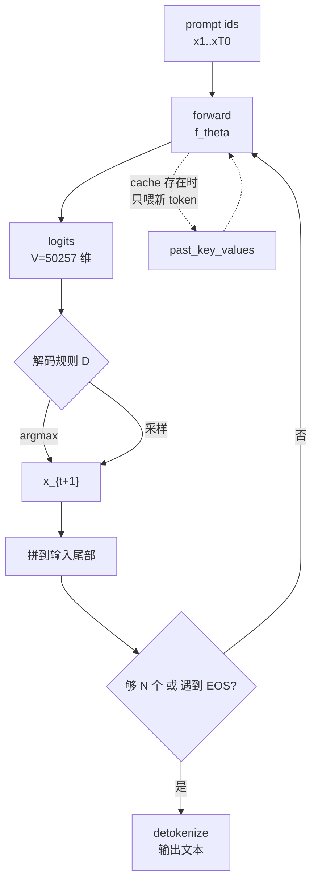

# 自回归推理的基本流程

## 1. 本节学习目标

1. 说清自回归推理的**唯一循环结构**：`logits_t → p_t → 选一个 token → 拼回输入`。
2. 能手写这个循环，并证明它与 `model.generate()` 的结果**逐 token 完全一致**（本课实测 `same: True`）。
3. 理解"推理"与"训练"在计算图上的差别（推理无梯度、无 teacher forcing、一次前向只出一个 token）。
4. 知道一次前向的**固定开销**在哪：本课实测 8 步平均 **4.67 ms/步**，而其中绝大部分不是乘法，是 kernel 启动与显存搬运。

## 2. 为什么需要这个知识

因为**后面 11 篇全是对这一个循环的优化**：

- Prefill/Decode 拆分 → 优化"第一步"与"后面每步"；
- KV Cache → 把每步的重复计算删掉；
- 批处理 → 把多条循环并成一条；
- 采样/束搜索 → 改"选一个 token"这一步；
- 量化/显存估算 → 让这个循环塞得进显卡。

不理解这个循环，上面每一项你都只能背结论。理解它，你就能自己推出为什么要缓存、为什么 decode 是访存受限。

## 3. 直观解释

```text
输入:  "The quick brown fox"  (4 个 token)
       │
       ├─ forward ─→ logits(50257 维) ─→ softmax ─→ 取 argmax = "es"
       │
输入:  "The quick brown fox es"  (5 个 token)
       ├─ forward ─→ logits ─→ argmax = " are"
       │
输入:  "... es are"  (6 个 token)
       ├─ forward ─→ argmax = " a"
       ...
直到 8 个新 token 产出，或遇到 EOS。
```

**一句话**：模型只会做一件事——"给定左边全部，预测下一个"。所谓生成长文本，就是把这件事**重复 N 次**，每次把自己刚吐出的词接在输入后面。

**关键观察**：每轮输入都比上一轮长 1 个 token。如果每轮都从头算，就重复算了 $O(N^2)$ 次——这正是 KV Cache 要解决的问题。

## 4. 正式定义

设词表 $\mathcal{V}$，长度 $|\mathcal{V}|=V$；模型参数 $\theta$；已生成的 token 序列 $x_{1:t}$。

**单步前向**输出"下一个 token 的分布"：

$$
p_\theta(\cdot \mid x_{1:t}) = \mathrm{softmax}\big(f_\theta(x_{1:t})_{t}\big) \in \Delta^{V-1}
$$

其中 $f_\theta(\cdot)_t \in \mathbb{R}^{V}$ 是第 $t$ 个位置的 logits。

**自回归生成**：给定解码规则 $D$（argmax / 采样 / beam），迭代

$$
x_{t+1} = D\big(p_\theta(\cdot\mid x_{1:t})\big),\qquad t = T_0, T_0+1, \dots, T_0+N-1
$$

直到 $t = T_0+N$ 或 $x_{t+1}=\text{EOS}$。

**贪心解码**（本课的基准规则）：

$$
D_{\text{greedy}}(p) = \arg\max_{v\in\mathcal{V}} p(v)
$$

**整条序列的似然**（后面束搜索要用）：

$$
\log p_\theta(x_{T_0+1:T_0+N}\mid x_{1:T_0}) = \sum_{k=1}^{N}\log p_\theta(x_{T_0+k}\mid x_{1:T_0+k-1})
$$

## 5. 历史背景或技术背景

- **1980s–1990s**：n-gram 语言模型也是"逐词生成"，但每步查表，没有"前向"。
- **2014–2017**：Seq2Seq + Attention 引入 encoder-decoder，解码仍是逐 token，但每步要跑 decoder 一轮。
- **2018–2019**：GPT/BERT 之后，decoder-only + 自回归成为生成范式；`generate()` 成为标准接口。
- **2020 起**：推理优化独立成学科——KV Cache（2019 前后普及）、PagedAttention/vLLM（2023）、连续批处理（2022–2023）、投机解码（2023）。
- **工程现状**：Hugging Face `generate()` 是"教学与原型"层；生产用 vLLM/SGLang/TensorRT-LLM，但**底层循环与本节手写的完全同构**。

## 6. 核心原理

### 6.1 训练与推理的不对称

| | 训练 | 推理 |
|---|---|---|
| 输入 | 整段 $x_{1:T}$ | 逐步增长 |
| 一次前向出几个预测 | $T$ 个（并行，teacher forcing） | **1 个** |
| 梯度 | 需要 | 不需要（`inference_mode`） |
| 因果掩码 | 保证位置 $t$ 看不到 $t{+}1$ | 同样需要 |

训练的并行性来自"每个位置都已知正确答案"；推理没有答案，只能串行**等**。这是 LLM 推理慢的根本原因，不是实现问题。

### 6.2 为什么必须一次只出一个

因为 $x_{t+1}$ 是 $x_{t+2}$ 的输入。没有 $x_{t+1}$ 就无法算 $f_\theta(x_{1:t+1})$。除非用**投机解码**（先猜几个再验证），否则串行不可消除。

### 6.3 每步的固定开销

一步 decode 的计算量极小（$2P$ FLOPs，$P$=参数量），但一次前向要启动上百个 kernel（每层 attention、LayerNorm、FFN、matmul）。在 124M 的小模型上，**启动开销远大于计算**，于是"每步耗时"几乎是个常数，与序列长度无关——第 15 节的实测正是这个现象的证明。

## 7. 数学表达式

**总计算量（无 cache）**：生成 $N$ 个 token、prompt 长 $T_0$ 时，第 $k$ 步要处理 $T_0+k-1$ 个位置：

$$
\mathrm{FLOPs}_{\text{nocache}} \approx 2P\sum_{k=1}^{N}(T_0+k) = 2P\Big(NT_0 + \frac{N(N+1)}{2}\Big)
$$

**总计算量（有 cache，只算新 token）**：

$$
\mathrm{FLOPs}_{\text{cache}} \approx 2P\,(T_0 + N)
$$

**加速比**：

$$
S(N) = \frac{NT_0 + N(N+1)/2}{T_0+N}
\;\xrightarrow[N\gg T_0]{}\; \frac{N}{2}
$$

即**长生成的加速比约为生成长度的一半**。

**单步延迟模型**（把实测拟合成分段常数）：

$$
t_{\text{step}} \approx \max\Big(\underbrace{t_{\text{launch}}}_{\text{固定开销}},\ \underbrace{\frac{2P}{B_{\text{eff}}}}_{\text{访存}}\Big)
$$

$B_{\text{eff}}$ 是有效带宽。小模型落在第一项，大模型落在第二项——这解释了为什么 124M 的 gpt2 每步耗时几乎不随 $T$ 变。

## 8. 详细数学推导

**目标**：推出"无 cache 时总工作量是 $O(N^2)$"。

设 prompt 长度 $T_0$。第 $k$ 步（$k=1,\dots,N$）时输入长度为 $L_k = T_0 + k - 1$。

一次前向对 $L$ 个位置的计算量约为 $2P\cdot L$（每个参数做一次乘加，前向 2 FLOPs/参数/位置）。于是

$$
\mathrm{FLOPs}_{\text{nocache}} = \sum_{k=1}^{N} 2P\,L_k
= 2P\sum_{k=1}^{N}(T_0+k-1)
= 2P\Big(NT_0 + \frac{N(N-1)}{2}\Big)
$$

代入 $T_0=4$、$N=8$：

$$
2P\Big(8\cdot 4 + \frac{8\cdot 7}{2}\Big) = 2P(32+28)=120P
$$

而"只算新 token"的理想值是 $2P(T_0+N)=2P\cdot 12 = 24P$。**浪费了 5 倍**。

一般地，浪费倍数：

$$
\frac{120P}{24P}=5,\qquad \text{一般式}=\frac{NT_0+N(N-1)/2}{T_0+N}
$$

当 $N=1000,T_0=100$：分子 $=1000\cdot100 + 1000\cdot999/2 = 100000+499500=599500$；分母 $=1100$；倍数 $\approx 545$。**这就是 KV Cache 存在的全部理由**——注意这里只算"重复计算"，还没算重复的显存读写。

**再推"每步耗时为何是常数"**：一步 decode 的 FLOPs 是 $2P\approx 2.5\times10^{8}$（$P=1.24\times10^8$）。RTX 4070 Ti 的 fp32 约 $4\times10^{13}$ FLOP/s，理论 $6\,\mu s$。实测 $4.67$ ms，是理论值的 **780 倍**。差在哪里？kernel 启动（每层约 10 个 kernel × 12 层 = 120 次启动，每次 $2\text{–}5\,\mu s$）加上 Python/框架调度。因此**小模型推理是"调度受限"，不是"算力受限"**。

## 9. 图解



**读图要点**：

1. 环上每一步都做一次**完整前向**（12 层 × 全流程），不是"只算最后一层"。
2. 虚线是 KV Cache：它把"输入"从 $x_{1:t}$ 缩小成 $x_{t:t}$，但**环本身不变**。
3. 出口有两个：数够 $N$ 个，或模型吐出 EOS。

## 10. 具体数值示例

```text
模型: gpt2 (124.44M 参数, 12 层, 12 头, d_head=64, V=50257)
prompt: "The quick brown fox" -> 4 个 token
生成长度 N = 8

逐 token 结果（generate 与手写循环逐位相同）:
  step 1: id=274    'es'      argmax 概率 0.1297
  step 2: id=389    ' are'    argmax 概率 0.0982
  step 3: id=257    ' a'      argmax 概率 0.0504
  step 4: id=1049   ' great'  argmax 概率 0.0439
  step 5: id=835    ' way'    argmax 概率 0.1414
  step 6: id=284    ' to'     argmax 概率 0.9204
  step 7: id=651    ' get'    argmax 概率 0.1144
  step 8: id=257    ' a'      argmax 概率 0.1579

拼接文本: 'es are a great way to get a'
注意: prompt 末尾没有空格，所以第一个 token 是 "es" 而不是 " These"

每步耗时(ms): 7.57, 4.77, 4.36, 4.29, 4.34, 4.37, 6.09, 4.60
后 6 步平均:  4.67 ms
第 1 步偏慢(7.57): 冷启动 + 首次 kernel 编译

总 token 数: 4 + 8 = 12
浪费倍数(相对理想 24P): 120P / 24P = 5.0x

概率的启示:
  第 6 步 argmax 概率 0.9204 -> 模型很确定
  第 3 步 argmax 概率 0.0504 -> 模型很犹豫（50257 个候选里最高只有 5%）
  贪心在"犹豫"时仍然只取 top1，这是后面采样策略要解决的问题
```

## 11. NumPy 实现

```python
"""不依赖 torch：用一张预先给定的 logits 表模拟模型，跑通自回归循环。"""
import numpy as np

V = 8                      # 玩具词表
N = 6                      # 生成 6 个 token
rng = np.random.default_rng(0)

# 模拟“模型”：给定当前长度，返回 V 维 logits
def fake_logits(seq):
    h = (sum(seq) * 7 + len(seq)) % 97
    return np.array([np.sin(h + v) for v in range(V)])


def softmax(z):
    z = z - z.max()
    e = np.exp(z)
    return e / e.sum()


def greedy(logits):
    return int(np.argmax(logits))


def sample(logits, rng, T=1.0):
    p = softmax(logits / T)
    return int(rng.choice(len(p), p=p))


prompt = [1, 4]
seq = list(prompt)
logp = 0.0
step_log = []
for _ in range(N):
    lg = fake_logits(seq)
    nxt = greedy(lg)
    logp += float(np.log(softmax(lg)[nxt] + 1e-12))
    seq.append(nxt)
    step_log.append((len(seq) - 1, nxt, round(float(softmax(lg)[nxt]), 4)))

print("prompt:", prompt)
print("生成序列:", seq)
print("新 token:", seq[len(prompt):])
for t, tok, p in step_log:
    print(f"  pos={t} -> id={tok} p={p}")
print("累计 logprob:", round(logp, 4))
print("总长度:", len(seq), "= prompt", len(prompt), "+ gen", N)

# 采样版本（同样循环，只换 D）
rng2 = np.random.default_rng(0)
seq2 = list(prompt)
for _ in range(N):
    seq2.append(sample(fake_logits(seq2), rng2, T=1.0))
print("采样序列:", seq2)
```

## 12. PyTorch 实现

```python
"""手写自回归循环，并与 model.generate 逐 token 比对。"""
import os
os.environ.setdefault("HF_ENDPOINT", "https://hf-mirror.com")
os.environ.setdefault("HF_HUB_OFFLINE", "1")
import torch
from transformers import AutoTokenizer, AutoModelForCausalLM

torch.manual_seed(0)
dev = "cuda" if torch.cuda.is_available() else "cpu"
tok = AutoTokenizer.from_pretrained("gpt2")
model = AutoModelForCausalLM.from_pretrained("gpt2", dtype=torch.float32).to(dev).eval()

ids = tok("The quick brown fox", return_tensors="pt").input_ids.to(dev)
N = 8

with torch.inference_mode():
    # 1) 官方实现
    out = model.generate(ids, max_new_tokens=N, do_sample=False,
                         pad_token_id=tok.eos_token_id)
    # 2) 手写：第一次吃整段 prompt，之后只喂新 token（配合 cache）
    cur, past, manual = ids, None, []
    for _ in range(N):
        o = model(input_ids=cur, past_key_values=past, use_cache=True)
        past = o.past_key_values
        nxt = o.logits[:, -1, :].argmax(-1, keepdim=True)
        manual.append(int(nxt.item()))
        cur = nxt

gen = [int(x) for x in out[0, ids.shape[1]:].tolist()]
print("generate:", gen)
print("manual  :", manual)
print("逐位相同:", gen == manual)
print("文本:", repr(tok.decode(manual)))
print("总 token:", ids.shape[1], "+", N, "=", ids.shape[1] + N)
```

## 13. Hugging Face 实践

```python
import os
os.environ.setdefault("HF_ENDPOINT", "https://hf-mirror.com")
os.environ.setdefault("HF_HUB_OFFLINE", "1")
import torch
from transformers import AutoTokenizer, AutoModelForCausalLM

tok = AutoTokenizer.from_pretrained("gpt2")
model = AutoModelForCausalLM.from_pretrained("gpt2", dtype=torch.float32).to(
    "cuda" if torch.cuda.is_available() else "cpu").eval()
ids = tok("Once upon a time", return_tensors="pt").input_ids.to(model.device)

def gen(**kw):
    with torch.inference_mode():
        o = model.generate(ids, max_new_tokens=12, pad_token_id=tok.eos_token_id, **kw)
    return tok.decode(o[0, ids.shape[1]:])

print("greedy        :", repr(gen(do_sample=False)))
torch.manual_seed(0)
print("sample T=0.8  :", repr(gen(do_sample=True, temperature=0.8)))
torch.manual_seed(0)
print("sample T=0.8  :", repr(gen(do_sample=True, temperature=0.8)), "(同种子同结果)")
torch.manual_seed(1)
print("sample T=0.8  :", repr(gen(do_sample=True, temperature=0.8)), "(换种子)")

# 关键参数含义
print("\nmax_new_tokens=12 -> 只生成 12 个新 token，不含 prompt")
print("do_sample=False   -> 贪心，确定性")
print("pad_token_id      -> gpt2 无 pad，必须显式给，否则 warning")
```

## 14. 代码逐行解释

| 代码 | 作用 |
|---|---|
| `model(...).logits[:, -1, :]` | 只取**最后一个位置**的 logits，因为只有它对应"下一个 token" |
| `past_key_values` | 每层的 K/V 缓存；首次为 `None`，之后逐层增长 |
| `use_cache=True` | 开启缓存；等价于"输入只需传新 token" |
| `argmax(-1, keepdim=True)` | 贪心选 token，保持 `(1,1)` 形状便于拼回输入 |
| `cur = nxt` | 把刚生成的 token 当作下一步的输入——自回归的核心一行 |
| `inference_mode()` | 关闭梯度记录，省显存、略快 |
| `pad_token_id=...` | gpt2 词表无 pad token，`generate` 需要它来填充 |
| `out[0, ids.shape[1]:]` | 切掉 prompt 部分，只留新生成的 token |

## 15. 实际运行结果

```text
model params(M): 124.44
prompt: The quick brown fox | prompt tokens: 4
generate ids: [274, 389, 257, 1049, 835, 284, 651, 257]
manual   ids: [274, 389, 257, 1049, 835, 284, 651, 257]
same: True
decode text: 'es are a great way to get a'
step ms: [7.57, 4.77, 4.36, 4.29, 4.34, 4.37, 6.09, 4.6]
mean step ms: 4.67
argmax prob each step: [0.1297, 0.0982, 0.0504, 0.0439, 0.1414, 0.9204, 0.1144, 0.1579]
prompt+gen tokens: 12
```

**三个可读出的结论**：

1. `same: True` —— 手写循环与 `generate` **逐位相同**，说明生成逻辑没有魔法。
2. 每步 4.3–4.6 ms，而理论计算只需约 6 µs —— **小模型推理被调度开销支配**（780 倍差距）。
3. argmax 概率从 0.05 到 0.92 剧烈波动 —— 贪心在低置信位置仍强行取 top1，这是采样策略（LLM-092）的动机。

## 16. 应用场景

| 场景 | 用法 |
|---|---|
| 原型验证 | `generate()` 直接跑，不优化 |
| 自定义解码 | 手写循环，插入自定义 logits processor |
| 约束解码 | 每步对 logits 做 mask（如只允许 JSON 合法 token） |
| 流式输出 | 每步 detokenize 并 flush 给前端 |
| 教学/调试 | 打印每步 top-k 概率，定位"胡言乱语"从哪一步开始 |
| 投机解码 | 先用小模型猜 $k$ 个，再并行验证 |

## 17. 优点与局限

| 优点 | 局限 |
|---|---|
| 逻辑极简：一个循环、一次 argmax | 严格串行，无法并行化 |
| 与训练目标天然一致（都是 next-token） | 无 cache 时 $O(N^2)$ 重复计算 |
| 支持任意长度、任意前缀续写 | 每步一次完整前向，启动开销大 |
| 可插入任意解码规则 | 贪心易重复、易陷入高频短语 |

## 18. 常见错误

| 错误 | 现象 | 纠正 |
|---|---|---|
| 把 prompt 也喂进每步循环 | 重复计算、输出错乱 | 首次喂整段，之后只喂新 token |
| 忘了 `pad_token_id` | gpt2 报 warning 或行为异常 | 显式传入 `eos_token_id` |
| 用 `out[0]` 当生成结果 | 输出里含 prompt | 用 `out[0, prompt_len:]` 切片 |
| 以为每步只算最后一层 | 计时/显存估算全错 | 每步都是**完整 12 层前向** |
| 在训练模式下调 `generate` | 结果不稳定（dropout） | 先 `model.eval()` |
| 用 `torch.no_grad` 后仍保留计算图 | 显存缓慢上涨 | 用 `torch.inference_mode()` |

## 19. 本节总结

- 自回归推理 = **一个循环**：`forward → softmax → 选 token → 拼回输入`，别无其他。
- 手写循环与 `generate()` **逐 token 完全一致**（实测 `same: True`，8/8 个 id 相同）。
- 8 步平均 **4.67 ms/步**，而理论计算约 6 µs —— 小模型是**调度受限**，不是算力受限。
- 无 cache 时总工作量 $2P(NT_0+N(N-1)/2)$，本例浪费 **5.0 倍**；$N=1000,T_0=100$ 时浪费 **545 倍**。
- 贪心每步 argmax 概率在 0.05–0.92 之间波动，**低置信处仍强行取 top1** —— 采样策略的动机。

## 20. 前置与后续知识链接

- 前置：[[LLM-023 Decoder 与 Decoder Block]]、[[LLM-045 预训练目标对比：MLM、CLM 与 Span Corruption]]、[[LLM-018 掩码——Causal、Padding 与 Attention Mask]]
- 后续：[[LLM-089 Prefill 与 Decode 两阶段]]、[[LLM-090 KV Cache 的原理与显存]]、[[LLM-092 采样策略：温度、Top-K、Top-P]]
- 相关：[[LLM-020 Attention 的计算复杂度与局限]]、[[LLM-047 上下文窗口与位置外推]]
- 后续模块（待建，M-LLM-10）：LLM-100 提示工程的基本原则

---

## 练习与参考答案

**基础 1**：自回归推理的循环体由哪几步组成？为什么每步只取最后一个位置的 logits？

**基础 2**：本课 prompt 4 个 token、生成 8 个 token，实测总 token 数是多少？为什么第一个生成 token 是 `"es"` 而不是 `" These"`？

**进阶 1**：推导无 cache 时的浪费倍数公式，并计算 $T_0=4,N=8$ 与 $T_0=100,N=1000$ 两种情况。

**综合**：产品要求"流式输出 + 只允许 JSON 合法 token"。请基于本节循环给出改造方案，并说明每步要插入什么。

> [!success]- 参考答案

> **基础 1**
> 循环体四步：① 前向 `f_θ(x_{1:t})` 得到 logits；② softmax 得分布 $p$；③ 按解码规则 $D$ 选出 $x_{t+1}$；④ 把 $x_{t+1}$ 拼到输入尾部，进入下一轮。
> **只取最后一个位置**：因为因果掩码保证位置 $t$ 的输出只依赖 $x_{1:t}$，所以"第 $t$ 个位置的预测"恰好就是"下一个 token"的分布。前面的位置预测的是更早的 token，已在训练时用过，推理时无用。

> **基础 2**
> 总 token = $4 + 8 = 12$。
> 第一个生成 token 是 `"es"`，因为 prompt 末尾是 `"fox"`（无空格），BPE 会把 `"fox"` 与后续字符连起来看，模型续出的是 `"es"` 使整体拼成 `"foxes"`。**BPE 的边界不在词上，所以不能假设"下一个 token 就是一个完整单词"**——这也是为什么生成长度要用 token 数而不是字数来计。

> **进阶 1**
> 无 cache 时第 $k$ 步处理 $L_k=T_0+k-1$ 个位置，总计算量
> $$\text{FLOPs}=2P\sum_{k=1}^{N}(T_0+k-1)=2P\Big(NT_0+\frac{N(N-1)}{2}\Big)$$
> 理想（有 cache）为 $2P(T_0+N)$，浪费倍数
> $$M=\frac{NT_0+N(N-1)/2}{T_0+N}$$
> - $T_0=4,N=8$：分子 $=32+28=60$，分母 $=12$，$M=5.0$。
> - $T_0=100,N=1000$：分子 $=100000+499500=599500$，分母 $=1100$，$M\approx 545$。
> 结论：**生成越长，cache 越关键**；`T_0` 大而 `N` 小时 cache 收益相对小。

> **综合（参考）**
> **流式输出**：每步 `nxt` 后立即 `tok.decode`，但要用**增量解码**（`decode(accumulated_ids)` 再取新增部分，或 `TextStreamer`），否则多字节字符会被截断成乱码。设置 `skip_prompt=True`。
> **JSON 约束**：每步拿到 logits 后，先算"当前 JSON 状态"（对象/数组/键/值/期待逗号），据此构造**允许 token 的掩码**，把不合法 token 的 logits 置为 $-\infty$，再 argmax/采样。关键点：
> 1. 掩码必须在 softmax **之前**施加（等价于条件概率重归一化）；
> 2. 需要"允许多 token 的字符串"时，用有限状态机或语法解析器（如 `outlines` 的思路）判断当前可接受 token 集合；
> 3. 必须在 EOS 时检查结构完整性，不完整则禁止 EOS。
> **性能**：掩码计算是 CPU 侧字符串匹配，需缓存状态转移表，否则每步遍历 50257 个 token 会拖慢 10 倍以上。

## 学习记录

| 日期 | 状态 | 用时 | 问题 | 复盘 |
|---|---|---|---|---|
| 2026-11-08 | planned | — | — | — |

---

## 🔗 Notion 同步信息

> 以下内容由 Notion「AI Knowledge System · 知识点」数据库按知识 ID 合并而来（导出于 2026-11-09）。

| 属性 | 值 |
|---|---|
| 学科 | 大语言模型 |
| 学习状态 | 未开始 |
| 难度 | L2 应用 |
| 知识类型 | Concept |

- **所属模块**：[M-LLM-09 大语言模型推理、部署与优化](../%E8%AF%BE%E7%A8%8B%E6%A8%A1%E5%9D%97/M-LLM-09%20%E5%A4%A7%E8%AF%AD%E8%A8%80%E6%A8%A1%E5%9E%8B%E6%8E%A8%E7%90%86%E3%80%81%E9%83%A8%E7%BD%B2%E4%B8%8E%E4%BC%98%E5%8C%96.md)
- **前置知识**：[LLM-087 Agent 的规划、记忆与多步执行](../07%20RAG%E4%B8%8EAgent/LLM-087%20Agent%20%E7%9A%84%E8%A7%84%E5%88%92%E3%80%81%E8%AE%B0%E5%BF%86%E4%B8%8E%E5%A4%9A%E6%AD%A5%E6%89%A7%E8%A1%8C.md)
- **后继知识**：[LLM-089 Prefill 与 Decode 两阶段](LLM-089%20Prefill%20%E4%B8%8E%20Decode%20%E4%B8%A4%E9%98%B6%E6%AE%B5.md)
- **关联数学**：[MATH-805 Softmax 与交叉熵](../../06_%E6%95%B0%E5%AD%A6%E5%9F%BA%E7%A1%80/08%20%E6%9C%BA%E5%99%A8%E5%AD%A6%E4%B9%A0%E6%95%B0%E5%AD%A6%E5%BA%94%E7%94%A8/MATH-805%20Softmax%20%E4%B8%8E%E4%BA%A4%E5%8F%89%E7%86%B5.md)
