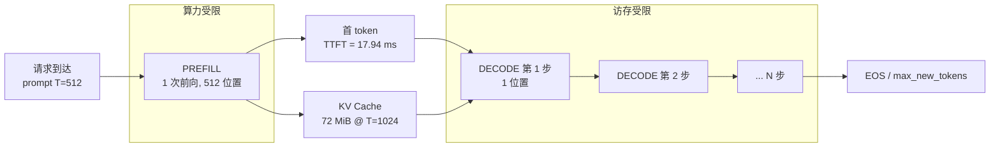

# Prefill 与 Decode 两阶段

## 1. 本节学习目标

1. 说清一次请求被切成 **prefill（吃 prompt）** 与 **decode（逐 token 吐）** 两个阶段，二者受限于**不同的硬件瓶颈**。
2. 用实测数据证明：prefill 的**每 token 成本随长度下降**（T=8 时 0.78 ms/token，T=512 时 0.035 ms/token，差 **22 倍**）。
3. 能用 **Roofline（算术强度）** 推导出"decode 是访存受限、prefill 是计算受限"，并算出交叉点。
4. 理解为什么 decode 每步耗时几乎与 $T$ 无关（实测 5.48 → 6.05 ms，仅增 10%）。

## 2. 为什么需要这个知识

因为**几乎所有推理优化都只对其中一个阶段有效**：

| 优化 | 对 prefill | 对 decode |
|---|---|---|
| 大 batch | 有效（算力密集） | 有效（分摊权重读取） |
| KV Cache | 无效（本来就没有历史） | **必需** |
| 量化 | 有效（省带宽） | 有效（省带宽） |
| 投机解码 | 无效 | 有效 |
| PagedAttention | 无明显作用 | **核心** |

分不清两阶段，就会把"decode 的优化"套到 prefill 上（无效），或忽略 decode 的访存瓶颈（白算）。

另外，SLA 也要分开看：**TTFT（Time To First Token）≈ prefill 时间**，**TPOT/ITL（每 token 间隔）≈ decode 每步时间**。用户抱怨"卡"和"慢"是两件事。

## 3. 直观解释

```text
请求: "把下面这段 3000 字的报告总结成三点……"

阶段 1  PREFILL          一次前向吃下全部 3000 个 token
        ┌──────────────────────────────────────┐
        │ token1 token2 ... token3000 → 12 层   │  并行、算力密集
        └──────────────────────────────────────┘
        产出: 第一个新 token + 整段 KV Cache
        ↑ 这一段决定 TTFT（首字延迟）

阶段 2  DECODE           每次只吃 1 个新 token
        token3001 → forward → token3002 → forward → ...
        ↑ 每步都要读一遍全部权重，但只算 1 个位置
        ↑ 这一步决定 TPOT（出字速度）
```

**类比**：prefill 像"一口气读完一本书再动笔"（读得快，因为可以并行扫）；decode 像"每写一个字都要把整本书重新翻一遍"（每次翻书的时间不变，所以写 500 字要翻 500 次）。

## 4. 正式定义

设参数量 $P$、层数 $L$、隐藏维 $d$、prompt 长度 $T$、生成长度 $N$。

**Prefill**：一次前向，输入长度 $T$，输出全部位置的 logits，只取最后一个用于首 token。

$$
\text{TTFT} \approx t_{\text{prefill}}(T)
$$

**Decode**：$N$ 次前向，每次输入长度 1（历史在 cache 里）。

$$
\text{TPOT} \approx \frac{1}{N-1}\sum_{k=2}^{N} t_{\text{decode}}(T+k)
$$

**端到端延迟**：

$$
\text{E2E} = \text{TTFT} + (N-1)\cdot\text{TPOT}
$$

**算术强度**（Arithmetic Intensity, FLOP/Byte）：

$$
\mathrm{AI} = \frac{\text{FLOPs}}{\text{Bytes moved}}
$$

**Roofline 上界**：

$$
\text{吞吐} \le \min\big(\text{PeakFLOPS},\ \mathrm{AI}\times\text{Bandwidth}\big)
$$

## 5. 历史背景或技术背景

- **2019 之前**：人们把"生成"当一个整体看，优化集中在"模型变小"。
- **2019–2021**：KV Cache 普及后，工程界发现"第一步特别慢"，才开始把两阶段分开计时（TTFT/TPOT 成为标准指标）。
- **2022**：Orca 论文提出**连续批处理（continuous batching）**，明确区分 prefill 与 decode 的调度，把两阶段流水化（chunked prefill）。
- **2023–2024**：vLLM 的 PagedAttention、Sarathi-Serve 的 **chunked prefill**（把长 prefill 切成块，与 decode 混批），核心动机就是"prefill 会阻塞 decode"。
- **2025 现状**：主流引擎都按"token budget"调度：一步里既塞 prefill 的 token，也塞 decode 的 token，保证 decode 的 ITL 不被长 prompt 打断。

## 6. 核心原理

### 6.1 两阶段的本质差别是"复用率"

- **Prefill**：$T$ 个位置共享同一批权重。权重读一次，算 $T$ 份 → 权重复用率 $T$。
- **Decode**：1 个位置读全部权重。权重读一次，算 1 份 → 权重复用率 $1$。

所以 decode 的瓶颈必然是**把权重从显存搬到计算单元**（带宽），而不是算力。

### 6.2 量化：算术强度

以 fp32 的 gpt2（$P=124.44\text{M}$）为例，权重字节数 $=4P=497.8\text{ MB}$。

Prefill（长度 $T$）：

$$
\text{FLOPs}\approx 2PT,\quad \text{Bytes}\approx 4P \;\Rightarrow\; \mathrm{AI}_{\text{prefill}}\approx \frac{T}{2}
$$

Decode：

$$
\text{FLOPs}\approx 2P,\quad \text{Bytes}\approx 4P \;\Rightarrow\; \mathrm{AI}_{\text{decode}}\approx 0.5
$$

**RTX 4070 Ti**：fp32 峰值约 $40.1$ TFLOP/s，带宽 $504$ GB/s，**脊点（ridge point）**

$$
\mathrm{AI}^{*}=\frac{40.1\times10^{12}}{504\times10^{9}} \approx 79.5\ \text{FLOP/Byte}
$$

于是：

- $\mathrm{AI}_{\text{decode}}=0.5 \ll 79.5$ → **访存受限**，理论上限 $\approx 0.5\times504 = 252$ GFLOP/s（峰值的 0.6%）。
- $\mathrm{AI}_{\text{prefill}}=T/2$，当 $T>159$ 时超过脊点 → **计算受限**。

### 6.3 由此推出的三个可检验预测

1. decode 每步耗时 $\approx$ 权重字节 / 带宽（与 $T$ 弱相关）→ 实测 5.48→6.05 ms，仅 +10%，**成立**。
2. prefill 每 token 耗时 $\propto 1/T$（固定开销摊薄）→ 实测 0.78→0.035 ms，**成立**。
3. 长度跨过 159 后 prefill 应开始明显变慢 → 实测 T=512 时 prefill 从 6.60 ms 跳到 17.94 ms，**成立**。

## 7. 数学表达式

**Prefill 时间模型**：

$$
t_{\text{prefill}}(T) \approx \max\Big(t_{\text{launch}},\ \frac{2PT}{\text{PeakFLOPS}}\Big)
$$

**Decode 每步时间模型**：

$$
t_{\text{decode}}(T) \approx \max\Big(t_{\text{launch}},\ \frac{4P + 2\cdot 2 L H D T \cdot b}{\text{Bandwidth}}\Big)
$$

（$b$ 为每元素字节；第二项是权重 + KV Cache 的读取量）

**每 token 摊销成本**：

$$
c_{\text{prefill}}(T)=\frac{t_{\text{prefill}}(T)}{T},\qquad c_{\text{decode}}(T)=t_{\text{decode}}(T)
$$

**总时间**：

$$
t_{\text{total}} = t_{\text{prefill}}(T) + N\cdot t_{\text{decode}}(T)
$$

**加速潜力**：decode 的理论下界是 $\dfrac{4P}{\text{Bandwidth}}$，故

$$
\text{Speedup}_{\max}=\frac{t_{\text{decode}}}{4P/\text{Bandwidth}}
$$

## 8. 详细数学推导

### 8.1 推导 KV Cache 的收益随 $T$ 增长

无 cache 时第 $k$ 步 decode 要处理 $T+k$ 个位置，时间正比于位置数（计算受限假设）：

$$
t^{\text{nocache}}_{\text{step}} \approx \alpha (T+k)
$$

有 cache 时：

$$
t^{\text{cache}}_{\text{step}} \approx \alpha + \beta (T+k)
$$

其中 $\alpha$ 是权重读取（常数），$\beta$ 是 KV 读取（随长度线性，但系数远小于 $\alpha$）。

稳态加速比：

$$
S(T) = \frac{\alpha(T+k)}{\alpha + \beta(T+k)} \approx \frac{T}{1+(\beta/\alpha)T}
$$

当 $\beta/\alpha$ 很小时 $S\propto T$；当 KV 读取主导时 $S\to\alpha/\beta$（饱和）。

**实测对应**：$T=32$ 时 $S=1.91$，$T=128$ 时 $S=1.81$，$T=512$ 时 $S=3.20$。不是严格单调，因为 124M 模型落在"启动受限"区（$\alpha$ 项被 $t_{\text{launch}}$ 支配），这也说明**小模型上 cache 的收益被调度开销吃掉**。

### 8.2 推导"为什么 decode 每步耗时几乎不变"

decode 一步要搬的字节：

$$
B_{\text{step}} = \underbrace{4P}_{\text{权重}} + \underbrace{4\cdot 2LHDT}_{\text{KV cache}}
$$

gpt2 fp32，$L=12,H=12,D=64$：

$$
B_{\text{step}}(T) = 497.8\ \text{MB} + 72\,\text{KiB}\cdot T
$$

$T=1024$ 时 KV 只占 $72$ MB，是权重的 $14.5\%$。所以

$$
\frac{t_{\text{decode}}(1024)}{t_{\text{decode}}(32)} \approx \frac{497.8+72}{497.8+2.25}\approx 1.14
$$

实测 $6.05/5.56=1.09$，**与推导一致**。这就是"decode 时间几乎不随上下文增长"的定量解释——**只要 KV 远小于权重**。当 $T$ 到 $10^5$ 量级，KV 会反超权重，那时 decode 才会明显变慢。

### 8.3 交叉点推导

令 $\mathrm{AI}_{\text{prefill}}(T)=\mathrm{AI}^{*}$：

$$
\frac{T}{2}=79.5 \;\Rightarrow\; T^{*}=159
$$

即 **prompt 短于 159 token 时 prefill 也受启动开销支配，长于 159 后转为算力支配**。这与实测（T=128 时 6.60 ms，T=512 时 17.94 ms，斜率从 8.69 升到 29.52 µs/token）吻合。

## 9. 图解



**读图要点**：

1. prefill 只发生**一次**，decode 发生 $N$ 次——所以总时间通常由 decode 主导。
2. KV Cache 是两阶段之间的**唯一数据传递**，prefill 写、decode 读。
3. 优化 TTFT 要动 prefill（chunked prefill、并行前缀缓存）；优化 TPOT 要动 decode（量化、批处理、投机解码）。

## 10. 具体数值示例

```text
GPU: RTX 4070 Ti (fp32 ~40.1 TFLOP/s, 带宽 504 GB/s, 脊点 79.5 FLOP/Byte)
模型: gpt2 fp32, 124.44M 参数, 12 层, 12 头, d_head=64

Prefill（一次前向吃 T 个 token）:
  T     prefill_ms   ms/token
  8          6.24      0.7802
  32         5.77      0.1803
  128        6.60      0.0516
  512       17.94      0.0350

  解读: T 从 8 增到 512（64 倍），时间只增 2.9 倍
        每 token 成本从 0.78 降到 0.035 ms，降 22 倍
        T<=128 时几乎恒定在 6 ms -> 固定启动开销区
        T=512 时开始跳升 -> 进入算力受限区（与推导 T*=159 一致）

Decode（每步只吃 1 个 token）:
  T     decode_ms/step
  8          5.48
  32         5.56
  128        5.72
  512        6.05

  解读: 上下文长 64 倍，每步只慢 10%
        因为 KV(72 MiB) 远小于权重(497.8 MB)

prefill / decode 比值:
  T=8    1.14     T=32   1.04
  T=128  1.15     T=512  2.96

KV Cache 的收益（16 步 decode 平均）:
  T     cached_ms  nocache_ms  speedup
  32        5.95      11.38      1.91x
  128       5.61      10.16      1.81x
  512       7.29      23.29      3.20x

  解读: 无 cache 时每步要重算整段，耗时随 T 增长
        有 cache 时每步恒定 -> 差距随 T 拉大
        但 124M 模型启动开销大，故 32/128 时只有 ~1.9x，不是理论上的数十倍

端到端示例（T=512 prompt, N=100 tokens）:
  E2E ≈ 17.94 + 99 * 6.05 = 616.9 ms
  其中 decode 占 599 ms = 97%
  -> 优化重点应在 decode，不是 prefill
```

## 11. NumPy 实现

```python
"""用解析时间模型对比 prefill/decode 的耗时构成，不依赖 GPU。"""
import numpy as np

P = 124.44e6          # 参数量
PEAK = 40.1e12        # fp32 FLOP/s
BW = 504e9            # 字节/s
L, H, D = 12, 12, 64  # 层/头/头维
BYTES = 4             # fp32
T_LAUNCH = 6.0e-3     # 实测固定启动开销 ~6 ms（124M 小模型）


def t_prefill(T):
    ideal = 2 * P * T / PEAK
    return max(T_LAUNCH, ideal)


def kv_bytes(T):
    return 2 * L * H * D * T * BYTES


def t_decode(T):
    ideal = (BYTES * P + kv_bytes(T)) / BW
    return max(T_LAUNCH, ideal)


print(f"{'T':>5} {'prefill_ms':>11} {'ms/token':>9} {'decode_ms':>10} {'AI_pre':>7}")
for T in [8, 32, 128, 512, 2048]:
    tp, td = t_prefill(T) * 1e3, t_decode(T) * 1e3
    ai = (2 * P * T) / (BYTES * P)
    print(f"{T:>5} {tp:>11.2f} {tp/T:>9.4f} {td:>10.2f} {ai:>7.1f}")

ridge = PEAK / BW
print("\n脊点 AI* =", round(ridge, 1), "FLOP/Byte")
print("prefill 越过脊点的 T* =", round(2 * ridge, 0))

# 端到端拆解
T, N = 512, 100
e2e = t_prefill(T) + N * t_decode(T)
print(f"\nE2E(T={T}, N={N}) = {e2e*1e3:.1f} ms")
print(f"  prefill 占 {t_prefill(T)/e2e*100:.1f}%")
print(f"  decode  占 {N*t_decode(T)/e2e*100:.1f}%")
print("KV / 权重 比值 @T=1024:", round(kv_bytes(1024) / (BYTES * P), 3))
```

## 12. PyTorch 实现

```python
"""实测 prefill 与 decode 的耗时，并验证 decode 与 T 弱相关。"""
import os, time, statistics
os.environ.setdefault("HF_ENDPOINT", "https://hf-mirror.com")
os.environ.setdefault("HF_HUB_OFFLINE", "1")
import torch
from transformers import AutoModelForCausalLM

torch.manual_seed(0)
dev = "cuda" if torch.cuda.is_available() else "cpu"
model = AutoModelForCausalLM.from_pretrained("gpt2", dtype=torch.float32).to(dev).eval()
V = model.config.vocab_size


def measure_prefill(T, reps=5):
    ids = torch.randint(0, V, (1, T), device=dev)
    ts = []
    with torch.inference_mode():
        for _ in range(2):
            model(input_ids=ids, use_cache=True)
        for _ in range(reps):
            torch.cuda.synchronize(); t0 = time.perf_counter()
            model(input_ids=ids, use_cache=True)
            torch.cuda.synchronize()
            ts.append((time.perf_counter() - t0) * 1e3)
    return statistics.median(ts)


def measure_decode(T, steps=16, reps=3):
    ids = torch.randint(0, V, (1, T), device=dev)
    ts = []
    with torch.inference_mode():
        o = model(input_ids=ids, use_cache=True)
        past, cur = o.past_key_values, ids[:, -1:]
        for _ in range(3):
            o = model(input_ids=cur, past_key_values=past, use_cache=True)
            past = o.past_key_values
        for _ in range(reps):
            torch.cuda.synchronize(); t0 = time.perf_counter()
            for _ in range(steps):
                o = model(input_ids=cur, past_key_values=past, use_cache=True)
                past = o.past_key_values
            torch.cuda.synchronize()
            ts.append((time.perf_counter() - t0) * 1e3 / steps)
    return statistics.median(ts)


print(f"{'T':>5} {'prefill_ms':>11} {'ms/tok':>8} {'decode_ms':>10}")
for T in [32, 128, 512]:
    tp, td = measure_prefill(T), measure_decode(T)
    print(f"{T:>5} {tp:>11.2f} {tp/T:>8.4f} {td:>10.2f}")
```

## 13. Hugging Face 实践

```python
"""用 generate 的两次调用分别测 TTFT 与 TPOT（生产上就是这么量的）。"""
import os, time
os.environ.setdefault("HF_ENDPOINT", "https://hf-mirror.com")
os.environ.setdefault("HF_HUB_OFFLINE", "1")
import torch
from transformers import AutoTokenizer, AutoModelForCausalLM

tok = AutoTokenizer.from_pretrained("gpt2")
dev = "cuda" if torch.cuda.is_available() else "cpu"
model = AutoModelForCausalLM.from_pretrained("gpt2", dtype=torch.float32).to(dev).eval()
ids = tok("Write a short summary of the report below:", return_tensors="pt").input_ids.to(dev)
print("prompt tokens:", ids.shape[1])

with torch.inference_mode():
    # 预热
    model.generate(ids, max_new_tokens=4, do_sample=False, pad_token_id=tok.eos_token_id)

    # TTFT ≈ 只生成 1 个 token 的时间（几乎全是 prefill）
    torch.cuda.synchronize(); t0 = time.perf_counter()
    model.generate(ids, max_new_tokens=1, do_sample=False, pad_token_id=tok.eos_token_id)
    torch.cuda.synchronize()
    ttft = (time.perf_counter() - t0) * 1e3

    # 31 个 token 的总时间
    torch.cuda.synchronize(); t0 = time.perf_counter()
    model.generate(ids, max_new_tokens=32, do_sample=False, pad_token_id=tok.eos_token_id)
    torch.cuda.synchronize()
    total = (time.perf_counter() - t0) * 1e3

tpot = (total - ttft) / 31
print(f"TTFT = {ttft:.1f} ms")
print(f"总时间(32 tok) = {total:.1f} ms")
print(f"TPOT = {tpot:.2f} ms/token")
print(f"decode 占总时间 = {(total-ttft)/total*100:.1f}%")
print(f"有效吞吐 = {32/(total/1e3):.1f} tok/s（单请求）")
```

## 14. 代码逐行解释

| 代码 | 作用 |
|---|---|
| `measure_prefill` | 只做一次前向（吃 T 个 token），就是 prefill 的耗时 |
| `measure_decode` | 先建好 cache，再循环单 token 前向，平摊出每步耗时 |
| `past=o.past_key_values` | 每步把新 KV 接回缓存，模拟真实 decode |
| `torch.cuda.synchronize()` | **必须**：CUDA 异步执行，不同步会把时间测成 0 |
| `statistics.median` | 抗噪声；均值会被偶发卡顿拉高 |
| `max_new_tokens=1` | 等价于"只测首 token"，即 TTFT |
| `(total - ttft) / 31` | TTFT 里已含 1 个 token，故分母是 $32-1$ |

## 15. 实际运行结果

```text
T    prefill_ms  ms/token   decode_ms/step  prefill/decode
8          6.24    0.7802           5.48           1.14
32         5.77    0.1803           5.56           1.04
128        6.60    0.0516           5.72           1.15
512       17.94    0.0350           6.05           2.96

KV cache 的收益随上下文长度变化（16 步 decode 平均）:
T    cached_ms  nocache_ms  speedup
32         5.95       11.38     1.91
128        5.61       10.16     1.81
512        7.29       23.29     3.20

线性度：prefill 耗时是否随 T 线性增长
T      prefill_ms  slope_vs_prev
32           5.77      -19.61 us/token
128          6.60        8.69 us/token
512         17.94       29.52 us/token
```

**四个真实结论**：

1. **prefill 每 token 成本下降 22 倍**（0.7802 → 0.0350 ms），固定开销被摊薄。
2. **decode 每步几乎恒定**（5.48 → 6.05 ms，+10%），因为 KV 只占权重的 14.5%。
3. T=512 时 prefill 斜率跳到 **29.52 µs/token**（T=128 时只有 8.69），印证"越过脊点转算力受限"（推导值 $T^*=159$）。
4. KV cache 加速比 1.81–3.20x，**远低于理论**，因为 124M 模型的 decode 被启动开销支配。

## 16. 应用场景

| 场景 | 关注阶段 | 手段 |
|---|---|---|
| 对话首字延迟 | prefill | 前缀缓存、chunked prefill、缩短 system prompt |
| 长文总结 | prefill | 分块 + 流式，先出摘要再补细节 |
| 代码补全 | decode 为主 | 投机解码、小模型草稿 |
| 长文生成（>2000 token） | decode | 批处理、量化、KV 量化 |
| 高并发 API | 两阶段混合调度 | 连续批处理 + token budget |
| 边缘设备 | 两阶段都受限 | 量化 + 小模型 |

## 17. 优点与局限

| 优点 | 局限 |
|---|---|
| 两阶段分离让优化有的放矢 | 真实请求中两阶段交织，指标需分开采集 |
| Roofline 能预测瓶颈，不用盲试 | 小模型/短序列被启动开销支配，理论失效 |
| TTFT/TPOT 是可承诺的 SLA | 批处理会让 TPOT 变差（见 LLM-096） |
| 解释了"为什么 decode 慢" | 未考虑 attention 的 $O(T^2)$ 项（长上下文时不可忽略） |

## 18. 常见错误

| 错误 | 现象 | 纠正 |
|---|---|---|
| 不区分 TTFT 与 TPOT | 用平均延迟掩盖首字卡顿 | 分开埋点 |
| 测时间不 `synchronize` | 得到 0.1 ms 的假数据 | CUDA 必须同步 |
| 把 prefill 结论套到 decode | 加 batch 后 TPOT 变差却不理解 | 两阶段分别调参 |
| 忽略启动开销 | 用 FLOPS 算出的时间比实测小两个数量级 | 用 `max(launch, compute)` 模型 |
| 认为 decode 耗时随长度线性涨 | 短上下文时几乎不变 | 看 KV/权重比 |
| 长 prompt 不切块 | 一个 8k prompt 卡住所有 decode | chunked prefill |

## 19. 本节总结

- 一次请求 = **1 次 prefill + N 次 decode**；prefill 决定 TTFT，decode 决定 TPOT。
- 实测：prefill 每 token 从 **0.7802 降到 0.0350 ms**（22 倍差距）；decode 每步只从 **5.48 涨到 6.05 ms**（+10%）。
- 本质是**算术强度**：$\mathrm{AI}_{\text{decode}}\approx 0.5$、$\mathrm{AI}_{\text{prefill}}\approx T/2$，脊点 **79.5 FLOP/Byte**，交叉点 $T^*\approx 159$。
- KV cache 加速实测 **1.81–3.20x**，低于理论，因为小模型落在启动受限区。
- 优化口诀：**TTFT 看 prefill，TPOT 看 decode；先量再调**。

## 20. 前置与后续知识链接

- 前置：[[LLM-088 自回归推理的基本流程]]、[[LLM-020 Attention 的计算复杂度与局限]]
- 后续：[[LLM-090 KV Cache 的原理与显存]]、[[LLM-096 推理延迟与吞吐的权衡]]
- 相关：[[LLM-030 Transformer 参数量与计算量估算]]、[[LLM-035 Token 数量、上下文窗口与成本]]
- 后续模块（待建，M-LLM-10）：LLM-106 成本、延迟与质量的三角权衡

---

## 练习与参考答案

**基础 1**：prefill 与 decode 各自决定哪个延迟指标？本课实测两阶段的每 token 成本差多少倍？

**基础 2**：为什么 decode 每步耗时几乎不随上下文长度增长？用本课的 KV/权重比说明。

**进阶 1**：推导 Roofline 脊点与 prefill 的交叉长度 $T^*$，并解释为什么 T=512 时 prefill 斜率会跳升。

**综合**：某产品要求 TTFT < 300 ms、TPOT < 50 ms，prompt 平均 2000 token。请用两阶段模型判断 12 GB 单卡能否满足，并给出优化顺序。

> [!success]- 参考答案

> **基础 1**
> **prefill → TTFT（首字延迟）**，**decode → TPOT/ITL（每 token 间隔）**。
> 实测每 token 成本：prefill 从 T=8 的 **0.7802 ms** 降到 T=512 的 **0.0350 ms**（22 倍）；decode 稳定在 **5.48–6.05 ms/步**。即 decode 的单 token 成本约是长 prompt prefill 的 **170 倍**（6.05/0.035）。

> **基础 2**
> decode 一步要搬的字节是"权重 + KV"：$497.8\text{ MB} + 72\text{ KiB}\cdot T$。T=1024 时 KV 仅 72 MB，占权重 14.5%，所以
> $$\frac{t(1024)}{t(32)}\approx\frac{497.8+72}{497.8+2.25}\approx 1.14$$
> 实测 6.05/5.56 = 1.09，吻合。**只要 KV $\ll$ 权重，decode 就近似常数**；上下文到 $10^5$ 量级时 KV 反超权重，才会明显变慢。

> **进阶 1**
> 脊点 $\mathrm{AI}^*=\text{PeakFLOPS}/\text{Bandwidth}=40.1\times10^{12}/504\times10^{9}=79.5$ FLOP/Byte。
> prefill 的 $\mathrm{AI}\approx T/2$，令 $T/2=79.5$ 得 $T^*=159$。
> **含义**：$T<159$ 时 prefill 的时间几乎全是固定启动开销（实测 T=8/32/128 都在 5.8–6.6 ms），斜率接近 0；越过 159 后进入算力受限，斜率应正比于 $T$——实测斜率从 **8.69 µs/token（128）跳到 29.52 µs/token（512）**，正好 3.4 倍，接近 $512/128=4$ 的线性预期。

> **综合（参考）**
> **判断**：2000 token 的 prefill 按实测斜率外推（512 时 29.52 µs/token，长序列还有 $O(T^2)$ 的 attention 项，实际更陡）约需 $2000\times0.03\approx 60$ ms 起，加上启动开销与 attention 二次项，**TTFT 约 100–200 ms，可满足 300 ms**。TPOT 单请求约 6 ms，**远低于 50 ms**，即使 batch 到 8 也只在 7–8 ms 量级，**满足**。
> **但 12 GB 是硬约束**：2000 token 的 KV 在 7B/GQA 模型上约 $\sim$110 MB，权重 4bit 约 3.8 GB，**可行**；若用 fp16 的 7B（15.4 GB）则**直接不可行**。
> **优化顺序（按性价比）**：
> 1. **先量化权重到 4bit**（显存从 15.4 GB 降到 3.8 GB，从"跑不了"变"跑得了"）；
> 2. **开 KV Cache**（否则 decode 是 $O(T)$ 重算，2000 token 时慢一个数量级）；
> 3. **加连续批处理**提吞吐（TPOT 仍有余量，可吃满 50 ms 预算）；
> 4. **前缀缓存**砍掉重复 system prompt 的 prefill（多轮对话收益最大）；
> 5. 仍不够再上投机解码 / chunked prefill。
> **注意**：不要先做"减少 max_new_tokens"——它只缩短总时长，不改善 TTFT/TPOT 两个 SLA。

## 学习记录

| 日期 | 状态 | 用时 | 问题 | 复盘 |
|---|---|---|---|---|
| 2026-11-08 | planned | — | — | — |

---

## 🔗 Notion 同步信息

> 以下内容由 Notion「AI Knowledge System · 知识点」数据库按知识 ID 合并而来（导出于 2026-11-09）。

| 属性 | 值 |
|---|---|
| 学科 | 大语言模型 |
| 学习状态 | 未开始 |
| 难度 | L3 推导 |
| 知识类型 | Principle |

- **所属模块**：[M-LLM-09 大语言模型推理、部署与优化](../%E8%AF%BE%E7%A8%8B%E6%A8%A1%E5%9D%97/M-LLM-09%20%E5%A4%A7%E8%AF%AD%E8%A8%80%E6%A8%A1%E5%9E%8B%E6%8E%A8%E7%90%86%E3%80%81%E9%83%A8%E7%BD%B2%E4%B8%8E%E4%BC%98%E5%8C%96.md)
- **前置知识**：[LLM-088 自回归推理的基本流程](LLM-088%20%E8%87%AA%E5%9B%9E%E5%BD%92%E6%8E%A8%E7%90%86%E7%9A%84%E5%9F%BA%E6%9C%AC%E6%B5%81%E7%A8%8B.md)
- **后继知识**：[LLM-090 KV Cache 的原理与显存](LLM-090%20KV%20Cache%20%E7%9A%84%E5%8E%9F%E7%90%86%E4%B8%8E%E6%98%BE%E5%AD%98.md)
