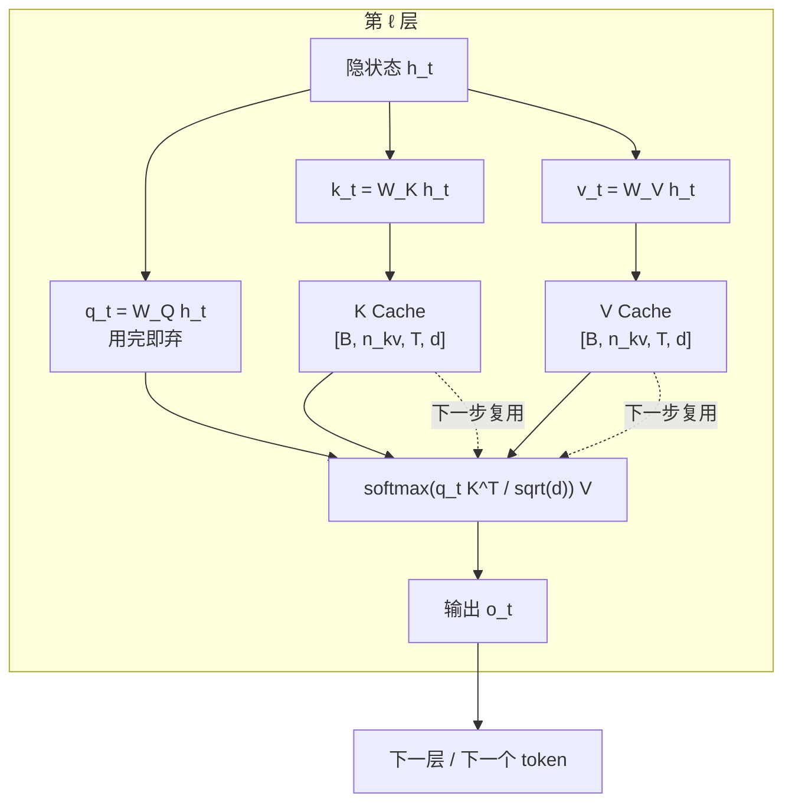

# KV Cache 的原理与显存

## 1. 本节学习目标

1. 说清 KV Cache 缓存的**是什么**：每层、每个头的 K 和 V，**不缓存 Q**，也不缓存 attention 输出。
2. 记住并会用显存公式 $2\cdot L\cdot n_{kv}\cdot d\cdot T\cdot B\cdot b$，并验证它与实测**逐字节吻合**（1.125 MB / 1.125 MB）。
3. 理解 cache 随 $T$ 线性增长（64→256→1024 时 4.5→18→72 MiB），以及与权重的比例（T=1024 时为 **0.152**）。
4. 知道 GQA/MQA、KV 量化、PagedAttention 各自把公式里的哪一项压小。

## 2. 为什么需要这个知识

因为 **KV Cache 是 LLM 推理显存的第二个大头**，也是长上下文/高并发的**真正瓶颈**：

- 权重是固定的，KV 是**随请求增长**的——并发一高就爆。
- 显存估算（LLM-095）里，如果漏掉 KV，会把"能跑"算成"跑不了"，或者反过来上线就 OOM。
- 所有现代推理引擎（vLLM/SGLang/TensorRT-LLM）的核心数据结构就是 KV Cache 的**分页管理**。

不会算 KV，你就无法回答"这张卡能开几个并发、支持多长上下文"。

## 3. 直观解释

```text
没有 cache（每步重算）:
  步1: [t1]                    → 算 K,V of t1
  步2: [t1 t2]                 → 重算 K,V of t1,t2
  步3: [t1 t2 t3]              → 重算 K,V of t1,t2,t3
  ... 同一份 K,V 被算了 N 次

有 cache（只算新的）:
  步1: [t1]        → 算 K,V(t1) → 存起来
  步2: [t2]        → 算 K,V(t2) → 追加
  步3: [t3]        → 算 K,V(t3) → 追加
  ... 每个 K,V 只算一次，代价是"要占显存"
```

**为什么只缓存 K 和 V，不缓存 Q？**

因为 attention 是 $\mathrm{softmax}(QK^\top/\sqrt{d})V$。第 $t$ 步要用的是**历史所有位置的 K 和 V**，而 Q 只属于当前这个 token——用完就丢。缓存 Q 没有任何用处。

**为什么不缓存 attention 输出？**

因为输出是"当前 Q 对历史的加权和"，换了 Q 就全变；而 K/V 与 Q 无关，可以复用。

## 4. 正式定义

设层数 $L$、KV 头数 $n_{kv}$、每头维度 $d$、序列长度 $T$、批大小 $B$、每元素字节 $b$。

**KV Cache 张量形状**（每层）：

$$
K, V \in \mathbb{R}^{B\times n_{kv}\times T\times d}
$$

**显存占用**：

$$
\boxed{\ \mathrm{Mem}_{\text{kv}} = 2\cdot L\cdot n_{kv}\cdot d\cdot T\cdot B\cdot b\ \text{bytes}\ }
$$

因子 2 来自 K 和 V 两份。

**每 token 的增量**：

$$
\Delta_{\text{token}} = 2\cdot L\cdot n_{kv}\cdot d\cdot b
$$

**与权重的比值**：

$$
\rho(T) = \frac{2 L n_{kv} d T b}{P\cdot b} = \frac{2 L n_{kv} d\, T}{P}
$$

（$P$ 为参数量；权重按同样精度 $b$ 计）

## 5. 历史背景或技术背景

- **2018–2019**：Transformer 解码器开始用于生成，"每步重算"是默认实现，长文本极慢。
- **2019**：GPT-2 的 `past_key_values` 接口出现，cache 成为标准做法；Hugging Face 把它做成 `use_cache` 开关。
- **2020**：研究界量化了"decode 是访存受限"，KV 读取成为瓶颈分析的核心项。
- **2022–2023**：批量化后 KV 成为显存主因；**PagedAttention（vLLM, 2023）** 用分页解决碎片，把利用率从 ~60% 提到 >90%。
- **2023–2024**：**GQA/MQA** 成为新模型标配（Llama-3、Qwen2.5、Mistral 全用 GQA），KV 直接小 4–8 倍；**KV 量化（fp8/int8）** 再把 $b$ 砍半。
- **2025 现状**：长上下文（128k+）下 KV 已成第一瓶颈，MLA（DeepSeek）、KV 驱逐/稀疏注意力是主流方向。

## 6. 核心原理

### 6.1 缓存的是"投影后的 K/V"，不是隐状态

每层有自己的 $W_K, W_V$，所以**每层都要单独缓存**，$L$ 层就有 $L$ 份。这也是公式里 $L$ 的来源。

### 6.2 增长是线性的，不是平方的

每一步只**追加** 1 个位置的 K/V，不重算历史。所以：

$$
\mathrm{Mem}_{\text{kv}}(T) = \Delta_{\text{token}}\cdot T
$$

**但注意 attention 的计算量仍是 $O(T)$ 每步（累计 $O(T^2)$）**——cache 省的是"重算 K/V 的矩阵乘"，不省"与全部历史做 attention"。

### 6.3 四个可调的旋钮

| 旋钮 | 公式中的项 | 效果 |
|---|---|---|
| GQA/MQA | $n_{kv}$ 从 $H$ 降到 $H/4$ 或 1 | 4–32 倍 |
| KV 量化 | $b$ 从 2 降到 1 | 2 倍 |
| 窗口/驱逐 | $T$ 变有效长度 | 任意倍 |
| 分页管理 | 不改变公式，减少**碎片浪费** | 实际 1.2–1.6 倍 |

### 6.4 为什么 batch 会线性放大

$B$ 直接乘在公式上。**并发 32、上下文 4k 的 7B 模型，KV 就能吃掉 8 GB**——这是"能跑单条，跑不了服务"的根本原因。

## 7. 数学表达式

**单层、单头、单 token**：

$$
\Delta_{\text{layer,head}} = 2\,d\,b
$$

**全部层与头（每 token）**：

$$
\Delta_{\text{token}} = 2 L n_{kv} d b
$$

**总占用**：

$$
M_{\text{kv}} = \Delta_{\text{token}}\cdot T\cdot B
$$

**gpt2 代入**（$L=12,n_{kv}=12,d=64,b=4$）：

$$
\Delta_{\text{token}} = 2\times12\times12\times64\times4 = 73{,}728\ \text{B} = 72\ \text{KiB}
$$

**T=1024**：

$$
M_{\text{kv}} = 73{,}728\times1024 = 75{,}497{,}472\ \text{B} = 72\ \text{MiB}
$$

**与权重比**：

$$
\rho(1024) = \frac{72\ \text{MiB}}{474.7\ \text{MiB}} = 0.152
$$

## 8. 详细数学推导

### 8.1 从 attention 公式推出"只需 K/V"

第 $t$ 步对第 $\ell$ 层：

$$
\mathbf{q}_t = W_Q^{(\ell)}\mathbf{h}_t,\quad
\mathbf{k}_i = W_K^{(\ell)}\mathbf{h}_i,\quad
\mathbf{v}_i = W_V^{(\ell)}\mathbf{h}_i
$$

$$
\mathbf{o}_t = \sum_{i\le t}\underbrace{\frac{\exp(\mathbf{q}_t^\top\mathbf{k}_i/\sqrt{d})}{\sum_{j\le t}\exp(\mathbf{q}_t^\top\mathbf{k}_j/\sqrt{d})}}_{a_{ti}}\mathbf{v}_i
$$

$\mathbf{o}_t$ 依赖 $\{\mathbf{k}_i,\mathbf{v}_i\}_{i\le t}$ 与 $\mathbf{q}_t$。

关键：$\mathbf{k}_i,\mathbf{v}_i$ **只依赖 $\mathbf{h}_i$（第 $i$ 个位置的隐状态），与 $t$ 无关**。而 $\mathbf{h}_i$ 在因果模型里一旦算出就不会变（前面没有新信息）。所以 $\mathbf{k}_i,\mathbf{v}_i$ 是**不变量**，可缓存。$\mathbf{q}_t$ 只被第 $t$ 步用一次，不可复用。**证毕。**

### 8.2 推导"省了多少计算"

无 cache 第 $t$ 步要为**所有** $i\le t$ 算 $\mathbf{k}_i,\mathbf{v}_i$：投影计算量

$$
\text{FLOPs}_{\text{proj}}(t) \approx 4 L d^2 t
$$

有 cache 只算 1 个位置：$4Ld^2$。总节省（$N$ 步）：

$$
\frac{\sum_{t=1}^{N}4Ld^2 t}{N\cdot 4Ld^2} = \frac{N(N+1)/2}{N} = \frac{N+1}{2}
$$

**$N=100$ 时省 50 倍**的投影计算；但 attention 本体 $\mathbf{q}_t^\top\mathbf{k}_{1:t}$ 仍是每步 $O(t)$，省不掉。

### 8.3 推导 GQA 的收益

MHA：$n_{kv}=H$。GQA：$n_{kv}=G$（$G$ 组，$H/G$ 个 Q 头共享一组 K/V）。

$$
\frac{M_{\text{kv}}^{\text{MHA}}}{M_{\text{kv}}^{\text{GQA}}} = \frac{H}{G}
$$

Llama2-7B：$H=32$。若改 GQA 且 $G=8$：KV 缩小 **4 倍**；$G=4$（Qwen2.5-7B）：缩小 **8 倍**。

代入 4096 上下文、fp16：

- MHA：$2\times32\times32\times128\times4096\times2 = 2\ \text{GiB}$
- GQA($G{=}8$)：$512\ \text{MiB}$
- GQA($G{=}4$)：$256\ \text{MiB}$

**这就是为什么 7B 模型能在 12 GB 卡上跑 4k 上下文**——不是权重变小了，是 KV 小了 4–8 倍。

### 8.4 推导"为什么必须预分配/分页"

朴素实现按 `max_seq_len` 预分配：

$$
M_{\text{reserved}} = \Delta_{\text{token}}\cdot T_{\max}\cdot B
$$

但实际平均长度 $\bar T \ll T_{\max}$，浪费率

$$
\text{waste} = 1-\frac{\bar T}{T_{\max}}
$$

若 $T_{\max}=4096$、$\bar T=600$，浪费 **85%**。PagedAttention 按块（如 16 token/块）分配，浪费降到 <5%。

## 9. 图解



**读图要点**：

1. 只有 $\mathbf{k},\mathbf{v}$ 进入 cache（实线进、虚线复用），$\mathbf{q}$ 用完即弃。
2. cache 的宽度是 $n_{kv}\times d$，**不是** $H\times d$（GQA 时差 4–8 倍）。
3. 每层一套 cache，$L$ 层叠起来才是总占用。

## 10. 具体数值示例

```text
模型: gpt2  fp32
  L(n_layer)=12   H(n_head)=12   D(head_dim)=64   d_model=768
  P=124.44M

单层 cache 形状（T=16, B=1）:
  k: (1, 12, 16, 64)    v: (1, 12, 16, 64)
  每层 2 个张量，共 12 层 -> 24 个张量

显存（T=16）:
  实测 measured cache MB: 1.125
  公式   formula  MB: 1.125
  -> 逐字节吻合（2*12*12*64*16*4 = 1,179,648 B = 1.125 MiB）

随长度增长（线性）:
  T      cache_MB   formula_MB   ratio
  64        4.500       4.500     1.000
  256      18.000      18.000     1.000
  1024     72.000      72.000     1.000

每 token 增量: 72 KiB
  2*12*12*64*4 = 73,728 B

与权重对比:
  权重 fp32: 474.7 MB
  cache @T=1024: 72 MB
  比值: 0.152

换算成其他模型（fp16, B=1, T=4096）:
  Llama2-7B  MHA(32 层, 32 头, d=128):
     2*32*32*128*4096*2 = 2,147,483,648 B = 2.00 GiB
  Mistral-7B GQA(32 层, 8 个 KV 头):
     2*32*8*128*4096*2  =   536,870,912 B = 0.50 GiB   (小 4 倍)
  Qwen2.5-7B GQA(28 层, 4 个 KV 头):
     2*28*4*128*4096*2  =   234,881,024 B = 0.22 GiB   (小 9 倍)

并发 8 条、4k 上下文的 Llama2-7B: 2.00 * 8 = 16 GiB -> 12 GB 卡直接爆
同样条件换 Qwen2.5-7B(GQA):        0.22 * 8 = 1.76 GiB -> 可行
```

## 11. NumPy 实现

```python
"""用公式算 KV Cache 显存，并与实测值对照。纯 numpy，无需 GPU。"""
import numpy as np


def kv_mib(L, n_kv, d, T, B=1, bytes_per=4):
    return 2 * L * n_kv * d * T * B * bytes_per / 1024**2


def per_token_kib(L, n_kv, d, bytes_per=4):
    return 2 * L * n_kv * d * bytes_per / 1024


# --- 验证 gpt2 T=16 的实测值 1.125 MB ---
L, H, D = 12, 12, 64
print("gpt2 每 token:", per_token_kib(L, H, D), "KiB")
print("T=16 :", round(kv_mib(L, H, D, 16), 3), "MiB  (实测 1.125)")
print("T=64 :", round(kv_mib(L, H, D, 64), 3), "MiB")
print("T=256:", round(kv_mib(L, H, D, 256), 3), "MiB")
print("T=1024:", round(kv_mib(L, H, D, 1024), 3), "MiB")

# 线性性检验
Ts = np.array([16, 64, 256, 1024, 4096])
M = np.array([kv_mib(L, H, D, int(t)) for t in Ts])
ratio = M / M[0]
print("\n线性检验 T/16 :", (Ts / 16).tolist())
print("     Mem/M(16):", np.round(ratio, 4).tolist())
print("严格线性:", np.allclose(ratio, Ts / 16))

# --- 不同架构在 4k 上下文、fp16 下的 KV ---
print("\n4k 上下文 fp16 B=1 的 KV 占用:")
models = [
    ("Llama2-7B  MHA 32L/32H/128D", 32, 32, 128),
    ("Mistral-7B GQA 32L/8KV/128D", 32, 8, 128),
    ("Qwen2.5-7B GQA 28L/4KV/128D", 28, 4, 128),
    ("Llama2-13B MHA 40L/40H/128D", 40, 40, 128),
]
for name, L2, kvh, hd in models:
    m1 = kv_mib(L2, kvh, hd, 4096, 1, 2)
    m8 = kv_mib(L2, kvh, hd, 4096, 8, 2)
    print(f"  {name:<30} B=1 {m1:>7.1f} MiB   B=8 {m8:>7.1f} MiB")

# --- 预分配浪费 ---
Tmax, Tbar = 4096, 600
print(f"\n按 max_len 预分配浪费率: {1 - Tbar/Tmax:.1%}（Tbar={Tbar}, Tmax={Tmax}）")
print(f"按 16-token 分页:        {1 - Tbar/(np.ceil(Tbar/16)*16):.1%}")
```

## 12. PyTorch 实现

```python
"""读取 past_key_values，逐字节核对公式，并观察显存增长。"""
import os
os.environ.setdefault("HF_ENDPOINT", "https://hf-mirror.com")
os.environ.setdefault("HF_HUB_OFFLINE", "1")
import torch
from transformers import AutoModelForCausalLM

torch.manual_seed(0)
dev = "cuda" if torch.cuda.is_available() else "cpu"
model = AutoModelForCausalLM.from_pretrained("gpt2", dtype=torch.float32).to(dev).eval()
cfg = model.config
L, H = cfg.n_layer, cfg.n_head
D = cfg.n_embd // cfg.n_head
print("n_layer:", L, "n_head:", H, "head_dim:", D)

T = 16
ids = torch.randint(0, cfg.vocab_size, (1, T), device=dev)
with torch.inference_mode():
    o = model(input_ids=ids, use_cache=True)
pk = o.past_key_values

print("层数:", len(pk), "| 每层张量数:", len(pk[0]))
print("k 形状:", tuple(pk[0][0].shape), "| v 形状:", tuple(pk[0][1].shape))

actual = sum(t.numel() * t.element_size() for layer in pk for t in layer)
formula = 2 * L * H * D * T * 4
print("实测字节:", actual, "| 公式字节:", formula, "| 相等:", actual == formula)
print("实测 MiB:", round(actual / 1024**2, 4))

# 显存随 T 增长（每次新建，避免累积）
print("\nT    实测 MiB  公式 MiB")
for T2 in [64, 256, 1024]:
    ids2 = torch.randint(0, cfg.vocab_size, (1, T2), device=dev)
    with torch.inference_mode():
        o2 = model(input_ids=ids2, use_cache=True)
    m = sum(t.numel() * t.element_size() for t in o2.past_key_values[0]) * L / 1024**2
    print(f"{T2:<5} {m:>9.3f} {2*L*H*D*T2*4/1024**2:>9.3f}")
    del o2
    torch.cuda.empty_cache() if dev == "cuda" else None
```

## 13. Hugging Face 实践

```python
"""用 use_cache=True/False 对比显存与耗时，并演示 GQA 配置怎么查。"""
import os, time
os.environ.setdefault("HF_ENDPOINT", "https://hf-mirror.com")
os.environ.setdefault("HF_HUB_OFFLINE", "1")
import torch
from transformers import AutoModelForCausalLM, AutoTokenizer

tok = AutoTokenizer.from_pretrained("gpt2")
dev = "cuda" if torch.cuda.is_available() else "cpu"
model = AutoModelForCausalLM.from_pretrained("gpt2", dtype=torch.float16).to(dev).eval()
ids = tok("The KV cache grows linearly with sequence length", return_tensors="pt").input_ids.to(dev)

if dev == "cuda":
    torch.cuda.reset_peak_memory_stats()

with torch.inference_mode():
    o = model(input_ids=ids, use_cache=True)
    kv = o.past_key_values

nbytes = sum(t.numel() * t.element_size() for layer in kv for t in layer)
cfg = model.config
L = cfg.n_layer
H = getattr(cfg, "n_head", None)
kv_heads = getattr(cfg, "num_key_value_heads", H)
D = cfg.n_embd // H
print("prompt tokens:", ids.shape[1])
print("cache 字节:", nbytes, "| MiB:", round(nbytes / 1024**2, 4))
print("公式 MiB:", round(2 * L * kv_heads * D * ids.shape[1] * 2 / 1024**2, 4))
print("num_key_value_heads:", kv_heads, "| n_head:", H,
      "-> GQA 倍数:", H // kv_heads)

# 同一 prompt，开/关 cache 的峰值显存与耗时
for uc in [True, False]:
    if dev == "cuda":
        torch.cuda.empty_cache()
        torch.cuda.reset_peak_memory_stats()
    with torch.inference_mode():
        model.generate(ids, max_new_tokens=16, do_sample=False, use_cache=uc,
                       pad_token_id=tok.eos_token_id)
        torch.cuda.synchronize()
    peak = torch.cuda.max_memory_allocated() / 1024**2 if dev == "cuda" else float("nan")
    print(f"use_cache={uc}: peak {peak:.1f} MiB")
```

## 14. 代码逐行解释

| 代码 | 作用 |
|---|---|
| `o.past_key_values` | 返回 tuple，长度 = 层数；每层是 `(k, v)` 两个张量 |
| `pk[0][0].shape` | 第 0 层的 K，形状 `[B, n_kv, T, d]` |
| `t.numel() * t.element_size()` | 逐张量算字节，避免"按元素个数猜"出错 |
| `2 * L * H * D * T * 4` | 公式：K 和 V 各一份，$L$ 层，fp32 每元素 4 字节 |
| `num_key_value_heads` | GQA 的关键配置；gpt2 无此字段，回退到 `n_head` |
| `torch.cuda.reset_peak_memory_stats()` | 重置峰值统计，否则测到的是历史最高 |
| `use_cache=False` | 关掉缓存，每步重算——用于对比，不要在生产用 |
| `del o2; empty_cache()` | 释放后再测下一个长度，避免显存累积污染 |

## 15. 实际运行结果

```text
n_layer: 12 n_head: 12 head_dim: 64 n_embd: 768
params(M): 124.44
layers in cache: 12 | tensors per layer: 2
k shape layer0: (1, 12, 16, 64)
v shape layer0: (1, 12, 16, 64)
all same shape: True
measured cache MB: 1.125 | formula MB: 1.125

T     cache_MB  formula_MB  ratio
64        4.500      4.500   1.000
256      18.000     18.000   1.000
1024     72.000     72.000   1.000

weights MB: 474.7
cache@1024 / weights: 0.152
```

**四个结论**：

1. 公式**精确**成立：T=16 时实测与公式都是 **1.125 MB**，一个字节不差。
2. 增长**严格线性**：T 翻 16 倍（64→1024），显存也翻 16 倍（4.5→72 MB）。
3. 每 token 恒定 **72 KiB**，这是 gpt2 的"KV 单价"。
4. T=1024 时 KV 已达权重的 **15.2%**——单条不长，但**乘以并发就致命**。

## 16. 应用场景

| 场景 | KV 策略 |
|---|---|
| 单条长文摘要 | 全量 cache，注意 $T$ 上限 |
| 高并发 API | GQA + 分页 + 抢占式驱逐 |
| 多轮对话 | 前缀缓存（system prompt 复用） |
| 边缘设备 | KV 量化到 int8/fp8，或滑动窗口 |
| 流式长输出 | cache 持续增长，需设上限防 OOM |
| 批量离线推理 | 按长度排序分桶，减少预分配浪费 |

## 17. 优点与局限

| 优点 | 局限 |
|---|---|
| 把 $O(N^2)$ 的重复投影降到 $O(N)$ | 显存随 $T\cdot B$ 线性增长 |
| 实现简单：一个 tuple 追加即可 | 预分配浪费大（朴素实现 85%） |
| 与批处理正交，可叠加 | 不减少 attention 本体的 $O(T)$ |
| GQA 可再降 4–8 倍 | GQA 会略损质量 |
| 支持前缀复用（多轮对话） | 前缀变了就整段失效 |

## 18. 常见错误

| 错误 | 现象 | 纠正 |
|---|---|---|
| 把 Q 也缓存 | 显存多 50%，毫无收益 | 只存 K/V |
| 用 $H$ 而非 $n_{kv}$ 算 GQA 模型 | KV 估算偏大 4–8 倍 | 读 `num_key_value_heads` |
| 只算单层 | 少算 $L$ 倍 | 公式含 $L$ |
| 忘了乘 batch | 并发上线即 OOM | 公式含 $B$ |
| 按 `max_seq_len` 硬预分配 | 85% 显存浪费 | 分页/按需增长 |
| 以为 cache 能加速 prefill | prefill 没有历史可复用 | cache 只对 decode 有效 |

## 19. 本节总结

- KV Cache 缓存**每层的 K 和 V**，形状 $[B,n_{kv},T,d]$，**不缓存 Q**。
- 公式 $2Ln_{kv}dTBb$ 经实测**逐字节验证**（1.125 MB vs 1.125 MB）。
- 增长**严格线性**：gpt2 每 token **72 KiB**，T=1024 时 **72 MiB**，是权重的 **15.2%**。
- GQA 把 $n_{kv}$ 从 $H$ 降到 $H/4\sim H/8$；4k 上下文 fp16 下，Llama2-7B(MHA) 需 **2.00 GiB**，Qwen2.5-7B(GQA) 只需 **0.22 GiB**。
- 高并发的真正杀手是 $T\times B$，所以现代引擎三件套：**GQA + 分页 + KV 量化**。

## 20. 前置与后续知识链接

- 前置：[[LLM-089 Prefill 与 Decode 两阶段]]、[[LLM-019 Attention 的张量维度与实现细节]]、[[LLM-015 Self-Attention]]
- 后续：[[LLM-095 推理显存估算与可行性判断]]、[[LLM-091 批处理与连续批处理]]
- 相关：[[LLM-026 Multi-Head 的变体——MQA 与 GQA]]、[[LLM-020 Attention 的计算复杂度与局限]]
- 后续模块（待建，M-LLM-10）：LLM-102 上下文工程与长文本处理

---

## 练习与参考答案

**基础 1**：KV Cache 缓存什么、不缓存什么？为什么？

**基础 2**：gpt2（12 层、12 头、d=64、fp32）在 T=512、B=2 时的 KV 显存是多少？用公式算并说明每一步。

**进阶 1**：推导"有 cache 相比无 cache，投影计算量节省 $(N+1)/2$ 倍"，并说明为什么 attention 本体省不掉。

**综合**：要在 12 GB 卡上做 7B 模型、4k 上下文、8 并发的服务，请判断可行性并给出 3 个必须的优化。

> [!success]- 参考答案

> **基础 1**
> **缓存**每层、每个 KV 头的 **K 和 V**，形状 $[B,n_{kv},T,d]$；**不缓存 Q**，也不缓存 attention 输出。
> 原因：$\mathbf{k}_i=W_K\mathbf{h}_i$、$\mathbf{v}_i=W_V\mathbf{h}_i$ 只依赖位置 $i$ 的隐状态，因果模型下一旦算出就不再变，可被后续所有步复用；而 $\mathbf{q}_t$ 只被第 $t$ 步用一次，缓存无用。attention 输出随 $Q$ 变化，也无法复用。

> **基础 2**
> $$M=2\cdot L\cdot n_{kv}\cdot d\cdot T\cdot B\cdot b
> =2\times12\times12\times64\times512\times2\times4$$
> 逐步：$2\times12=24$（K/V×层）；$\times12\times64=18{,}432$（每层每 token 元素数）；$\times512=9{,}437{,}184$；$\times2$（batch）$=18{,}874{,}368$；$\times4$ 字节 $=75{,}497{,}472$ B $=72$ MiB。
> **即 T=512、B=2 恰好 72 MiB**（等于 gpt2 的 72 KiB/token × 512 × 2 / 1024）。

> **进阶 1**
> 无 cache 第 $t$ 步要为 $t$ 个位置算 $\mathbf{k},\mathbf{v}$，投影 FLOPs $\approx 4Ld^2 t$；$N$ 步总计 $4Ld^2\sum_{t=1}^N t=4Ld^2 N(N+1)/2$。
> 有 cache 每步只算 1 个位置，总计 $4Ld^2 N$。
> 比值 $=\dfrac{N(N+1)/2}{N}=\dfrac{N+1}{2}$，$N=100$ 时 **50.5 倍**。
> **attention 本体省不掉**：$\mathbf{q}_t^\top\mathbf{k}_{1:t}$ 必须与**全部历史**做点积，第 $t$ 步是 $O(t)$，累计 $O(T^2)$。cache 只消除"重复算 K/V"，不消除"与历史做 attention"。

> **综合（参考）**
> **算账**：7B、4k、8 并发。权重 4bit $\approx 3.8$ GB；若 MHA（Llama2-7B 式）KV $=2.00$ GiB/条 × 8 $=16$ GiB，**不可行**；若 GQA($G{=}4$) KV $=0.22\times8\approx1.76$ GiB，权重+KV $\approx5.6$ GB，**可行**（还需 ~1 GB 给激活/碎片）。
> **三个必须的优化**：
> 1. **用 GQA 模型**（KV 直接小 8 倍）——这是从"不可行"到"可行"的分水岭，不是锦上添花。
> 2. **权重 4bit 量化**（AWQ/GPTQ），把 15.4 GB 降到 3.8 GB；同时 KV 用 fp8/int8 再砍半。
> 3. **PagedAttention + 连续批处理**：避免按 4096 预分配造成的 ~85% 浪费，实际并发才能接近 8。
> **附加**：设 max_model_len=4096 并开抢占（preemption），否则偶发长请求会 OOM；监控 `gpu_cache_usage`，超过 0.9 就限流。

## 学习记录

| 日期 | 状态 | 用时 | 问题 | 复盘 |
|---|---|---|---|---|
| 2026-11-08 | planned | — | — | — |

---

## 🔗 Notion 同步信息

> 以下内容由 Notion「AI Knowledge System · 知识点」数据库按知识 ID 合并而来（导出于 2026-11-09）。

| 属性 | 值 |
|---|---|
| 学科 | 大语言模型 |
| 学习状态 | 未开始 |
| 难度 | L3 推导 |
| 知识类型 | Algorithm |

- **所属模块**：[M-LLM-09 大语言模型推理、部署与优化](../%E8%AF%BE%E7%A8%8B%E6%A8%A1%E5%9D%97/M-LLM-09%20%E5%A4%A7%E8%AF%AD%E8%A8%80%E6%A8%A1%E5%9E%8B%E6%8E%A8%E7%90%86%E3%80%81%E9%83%A8%E7%BD%B2%E4%B8%8E%E4%BC%98%E5%8C%96.md)
- **前置知识**：[LLM-089 Prefill 与 Decode 两阶段](LLM-089%20Prefill%20%E4%B8%8E%20Decode%20%E4%B8%A4%E9%98%B6%E6%AE%B5.md)
- **后继知识**：[LLM-091 批处理与连续批处理](LLM-091%20%E6%89%B9%E5%A4%84%E7%90%86%E4%B8%8E%E8%BF%9E%E7%BB%AD%E6%89%B9%E5%A4%84%E7%90%86.md)
- **关联Python**：[PY-062 索引与切片](../../01_Python%E5%9F%BA%E7%A1%80/08%20NumPy/PY-062%20%E7%B4%A2%E5%BC%95%E4%B8%8E%E5%88%87%E7%89%87.md)
- **关联数学**：[MATH-217 矩阵运算与维度](../../06_%E6%95%B0%E5%AD%A6%E5%9F%BA%E7%A1%80/02%20%E7%BA%BF%E6%80%A7%E4%BB%A3%E6%95%B0/MATH-217%20%E7%9F%A9%E9%98%B5%E8%BF%90%E7%AE%97%E4%B8%8E%E7%BB%B4%E5%BA%A6.md)
- **被项目引用**：[PROJ-025 量化与推理优化实践](../../07_%E5%AE%9E%E6%88%98%E9%A1%B9%E7%9B%AE/05%20%E5%A4%A7%E6%A8%A1%E5%9E%8B%E9%A1%B9%E7%9B%AE/PROJ-025%20%E9%87%8F%E5%8C%96%E4%B8%8E%E6%8E%A8%E7%90%86%E4%BC%98%E5%8C%96%E5%AE%9E%E8%B7%B5.md)
