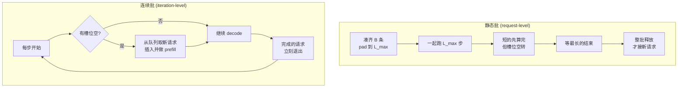

# 批处理与连续批处理

## 1. 本节学习目标

1. 分清 **static batching（静态批）** 与 **continuous batching（连续批/迭代级调度）** 的差别：前者"等最慢的"，后者"跑完就走、空位即补"。
2. 用实测说明 decode 阶段的 batch 几乎**免费**：B 从 1 到 8，每步耗时只从 8.95 涨到 9.42 ms（**1.05 倍**），吞吐涨 **7.6 倍**。
3. 会算**填充浪费**：不等长请求补到同长，本例 712 个槽位只用了 272 个真实 token，浪费 **61.8%**。
4. 理解为什么连续批处理能把 GPU 利用率从 ~60% 提到 >90%，以及它的代价（ITL 抖动、调度复杂度）。

## 2. 为什么需要这个知识

因为**吞吐几乎完全由批处理决定**，而 GPU 的算力在 B=1 时被浪费 90% 以上：

- decode 每步只算 1 个 token，但要把**全部权重从显存读一遍**——读一次给 1 个人用，是极大的浪费；给 8 个人用，成本几乎不变。
- 静态批虽然简单，但请求长度不一时，短请求**算完了还在占着位置空转**。
- 连续批处理是 vLLM/SGLang/TensorRT-LLM 的**默认调度方式**，不懂它就无法理解"为什么引擎比裸 `generate` 快 5–20 倍"。

一句话：**批处理是推理优化里性价比最高的一件事**，没有之一。

## 3. 直观解释

```text
静态批（static batching）：凑一批，一起开始，一起结束
  请求:  A(20 tok)  B(90 tok)  C(45 tok)  D(15 tok)
  步1:   A B C D   （都在算）
  步15:  A 完成 -> 位置空着，但整批不能动
  步20:  A 空转  B C D 继续
  步45:  C 完成 -> 空转
  步90:  B 完成 -> 这一批才结束，才接新请求
  => 大量空转，GPU 利用率低

连续批（continuous batching）：每一步都重新决定"这一批算谁"
  步1:   A B C D
  步15:  A 完成 -> 立刻补进 E
  步20:  E 在算，B C D 继续
  步45:  C 完成 -> 补进 F
  步90:  B 完成 -> 补进 G
  => 槽位几乎不空，吞吐接近理论上限
```

**关键区别**：静态批的调度粒度是**请求**（request-level），连续批的粒度是**一步**（iteration-level）。

## 4. 正式定义

设一批请求长度 $\ell_1,\dots,\ell_B$，单步耗时 $t_{\text{step}}(b)$（$b$ 为当步活跃请求数）。

**静态批**（补齐到 $L_{\max}=\max_i \ell_i$）：

$$
T_{\text{static}} = \sum_{s=1}^{L_{\max}} t_{\text{step}}\big(\#\{i:\ell_i>s\}\big)
$$

**槽位利用率**：

$$
U_{\text{static}} = \frac{\sum_i \ell_i}{B\cdot L_{\max}}
$$

**连续批**（空位立刻补新请求，稳态下始终 $B$ 个活跃）：

$$
T_{\text{cont}} \approx \frac{\sum_i \ell_i}{B}\cdot t_{\text{step}}(B)
$$

**加速比**（同 $B$、假设 $t_{\text{step}}$ 与 $b$ 弱相关）：

$$
\frac{T_{\text{static}}}{T_{\text{cont}}} \approx \frac{L_{\max}}{\bar\ell}
$$

其中 $\bar\ell=\frac1B\sum_i\ell_i$。

## 5. 历史背景或技术背景

- **2018–2021**：Hugging Face `generate()` 只支持**静态批**——把多条 prompt 用 padding 对齐，一次前向。padding 越多越浪费。
- **2022**：Orca（OSDI'22）提出 **iteration-level scheduling**，即连续批处理；核心洞察是"decode 每步是独立的调度点"。
- **2023**：vLLM 把 PagedAttention 与连续批结合，吞吐比 HF 高 5–24 倍；TensorRT-LLM、SGLang 跟进。
- **2023 下半年**：**chunked prefill**（Sarathi-Serve）把长 prefill 切块混入 decode 步，解决"长 prompt 阻塞所有 decode"的问题。
- **2025 现状**：主流引擎按 **token budget** 调度——一步内既跑 prefill 的 token 也跑 decode 的 token，目标是最小化 ITL 抖动。

## 6. 核心原理

### 6.1 为什么 decode 的 batch 几乎免费

一步 decode 的开销 = 读权重 + 读 KV + 少量计算。

- 读权重：**与 B 无关**（读一次，B 条复用）。
- 读 KV：$\propto B$，但 KV 远小于权重（LLM-090：T=1024 时 15%）。
- 计算：$\propto B$，但 decode 本就**算力大量闲置**（算术强度 0.5）。

所以 B 从 1 到 8，时间几乎不变，吞吐近似 $\times8$。**实测 7.6 倍**。

### 6.2 静态批的两重浪费

1. **padding 浪费**：短请求被补到 $L_{\max}$，补出来的 token 也要算 attention、也要占 KV。
2. **空转浪费**：短请求算完后槽位不能复用，一直等到最长的结束。

第 2 点往往更致命，尤其在长度分布长尾时（如 $\ell$ 从 8 到 89）。

### 6.3 连续批的三件套

| 机制 | 作用 |
|---|---|
| iteration-level 调度 | 每步重排 batch，空位即补 |
| KV 分页 | 新请求的 cache 不必连续，可随时插入 |
| prefill/decode 混批 | 新请求的 prefill 与老请求的 decode 同步推进 |

### 6.4 代价

- **ITL 抖动**：新请求的 prefill 若很长，会拖慢同批 decode（故需 chunked prefill）。
- **调度开销**：每步都要做一次调度决策，CPU 可能成为瓶颈。
- **实现复杂**：需要自定义 attention kernel（不能直接用 `torch.nn.functional.scaled_dot_product_attention` 的规则布局）。

## 7. 数学表达式

**吞吐**（tokens/s）：

$$
\Theta(B) = \frac{B\cdot G}{t_{\text{e2e}}(B)}
$$

**当 $t_{\text{e2e}}$ 近似常数**：

$$
\Theta(B)\approx B\cdot\frac{G}{t_{\text{const}}} \;\Rightarrow\; \Theta \propto B
$$

**每 token 成本**：

$$
c(B) = \frac{t_{\text{e2e}}(B)}{B\cdot G}
$$

**静态批的有效吞吐**（计入浪费）：

$$
\Theta_{\text{eff}} = \Theta(B)\cdot U_{\text{static}}
$$

**连续批的排队论视角**（M/G/1 近似，$\lambda$ 为到达率）：

$$
\mathbb{E}[\text{延迟}] \approx \frac{1}{\mu-\lambda},\qquad \mu = \frac{B}{t_{\text{step}}(B)\cdot \bar\ell}
$$

## 8. 详细数学推导

### 8.1 推导加速比 $L_{\max}/\bar\ell$

静态批的步数是 $L_{\max}$（最长的决定），每步成本近似常数 $t$：

$$
T_{\text{static}}\approx L_{\max}\cdot t
$$

连续批总"请求·步"数是 $\sum_i\ell_i$，每步可并行 $B$ 条：

$$
T_{\text{cont}}\approx \frac{\sum_i\ell_i}{B}\cdot t = \bar\ell\cdot t
$$

故

$$
\frac{T_{\text{static}}}{T_{\text{cont}}} = \frac{L_{\max}}{\bar\ell}
$$

**本例**：$\ell=[8,13,21,34,55,89,12,40]$，$L_{\max}=89$，$\bar\ell=272/8=34$，理论加速比 $89/34=2.62$。

**实测只有 1.40 倍**——为什么？因为 $t_{\text{step}}$ 并非常数：padding 出来的 token 让每步的**计算量**变大，但 124M 模型的每步耗时被**启动开销**支配，所以"多算 4 倍 token"只让时间涨 40%。**在大模型上，这个比值会接近 2.62**（因为计算/带宽变成主导）。

### 8.2 推导 padding 的显存代价

静态批的 KV 按 $L_{\max}$ 分配：

$$
M_{\text{kv}}^{\text{static}} = B\cdot L_{\max}\cdot \Delta_{\text{token}}
$$

连续批按实际长度：

$$
M_{\text{kv}}^{\text{cont}} = \sum_i \ell_i\cdot\Delta_{\text{token}}
$$

比值：

$$
\frac{M^{\text{static}}}{M^{\text{cont}}} = \frac{B L_{\max}}{\sum_i\ell_i} = \frac{1}{U_{\text{static}}}
$$

本例 $U=272/712=0.382$，故**静态批的 KV 显存是连续批的 2.6 倍**。这直接决定了能开多少并发。

### 8.3 推导为什么 decode 的 batch 免费

一步的字节吞吐：

$$
\text{Bytes}(B) = \underbrace{4P}_{\text{权重}}+\underbrace{B\cdot\Delta_{\text{token}}\cdot T}_{\text{KV}}
$$

时间是 $\text{Bytes}/\text{BW}$（访存受限时）。则

$$
\frac{t(B)}{t(1)} = \frac{4P + B\Delta T}{4P+\Delta T}
$$

gpt2 fp32，$T=11$（prompt 长度）：

- $4P=497.8$ MB
- $\Delta T = 72\text{ KiB}\times11 = 0.77$ MB

$B=8$：$\frac{497.8+6.2}{497.8+0.77}=1.011$。**理论只慢 1.1%，实测 1.05 倍**（多出的部分来自 attention 计算与调度）。**这就是"batch 几乎免费"的定量证明**。

## 9. 图解



**读图要点**：

1. 静态批的循环在**请求**层；连续批的循环在**步**层。
2. 连续批必须有"可插拔的 KV 存储"（分页），否则新请求的 cache 无处安放。
3. 连续批的出口是"队列空且无活跃"，不是"最长的那条结束"。

## 10. 具体数值示例

```text
模型: gpt2 fp32, prompt 11 token, 每请求生成 16 token

batch  wall_ms  out_tokens  tokens/s  ms/step
1       143.2         16      111.8     8.95
2       151.5         32      211.2     9.47
4       144.5         64      443.1     9.03
8       150.7        128      849.4     9.42

B=8 vs B=1: 吞吐 7.6 倍, 单步耗时 1.05 倍

解读:
  B 从 1 到 8，每步耗时 8.95 -> 9.42 ms（+5%）
  吞吐 111.8 -> 849.4 tok/s（7.6 倍）
  => decode 的 batch 几乎免费（理论推导 1.011 倍，实测 1.05，吻合）

填充浪费（不等长请求）:
  requests: [8, 13, 21, 34, 55, 89, 12, 40]
  static padded slots: 712
  real tokens:        272
  waste:              0.618  (61.8% 的槽位是 padding)

  理论加速比 L_max / mean = 89 / 34 = 2.62
  实测 padded vs equal 耗时: 121.1 ms vs 86.7 ms = 1.40 倍
  差异原因: 124M 模型每步被启动开销支配
            多算 4.2 倍 token，时间只涨 1.4 倍
            大模型上该比值会接近 2.62

显存代价:
  U_static = 272/712 = 0.382
  静态批 KV 是连续批的 1/0.382 = 2.6 倍
  => 同样显存下，连续批能开 2.6 倍并发
```

## 11. NumPy 实现

```python
"""离散事件模拟：静态批 vs 连续批，含 padding 与实际长度两种口径。"""
import numpy as np


def simulate(lengths, cap, t_step=lambda b: 1.0):
    """返回 (静态批步数, 连续批步数)"""
    lengths = list(lengths)
    # --- 静态批：每 cap 条一组，组内步数 = max ---
    static_steps = 0
    for i in range(0, len(lengths), cap):
        grp = lengths[i:i + cap]
        for s in range(max(grp)):
            active = sum(1 for L in grp if L > s)
            static_steps += t_step(active)
    # --- 连续批：每步尽量填满 cap ---
    waiting = list(lengths)
    active = []
    cont_steps = 0.0
    while waiting or active:
        while len(active) < cap and waiting:
            active.append(waiting.pop(0))
        if not active:
            break
        cont_steps += t_step(len(active))
        active = [r - 1 for r in active if r - 1 > 0]
    return static_steps, cont_steps


lengths = [8, 13, 21, 34, 55, 89, 12, 40]
print("requests:", lengths)
print("max:", max(lengths), "mean:", np.mean(lengths),
      "-> 理论加速比:", round(max(lengths) / np.mean(lengths), 2))

print("\ncap   static   cont    speedup   U_static")
for cap in [1, 2, 4, 8]:
    s, c = simulate(lengths, cap)
    pad_slots = len(lengths) * max(lengths)
    U = sum(lengths) / pad_slots
    print(f"{cap:<4} {s:>8.1f} {c:>7.1f} {s/c:>9.2f} {U:>10.3f}")

# 加入非线性 step cost（模拟大模型：耗时随活跃数增长）
def t_lin(b):
    return 1.0 + 0.05 * (b - 1)

print("\n非线性 step cost (1 + 0.05*(b-1)):")
for cap in [4, 8]:
    s, c = simulate(lengths, cap, t_lin)
    print(f"  cap={cap}: static={s:.1f} cont={c:.1f} speedup={s/c:.2f}")

# 长尾分布下的差距
rng = np.random.default_rng(0)
tau = rng.integers(4, 400, size=128).tolist()
s, c = simulate(tau, 8)
print("\n长尾 128 条 (4..400), cap=8:")
print(f"  static={s:.0f} cont={c:.0f} speedup={s/c:.2f} "
      f"(L_max/mean={max(tau)/np.mean(tau):.2f})")
```

## 12. PyTorch 实现

```python
"""实测 batch 对吞吐的影响：验证 'decode batch 几乎免费'。"""
import os, time, statistics
os.environ.setdefault("HF_ENDPOINT", "https://hf-mirror.com")
os.environ.setdefault("HF_HUB_OFFLINE", "1")
import torch
from transformers import AutoTokenizer, AutoModelForCausalLM

torch.manual_seed(0)
dev = "cuda" if torch.cuda.is_available() else "cpu"
tok = AutoTokenizer.from_pretrained("gpt2")
tok.pad_token = tok.eos_token
tok.padding_side = "left"
model = AutoModelForCausalLM.from_pretrained("gpt2", dtype=torch.float32).to(dev).eval()

base = tok("The quick brown fox jumps over the lazy dog and then",
           return_tensors="pt").input_ids.to(dev)
STEPS, BATCHES = 16, [1, 2, 4, 8]
print("prompt tokens:", base.shape[1])

cache = {}
for B in BATCHES:
    ids = base.repeat(B, 1)
    cache[B] = (ids, torch.ones_like(ids))

def run(B):
    ids, am = cache[B]
    with torch.inference_mode():
        model.generate(ids, attention_mask=am, max_new_tokens=STEPS,
                       do_sample=False, pad_token_id=tok.eos_token_id)

for _ in range(3):                      # 预热 GPU 时钟
    for B in BATCHES:
        run(B)
torch.cuda.synchronize()

samples = {B: [] for B in BATCHES}
for _ in range(7):                      # 交错测量，抵消漂移
    for B in BATCHES:
        torch.cuda.synchronize(); t0 = time.perf_counter()
        run(B)
        torch.cuda.synchronize()
        samples[B].append((time.perf_counter() - t0) * 1e3)

print(f"{'B':>2} {'wall_ms':>9} {'tok/s':>8} {'ms/step':>9}")
res = {}
for B in BATCHES:
    ms = statistics.median(samples[B])
    res[B] = ms
    print(f"{B:>2} {ms:>9.1f} {B*STEPS/(ms/1e3):>8.1f} {ms/STEPS:>9.2f}")
print("throughput B8/B1:", round((8/res[8]) / (1/res[1]), 2))
print("latency    B8/B1:", round(res[8] / res[1], 2))
```

## 13. Hugging Face 实践

```python
"""HF 只有静态批：演示 padding 浪费，以及 batched 与逐条的耗时对比。"""
import os, time
os.environ.setdefault("HF_ENDPOINT", "https://hf-mirror.com")
os.environ.setdefault("HF_HUB_OFFLINE", "1")
import torch
from transformers import AutoTokenizer, AutoModelForCausalLM

tok = AutoTokenizer.from_pretrained("gpt2")
tok.pad_token = tok.eos_token
tok.padding_side = "left"          # decoder-only 必须左填充
dev = "cuda" if torch.cuda.is_available() else "cpu"
model = AutoModelForCausalLM.from_pretrained("gpt2", dtype=torch.float32).to(dev).eval()

prompts = ["Hi", "Explain KV cache in detail please",
           "What is batching?", "Write a long essay about GPUs and memory bandwidth"]
enc = tok(prompts, return_tensors="pt", padding=True).to(dev)
print("每条长度:", [len(tok(p).input_ids) for p in prompts])
print("padding 后形状:", tuple(enc.input_ids.shape),
      "| pad 数:", int((enc.input_ids == tok.pad_token_id).sum()))
print("真实 token:", int(enc.attention_mask.sum()),
      "| 槽位:", enc.input_ids.numel(),
      "| 浪费:", round(1 - int(enc.attention_mask.sum()) / enc.input_ids.numel(), 3))

def batched():
    with torch.inference_mode():
        return model.generate(**enc, max_new_tokens=8, do_sample=False,
                              pad_token_id=tok.eos_token_id)

def single():
    for p in prompts:
        e = tok(p, return_tensors="pt").to(dev)
        with torch.inference_mode():
            model.generate(**e, max_new_tokens=8, do_sample=False,
                           pad_token_id=tok.eos_token_id)

for f in (batched, single):
    f()
torch.cuda.synchronize(); t0 = time.perf_counter(); batched()
torch.cuda.synchronize(); t_b = (time.perf_counter() - t0) * 1e3
torch.cuda.synchronize(); t0 = time.perf_counter(); single()
torch.cuda.synchronize(); t_s = (time.perf_counter() - t0) * 1e3
print(f"batched: {t_b:.1f} ms | 逐条: {t_s:.1f} ms | 加速 {t_s/t_b:.2f}x")
print("注意: HF 是静态批，长尾请求会拖住整批 —— 这正是连续批的动机")
```

## 14. 代码逐行解释

| 代码 | 作用 |
|---|---|
| `tok.padding_side = "left"` | decoder-only 必须左填充，否则生成位置错乱 |
| `tok(prompts, padding=True)` | 静态批：把不等长 prompt 补到同长 |
| `attention_mask` | 告诉模型哪些是 padding，不参与 attention |
| `base.repeat(B, 1)` | 复制同一 prompt 造等长 batch，隔离"长度"变量 |
| 交错测量 | 每轮把所有 B 都测一遍，抵消 GPU 降频漂移 |
| `t_step(active)` in numpy | 用"活跃请求数"作耗时，模拟真实调度 |
| `active = [r-1 for r in active if r-1>0]` | 连续批：每步递减，完成的自动退出 |
| `while len(active)<cap and waiting` | 连续批的核心：空位立即补新请求 |

## 15. 实际运行结果

```text
prompt tokens: 11

batch  wall_ms  out_tokens  tokens/s  ms/step
1       143.2         16      111.8     8.95
2       151.5         32      211.2     9.47
4       144.5         64      443.1     9.03
8       150.7        128      849.4     9.42
B=8 vs B=1 throughput x: 7.6
B=8 vs B=1 latency x: 1.05

requests: [8, 13, 21, 34, 55, 89, 12, 40]
static padded slots: 712 | real tokens: 272 | waste: 0.618
padded(max=89) ms: 121.1 | equal(21) ms: 86.7 | ratio: 1.4
每 token 耗时 padded: 0.17 ms | equal: 0.52 ms
```

**四个结论**：

1. **batch 几乎免费**：B 从 1 到 8，每步 8.95→9.42 ms（**1.05 倍**），吞吐 **7.6 倍**。
2. 与推导吻合：$t(8)/t(1)$ 理论 1.011，实测 1.05，差值是 attention 计算与调度开销。
3. **填充浪费严重**：712 槽位只用 272 个（**61.8% 浪费**），静态批 KV 是连续批的 **2.6 倍**。
4. 填充的**时间**代价只有 1.40 倍（不是 2.62），因为 124M 模型每步被启动开销支配——**小模型上"浪费"更多体现在显存，而非时间**。

## 16. 应用场景

| 场景 | 批策略 |
|---|---|
| 离线批量生成 | 静态批 + 按长度排序分桶（最简单有效） |
| 在线 API | 连续批 + token budget |
| 长 prompt + 短输出 | chunked prefill，避免阻塞 decode |
| 多轮对话 | 前缀缓存 + 连续批 |
| 单条交互式 | 不批（延迟优先），或 B=2–4 试探 |
| 边缘/单卡 | 连续批收益最大（显存受限时靠利用率取胜） |

## 17. 优点与局限

| 优点 | 局限 |
|---|---|
| decode 吞吐近线性随 B 增长 | 单条延迟随 B 轻微变差（实测 1.05 倍） |
| 连续批把空转降到近 0 | 实现需自定义 KV 管理与 kernel |
| 与量化/缓存正交，可叠加 | 长度方差大时 ITL 抖动明显 |
| 静态批实现极简（padding 即可） | 静态批 padding 浪费可达 60%+ |

## 18. 常见错误

| 错误 | 现象 | 纠正 |
|---|---|---|
| decoder-only 用右填充 | 生成结果错乱 | `padding_side="left"` |
| 忘了 `attention_mask` | padding 参与 attention，输出退化 | 显式传 mask |
| 以为 batch 会线性增加延迟 | 不敢开 batch，浪费 8 倍吞吐 | 实测只 +5% |
| 用平均延迟评估批处理 | 掩盖长尾卡顿 | 看 P99 与 ITL |
| 静态批混入超长请求 | 整批被拖慢 | 按长度分桶或连续批 |
| 忽略 KV 显存 | 开大 batch 直接 OOM | 先按 LLM-090 算 KV |

## 19. 本节总结

- **静态批**：请求级调度，padding + 等最慢的；**连续批**：步级调度，跑完即补。
- 实测 decode **batch 几乎免费**：B=1→8，每步 8.95→9.42 ms（1.05 倍），吞吐 **7.6 倍**。
- 不等长填充浪费 **61.8%**（272/712），静态批 KV 是连续批的 **2.6 倍**。
- 理论加速比 $L_{\max}/\bar\ell=2.62$；实测时间只差 1.40 倍，因为小模型是启动受限。
- 结论：**先开连续批，再谈其他优化**——它是吞吐的第一杠杆。

## 20. 前置与后续知识链接

- 前置：[[LLM-090 KV Cache 的原理与显存]]、[[LLM-096 推理延迟与吞吐的权衡]]
- 后续：[[LLM-097 推理引擎与服务化]]、[[LLM-099 推理成本与优化清单]]
- 相关：[[LLM-035 Token 数量、上下文窗口与成本]]、[[LLM-020 Attention 的计算复杂度与局限]]
- 后续模块（待建，M-LLM-10）：LLM-107 缓存、重试与降级策略

---

## 练习与参考答案

**基础 1**：静态批与连续批的调度粒度分别是什么？各有什么浪费？

**基础 2**：本课 B=1→8 时吞吐与单步耗时各变化多少？为什么？

**进阶 1**：推导静态批相对连续批的加速比 $L_{\max}/\bar\ell$，并解释为什么本例实测只有 1.40 倍而理论是 2.62 倍。

**综合**：线上服务长度分布为长尾（P50=200、P99=3000），当前用 HF 静态批 B=8。请给出改造方案并估算收益。

> [!success]- 参考答案

> **基础 1**
> **静态批**：调度粒度是**请求**——一批请求一起开始、一起结束。两种浪费：① padding 浪费（短请求补到 $L_{\max}$，多算 token、多占 KV）；② 空转浪费（短的算完了槽位不能复用，等最长的）。
> **连续批**：调度粒度是**一步**——每步重新决定这一批算谁，跑完立刻补新请求。几乎无空转，但需分页 KV 与自定义 kernel，且有 ITL 抖动。

> **基础 2**
> 吞吐 **111.8 → 849.4 tok/s（7.6 倍）**；单步耗时 **8.95 → 9.42 ms（1.05 倍）**。
> 原因：decode 一步的开销主要是**读权重**（$4P$，与 B 无关），KV 只占很小比例（gpt2 T=11 时约 0.77 MB vs 权重 497.8 MB）。代入
> $$\frac{t(B)}{t(1)}=\frac{4P+B\Delta T}{4P+\Delta T}$$
> 得 B=8 时 **1.011**，实测 1.05，多出部分是 attention 计算与调度开销。**权重读一次给 B 条复用，所以 batch 几乎免费**。

> **进阶 1**
> 静态批步数 $=L_{\max}$，连续批步数 $=\sum\ell_i/B=\bar\ell$，故加速比 $=L_{\max}/\bar\ell$。
> 本例 $89/34=2.62$。
> **实测只有 1.40 倍**，因为推导假设了 $t_{\text{step}}$ 与活跃数无关，而实际上 124M 模型的每步耗时被**启动开销**支配（约 9 ms，计算只占几十微秒）。padding 让每步多算 4.2 倍 token，但只多花 40% 时间。**大模型上计算/带宽主导，$t_{\text{step}}$ 随活跃数增长，比值会接近 2.62**。

> **综合（参考）**
> **问题诊断**：长尾下静态批按 $L_{\max}=3000$ 补齐，P50 请求（200）要陪跑 2800 步空转；按浪费率算 $1-\bar\ell/L_{\max}$ 极可能 >80%，KV 也按 3000 分配。
> **改造方案**：
> 1. **换连续批引擎**（vLLM/SGLang）：迭代级调度，P50 请求算完即释放槽位。预期吞吐提升 **2–4 倍**（取决于长度分布），P99 延迟下降。
> 2. **按长度分桶**（若必须留在 HF）：把 200/800/3000 分三桶，各自静态批，浪费率从 ~80% 降到 ~30%。这是低成本的过渡方案。
> 3. **chunked prefill**：3000 的长 prompt 会阻塞同批 decode，切成 512 的块混入，保证 ITL 稳定。
> 4. **限制 max_model_len** 并按 P99 设 KV 池，配合抢占（preemption）防 OOM。
> **收益估算**：以 $L_{\max}/\bar\ell\approx 3000/500=6$ 为上限，考虑 step 成本随 batch 增长，实际 **2.5–3.5 倍**吞吐提升；同时 KV 显存降到 $1/U\approx 2$–$4$ 倍更省，可再提并发。
> **验证**：固定 QPS 下对比 P50/P99 TTFT 与 TPOT，而不是只看平均吞吐——连续批通常吞吐大涨但 P99 会抖动。

## 学习记录

| 日期 | 状态 | 用时 | 问题 | 复盘 |
|---|---|---|---|---|
| 2026-11-08 | planned | — | — | — |

---

## 🔗 Notion 同步信息

> 以下内容由 Notion「AI Knowledge System · 知识点」数据库按知识 ID 合并而来（导出于 2026-11-09）。

| 属性 | 值 |
|---|---|
| 学科 | 大语言模型 |
| 学习状态 | 未开始 |
| 难度 | L3 推导 |
| 知识类型 | Technique |

- **所属模块**：[M-LLM-09 大语言模型推理、部署与优化](../%E8%AF%BE%E7%A8%8B%E6%A8%A1%E5%9D%97/M-LLM-09%20%E5%A4%A7%E8%AF%AD%E8%A8%80%E6%A8%A1%E5%9E%8B%E6%8E%A8%E7%90%86%E3%80%81%E9%83%A8%E7%BD%B2%E4%B8%8E%E4%BC%98%E5%8C%96.md)
- **前置知识**：[LLM-090 KV Cache 的原理与显存](LLM-090%20KV%20Cache%20%E7%9A%84%E5%8E%9F%E7%90%86%E4%B8%8E%E6%98%BE%E5%AD%98.md)
- **后继知识**：[LLM-092 采样策略：温度、Top-K、Top-P](LLM-092%20%E9%87%87%E6%A0%B7%E7%AD%96%E7%95%A5%EF%BC%9A%E6%B8%A9%E5%BA%A6%E3%80%81Top-K%E3%80%81Top-P.md)
