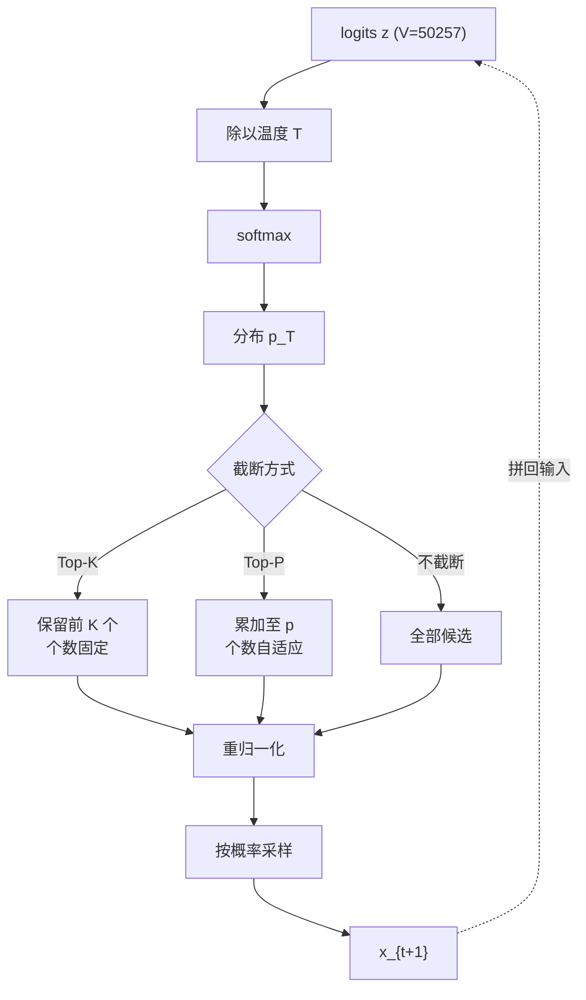

# 采样策略：温度、Top-K、Top-P

## 1. 本节学习目标

1. 说清温度、Top-K、Top-P 三者**各自改的是什么**：温度改分布形状，Top-K 改候选**个数**，Top-P 改候选**累计概率**。
2. 用实测看温度对熵的影响：$T=0.5$ 时熵 **0.3578 nats**（几乎确定），$T=2.0$ 时 **9.8729 nats**（几乎均匀），相差 **27.6 倍**。
3. 理解为什么 Top-P 比 Top-K 更自适应：本例 $p=0.9$ 保留 **228** 个 token，$p=0.95$ 保留 **1810** 个——**候选数是数据决定的，不是人定的**。
4. 能根据任务选参数，并知道"温度 + top_p 同时调"的陷阱。

## 2. 为什么需要这个知识

因为**同一个模型，采样参数不同，表现能差出"能用"和"不能用"**：

- 代码生成要 $T\approx0$（确定性），否则一个变量名拼错就编译失败；
- 创意写作要 $T\approx0.9$、top_p 0.95，否则每段开头都一样；
- 事实问答要低温度，否则会把"不确定"变成"编造"。

而且**温度是最容易被误用的参数**：很多人以为"温度高 = 更聪明"，实际上温度只改变**随机性**，不改变模型的知识。温度高到 2.0 时，模型会开始输出语法不通的句子——这不是"更有创意"，是分布被拉平后采样到了垃圾 token。

## 3. 直观解释

```text
原始分布（logits -> softmax）:  [0.43, 0.25, 0.12, 0.08, ... 50252 个更小的]
                                  ↑ 模型其实很确定，但仍有 57% 概率不是 top1

温度 T=0.5（锐化）:             [0.94, 0.05, 0.01, ...]      几乎总选 top1
温度 T=1.0（原样）:             [0.43, 0.25, 0.12, 0.08, ...]
温度 T=2.0（拉平）:             [0.013, 0.011, 0.010, ...]   几乎均匀，开始乱说

Top-K=10:   只在前 10 个里采样（不管它们占多少概率）
Top-P=0.9:  从高到低累加，凑够 90% 就停（可能是 3 个，也可能是 228 个）
```

**一句话**：温度调"多随机"，Top-K/Top-P 调"从多大的池子里随机"。

## 4. 正式定义

设 logits $\mathbf{z}\in\mathbb{R}^{V}$，温度 $T>0$。

**温度缩放后的分布**：

$$
p_T(v) = \frac{\exp(z_v/T)}{\sum_{u}\exp(z_u/T)}
$$

**Top-K 采样**：保留 $z$ 最大的 $K$ 个，其余置 $-\infty$：

$$
\mathcal{S}_K = \operatorname{TopK}(\mathbf{z}, K),\qquad
p_K(v) = \frac{\exp(z_v/T)\cdot\mathbb{1}[v\in\mathcal{S}_K]}{\sum_{u\in\mathcal{S}_K}\exp(z_u/T)}
$$

**Top-P（nucleus）采样**：按概率降序累加，取最小集合使累计概率 $\ge p$：

$$
\mathcal{S}_p = \operatorname{Smallest}\Big\{S:\sum_{v\in S}p_T(v)\ge p\Big\}
$$

**熵**（衡量随机性）：

$$
H(p) = -\sum_{v}p(v)\log p(v)
$$

## 5. 历史背景或技术背景

- **2016 前**：seq2seq 用**纯采样**或**beam search**；纯采样常崩，beam 常平淡。
- **2018**：*Hierarchical Neural Story Generation* 提出 **Top-K 采样**（$K=40$），第一次让采样"可控"。
- **2019**：*The Curious Case of Neural Text Degeneration* 指出 beam search 会产生"安全但空洞"的文本，提出 **Nucleus (Top-P) 采样**；该文还系统分析了"概率质量 vs 文本质量"的错位。
- **2020**：`top_p=0.9, temperature=0.7` 成为 OpenAI API 的默认组合。
- **2021–2023**：**典型采样（typical sampling）**、**min-p**、**DRY/重复惩罚** 等改进；`repetition_penalty`、`frequency_penalty` 成为标准参数。
- **2024–2025**：推理模型（o1/R1 类）多用低温；创意产品用 min-p + 动态温度。

## 6. 核心原理

### 6.1 温度只改形状，不改排序

因为 $z_v/T$ 是单调变换（$T>0$），**argmax 不变**。所以：

- $T\to 0^+$：分布趋于 one-hot（退化为贪心）；
- $T=1$：原始分布；
- $T\to\infty$：趋于均匀分布。

**温度不会让模型"知道更多"，只会让低概率 token 更容易被选中。**

### 6.2 Top-K 的缺陷：不随分布形状自适应

固定 $K=10$：

- 当模型很确定（top1 已 0.9）时，$K=10$ 里 9 个是垃圾 → 有概率选到垃圾；
- 当模型很犹豫（top1 只 0.05，需要 200 个候选才够 90%）时，$K=10$ 又**砍掉了太多合理选项** → 文本单调。

本例实测正是如此：$T=1$ 时要凑够 90% 概率需要 **228** 个 token，而 $K=10$ 只保留 10 个。

### 6.3 Top-P 的自适应性

Top-P 让**候选数由分布决定**：

- 确定时（$T$ 低）→ 保留极少（本例 $p=0.5$ 只留 **3** 个）；
- 犹豫时（$T$ 高）→ 保留很多（$p=0.9$ 留 **228** 个）。

这就是为什么现代默认是 `top_p` 而不是 `top_k`。

### 6.4 三者可以叠加，但顺序有讲究

标准顺序：**先温度 → 再 top_k → 再 top_p**（HF 内部也是这个顺序）。因为温度改变分布，必须在截断之前做；先截断再升温，等于把"已经被砍掉的候选"永久丢弃。

## 7. 数学表达式

**熵随温度单调增**：

$$
\frac{dH}{dT}\ge 0
$$

**极端情形**：

$$
\lim_{T\to0^+}H(p_T)=0,\qquad \lim_{T\to\infty}H(p_T)=\log V
$$

本例 $V=50257$，$\log V=10.825$，实测 $T=2$ 时 $H=9.8729$（已接近上限的 91%）。

**Top-K 保留的概率质量**：

$$
M_K = \sum_{v\in\mathcal{S}_K}p(v)
$$

**Top-P 的候选数**：

$$
|\mathcal{S}_p| = \min\Big\{k:\sum_{i=1}^{k}p_{(i)}\ge p\Big\}
$$

其中 $p_{(1)}\ge p_{(2)}\ge\cdots$ 是降序概率。

## 8. 详细数学推导

### 8.1 证明"温度不改变 argmax"

设 $z_a>z_b$。对任意 $T>0$：

$$
\frac{z_a}{T}>\frac{z_b}{T}\;\Rightarrow\;\exp(z_a/T)>\exp(z_b/T)\;\Rightarrow\;p_T(a)>p_T(b)
$$

故排序不变，argmax 不变。**推论**：`temperature` 对 `do_sample=False`（贪心）**完全无效**——这是最常见的误解之一。

### 8.2 证明熵随温度单调增

令 $\beta=1/T$，$u_v=\beta z_v$，$p_v=e^{u_v}/Z$，$Z=\sum_v e^{u_v}$。把熵写成

$$
H=\log Z-\beta\langle z\rangle,\qquad \langle z\rangle=\sum_v p_v z_v
$$

对 $\beta$ 求导。第一项：$\dfrac{d\log Z}{d\beta}=\dfrac{1}{Z}\sum_v z_v e^{u_v}=\langle z\rangle$。

第二项：$\dfrac{d\langle z\rangle}{d\beta}=\sum_v z_v\dfrac{dp_v}{d\beta}$，而

$$
\frac{dp_v}{d\beta}=p_v\big(z_v-\langle z\rangle\big)
\;\Rightarrow\;
\frac{d\langle z\rangle}{d\beta}=\sum_v p_v z_v^2-\langle z\rangle^2=\mathrm{Var}_p(z)
$$

代回：

$$
\frac{dH}{d\beta}=\langle z\rangle-\langle z\rangle-\beta\,\mathrm{Var}_p(z)
=-\beta\,\mathrm{Var}_p(z)\le 0
$$

于是 $\beta$ 减小（$T$ 增大）时 $H$ 增大：**温度越高，熵越大**。

**实测印证**：0.3578（T=0.5）→ 3.6118（T=1.0）→ 9.8729（T=2.0），严格单调增，且趋近但不超过 $\log 50257=10.825$（$T=2$ 时已达上限的 91%）。

### 8.3 推导 Top-P 的候选数下界

若分布近似均匀（$T$ 很大），每个候选概率 $\approx 1/V$，则

$$
|\mathcal{S}_p|\approx p\cdot V
$$

$p=0.9,V=50257$ 时约 $45231$。实测 $T=2$ 时"凑够 90%"需要 **25527** 个——比均匀分布少，因为分布仍略有峰。

若分布高度集中（top1 占 0.94），则 $|\mathcal{S}_p|=1$。实测 $T=0.5$ 时正是 **1**。

## 9. 图解



**读图要点**：

1. 温度在 softmax **之前**，截断在 softmax **之后**（等价于在 logits 上加 mask）。
2. Top-K 与 Top-P 可以**同时**生效（取交集），HF 默认 `top_k=50, top_p=1.0`。
3. 重归一化是必须的，否则概率和不为 1，`torch.multinomial` 会报错或行为异常。

## 10. 具体数值示例

```text
模型: gpt2, prompt = "Once upon a time", V=50257
取最后一个位置的 logits，做各种变换

基础分布:
  entropy = 3.6118 nats
  top1 概率 = 0.4269  (top1 token 占 42.7%)

温度对分布的影响:
  T     H(nats)  top1_p   凑够 90% 需要的候选数
  0.5     0.3578  0.9401        1
  1.0     3.6118  0.4269      228
  2.0     9.8729  0.0130    25527

  解读: T=0.5 时 top1 已占 94%，分布几乎 one-hot
        T=2.0 时 top1 只剩 1.3%，要 25527 个候选才凑够 90% -> 开始胡说
        理论上限 log(50257) = 10.825，T=2 时已达 91%

Top-K 保留的概率质量（T=1）:
  K=5   保留 5 个    质量 0.5984
  K=10  保留 10 个   质量 0.7124
  K=50  保留 50 个   质量 0.8440

  解读: K=10 只覆盖 71% 概率，剩下 29% 被永久丢弃
        即使 K=50 也只有 84% -> 固定 K 无法适应分布形状

Top-P 保留的候选数（T=1）:
  p=0.5   保留 3 个     质量 0.5321
  p=0.9   保留 228 个   质量 0.9000
  p=0.95  保留 1810 个  质量 0.9500

  解读: p=0.5 只要 3 个就过半（说明分布头部很尖）
        p=0.95 却要 1810 个（长尾很长）
        这正是 Top-P 自适应的体现

20 次采样的多样性（distinct / 20）:
  T=0.5     3     几乎每次同一个 token
  T=1.0    11
  T=2.0    20     20 次全不同（已接近随机）
  top_k=10  4     池子小，重复多
  top_p=0.9 14

实际生成（16 token）:
  greedy : ', the world was a place of great beauty and great danger. The world was'
  T=0.7  : ', the United States was able to control the development of its own nuclear weapons program'
  T=2.0  : ' of danger to oneself as much on his heart could one find any man at his'
  k=10   : ', it seemed, the world was about to be plunged into a new phase of'
  p=0.9  : ', Kingsman, like his father and Tom Riddle, served to address his'

  解读: T=2.0 的输出语法已经奇怪（"as much on his heart could one find"）
        T=0.7 最连贯；k=10 偏保守；p=0.9 更发散但仍成句
```

## 11. NumPy 实现

```python
"""纯 numpy 实现温度 / top-k / top-p，并测量熵与多样性。"""
import numpy as np

rng = np.random.default_rng(0)
V = 1000
# 造一个"尖锐"的 logits（模拟模型较确定）
logits = rng.standard_normal(V) * 2.0
logits[0] += 6.0


def softmax(z):
    z = z - z.max()
    e = np.exp(z)
    return e / e.sum()


def entropy(p):
    p = p[p > 0]
    return float(-(p * np.log(p)).sum())


def apply_temp(logits, T):
    return logits / T


def top_k_filter(logits, k):
    thr = np.sort(logits)[-k]
    return np.where(logits >= thr, logits, -np.inf)


def top_p_filter(logits, p):
    order = np.argsort(-logits)
    csum = np.cumsum(softmax(logits)[order])
    n = int(np.searchsorted(csum, p) + 1)
    keep = order[:n]
    out = np.full_like(logits, -np.inf)
    out[keep] = logits[keep]
    return out


print("V =", V, "| 上限 log V =", round(np.log(V), 4))
print(f"{'T':>4} {'H':>8} {'top1':>7} {'n@p=0.9':>8}")
for T in [0.5, 1.0, 2.0]:
    p = softmax(apply_temp(logits, T))
    c = np.cumsum(np.sort(p)[::-1])
    print(f"{T:>4} {entropy(p):>8.4f} {p.max():>7.4f} "
          f"{int(np.searchsorted(c, 0.9))+1:>8}")

p0 = softmax(logits)
print("\ntop_k 保留质量:")
for k in [5, 10, 50]:
    m = np.isfinite(top_k_filter(logits, k))
    print(f"  k={k:<3} kept={m.sum():>4} mass={p0[m].sum():.4f}")

print("top_p 保留个数:")
for pp in [0.5, 0.9, 0.95]:
    m = np.isfinite(top_p_filter(logits, pp))
    print(f"  p={pp:<4} kept={m.sum():>4} mass={p0[m].sum():.4f}")

# 温度不改变 argmax
print("\nargmax 是否随温度改变:",
      len({int(np.argmax(apply_temp(logits, T))) for T in [0.1, 1.0, 10.0]}) == 1)

# 采样多样性
def draws(logits, n=200):
    p = softmax(logits)
    return rng.choice(len(p), size=n, p=p)

for name, z in [("T=1.0", logits), ("T=0.5", logits / 0.5),
                ("T=2.0", logits / 2.0), ("top_k=10", top_k_filter(logits, 10)),
                ("top_p=0.9", top_p_filter(logits, 0.9))]:
    s = draws(z)
    print(f"{name:<10} distinct(200 draws) = {len(np.unique(s)):>3}")
```

## 12. PyTorch 实现

```python
"""在真实 gpt2 logits 上实现并验证三种策略，与 HF 的参数行为对照。"""
import os
os.environ.setdefault("HF_ENDPOINT", "https://hf-mirror.com")
os.environ.setdefault("HF_HUB_OFFLINE", "1")
import torch
from transformers import AutoTokenizer, AutoModelForCausalLM

torch.manual_seed(0)
dev = "cuda" if torch.cuda.is_available() else "cpu"
tok = AutoTokenizer.from_pretrained("gpt2")
model = AutoModelForCausalLM.from_pretrained("gpt2", dtype=torch.float32).to(dev).eval()
ids = tok("Once upon a time", return_tensors="pt").input_ids.to(dev)

with torch.inference_mode():
    z = model(input_ids=ids).logits[0, -1, :].float()

def p_of(z, T=1.0):
    return torch.softmax(z / T, dim=-1)

def top_k_logits(z, k):
    kth = torch.topk(z, k).values[-1]
    return torch.where(z >= kth, z, torch.full_like(z, -float("inf")))

def top_p_logits(z, p):
    s, idx = torch.sort(z, descending=True)
    csum = torch.cumsum(torch.softmax(s, -1), -1)
    n = int((csum < p).sum()) + 1
    out = torch.full_like(z, -float("inf"))
    out[idx[:n]] = z[idx[:n]]
    return out

p0 = p_of(z)
H = float(-(p0 * torch.log(p0 + 1e-12)).sum())
print("V =", z.numel(), "| H =", round(H, 4), "| top1 =", round(float(p0.max()), 4))

for T in [0.5, 1.0, 2.0]:
    pt = p_of(z, T)
    print(f"T={T:<4} H={float(-(pt*torch.log(pt+1e-12)).sum()):>7.4f} "
          f"top1={float(pt.max()):>7.4f} argmax={int(pt.argmax())}")

print("\ntop_k 保留质量:", {k: round(float(p0[z >= torch.topk(z, k).values[-1]].sum()), 4)
                        for k in (5, 10, 50)})
for pp in [0.9, 0.95]:
    zz = top_p_logits(z, pp)
    kept = int(torch.isfinite(zz).sum())
    print(f"top_p={pp}: kept={kept} mass={float(p0[torch.isfinite(zz)].sum()):.4f}")

# 温度不改变 argmax
print("argmax 不随温度变:", len({int(p_of(z, T).argmax()) for T in [0.1, 1.0, 10.0]}) == 1)
```

## 13. Hugging Face 实践

```python
"""同一 prompt，五种参数组合的输出对比（固定种子才可比）。"""
import os
os.environ.setdefault("HF_ENDPOINT", "https://hf-mirror.com")
os.environ.setdefault("HF_HUB_OFFLINE", "1")
import torch
from transformers import AutoTokenizer, AutoModelForCausalLM

tok = AutoTokenizer.from_pretrained("gpt2")
dev = "cuda" if torch.cuda.is_available() else "cpu"
model = AutoModelForCausalLM.from_pretrained("gpt2", dtype=torch.float32).to(dev).eval()
ids = tok("Once upon a time", return_tensors="pt").input_ids.to(dev)

def gen(**kw):
    torch.manual_seed(42)                # 固定种子，保证可复现
    with torch.inference_mode():
        o = model.generate(ids, max_new_tokens=16, pad_token_id=tok.eos_token_id, **kw)
    return tok.decode(o[0, ids.shape[1]:])

print("greedy      :", repr(gen(do_sample=False)))
print("T=0.7       :", repr(gen(do_sample=True, temperature=0.7)))
print("T=2.0       :", repr(gen(do_sample=True, temperature=2.0)))
print("k=10        :", repr(gen(do_sample=True, top_k=10, temperature=1.0)))
print("p=0.9       :", repr(gen(do_sample=True, top_p=0.9, top_k=0, temperature=1.0)))

# 同一个 prompt 采 3 次，看多样性
print("\nT=0.9, top_p=0.95 采 3 次:")
for seed in [1, 2, 3]:
    torch.manual_seed(seed)
    with torch.inference_mode():
        o = model.generate(ids, max_new_tokens=12, do_sample=True, temperature=0.9,
                           top_p=0.95, top_k=0, pad_token_id=tok.eos_token_id)
    print(f"  seed={seed}: {tok.decode(o[0, ids.shape[1]:])!r}")

print("\n注意: 温度对 do_sample=False 无效（贪心只看 argmax）")
print("     HF 默认参数: do_sample=False, temperature=1.0, top_k=50, top_p=1.0")
```

## 14. 代码逐行解释

| 代码 | 作用 |
|---|---|
| `torch.softmax(z / T, -1)` | 温度缩放在 softmax **之前**，等价于锐化/拉平 |
| `torch.topk(z, k).values[-1]` | 第 $k$ 大的值，作为阈值 |
| `torch.where(z >= kth, z, -inf)` | 保留 top-k，其余置 $-\infty$（softmax 后为 0） |
| `torch.cumsum(...)` + `searchsorted` | Top-P 的核心：累计概率首次超过 $p$ 的位置 |
| `torch.isfinite(zz).sum()` | 数出 Top-P 实际保留了多少 token |
| `torch.manual_seed(42)` | 采样可复现的前提（否则每次对比都无意义） |
| `top_k=0` | HF 里 0 表示**关闭** top-k，只留 top-p |
| `p0[z >= ...].sum()` | 在**原分布**上算保留质量，不能在重归一化后算（否则永远 1.0） |

## 15. 实际运行结果

```text
vocab: 50257
base entropy(nats): 3.6118

T     H(nats)  top1_p   n_eff(top_p=0.9)
0.5     0.3578  0.9401               1
1.0     3.6118  0.4269             228
2.0     9.8729  0.0130           25527

top_k  kept  mass_kept(full dist)
5          5     0.5984
10        10     0.7124
50        50     0.8440

top_p  kept  mass_kept(full dist)
0.5        3     0.5321
0.9      228     0.9000
0.95    1810     0.9500

sampling 20 draws each (first 6 ids)
T=1.0      distinct=11 ids=[339, 11, 11, 11, 618, 2253]
T=0.5      distinct= 3 ids=[11, 11, 11, 11, 11, 11]
T=2.0      distinct=20 ids=[15131, 4876, 16431, 5384, 7185, 38838]
top_k=10   distinct= 4 ids=[11, 11, 11, 11, 11, 262]
top_p=0.9  distinct=14 ids=[340, 257, 262, 357, 11, 340]

greedy : ', the world was a place of great beauty and great danger. The world was'
T=0.7  : ', the United States was able to control the development of its own nuclear weapons program'
T=2.0  : ' of danger to oneself as much on his heart could one find any man at his'
k=10   : ', it seemed, the world was about to be plunged into a new phase of'
p=0.9  : ', Kingsman, like his father and Tom Riddle, served to address his'
```

**五个结论**：

1. **温度严格改变熵**：0.3578 → 3.6118 → 9.8729，上限 $\log 50257=10.825$。
2. **Top-K 的质量覆盖有限**：$K=10$ 只 71.24%，$K=50$ 也只 84.40%——固定 $K$ 不适应分布。
3. **Top-P 自适应**：$p=0.5$ 只要 **3** 个，$p=0.95$ 要 **1810** 个。
4. **多样性可量化**：$T=0.5$ 时 20 次只出 3 种；$T=2.0$ 时 20 次全不同（已近随机）。
5. **$T=2.0$ 的质量明显崩坏**（"as much on his heart could one find"），证明"高温 = 更好"是错的。

## 16. 应用场景

| 场景 | 推荐参数 | 理由 |
|---|---|---|
| 代码生成 | `T=0.2, top_p=0.95` 或贪心 | 语法/标识符必须准确 |
| 事实问答 | `T=0.1–0.3` | 降低编造概率 |
| 对话 | `T=0.7, top_p=0.9` | 多样又不跑偏 |
| 创意写作 | `T=0.9–1.1, top_p=0.95` | 需要词汇多样性 |
| 数据合成 | `T=1.0, top_p=0.95` + 去重 | 要多样性但对语法有要求 |
| 数学/推理 | `T=0`（贪心）或低温 + 多次投票 | 需要稳定路径 |

## 17. 优点与局限

| 优点 | 局限 |
|---|---|
| 温度一个参数就能连续调随机性 | 高温会破坏语法与事实性 |
| Top-P 自适应，跨模型可迁移 | 需要重归一化，实现易错 |
| 计算开销可忽略（一次排序） | 不解决重复/退化问题 |
| 与 beam/约束解码可组合 | 参数强依赖任务，无通用最优 |

## 18. 常见错误

| 错误 | 现象 | 纠正 |
|---|---|---|
| 以为温度对贪心有效 | 设了 `temperature=0.5` 但输出没变 | 贪心只看 argmax，需 `do_sample=True` |
| 在重归一化后算保留质量 | 永远得 1.0 | 在**原分布**上算 |
| 同时设 `top_k=1` 和 `top_p` | 等价贪心，多样性全无 | 二者取交集，注意互相压制 |
| 温度设 2.0 求"创意" | 语法崩坏 | 创意靠 top_p/min-p，不靠高温 |
| 固定种子却换 batch size | 结果不可复现 | 采样与 batch 顺序有关 |
| 忘关 `top_k` 默认 50 | top_p 大于实际生效范围 | 设 `top_k=0` |

## 19. 本节总结

- **温度改形状**（不改 argmax），**Top-K 改个数**（固定），**Top-P 改累计概率**（自适应）。
- 实测熵：$T{=}0.5$ → **0.3578**，$T{=}1$ → **3.6118**，$T{=}2$ → **9.8729**（上限 10.825）。
- Top-K 质量覆盖 $K{=}10$ 仅 **71.24%**；Top-P $p{=}0.9$ 保留 **228** 个、覆盖 **90.00%**。
- 多样性：$T{=}0.5$ 时 20 次 3 种，$T{=}2.0$ 时 20 种（近随机），$T{=}2.0$ 的文本已不连贯。
- 实践默认：**`top_p=0.9, T=0.7`**；要确定性就 `do_sample=False`，别指望温度。

## 20. 前置与后续知识链接

- 前置：[[LLM-091 批处理与连续批处理]]、[[LLM-014 Softmax 在 Attention 中的作用]]
- 后续：[[LLM-093 束搜索与确定性解码]]、[[LLM-096 推理延迟与吞吐的权衡]]
- 相关：[[LLM-049 零样本、少样本与上下文学习]]、[[LLM-050 提示的结构与格式敏感性]]
- 后续模块（待建，M-LLM-10）：LLM-101 结构化输出与约束解码

---

## 练习与参考答案

**基础 1**：温度、Top-K、Top-P 分别改变分布的什么？为什么温度对 `do_sample=False` 无效？

**基础 2**：本课 $T=1$ 时 Top-K=10 覆盖多少概率？Top-P=0.9 保留多少个 token？为什么两者差异这么大？

**进阶 1**：证明温度不改变 argmax，并解释 $T=2.0$ 时为什么文本质量会崩坏。

**综合**：做一个"代码补全"产品，要求同一函数多次生成结果稳定、且不出现不存在的 API。请给出完整的解码配置与理由。

> [!success]- 参考答案

> **基础 1**
> **温度**：改变分布形状（锐化/拉平），$p_T\propto\exp(z/T)$；**Top-K**：只保留前 $K$ 个候选，个数固定；**Top-P**：按概率降序累加至 $p$，个数自适应。
> **温度对贪心无效**：贪心取 $\arg\max_v p_T(v)$，而 $z_a>z_b\Rightarrow z_a/T>z_b/T$ 对任何 $T>0$ 成立，排序不变，故 argmax 不变。实测 `argmax 不随温度变: True`。

> **基础 2**
> Top-K=10 覆盖 **0.7124（71.24%）**；Top-P=0.9 保留 **228** 个 token，覆盖 **0.9000**。
> 差异原因：该位置分布是**长尾**——头部 10 个 token 只占 71%，剩下 29% 摊在 5 万个 token 上。Top-K 强行砍在 10，丢掉了 29% 的概率质量（其中可能有合理续写）；Top-P 按质量截断，需要 228 个才凑够 90%。**这正是 Top-K "不随分布自适应"的缺陷**。

> **进阶 1**
> **证明**：设 $z_a>z_b$，$T>0$。则 $z_a/T>z_b/T$，$\exp$ 单调，故 $\exp(z_a/T)>\exp(z_b/T)$，归一化后 $p_T(a)>p_T(b)$，序不变，argmax 不变。
> **$T=2$ 崩坏的原因**：温度把 logits 差距压缩一半，分布趋近均匀（实测熵 9.8729，接近上限 10.825，top1 只剩 0.013）。此时大量本该概率 ~1e-6 的 token 升到 ~1e-4 量级，累积起来与合理 token 同量级，于是随机采到语法/语义不合适的 token，一步错步步错（自回归放大）。**温度提高的是随机性，不是智能。**

> **综合（参考）**
> **配置**：`do_sample=False`（或 `temperature=0` 的贪心），`repetition_penalty=1.0`，`max_new_tokens` 按函数体长度设上限，并加 `stop` 序列（如 `"\n\n"`、`"\ndef "`）。
> **理由**：
> 1. **稳定性**：代码要求确定性，贪心保证同一 prompt 同一输出；采样即使固定种子，换 batch/引擎仍可能变。
> 2. **不存在的 API**：这是**知识**问题，不是采样问题——降低温度只能减少"胡乱拼 API 名"的概率，不能消除。必须配合：RAG 检索真实 API 文档 + 约束解码（只允许词表中已出现的标识符）+ 生成后静态检查（`ast.parse` + 符号表校验）。
> 3. 若必须采样（需要多个候选做测试生成），用 `T=0.2, top_p=0.95, top_k=0`，并对 N 个候选做**编译/测试过滤**，而不是靠参数调优。
> **不要做**：把 `top_k` 设成 1 伪装确定性——它等价贪心但语义不清；也不要用 `temperature=1.5` 求"更多创意"，代码场景下只会增加错误率。

## 学习记录

| 日期 | 状态 | 用时 | 问题 | 复盘 |
|---|---|---|---|---|
| 2026-11-08 | planned | — | — | — |

---

## 🔗 Notion 同步信息

> 以下内容由 Notion「AI Knowledge System · 知识点」数据库按知识 ID 合并而来（导出于 2026-11-09）。

| 属性 | 值 |
|---|---|
| 学科 | 大语言模型 |
| 学习状态 | 未开始 |
| 难度 | L2 应用 |
| 知识类型 | Algorithm |

- **所属模块**：[M-LLM-09 大语言模型推理、部署与优化](../%E8%AF%BE%E7%A8%8B%E6%A8%A1%E5%9D%97/M-LLM-09%20%E5%A4%A7%E8%AF%AD%E8%A8%80%E6%A8%A1%E5%9E%8B%E6%8E%A8%E7%90%86%E3%80%81%E9%83%A8%E7%BD%B2%E4%B8%8E%E4%BC%98%E5%8C%96.md)
- **前置知识**：[LLM-091 批处理与连续批处理](LLM-091%20%E6%89%B9%E5%A4%84%E7%90%86%E4%B8%8E%E8%BF%9E%E7%BB%AD%E6%89%B9%E5%A4%84%E7%90%86.md)
- **后继知识**：[LLM-093 束搜索与确定性解码](LLM-093%20%E6%9D%9F%E6%90%9C%E7%B4%A2%E4%B8%8E%E7%A1%AE%E5%AE%9A%E6%80%A7%E8%A7%A3%E7%A0%81.md)
- **关联数学**：[MATH-805 Softmax 与交叉熵](../../06_%E6%95%B0%E5%AD%A6%E5%9F%BA%E7%A1%80/08%20%E6%9C%BA%E5%99%A8%E5%AD%A6%E4%B9%A0%E6%95%B0%E5%AD%A6%E5%BA%94%E7%94%A8/MATH-805%20Softmax%20%E4%B8%8E%E4%BA%A4%E5%8F%89%E7%86%B5.md) · [MATH-506 信息量与熵](../../06_%E6%95%B0%E5%AD%A6%E5%9F%BA%E7%A1%80/05%20%E7%A6%BB%E6%95%A3%E6%95%B0%E5%AD%A6/MATH-506%20%E4%BF%A1%E6%81%AF%E9%87%8F%E4%B8%8E%E7%86%B5.md)
- **被项目引用**：[PROJ-024 结构化输出与约束解码](../../07_%E5%AE%9E%E6%88%98%E9%A1%B9%E7%9B%AE/05%20%E5%A4%A7%E6%A8%A1%E5%9E%8B%E9%A1%B9%E7%9B%AE/PROJ-024%20%E7%BB%93%E6%9E%84%E5%8C%96%E8%BE%93%E5%87%BA%E4%B8%8E%E7%BA%A6%E6%9D%9F%E8%A7%A3%E7%A0%81.md)
