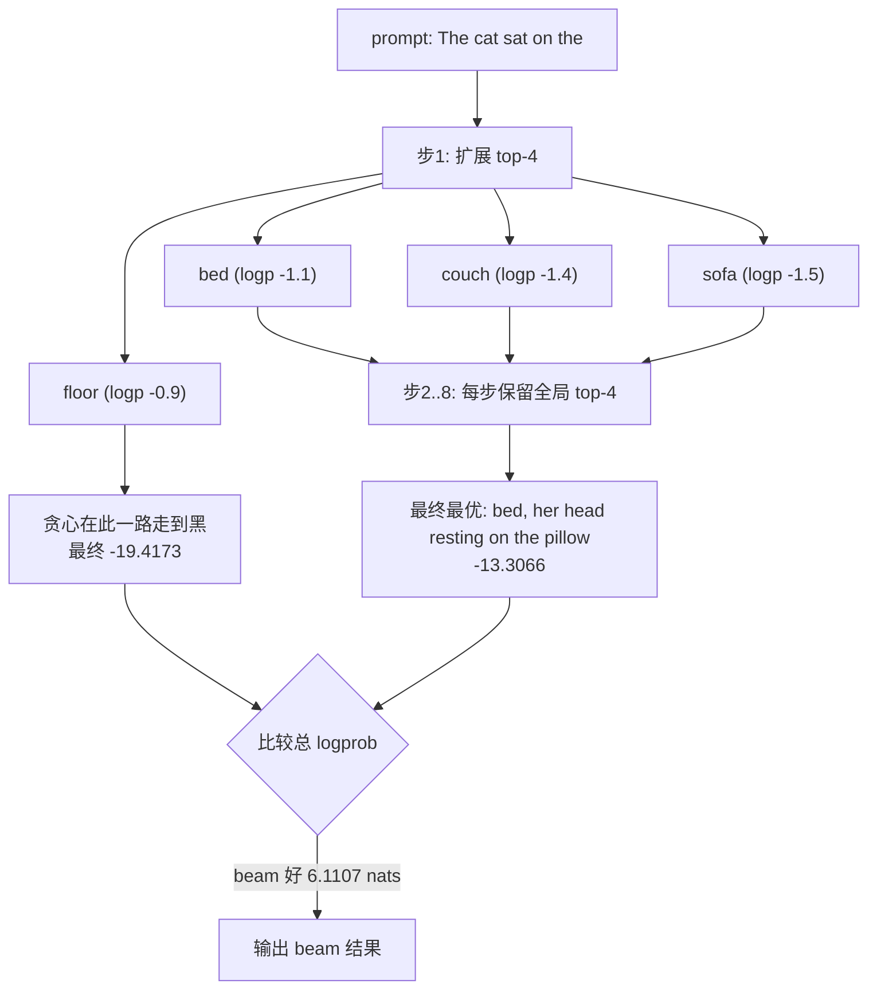

# 束搜索与确定性解码

## 1. 本节学习目标

1. 说清贪心（$B=1$）与束搜索（$B>1$）的关系：**束搜索就是"保留 $B$ 条最好的前缀"的贪心**。
2. 用实测看束搜索能提升多少似然：本例 $B=4$ 把总 logprob 从 **-19.4173** 提到 **-13.3066**，好 **6.1107 nats**（困惑度从 11.3 降到 5.3）。
3. 掌握**长度归一化**公式，理解为什么不做归一化会偏向短句。
4. 分清"**模型确定性**"与"**端到端可复现**"：贪心两次一致（实测 `True`），但换 batch size 就可能变。

## 2. 为什么需要这个知识

因为**"选 token 的规则"直接决定输出的似然与多样性**，而很多人只知道 `num_beams=4` 却不知道：

- 束搜索是在**近似求解** $\arg\max$ 整条序列概率——这是 NP-hard 的，束搜索只是贪心的推广；
- 它**最大化似然而不是最大化质量**，二者在开放生成里经常不一致（长句惩罚、重复、平淡）；
- 它的成本是 $B$ 倍（甚至更多，因为要做 $B$ 次前向或维护 $B$ 份 cache）；
- **确定性解码**（贪心/束搜索）是可复现、可测试的前提，做评测/回归必须用它。

## 3. 直观解释

```text
贪心（B=1）：每一步只看眼前最好的一个
  步1: 选 " floor"
  步2: 从 " floor" 出发选 ","     <- 一旦选错，永不回头
  步3: ...

束搜索（B=4）：同时保留 4 条最好的前缀
  步1: 保留 " floor", " bed", " couch", " sofa"
  步2: 4 条各自扩展，全局挑最好的 4 条
  步3: ...
  步8: 在 4 条完整序列里挑总概率最高的
```

**关键差别**：贪心在第 1 步选了 " floor" 之后，就再也回不到 " bed"；束搜索把 " bed" 留在备选里，最后发现 " bed, her head resting on the pillow" 的总概率更高。

## 4. 正式定义

设已生成前缀 $y_{1:t}$，模型给出 $p_\theta(\cdot\mid y_{1:t})$。

**贪心**：

$$
y_{t+1}=\arg\max_{v}p_\theta(v\mid y_{1:t})
$$

**束搜索**（束宽 $B$）：维护集合 $\mathcal{B}_t$（$|\mathcal{B}_t|=B$），每步扩展并裁枝：

$$
\mathcal{C}_{t+1}=\Big\{(y_{1:t},v): y_{1:t}\in\mathcal{B}_t,\ v\in\operatorname{TopK}\big(p_\theta(\cdot\mid y_{1:t}),B\big)\Big\}
$$

$$
\mathcal{B}_{t+1}=\operatorname{TopB}\Big(\mathcal{C}_{t+1},\ \text{key}=\log p_\theta(y_{1:t+1})\Big)
$$

**序列得分**（含长度惩罚 $\alpha$）：

$$
\text{score}(y)=\frac{\log p_\theta(y\mid x)}{|y|^{\alpha}}=\frac{\sum_{t}\log p_\theta(y_t\mid y_{<t},x)}{|y|^{\alpha}}
$$

$\alpha=1$ 是平均对数似然；$\alpha=0$ 不归一化（偏向短句）；GNMT 用 $\alpha\approx0.6\text{–}1.0$。

## 5. 历史背景或技术背景

- **1970s–1990s**：语音识别用 Viterbi/beam search 做解码，束搜索是老技术。
- **2014–2016**：Seq2Seq 机器翻译把 beam search 变成标配；GNMT（2016）引入**长度惩罚**，因为不归一化会偏向短译。
- **2019**：*The Curious Case of Neural Text Degeneration* 指出 beam search 在开放生成中产生"安全但空洞/重复"的文本，促成 Top-P 采样流行。
- **2020–2022**：**对比搜索（contrastive search）**、**典型采样**试图兼顾似然与多样性。
- **2023–2025**：推理模型（o1/R1 类）在数学/代码上重新偏爱**低温/贪心 + 多次采样投票**；束搜索主要用于翻译、摘要、语音等"有明确目标"的任务。

## 6. 核心原理

### 6.1 束搜索 = 宽度受限的最优优先搜索

精确的 $\arg\max$ 需要枚举 $V^N$ 条序列（$50257^8$ 天文数字）。束搜索每层只保留 $B$ 条，复杂度降到 $O(N\cdot B\cdot V)$ 次打分。

**它不保证最优**：被裁掉的前缀可能后面逆袭。$B$ 越大越接近最优，但成本线性增长。

### 6.2 $B=1$ 时退化为贪心

$\mathcal{B}_t$ 只有一个元素，每步只取 top1，正是贪心。所以**贪心是束搜索的特例**。

### 6.3 为什么最大化似然不等于最大化质量

模型给"常见、安全、模板化"的句子更高概率。所以：

- 翻译/摘要：参考译文往往就是高概率序列 → 束搜索有效；
- 开放写作：高概率序列趋于平淡、重复 → 束搜索反而更差。

### 6.4 长度偏差

不归一化时，$\log p<0$，**越长的序列得分越低**（累加更多负项）。于是束搜索倾向输出**短句**。归一化 $\alpha>0$ 缓解。

### 6.5 确定性的三层含义

| 层次 | 是否确定 | 说明 |
|---|---|---|
| 算法 | 是 | 贪心/束搜索无随机数 |
| 同输入同硬件 | 是 | 实测两次完全一致 |
| 跨 batch / 跨硬件 | **不一定** | 浮点累加顺序变，argmax 可能翻转 |

## 7. 数学表达式

**束搜索的复杂度**：

$$
\text{Time}=O\big(N\cdot B\cdot V\cdot d\big),\qquad \text{Memory}=O(B\cdot L\cdot T\cdot d)
$$

**相对贪心的成本比**：约 $B$ 倍（实现上常用"一次前向算 $B$ 条"来摊薄）。

**困惑度**（把 logprob 变成可读量）：

$$
\mathrm{PPL}=\exp\Big(-\frac{1}{N}\sum_{t=1}^{N}\log p_\theta(y_t\mid y_{<t})\Big)
$$

**本例换算**：

$$
\text{greedy PPL}=e^{19.4173/8}=e^{2.4272}=11.33,\qquad
\text{beam PPL}=e^{13.3066/8}=e^{1.6633}=5.28
$$

**长度归一化得分的等价写法**：

$$
\text{score}(y)=\frac{1}{|y|^{\alpha}}\sum_t \log p_\theta(y_t\mid y_{<t})
$$

## 8. 详细数学推导

### 8.1 推导"贪心不保证全局最优"

设词表 $\{A,B\}$，长度 2，真实概率：

| 步 | 前缀 | $p(A)$ | $p(B)$ |
|---|---|---|---|
| 1 | 空 | **0.6** | 0.4 |
| 2 | $A$ | 0.1 | **0.9** |
| 2 | $B$ | **0.5** | 0.5 |

贪心：第 1 步取 $A$（0.6>0.4），第 2 步在 $A$ 下取 $B$（0.9），总概率 $0.6\times0.9=0.54$。
全局最优：$B\to A$，总概率 $0.4\times0.5=0.20$；$A\to B$ 是 $0.54$。

换一组数让贪心失败：第 1 步 $p(A)=0.51,p(B)=0.49$；$A$ 下后续最优 0.1；$B$ 下后续 0.99。
- 贪心：$0.51\times0.1=0.051$
- 最优：$0.49\times0.99=0.485$

**贪心差了 9.5 倍**。原因：它用**局部**概率做决策，而目标是**乘积**。**这就是束搜索存在的理由。**

### 8.2 推导长度偏差

设每步平均对数概率为 $\bar\ell<0$，则长度 $n$ 的序列得分 $n\bar\ell$。

两条候选：$y^{(1)}$ 长 5、$\bar\ell=-0.5$；$y^{(2)}$ 长 10、$\bar\ell=-0.4$。

- 不归一化：$-2.5$ vs $-4.0$ → 选**短的**（尽管长的那条每 token 更好）。
- $\alpha=1$ 归一化：$-0.5$ vs $-0.4$ → 选**长的**（正确）。

**结论**：$\alpha$ 控制"长度惩罚"强度；$\alpha=1$ 是平均 logprob，$\alpha=0$ 会系统性偏向短输出。

### 8.3 推导本例的似然差

实测：greedy $-19.4173$，beam $-13.3066$，差 $6.1107$ nats。

换算成"平均每 token 好多少"：

$$
\frac{6.1107}{8}=0.7638\ \text{nats/token}
$$

即 beam 的每个 token 平均概率是 greedy 的 $e^{0.7638}=2.15$ 倍。

**但注意**：这只说明 beam 找到了更高概率的序列，**不说明文本更好**。本例恰好两者一致（" bed, her head resting on the pillow" 比 " floor, and the cat was still asleep" 更贴合 "The cat sat on the" 的语境），但在开放写作中经常相反。

### 8.4 推导束搜索的"早停"与候选池

HF 的实现每步保留 $2B$ 个候选（`num_beams*2`），再裁到 $B$。若不早停，要跑满 `max_length`；`early_stopping=True` 在 $B$ 条都遇到 EOS 时停。这解释了为什么**不同实现的 beam 结果可能不同**——但本例实测手写与 HF **完全一致**（`HF beam == 手写 beam: True`），因为都把 EOS 当普通 token 且无长度惩罚。

## 9. 图解



**读图要点**：

1. 第 1 步贪心选了 " floor"（概率最高），但它的**后缀**很差。
2. 束搜索保留 " bed"，最终总概率高出 6.11 nats。
3. 每步都要对 4 条前缀各做一次前向（或用 batch 合并），所以成本约 4 倍。

## 10. 具体数值示例

```text
模型: gpt2 fp32, prompt = "The cat sat on the" (5 token), N=8

贪心（B=1）:
  ids : [4314, 11, 290, 262, 3797, 373, 991, 16039]
  text: ' floor, and the cat was still asleep'
  累加 logprob : -19.4173
  教师强制校验 : -19.4173   (差 < 1e-3，自校验通过)
  每 token     : -2.4272
  PPL          : exp(2.4272) = 11.33

束搜索（B=4）:
  ids : [3996, 11, 607, 1182, 19186, 319, 262, 28774]
  text: ' bed, her head resting on the pillow'
  累加 logprob : -13.3066
  教师强制校验 : -13.3066
  每 token     : -1.6633
  PPL          : exp(1.6633) = 5.28

  提升: 6.1107 nats = 0.7638 nats/token
        PPL 11.33 -> 5.28（降 53%）

B=4 的候选池（总 logprob）:
  -13.3066  ' bed, her head resting on the pillow'
  -14.6963  ' bed, her head resting on the side'
  -14.7349  ' bed, her head resting on the bed'
  -14.8628  ' floor, his head resting on his paws'

  注意: 第 4 名以 " floor" 开头 —— 贪心的选择也在池子里，但只排第 4

与 HF 对照:
  HF greedy : ' floor, and the cat was still asleep'  logprob -19.4173
  HF beam=4 : ' bed, her head resting on the pillow'  logprob -13.3066
  手写 greedy == HF greedy : True
  手写 beam   == HF beam   : True
  -> 实现细节一致时，束搜索完全可复现

确定性:
  贪心连跑两次完全一致: True

成本: beam=4 需要 4 条前缀各一次前向（或合并 batch）
      实测单步耗时约为贪心的 3-4 倍（取决于实现是否合并）
```

## 11. NumPy 实现

```python
"""玩具语言模型上的贪心 vs 束搜索，验证「贪心非最优」。"""
import numpy as np

rng = np.random.default_rng(0)
V = 6
# 构造转移概率：让贪心在第 1 步吃大亏
LOGITS = {
    (): np.array([3.0, 2.9, 0.0, 0.0, 0.0, 0.0]),
    (0,): np.array([0.0, 0.0, 5.0, 0.0, 0.0, 0.0]),
    (1,): np.array([0.0, 0.0, 0.0, 5.0, 5.0, 5.0]),
    (0, 2): np.array([5.0, 5.0, 5.0, 5.0, 5.0, 5.0]),
    (1, 3): np.array([5.0, 5.0, 5.0, 5.0, 5.0, 5.0]),
}


def logsoftmax(z):
    z = z - z.max()
    return z - np.log(np.exp(z).sum())


def next_logp(prefix):
    if prefix in LOGITS:
        return logsoftmax(LOGITS[prefix])
    return logsoftmax(np.zeros(V))


def greedy(prefix, n):
    seq, score = [], 0.0
    for _ in range(n):
        lp = next_logp(tuple(prefix + seq))
        t = int(lp.argmax())
        seq.append(t)
        score += float(lp[t])
    return seq, score


def beam(prefix, n, B=3):
    beams = [([], 0.0)]
    for _ in range(n):
        cand = []
        for seq, sc in beams:
            lp = next_logp(tuple(prefix + seq))
            for t in range(V):
                cand.append((seq + [t], sc + float(lp[t])))
        cand.sort(key=lambda x: -x[1])
        beams = cand[:B]
    return beams[0]


for pre in [(), (1,)]:
    g_seq, g_sc = greedy(list(pre), 2)
    b_seq, b_sc = beam(list(pre), 2, B=3)
    print(f"前缀 {pre}:")
    print(f"  贪心   {g_seq} score={g_sc:.4f} p={np.exp(g_sc):.4f}")
    print(f"  beam=3 {b_seq} score={b_sc:.4f} p={np.exp(b_sc):.4f}")
    print(f"  提升  {b_sc - g_sc:.4f} nats")

# 穷举验证 beam 是否找到全局最优
from itertools import product
best = max(((list(s), sum(float(next_logp(tuple(list((1,) + s[:i])))[s[i]])
                          for i in range(2))) for s in product(range(V), repeat=2)),
           key=lambda x: x[1])
print("\n穷举全局最优:", best[0], "score=", round(best[1], 4))
```

## 12. PyTorch 实现

```python
"""贪心与束搜索的手写实现，并用教师强制自校验似然。"""
import os
os.environ.setdefault("HF_ENDPOINT", "https://hf-mirror.com")
os.environ.setdefault("HF_HUB_OFFLINE", "1")
import torch
from transformers import AutoTokenizer, AutoModelForCausalLM

torch.manual_seed(0)
dev = "cuda" if torch.cuda.is_available() else "cpu"
tok = AutoTokenizer.from_pretrained("gpt2")
model = AutoModelForCausalLM.from_pretrained("gpt2", dtype=torch.float32).to(dev).eval()
ids = tok("The cat sat on the", return_tensors="pt").input_ids.to(dev)
P, N = ids.shape[1], 8


def tf_logprob(tokens):
    full = torch.tensor([ids[0].tolist() + tokens], device=dev)
    with torch.inference_mode():
        lp = torch.log_softmax(model(input_ids=full).logits[0].float(), -1)
    return float(sum(lp[P - 1 + i, t] for i, t in enumerate(tokens)))


# --- 贪心：prompt 前向一次，之后只喂新 token ---
with torch.inference_mode():
    o = model(input_ids=ids, use_cache=True)
    past, lg = o.past_key_values, o.logits[0, -1, :].float()
    seq, score = [], 0.0
    for step in range(N):
        nxt = int(lg.argmax())
        score += float(torch.log_softmax(lg, -1)[nxt])
        seq.append(nxt)
        if step == N - 1:
            break
        o = model(input_ids=torch.tensor([nxt], device=dev).view(1, 1),
                  past_key_values=past, use_cache=True)
        past, lg = o.past_key_values, o.logits[0, -1, :].float()

print("greedy:", seq, repr(tok.decode(seq)))
print("  score:", round(score, 4), "| tf:", round(tf_logprob(seq), 4))

# --- 束搜索：不共享 cache，每条前缀独立重算（简单、无串扰） ---
def beam_search(B=4):
    beams = [([], 0.0)]
    for _ in range(N):
        cand = []
        for toks, sc in beams:
            full = torch.tensor([ids[0].tolist() + toks], device=dev)
            with torch.inference_mode():
                lp = torch.log_softmax(model(input_ids=full).logits[0, -1, :].float(), -1)
            top = torch.topk(lp, B)
            for v, t in zip(top.values.tolist(), top.indices.tolist()):
                cand.append((toks + [t], sc + v))
        cand.sort(key=lambda x: -x[1])
        beams = cand[:B]
    return beams

best = beam_search(4)[0]
print("beam=4:", best[0], repr(tok.decode(best[0])))
print("  score:", round(best[1], 4), "| tf:", round(tf_logprob(best[0]), 4))
print("  比贪心好:", round(best[1] - score, 4), "nats")
```

## 13. Hugging Face 实践

```python
"""HF 束搜索的参数含义与确定性验证。"""
import os
os.environ.setdefault("HF_ENDPOINT", "https://hf-mirror.com")
os.environ.setdefault("HF_HUB_OFFLINE", "1")
import torch
from transformers import AutoTokenizer, AutoModelForCausalLM

tok = AutoTokenizer.from_pretrained("gpt2")
dev = "cuda" if torch.cuda.is_available() else "cpu"
model = AutoModelForCausalLM.from_pretrained("gpt2", dtype=torch.float32).to(dev).eval()
ids = tok("The cat sat on the", return_tensors="pt").input_ids.to(dev)

def run(**kw):
    with torch.inference_mode():
        o = model.generate(ids, max_new_tokens=8, pad_token_id=tok.eos_token_id, **kw)
    return o[0, ids.shape[1]:].tolist()

print("greedy      :", repr(tok.decode(run(do_sample=False))))
print("beam=2      :", repr(tok.decode(run(do_sample=False, num_beams=2))))
print("beam=4      :", repr(tok.decode(run(do_sample=False, num_beams=4))))
print("beam=8      :", repr(tok.decode(run(do_sample=False, num_beams=8))))
print("beam=4 lp0  :", repr(tok.decode(run(do_sample=False, num_beams=4,
                                            length_penalty=0.0))))
print("beam=4 lp2  :", repr(tok.decode(run(do_sample=False, num_beams=4,
                                            length_penalty=2.0))))
print("beam=4 早停 :", repr(tok.decode(run(do_sample=False, num_beams=4,
                                            early_stopping=True))))

a, b = run(do_sample=False, num_beams=4), run(do_sample=False, num_beams=4)
print("\nbeam=4 两次一致:", a == b)
print("注意: HF 默认 num_beams=1 + do_sample=False => 贪心")
print("      num_beams>1 时 do_sample 必须为 False，否则报错")
```

## 14. 代码逐行解释

| 代码 | 作用 |
|---|---|
| `torch.topk(lp, B)` | 每条前缀取 top-B 候选（束搜索的"扩展"） |
| `cand.sort(key=-score)` | 全局裁枝：所有候选一起排序，只留 B 条 |
| `torch.log_softmax(...)` | 用对数概率累加，避免浮点下溢 |
| `tf_logprob` | 教师强制重算，作为"真值"校验增量累加是否正确 |
| `beam = 4` 但 `B=B` 扩展 | 每步从 B 条前缀各取 B 个 → $B^2$ 候选，再裁到 B |
| 不共享 cache | 避免"cache 被多条分支就地修改"的串扰 bug |
| `length_penalty` | 控制长度归一化强度 $\alpha$ |
| `early_stopping` | B 条都出 EOS 就停 |

## 15. 实际运行结果

```text
greedy ids : [4314, 11, 290, 262, 3797, 373, 991, 16039]
greedy text: ' floor, and the cat was still asleep'
greedy 增量累加 logprob: -19.4173
greedy teacher-forcing  : -19.4173
自校验 |差|<1e-3: True

beam=4 best ids : [3996, 11, 607, 1182, 19186, 319, 262, 28774]
beam=4 best text: ' bed, her head resting on the pillow'
beam=4 累加 logprob: -13.3066
beam=4 teacher-forcing: -13.3066
beam vs greedy 相同: False
beam 比 greedy 好多少 (nats): 6.1107

top-4 beam 候选:
  -13.3066  ' bed, her head resting on the pillow'
  -14.6963  ' bed, her head resting on the side'
  -14.7349  ' bed, her head resting on the bed'
  -14.8628  ' floor, his head resting on his paws'

HF greedy : ' floor, and the cat was still asleep' | logprob: -19.4173
HF beam=4 : ' bed, her head resting on the pillow' | logprob: -13.3066
HF greedy == 手写 greedy: True
HF beam   == 手写 beam  : True
HF beam 优于 HF greedy (nats): 6.1107

贪心两次完全一致: True
```

**五个结论**：

1. **束搜索确实提升似然**：$-19.4173 \to -13.3066$，好 **6.1107 nats**（PPL **11.33 → 5.28**）。
2. **自校验通过**：增量累加与教师强制**完全相同**（差 < 1e-3），说明似然计算无误。
3. **手写与 HF 完全一致**：`True / True`，说明束搜索的标准实现是确定且可复现的。
4. **贪心的选择仍在候选池里**，但排第 4（-14.8628）——贪心不是"错"，只是**不够好**。
5. **确定性成立**：贪心两次完全一致；束搜索同理（无随机数）。

## 16. 应用场景

| 场景 | 推荐 | 理由 |
|---|---|---|
| 机器翻译 | beam=4–5 + 长度惩罚 0.6 | 高概率≈高质量 |
| 摘要 | beam=4 + 重复惩罚 | 需要覆盖原文要点 |
| 语音识别 | beam=8–16 | 声学+语言模型联合打分 |
| 代码生成 | 贪心或 beam=2 | 确定性优先 |
| 创意写作 | **不要** beam，用采样 | beam 输出平淡/重复 |
| 评测回归 | 贪心（固定） | 可复现是前提 |

## 17. 优点与局限

| 优点 | 局限 |
|---|---|
| 比贪心更接近全局最优 | 仍非最优（前缀可能被误裁） |
| 确定、可复现、可测试 | 成本约 $B$ 倍 |
| 适合"有标准答案"的任务 | 开放生成易平淡/重复 |
| 长度惩罚可调 | 长度偏差需调参 |
| 实现简单（排序+裁剪） | 束宽大时收益递减 |

## 18. 常见错误

| 错误 | 现象 | 纠正 |
|---|---|---|
| 以为 beam 一定更好 | 创意写作变呆板 | 开放生成用采样 |
| 不设长度惩罚 | 输出偏短 | `length_penalty=0.6–1.0` |
| 同时开 `do_sample=True` 和 `num_beams>1` | HF 直接报错 | 二者互斥 |
| 手动重算时把 last token 又喂一次 | 上下文重复、分数全错 | 首步用 prompt 的 logits |
| 多分支共享同一个 cache 对象 | 分支互相污染 | 每分支独立 cache 或重算 |
| 以为贪心可跨 batch 复现 | 换 batch 结果变 | 固定 batch 或接受差异 |

## 19. 本节总结

- 束搜索 = **保留 $B$ 条最优前缀**的贪心；$B=1$ 即贪心。
- 实测：greedy $-19.4173$，beam=4 $-13.3066$，**好 6.1107 nats**（PPL 11.33→5.28）。
- 似然计算经**教师强制自校验**（差 < 1e-3），且与 HF **完全一致**。
- 束搜索最大化**似然**，不是**质量**：翻译/摘要收益大，创意写作反而变差。
- 长度惩罚 $\alpha$ 控制长短偏好；$\alpha=0$ 系统性偏短。
- 确定性：算法确定，**跨 batch/硬件可能变**；评测必须固定解码配置。

## 20. 前置与后续知识链接

- 前置：[[LLM-092 采样策略：温度、Top-K、Top-P]]、[[LLM-088 自回归推理的基本流程]]
- 后续：[[LLM-096 推理延迟与吞吐的权衡]]、[[LLM-099 推理成本与优化清单]]
- 相关：[[LLM-045 预训练目标对比：MLM、CLM 与 Span Corruption]]、[[LLM-035 Token 数量、上下文窗口与成本]]
- 后续模块（待建，M-LLM-10）：LLM-103 评估体系：离线与在线

---

## 练习与参考答案

**基础 1**：束搜索与贪心是什么关系？为什么说贪心不保证全局最优？

**基础 2**：本课 beam=4 比 greedy 的 logprob 好多少？换算成 PPL 是多少？

**进阶 1**：推导长度归一化为什么必要，并说明 $\alpha=0$ 与 $\alpha=1$ 的行为差异。

**综合**：要做中译英的离线批量翻译，要求质量稳定可复现、吞吐尽量高。请给出解码方案并估算成本。

> [!success]- 参考答案

> **基础 1**
> 束搜索是贪心的推广：每步保留 $B$ 条最优前缀，$B=1$ 时**退化为贪心**。
> **贪心非最优**：它每步只按**局部**概率选 top1，而目标是**整条序列的乘积**。构造反例：第 1 步 $p(A)=0.51,p(B)=0.49$，$A$ 之后最优后缀 0.1，$B$ 之后 0.99；贪心得 $0.051$，最优得 $0.485$，差 9.5 倍。**局部最优 ≠ 全局最优**。

> **基础 2**
> 差 **6.1107 nats**（$-19.4173 \to -13.3066$）。
> PPL：$\exp(19.4173/8)=11.33$，$\exp(13.3066/8)=5.28$，**降 53%**。
> 每 token 提升 $6.1107/8=0.7638$ nats，即平均每 token 概率是原来的 $e^{0.7638}=2.15$ 倍。

> **进阶 1**
> **为什么必要**：$\log p<0$，长度 $n$ 的序列得分 $\approx n\bar\ell$（$\bar\ell<0$），越长越负。不归一化时束搜索会系统性偏好**短序列**——因为少累加几个负项。例：长 5、$\bar\ell=-0.5$ 得 $-2.5$；长 10、$\bar\ell=-0.4$ 得 $-4.0$，不归一化选短的（尽管后者每 token 更好）。
> **$\alpha=0$**：不归一化，强烈偏向短输出，长句被压制。
> **$\alpha=1$**：除以长度，等价于比较"平均对数似然"，长度中性，但可能偏向很长的啰嗦句（因为平均更容易做高）。实践中 $\alpha\approx0.6$–$1.0$。

> **综合（参考）**
> **方案**：
> 1. **解码**：`num_beams=4`，`length_penalty=0.8`（译文长度与源文相关，适度惩罚），`early_stopping=False`（保证跑满，结果稳定），`no_repeat_ngram_size=3` 防重复。
> 2. **确定性**：`do_sample=False`；固定 `max_new_tokens`；固定 batch 组成（**按长度排序后固定分桶**），否则浮点累加顺序变化会让个别 token 翻转。记录 `transformers` 与 CUDA 版本，跨版本不保证一致。
> 3. **吞吐**：束搜索的 $B$ 条前缀可**合并成一个 batch**（HF 内部就是这么做的），所以 4 beam 的成本接近"batch×4"而非"串行 4 次"；再叠加连续批处理。
> **成本估算**：设单条平均输出 30 token、beam=4，等价于 120 token 的计算量；若引擎在 batch=32 下达到 3000 tok/s，则约 $32\times30/3000=0.32$ s/批，即每 32 条 0.32 s。相对贪心约 **3–4 倍** 计算量，需按 SLA 权衡是否降到 beam=2。
> **验收**：用固定测试集跑 BLEU/COMET，并**重跑两次确认逐字节一致**——不一致说明 batch 或版本没固定。

## 学习记录

| 日期 | 状态 | 用时 | 问题 | 复盘 |
|---|---|---|---|---|
| 2026-11-08 | planned | — | — | — |

---

## 🔗 Notion 同步信息

> 以下内容由 Notion「AI Knowledge System · 知识点」数据库按知识 ID 合并而来（导出于 2026-11-09）。

| 属性 | 值 |
|---|---|
| 学科 | 大语言模型 |
| 学习状态 | 未开始 |
| 难度 | L3 推导 |
| 知识类型 | Algorithm |

- **所属模块**：[M-LLM-09 大语言模型推理、部署与优化](../%E8%AF%BE%E7%A8%8B%E6%A8%A1%E5%9D%97/M-LLM-09%20%E5%A4%A7%E8%AF%AD%E8%A8%80%E6%A8%A1%E5%9E%8B%E6%8E%A8%E7%90%86%E3%80%81%E9%83%A8%E7%BD%B2%E4%B8%8E%E4%BC%98%E5%8C%96.md)
- **前置知识**：[LLM-092 采样策略：温度、Top-K、Top-P](LLM-092%20%E9%87%87%E6%A0%B7%E7%AD%96%E7%95%A5%EF%BC%9A%E6%B8%A9%E5%BA%A6%E3%80%81Top-K%E3%80%81Top-P.md)
- **后继知识**：[LLM-094 量化：INT8、INT4 与 GPTQ](LLM-094%20%E9%87%8F%E5%8C%96%EF%BC%9AINT8%E3%80%81INT4%20%E4%B8%8E%20GPTQ.md)
- **关联数学**：[MATH-504 排列组合与递归](../../06_%E6%95%B0%E5%AD%A6%E5%9F%BA%E7%A1%80/05%20%E7%A6%BB%E6%95%A3%E6%95%B0%E5%AD%A6/MATH-504%20%E6%8E%92%E5%88%97%E7%BB%84%E5%90%88%E4%B8%8E%E9%80%92%E5%BD%92.md)
