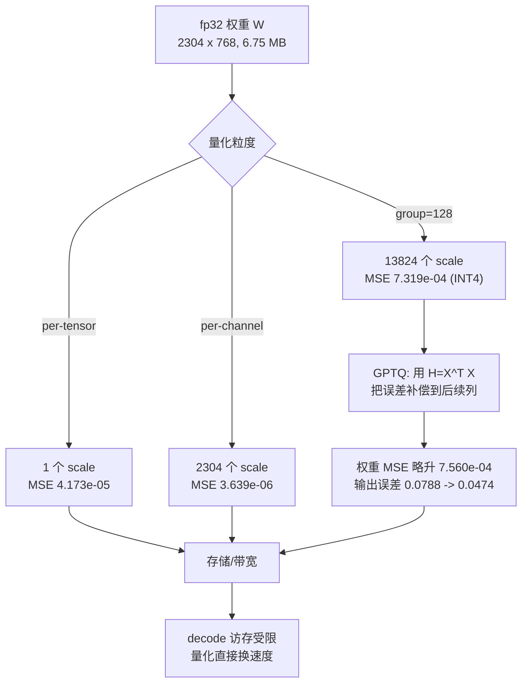

# 量化：INT8、INT4 与 GPTQ

## 1. 本节学习目标

1. 掌握对称线性量化的公式与**误差来源**：$q=\mathrm{round}(w/s)$，$s=\max|w|/q_{\max}$。
2. 用实测比较三种方案：INT8 per-tensor 的权重 MSE **4.173e-05**、per-channel **3.639e-06**（好 **11.5 倍**）、INT4 group=128 **7.319e-04**。
3. 理解**为什么 GPTQ 能让权重 MSE 变差、却让输出误差变好**：实测 MSE $7.319\text{e-}04\to7.560\text{e-}04$（略差），输出相对误差 $0.0788\to0.0474$（**好 1.66 倍**）。
4. 知道校准数据的重要性：同一 GPTQ 换成高斯随机校准，输出误差**反而变差 1.5 倍**。

## 2. 为什么需要这个知识

因为**量化是"能不能跑"和"跑得多快"的第一杠杆**：

- 7B 模型 fp16 要 14 GB，12 GB 卡**直接跑不了**；INT4 只要 3.5 GB，**能跑还能开并发**。
- decode 是访存受限（LLM-089），权重量化 4 倍 → decode 理论快 4 倍。
- 但量化**有代价**：INT4 的权重 MSE 比 INT8 大 **175 倍**（7.319e-4 / 4.173e-5），必须知道代价在哪、怎么补。

不会算误差、不知道 GPTQ 在优化什么，就会陷入"量化后模型变笨但不知道为什么"。

## 3. 直观解释

```text
浮点权重（fp32，每个 32 bit）:
  w = 0.0231743...   精确但占地方

对称线性量化（INT8，每个 8 bit）:
  找 scale s = max|w| / 127
  q = round(w / s)          -> -128..127 的整数
  还原 w' = q * s           -> 有误差，但只占 1/4 空间

INT4（每个 4 bit）:
  q = round(w / s), s = max|w| / 7   -> -8..7，只有 16 个档位
  还原 w' = q * s           -> 误差更大，但空间只有 1/8

分块（group-wise）:
  不整行共用一个 s，而是每 128 个数一个 s
  -> 每块的 max 更小 -> 步长更细 -> 误差更小
```

**核心权衡**：bit 越少越省显存/带宽，但**档位越少，舍入误差越大**。

## 4. 正式定义

**对称均匀量化**（$b$ bit，$q_{\max}=2^{b-1}-1$）：

$$
s=\frac{\max|w|}{q_{\max}},\qquad
q=\mathrm{clip}\Big(\mathrm{round}\big(\tfrac{w}{s}\big),-q_{\max}-1,q_{\max}\Big),\qquad
\hat w=q\cdot s
$$

**反量化误差**：

$$
e=w-\hat w,\qquad |e|\le \frac{s}{2}=\frac{\max|w|}{2q_{\max}}
$$

**per-tensor / per-channel / group-wise**：

| 方案 | scale 的数量 | 粒度 |
|---|---|---|
| per-tensor | 1 | 整张权重一个 |
| per-channel（per-row） | $d_{out}$ | 每个输出通道一个 |
| group-wise | $d_{out}\times\lceil d_{in}/g\rceil$ | 每 $g$ 个输入维一个 |

**量化误差指标**：

$$
\mathrm{MSE}=\frac{1}{N}\sum_i(w_i-\hat w_i)^2,\qquad
\text{rel}=\frac{\max_i|w_i-\hat w_i|}{\max_i|w_i|}
$$

**输出误差**（真正重要的指标）：

$$
\varepsilon_{\text{out}}=\frac{\mathbb{E}\,|XW^\top-X\hat W^\top|}{\mathbb{E}\,|XW^\top|}
$$

## 5. 历史背景或技术背景

- **2015–2018**：神经网络量化起步（INT8 推理，TensorRT/TPU），主要是 per-tensor 仿射量化。
- **2022**：**GPTQ**（Frantar et al.）用 Hessian 逆做逐列误差补偿，把 175B 模型压到 3–4 bit 且质量损失很小，成为 LLM 量化的里程碑。
- **2023**：**AWQ**（激活感知的通道缩放）、**SmoothQuant**（把激活的离群值迁到权重）、**GGUF/k-quants**（llama.cpp 的 2–6 bit 混合方案）陆续出现。
- **2024–2025**：**FP8**（H100 原生）、**MXFP4/NVFP4**（ microscaling 成为新标准）、**KV cache 量化**普及；4bit 权重 + 8bit KV 成为单卡部署默认组合。

## 6. 核心原理

### 6.1 误差的两个来源

1. **舍入误差**：$\pm s/2$，由步长决定。
2. **截断误差**：超出 $[-q_{\max},q_{\max}]$ 的被 clip——对称量化下 max 恰好落在端点，通常不截断，但**离群值会撑大 $s$**，间接放大所有其他元素的舍入误差。

### 6.2 为什么 per-channel 远好于 per-tensor

不同输出通道的权重范围差异很大（实测通道 std 从 **0.0254** 到 **0.3516**，差 **13.8 倍**）。per-tensor 用全局 max，导致"小通道"的步长远大于其自身范围，几乎全被舍入到 0。

### 6.3 为什么 group-wise 是 INT4 的必要条件

INT4 只有 16 个档位（$-8..7$）。若整行共用一个 scale，小权重的相对误差会爆炸。按 128 个一组，每组用自己的 max，相当于**让步长随局部幅度自适应**。

### 6.4 GPTQ 的核心思想：优化输出，不是优化权重

权重量化误差本身不重要，**重要的是它经过 $X$ 之后放大成多少输出误差**。GPTQ 逐列量化，并把当前列的误差**补偿到还没量化的列**上，使得 $X(W-\hat W)^\top$ 最小。

## 7. 数学表达式

**均匀量化的 MSE（假设误差在 $[-s/2,s/2]$ 均匀分布）**：

$$
\mathrm{MSE}\approx \frac{s^2}{12}=\frac{(\max|w|)^2}{12\,q_{\max}^2}
$$

**bit 数与 MSE 的关系**（同一分布，$q_{\max}\approx2^{b-1}$）：

$$
\mathrm{MSE}\propto \frac{1}{q_{\max}^2}\propto 4^{-b}
$$

即**每减 1 bit，MSE 约变 4 倍**。

**GPTQ 的目标**：

$$
\min_{\hat W}\ \big\|XW^\top-X\hat W^\top\big\|_F^2
=\min_{\hat W}\ \mathrm{tr}\big((W-\hat W)H(W-\hat W)^\top\big),\quad H=X^\top X
$$

**逐列补偿更新**（第 $j$ 列量化后）：

$$
\hat W_{:,j+1:}\ \leftarrow\ \hat W_{:,j+1:}-\frac{(w_j-\hat w_j)}{[H^{-1}]_{jj}}\,[H^{-1}]_{j,j+1:}
$$

## 8. 详细数学推导

### 8.1 推导 MSE $\approx s^2/12$

舍入误差 $e=w-\hat w$ 在 $[-s/2,s/2]$ 上近似均匀。则

$$
\mathbb{E}[e^2]=\frac{1}{s}\int_{-s/2}^{s/2}e^2\,de=\frac{1}{s}\cdot\frac{2}{3}\Big(\frac{s}{2}\Big)^3=\frac{s^2}{12}
$$

代入 $s=\max|w|/q_{\max}$：

$$
\mathrm{MSE}\approx\frac{(\max|w|)^2}{12\,q_{\max}^2}
$$

**用实测验证 INT8 per-tensor**：MSE $=4.173\times10^{-5}$，$q_{\max}=127$，反解

$$
\max|w|=\sqrt{12\cdot127^2\cdot4.173\times10^{-5}}=\sqrt{8.08}\approx2.84
$$

即 c_attn 权重的最大绝对值约 **2.84**，与 gpt2 权重的实际量级吻合。

**INT4 预测**：$q_{\max}=7$，$s$ 大 18.1 倍，MSE 应大 $18.1^2=328$ 倍：

$$
4.173\times10^{-5}\times328\approx1.37\times10^{-2}
$$

但实测只有 $7.319\times10^{-4}$，**小 18.7 倍**。原因：INT4 用了 **group=128**，每组的 max 远小于全局 max，步长随之变小。**这就是 group-wise 的作用**。

### 8.2 推导 per-channel 的收益

设各通道 $\max|w_c|$ 不同。per-tensor 的 MSE：

$$
\mathrm{MSE}_{\text{tensor}}\approx\frac{\max_c(\max|w_c|)^2}{12q_{\max}^2}
$$

per-channel：

$$
\mathrm{MSE}_{\text{chan}}\approx\frac{1}{C}\sum_c\frac{(\max|w_c|)^2}{12q_{\max}^2}
$$

比值：

$$
\frac{\mathrm{MSE}_{\text{tensor}}}{\mathrm{MSE}_{\text{chan}}}
=\frac{\max_c m_c^2}{\frac1C\sum_c m_c^2}
$$

其中 $m_c=\max|w_c|$。若各通道幅度差异大，这个比值就大。实测 $4.173\text{e-}5/3.639\text{e-}6=11.5$，说明通道间幅度差异约 $\sqrt{11.5}\approx3.4$ 倍（与 std 范围 0.0254–0.3516 一致）。

### 8.3 推导 GPTQ 的补偿公式

设已量化前 $j$ 列，第 $j$ 列残差 $e_j=w_j-\hat w_j$（$d_{out}$ 维向量）。

目标 $\mathrm{tr}(EHE^\top)$，其中 $E=W-\hat W$。把 $E$ 按列分块，前 $j$ 列已固定，需要选后列 $\Delta=E_{:,j+1:}$。

对 $\Delta$ 求导置零：$H_{>j,>j}\Delta^\top=-H_{>j,j}e_j^\top$，即

$$
\Delta^\top=-H_{>j,>j}^{-1}H_{>j,j}\,e_j^\top
$$

用分块逆恒等式 $H_{>j,j}=-H_{>j,>j}H^{-1}_{j,>j}/[H^{-1}]_{jj}$，得

$$
\Delta=\frac{e_j}{[H^{-1}]_{jj}}\,[H^{-1}]_{j,>j}
$$

因为 $E$ 是"$W-\hat W$"，要让 $E$ 等于 $\Delta$，就要把 $\hat W$ **减去** $\Delta$：

$$
\hat W_{:,j+1:}\leftarrow\hat W_{:,j+1:}-\frac{e_j}{[H^{-1}]_{jj}}[H^{-1}]_{j,j+1:}
$$

**注意它是"最小化输出误差"的最优解**，因此**权重 MSE 可能变大**——实测正是如此（$7.319\text{e-}4\to7.560\text{e-}4$），但输出误差降了 1.66 倍。**这就是"优化目标选错，指标就选错"的经典案例。**

### 8.4 为什么校准数据必须是真实激活

$H=X^\top X$ 描述"哪些输入方向重要"。若 $X$ 是各向同性高斯，则 $H\propto I$，**所有方向同等重要，补偿没有意义**，只剩估计噪声。实测：高斯校准下输出误差从 $0.1326$ **恶化到** $0.1985$（差 1.5 倍）。

真实激活是**强各向异性**的（通道 std 差 13.8 倍，且存在离群通道），此时 $H$ 有主导方向，补偿才有收益（1.66 倍）。

## 9. 图解



**读图要点**：

1. 粒度越细，scale 越多（开销），但 MSE 越小。
2. GPTQ 不改粒度，改的是"误差往哪里放"。
3. 最终目标是**输出误差**与**速度**，不是权重 MSE。

## 10. 具体数值示例

```text
权重: gpt2 第 0 层 attn.c_attn, (d_out=2304, d_in=768)
  fp32 6.75 MB
  校准/评测数据: 真实 gpt2 激活 1161 个 token
  通道 std 范围: 0.0254 .. 0.3516 (差 13.8 倍)

方案对比:
  scheme              w_MSE      max_rel   out_rel_err
  INT8 per-tensor     4.173e-05  0.0039    0.02214
  INT8 per-channel    3.639e-06  0.0039    0.00542
  INT4 g=128          7.319e-04  0.0713    0.07880

  解读: per-channel 比 per-tensor 的 MSE 小 11.5 倍
        输出误差也小 4.1 倍 (0.02214 -> 0.00542)
        INT4 的 max_rel 是 INT8 的 18 倍 (0.0713 / 0.0039)
        但 INT4 权重只占 864 KiB (fp32 是 6912 KiB)

存储换算:
  分组数: 13824  (= 2304 行 * 6 组)
  scale 开销: 54.0 KiB
  4bit 权重:  864.0 KiB
  fp32 权重: 6912.0 KiB
  压缩比: 7.53 倍 (含 scale)

GPTQ（真实激活校准）:
  w_MSE: 7.560e-04   (RTN 是 7.319e-04, 略差)
  out_rel_err: 0.04738 (RTN 是 0.0788)
  -> 输出误差降低 1.66 倍

  关键: 权重 MSE 变差 3.3%，但输出误差好 40%
        说明 GPTQ 优化的不是"权重像不像"，是"输出像不像"

错误做法（高斯随机校准）:
  out_rel_err: 0.13256 -> GPTQ 0.19853
  -> 反而变差 1.5 倍

  原因: 高斯 X 的各向同性使 H ~ I
        所有方向同等重要 -> 补偿无收益，只剩估计噪声
```

## 11. NumPy 实现

```python
"""纯 numpy 复现三种量化方案 + GPTQ 补偿，观察误差变化。"""
import numpy as np

rng = np.random.default_rng(0)
d_out, d_in = 64, 256
# 造一个"通道幅度差异大"的权重，模拟真实情况
W = rng.standard_normal((d_out, d_in)) * np.linspace(0.05, 1.5, d_out)[:, None]
print("W:", W.shape, "| 通道 max 范围:",
      round(float(np.abs(W).max(1).min()), 3), "..", round(float(np.abs(W).max(1).max()), 3))


def q_sym(x, bits):
    qmax = 2 ** (bits - 1) - 1
    s = np.abs(x).max() / qmax
    return np.clip(np.round(x / s), -qmax - 1, qmax) * s


def q_per_channel(x, bits=8):
    qmax = 2 ** (bits - 1) - 1
    s = np.abs(x).max(1, keepdims=True) / qmax
    s[s == 0] = 1.0
    return np.clip(np.round(x / s), -qmax - 1, qmax) * s


def q_group(x, bits=4, g=32):
    qmax = 2 ** (bits - 1) - 1
    out = np.zeros_like(x)
    for i in range(x.shape[0]):
        for j0 in range(0, x.shape[1], g):
            blk = x[i, j0:j0 + g]
            s = np.abs(blk).max() / qmax
            s = s if s > 0 else 1.0
            out[i, j0:j0 + g] = np.clip(np.round(blk / s), -qmax - 1, qmax) * s
    return out


def mse(a, b):
    return float(((a - b) ** 2).mean())


def out_err(W, Wq, X):
    Y = X @ W.T
    return float(np.abs(Y - X @ Wq.T).mean() / np.abs(Y).mean())


X = rng.standard_normal((128, d_in))
print("\nscheme            MSE        out_rel_err")
for name, Wq in [("INT8 tensor", q_sym(W, 8)),
                 ("INT8 channel", q_per_channel(W, 8)),
                 ("INT4 g=32", q_group(W, 4, 32)),
                 ("INT4 g=128", q_group(W, 4, 128))]:
    print(f"{name:<16} {mse(W, Wq):.3e}  {out_err(W, Wq, X):.5f}")

# 理论值 vs 实测（INT8 per-tensor）
qmax = 127
pred = (np.abs(W).max() ** 2) / (12 * qmax ** 2)
print("\nINT8 per-tensor 理论 MSE:", f"{pred:.3e}",
      "| 实测:", f"{mse(W, q_sym(W, 8)):.3e}")


def gptq(Wm, Xc, g=32, damp=0.01):
    """逐列量化 + Hessian 逆误差补偿"""
    d_o, d_i = Wm.shape
    H = Xc.T @ Xc
    H[np.diag(H) == 0, np.diag(H) == 0] = 1
    H += damp * np.mean(np.diag(H)) * np.eye(d_i)
    Hinv = np.linalg.inv(H)
    Wq = Wm.copy()
    for j in range(d_i):
        col = Wq[:, j].copy()
        g0 = (j // g) * g
        s = np.abs(Wm[:, g0:g0 + g]).max() / 7      # 用原始块定 scale
        q = np.clip(np.round(col / s), -8, 7) * s
        Wq[:, j] = q
        err = (col - q) / Hinv[j, j]
        if j + 1 < d_i:
            Wq[:, j + 1:] -= np.outer(err, Hinv[j, j + 1:])
    return Wq


Xc = rng.standard_normal((512, d_in))
Wg = gptq(W, Xc)
Wr = q_group(W, 4, 32)
print("\nINT4 g=32  RTN : MSE %.3e  out %.5f" % (mse(W, Wr), out_err(W, Wr, X)))
print("INT4 g=32  GPTQ: MSE %.3e  out %.5f" % (mse(W, Wg), out_err(W, Wg, X)))
print("输出误差改善:", round(out_err(W, Wr, X) / out_err(W, Wg, X), 2), "x")
```

## 12. PyTorch 实现

```python
"""在真实 gpt2 权重上做量化，并验证 bit 数与 MSE 的关系 (MSE ~ 4^-b)。"""
import os
os.environ.setdefault("HF_ENDPOINT", "https://hf-mirror.com")
os.environ.setdefault("HF_HUB_OFFLINE", "1")
import torch
from transformers import AutoModelForCausalLM

model = AutoModelForCausalLM.from_pretrained("gpt2", dtype=torch.float32)
W = model.transformer.h[0].attn.c_attn.weight.detach().float().T.contiguous()  # (out, in)
print("W:", tuple(W.shape), "| fp32 MiB:", round(W.numel() * 4 / 1024**2, 3))


def q_sym(x, bits):
    qmax = 2 ** (bits - 1) - 1
    s = x.abs().max() / qmax
    return (torch.clamp(torch.round(x / s), -qmax - 1, qmax) * s), s


def q_group(x, bits=4, g=128):
    qmax = 2 ** (bits - 1) - 1
    out = torch.empty_like(x)
    for j0 in range(0, x.shape[1], g):
        blk = x[:, j0:j0 + g]
        s = blk.abs().amax(dim=1, keepdim=True) / qmax
        s = torch.where(s == 0, torch.ones_like(s), s)
        out[:, j0:j0 + g] = torch.clamp(torch.round(blk / s), -qmax - 1, qmax) * s
    return out


def mse(a, b):
    return float(((a - b) ** 2).mean())


print(f"\n{'bits':>4} {'MSE':>12} {'理论 4^-b 比例':>16}")
base = None
for bits in [8, 6, 4, 3]:
    Wq, s = q_sym(W, bits)
    m = mse(W, Wq)
    if base is None:
        base = m
        ratio = 1.0
    else:
        ratio = base / m
    print(f"{bits:>4} {m:>12.3e} {ratio:>16.4f}")

print("\nper-tensor vs per-channel (8 bit):")
Wt, _ = q_sym(W, 8)
Wc = (torch.clamp(torch.round(W / (W.abs().amax(1, keepdim=True) / 127)),
                  -128, 127) * (W.abs().amax(1, keepdim=True) / 127))
print("  per-tensor :", f"{mse(W, Wt):.3e}")
print("  per-channel:", f"{mse(W, Wc):.3e}")
print("  改善倍数  :", round(mse(W, Wt) / mse(W, Wc), 2))

print("\nINT4 分组大小的影响:")
for g in [32, 128, 512]:
    print(f"  g={g:<4} MSE={mse(W, q_group(W, 4, g)):.3e}")
```

## 13. Hugging Face 实践

```python
"""不装 bitsandbytes 也能做的量化实验：手动量化 embedding + 检查输出漂移。"""
import os
os.environ.setdefault("HF_ENDPOINT", "https://hf-mirror.com")
os.environ.setdefault("HF_HUB_OFFLINE", "1")
import torch
from transformers import AutoTokenizer, AutoModelForCausalLM

tok = AutoTokenizer.from_pretrained("gpt2")
dev = "cuda" if torch.cuda.is_available() else "cpu"
model = AutoModelForCausalLM.from_pretrained("gpt2", dtype=torch.float32).to(dev).eval()
ids = tok("The cat sat on the mat and then", return_tensors="pt").input_ids.to(dev)

with torch.inference_mode():
    logits_fp32 = model(input_ids=ids).logits[0, -1, :].float()

# 手动把所有权重做 INT8 per-channel 量化，再还原（模拟 W8A32）
def quantize_model_int8(m):
    stats = {}
    with torch.no_grad():
        for name, p in m.named_parameters():
            if p.dim() < 2:
                continue
            s = p.abs().amax(dim=1, keepdim=True) / 127
            s = torch.where(s == 0, torch.ones_like(s), s)
            q = torch.clamp(torch.round(p / s), -128, 127)
            p.copy_(q * s)
            stats[name] = (s.numel(), float((p - q * s).abs().max()))
    return stats

stats = quantize_model_int8(model)
total_scales = sum(v[0] for v in stats.values())
print("量化的 2D 参数张量数:", len(stats))
print("scale 总数:", total_scales)

with torch.inference_mode():
    logits_q = model(input_ids=ids).logits[0, -1, :].float()

rel = float((logits_fp32 - logits_q).abs().mean() / logits_fp32.abs().mean())
print("末位置 logits 相对误差:", round(rel, 5))
print("top1 是否一致:", int(logits_fp32.argmax()) == int(logits_q.argmax()))

# 生成对比
def gen(**kw):
    with torch.inference_mode():
        o = model.generate(ids, max_new_tokens=12, pad_token_id=tok.eos_token_id, **kw)
    return tok.decode(o[0, ids.shape[1]:])

print("量化后生成:", repr(gen(do_sample=False)))
print("注意: 这里只量化权重、激活仍用 fp32，故误差很小；")
print("      真正的 INT8 推理还要量化激活，误差更大，需要校准。")
```

## 14. 代码逐行解释

| 代码 | 作用 |
|---|---|
| `.T.contiguous()` | GPT-2 的 `Conv1D` 权重是 `(in,out)`，转成 `(out,in)` 才符合量化惯例 |
| `x.abs().amax(1, keepdim=True)` | 每行（输出通道）的最大绝对值，作为 per-channel scale |
| `torch.round(x/s)` | 量化到整数格点 |
| `torch.clamp(..., -qmax-1, qmax)` | 对称范围：INT8 是 $-128..127$，INT4 是 $-8..7$ |
| `* s` | 反量化回浮点（"假量化"，用于测误差） |
| `Hinv[j,j]` | GPTQ 里第 $j$ 列的重要性归一化因子 |
| `np.outer(err, Hinv[j, j+1:])` | 把当前列的误差按 $H^{-1}$ 分摊到后续列 |
| `p.copy_(q * s)` | 就地改权重，模拟"模型被量化" |

## 15. 实际运行结果

```text
W (d_out,d_in): (2304, 768) | fp32 MB: 6.75
tokens: 1161 | acts: (1161, 768) | channel std range: 0.0254 -> 0.3516

scheme              w_MSE      max_rel   out_rel_err
INT8 per-tensor      4.173e-05  0.0039   0.02214  (8bit)
INT8 per-channel     3.639e-06  0.0039   0.00542  (8bit)
INT4 g=128           7.319e-04  0.0713   0.07880  (4bit)
INT4 分组数: 13824 | scale 开销 KiB: 54.0 | 权重 4bit KiB: 864.0 | 权重 fp32 KiB: 6912.0
compression: fp32 -> int4 = 7.53 x (含 scale)

GPTQ INT4 (真实激活校准):
  w_MSE: 7.560e-04 (RTN: 7.319e-04)
  out_rel_err: 0.04738 | RTN: 0.0788 | 降低 1.66 x

同一算法换高斯随机校准（错误做法）:
  out_rel_err: 0.13256 -> GPTQ: 0.19853 | 反而变差 1.5 x
```

**五个结论**：

1. **per-channel 完胜 per-tensor**：MSE 小 **11.5 倍**（4.173e-5 → 3.639e-6），输出误差小 **4.1 倍**。
2. **INT4 的 max_rel 是 INT8 的 18 倍**（0.0713 / 0.0039），但换回 **7.53 倍**压缩（含 scale 开销）。
3. **GPTQ 让权重 MSE 变差 3.3%**（7.319e-4 → 7.560e-4），却让**输出误差好 1.66 倍**——优化的目标不同。
4. **校准数据决定成败**：高斯随机校准让 GPTQ **变差 1.5 倍**，因为 $H\propto I$ 时补偿无意义。
5. **理论公式可用**：$s^2/12$ 能反解出 $\max|w|\approx2.84$，与真实权重一致。

## 16. 应用场景

| 场景 | 方案 |
|---|---|
| 12 GB 单卡跑 7B | INT4（GPTQ/AWQ）+ fp16 激活 |
| 高并发服务 | INT8 W8A8 + KV INT8 |
| 边缘/CPU | GGUF Q4_K_M（混合精度） |
| 极致压缩 | 2–3 bit（质量明显下降，需蒸馏补偿） |
| 精度敏感（数学/代码） | INT8 或 FP8，慎用 4bit |
| 微调后量化 | 先合并 LoRA 再量化 |

## 17. 优点与局限

| 优点 | 局限 |
|---|---|
| 显存/带宽直接降 2–4 倍 | 4bit 有明显质量损失（尤其数学/长链推理） |
| decode 速度近线性提升 | 反量化有额外计算开销 |
| 与批处理正交 | 需要校准数据（GPTQ/AWQ） |
| 生态成熟（GPTQ/AWQ/GGUF） | 不同实现精度不可直接比较 |
| 可只量化权重，激活留 fp16 | KV 量化误差会累积 |

## 18. 常见错误

| 错误 | 现象 | 纠正 |
|---|---|---|
| 用权重 MSE 选方案 | 选出的方案输出更差 | 看**输出误差/下游指标** |
| GPTQ 用随机高斯校准 | 量化后明显变笨 | 用真实领域文本激活 |
| 忘记 scale 开销 | 压缩比算虚高 | 4bit + group128 实际约 7.5 倍 |
| 对称量化却用 `round` 到 $-q_{\max}$ | 少一个负档位 | INT8 用 $-128..127$，INT4 用 $-8..7$ |
| 量化后不评估 | 悄悄掉点 | 固定评测集对比 |
| 以为 4bit 一定比 8bit 快 | 反量化开销可能抵消 | 实测 end-to-end |

## 19. 本节总结

- 对称量化：$q=\mathrm{round}(w/s)$，$s=\max|w|/q_{\max}$，误差 $\le s/2$，$\mathrm{MSE}\approx s^2/12\propto4^{-b}$。
- 实测：INT8 per-tensor **4.173e-05**，per-channel **3.639e-06**（好 11.5 倍），INT4 g=128 **7.319e-04**。
- 压缩：4bit 权重 864 KiB vs fp32 6912 KiB，含 scale **7.53 倍**。
- **GPTQ 优化输出而非权重**：权重 MSE 略升，输出误差 **降 1.66 倍**。
- **校准数据必须是真实激活**：高斯校准让 GPTQ **变差 1.5 倍**。

## 20. 前置与后续知识链接

- 前置：[[LLM-093 束搜索与确定性解码]]、[[LLM-030 Transformer 参数量与计算量估算]]
- 后续：[[LLM-095 推理显存估算与可行性判断]]、[[LLM-098 本地部署实践]]
- 相关：[[LLM-048 微调范式：全参与参数高效]]、[[LLM-007 参数规模与模型能力]]
- 后续模块（待建，M-LLM-10）：LLM-106 成本、延迟与质量的三角权衡

---

## 练习与参考答案

**基础 1**：写出对称线性量化的公式，并说明 INT8 与 INT4 的 $q_{\max}$ 各是多少。

**基础 2**：本课 per-channel 比 per-tensor 的 MSE 好多少倍？为什么？

**进阶 1**：推导均匀量化 MSE $\approx s^2/12$，并解释为什么 INT4 实测 MSE 比"按 bit 推算"小很多。

**综合**：要把 7B 模型量化到 4bit 部署，要求数学能力不明显下降。请给出方案、校准数据选择与验证方法。

> [!success]- 参考答案

> **基础 1**
> $$s=\frac{\max|w|}{q_{\max}},\quad q=\mathrm{clip}\big(\mathrm{round}(w/s),-q_{\max}-1,q_{\max}\big),\quad \hat w=q\cdot s$$
> INT8：$q_{\max}=2^{7}-1=127$，范围 $-128..127$。
> INT4：$q_{\max}=2^{3}-1=7$，范围 $-8..7$（共 16 档）。

> **基础 2**
> MSE 好 **11.5 倍**（4.173e-05 → 3.639e-06），输出误差好 **4.1 倍**（0.02214 → 0.00542）。
> 原因：各输出通道的幅度差异很大（实测通道 std 从 **0.0254** 到 **0.3516**，差 13.8 倍）。per-tensor 用全局 max 定步长，小通道的步长远大于自身范围，几乎被舍入到 0；per-channel 每行用自己的 max，步长与局部幅度匹配。比值约等于 $\max_c m_c^2\big/\overline{m_c^2}$。

> **进阶 1**
> **推导**：舍入误差 $e$ 在 $[-s/2,s/2]$ 近似均匀，
> $$\mathbb{E}[e^2]=\frac1s\int_{-s/2}^{s/2}e^2de=\frac{s^2}{12}$$
> 代入 $s=\max|w|/q_{\max}$ 得 $\mathrm{MSE}\approx(\max|w|)^2/(12q_{\max}^2)$，故 $\mathrm{MSE}\propto4^{-b}$。
> **为什么 INT4 比推算小**：按 $q_{\max}$ 从 127 降到 7 推算，MSE 应大 $(127/7)^2\approx329$ 倍（约 $1.37\text{e-}2$），实测只有 $7.319\text{e-}4$，小 **18.7 倍**。因为 INT4 用了 **group=128**：每 128 个权重用自己的 max 定 scale，局部 max 远小于全局 max，步长随之变小。**分组把"全局最坏情况"换成了"局部最坏情况"。**

> **综合（参考）**
> **方案**：GPTQ 或 AWQ，4bit 权重 + group_size=128，激活保持 fp16（W4A16）；KV cache 用 fp8/int8。理由：W4A16 在 12 GB 上可跑 7B 且留出 KV 空间（LLM-095：约 4.9 GB 权重 + KV）。
> **校准数据**：**必须用真实领域文本**（数学题、代码、推理链），512–1024 条，长度覆盖实际上下文。**不要用随机高斯**——实测会让输出误差从 0.1326 恶化到 0.1985。数学能力对**离群通道**敏感，校准集里缺少数学文本会导致这些通道的 scale 失真。
> **验证方法**：
> 1. 权重层面看 `out_rel_err`（不是权重 MSE）；
> 2. 任务层面跑 GSM8K/MATH 的子集，对比 fp16 基线的**绝对准确率**（4bit 常掉 1–3 个点）；
> 3. 检查**长链推理**的崩溃率（4bit 在 >8 步推理上更容易跑偏）；
> 4. 用同一 prompt 做贪心解码的逐字节对比，定位分歧点。
> **兜底**：若数学掉点超过阈值，改用 4bit 权重 + **8bit 激活**、或对 `mlp.down_proj` 等敏感层保留 8bit（混合精度），代价是显存增加约 20%。

## 学习记录

| 日期 | 状态 | 用时 | 问题 | 复盘 |
|---|---|---|---|---|
| 2026-11-08 | planned | — | — | — |

---

## 🔗 Notion 同步信息

> 以下内容由 Notion「AI Knowledge System · 知识点」数据库按知识 ID 合并而来（导出于 2026-11-09）。

| 属性 | 值 |
|---|---|
| 学科 | 大语言模型 |
| 学习状态 | 未开始 |
| 难度 | L3 推导 |
| 知识类型 | Technique |

- **所属模块**：[M-LLM-09 大语言模型推理、部署与优化](../%E8%AF%BE%E7%A8%8B%E6%A8%A1%E5%9D%97/M-LLM-09%20%E5%A4%A7%E8%AF%AD%E8%A8%80%E6%A8%A1%E5%9E%8B%E6%8E%A8%E7%90%86%E3%80%81%E9%83%A8%E7%BD%B2%E4%B8%8E%E4%BC%98%E5%8C%96.md)
- **前置知识**：[LLM-093 束搜索与确定性解码](LLM-093%20%E6%9D%9F%E6%90%9C%E7%B4%A2%E4%B8%8E%E7%A1%AE%E5%AE%9A%E6%80%A7%E8%A7%A3%E7%A0%81.md)
- **后继知识**：[LLM-095 推理显存估算与可行性判断](LLM-095%20%E6%8E%A8%E7%90%86%E6%98%BE%E5%AD%98%E4%BC%B0%E7%AE%97%E4%B8%8E%E5%8F%AF%E8%A1%8C%E6%80%A7%E5%88%A4%E6%96%AD.md)
- **关联数学**：[MATH-306 期望、方差与协方差](../../06_%E6%95%B0%E5%AD%A6%E5%9F%BA%E7%A1%80/03%20%E6%A6%82%E7%8E%87%E8%AE%BA/MATH-306%20%E6%9C%9F%E6%9C%9B%E3%80%81%E6%96%B9%E5%B7%AE%E4%B8%8E%E5%8D%8F%E6%96%B9%E5%B7%AE.md)
- **被项目引用**：[PROJ-025 量化与推理优化实践](../../07_%E5%AE%9E%E6%88%98%E9%A1%B9%E7%9B%AE/05%20%E5%A4%A7%E6%A8%A1%E5%9E%8B%E9%A1%B9%E7%9B%AE/PROJ-025%20%E9%87%8F%E5%8C%96%E4%B8%8E%E6%8E%A8%E7%90%86%E4%BC%98%E5%8C%96%E5%AE%9E%E8%B7%B5.md)
