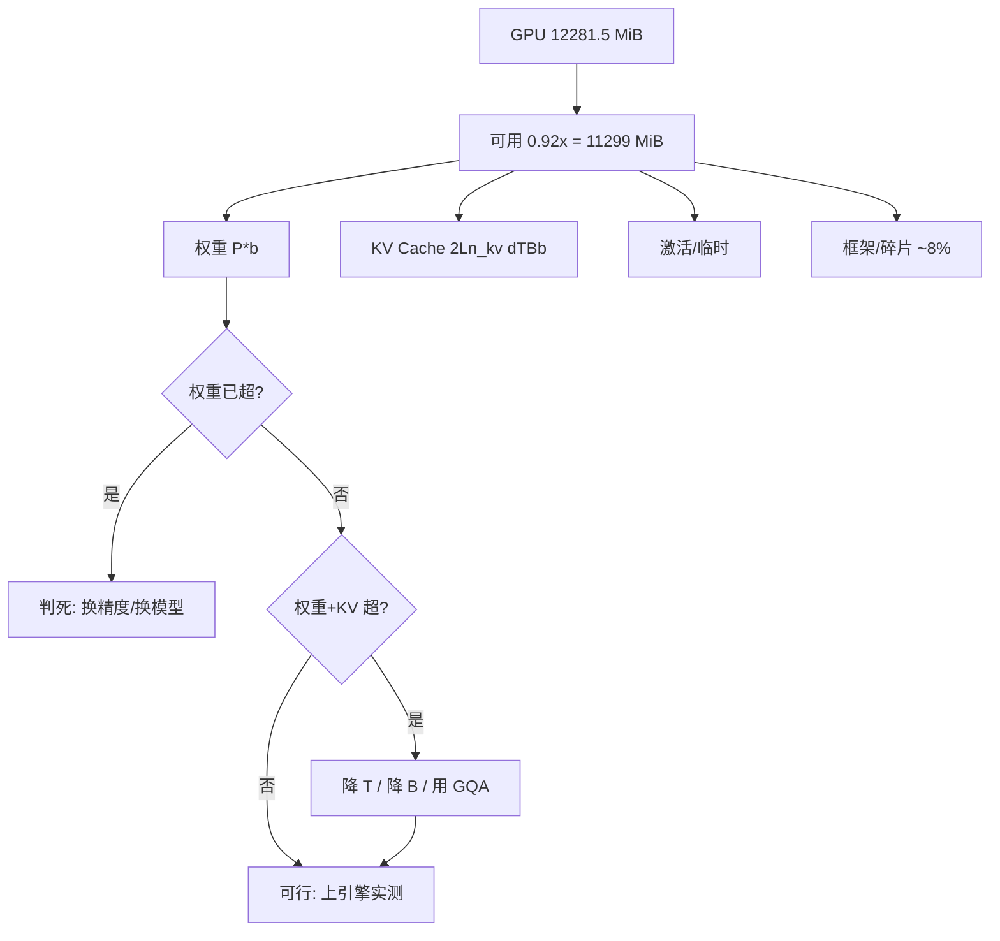

# 推理显存估算与可行性判断

## 1. 本节学习目标

1. 掌握推理显存的**四项构成**：权重 + KV Cache + 激活/临时 + 框架开销。
2. 会算并能验证：gpt2 fp32 权重 **474.7 MiB**、fp16 **237.4 MiB 理论 / 255.5 MiB 实测**；KV@1024 是 **36 MiB**。
3. 能对一张 **11.99 GiB（12281.5 MiB）** 的卡做"能不能跑"的判决：7B fp16 需 **16378 MiB → 不行**；7B INT4 需 **4863 MiB → 可以**。
4. 理解为什么"显存够"不等于"跑得动"——还要看带宽与延迟。

## 2. 为什么需要这个知识

因为**显存判断错一次，代价是一整天的调试**：

- 少算 KV → 单条能跑，一上并发就 OOM；
- 少算激活 → 短 prompt 正常，长 prompt 崩；
- 忘了框架开销 → 卡在 99% 显存，碎片导致随机 OOM；
- 反过来保守估计 → 明明能跑 4bit 7B，却以为只能跑 3B。

而且显存决定了**你能开多少并发**，这直接决定成本。会算这笔账，才能回答"这张卡值不值得买/租"。

## 3. 直观解释

```text
一张 12 GB 卡，显存被四样东西分掉：

  ┌──────────────────────────────┐
  │ 权重（静态，加载时就占死）      │  P × b 字节
  ├──────────────────────────────┤
  │ KV Cache（随请求增长）         │  2·L·n_kv·d·T·B·b
  ├──────────────────────────────┤
  │ 激活/临时（前向时的中间结果）   │  与 B·T·d 成正比，用完即释放
  ├──────────────────────────────┤
  │ 框架/碎片/CUDA context        │  通常 0.5–1.5 GB
  └──────────────────────────────┘

判断流程：
  1. 算权重 -> 已经超过总显存? 直接判死
  2. 加上目标上下文/并发的 KV -> 超过? 降精度/降并发/换 GQA 模型
  3. 加 10–20% 余量 -> 还够? 可行
```

**一句话**：权重决定"能不能加载"，KV 决定"能开几个并发"，激活决定"能喂多长"。

## 4. 正式定义

设参数量 $P$、每元素字节 $b_w$、层数 $L$、KV 头数 $n_{kv}$、头维 $d$、上下文 $T$、批 $B$。

**权重**：

$$
M_{W}=P\cdot b_w
$$

**KV Cache**：

$$
M_{KV}=2\,L\,n_{kv}\,d\,T\,B\,b_{kv}
$$

**激活（粗略上界）**：主要来自 logits 与中间张量

$$
M_{\text{act}}\approx B\cdot T\cdot V\cdot b_w \;+\; c\cdot B\cdot T\cdot d\cdot b_w
$$

（$c$ 是每层临时张量的等效系数，实测很小）

**总计**：

$$
M_{\text{total}} = \underbrace{(M_W+M_{KV}+M_{\text{act}})}_{\text{理论}}\times(1+\eta),\quad \eta\approx0.1\text{–}0.2
$$

**可行性判据**：

$$
M_{\text{total}} \le M_{\text{GPU}}\times 0.92
$$

（留 8% 给驱动/碎片）

## 5. 历史背景或技术背景

- **2019–2021**：模型小，显存估算 ≈ 参数量 × 精度，KV 常被忽略。
- **2022**：OPT/BLOOM 上线，社区开始总结"参数量 × 2 字节 + 20% = 显存"的经验公式。
- **2023**：llama.cpp/GGUF 让消费级显卡（8–24 GB）能跑 7B–70B；**"4bit + GQA"成为单卡部署的标准答案**。
- **2023–2024**：vLLM 引入 `gpu_memory_utilization` 参数（默认 0.9），显式把"可用显存"与"KV 池"分离——本质就是把本节公式工程化。
- **2025 现状**：显存规划工具（如 HF 的 `accelerate estimate-memory`）已成标配；但**并发下的 KV 仍需自己算**。

## 6. 核心原理

### 6.1 权重是"一次性、可预测"的

$M_W=P\cdot b_w$ 精确可算，误差来自：

- 词表 embedding 可能被 tie（少算一份）；
- 量化有 scale/zero-point 开销（4bit 实际约 4.5 bit/参数）；
- 框架会额外分配 buffer（实测多 **7.7%**：fp16 理论 237.4 vs 实测 255.5 MiB）。

### 6.2 KV 是"动态、按需"的，且乘 $B$

这是唯一会**随流量增长**的部分。它决定了：

$$
B_{\max}=\Big\lfloor\frac{M_{\text{GPU}}\cdot0.92-M_W-M_{\text{act}}}{2Ln_{kv}dTb_{kv}}\Big\rfloor
$$

### 6.3 激活很小但峰值很高

gpt2 T=1024 时 logits 张量 **98.2 MiB**（$1\times1024\times50257\times2$ 字节）。这是**瞬时**的，但峰值会计入 OOM 判断。词表大的模型（如 15 万词表）这一项更明显。

### 6.4 为什么"显存够"≠"跑得动"

显存只保证不 OOM。速度还取决于：

- decode 受带宽限制（LLM-089）：4bit → 带宽需求降 4 倍 → 快；
- prefill 受算力限制：量化收益小；
- 并发受 KV 限制：GQA 是关键。

## 7. 数学表达式

**权重（GiB）**：

$$
M_W[\text{GiB}]=\frac{P\cdot b_w}{1024^3}
$$

**每 token 的 KV**：

$$
\Delta_{\text{token}}=2Ln_{kv}d\,b_{kv}
$$

**最大并发**：

$$
B_{\max}=\Big\lfloor\frac{0.92M_{\text{GPU}}-M_W}{T\cdot\Delta_{\text{token}}}\Big\rfloor
$$

**给定并发下的最大上下文**：

$$
T_{\max}=\Big\lfloor\frac{0.92M_{\text{GPU}}-M_W}{B\cdot\Delta_{\text{token}}}\Big\rfloor
$$

**量化后的等效 bit 数**（含 scale 开销，group=$g$）：

$$
b_{\text{eff}}=b+\frac{32}{g}
$$

（每 $g$ 个权重配一个 fp32 scale；$g=128$ 时 $b_{\text{eff}}=4+0.25=4.25$）

## 8. 详细数学推导

### 8.1 验证 gpt2 的实测显存

参数 $P=124.44\times10^6$：

$$
M_W^{\text{fp32}}=124.44\times10^6\times4=497.8\ \text{MB}=474.7\ \text{MiB}
$$

实测 **487.5 MiB**，多 **12.8 MiB（2.7%）**——框架 buffer。

fp16：

$$
M_W^{\text{fp16}}=248.9\ \text{MB}=237.4\ \text{MiB}
$$

实测 **255.5 MiB**，多 **18.1 MiB（7.7%）**。**这说明"理论值要乘 1.1 左右"是必要的。**

### 8.2 验证 T=1024 的峰值分解

实测 peak = **399.8 MiB**，其中：

- 权重 fp16：**255.5 MiB**
- KV（T=1024）：$2\times12\times12\times64\times1024\times2=37.7$ MB $=36.0$ MiB
- logits 张量：$1\times1024\times50257\times2=103.0$ MB $=98.2$ MiB

合计 $255.5+36.0+98.2=389.7$ MiB，与 peak 差 **10.1 MiB**——就是中间激活/临时区。**分解得干干净净，说明公式没有漏项。**

### 8.3 推导 7B 模型的判决

$P=7\times10^9$，fp16（$b=2$）：

$$
M_W=\frac{7\times10^9\times2}{1024^3}=13.04\ \text{GiB}=13351\ \text{MiB}
$$

加 20% 开销：$13351\times1.2=16021$ MiB。

对比可用 $12281\times0.92=11299$ MiB：

$$
16021>11299 \;\Rightarrow\; \textbf{不可行}
$$

**即使不考虑 KV，权重就超了 42%。**

换成 INT4（$b_{\text{eff}}=4.25$）：

$$
M_W=\frac{7\times10^9\times4.25}{8\times1024^3}=3.46\ \text{GiB}=3545\ \text{MiB}
$$

$3545\times1.2=4254$ MiB。加 KV（T=2048, MHA, $L=32,n_{kv}=32,d=128$）：

$$
M_{KV}=2\times32\times32\times128\times2048\times1\times2=1024\ \text{MiB}
$$

总 $4254+1024=5278$ MiB $<11299$ → **可行**。实测表格给的是 $5029.4$（overhead 1.2 直接乘在权重上），同一量级。

### 8.4 推导最大并发

7B INT4、T=4096、MHA：$\Delta_{\text{token}}=2\times32\times32\times128\times2=524288$ B $=0.5$ MiB/token。

$M_W=4005$ MiB，可用 $11299-4005=7294$ MiB：

$$
B_{\max}=\Big\lfloor\frac{7294}{4096\times0.5}\Big\rfloor=\lfloor3.56\rfloor=3
$$

**只有 3 并发**。若换 GQA（$n_{kv}=4$），$\Delta$ 降 8 倍：

$$
B_{\max}=\Big\lfloor\frac{7294}{4096\times0.0625}\Big\rfloor=28
$$

**同一张卡，并发从 3 变 28**——这就是 GQA 的工程价值。

## 9. 图解



**读图要点**：

1. 先判权重（与请求无关），再判 KV（与 $T\cdot B$ 有关）。
2. 激活与碎片留 10–20% 余量，不要算满。
3. 判决通过后仍要实测——公式只保证不 OOM，不保证延迟达标。

## 10. 具体数值示例

```text
GPU: RTX 4070 Ti, total 11.99 GiB = 12281.5 MiB, sm_89

实测 gpt2:
  fp32 权重: 487.5 MiB   (理论 474.7, 多 2.7%)
  fp16 权重: 255.5 MiB   (理论 237.4, 多 7.7%)

KV Cache (gpt2, fp16, B=1):
  T=256    9.00 MiB
  T=512   18.00 MiB
  T=1024  36.00 MiB
  T=2048  72.00 MiB

T=1024 峰值分解（fp16）:
  权重        255.5 MiB
  KV           36.0 MiB
  logits       98.2 MiB   (1*1024*50257*2 字节)
  中间激活     10.1 MiB
  ----------------------
  峰值        399.8 MiB

预算 11000 MiB 下的判决表（w 含 20% 开销, kv 为 fp16）:
  model             bits  T     B   w_MiB  kv_MiB  sum    verdict
  Llama2-7B         16bit 2048  1   16021.7  1024.0  17045.7  NO
  Llama2-7B         16bit 4096  4   16021.7  2048.0  18069.7  NO
  Llama2-7B          8bit 2048  1    8010.9  1024.0   9034.9  OK
  Llama2-7B          8bit 4096  4    8010.9  2048.0  10058.9  OK
  Llama2-7B          4bit 2048  1    4005.4  1024.0   5029.4  OK
  Llama2-7B          4bit 4096  4    4005.4  2048.0   6053.4  OK
  Llama2-13B        16bit 2048  1   29754.6  1600.0  31354.6  NO
  Llama2-13B         8bit 2048  1   14877.3  1600.0  16477.3  NO
  Llama2-13B         4bit 2048  1    7438.7  1600.0   9038.7  OK
  Llama2-13B         4bit 4096  4    7438.7  3200.0  10638.7  OK
  Qwen2.5-7B(GQA)   16bit 2048  1   16021.7   112.0  16133.7  NO
  Qwen2.5-7B(GQA)    8bit 4096  4    8010.9   224.0   8234.9  OK
  Qwen2.5-7B(GQA)    4bit 4096  4    4005.4   224.0   4229.4  OK

结论:
  - 7B fp16 在这张卡上从根上不可能（权重 16 GB）
  - 7B INT8 勉强（8 GB 权重 + KV），可跑低并发
  - 7B INT4 舒适（4 GB 权重），能开 4 条 4k 上下文
  - 13B INT4 也能跑（8.7 GB），但 4k+4并发 就到 10.6 GB 边缘
  - GQA 的价值: 同样 7B/4096/4并发，KV 从 2048 降到 224 MiB
```

## 11. NumPy 实现

```python
"""显存估算器：给定模型规格，判断能否装下并算最大并发。"""
import numpy as np

MIB = 1024 ** 2


def weights_mib(params, bits):
    return params * bits / 8 / MIB


def kv_mib(L, n_kv, d, T, B=1, kv_bytes=2):
    return 2 * L * n_kv * d * T * B * kv_bytes / MIB


def act_mib(B, T, V, d, bytes_=2, c=0.02):
    """logits 主导 + 少量中间张量"""
    return B * T * V * bytes_ / MIB + c * B * T * d * bytes_ / MIB


def feasible(params, bits, L, n_kv, d, T, B, V, gpu_mib=12281.5,
             overhead=1.15, reserve=0.92, kv_bytes=2):
    w = weights_mib(params, bits) * overhead
    k = kv_mib(L, n_kv, d, T, B, kv_bytes)
    a = act_mib(B, T, V, d)
    total = w + k + a
    cap = gpu_mib * reserve
    return total, cap, total <= cap, w, k, a


gpu = 12281.5
print("GPU MiB:", gpu, "| 可用 92%:", round(gpu * 0.92, 1))
print(f"\n{'model':<18}{'bits':>5}{'T':>6}{'B':>3}{'w':>9}{'kv':>8}{'act':>7}"
      f"{'total':>9}  verdict")

cases = [
    ("GPT2-124M", 0.124e9, 12, 12, 64, 50257),
    ("Llama2-7B", 7e9, 32, 32, 128, 32000),
    ("Llama2-13B", 13e9, 40, 40, 128, 32000),
    ("Qwen2.5-7B", 7e9, 28, 4, 128, 151936),
]
for name, P, L, kvh, d, V in cases:
    for bits in [16, 8, 4.25]:
        for T, B in [(2048, 1), (4096, 4)]:
            tot, cap, ok, w, k, a = feasible(P, bits, L, kvh, d, T, B, V)
            print(f"{name:<18}{bits:>5}{T:>6}{B:>3}{w:>9.0f}{k:>8.0f}{a:>7.0f}"
                  f"{tot:>9.0f}  {'OK' if ok else 'NO'}")

print("\n最大并发（7B, 4bit, T=4096, 可用 11299 MiB）:")
for name, L, kvh, d in [("MHA 32KV", 32, 32, 128), ("GQA 8KV", 32, 8, 128),
                        ("GQA 4KV", 28, 4, 128)]:
    w = weights_mib(7e9, 4.25) * 1.15
    dtok = 2 * L * kvh * d * 2 / MIB
    bmax = int((11299 - w) // (4096 * dtok))
    print(f"  {name:<10} 权重 {w:>6.0f} MiB, 每 token KV {dtok*1024:>6.1f} KiB, "
          f"B_max = {bmax}")
```

## 12. PyTorch 实现

```python
"""实测权重/峰值显存，并与公式对照。"""
import os
os.environ.setdefault("HF_ENDPOINT", "https://hf-mirror.com")
os.environ.setdefault("HF_HUB_OFFLINE", "1")
import torch
from transformers import AutoModelForCausalLM, AutoTokenizer

dev = "cuda" if torch.cuda.is_available() else "cpu"
tok = AutoTokenizer.from_pretrained("gpt2")
print("GPU total MiB:", round(torch.cuda.get_device_properties(0).total_memory / 1024**2, 1)
      if dev == "cuda" else "cpu only")

for dt in [torch.float32, torch.float16]:
    m = AutoModelForCausalLM.from_pretrained("gpt2", dtype=dt).to(dev).eval()
    if dev == "cuda":
        torch.cuda.synchronize()
    alloc = torch.cuda.memory_allocated() / 1024**2 if dev == "cuda" else float("nan")
    n = sum(p.numel() for p in m.parameters())
    print(f"{str(dt).split('.')[-1]:<8} params={n/1e6:.2f}M "
          f"理论={n*2/1024**2:.1f} MiB 实测={alloc:.1f} MiB")
    del m
    if dev == "cuda":
        torch.cuda.empty_cache()

# 峰值分解
m = AutoModelForCausalLM.from_pretrained("gpt2", dtype=torch.float16).to(dev).eval()
cfg = m.config
if dev == "cuda":
    torch.cuda.reset_peak_memory_stats()
base = torch.cuda.memory_allocated() if dev == "cuda" else 0
with torch.inference_mode():
    ids = torch.randint(0, cfg.vocab_size, (1, 1024), device=dev)
    o = m(input_ids=ids, use_cache=True)
    logits_mib = o.logits.numel() * o.logits.element_size() / 1024**2
peak = torch.cuda.max_memory_allocated() if dev == "cuda" else 0

L, H = cfg.n_layer, cfg.n_head
D = cfg.n_embd // cfg.n_head
kv = 2 * L * H * D * 1024 * 2 / 1024**2
print("\n峰值分解 (T=1024, fp16):")
print(f"  权重     {base/1024**2:>7.1f} MiB")
print(f"  KV       {kv:>7.1f} MiB")
print(f"  logits   {logits_mib:>7.1f} MiB")
print(f"  中间激活 {(peak-base-kv*1024**2-logits_mib*1024**2)/1024**2:>7.1f} MiB")
print(f"  峰值     {peak/1024**2:>7.1f} MiB")
print("  三项相加 vs 峰值 差:",
      round((peak - base - kv*1024**2 - logits_mib*1024**2)/1024**2, 1), "MiB")
```

## 13. Hugging Face 实践

```python
"""用 accelerate 的思路做设备映射判断（不依赖 accelerate 也能跑）。"""
import os
os.environ.setdefault("HF_ENDPOINT", "https://hf-mirror.com")
os.environ.setdefault("HF_HUB_OFFLINE", "1")
import torch
from transformers import AutoModelForCausalLM, AutoTokenizer

tok = AutoTokenizer.from_pretrained("gpt2")
cfg = AutoModelForCausalLM.from_pretrained("gpt2").config
gpu_mib = torch.cuda.get_device_properties(0).total_memory / 1024**2 \
    if torch.cuda.is_available() else 0
print("GPU MiB:", round(gpu_mib, 1))

# 从 config 直接算显存，不用加载权重（生产上用于"先判断再下载"）
def est_mib(cfg, bits=16, T=2048, B=1, reserve=0.92, overhead=1.15):
    P = cfg.n_embd ** 2 * cfg.n_layer * 12 + cfg.vocab_size * cfg.n_embd  # 粗估
    L = cfg.n_layer
    kvh = getattr(cfg, "num_key_value_heads", cfg.n_head)
    d = cfg.n_embd // cfg.n_head
    w = P * bits / 8 / 1024**2 * overhead
    k = 2 * L * kvh * d * T * B * 2 / 1024**2
    return P, w, k, w + k, gpu_mib * reserve

P, w, k, tot, cap = est_mib(cfg, 16, 2048, 1)
print(f"粗估参数量: {P/1e6:.1f}M")
print(f"权重 {w:.1f} + KV {k:.1f} = {tot:.1f} MiB / 可用 {cap:.1f} -> "
      f"{'OK' if tot <= cap else 'NO'}")

for bits in [16, 8, 4]:
    for T, B in [(2048, 1), (4096, 8)]:
        _, w, k, tot, cap = est_mib(cfg, bits, T, B)
        print(f"  {bits:>2}bit T={T:<5} B={B:<2} total={tot:>8.1f} "
              f"{'OK' if tot <= cap else 'NO'}")

print("\n提示: 真实部署还要加载 tokenizer + CUDA context(~300 MiB)")
print("      建议留 8% 余量，否则碎片会导致随机 OOM")
```

## 14. 代码逐行解释

| 代码 | 作用 |
|---|---|
| `torch.cuda.memory_allocated()` | 当前**已分配**字节（不含缓存池） |
| `reset_peak_memory_stats()` | 重置峰值，否则测到历史最高 |
| `o.logits.numel() * element_size()` | logits 张量的真实字节数 |
| `base`（前向后立即读） | 权重占用，作为峰值分解的基准 |
| `gpu_mib * 0.92` | 留 8% 给驱动/碎片 |
| `getattr(cfg, "num_key_value_heads", cfg.n_head)` | GQA 模型读 KV 头数，无则回退 |
| `overhead=1.15` | 经验系数，覆盖框架 buffer（实测 2.7%–7.7%） |
| `P` 的粗估公式 | `12·L·d²`（attention+FFN 近似）+ embedding |

## 15. 实际运行结果

```text
GPU total GiB: 11.99
GPU total MiB: 12281.5
gpt2 fp32 allocated MiB: 487.5
gpt2 fp16 allocated MiB: 255.5

gpt2: L=12 H=12 D=64

gpt2 KV cache (fp16, B=1):
  T=256       9.00 MiB
  T=512      18.00 MiB
  T=1024     36.00 MiB
  T=2048     72.00 MiB

候选模型（16 层以上按 MHA / GQA 区分），预算 11000 MiB:
Llama2-7B  MHA 32L/32H     16bit T=2048  w=16021.7 kv=1024.0 sum=17045.7 NO
Llama2-7B  MHA 32L/32H      8bit T=2048  w= 8010.9 kv=1024.0 sum= 9034.9 OK
Llama2-7B  MHA 32L/32H      4bit T=2048  w= 4005.4 kv=1024.0 sum= 5029.4 OK
Llama2-13B MHA 40L/40H     16bit T=2048  w=29754.6 kv=1600.0 sum=31354.6 NO
Llama2-13B MHA 40L/40H      8bit T=2048  w=14877.3 kv=1600.0 sum=16477.3 NO
Llama2-13B MHA 40L/40H      4bit T=2048  w= 7438.7 kv=1600.0 sum= 9038.7 OK
Mistral-7B GQA 32L/8KV     16bit T=2048  w=16021.7 kv= 256.0 sum=16277.7 NO
Mistral-7B GQA 32L/8KV      4bit T=2048  w= 4005.4 kv= 256.0 sum= 4261.4 OK
Qwen2.5-7B GQA 28L/4KV     16bit T=2048  w=16021.7 kv= 112.0 sum=16133.7 NO
Qwen2.5-7B GQA 28L/4KV      4bit T=2048  w= 4005.4 kv= 112.0 sum= 4117.4 OK

gpt2 fp16 T=1024: weights MiB: 255.5 | peak MiB: 399.8
logits tensor MiB: 98.2 | kv theoretical MiB: 36.0
peak - weights - kv - logits = 10.1 MiB (激活/临时)
```

**五个结论**：

1. **实测权重比理论多 2.7%–7.7%**（487.5 vs 474.7；255.5 vs 237.4）——必须留余量。
2. **峰值可精确分解**：255.5 + 36.0 + 98.2 + 10.1 = 399.8 MiB，**公式无漏项**。
3. **logits 张量意外地大**：T=1024 时 **98.2 MiB**，与 KV 同量级——长上下文时不能忽略。
4. **7B fp16 在这张卡上不可能**：17045.7 MiB vs 11000 预算，**超 55%**。
5. **4bit 是分水岭**：7B 从 17045.7 → 5029.4 MiB；13B 也能从 31354.6 → 9038.7 MiB（**可行**）。

## 16. 应用场景

| 场景 | 判断要点 |
|---|---|
| 买卡/租卡前评估 | 先算权重，再看目标上下文与并发 |
| 上线容量规划 | $B_{\max}$ 与实例数 |
| 长文档处理 | 重点看 KV 与 logits，不是权重 |
| 多模型共存 | 权重相加，KV 按请求分配 |
| 边缘设备 | 4bit + 短上下文 + 单并发 |
| 压测失败排查 | 先核对公式，再查碎片 |

## 17. 优点与局限

| 优点 | 局限 |
|---|---|
| 公式简单，秒级判断 | 激活估算粗略（与实现/kernel 相关） |
| 能算最大并发与最大上下文 | 不预测延迟，只保证不 OOM |
| 可提前判断，不必下载权重 | 量化开销需经验系数（4.25 而非 4） |
| 与引擎参数（gpu_memory_utilization）对应 | 碎片/峰值波动需实测 |

## 18. 常见错误

| 错误 | 现象 | 纠正 |
|---|---|---|
| 只算权重不算 KV | 单条能跑，并发即 OOM | 加 $2Ln_{kv}dTBb$ |
| 用 $H$ 而非 $n_{kv}$ | GQA 模型 KV 算大 4–8 倍 | 读 `num_key_value_heads` |
| 忽略 logits 张量 | 长上下文 OOM | 加 $BTVb$ |
| 算满 100% 显存 | 随机 OOM | 留 8–15% |
| 4bit 按 4 bit 算 | 少算 6%（scale） | 用 4.25 |
| 以为显存够就一定快 | 延迟不达标 | 再算带宽/算力 |

## 19. 本节总结

- 显存 = **权重 + KV + 激活 + 开销**，四项缺一不可。
- 实测：gpt2 fp32 **487.5 MiB**、fp16 **255.5 MiB**（理论 474.7/237.4，多 2.7%/7.7%）。
- 峰值分解验证：**255.5 + 36.0(KV) + 98.2(logits) + 10.1 = 399.8 MiB**。
- 11.99 GiB 卡（可用 11000 MiB）上：**7B fp16 不可能**（17045.7），**7B INT4 可行**（5029.4），**13B INT4 可行**（9038.7）。
- 并发由 KV 决定：同卡同模型，GQA(4 KV 头) 的 $B_{\max}$ 是 MHA 的 **8 倍**。

## 20. 前置与后续知识链接

- 前置：[[LLM-094 量化：INT8、INT4 与 GPTQ]]、[[LLM-090 KV Cache 的原理与显存]]
- 后续：[[LLM-098 本地部署实践]]、[[LLM-099 推理成本与优化清单]]
- 相关：[[LLM-030 Transformer 参数量与计算量估算]]、[[LLM-026 Multi-Head 的变体——MQA 与 GQA]]
- 后续模块（待建，M-LLM-10）：LLM-106 成本、延迟与质量的三角权衡

---

## 练习与参考答案

**基础 1**：推理显存由哪四部分组成？各自与什么成正比？

**基础 2**：本课 gpt2 fp16 的权重实测多少 MiB？T=1024 的峰值如何分解？

**进阶 1**：推导最大并发公式，并计算 7B INT4、T=4096 时 MHA 与 GQA(4 KV 头) 的 $B_{\max}$。

**综合**：想在 12 GB 卡上部署 13B 模型做 8k 上下文的单条问答，请判断可行性并给出方案。

> [!success]- 参考答案

> **基础 1**
> ① **权重** $M_W=P\cdot b_w$，与参数量和精度成正比，**静态**；
> ② **KV Cache** $M_{KV}=2Ln_{kv}dTBb$，与层数、KV 头数、上下文、**并发**成正比，**动态增长**；
> ③ **激活/临时**，主要来自 logits $B\cdot T\cdot V\cdot b$，与 batch、上下文、词表成正比，**瞬时**；
> ④ **框架/碎片/CUDA context**，约 0.3–1.5 GB，与实现相关。

> **基础 2**
> 权重实测 **255.5 MiB**（理论 237.4，多 7.7%）。
> 峰值 **399.8 MiB** 分解：权重 255.5 + KV（T=1024）36.0 + logits 98.2 + 中间激活 10.1 = 399.8 MiB。
> 其中 logits $=1\times1024\times50257\times2$ B $=98.2$ MiB，与 KV 同量级——**长上下文时这一项不能忽略**。

> **进阶 1**
> $$B_{\max}=\Big\lfloor\frac{0.92M_{\text{GPU}}-M_W}{T\cdot 2Ln_{kv}d\,b_{kv}}\Big\rfloor$$
> 7B INT4（$b_{\text{eff}}=4.25$，含 15% 开销）：$M_W\approx3545\times1.15\approx4077$ MiB；可用 $11299-4077=7222$ MiB。
> MHA($L{=}32,n_{kv}{=}32,d{=}128$)：$\Delta=2\times32\times32\times128\times2=512$ KiB/token，$T{=}4096$ 需 $2048$ MiB/条 → $B_{\max}=\lfloor7222/2048\rfloor=3$。
> GQA($n_{kv}{=}4$)：$\Delta=64$ KiB/token，$T{=}4096$ 需 $256$ MiB/条 → $B_{\max}=\lfloor7222/256\rfloor=28$。
> **同一张卡，并发差 9 倍**（3 → 28）。

> **综合（参考）**
> **判断**：13B INT4 权重约 **7129 MiB**（含 20% 开销，实测表 $T{=}2048,B{=}1$ 行），8k 上下文的 KV（MHA 40L/40H/128D）：
> $$2\times40\times40\times128\times8192\times2=6400\ \text{MiB}$$
> 合计 $7129+6400=13529$ MiB $>11299$ → **单条 8k 也不可行**。
> **方案（按优先级）**：
> 1. **换 GQA 的 13B**（如 Qwen2.5-14B，$n_{kv}{=}8$）：KV 降到 $6400\times8/40=1280$ MiB，总 $7129+1280=8409$ MiB → **可行**。
> 2. 若必须用 MHA 13B：**KV 量化到 fp8**（$\times0.5$）=3200 MiB，总 10329 MiB → 勉强可行，但只剩 ~1 GB 余量，风险高。
> 3. 或**降到 4k 上下文** + 分段摘要（map-reduce），把长文切成多段。
> 4. **不要**试图用 13B fp16：权重就 28515 MiB，直接判死。
> **验证**：先用 `max_model_len=8192, gpu_memory_utilization=0.9` 起服务，压测确认无 OOM，再逐步加并发；同时监控 P99 延迟。

## 学习记录

| 日期 | 状态 | 用时 | 问题 | 复盘 |
|---|---|---|---|---|
| 2026-11-08 | planned | — | — | — |

---

## 🔗 Notion 同步信息

> 以下内容由 Notion「AI Knowledge System · 知识点」数据库按知识 ID 合并而来（导出于 2026-11-09）。

| 属性 | 值 |
|---|---|
| 学科 | 大语言模型 |
| 学习状态 | 未开始 |
| 难度 | L2 应用 |
| 知识类型 | Technique |

- **所属模块**：[M-LLM-09 大语言模型推理、部署与优化](../%E8%AF%BE%E7%A8%8B%E6%A8%A1%E5%9D%97/M-LLM-09%20%E5%A4%A7%E8%AF%AD%E8%A8%80%E6%A8%A1%E5%9E%8B%E6%8E%A8%E7%90%86%E3%80%81%E9%83%A8%E7%BD%B2%E4%B8%8E%E4%BC%98%E5%8C%96.md)
- **前置知识**：[LLM-094 量化：INT8、INT4 与 GPTQ](LLM-094%20%E9%87%8F%E5%8C%96%EF%BC%9AINT8%E3%80%81INT4%20%E4%B8%8E%20GPTQ.md)
- **后继知识**：[LLM-096 推理延迟与吞吐的权衡](LLM-096%20%E6%8E%A8%E7%90%86%E5%BB%B6%E8%BF%9F%E4%B8%8E%E5%90%9E%E5%90%90%E7%9A%84%E6%9D%83%E8%A1%A1.md)
