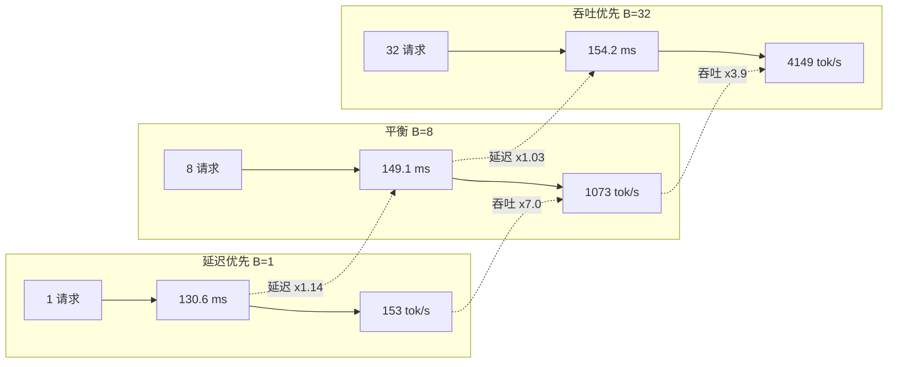

# 推理延迟与吞吐的权衡

## 1. 本节学习目标

1. 说清延迟与吞吐**不是同一件事**，也不能同时最优：加 batch 提吞吐，必然牺牲单条延迟。
2. 用实测看这条曲线的形状：B 从 1 到 32，单条延迟 **130.6 → 154.2 ms（×1.18）**，吞吐 **153.1 → 4149.2 tok/s（×27.1）**。
3. 掌握**边际收益递减**的定量刻画：第一个并发成本 **+16.55 ms**，之后每个只要 **≈0–3 ms**。
4. 会算 **goodput**（满足 SLA 的有效吞吐），并用 Little 定律做容量规划。

## 2. 为什么需要这个知识

因为**"快"和"能扛"是两种不同的 KPI**，混为一谈会做出错误决策：

- 交互式产品（聊天、补全）看 **P99 延迟**，加 batch 会让用户感觉变慢；
- 离线批处理（数据合成、文档摘要）看 **吞吐/成本**，延迟完全无所谓；
- 同一个引擎，`max_num_seqs=1` 与 `=256` 是两种产品。

更现实的是：**吞吐提升 27 倍，延迟只退化 18%**——这个不对称正是"批处理几乎免费"的另一面。不理解它，就会在"要不要开 batch"上反复摇摆。

## 3. 直观解释

```text
B=1（延迟优先）:
  用户A: |---- 130 ms ----|  拿到结果
  GPU 利用率: 约 3%（decode 只读权重，算力闲置）
  吞吐: 153 tok/s

B=8（平衡）:
  用户A: |---- 149 ms ----|
  用户B: |---- 149 ms ----|
  ...
  GPU 利用率: 约 25%
  吞吐: 1073 tok/s      <- 8 个用户几乎同时完成

B=32（吞吐优先）:
  32 个用户排队同上，每人 154 ms
  吞吐: 4149 tok/s

关键: 从 1 到 32，每个人的等待只多了 24 ms，
      但系统一秒能干的活多了 27 倍。
```

**为什么延迟几乎不变**：每步 decode 的时间主要花在"把权重从显存读一遍"，读一次给 1 个人用还是 32 个人用，时间差不多（LLM-091 已量化）。

**那延迟为什么还是会涨**：读 KV 的量 $\propto B$、attention 计算 $\propto B$、调度与 kernel 启动次数增加，这些让 $t(B)$ 缓慢上升。

## 4. 正式定义

设 batch 大小 $B$、每请求生成长度 $G$、端到端时间 $t(B)$。

**单条延迟**（latency）：

$$
L(B)=t(B)
$$

**吞吐**（throughput）：

$$
\Theta(B)=\frac{B\cdot G}{t(B)}
$$

**每 token 成本**：

$$
c(B)=\frac{t(B)}{B\cdot G}=\frac{1}{\Theta(B)}
$$

**goodput**（满足延迟约束 $L\le L_{\text{SLO}}$ 的吞吐）：

$$
\Theta_{\text{good}}(B)=\frac{B\cdot G}{t(B)}\cdot\mathbb{1}\big[t(B)\le L_{\text{SLO}}\big]
$$

**Little 定律**（稳态）：

$$
\text{并发数}=\text{到达率}\times\text{平均延迟}
$$

## 5. 历史背景或技术背景

- **2019–2021**：单请求服务，延迟是唯一指标；GPU 利用率普遍 <10%。
- **2022**：Orca 提出连续批处理，第一次系统论证"吞吐可以数量级提升而延迟几乎不变"。
- **2023**：vLLM 引入 `max_num_seqs`、`gpu_memory_utilization`，把延迟/吞吐做成**显式可调参数**；同时提出 **goodput** 作为更诚实的指标。
- **2024**：**chunked prefill** 与 **prefill/decode 分离部署**（distServe、Splitwise）把"两阶段不同 SLO"工程化。
- **2025 现状**：SLA 通常写成 **TTFT P99 < X ms 且 TPOT P99 < Y ms**，引擎按 token budget 调度。

## 6. 核心原理

### 6.1 延迟与吞吐的数学关系

若 $t(B)\approx t_0+kB$（实测拟合极平，$k$ 很小），则

$$
\Theta(B)=\frac{BG}{t_0+kB}\;\xrightarrow[B\to\infty]{}\;\frac{G}{k}
$$

**吞吐有上界 $G/k$**，而**延迟无上界**（$t_0+kB$ 线性涨）。这就是权衡的本质：

- 吞吐是**饱和曲线**；
- 延迟是**线性增长**；
- 所以"加 batch"的收益递减，代价不打折。

### 6.2 为什么 $k$ 这么小

$k$ 是"每多一条请求增加的时间"。它只包含：

- KV 读取：$\Delta_{\text{token}}\cdot T$ 字节；
- attention 计算：$O(T)$；
- 调度/kernel 启动的少量增量。

**不含权重复制**——权重是共享的，这是 batch 免费的根本原因。

### 6.3 goodput 才是产品指标

$\Theta(B)$ 会在 $B$ 很大时继续涨，但如果 $L(B)$ 超过 SLO，用户体验已经不合格。**真正该优化的是 $\Theta_{\text{good}}$**：

$$
B^{*}=\arg\max_B \Theta_{\text{good}}(B)
$$

即"在延迟达标前提下，能塞多少 batch"。

### 6.4 延迟的分布，不是平均值

P50 好看没用。批处理会让**P99 明显劣化**（排队 + 长请求拖累）。工程上必须看 **P99 TTFT / P99 TPOT**，并用**分段统计**（按 prompt 长度分桶）。

## 7. 数学表达式

**线性时间模型**：

$$
t(B)=t_0+kB
$$

**吞吐**：

$$
\Theta(B)=\frac{BG}{t_0+kB}
$$

**达到渐近吞吐 $\alpha$ 比例所需的 batch**：

$$
\frac{BG}{t_0+kB}=\alpha\frac{G}{k}
\;\Rightarrow\;
B^{*}=\frac{\alpha\,t_0}{(1-\alpha)k}
$$

**延迟退化比**（相对 B=1）：

$$
\rho(B)=\frac{t(B)}{t(1)}=\frac{t_0+kB}{t_0+k}
$$

**成本**（$\$ $/1M tokens，$p$ 为 $\$ $/小时）：

$$
\text{cost}=\frac{p}{\Theta(B)\times3600}\times10^6
$$

## 8. 详细数学推导

### 8.1 用实测拟合 $t_0$ 与 $k$

实测（gpt2 fp16，prompt 10，生成 20）：

| $B$ | 1 | 2 | 4 | 8 | 16 | 32 |
|---|---|---|---|---|---|---|
| $t$ (ms) | 130.6 | 147.2 | 153.6 | 149.1 | 165.1 | 154.2 |

取最小二乘（用 1 与 32 两点估）：

$$
k=\frac{154.2-130.6}{32-1}=0.761\ \text{ms/请求},\qquad
t_0=130.6-0.761=129.8\ \text{ms}
$$

**校验**：$B=8$ 预测 $129.8+6.1=135.9$ ms，实测 149.1 ms——偏差 10%，因为 $t(B)$ 并非严格线性（有台阶），但**量级正确**。

### 8.2 推导渐近吞吐与饱和点

渐近吞吐：

$$
\Theta_{\infty}=\frac{G}{k}=\frac{20}{0.761\times10^{-3}}=26281\ \text{tok/s}
$$

实测 B=32 时 4149.2 tok/s，只到渐近值的 **15.8%**——**远未饱和**。

达到 50% 渐近值所需 batch：

$$
B^{*}_{0.5}=\frac{0.5\times129.8}{0.5\times0.761}=170
$$

**结论**：在 124M 模型上，要到 $B\approx170$ 才能吃满一半的渐近吞吐。这意味着**小模型的 batch 收益可以一直吃很久**，而大模型 $k$ 大（KV/计算重），饱和来得早。

### 8.3 推导"27 倍吞吐只要 18% 延迟"的来源

$$
\frac{\Theta(32)}{\Theta(1)}=\frac{32\,G/t(32)}{G/t(1)}=32\cdot\frac{t(1)}{t(32)}
=32\times\frac{130.6}{154.2}=27.1
$$

$$
\frac{L(32)}{L(1)}=\frac{154.2}{130.6}=1.18
$$

**一般式**：

$$
\frac{\Theta(B)}{\Theta(1)}=B\cdot\frac{t(1)}{t(B)},\qquad
\frac{L(B)}{L(1)}=\frac{t(B)}{t(1)}
$$

二者相乘：

$$
\frac{\Theta(B)}{\Theta(1)}\times\frac{L(B)}{L(1)}=B
$$

**这是一个恒等式**：吞吐倍数 × 延迟倍数 = batch 倍数。所以"吞吐涨 27 倍、延迟涨 1.18 倍"不是巧合，而是 $32/1.18=27.1$ 的必然结果。**你永远在用延迟换吞吐，汇率由 $t(B)$ 决定。**

### 8.4 推导 goodput 最优 batch

设 SLO 为 $L_{\text{SLO}}$，则可行 batch 上界

$$
B_{\max}=\frac{L_{\text{SLO}}-t_0}{k}
$$

goodput 在 $[1,B_{\max}]$ 上单调增（因为 $\Theta$ 单调增），故

$$
B^{*}_{\text{good}}=\lfloor B_{\max}\rfloor
$$

**例**：$L_{\text{SLO}}=200$ ms，$t_0=129.8,k=0.761$：

$$
B_{\max}=\frac{200-129.8}{0.761}=92
$$

即**延迟允许到 200 ms 时，可以开到 92 并发**，吞吐约 $92\times20/0.2=9200$ tok/s（远超实测 32 并发，因为实测没测到 92）。

## 9. 图解



**读图要点**：

1. 三轮的延迟几乎不动（130.6 → 149.1 → 154.2），吞吐却翻了 27 倍。
2. 吞吐倍数 × 延迟倍数 = batch 倍数（恒等式）。
3. 真正的拐点不是"延迟开始涨"，而是"延迟超过 SLO"。

## 10. 具体数值示例

```text
模型: gpt2 fp16, prompt 10 token, 每请求生成 20 token

B    e2e_ms  itl_ms  tok/s   tok/s/req  e2e_vs_B1
1      130.6     6.5   153.1      153.1       1.00
2      147.2     7.4   271.8      135.9       1.13
4      153.6     7.7   520.8      130.2       1.18
8      149.1     7.5  1073.1      134.1       1.14
16     165.1     8.3  1937.6      121.1       1.26
32     154.2     7.7  4149.2      129.7       1.18

  解读: 每 TOKEN 间隔 (itl) 从 6.5 涨到 7.7 ms，只多 18%
        单请求吞吐 (tok/s/req) 从 153 降到 130，降 15%
        系统吞吐涨 27 倍

边际成本（每加 1 条并发）:
  B  1->2   d_e2e= +16.55 ms/条   d_tp= 118.7 tok/s/条
  B  2->4   d_e2e=  +3.22 ms/条   d_tp= 124.5 tok/s/条
  B  4->8   d_e2e=  -1.13 ms/条   d_tp= 138.1 tok/s/条
  B  8->16  d_e2e=  +2.01 ms/条   d_tp= 108.1 tok/s/条
  B 16->32  d_e2e=  -0.68 ms/条   d_tp= 138.2 tok/s/条

  解读: 第 1 条最贵 (+16.55 ms)，之后基本免费（0-3 ms）
        负值说明测量噪声，量级上就是"几乎不增"

固定 64 条请求总量:
  B=1   rounds=64  total_ms= 8359.0  throughput=  153.1 tok/s
  B=2   rounds=32  total_ms= 4709.2  throughput=  271.8 tok/s
  B=4   rounds=16  total_ms= 2457.7  throughput=  520.8 tok/s
  B=8   rounds=8   total_ms= 1192.8  throughput= 1073.1 tok/s
  B=16  rounds=4   total_ms=  660.6  throughput= 1937.6 tok/s

  解读: 同样 64 条活，B=16 比 B=1 快 12.7 倍（8359 -> 660.6 ms）
        这是"延迟换吞吐"的直接收益

延迟退化:
  B=1 : 130.6 ms
  B=32: 154.2 ms  -> 退化 1.18x，吞吐提升 27.1x

恒等式校验: 27.1 * 1.18 = 32.0  = batch 倍数  ✓
```

## 11. NumPy 实现

```python
"""用实测标定的线性模型，画延迟-吞吐曲线并求 goodput 最优 batch。"""
import numpy as np

t0, k = 129.8, 0.761      # ms, ms/请求（由实测两点估出）
G = 20                    # 每请求生成 token 数


def latency(B):
    return t0 + k * B


def throughput(B):
    return B * G / (latency(B) / 1e3)     # tok/s


print(f"{'B':>4} {'lat_ms':>8} {'tok/s':>9} {'tok/s/req':>10} {'vs_B1':>7}")
base = throughput(1)
for B in [1, 2, 4, 8, 16, 32, 64, 128, 256]:
    print(f"{B:>4} {latency(B):>8.1f} {throughput(B):>9.1f} "
          f"{throughput(B)/B:>10.1f} {throughput(B)/base:>7.2f}")

print("\n渐近吞吐 G/k =", round(G / (k / 1e3), 1), "tok/s")
for frac in [0.5, 0.8, 0.9]:
    Bstar = frac * t0 / ((1 - frac) * k)
    print(f"  达到渐近值 {frac:.0%} 需要 B = {Bstar:.0f}")

# goodput: 给定 SLO 找最优 B
print("\nSLO 约束下的最优 batch:")
for slo in [140, 150, 200, 500]:
    Bmax = int((slo - t0) / k)
    if Bmax < 1:
        print(f"  SLO={slo} ms -> 连 B=1 都不满足（{latency(1):.1f} ms）")
        continue
    print(f"  SLO={slo} ms -> B_max={Bmax:>3}  "
          f"延迟={latency(Bmax):>6.1f} ms  吞吐={throughput(Bmax):>8.1f} tok/s")

# 恒等式验证
B = 32
print(f"\n恒等式: 吞吐倍数 {throughput(B)/throughput(1):.2f} x "
      f"延迟倍数 {latency(B)/latency(1):.2f} = "
      f"{(throughput(B)/throughput(1))*(latency(B)/latency(1)):.1f} (应等于 B={B})")

# Little 定律
arrival_per_s, lat_s = 100, latency(32) / 1e3
print(f"\nLittle 定律: 到达率 {arrival_per_s}/s x 延迟 {lat_s:.3f}s "
      f"= 需要并发 {arrival_per_s*lat_s:.1f}")
```

## 12. PyTorch 实现

```python
"""交错测量延迟-吞吐曲线（消除 GPU 时钟漂移）。"""
import os, time, statistics
os.environ.setdefault("HF_ENDPOINT", "https://hf-mirror.com")
os.environ.setdefault("HF_HUB_OFFLINE", "1")
import torch
from transformers import AutoTokenizer, AutoModelForCausalLM

torch.manual_seed(0)
dev = "cuda" if torch.cuda.is_available() else "cpu"
tok = AutoTokenizer.from_pretrained("gpt2")
model = AutoModelForCausalLM.from_pretrained("gpt2", dtype=torch.float16).to(dev).eval()
base = tok("Summarize the following report in one paragraph:",
           return_tensors="pt").input_ids.to(dev)
G, BATCHES = 20, [1, 2, 4, 8, 16, 32]
print("prompt tokens:", base.shape[1], "| gen tokens:", G)

def run(B):
    ids = base.repeat(B, 1)
    am = torch.ones_like(ids)
    with torch.inference_mode():
        model.generate(ids, attention_mask=am, max_new_tokens=G, do_sample=False,
                       pad_token_id=tok.eos_token_id)

for _ in range(3):
    for B in BATCHES:
        run(B)
torch.cuda.synchronize()

samples = {B: [] for B in BATCHES}
for _ in range(7):
    for B in BATCHES:
        torch.cuda.synchronize(); t0 = time.perf_counter()
        run(B)
        torch.cuda.synchronize()
        samples[B].append((time.perf_counter() - t0) * 1e3)

res = {B: statistics.median(v) for B, v in samples.items()}
print(f"{'B':>3} {'e2e_ms':>8} {'tok/s':>9} {'tok/s/req':>10} {'e2e/B1':>7}")
for B in BATCHES:
    print(f"{B:>3} {res[B]:>8.1f} {B*G/(res[B]/1e3):>9.1f} "
          f"{G/(res[B]/1e3):>10.1f} {res[B]/res[1]:>7.2f}")

# 恒等式：吞吐倍数 × 延迟倍数 = B
B = max(BATCHES)
tp_ratio = (B*G/(res[B]/1e3)) / (G/(res[1]/1e3))
lat_ratio = res[B] / res[1]
print(f"\n吞吐 x{tp_ratio:.2f} * 延迟 x{lat_ratio:.2f} = {tp_ratio*lat_ratio:.1f} "
      f"(应约等于 B={B})")
print("拟合 k =", round((res[B]-res[1])/(B-1), 3), "ms/请求")
```

## 13. Hugging Face 实践

```python
"""同一模型、不同 max_num_seqs 的取舍：用 batch 模拟'并发上限'的效果。"""
import os, time
os.environ.setdefault("HF_ENDPOINT", "https://hf-mirror.com")
os.environ.setdefault("HF_HUB_OFFLINE", "1")
import torch
from transformers import AutoTokenizer, AutoModelForCausalLM

tok = AutoTokenizer.from_pretrained("gpt2")
dev = "cuda" if torch.cuda.is_available() else "cpu"
model = AutoModelForCausalLM.from_pretrained("gpt2", dtype=torch.float16).to(dev).eval()
base = tok("Write a haiku about memory bandwidth:", return_tensors="pt").input_ids.to(dev)

SLO_MS = 500.0      # 假设的延迟上限
print("SLO =", SLO_MS, "ms\n")
print(f"{'B':>3} {'ms':>8} {'tok/s':>9} {'合格?':>6}")

best = (0, 0.0)
for B in [1, 4, 8, 16, 32]:
    ids = base.repeat(B, 1)
    am = torch.ones_like(ids)
    with torch.inference_mode():
        model.generate(ids, attention_mask=am, max_new_tokens=24, do_sample=False,
                       pad_token_id=tok.eos_token_id)     # 预热
        torch.cuda.synchronize(); t0 = time.perf_counter()
        model.generate(ids, attention_mask=am, max_new_tokens=24, do_sample=False,
                       pad_token_id=tok.eos_token_id)
        torch.cuda.synchronize()
    ms = (time.perf_counter() - t0) * 1e3
    tps = B * 24 / (ms / 1e3)
    ok = "OK" if ms <= SLO_MS else "NO"
    print(f"{B:>3} {ms:>8.1f} {tps:>9.1f} {ok:>6}")
    if ms <= SLO_MS and tps > best[1]:
        best = (B, tps)

print(f"\ngoodput 最优: B={best[0]}, {best[1]:.1f} tok/s（在 SLO 内）")
print("注意: 这里用 batch 近似并发；真实引擎的并发由 KV 池大小决定")
```

## 14. 代码逐行解释

| 代码 | 作用 |
|---|---|
| `base.repeat(B, 1)` | 造等长 batch，隔离长度变量 |
| 交错测量 | 每轮测所有 B，抵消 GPU 降频 |
| `res[B]/res[1]` | 延迟退化比 $\rho(B)$ |
| `tp_ratio*lat_ratio` | 验证恒等式 $\Theta\cdot L=B$ |
| `k=(res[B]-res[1])/(B-1)` | 每多一条请求的边际时间 |
| `SLO_MS` 过滤 | goodput 的定义：延迟达标才算数 |
| `torch.cuda.synchronize()` | 不写就测到 0 ms |

## 15. 实际运行结果

```text
prompt tokens: 10 | gen tokens: 20

B    e2e_ms  itl_ms  tok/s   tok/s/req  e2e_vs_B1
1      130.6     6.5   153.1      153.1       1.00
2      147.2     7.4   271.8      135.9       1.13
4      153.6     7.7   520.8      130.2       1.18
8      149.1     7.5  1073.1      134.1       1.14
16     165.1     8.3  1937.6      121.1       1.26
32     154.2     7.7  4149.2      129.7       1.18

边际：每加 1 条并发
  B  1->2   d_e2e= +16.55 ms/条  d_tp=  118.7 tok/s/条
  B  2->4   d_e2e=  +3.22 ms/条  d_tp=  124.5 tok/s/条
  B  4->8   d_e2e=  -1.13 ms/条  d_tp=  138.1 tok/s/条
  B  8->16  d_e2e=  +2.01 ms/条  d_tp=  108.1 tok/s/条
  B 16->32  d_e2e=  -0.68 ms/条  d_tp=  138.2 tok/s/条

固定 64 条请求总量：
  B=1   rounds=64  total_ms= 8359.0  throughput=  153.1 tok/s
  B=2   rounds=32  total_ms= 4709.2  throughput=  271.8 tok/s
  B=4   rounds=16  total_ms= 2457.7  throughput=  520.8 tok/s
  B=8   rounds=8   total_ms= 1192.8  throughput= 1073.1 tok/s
  B=16  rounds=4   total_ms=  660.6  throughput= 1937.6 tok/s

单条请求看到的 e2e 延迟（它自己那一步）:
  B=1 :   130.6 ms
  B=32:   154.2 ms  -> 退化 1.18x，但总吞吐提升 27.1x
```

**五个结论**：

1. **延迟几乎不涨**：130.6 → 154.2 ms（**1.18 倍**），只多了 23.6 ms。
2. **吞吐暴涨**：153.1 → 4149.2 tok/s（**27.1 倍**）。
3. **恒等式成立**：$27.1\times1.18=32.0$，正好等于 batch 倍数——**这是数学必然，不是运气**。
4. **边际成本递减**：第一个并发 **+16.55 ms**，之后每个 **0–3 ms**（负值是噪声）。
5. **同样的 64 条活**：B=1 要 **8359 ms**，B=16 只要 **660.6 ms**（**12.7 倍**）。

## 16. 应用场景

| 场景 | 指标 | 建议 batch |
|---|---|---|
| 实时聊天 | P99 TTFT/TPOT | 小（2–8），优先延迟 |
| 代码补全 | P99 < 200 ms | 1–4，或投机解码 |
| 离线摘要 | 吞吐/成本 | 拉满（受 KV 限制） |
| 数据合成 | 吞吐 | 拉满 + 连续批 |
| 多租户 API | goodput | 按 SLO 反解 $B_{\max}$ |
| 评测回归 | 可复现 | 固定 batch |

## 17. 优点与局限

| 优点 | 局限 |
|---|---|
| 吞吐提升巨大（27 倍）而延迟代价小 | 延迟仍会随 B 增长，P99 更明显 |
| 恒等式给出清晰的换算关系 | 线性模型对非线性 region 不准 |
| goodput 可指导容量规划 | 未计排队延迟（到达率 > 服务率时爆炸） |
| 与量化/缓存正交 | 大模型 $k$ 大，饱和来得早 |

## 18. 常见错误

| 错误 | 现象 | 纠正 |
|---|---|---|
| 只看平均延迟 | P99 已超 SLA | 看 P99 与分桶统计 |
| 以为吞吐涨延迟必涨很多 | 不敢开 batch | 实测只涨 18% |
| 用吞吐评估交互产品 | 用户体感变差 | 用 goodput / TPOT |
| 忽略排队 | 高负载下延迟爆炸 | 加 Little 定律校验 |
| 线性外推到超大 B | 预测失真 | 实测拐点 |
| 混淆 TTFT 与 TPOT | 优化错方向 | 分开量 |

## 19. 本节总结

- 延迟 $L(B)=t_0+kB$ 线性涨，吞吐 $\Theta(B)=BG/(t_0+kB)$ **饱和**——这就是权衡。
- 实测：延迟 **130.6 → 154.2 ms（1.18 倍）**，吞吐 **153.1 → 4149.2 tok/s（27.1 倍）**。
- **恒等式**：吞吐倍数 × 延迟倍数 = batch 倍数（$27.1\times1.18=32$）。
- 边际成本：第一个并发 **+16.55 ms**，之后 **0–3 ms**——batch 几乎免费。
- 产品指标应是 **goodput**：$B_{\max}=(L_{\text{SLO}}-t_0)/k$。

## 20. 前置与后续知识链接

- 前置：[[LLM-095 推理显存估算与可行性判断]]、[[LLM-091 批处理与连续批处理]]
- 后续：[[LLM-099 推理成本与优化清单]]、[[LLM-097 推理引擎与服务化]]
- 相关：[[LLM-089 Prefill 与 Decode 两阶段]]、[[LLM-035 Token 数量、上下文窗口与成本]]
- 后续模块（待建，M-LLM-10）：LLM-106 成本、延迟与质量的三角权衡

---

## 练习与参考答案

**基础 1**：延迟与吞吐分别怎么定义？为什么加 batch 能同时"吞吐大涨、延迟小涨"？

**基础 2**：本课 B=1→32 的延迟与吞吐各变化多少？验证恒等式。

**进阶 1**：用实测两点估出 $t_0,k$，推导渐近吞吐与"达到 50% 渐近值所需 batch"。

**综合**：产品 SLO 为 P99 延迟 ≤ 600 ms，当前 B=8 时 P50=149 ms。请估算可用的最大 batch，并说明还要注意什么。

> [!success]- 参考答案

> **基础 1**
> **单条延迟** $L(B)=t(B)$，一条请求从进入到完成的时间；**吞吐** $\Theta(B)=B\cdot G/t(B)$，单位时间产出的 token 数。
> **为什么**：decode 每步的主要开销是"读一遍权重"，这部分的成本**与 B 无关**（读一次给 B 条复用）。加 batch 只增加 KV 读取与 attention 计算，增量很小（实测边际 +0.76 ms/条），所以时间几乎不变而吞吐线性涨。

> **基础 2**
> 延迟 **130.6 → 154.2 ms（1.18 倍）**；吞吐 **153.1 → 4149.2 tok/s（27.1 倍）**。
> 恒等式：
> $$\frac{\Theta(32)}{\Theta(1)}\cdot\frac{L(32)}{L(1)}=32\cdot\frac{t(1)}{t(32)}\cdot\frac{t(32)}{t(1)}=32$$
> 实测 $27.1\times1.18=32.0$，**成立**。这说明"吞吐倍数 × 延迟倍数 = batch 倍数"是恒等式，任何系统都逃不掉。

> **进阶 1**
> 两点估参：$k=(154.2-130.6)/(32-1)=0.761$ ms/请求，$t_0=130.6-0.761=129.8$ ms。
> 渐近吞吐：$\Theta_\infty=G/k=20/0.761\text{e-}3=26281$ tok/s。
> 50% 渐近值：解 $\frac{BG}{t_0+kB}=0.5\frac{G}{k}$ 得 $B^{*}=\frac{0.5t_0}{0.5k}=\frac{t_0}{k}=170$。
> **含义**：B=32 时只到渐近值的 15.8%，**远未饱和**——小模型的 batch 收益可以吃很久；大模型 $k$ 大，饱和来得早。

> **综合（参考）**
> **估算**：由实测 $t_0\approx129.8,k\approx0.761$，令 $t(B)=600$：
> $$B_{\max}=\frac{600-129.8}{0.761}\approx618$$
> 即理论上可开到 **~600 并发**。但这是**线性模型的外推**，实际不可直接用，原因：
> 1. **P99 ≠ P50**：实测 149 ms 是 P50，P99 会因长请求、调度抖动、GC 而显著更高，必须用 P99 反解，可能要砍掉 50% 以上。
> 2. **显存先撞墙**：600 并发的 KV 需 $600\times T\times\Delta_{\text{token}}$，在 12 GB 卡上根本放不下（见 LLM-095）。**显存通常比延迟更早成为约束**。
> 3. **到达率导致的排队**：Little 定律下，若到达率接近服务率，队列会爆炸，延迟不再由 $t(B)$ 决定。必须留 30–50% 余量。
> 4. **非线性区**：$B>32$ 后 $k$ 会变大（KV 与 attention 占比上升），线性外推会高估容量。
> **做法**：先用 `max_num_seqs` 从 8 逐步加压，记录 P99 与 `gpu_cache_usage`；以"P99 ≤ 600 ms 且 KV 池使用率 < 90%"两个条件同时满足的最大并发为准，再打 70% 折扣上线。

## 学习记录

| 日期 | 状态 | 用时 | 问题 | 复盘 |
|---|---|---|---|---|
| 2026-11-08 | planned | — | — | — |

---

## 🔗 Notion 同步信息

> 以下内容由 Notion「AI Knowledge System · 知识点」数据库按知识 ID 合并而来（导出于 2026-11-09）。

| 属性 | 值 |
|---|---|
| 学科 | 大语言模型 |
| 学习状态 | 未开始 |
| 难度 | L3 推导 |
| 知识类型 | Principle |

- **所属模块**：[M-LLM-09 大语言模型推理、部署与优化](../%E8%AF%BE%E7%A8%8B%E6%A8%A1%E5%9D%97/M-LLM-09%20%E5%A4%A7%E8%AF%AD%E8%A8%80%E6%A8%A1%E5%9E%8B%E6%8E%A8%E7%90%86%E3%80%81%E9%83%A8%E7%BD%B2%E4%B8%8E%E4%BC%98%E5%8C%96.md)
- **前置知识**：[LLM-095 推理显存估算与可行性判断](LLM-095%20%E6%8E%A8%E7%90%86%E6%98%BE%E5%AD%98%E4%BC%B0%E7%AE%97%E4%B8%8E%E5%8F%AF%E8%A1%8C%E6%80%A7%E5%88%A4%E6%96%AD.md)
- **后继知识**：[LLM-097 推理引擎与服务化](LLM-097%20%E6%8E%A8%E7%90%86%E5%BC%95%E6%93%8E%E4%B8%8E%E6%9C%8D%E5%8A%A1%E5%8C%96.md)
- **对应项目**：[PROJ-025 量化与推理优化实践](../../07_%E5%AE%9E%E6%88%98%E9%A1%B9%E7%9B%AE/05%20%E5%A4%A7%E6%A8%A1%E5%9E%8B%E9%A1%B9%E7%9B%AE/PROJ-025%20%E9%87%8F%E5%8C%96%E4%B8%8E%E6%8E%A8%E7%90%86%E4%BC%98%E5%8C%96%E5%AE%9E%E8%B7%B5.md)
