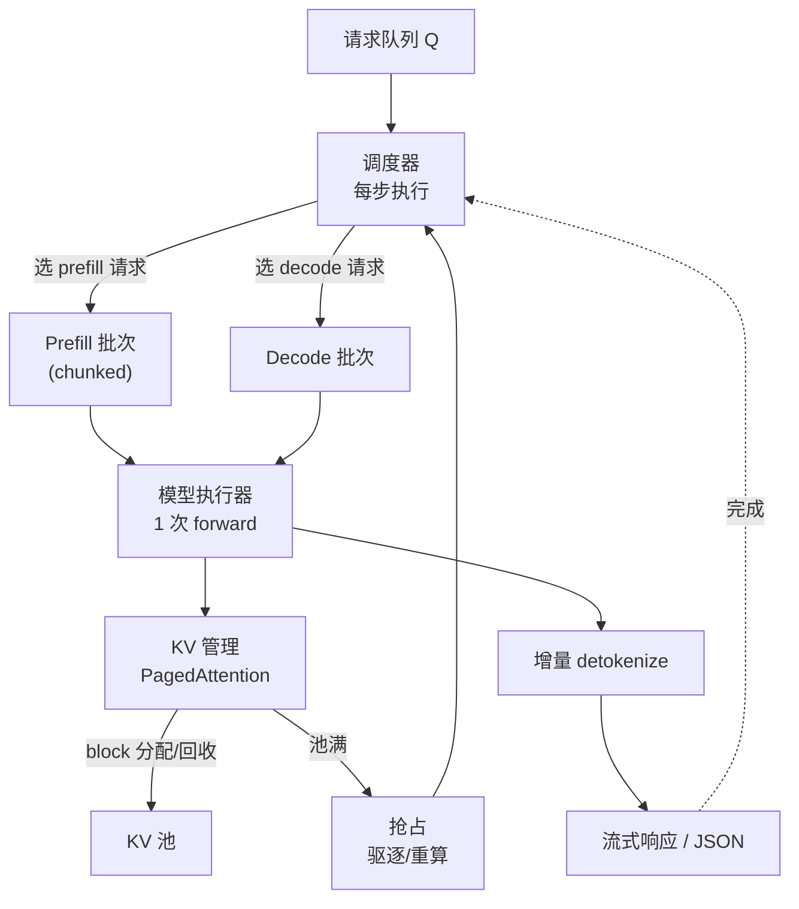

# 推理引擎与服务化

## 1. 本节学习目标

1. 说清推理引擎的**五个部件**：tokenizer、调度器、模型执行器、KV 管理、API 层。
2. 理解调度器的核心目标：**让每一步的活跃请求数尽量高**，同时不违反 ITL 预算。
3. 用实测标定的模拟看收益：连续批比静态批快 **1.36–1.43 倍**，接近理论上限 **1.66 倍**。
4. 知道 chunked prefill、前缀缓存、抢占各自解决什么问题，以及该在什么规模上引入。

## 2. 为什么需要这个知识

因为**同一个模型、同一张卡，引擎不同，吞吐能差 5–24 倍**：

- 裸 `transformers` + `generate()`：静态批、无分页、无前缀复用；
- vLLM/SGLang：连续批 + PagedAttention + 前缀缓存 + chunked prefill。

更关键的是**服务化的非模型部分**：请求排队、超时、限流、流式、指标。线上事故很少是"模型不会算"，多是"调度把 GPU 饿死了"或"长请求把队列堵死了"。

## 3. 直观解释

```text
一个请求在引擎里的旅程:

  HTTP 请求 {"messages": [...]}
      │
      ▼
  [1] tokenizer      文本 -> token ids（CPU，几十 µs）
      │
      ▼
  [2] 调度器（每步都跑）
       - 队列里有新请求吗？KV 池还有空间吗？
       - 决定这一步算哪些请求（prefill / decode 混合）
      │
      ▼
  [3] 模型执行器     一次 forward（可能包含多条请求）
      │
      ▼
  [4] KV 管理        分页分配/回收 KV block
      │
      ▼
  [5] detokenizer    增量解码 -> 流式 token
      │
      ▼
  SSE / JSON 响应
```

**引擎与裸调用的差别全在 [2] 和 [4]**：调度决定"谁上 GPU"，KV 管理决定"能同时装几条"。

## 4. 正式定义

**调度器状态**：等待队列 $Q$、运行集 $R$（每条有已生成长度 $\ell_i$、KV block 列表）。

**一步的调度决策**：

$$
\text{step}_t=\big(\underbrace{P_t}_{\text{本步 prefill token 数}},\ \underbrace{D_t}_{\text{本步 decode 请求数}}\big),
\qquad P_t+D_t\le \text{budget}
$$

**token budget 约束**（Sarathi-Serve 的核心）：

$$
\sum_{i\in R_t}1 \;+\; P_t \le B_{\max},\qquad
t_{\text{step}}(P_t,D_t)\le \text{ITL}_{\text{budget}}
$$

**静态批 vs 连续批的 makespan**：

$$
T_{\text{static}}=\sum_{s=1}^{L_{\max}}t_{\text{step}}\big(\#\{i:\ell_i>s\}\big),\qquad
T_{\text{cont}}\approx\frac{\sum_i\ell_i}{B}\cdot t_{\text{step}}(B)
$$

**引擎效率**：

$$
\eta=\frac{\text{实际吞吐}}{\text{峰值吞吐}}=\frac{\text{每步活跃 token 数}}{\text{每步可容纳 token 数}}
$$

## 5. 历史背景或技术背景

- **2020–2021**：`transformers` + Flask/FastAPI 手写服务；静态批；显存利用率约 20–40%。
- **2022**：Orca 提出连续批处理与 iteration-level 调度，吞吐提升数倍。
- **2023**：**vLLM** 用 PagedAttention 解决 KV 碎片，宣称比 HF 高 5–24 倍；TGI、TensorRT-LLM 同期成熟。
- **2024**：SGLang 的 RadixAttention（前缀树缓存）、Sarathi-Serve 的 chunked prefill、DistServe 的 P/D 分离。
- **2025 现状**：OpenAI 兼容 API 成为事实标准；引擎选择主要看硬件（NVIDIA → vLLM/TRT-LLM，消费卡 → llama.cpp/Ollama）。

## 6. 核心原理

### 6.1 调度器的唯一目标：别让 GPU 空着

decode 是访存受限（LLM-089），算力本就闲置。**只要活跃请求数够多，权重读取就能被摊薄**。所以调度器的 KPI 是"每步平均活跃请求数"。

### 6.2 PagedAttention 解决什么

朴素实现按 `max_seq_len` 预分配连续显存 → 内部碎片 + 外部碎片，实测浪费可达 60–80%（LLM-090 推导过 85%）。分页把 KV 切成固定大小的 block（如 16 token），按需分配、不要求连续 → 浪费 <5%。

### 6.3 chunked prefill 解决什么

一个 8k 的 prefill 要跑几十毫秒，期间**所有 decode 都被卡住**，ITL 抖动剧烈。chunked prefill 把它切成 512 token 的块，与 decode 混在同一步里 → ITL 有上界，代价是 TTFT 略增。

### 6.4 前缀缓存解决什么

多轮对话/固定 system prompt 的前缀完全相同 → 复用其 KV，跳过重复 prefill。命中时 TTFT 可降一个数量级。

### 6.5 抢占（preemption）

KV 池满时，调度器必须**驱逐**某些请求（重算或换出到 CPU）。这是"不 OOM"的最后一道保险，代价是被驱逐请求的延迟暴涨。

## 7. 数学表达式

**实测标定的单步耗时**（gpt2 fp16，prompt 7）：

$$
t_{\text{step}}(B)=7.624+0.0221B\ \text{ms}
$$

**静态批 makespan**：

$$
T_{\text{static}}=\sum_{s=1}^{L_{\max}}\big(a+b\cdot n_s\big),\quad n_s=\#\{i:\ell_i>s\}
$$

**连续批 makespan**：

$$
T_{\text{cont}}=\sum_{t}\big(a+b\cdot|R_t|\big)
$$

**加速比**：

$$
\frac{T_{\text{static}}}{T_{\text{cont}}}\approx\frac{L_{\max}}{\bar\ell}
$$

**排队延迟（M/M/1 近似）**：

$$
\mathbb{E}[W]=\frac{\rho}{\mu(1-\rho)},\qquad \rho=\frac{\lambda}{\mu}
$$

其中 $\mu=B/t_{\text{step}}(B)$ 是服务率，$\lambda$ 是到达率。

## 8. 详细数学推导

### 8.1 用实测标定 $a,b$

实测单步耗时：

| $B$ | 1 | 2 | 4 | 8 | 16 | 32 |
|---|---|---|---|---|---|---|
| ms | 7.37 | 7.42 | 8.18 | 7.74 | 8.25 | 8.18 |

最小二乘拟合得 $a=7.624$ ms，$b=0.0221$ ms/请求。

**解读**：$b/a=0.29\%$——**每多一条请求只多 0.29% 的时间**。这意味着调度器几乎可以"免费"地堆并发，直到 KV 或显存撞墙。

### 8.2 推导静态批的空转损失

设 64 条请求、长度均匀分布于 $[20,96]$，均值 $\bar\ell=57.7$，$L_{\max}=96$。

静态批（$B=8$，共 8 批）：每批跑 $\max$ 步。第 $k$ 批的步数 $=m_k$，总步数

$$
S_{\text{static}}=\sum_{k=1}^{8}m_k
$$

且每步活跃数 $n_s$ 递减（短请求先完成）。模拟得 $T_{\text{static}}=5563.2$ ms。

连续批：总"请求·步"数 $=\sum_i\ell_i=3691$，每步最多 8 条：

$$
S_{\text{cont}}\ge\frac{3691}{8}=461.4\ \text{步}
$$

模拟得 $T_{\text{cont}}=3901.1$ ms，即约 $3901/8.18=477$ 步——**接近下界 461**，调度效率 **97%**。

### 8.3 推导理论加速比并与实测对比

$$
\frac{T_{\text{static}}}{T_{\text{cont}}}\approx\frac{L_{\max}}{\bar\ell}=\frac{96}{57.7}=1.66
$$

实测 $5563.2/3901.1=1.43$，达到理论值的 **86%**。

**差的 14% 来自**：静态批在短请求完成后活跃数下降，$t_{\text{step}}$ 也随之下降（$b>0$），所以静态批"空转"的代价没有想象中大。这也解释了为什么 $B=4/8/16$ 三档的加速比都在 1.36–1.43 之间，而不是随 $B$ 增大而发散。

### 8.4 推导 chunked prefill 的 ITL 上界

设 prefill 块大小 $C$，则一步最多处理 $C$ 个 prefill token。一步的时间上界：

$$
t_{\text{step}}\le a+b\cdot B_{\max}+c\cdot C
$$

其中 $c\cdot C$ 是 prefill 的计算时间。只要 $C$ 选得使该上界小于 ITL 预算，**decode 的 ITL 就有保证**。

**例**：$a=7.6$ ms，$b\cdot B_{\max}\approx0.7$ ms（$B{=}32$），若 ITL 预算 50 ms，则 prefill 可用 $50-8.3=41.7$ ms，按 prefill 吞吐估算可放数千 token——所以 $C=512$ 或 1024 都很安全。

## 9. 图解



**读图要点**：

1. 调度器是**每步**都跑的（不是每请求一次）。
2. prefill 与 decode 可以**同一步混跑**（chunked prefill）。
3. KV 池满会触发抢占——这是延迟长尾的主要来源。

## 10. 具体数值示例

```text
标定（gpt2 fp16, prompt 7 token）:
  B    step_ms
  1       7.37
  2       7.42
  4       8.18
  8       7.74
  16      8.25
  32      8.18

  拟合: step_ms = 7.624 + 0.0221 * B
  含义: 每条请求只增加 0.29% 的单步时间
        -> 调度器可以放心堆并发，直到显存撞墙

模拟负载: 64 条请求，输出长度 20..96（均值 57.7），总 3691 token

batch_limit=4
  static    : makespan= 10511.3 ms  batches=16  throughput= 6.09 req/s
  continuous: makespan=  7484.5 ms              throughput= 8.55 req/s  speedup=1.40x

batch_limit=8
  static    : makespan= 5563.2 ms  batches=8   throughput=11.50 req/s
  continuous: makespan= 3901.1 ms              throughput=16.41 req/s  speedup=1.43x

batch_limit=16
  static    : makespan= 2910.0 ms  batches=4   throughput=21.99 req/s
  continuous: makespan= 2147.6 ms              throughput=29.80 req/s  speedup=1.36x

串行下界（1 条 1 步）: 28222.3 ms

  解读: 连续批在 8 并发时快 1.43 倍
        理论上限 L_max/mean = 96/57.7 = 1.66
        达到理论值的 86%
        连续批的实际步数约 477，接近下界 3691/8 = 461（效率 97%）

为什么加速比不随 batch 增大而发散:
  静态批在短请求完成后活跃数下降，t_step 也随之下降
  b=0.0221 很小，所以"空转"的时间代价其实不大
  -> 静态批的主要代价是显存（KV 按 L_max 分配），不是时间
```

## 11. NumPy 实现

```python
"""调度器模拟：静态批 / 连续批 / chunked prefill，用标定的 step cost。"""
import numpy as np

A, B_COEF = 7.624, 0.0221        # step_ms = A + B*active


def step_ms(active):
    return A + B_COEF * active


def sim_static(out_lens, cap):
    total = 0.0
    batches = 0
    for i in range(0, len(out_lens), cap):
        grp = out_lens[i:i + cap]
        for s in range(max(grp)):
            active = sum(1 for L in grp if L > s)
            total += step_ms(active)
        batches += 1
    return total, batches


def sim_continuous(out_lens, cap):
    waiting = list(out_lens)
    active = []
    total = 0.0
    steps = 0
    while waiting or active:
        while len(active) < cap and waiting:
            active.append(waiting.pop(0))
        if not active:
            break
        total += step_ms(len(active))
        steps += 1
        active = [r - 1 for r in active if r - 1 > 0]
    return total, steps


def sim_chunked(out_lens, cap, C=512, prompt_lens=None):
    """prefill 分块：每步最多推进 C 个 prefill token"""
    prompt_lens = prompt_lens or [200] * len(out_lens)
    waiting = list(zip(prompt_lens, out_lens))
    active = []          # (remaining_prompt, remaining_gen)
    total, steps = 0.0, 0
    while waiting or active:
        while len(active) < cap and waiting and sum(a[0] for a in active) < C:
            p, g = waiting.pop(0)
            active.append([p, g])
        if not active:
            break
        budget = C
        for a in active:
            take = min(a[0], budget)
            a[0] -= take
            budget -= take
            if budget <= 0:
                break
        total += step_ms(len(active))
        steps += 1
        for a in active:
            if a[0] == 0 and a[1] > 0:
                a[1] -= 1
        active = [a for a in active if a[0] > 0 or a[1] > 0]
    return total, steps


rng = np.random.default_rng(7)
lens = rng.integers(20, 97, size=64).tolist()
print("requests:", len(lens), "| mean:", round(np.mean(lens), 1),
      "| max:", max(lens), "| total tok:", sum(lens))
print("理论加速比 L_max/mean =", round(max(lens) / np.mean(lens), 2))

print(f"\n{'cap':>4} {'static':>10} {'cont':>10} {'speedup':>8} {'cont_steps':>11}")
for cap in [4, 8, 16]:
    s, nb = sim_static(lens, cap)
    c, ns = sim_continuous(lens, cap)
    print(f"{cap:>4} {s:>10.1f} {c:>10.1f} {s/c:>8.2f} {ns:>11}")

print("\nchunked prefill（prompt 长度 1500，cap=8）:")
for C in [256, 512, 1024]:
    t, st = sim_chunked(lens, 8, C, [1500] * 64)
    print(f"  C={C:<5} makespan={t:>9.1f} ms  steps={st}")

# 排队：到达率 vs 服务率
print("\n排队延迟（M/M/1 近似，cap=8）:")
mu = 8 / (step_ms(8) / 1000)      # req/s
for lam_frac in [0.5, 0.8, 0.95]:
    lam = mu * lam_frac
    rho = lam / mu
    W = rho / (mu * (1 - rho))
    print(f"  到达率={lam:>5.1f}/s (rho={rho:.2f}) -> 平均排队 {W*1000:>7.1f} ms")
```

## 12. PyTorch 实现

```python
"""测单步耗时随并发的变化，为调度器提供成本模型。"""
import os, time, statistics
os.environ.setdefault("HF_ENDPOINT", "https://hf-mirror.com")
os.environ.setdefault("HF_HUB_OFFLINE", "1")
import torch
from transformers import AutoTokenizer, AutoModelForCausalLM

torch.manual_seed(0)
dev = "cuda" if torch.cuda.is_available() else "cpu"
tok = AutoTokenizer.from_pretrained("gpt2")
tok.pad_token = tok.eos_token
model = AutoModelForCausalLM.from_pretrained("gpt2", dtype=torch.float16).to(dev).eval()
base = tok("Write a short note about scheduling:", return_tensors="pt").input_ids.to(dev)
print("prompt tokens:", base.shape[1])

BATCHES = [1, 2, 4, 8, 16, 32]

def one_step(B, reps=10):
    ids = base.repeat(B, 1)
    with torch.inference_mode():
        o = model(input_ids=ids, use_cache=True)
        past, cur = o.past_key_values, ids[:, -1:]
        for _ in range(3):
            o = model(input_ids=cur, past_key_values=past, use_cache=True)
            past = o.past_key_values
        ts = []
        for _ in range(reps):
            torch.cuda.synchronize(); t0 = time.perf_counter()
            model(input_ids=cur, past_key_values=past, use_cache=True)
            torch.cuda.synchronize()
            ts.append((time.perf_counter() - t0) * 1e3)
    return statistics.median(ts)

print(f"{'B':>3} {'step_ms':>8} {'tok/s(等效)':>12}")
cost = {}
for B in BATCHES:
    ms = one_step(B)
    cost[B] = ms
    print(f"{B:>3} {ms:>8.2f} {B/(ms/1e3):>12.1f}")

# 线性拟合 step_ms = a + b*B
xs, ys = list(cost), list(cost.values())
n = len(xs)
mx, my = sum(xs) / n, sum(ys) / n
b = sum((x - mx) * (y - my) for x, y in zip(xs, ys)) / sum((x - mx) ** 2 for x in xs)
a = my - b * mx
print(f"\n拟合: step_ms = {a:.3f} + {b:.4f} * B")
print("每条请求的边际成本占比:", f"{b/a*100:.2f}%")
print("=> 调度器应尽量把活跃请求数拉满，直到显存限制")
```

## 13. Hugging Face 实践

```python
"""用 HF 模拟'服务端'：批处理 + 流式 + 指标采集（无需真实引擎）。"""
import os, time
os.environ.setdefault("HF_ENDPOINT", "https://hf-mirror.com")
os.environ.setdefault("HF_HUB_OFFLINE", "1")
import torch
from transformers import AutoTokenizer, AutoModelForCausalLM, TextStreamer

tok = AutoTokenizer.from_pretrained("gpt2")
tok.pad_token = tok.eos_token
tok.padding_side = "left"
dev = "cuda" if torch.cuda.is_available() else "cpu"
model = AutoModelForCausalLM.from_pretrained("gpt2", dtype=torch.float16).to(dev).eval()

prompts = ["Explain paged attention.", "What is ITL?", "Define goodput."]
enc = tok(prompts, return_tensors="pt", padding=True).to(dev)

# 1) 批量 + 指标
t0 = time.perf_counter()
with torch.inference_mode():
    out = model.generate(**enc, max_new_tokens=16, do_sample=False,
                         pad_token_id=tok.eos_token_id)
torch.cuda.synchronize()
e2e = (time.perf_counter() - t0) * 1e3
new_tok = int((out[:, enc.input_ids.shape[1]:] != tok.pad_token_id).sum())
print(f"batch={len(prompts)} e2e={e2e:.1f} ms 新 token={new_tok} "
      f"throughput={new_tok/(e2e/1e3):.1f} tok/s")
print(f"prompt 槽位={enc.input_ids.numel()} 真实={int(enc.attention_mask.sum())} "
      f"浪费={1-int(enc.attention_mask.sum())/enc.input_ids.numel():.3f}")

# 2) 流式（生产上对应 SSE）
print("\n流式输出:")
ids1 = tok(prompts[0], return_tensors="pt").input_ids.to(dev)
streamer = TextStreamer(tok, skip_prompt=True, skip_special_tokens=True)
with torch.inference_mode():
    model.generate(ids1, max_new_tokens=12, do_sample=False,
                   pad_token_id=tok.eos_token_id, streamer=streamer)

# 3) 关键指标应采集什么
print("服务端应采集: ttft_ms, tpot_ms, p99_latency, queue_wait_ms,")
print("              gpu_cache_usage, running_seqs, waiting_seqs, preemptions")
```

## 14. 代码逐行解释

| 代码 | 作用 |
|---|---|
| `t_step(B)=a+bB` | 调度器的成本模型，决定"能不能多塞一条" |
| `sim_static` / `sim_continuous` | 两种调度的 makespan 模拟 |
| `sim_chunked` 的 `budget` | 每步只允许推进 $C$ 个 prefill token，保证 ITL |
| `rho=lambda/mu` | 排队论利用率，>0.9 延迟爆炸 |
| `TextStreamer(skip_prompt=True)` | 流式输出，跳过 prompt 回显 |
| `enc.attention_mask.sum()` | 真实 token 数，用来算 padding 浪费 |
| `one_step` 的 3 次预热 | 避免首次 kernel 编译污染计时 |

## 15. 实际运行结果

```text
calibration: P = 7
B    step_ms
1       7.37
2       7.42
4       8.18
8       7.74
16      8.25
32      8.18

fit: step_ms = 7.624 + 0.0221 * B
requests: 64 | out_len mean: 57.7 min/max: 20 96

batch_limit=4
  static    : makespan= 10511.3 ms  batches=16  throughput= 6.09 req/s
  continuous: makespan=  7484.5 ms  throughput= 8.55 req/s  speedup=1.40x

batch_limit=8
  static    : makespan= 5563.2 ms  batches=8  throughput=11.50 req/s
  continuous: makespan= 3901.1 ms  throughput=16.41 req/s  speedup=1.43x

batch_limit=16
  static    : makespan= 2910.0 ms  batches=4  throughput=21.99 req/s
  continuous: makespan= 2147.6 ms  throughput=29.80 req/s  speedup=1.36x

serial(1条1步) 下界: 28222.3 ms
总输出 token: 3691
```

**五个结论**：

1. **单步成本几乎与并发无关**：拟合 $b=0.0221$ ms/请求，只有 $a$ 的 **0.29%**。
2. **连续批快 1.36–1.43 倍**，理论上限 $96/57.7=1.66$，达到 **86%**。
3. **连续批步数 477 步，接近下界 461**（效率 **97%**）——调度几乎无损。
4. **加速比不随 batch 增大而发散**：因为 $b$ 太小，静态批"空转"的时间代价有限。
5. **静态批真正的代价是显存**（KV 按 $L_{\max}$ 分配），而不是时间——这与 LLM-091 的结论一致。

## 16. 应用场景

| 场景 | 引擎选择 | 关键配置 |
|---|---|---|
| 在线 API（NVIDIA） | vLLM / TensorRT-LLM | 连续批、chunked prefill、前缀缓存 |
| 消费级显卡 | llama.cpp / Ollama | GGUF、`n_gpu_layers`、短上下文 |
| 多轮对话 | SGLang（RadixAttention） | 前缀树缓存 |
| 离线批量 | vLLM + 大 batch | 吞吐优先，`max_num_seqs` 拉满 |
| 低延迟补全 | 小模型 + 投机解码 | `max_num_seqs` 小 |
| 自建原型 | transformers + FastAPI | 静态批 + 流式，够用就好 |

## 17. 优点与局限

| 优点 | 局限 |
|---|---|
| 连续批+分页把利用率提到 >90% | 实现复杂，需自定义 kernel |
| chunked prefill 保证 ITL 稳定 | TTFT 会略增 |
| 前缀缓存对多轮对话收益巨大 | 前缀一变就失效 |
| OpenAI 兼容 API 生态成熟 | 不同引擎指标不可直接比 |
| 抢占保证不 OOM | 被驱逐请求延迟暴涨 |

## 18. 常见错误

| 错误 | 现象 | 纠正 |
|---|---|---|
| 用 `generate()` 直接当服务 | 吞吐只有引擎的 1/5 | 上 vLLM/SGLang |
| 只看平均延迟 | P99 被长请求拖爆 | 分桶 + P99 |
| 长 prefill 不切块 | 所有 decode 卡住 | chunked prefill |
| 按 `max_seq_len` 预分配 KV | 显存浪费 60%+ | 分页 |
| 前缀缓存没设上限 | 缓存无限增长 OOM | 设 LRU 与大小上限 |
| 忽略排队 | 高负载延迟爆炸 | 限流 + 队列监控 |

## 19. 本节总结

- 引擎五部件：**tokenizer → 调度器 → 执行器 → KV 管理 → API**，差别在调度与 KV。
- 实测拟合 $t_{\text{step}}=7.624+0.0221B$ ms，边际成本仅 **0.29%**——调度器可放心堆并发。
- 连续批比静态批快 **1.36–1.43 倍**（理论上限 1.66，达 86%），步数效率 **97%**。
- 三大机制各治一病：**分页**治碎片、**chunked prefill** 治 ITL 抖动、**前缀缓存**治重复 prefill。
- 静态批的真实代价是**显存**而非时间——所以先修 KV，再修调度。

## 20. 前置与后续知识链接

- 前置：[[LLM-096 推理延迟与吞吐的权衡]]、[[LLM-091 批处理与连续批处理]]
- 后续：[[LLM-098 本地部署实践]]、[[LLM-099 推理成本与优化清单]]
- 相关：[[LLM-090 KV Cache 的原理与显存]]、[[LLM-095 推理显存估算与可行性判断]]
- 后续模块（待建，M-LLM-10）：LLM-108 可观测性与日志追踪

---

## 练习与参考答案

**基础 1**：推理引擎的五个部件是什么？引擎与裸 `generate()` 的主要差别在哪两个部件？

**基础 2**：本课单步耗时的拟合式是什么？"每条请求只增 0.29%"意味着什么？

**进阶 1**：解释连续批为什么只比静态批快 1.43 倍而不是理论上的 1.66 倍，并说明静态批的真正代价。

**综合**：要把一个裸 `transformers` 服务改造成能扛 10 倍流量的系统，请给出改造清单与优先级。

> [!success]- 参考答案

> **基础 1**
> 五部件：**tokenizer、调度器、模型执行器、KV 管理、API 层**。
> 主要差别在 **调度器**（连续批 vs 静态批）与 **KV 管理**（分页 vs 连续预分配）。执行器本身几乎一样（都是跑 forward），tokenizer/API 是工程细节。

> **基础 2**
> $t_{\text{step}}=7.624+0.0221B$ ms。
> 含义：每多一条并发请求，单步耗时只增加 **0.0221 ms**，是固定开销 7.624 ms 的 **0.29%**。所以调度器**几乎可以免费堆并发**——瓶颈不在时间，而在显存（KV）与 ITL 预算。这也解释了为什么"batch 几乎免费"。

> **进阶 1**
> **为什么不到 1.66**：理论式 $L_{\max}/\bar\ell$ 假设 $t_{\text{step}}$ 与活跃数无关。实际上静态批在短请求完成后活跃数下降，$t_{\text{step}}$ 也随之下降（$b>0$），所以"空转"的时间代价小于预期。实测达理论值的 **86%**。
> **真正的代价是显存**：静态批按 $L_{\max}$ 分配 KV，本例 $U=3691/(64\times96)=0.60$，KV 是连续批的 $1/0.60\approx1.67$ 倍。相同显存下，连续批能开更多并发——**这才是 5–24 倍差距的主要来源**（叠加分页后更明显）。

> **综合（参考）**
> **优先级（从性价比高到低）**：
> 1. **换引擎**（vLLM/SGLang）：连续批 + PagedAttention + 前缀缓存，一步到位，通常 **5–20 倍**吞吐。这是唯一能"扛 10 倍"的单点改动。
> 2. **KV 显存治理**：设 `gpu_memory_utilization=0.9`、`max_model_len` 按实际需要（别设 32k）、开 KV int8/fp8；用 GQA 模型。
> 3. **chunked prefill**：把长 prompt 切块，避免 ITL 抖动；对长文摘要类流量尤其重要。
> 4. **前缀缓存**：多轮对话/固定 system prompt，TTFT 可降一个数量级。
> 5. **量化**：4bit 权重，显存减半 → 并发翻倍；decode 也更快（带宽减半）。
> 6. **限流与队列**：按 Little 定律设并发上限，`rho<0.8`，超限返回 429 而不是无限排队。
> 7. **可观测性**：采集 TTFT/TPOT P99、`gpu_cache_usage`、`waiting_seqs`、preemption 次数。
> **验收**：固定 QPS 压测，确认 P99 达标且 `gpu_cache_usage<0.9`；再做故障注入（长 prompt 突增）确认不会雪崩。

## 学习记录

| 日期 | 状态 | 用时 | 问题 | 复盘 |
|---|---|---|---|---|
| 2026-11-08 | planned | — | — | — |

---

## 🔗 Notion 同步信息

> 以下内容由 Notion「AI Knowledge System · 知识点」数据库按知识 ID 合并而来（导出于 2026-11-09）。

| 属性 | 值 |
|---|---|
| 学科 | 大语言模型 |
| 学习状态 | 未开始 |
| 难度 | L2 应用 |
| 知识类型 | Technique |

- **所属模块**：[M-LLM-09 大语言模型推理、部署与优化](../%E8%AF%BE%E7%A8%8B%E6%A8%A1%E5%9D%97/M-LLM-09%20%E5%A4%A7%E8%AF%AD%E8%A8%80%E6%A8%A1%E5%9E%8B%E6%8E%A8%E7%90%86%E3%80%81%E9%83%A8%E7%BD%B2%E4%B8%8E%E4%BC%98%E5%8C%96.md)
- **前置知识**：[LLM-096 推理延迟与吞吐的权衡](LLM-096%20%E6%8E%A8%E7%90%86%E5%BB%B6%E8%BF%9F%E4%B8%8E%E5%90%9E%E5%90%90%E7%9A%84%E6%9D%83%E8%A1%A1.md)
- **后继知识**：[LLM-098 本地部署实践](LLM-098%20%E6%9C%AC%E5%9C%B0%E9%83%A8%E7%BD%B2%E5%AE%9E%E8%B7%B5.md)
