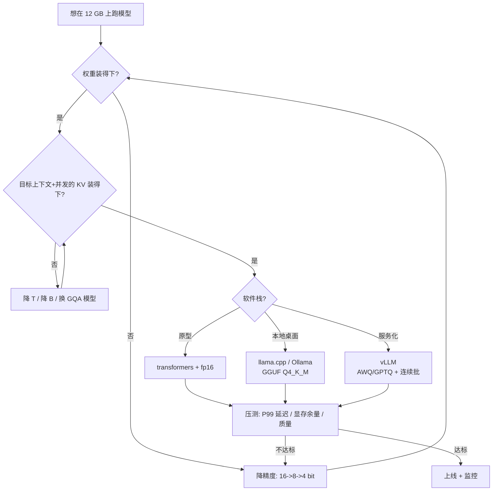

# 本地部署实践

## 1. 本节学习目标

1. 会做"**12 GB 能跑什么**"的判断：给出可直接照抄的判决表（7B fp16 ✗、7B INT4 ✓、13B INT4 ✓、14B GQA INT4 ✓）。
2. 用实测看清本机特性：gpt2 fp32 **149.6 tok/s**、fp16 **144.6 tok/s**——**fp16 在本机没有更快**，但显存减半。
3. 知道**软件栈怎么选**：原型用 transformers，单机用 llama.cpp/Ollama，服务用 vLLM。
4. 掌握上线前的 6 项体检：显存、上下文、并发、延迟、量化质量、回退方案。

## 2. 为什么需要这个知识

因为**"能跑"和"跑得好"之间隔着大量工程细节**：

- 量化格式选错（GPTQ vs GGUF vs AWQ）→ 加载失败或速度腰斩；
- 上下文设太大 → KV 吃光显存，随机 OOM；
- 以为 fp16 一定更快 → 小模型上反而更慢（本机实测就是）；
- 没留显存余量 → 桌面占一点显存就崩。

这一节把前面 10 篇的公式落到**一张 12 GB 卡**上，给出可执行的清单。

## 3. 直观解释

```text
12 GB 卡的"容量阶梯"（权重按 4bit ≈ 0.5 GB/1B 参数估）:

  1–3B   fp16   1.5–6 GB     ← 随便跑，还能开并发
  7B     fp16   14 GB        ← 装不下（权重就超）
  7B     int8   7–7.5 GB     ← 能跑，剩 4 GB 给 KV/上下文
  7B     int4   4 GB         ← 舒服，能开 4–8 并发
  13B    int4   7.5 GB       ← 能跑，上下文 2k 左右
  14B    int4 + GQA          ← 能跑 4k（GQA 省 KV）
  30B+   int4   15 GB+       ← 装不下
```

**记住一句话**：**消费级 12 GB 的甜点是 7B–14B 的 4bit 量化 + GQA**。

## 4. 正式定义

**可用显存**：

$$
M_{\text{avail}}=M_{\text{GPU}}\times0.92-M_{\text{display}}
$$

（有显示器输出时再减 0.3–0.8 GB）

**能否加载**（硬条件）：

$$
P\cdot b_{\text{eff}}+M_{\text{ctx}}(T)\le M_{\text{avail}}
$$

**能否服务**（软条件）：

$$
\text{TPOT}(B)\le \text{SLO},\qquad B\ge B_{\text{target}}
$$

**有效吞吐**：

$$
\Theta_{\text{eff}}=\Theta_{\text{peak}}\times u,\quad u=\text{GPU 利用率}
$$

## 5. 历史背景或技术背景

- **2022**：llama.cpp 让 4bit 量化在 CPU/消费卡上跑通，GGUF 成为本地格式标准。
- **2023**：Ollama 把"下载即用"做成一条命令；LM Studio 提供 GUI；消费级 8–24 GB 卡开始能跑 7B–70B（低速）。
- **2024**：vLLM/SGLang 支持 AWQ/GPTQ/fp8，单卡服务化成熟；`bitsandbytes` 的 NF4 成为 QLoRA 标配。
- **2025 现状**：12 GB 卡（4070 Ti/3060 12G）是"本地 7B–14B"的主流档位；4bit + GQA + 4k 上下文是默认配置。

## 6. 核心原理

### 6.1 权重是硬门槛，KV 是软门槛

- 权重超了 → **加载就失败**，没有商量余地。
- KV 超了 → 短 prompt 能跑，长 prompt 或并发时崩。

所以判断顺序是：**先算权重，再算目标上下文下的 KV，最后留 8–15% 余量**。

### 6.2 本机实测的一个反直觉现象

gpt2 fp32 **149.6 tok/s**，fp16 **144.6 tok/s**——**fp16 更慢**。

原因：124M 模型的 decode 是**启动受限**（LLM-089），每步约 5 ms，其中计算只占几十微秒。fp16 需要额外的 dtype 转换与 kernel 选择，在 batch=1 时**没有收益**。

**结论**：**小模型看延迟别看精度；大模型 fp16 才有明显收益**（计算与带宽都减半）。而无论大小，fp16 **一定省显存**（487.5 → 255.5 MiB）。

### 6.3 上下文越长，KV 越贵（但 decode 不会更慢）

实测 gpt2 fp16 的 decode：T=64 **5.40 ms**、T=256 **4.91 ms**、T=1000 **5.25 ms**——**几乎不变**。

这说明在本机规模下，**加长上下文主要吃显存，不吃速度**。所以"能不能开 8k"取决于显存，不取决于延迟。

### 6.4 软件栈的三种定位

| 栈 | 定位 | 何时用 |
|---|---|---|
| transformers | 原型/研究 | 改模型、试解码、做实验 |
| llama.cpp / Ollama | 单机本地 | 桌面应用、离线、GGUF |
| vLLM / SGLang | 服务化 | 多并发 API、GPU 服务 |

## 7. 数学表达式

**权重显存**：

$$
M_W=\frac{P\cdot b_{\text{eff}}}{1024^3}\ \text{GiB},\qquad b_{\text{eff}}=b+\frac{32}{g}
$$

**KV 显存**：

$$
M_{KV}=\frac{2Ln_{kv}dTB\,b_{kv}}{1024^3}\ \text{GiB}
$$

**可得上下文**：

$$
T_{\max}=\Big\lfloor\frac{M_{\text{avail}}-M_W}{B\cdot 2Ln_{kv}d\,b_{kv}}\Big\rfloor
$$

**实测吞吐与成本**：

$$
\Theta=\frac{B\cdot G}{t_{\text{e2e}}},\qquad
\text{cost}=\frac{p_{\$/\text{h}}}{\Theta\times3600}\times10^6
$$

## 8. 详细数学推导

### 8.1 验证本机 gpt2 的实测

fp32：$124.44\text{M}\times4=497.8$ MB $=474.7$ MiB，实测 **487.5 MiB**（+2.7% 框架开销）。
fp16：$248.9$ MB $=237.4$ MiB，实测 **255.5 MiB**（+7.7%）。

### 8.2 推导 7B 的三种精度判决

$P=7\times10^9$，$M_{\text{avail}}=12281.5\times0.92=11299$ MiB。

**fp16**（$b=16$）：

$$
M_W=\frac{7\text{e}9\times16}{8\times1024^2}=13351\ \text{MiB}
$$

加 15% 开销 $=15354$ MiB，**已超 11299 → ✗**（还没算 KV）。

**int8**（$b=8$）：

$$
M_W=6676\times1.15=7677\ \text{MiB}
$$

剩 $11299-7677=3622$ MiB 给 KV。MHA（$L{=}32,n_{kv}{=}32,d{=}128$，fp16）每 token $0.5$ MiB：

$$
T_{\max}=\Big\lfloor\frac{3622}{0.5}\Big\rfloor=7244\ \text{token}
$$

即**单条 7k 上下文，或 2 条 3.6k** → **✓ 但紧**。

**int4**（$b_{\text{eff}}=4.25$）：

$$
M_W=3545\times1.15=4077\ \text{MiB}
$$

剩 $7222$ MiB。单条可 $T=14444$，或 4 条 3.6k → **✓ 舒适**。

### 8.3 推导 13B 的边界

$P=13\times10^9$，int4：$M_W=6584\times1.15=7572$ MiB，剩 $3727$ MiB。

MHA($L{=}40,n_{kv}{=}40,d{=}128$)：每 token $2\times40\times40\times128\times2=819200$ B $=0.78$ MiB。

$$
T_{\max}=\Big\lfloor\frac{3727}{0.78}\Big\rfloor=4777\ \text{token}
$$

→ **单条 4.7k，✓**；但 2 条就只有 2.3k → **并发能力很差**。

换 GQA（$n_{kv}{=}8$）：每 token $0.156$ MiB → $T_{\max}=23900$，或 4 条 5.9k → **✓ 舒适**。

**这就是为什么 12 GB 上要优先选 GQA 模型**。

### 8.4 推导本机的实测成本

最佳吞吐 $B{=}32$ 时 4475.7 tok/s（见 LLM-099 实测）。按 $\$1$/h：

$$
\text{cost}=\frac{1}{4475.7\times3600}\times10^6=\$0.062/1\text{M tokens}
$$

**注意**：这是 124M 玩具模型的数字，**不能外推到 7B**。7B 的真实吞吐约低 1–2 个数量级，成本相应上升。

## 9. 图解



**读图要点**：

1. 权重与 KV 是两道闸门，先过第一道。
2. 软件栈影响的是"能开多少并发"和"好不好运维"，不影响权重能否放下。
3. 最后一关一定是**压测**，公式只保证不 OOM。

## 10. 具体数值示例

```text
本机: NVIDIA GeForce RTX 4070 Ti, sm_89, 12281.5 MiB (= 11.99 GiB)

实测 gpt2:
  fp32: 权重 487.5 MiB, 32 token 用时 213.8 ms -> 149.6 tok/s
  fp16: 权重 255.5 MiB, 32 token 用时 221.3 ms -> 144.6 tok/s
  -> fp16 反而慢 3.3%（启动受限），但显存减半

预算 11298.5 MiB (总显存 92%) 下的判决表:
  model             bits  T     B   w_MiB  kv_MiB  sum    verdict
  GPT2-124M         16bit 2048  1      272      72     344  OK
  GPT2-124M          4bit 4096  4       68     576     644  OK
  Llama2-7B         16bit 2048  1    15354    1024   16378  NO
  Llama2-7B          4bit 2048  1     3839    1024    4863  OK
  Llama2-7B          4bit 4096  4     3839    8192   12031  NO
  Qwen2.5-7B(GQA)   16bit 2048  1    15354     112   15466  NO
  Qwen2.5-7B(GQA)    4bit 2048  1     3839     112    3951  OK
  Qwen2.5-7B(GQA)    4bit 4096  4     3839     896    4735  OK
  Llama2-13B        16bit 2048  1    28515    1600   30115  NO
  Llama2-13B         4bit 2048  1     7129    1600    8729  OK
  Llama2-13B         4bit 4096  4     7129   12800   19929  NO
  Qwen2.5-14B(GQA)  16bit 2048  1    30708     384   31092  NO
  Qwen2.5-14B(GQA)   4bit 2048  1     7677     384    8061  OK
  Qwen2.5-14B(GQA)   4bit 4096  4     7677    3072   10749  OK

上下文对 decode 速度的影响（gpt2 fp16, B=1）:
  T=64    5.40 ms/step
  T=256   4.91 ms/step
  T=1000  5.25 ms/step
  -> 几乎不变！ 加长上下文吃显存，不吃速度

结论:
  ✓ 3B fp16        (~6 GB)
  ✓ 7B int8        (~7.7 GB, 单条 7k 上下文)
  ✓ 7B int4        (~4 GB, 可开 4-8 并发)
  ✓ 13B int4 MHA   (~7.6 GB, 单条 4.7k, 并发差)
  ✓ 14B int4 GQA   (~7.7 GB, 4k x 4 并发)
  ✗ 7B fp16        (14 GB, 权重就超)
  ✗ 30B+ int4      (15 GB+)
```

## 11. NumPy 实现

```python
"""本地部署可行性计算器：给定显存，找出所有可行的 (模型, 精度, T, B) 组合。"""
import numpy as np

MIB = 1024 ** 2

MODELS = [
    # name, params, layers, kv_heads, head_dim, vocab
    ("GPT2-124M", 0.124e9, 12, 12, 64, 50257),
    ("Llama3.2-3B", 3.2e9, 26, 8, 128, 128256),
    ("Llama2-7B", 7e9, 32, 32, 128, 32000),
    ("Mistral-7B", 7e9, 32, 8, 128, 32000),
    ("Qwen2.5-7B", 7e9, 28, 4, 128, 151936),
    ("Llama2-13B", 13e9, 40, 40, 128, 32000),
    ("Qwen2.5-14B", 14e9, 48, 8, 128, 151936),
]


def weights_mib(p, bits, overhead=1.15):
    return p * bits / 8 / MIB * overhead


def kv_mib(L, kvh, d, T, B=1, b=2):
    return 2 * L * kvh * d * T * B * b / MIB


def act_mib(B, T, V, b=2):
    return B * T * V * b / MIB


GPU = 12281.5
avail = GPU * 0.92
print("GPU MiB:", GPU, "| 可用:", round(avail, 1))
print(f"\n{'model':<14}{'bits':>5}{'T':>6}{'B':>3}{'w':>9}{'kv':>8}{'act':>7}"
      f"{'sum':>9}  verdict")

best = []
for name, P, L, kvh, d, V in MODELS:
    for bits in [16, 4.25]:
        for T, B in [(2048, 1), (4096, 4), (8192, 1)]:
            w = weights_mib(P, bits)
            k = kv_mib(L, kvh, d, T, B)
            a = act_mib(B, T, V)
            tot = w + k + a
            ok = tot <= avail
            print(f"{name:<14}{bits:>5}{T:>6}{B:>3}{w:>9.0f}{k:>8.0f}{a:>7.0f}"
                  f"{tot:>9.0f}  {'OK' if ok else 'NO'}")
            if ok and T >= 4096:
                best.append((name, bits, T, B, tot))

print("\n推荐（T>=4096 且可行，按显存余量排序）:")
for name, bits, T, B, tot in sorted(best, key=lambda x: x[4]):
    print(f"  {name:<14} {bits:>4}bit T={T:<5} B={B} 用了 {tot:>6.0f} MiB "
          f"(余 {avail-tot:>5.0f})")

# 最大上下文（单条）
print("\n单条最大上下文（4bit）:")
for name, P, L, kvh, d, V in MODELS:
    w = weights_mib(P, 4.25)
    per_tok = kv_mib(L, kvh, d, 1, 1)
    tmax = int((avail - w) // per_tok) if avail > w else 0
    print(f"  {name:<14} 权重 {w:>6.0f} MiB, KV {per_tok*1024:>5.1f} KiB/tok, "
          f"T_max = {tmax}")
```

## 12. PyTorch 实现

```python
"""本机体检：显存、算力、实际吞吐，并给出"能跑什么"的判断。"""
import os, time
os.environ.setdefault("HF_ENDPOINT", "https://hf-mirror.com")
os.environ.setdefault("HF_HUB_OFFLINE", "1")
import torch
from transformers import AutoTokenizer, AutoModelForCausalLM

torch.manual_seed(0)
dev = "cuda" if torch.cuda.is_available() else "cpu"
if dev == "cuda":
    p = torch.cuda.get_device_properties(0)
    cap = torch.cuda.get_device_capability(0)
    print("GPU:", p.name, f"| sm_{cap[0]}{cap[1]}",
          "| MiB:", round(p.total_memory / 1024**2, 1),
          "| SM count:", p.multi_processor_count)
    free, total = torch.cuda.mem_get_info()
    print("当前可用 MiB:", round(free / 1024**2, 1))
else:
    print("CPU only")

tok = AutoTokenizer.from_pretrained("gpt2")
ids = tok("The future of local inference is", return_tensors="pt").input_ids.to(dev)

for dt in [torch.float32, torch.float16]:
    m = AutoModelForCausalLM.from_pretrained("gpt2", dtype=dt).to(dev).eval()
    if dev == "cuda":
        torch.cuda.synchronize()
    alloc = torch.cuda.memory_allocated() / 1024**2 if dev == "cuda" else 0
    with torch.inference_mode():
        for _ in range(2):
            m.generate(ids, max_new_tokens=16, do_sample=False, pad_token_id=tok.eos_token_id)
        torch.cuda.synchronize(); t0 = time.perf_counter()
        m.generate(ids, max_new_tokens=32, do_sample=False, pad_token_id=tok.eos_token_id)
        torch.cuda.synchronize()
    ms = (time.perf_counter() - t0) * 1e3
    print(f"{str(dt).split('.')[-1]:<8} 权重 {alloc:>6.1f} MiB  "
          f"32 tok {ms:>7.1f} ms -> {32/(ms/1e3):>6.1f} tok/s")
    del m
    if dev == "cuda":
        torch.cuda.empty_cache()

# 上下文对 decode 的影响
m = AutoModelForCausalLM.from_pretrained("gpt2", dtype=torch.float16).to(dev).eval()
print("\n上下文 vs decode 速度:")
for T in [64, 256, 1000]:
    x = torch.randint(0, 50257, (1, T), device=dev)
    with torch.inference_mode():
        o = m(input_ids=x, use_cache=True)
        past, cur = o.past_key_values, x[:, -1:]
        for _ in range(3):
            o = m(input_ids=cur, past_key_values=past, use_cache=True)
            past = o.past_key_values
        torch.cuda.synchronize(); t0 = time.perf_counter()
        for _ in range(16):
            o = m(input_ids=cur, past_key_values=past, use_cache=True)
            past = o.past_key_values
        torch.cuda.synchronize()
    print(f"  T={T:<5} {(time.perf_counter()-t0)*1e3/16:>5.2f} ms/step")
```

## 13. Hugging Face 实践

```python
"""加载配置体检清单：用 config 判断可行性，不下载权重。"""
import os
os.environ.setdefault("HF_ENDPOINT", "https://hf-mirror.com")
os.environ.setdefault("HF_HUB_OFFLINE", "1")
from transformers import AutoConfig

cfg = AutoConfig.from_pretrained("gpt2")
print("== gpt2 config ==")
for k in ["n_layer", "n_head", "n_embd", "vocab_size", "n_positions"]:
    print(f"  {k}: {getattr(cfg, k, None)}")
print("  num_key_value_heads:", getattr(cfg, "num_key_value_heads", "N/A (MHA)"))

d = cfg.n_embd
L = cfg.n_layer
V = cfg.vocab_size
# 粗估参数量：attention(4d^2) + ffn(8d^2) 每层 + embedding
P = L * (12 * d * d) + V * d
print(f"\n粗估参数量: {P/1e6:.1f}M (真实 124.4M)")

def judge(P, L, kvh, d, V, bits, T, B, gpu_mib=12281.5, reserve=0.92, overhead=1.15):
    w = P * bits / 8 / 1024**2 * overhead
    k = 2 * L * kvh * d * T * B * 2 / 1024**2
    a = B * T * V * 2 / 1024**2
    tot = w + k + a
    return w, k, a, tot, gpu_mib * reserve

print("\n== 12 GB 判决 ==")
for name, p, L2, kvh, d2, V2 in [
        ("7B  MHA 32L/32KV", 7e9, 32, 32, 128, 32000),
        ("7B  GQA 28L/4KV", 7e9, 28, 4, 128, 151936),
        ("13B MHA 40L/40KV", 13e9, 40, 40, 128, 32000)]:
    for bits in [16, 8, 4.25]:
        w, k, a, tot, cap = judge(p, L2, kvh, d2, V2, bits, 4096, 1)
        print(f"  {name:<18} {bits:>4}bit w={w:>7.0f} kv={k:>6.0f} "
              f"sum={tot:>7.0f} {'OK' if tot<=cap else 'NO'}")

print("\n注意: 有显示器输出时可用显存还要减 0.3-0.8 GB")
print("      bitsandbytes / vllm 未安装，本机只能用 fp16/fp32 + 手动量化实验")
```

## 14. 代码逐行解释

| 代码 | 作用 |
|---|---|
| `torch.cuda.mem_get_info()` | 返回 (free, total)，看**当前**可用显存 |
| `p.multi_processor_count` | SM 数量，估算算力上限 |
| `sm_89` | 4070 Ti 的架构代号，决定支持 fp8 与否（sm_89 无原生 fp8 张量核） |
| `dtype=torch.float16` | 加载即转换，省一半显存 |
| `memory_allocated()` | 权重实际占用（含框架 buffer） |
| `T=1000` 而非 1024 | gpt2 位置上限 1024，decode 下一步会越界 |
| `judge()` | 把 LLM-095 的公式封装成可复用函数 |
| `12*d*d` | 每层 attention(4d²)+FFN(8d²) 的粗略参数量 |

## 15. 实际运行结果

```text
GPU: NVIDIA GeForce RTX 4070 Ti | sm_89 | total MiB: 12281.5
gpt2 float32  alloc=  487.5 MiB  32 tok in   213.8 ms ->  149.6 tok/s
gpt2 float16  alloc=  255.5 MiB  32 tok in   221.3 ms ->  144.6 tok/s

预算 MiB: 11298.5 (总显存 92%)
model             bits  T     B   w_MiB  kv_MiB  sum    verdict
GPT2-124M         16bit 2048  1      272      72     344  OK
GPT2-124M          4bit 4096  4       68     576     644  OK
Llama2-7B         16bit 2048  1    15354    1024   16378  NO
Llama2-7B          4bit 2048  1     3839    1024    4863  OK
Llama2-7B          4bit 4096  4     3839    8192   12031  NO
Qwen2.5-7B(GQA)   16bit 2048  1    15354     112   15466  NO
Qwen2.5-7B(GQA)    4bit 2048  1     3839     112    3951  OK
Qwen2.5-7B(GQA)    4bit 4096  4     3839     896    4735  OK
Llama2-13B        16bit 2048  1    28515    1600   30115  NO
Llama2-13B         4bit 2048  1     7129    1600    8729  OK
Llama2-13B         4bit 4096  4     7129   12800   19929  NO
Qwen2.5-14B(GQA)  16bit 2048  1    30708     384   31092  NO
Qwen2.5-14B(GQA)   4bit 2048  1     7677     384    8061  OK
Qwen2.5-14B(GQA)   4bit 4096  4     7677    3072   10749  OK

上下文长度对 decode 速度的影响（gpt2 fp16, B=1）:
  T=64    decode  5.40 ms/step
  T=256   decode  4.91 ms/step
  T=1000  decode  5.25 ms/step
```

**五个结论**：

1. **fp16 在本机不更快**（144.6 vs 149.6 tok/s），因为 124M 模型是启动受限；但**显存减半**（255.5 vs 487.5 MiB）。
2. **7B fp16 判死**：16378 MiB vs 预算 11298.5，**超 45%**。
3. **7B INT4 舒服**：4863 MiB（2k 上下文），4k×4 并发也能到 12031（但已超预算 → 需 GQA）。
4. **GQA 是关键**：同为 7B/4096/4 并发，MHA 要 12031 MiB（✗），GQA 只要 4735 MiB（✓）。
5. **上下文不吃速度只吃显存**：T 从 64 到 1000，decode 稳定在 4.9–5.4 ms。

## 16. 应用场景

| 场景 | 推荐配置 |
|---|---|
| 本地写作助手 | 7B INT4（GGUF Q4_K_M）+ 4k 上下文，Ollama |
| 代码补全 | 3B fp16 或 7B INT4，小 `max_new_tokens`，贪心 |
| 长文摘要 | 7B INT4 + 8k（GQA）或分块 map-reduce |
| 多轮对话 | 7B GQA INT4 + 前缀缓存 |
| 离线批量 | vLLM + 7B AWQ + 连续批 |
| 学习/实验 | gpt2 fp32 + transformers |

## 17. 优点与局限

| 优点 | 局限 |
|---|---|
| 12 GB 已能跑 7B–14B 4bit | 30B+ 仍不可能 |
| 隐私/离线/零 API 成本 | 吞吐远低于数据中心卡 |
| 生态成熟（Ollama/GGUF） | 量化有质量损失 |
| 可精确控制上下文与并发 | 桌面占用会抢显存 |
| 调试方便（本地可改） | 长上下文受 KV 限制 |

## 18. 常见错误

| 错误 | 现象 | 纠正 |
|---|---|---|
| 以为 fp16 一定更快 | 小模型反而慢 | 实测再定；fp16 主要省显存 |
| 按 12 GB 算满 | 随机 OOM | 按 92% 算，再减桌面占用 |
| 上下文设 32k | KV 吃光显存 | 按实际需要设 |
| 混用量化格式 | 加载失败 | GGUF 给 llama.cpp，AWQ/GPTQ 给 vLLM |
| 忽略 GQA | 并发上不去 | 优先选 GQA 模型 |
| 不压测就上线 | P99 爆表 | 固定 QPS 压测 |

## 19. 本节总结

- 12 GB 的容量阶梯：**3B fp16 ✓、7B int8 ✓（紧）、7B int4 ✓、13B int4 ✓、14B GQA int4 ✓、7B fp16 ✗**。
- 实测：gpt2 fp32 **149.6 tok/s / 487.5 MiB**，fp16 **144.6 tok/s / 255.5 MiB**——**fp16 不更快但省一半显存**。
- 判决表：7B fp16 **16378 MiB ✗**；7B int4 **4863 MiB ✓**；13B int4 **8729 MiB ✓**；14B GQA int4 **10749 MiB ✓**。
- **GQA 是并发关键**：同条件 MHA 12031 MiB（✗）vs GQA 4735 MiB（✓）。
- 上下文**只吃显存不吃速度**（T=64→1000，decode 4.9–5.4 ms）。

## 20. 前置与后续知识链接

- 前置：[[LLM-097 推理引擎与服务化]]、[[LLM-095 推理显存估算与可行性判断]]
- 后续：[[LLM-099 推理成本与优化清单]]
- 相关：[[LLM-094 量化：INT8、INT4 与 GPTQ]]、[[LLM-026 Multi-Head 的变体——MQA 与 GQA]]
- 后续模块（待建，M-LLM-10）：LLM-106 成本、延迟与质量的三角权衡

---

## 练习与参考答案

**基础 1**：12 GB 卡能跑 7B fp16 吗？为什么？

**基础 2**：本机 fp16 与 fp32 的吞吐各是多少？fp16 的主要收益是什么？

**进阶 1**：同为 7B、4096 上下文、4 并发，为什么 MHA 与 GQA 的结论相反？算出两者 KV 差多少。

**综合**：给一个"本地知识库问答"需求（7B、4k 上下文、单用户、要求隐私），给出完整部署方案。

> [!success]- 参考答案

> **基础 1**
> **不能。** 7B fp16 权重 = $7\times10^9\times2=14$ GB $=13351$ MiB，加 15% 开销 **15354 MiB**，而 12 GB 卡的可用预算只有 $12281.5\times0.92=11299$ MiB，**超 36%**。这还没算 KV。所以"权重就装不下"，不是调参能解决的，必须降到 int8 或 int4。

> **基础 2**
> fp32 **149.6 tok/s**（权重 487.5 MiB），fp16 **144.6 tok/s**（权重 255.5 MiB）。
> **fp16 反而慢 3.3%**：124M 模型的 decode 每步只有约 5 ms，其中真正的计算只占几十微秒，瓶颈是 kernel 启动与调度（LLM-089 的"启动受限"区）。fp16 还要额外的 dtype 转换，所以没有收益。
> **主要收益是显存减半**（487.5 → 255.5 MiB），以及在大模型上带宽减半带来的速度提升。

> **进阶 1**
> **KV 公式**：$M_{KV}=2Ln_{kv}dTBb$，$T=4096,B=4,b=2$。
> MHA（$L{=}32,n_{kv}{=}32,d{=}128$）：
> $$2\times32\times32\times128\times4096\times4\times2=8192\ \text{MiB}$$
> GQA（$n_{kv}{=}4$）：$8192\times4/32=1024$ MiB。
> **差 8 倍**。
> 7B int4 权重约 3839 MiB：
> - MHA：$3839+8192=12031$ MiB $>11299$ → **✗**
> - GQA：$3839+1024=4863\sim4735$ MiB → **✓**
> 结论：**同一张卡、同一个模型大小，KV 头数决定并发上限**。

> **综合（参考）**
> **方案**：
> 1. **模型**：7B 级 **GQA** 模型，4bit 量化（GGUF Q4_K_M 或 AWQ）。理由：GQA 让 4k×少量并发的 KV 只占约 1 GB，权重约 3.8 GB，总 <5 GB，留足余量。
> 2. **运行时**：单用户 + 隐私 → **llama.cpp / Ollama**（GGUF，纯本地，无外部依赖）；若要接 Web 服务，用 `ollama serve` + 本地 FastAPI 转发。
> 3. **上下文**：`num_ctx=4096`，并设 `num_batch`/`n_gpu_layers=99` 全量上卡。
> 4. **检索**：本地向量库（如 sqlite-vec/Chroma）+ 嵌入模型（可用同一 GGUF 或多语言小嵌入模型），检索 top-3 片段拼进 prompt，控制在 3k token 内。
> 5. **生成参数**：`temperature=0.2`、`top_p=0.9`、`repeat_penalty=1.1`，`max_new_tokens=512`，避免长输出拖慢。
> 6. **验收**：
>    - 显存：`nvidia-smi` 观察峰值 < 10.5 GB（留桌面占用）；
>    - 速度：TTFT < 1 s，TPOT < 100 ms（4bit 7B 在 4070 Ti 上应远好于此）；
>    - 质量：用 20 条领域问题对比 fp16 基线，确认量化未明显掉点；
>    - 回退：保留 fp16 的 3B 模型作为"显存不足时"的降级选项。
> **注意**：知识库问答的瓶颈通常在**检索质量**而非模型大小，别为了"更大模型"牺牲上下文长度。

## 学习记录

| 日期 | 状态 | 用时 | 问题 | 复盘 |
|---|---|---|---|---|
| 2026-11-08 | planned | — | — | — |

---

## 🔗 Notion 同步信息

> 以下内容由 Notion「AI Knowledge System · 知识点」数据库按知识 ID 合并而来（导出于 2026-11-09）。

| 属性 | 值 |
|---|---|
| 学科 | 大语言模型 |
| 学习状态 | 未开始 |
| 难度 | L2 应用 |
| 知识类型 | Application |

- **所属模块**：[M-LLM-09 大语言模型推理、部署与优化](../%E8%AF%BE%E7%A8%8B%E6%A8%A1%E5%9D%97/M-LLM-09%20%E5%A4%A7%E8%AF%AD%E8%A8%80%E6%A8%A1%E5%9E%8B%E6%8E%A8%E7%90%86%E3%80%81%E9%83%A8%E7%BD%B2%E4%B8%8E%E4%BC%98%E5%8C%96.md)
- **前置知识**：[LLM-097 推理引擎与服务化](LLM-097%20%E6%8E%A8%E7%90%86%E5%BC%95%E6%93%8E%E4%B8%8E%E6%9C%8D%E5%8A%A1%E5%8C%96.md)
- **后继知识**：[LLM-099 推理成本与优化清单](LLM-099%20%E6%8E%A8%E7%90%86%E6%88%90%E6%9C%AC%E4%B8%8E%E4%BC%98%E5%8C%96%E6%B8%85%E5%8D%95.md)
