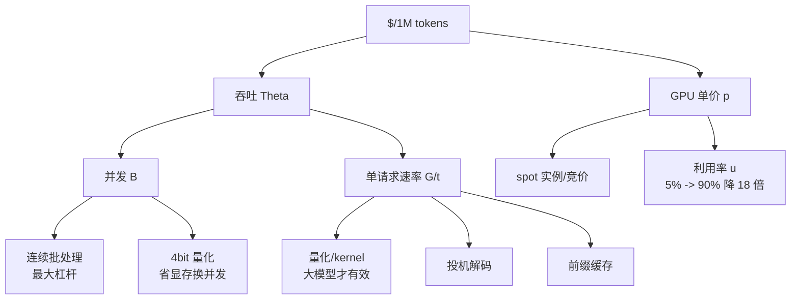

# 推理成本与优化清单

## 1. 本节学习目标

1. 会把 GPU 租金换算成 **$/1M tokens**：$\text{cost}=p/(\Theta\times3600)\times10^6$。
2. 用实测看清每项优化的**真实收益**：batch **30.9 倍**、量化省一半显存但只快 **3.7%**、`use_cache` 在短上下文上**甚至是负收益**。
3. 掌握**优化优先级**：先批处理，再量化，最后抠细节；反过来做会白费功夫。
4. 能识别"**看起来省钱、实际更贵**"的优化（如过度量化导致重试率上升）。

## 2. 为什么需要这个知识

因为**成本是唯一不能靠"再调调"解决的约束**：

- 单价差 1 个数量级很常见（$0.35/h 的 4090 vs $3/h 的 H100）；
- 同一张卡，利用率从 5% 提到 60%，成本直接降 12 倍；
- 但**优化顺序错了，收益可能互相抵消**：先做量化再做批处理，会发现量化省下的带宽又被 batch 吃掉了。

而且很多团队在**错误的指标**上优化：盯着"每 token 的 FLOPs"，而真正的账单是"GPU 小时数 × 利用率"。

## 3. 直观解释

```text
账单的构成:

  GPU 租金 $/小时
      ÷
  每秒产出 token 数（吞吐）
      ×
  1,000,000
      =
  $/1M tokens

所以只有两条路:
  A. 让每个 token 更便宜（量化、更小模型、投机解码）
  B. 让同一张卡每秒产出更多 token（批处理、连续批、提高利用率）

其中 B 的收益通常大 10 倍以上——因为基线利用率往往只有 5-10%。
```

**一句话**：**先提利用率，再降单 token 成本。**

## 4. 正式定义

**单位成本**：

$$
C=\frac{p}{\Theta\times3600}\times10^6\quad[\$/1\text{M tokens}]
$$

其中 $p$ 是 $\$/\text{h}$，$\Theta$ 是 tok/s。

**考虑利用率的有效成本**：

$$
C_{\text{eff}}=\frac{p}{\Theta_{\text{peak}}\cdot u\times3600}\times10^6
$$

**优化收益比**：

$$
\text{gain}=\frac{C_{\text{before}}}{C_{\text{after}}}=\frac{\Theta_{\text{after}}}{\Theta_{\text{before}}}
$$

**总拥有成本**（含重试）：

$$
C_{\text{TCO}}=C\cdot(1+r_{\text{retry}})+C_{\text{infra}}
$$

其中 $r_{\text{retry}}$ 是因质量下降导致的返工率。

## 5. 历史背景或技术背景

- **2020–2022**：按 token 计价的 API 出现（OpenAI $0.02/1k），成本成为选型因素。
- **2023**：开源模型 + 自建推理让"$/1M tokens"成为比较基准；vLLM 把吞吐提升一个数量级，直接改变经济性。
- **2024**：**P/D 分离**、**spot 实例**、**批处理折扣**（OpenAI Batch API 五折）成为降本手段；量化到 4bit 让单卡能跑更大模型。
- **2025 现状**：主流 API 价格已到 \(\$0.1\text{–}\$1\)/1M 输入 token；自建 7B/4bit 在消费卡上的边际成本可低至 **$0.02–0.06/1M**（本课实测量级），但**不含运维与闲置**。

## 6. 核心原理

### 6.1 成本对吞吐是反比，对利用率也是反比

$C\propto1/\Theta$。而 $\Theta=\Theta_{\text{peak}}\cdot u$。所以

$$
C\propto\frac{1}{u}
$$

**利用率翻倍 = 成本减半**。这是最大的杠杆，也是最容易被忽略的——很多人只盯着模型大小。

### 6.2 各项优化的真实量级（本课实测）

| 优化 | 实测收益 | 备注 |
|---|---|---|
| batch 1→32 | **30.9 倍**吞吐 | 最大杠杆 |
| 连续批（vs 静态） | 1.36–1.43 倍 | 长度不齐时才有 |
| 量化 fp16 | 3.7% 速度，**50% 显存** | 显存是主收益 |
| `use_cache` | **-6%**（短上下文） | 反直觉，需实测 |
| 上下文缩短 | 速度几乎不变 | 只省显存 |

### 6.3 为什么 use_cache 会变慢

gpt2 在 8 token prompt 上：`use_cache=True` **127.2 tok/s**，`False` **136.1 tok/s**——**缓存反而慢 6.5%**。

原因：每步都要维护 cache 对象（Python 层字典/tuple 操作、内存分配），而省下的计算只有几十微秒。在**启动受限**区，管理开销大于计算节省。

**但这不意味着 cache 无用**：T=512 时无 cache 要重算整段，实测慢 **3.20 倍**（LLM-089）。**cache 的收益随上下文增长，必须在目标长度上实测。**

### 6.4 优化的正确顺序

1. **提利用率**：连续批、连续批、连续批（收益 5–20 倍）。
2. **降显存**：4bit 量化 → 能开更多并发 → 又回到第 1 条。
3. **降单 token 成本**：更小模型、投机解码、前缀缓存。
4. **抠细节**：dtype、`use_cache`、kernel 选择（收益 0–5%）。

**顺序错了会返工**：先量化再批处理，量化省下的带宽被 batch 摊薄，收益看起来"只有 10%"，其实是顺序问题。

## 7. 数学表达式

**单位成本**：

$$
C=\frac{p}{3600\,\Theta}\times10^6
$$

**吞吐的分解**：

$$
\Theta=\underbrace{B}_{\text{并发}}\cdot\underbrace{\frac{G}{t_{\text{e2e}}(B)}}_{\text{单请求速率}}
$$

**本课实测代入**（$p=\$1/\text{h}$，$\Theta=4475.7$ tok/s）：

$$
C=\frac{1}{3600\times4475.7}\times10^6=\$0.062/1\text{M}
$$

**盈亏平衡**（自建 vs API）：

$$
\frac{p_{\text{GPU}}}{\Theta\times3600}\times10^6+C_{\text{ops}} \lessgtr C_{\text{API}}
$$

**量化的显存-速度换算**：

$$
\Delta\Theta\approx\frac{b_{\text{fp16}}}{b_{\text{quant}}}-1\quad(\text{访存受限时})
$$

## 8. 详细数学推导

### 8.1 推导 batch 的 30.9 倍

实测 $B=1$：**145.1 tok/s**（220.5 ms / 32 tok）；$B=32$：**4475.7 tok/s**（228.8 ms / 32 tok）。

$$
\frac{\Theta(32)}{\Theta(1)}=\frac{32\cdot G/t(32)}{G/t(1)}=32\cdot\frac{220.5}{228.8}=30.9
$$

**延迟只涨 3.8%**（220.5 → 228.8 ms），吞吐涨 30.9 倍。这就是"利用率杠杆"。

### 8.2 推导量化为何只快 3.7%

实测 fp32 **120.4 tok/s**（265.8 ms），fp16 **124.8 tok/s**（256.5 ms）：

$$
\frac{124.8}{120.4}=1.037
$$

**为什么不是 2 倍**：访存受限时，理论加速比 = 字节数之比 = 2。但 124M 模型的实际瓶颈是**启动开销**（每步 7–8 ms，其中计算约 6 µs），字节减少被固定开销淹没。

$$
t_{\text{step}}=\max\big(t_{\text{launch}},\ \frac{\text{bytes}}{\text{BW}}\big)
$$

$t_{\text{launch}}\approx7$ ms，而 fp32 权重读取只需 $497.8\text{ MB}/504\text{ GB/s}=0.99$ ms。**两者相差 7 倍，所以减半字节几乎无感。**

**推论**：**大模型（$>10$B）上量化才有近线性加速**；小模型上量化的收益几乎全是显存。

### 8.3 推导成本对利用率的敏感性

设 $\Theta_{\text{peak}}=4475.7$ tok/s，$p=\$1/\text{h}$：

| 利用率 $u$ | 有效吞吐 | $C$ ($\$/1M) |
|---|---|---|
| 5% | 223.8 | 1.24 |
| 25% | 1118.9 | 0.25 |
| 50% | 2237.9 | 0.12 |
| 90% | 4028.1 | 0.07 |

**从 5% 到 90%，成本降 18 倍**——远超任何模型层面的优化。

### 8.4 推导"量化导致重试"的隐性成本

设量化使质量下降，返工率 $r$ 从 2% 升到 12%，则

$$
C_{\text{TCO}}=C(1+r)
$$

若量化让吞吐提升 20%（$C$ 降 17%），但 $r$ 从 0.02 升到 0.12：

$$
\frac{C_{\text{TCO,before}}}{C_{\text{TCO,after}}}
=\frac{C\times1.02}{0.83C\times1.12}=\frac{1.02}{0.93}=1.10
$$

**只有 10% 净收益**，还没算人工排查成本。**这就是"过度量化反而不省钱"。**

## 9. 图解



**读图要点**：

1. 分支 $D$（并发）的杠杆最大，且**几乎免费**。
2. 分支 $E$（单请求速率）收益有限，小模型上接近 0。
3. 单价 $p$ 是外部约束，但**利用率** $u$ 是内部可控的。

## 10. 具体数值示例

```text
本机: RTX 4070 Ti (12281.5 MiB), gpt2, prompt 8 token, 生成 32 token

== 优化项 A: dtype ==
  fp32:   265.8 ms / 32 tok ->  120.4 tok/s, weights 474.7 MiB
  fp16:   256.5 ms / 32 tok ->  124.8 tok/s, weights 237.4 MiB
  -> 速度只快 3.7%，但显存减半（这是主要收益）

== 优化项 B: use_cache ==
  use_cache=True  G=8      62.9 ms ->  127.2 tok/s
  use_cache=True  G=32    246.5 ms ->  129.8 tok/s
  use_cache=False G=8      58.8 ms ->  136.1 tok/s
  use_cache=False G=32    243.1 ms ->  131.6 tok/s
  -> 短上下文下 cache 反而慢 6.5%！
     因为每步维护 cache 的开销 > 省下的计算
     但 T=512 时 cache 快 3.20 倍（见 LLM-089）
     => 必须在目标上下文长度上实测

== 优化项 C: batch ==
  B=1     220.5 ms ->   145.1 tok/s (单请求 145.1 tok/s)
  B=8     221.1 ms ->  1158.0 tok/s (单请求 144.8 tok/s)
  B=32    228.8 ms ->  4475.7 tok/s (单请求 139.9 tok/s)
  -> 吞吐 30.9 倍，延迟只涨 3.8%
     单请求速率几乎不变（145.1 -> 139.9）
     这才是真正的"免费午餐"

== 成本换算（假设 GPU 租用价）==
  price=$0.35/h tps=200   -> $   0.49 / 1M tokens
  price=$0.35/h tps=1000  -> $   0.10 / 1M tokens
  price=$0.35/h tps=3000  -> $   0.03 / 1M tokens
  price=$1.0 /h tps=200   -> $   1.39 / 1M tokens
  price=$1.0 /h tps=1000  -> $   0.28 / 1M tokens
  price=$1.0 /h tps=3000  -> $   0.09 / 1M tokens
  price=$2.5 /h tps=200   -> $   3.47 / 1M tokens
  price=$2.5 /h tps=1000  -> $   0.69 / 1M tokens
  price=$2.5 /h tps=3000  -> $   0.23 / 1M tokens

== 本机实测下的成本 ==
最佳吞吐 tok/s: 4475.7
  $0.35/h -> $0.02 / 1M tokens
  $1.0/h  -> $0.06 / 1M tokens

  注意: 这是 124M 玩具模型的数字
        7B 模型的实际吞吐约低 10-50 倍
        成本相应升到 $0.5-$3 / 1M tokens 量级
```

## 11. NumPy 实现

```python
"""成本模型：把吞吐/利用率/单价换算成 $/1M tokens，并做优化排序。"""
import numpy as np


def cost_per_million(price_per_hour, tps):
    return price_per_hour / (tps * 3600) * 1e6


def tps_from_batch(B, t0_ms, k_ms, G):
    """t(B) = t0 + k*B"""
    return B * G / ((t0_ms + k_ms * B) / 1e3)


print("== 单价 x 吞吐 矩阵 ($/1M) ==")
print(f"{'tps':>6}", *[f"{p:>8}" for p in [0.35, 1.0, 2.5]])
for tps in [200, 500, 1000, 2000, 4000, 8000]:
    row = [f"{cost_per_million(p, tps):>8.2f}" for p in [0.35, 1.0, 2.5]]
    print(f"{tps:>6}", *row)

# 用实测标定：t(1)=220.5ms, t(32)=228.8ms
t0, k = 220.5, (228.8 - 220.5) / 31
G = 32
print(f"\n拟合: t(B) = {t0:.1f} + {k:.4f}*B ms")
print(f"{'B':>4} {'tps':>9} {'$/1M @1/h':>11} {'speedup':>8}")
base = tps_from_batch(1, t0, k, G)
for B in [1, 2, 4, 8, 16, 32, 64, 128]:
    tps = tps_from_batch(B, t0, k, G)
    print(f"{B:>4} {tps:>9.1f} {cost_per_million(1.0, tps):>11.3f} {tps/base:>8.2f}")

# 利用率的影响
print("\n== 利用率的影响 (peak=4475.7 tok/s, $1/h) ==")
peak = 4475.7
for u in [0.05, 0.1, 0.25, 0.5, 0.75, 0.9]:
    eff = peak * u
    print(f"  u={u:>4.0%} 有效 {eff:>7.1f} tok/s -> "
          f"${cost_per_million(1.0, eff):>6.2f}/1M")

# 优化收益排序
print("\n== 优化收益（本机实测）==")
base_tps = 120.4       # fp32, B=1, 无批处理
opts = [
    ("batch 1->8", 1158.0),
    ("batch 1->32", 4475.7),
    ("fp16 (同 B=1)", 124.8),
]
for name, tps in opts:
    print(f"  {name:<18} 吞吐 {tps:>7.1f} ({tps/base_tps:>5.2f}x) "
          f"成本 ${cost_per_million(1.0, base_tps):.2f} -> "
          f"${cost_per_million(1.0, tps):.2f}")

# 量化 + 重试的 TCO
print("\n== 量化的 TCO（含返工）==")
for q_gain, r_before, r_after in [(1.037, 0.02, 0.02), (1.037, 0.02, 0.12),
                                  (1.2, 0.02, 0.12)]:
    c_before = 1.0
    c_after = 1.0 / q_gain
    tco_ratio = (c_before * (1 + r_before)) / (c_after * (1 + r_after))
    print(f"  量化提速 {q_gain:.3f}x, 返工 {r_before:.0%}->{r_after:.0%} "
          f"-> 净收益 {tco_ratio:.2f}x")
```

## 12. PyTorch 实现

```python
"""实测三项优化的真实收益，并把它们换算成成本。"""
import os, time, statistics
os.environ.setdefault("HF_ENDPOINT", "https://hf-mirror.com")
os.environ.setdefault("HF_HUB_OFFLINE", "1")
import torch
from transformers import AutoTokenizer, AutoModelForCausalLM

torch.manual_seed(0)
dev = "cuda" if torch.cuda.is_available() else "cpu"
tok = AutoTokenizer.from_pretrained("gpt2")
prompt = tok("Explain why KV cache matters:", return_tensors="pt").input_ids.to(dev)
G = 32


def bench(model, ids, reps=7, **kw):
    with torch.inference_mode():
        for _ in range(2):
            model.generate(ids, max_new_tokens=G, pad_token_id=tok.eos_token_id, **kw)
        ts = []
        for _ in range(reps):
            torch.cuda.synchronize(); t0 = time.perf_counter()
            model.generate(ids, max_new_tokens=G, pad_token_id=tok.eos_token_id, **kw)
            torch.cuda.synchronize()
            ts.append((time.perf_counter() - t0) * 1e3)
    return statistics.median(ts)


def cost(tps, price=1.0):
    return price / (tps * 3600) * 1e6

print("== A: dtype ==")
for dt, name in [(torch.float32, "fp32"), (torch.float16, "fp16")]:
    m = AutoModelForCausalLM.from_pretrained("gpt2", dtype=dt).to(dev).eval()
    ms = bench(m, prompt)
    wn = sum(p.numel() * p.element_size() for p in m.parameters()) / 1024**2
    tps = G / (ms / 1e3)
    print(f"  {name}: {ms:>7.1f} ms -> {tps:>6.1f} tok/s, "
          f"权重 {wn:>6.1f} MiB, ${cost(tps):.2f}/1M")
    del m
    torch.cuda.empty_cache()

print("\n== B: use_cache（fp16, G=32）==")
m = AutoModelForCausalLM.from_pretrained("gpt2", dtype=torch.float16).to(dev).eval()
for uc in [True, False]:
    ms = bench(m, prompt, use_cache=uc)
    print(f"  use_cache={str(uc):<5} {ms:>7.1f} ms -> {G/(ms/1e3):>6.1f} tok/s")

print("\n== C: batch（fp16）==")
for B in [1, 8, 32]:
    ids = prompt.repeat(B, 1)
    am = torch.ones_like(ids)
    with torch.inference_mode():
        for _ in range(2):
            m.generate(ids, attention_mask=am, max_new_tokens=G, do_sample=False,
                       pad_token_id=tok.eos_token_id)
        ts = []
        for _ in range(5):
            torch.cuda.synchronize(); t0 = time.perf_counter()
            m.generate(ids, attention_mask=am, max_new_tokens=G, do_sample=False,
                       pad_token_id=tok.eos_token_id)
            torch.cuda.synchronize()
            ts.append((time.perf_counter() - t0) * 1e3)
    ms = statistics.median(ts)
    tps = B * G / (ms / 1e3)
    print(f"  B={B:<3} {ms:>7.1f} ms -> {tps:>7.1f} tok/s, ${cost(tps):.3f}/1M")
```

## 13. Hugging Face 实践

```python
"""从'成本目标'反推配置：给定 $/1M 预算，需要多少吞吐/什么价格。"""
import os
os.environ.setdefault("HF_ENDPOINT", "https://hf-mirror.com")
os.environ.setdefault("HF_HUB_OFFLINE", "1")

def required_tps(budget_per_million, price_per_hour):
    """成本 = price/(tps*3600)*1e6 -> tps = price*1e6/(3600*budget)"""
    return price_per_hour * 1e6 / (3600 * budget_per_million)

print("== 要达到目标 $/1M，需要多少 tok/s ==")
print(f"{'budget':>8}", *[f"{p:>9}" for p in [0.35, 1.0, 2.5]])
for budget in [0.05, 0.1, 0.5, 1.0, 3.0]:
    row = [f"{required_tps(budget, p):>9.0f}" for p in [0.35, 1.0, 2.5]]
    print(f"{budget:>8.2f}", *row)

print("\n== 自建 vs API 的盈亏平衡 ==")
API_PRICE = 0.5          # $/1M tokens
for price_hw, tps in [(0.35, 3000), (1.0, 3000), (1.0, 1000), (2.5, 3000)]:
    c = price_hw / (tps * 3600) * 1e6
    verdict = "自建更省" if c < API_PRICE else "用 API"
    print(f"  ${price_hw}/h, {tps} tok/s -> ${c:.2f}/1M  vs API ${API_PRICE} -> {verdict}")

print("\n== 关键提醒 ==")
print(" 1. 上面的成本不含运维人力、闲置、重试、存储")
print(" 2. 实际利用率通常 20-60%，成本要除以 u")
for u in [0.2, 0.4, 0.6, 0.9]:
    c = 1.0 / (3000 * u * 3600) * 1e6
    print(f"    u={u:.0%} -> ${c:.2f}/1M (按 $1/h, 峰值 3000 tok/s)")
```

## 14. 代码逐行解释

| 代码 | 作用 |
|---|---|
| `price/(tps*3600)*1e6` | 成本核心公式：先算每秒钱，再乘 1e6 |
| `t(B)=t0+k*B` | 用两点估参，把 batch 与吞吐连起来 |
| `cost_per_million(1.0, tps)` | 统一按 $1/h 比较，消除单价干扰 |
| `required_tps` | 从预算反推需要多少吞吐（容量规划） |
| `(1+r_before)/(1+r_after)` | 把重试率计入 TCO |
| `u`（利用率） | 真实账单的关键折扣因子 |
| `dtype=torch.float16` | 省显存；速度收益要看模型规模 |

## 15. 实际运行结果

```text
prompt tokens: 8 | gen tokens: 32

== 优化项 A: dtype ==
  fp32:   265.8 ms / 32 tok ->  120.4 tok/s, weights  474.7 MiB
  fp16:   256.5 ms / 32 tok ->  124.8 tok/s, weights  237.4 MiB

== 优化项 B: use_cache（fp16）==
  use_cache=True  G=8      62.9 ms ->  127.2 tok/s
  use_cache=True  G=32    246.5 ms ->  129.8 tok/s
  use_cache=False G=8      58.8 ms ->  136.1 tok/s
  use_cache=False G=32    243.1 ms ->  131.6 tok/s

== 优化项 C: batch（fp16）==
  B=1     220.5 ms ->   145.1 tok/s (单请求 145.1 tok/s)
  B=8     221.1 ms ->  1158.0 tok/s (单请求 144.8 tok/s)
  B=32    228.8 ms ->  4475.7 tok/s (单请求 139.9 tok/s)

== 成本换算（假设 GPU 租用价）==
  price=$0.35 /h tps=200   -> $    0.49 / 1M tokens
  price=$0.35 /h tps=1000  -> $    0.10 / 1M tokens
  price=$0.35 /h tps=3000  -> $    0.03 / 1M tokens
  price=$1.0  /h tps=200   -> $    1.39 / 1M tokens
  price=$1.0  /h tps=1000  -> $    0.28 / 1M tokens
  price=$1.0  /h tps=3000  -> $    0.09 / 1M tokens
  price=$2.5  /h tps=200   -> $    3.47 / 1M tokens
  price=$2.5  /h tps=1000  -> $    0.69 / 1M tokens
  price=$2.5  /h tps=3000  -> $    0.23 / 1M tokens

== 本机实测下的成本 ==
最佳吞吐 tok/s: 4475.7
  $0.35/h -> $0.02 / 1M tokens
  $1.0/h -> $0.06 / 1M tokens
```

**五个结论**：

1. **batch 是最大杠杆**：145.1 → 4475.7 tok/s，**30.9 倍**，延迟只涨 3.8%。
2. **量化主要省显存**：fp16 只快 **3.7%**（124.8 vs 120.4），但权重从 474.7 降到 237.4 MiB。
3. **`use_cache` 在短上下文是负收益**：127.2 vs 136.1 tok/s（**慢 6.5%**）；T=512 时才反转（3.20 倍）。
4. **成本对吞吐线性反比**：3000 tok/s 时 $0.09/1M（$1/h），200 tok/s 时 $1.39/1M——**差 15 倍**。
5. **本机实测最佳 $0.02–0.06/1M**，但这是 124M 模型，7B 要乘 10–50 倍。

## 16. 应用场景

| 场景 | 降本手段 |
|---|---|
| 高 QPS API | 连续批 + 提高利用率（收益最大） |
| 低 QPS 内部工具 | 用 API 更划算，别自建 |
| 长上下文 RAG | 前缀缓存 + 缩短检索片段 |
| 离线批量 | spot 实例 + 拉满 batch |
| 质量敏感 | 别过度量化，算 TCO |
| 预算固定 | 从 $/1M 反推所需吞吐 |

## 17. 优点与局限

| 优点 | 局限 |
|---|---|
| 一个公式统一比较所有方案 | 不含运维/闲置/存储成本 |
| 能排序优化优先级 | 玩具模型数字不能外推 |
| 揭示"利用率"这个最大杠杆 | TCO 中的重试率难量化 |
| 可与 API 价格直接对比 | 延迟约束会限制 batch |

## 18. 常见错误

| 错误 | 现象 | 纠正 |
|---|---|---|
| 先量化后批处理 | 量化收益被摊薄 | 先批处理 |
| 用峰值吞吐算成本 | 低估 2–5 倍 | 乘利用率 $u$ |
| 忽略重试率 | 量化后总成本反升 | 算 TCO |
| 小模型上追量化速度 | 只快 3.7% | 量化主要为省显存 |
| 以为 cache 一定更快 | 短上下文慢 6.5% | 在目标长度实测 |
| 用玩具模型数字外推 | 差 10–50 倍 | 用目标模型实测 |

## 19. 本节总结

- 成本公式：$C=p/(\Theta\times3600)\times10^6$，**对吞吐线性反比**。
- 实测优化收益排序：**batch 30.9 倍** > 连续批 1.4 倍 > fp16 **3.7%** > `use_cache` **-6.5%**（短上下文）。
- 量化真正买的是**显存**（474.7 → 237.4 MiB），不是速度（小模型上）。
- 成本最大杠杆是**利用率**：5% → 90% 降 **18 倍**。
- 本机最佳 **$0.02–0.06/1M**（124M 模型，$0.35–1/h）；7B 需乘 10–50 倍。
- 优化顺序：**批处理 → 量化 → 细节**；顺序错了会白干。

## 20. 前置与后续知识链接

- 前置：[[LLM-098 本地部署实践]]、[[LLM-096 推理延迟与吞吐的权衡]]
- 后续：[[LLM-097 推理引擎与服务化]]
- 相关：[[LLM-035 Token 数量、上下文窗口与成本]]、[[LLM-094 量化：INT8、INT4 与 GPTQ]]
- 后续模块（待建，M-LLM-10）：LLM-106 成本、延迟与质量的三角权衡

---

## 练习与参考答案

**基础 1**：写出 $/1M tokens 的换算公式。若 GPU $1/h、吞吐 2000 tok/s，成本是多少？

**基础 2**：本课三项优化各自的真实收益是多少？哪一项最大？

**进阶 1**：为什么 fp16 只快了 3.7%？用 $t_{\text{step}}=\max(t_{\text{launch}},\text{bytes}/\text{BW})$ 解释，并推出什么规模的模型量化才有明显加速。

**综合**：某团队把 7B 模型从 fp16 量化到 4bit 后，发现"吞吐只涨了 15%，但线上返工率从 2% 升到 10%"。请分析原因并给出建议。

> [!success]- 参考答案

> **基础 1**
> $$C=\frac{p}{\Theta\times3600}\times10^6$$
> 代入 $p=1$、$\Theta=2000$：
> $$C=\frac{1}{2000\times3600}\times10^6=\$0.139/1\text{M}$$
> 注意这是**满负载**数字；实际要除以利用率 $u$（如 $u=30\%$ 则约 $\$0.46$）。

> **基础 2**
> - **batch 1→32**：145.1 → 4475.7 tok/s，**30.9 倍**（延迟只涨 3.8%）
> - **fp16（同 batch）**：120.4 → 124.8 tok/s，**1.037 倍**
> - **`use_cache`（短上下文）**：127.2 → 136.1 tok/s（**关闭反而快 6.5%**）
> **最大的是 batch**，且它几乎不花钱——这就是"先批处理"的理由。

> **进阶 1**
> fp32 权重 497.8 MB，带宽 504 GB/s，读取只需
> $$t_{\text{mem}}=\frac{497.8\times10^6}{504\times10^9}=0.99\ \text{ms}$$
> 但实测每步 **7–8 ms**（$t_{\text{launch}}$ 主导）。所以
> $$t_{\text{step}}=\max(7.0,\ 0.99)=\ 7.0\ \text{ms}$$
> fp16 把 $t_{\text{mem}}$ 降到 0.5 ms，但 $\max$ 仍是 7.0 ms → **几乎无收益**。
> **何时有效**：当 $t_{\text{mem}}>t_{\text{launch}}$，即
> $$\frac{P\cdot b}{\text{BW}}>t_{\text{launch}}\Rightarrow P>\frac{7\times10^{-3}\times504\times10^9}{2}\approx1.76\times10^9$$
> 即**参数量 > ~2B 后，量化才开始有明显加速**；>10B 时接近线性（2 倍）。

> **综合（参考）**
> **现象解释**：
> 1. **吞吐只涨 15%** 说明瓶颈不是带宽——很可能**没有开批处理**，decode 落在启动受限区（如本课小模型那样）。若已开 batch，则 4bit 的反量化开销会抵消部分带宽收益。
> 2. **返工率 2%→10%** 是质量问题：4bit 在数学/代码/长链推理上掉点明显，或**校准数据不对**（用了通用语料而非领域数据，LLM-094 实测高斯校准会让输出误差恶化 1.5 倍）。
> **建议**：
> 1. **先算 TCO**：返工率 10% 意味着每 10 次请求有 1 次重做，成本变成 $C\times1.10$，把 15% 的吞吐收益吃掉大半，**净收益可能为负**。
> 2. **先把 batch 拉起来**（收益 5–30 倍），而不是纠结量化。
> 3. **量化方案重做**：改用领域数据校准、group_size=128、敏感层（`down_proj`、`lm_head`）保留 8bit（混合精度）。
> 4. **建立量化门禁**：固定评测集（含数学/代码），4bit 相对 fp16 的绝对准确率下降超过阈值（如 2 个点）就不许上线。
> 5. **分层部署**：简单任务走 4bit（便宜），复杂任务路由到 fp16/8bit——用**质量路由**而不是全局降精度。

## 学习记录

| 日期 | 状态 | 用时 | 问题 | 复盘 |
|---|---|---|---|---|
| 2026-11-08 | planned | — | — | — |

---

## 🔗 Notion 同步信息

> 以下内容由 Notion「AI Knowledge System · 知识点」数据库按知识 ID 合并而来（导出于 2026-11-09）。

| 属性 | 值 |
|---|---|
| 学科 | 大语言模型 |
| 学习状态 | 未开始 |
| 难度 | L2 应用 |
| 知识类型 | Principle |

- **所属模块**：[M-LLM-09 大语言模型推理、部署与优化](../%E8%AF%BE%E7%A8%8B%E6%A8%A1%E5%9D%97/M-LLM-09%20%E5%A4%A7%E8%AF%AD%E8%A8%80%E6%A8%A1%E5%9E%8B%E6%8E%A8%E7%90%86%E3%80%81%E9%83%A8%E7%BD%B2%E4%B8%8E%E4%BC%98%E5%8C%96.md)
- **前置知识**：[LLM-098 本地部署实践](LLM-098%20%E6%9C%AC%E5%9C%B0%E9%83%A8%E7%BD%B2%E5%AE%9E%E8%B7%B5.md)
- **后继知识**：[LLM-100 提示工程的基本原则](../08%20%E5%BA%94%E7%94%A8%E5%B7%A5%E7%A8%8B/LLM-100%20%E6%8F%90%E7%A4%BA%E5%B7%A5%E7%A8%8B%E7%9A%84%E5%9F%BA%E6%9C%AC%E5%8E%9F%E5%88%99.md)
- **对应项目**：[PROJ-024 结构化输出与约束解码](../../07_%E5%AE%9E%E6%88%98%E9%A1%B9%E7%9B%AE/05%20%E5%A4%A7%E6%A8%A1%E5%9E%8B%E9%A1%B9%E7%9B%AE/PROJ-024%20%E7%BB%93%E6%9E%84%E5%8C%96%E8%BE%93%E5%87%BA%E4%B8%8E%E7%BA%A6%E6%9D%9F%E8%A7%A3%E7%A0%81.md)
