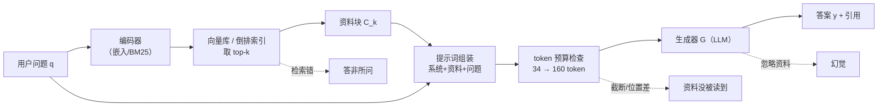

# RAG 的基本架构

## 1. 本节学习目标

1. 能画出 RAG 的**三段流水线**：检索（Retrieve）→ 增强（Augment）→ 生成（Generate），并说清每段的输入输出。
2. 用真实数字理解 RAG 的**代价结构**：本课实测同一问题，加两段资料后 prompt 从 **34 token 涨到 160 token（4.71 倍）**。
3. 用**困惑度**证明"给对资料确实让答案更可能"：gpt2 下 PPL **17.8679 → 2.8272**。
4. 知道 RAG 的失败**主要发生在检索段**，而不是生成段（本课 top1 命中 9/10，top2 命中 10/10，漏的那条正是"手机能不能用插件"）。

## 2. 为什么需要这个知识

模型参数里的知识有三个硬伤：

- **会过期**：训练截止日之后的事它不知道；
- **不可溯源**：它给的答案没有出处，审计不了；
- **装不下私有数据**：公司内部的接口文档、工单、笔记，从来不在预训练语料里。

微调能塞进新知识，但代价是每改一次文档就要重训一次，而且**微调擅长"学会格式和风格"，不擅长"记住事实"**。RAG 换了个思路：不改参数，改**上下文**——把相关资料找出来塞进 prompt，让模型"看着材料答题"。

这条路线的工程价值很直接：更新知识 = 更新索引，不用碰模型。

## 3. 直观解释

**开卷考试**。

闭卷考试（纯 LLM）：全靠脑子里记的，记错了也照样自信地写。
开卷考试（RAG）：先翻到可能相关的那几页（检索），把这几页摊在桌上（增强），再对着材料写答案（生成）。

开卷的关键不在"写"，在"翻对页"。翻错了页，写得再流畅也是错的——这就是为什么 RAG 系统里**检索质量决定上限**。

## 4. 正式定义

一次 RAG 查询由三个映射复合而成：

- 检索器 $R: q \mapsto \mathcal{C}_k$，把问题映射到 top-$k$ 个文本块；
- 组装器 $A: (q, \mathcal{C}_k) \mapsto p$，把问题与文本块拼成提示词；
- 生成器 $G: p \mapsto y$，由语言模型输出答案。

$$
y = G\big(A(q,\, R(q))\big)
$$

三个组件各自可替换、可单独评估——这正是 RAG 能被工程化的原因。

## 5. 历史背景或技术背景

| 时间 | 事件 | 关键点 |
|---|---|---|
| 2019 | REALM | 把检索器与语言模型**联合训练**，检索第一次进入预训练回路 |
| 2020 | **RAG（Lewis et al.）** | 提出"检索-增强-生成"三段式，并给出两种组合方式（同段拼接 / 逐段融合） |
| 2021 | DPR | 双塔稠密检索取代 BM25，成为 RAG 默认召回器 |
| 2022 | Atlas、RETRO | 检索规模化到万亿级 token 的语料库 |
| 2023 | 向量库与 RAG 框架爆发 | 工程重心从"训检索器"转向"切块、混合检索、重排" |
| 2024 起 | 长上下文 vs RAG 之争 | 结论趋于一致：长上下文不能替代检索，只降低了对 top-$k$ 精度的要求 |

## 6. 核心原理

**RAG 成立的两个前提**

1. **答案在语料里**：知识库确实包含回答所需的事实（否则再好的检索也找不出来）；
2. **模型会"读材料"**：给定包含答案的上下文，模型输出该答案的概率显著高于无上下文时。

第 2 条不是信仰，是可测的——本课用 gpt2 直接测了：同一句答案，在"问题 + 检索到的资料"前缀下，平均负对数似然从 **2.8830 降到 1.0393**。

**三段各自的失败形态**

| 段 | 失败表现 | 归因 |
|---|---|---|
| 检索 | 正确文档没进 top-$k$ | 切块切断了、向量语义不匹配、查询用词与文档不一致 |
| 增强 | 资料塞进去了但被截断/被淹没 | 预算算错、把最相关的放在中间、上下文过长 |
| 生成 | 资料对但答错/编造 | 模型忽略资料、多文档冲突、指令不明确 |

## 7. 数学表达式

**检索打分（以余弦为例）**

$$
s(q, d) = \frac{\mathbf{v}_q^\top \mathbf{v}_d}{\lVert \mathbf{v}_q\rVert\,\lVert \mathbf{v}_d\rVert}
$$

**top-$k$ 选择**

$$
\mathcal{C}_k = \operatorname{arg\,top\text{-}k}_{d \in \mathcal{D}}\; s(q, d)
$$

**生成目标（答案的负对数似然）**

$$
\mathcal{L}(y \mid q, \mathcal{C}_k) = -\frac{1}{|y|}\sum_{t=1}^{|y|}\log p_\theta\big(y_t \mid q, \mathcal{C}_k, y_{<t}\big)
$$

**RAG 的收益**就定义为同一答案在两种前缀下的似然差：

$$
\Delta = \mathcal{L}(y \mid q) - \mathcal{L}(y \mid q, \mathcal{C}_k)
$$

本课实测 $\Delta = 2.8830 - 1.0393 = 1.8437$（越大说明资料越"有用"）。

## 8. 详细数学推导

**推导 1：为什么"上下文越长"不等于"越好"**

设答案 $y$ 需要的信息量为 $I$，上下文提供的信息为 $I_c$，无关内容带来的干扰为 $N$。模型有效利用资料的概率可粗略写成：

$$
P(\text{答对}) \approx \sigma\big(\alpha I_c - \beta N\big)
$$

$k$ 增大时 $I_c$ 饱和（答案只在一两段里），而 $N$ 近似线性增长：

$$
I_c(k) \to I_c^{\max},\qquad N(k) \approx k\bar{n}
$$

所以 $\partial P/\partial k$ 会在某个 $k^\*$ 处变号——这就是"top-$k$ 不是越大越好"的定量解释。本课实测：$k$ 从 1 到 5，噪声文档占比从 **33.33% 涨到 83.33%**。

**推导 2：困惑度与似然的关系**

$$
\mathrm{PPL} = \exp\!\Big(-\frac{1}{|y|}\sum_t \log p(y_t)\Big) = e^{\mathcal{L}}
$$

所以 $\mathcal{L}$ 降 1.84 相当于 PPL 从 $e^{2.8830}=17.87$ 降到 $e^{1.0393}=2.83$，**降为原来的 15.8%**。

## 9. 图解



## 10. 具体数值示例

```text
问题：同步间隔怎么修改
检索：top2 = [doc1, doc6]，分数 0.373 / 0.082

无上下文 prompt：34 token
有上下文 prompt：160 token（2 段资料，共 66 字）
放大约 4.71 倍

同一句答案 "同步间隔默认 300 秒。"
  无上下文：NLL 2.8830 → PPL 17.8679
  有上下文：NLL 1.0393 → PPL  2.8272
  ΔNLL = 1.8437，PPL 降为 15.8%

生成 8 个 token 用时 201.6 ms，输出 "同步间隔"
```

## 11. NumPy 实现

```python
import re

import numpy as np

DOCS = [
    "星河笔记库的默认存储路径位于 D 盘的 data 目录，首次启动会自动创建。",
    "同步间隔默认为 300 秒，可在设置页的同步面板中修改为 60 到 3600 秒。",
    "导出 PDF 需要在打印对话框中选择另存为 PDF，中文字体使用思源宋体。",
    "插件市场需要开启社区插件开关，企业版默认关闭该开关。",
    "备份采用增量快照，每个快照保留 7 天，超过 7 天自动合并。",
]
QUERIES = [("默认存储路径在哪里", 0), ("同步间隔怎么修改", 1), ("备份快照保留多久", 4)]


def bigrams(text):
    text = re.sub(r"[^\w\u4e00-\u9fff]", "", text)
    return [text[i : i + 2] for i in range(len(text) - 1)]


vocab = {}
for d in DOCS:
    for g in bigrams(d):
        vocab.setdefault(g, len(vocab))
mat = np.zeros((len(DOCS), len(vocab)))
df = np.zeros(len(vocab))
for r, d in enumerate(DOCS):
    for g in bigrams(d):
        mat[r, vocab[g]] += 1.0
    for g in set(bigrams(d)):
        df[vocab[g]] += 1.0
idf = np.log((1 + len(DOCS)) / (1 + df)) + 1.0
mat = mat * idf
mat /= np.linalg.norm(mat, axis=1, keepdims=True)


def retrieve(q, k=2):
    v = np.zeros(len(vocab))
    for g in bigrams(q):
        if g in vocab:
            v[vocab[g]] += 1.0
    v *= idf
    v /= np.linalg.norm(v) + 1e-9
    sims = mat @ v
    return np.argsort(-sims)[:k], sims


for q, gold in QUERIES:
    idx, s = retrieve(q)
    print(f"{q:<12} top2={list(idx)} 分数={[round(float(s[i]), 3) for i in idx]} gold={gold}")

# 组装：同一个问题，加资料前后的字符成本
q = QUERIES[1][0]
idx, _ = retrieve(q, k=2)
ctx = "".join(DOCS[i] for i in idx)
print("无资料 prompt 字符数:", len(f"问题：{q}\n答案："))
print("有资料 prompt 字符数:", len(f"问题：{q}\n资料：{ctx}\n答案："))
```

## 12. PyTorch 实现

```python
import torch
import torch.nn.functional as F

torch.manual_seed(0)
# 模拟 6 个问题的查询向量与 8 个文档向量（真实系统里由嵌入模型产出）
Q = F.normalize(torch.randn(6, 64), dim=1)
D = F.normalize(torch.randn(8, 64), dim=1)

sims = Q @ D.T                     # [6, 8] 余弦相似度矩阵
topk = sims.topk(2, dim=1)         # 每行取 top-2
print("相似度矩阵形状:", tuple(sims.shape))
print("top2 索引:\n", topk.indices)

# 与 numpy 的排序结果对齐，验证 topk 的正确性
import numpy as np

idx_np = np.argsort(-sims.numpy(), axis=1)[:, :2]
print("numpy argsort 一致:", bool((idx_np == topk.indices.numpy()).all()))

# 用 softmax 把分数变成权重（融合多段资料的常见做法）
w = F.softmax(topk.values * 10, dim=1)
print("top2 权重:", w)
print("权重和:", float(w.sum(1)[0]))
```

## 13. Hugging Face 实践

```python
import math
import os

os.environ.setdefault("HF_ENDPOINT", "https://hf-mirror.com")
os.environ.setdefault("HF_HUB_OFFLINE", "1")
import torch
from transformers import AutoModelForCausalLM, AutoTokenizer

tok = AutoTokenizer.from_pretrained("gpt2")
model = AutoModelForCausalLM.from_pretrained("gpt2").eval()

CTX = "同步间隔默认为 300 秒，可在设置页的同步面板中修改为 60 到 3600 秒。移动端不支持本地插件，只能使用云端同步的笔记内容。"
Q = "同步间隔怎么修改"
A = "同步间隔默认 300 秒。"

prompt_no = f"问题：{Q}\n答案："
prompt_ctx = f"问题：{Q}\n资料：{CTX}\n答案："
print("无上下文 token:", len(tok(prompt_no)["input_ids"]))
print("有上下文 token:", len(tok(prompt_ctx)["input_ids"]))


def ppl(prefix, answer):
    p = tok(prefix)["input_ids"]
    a = tok(answer)["input_ids"]
    ids = torch.tensor([p + a])
    with torch.no_grad():
        logits = model(ids).logits
    lp = torch.log_softmax(logits[:, :-1], dim=-1)
    tgt = ids[:, 1:]
    s = len(p) - 1
    v = lp[0, s : s + len(a), :].gather(1, tgt[0, s : s + len(a)].unsqueeze(1))
    return float(torch.exp(-v.mean()))


p0, p1 = ppl(prompt_no, A), ppl(prompt_ctx, A)
print(f"无上下文 PPL = {p0:.4f}")
print(f"有上下文 PPL = {p1:.4f}")
print(f"降为原来的 {p1/p0*100:.1f}%")

enc = tok(prompt_ctx, return_tensors="pt")
with torch.no_grad():
    out = model.generate(**enc, max_new_tokens=8, do_sample=False, pad_token_id=50256)
print("生成:", tok.decode(out[0][enc["input_ids"].shape[1] :]))
```

## 14. 代码逐行解释

| 代码 | 作用 |
|---|---|
| `bigrams(text)` | 中文没有空格，用相邻两字成词做最朴素的切词 |
| `idf` | 逆文档频率，压低"的、是"这类到处都有的双字 |
| `mat /= np.linalg.norm(...)` | L2 归一化，此后点积即余弦 |
| `sims = mat @ v` | 一次矩阵乘法完成全部打分 |
| `Q @ D.T` | PyTorch 版的全量相似度，形状 `[查询数, 文档数]` |
| `sims.topk(2, dim=1)` | 每行取前 2，返回 values 与 indices |
| `lp[0, s:s+len(a), :]` | 只取答案那一段的 logits，前缀不算损失 |
| `torch.exp(-v.mean())` | PPL = exp(平均负对数似然) |
| `model.generate(..., do_sample=False)` | 贪心解码，保证结果可复现 |

## 15. 实际运行结果

```text
### LLM-076 三段流水线：检索命中率与上下文开销
  Q: 默认存储路径在哪里    top2=[0, 3] 分数=[0.394, 0.052]
  Q: 同步间隔怎么修改     top2=[1, 6] 分数=[0.373, 0.082]
  Q: 怎么导出 pdf     top2=[2, 0] 分数=[0.172, 0.0]
  Q: 社区插件开关怎么打开   top2=[3, 6] 分数=[0.593, 0.073]
  Q: 备份快照保留多久     top2=[4, 7] 分数=[0.478, 0.069]
  Q: 搜索索引怎么重建     top2=[5, 0] 分数=[0.323, 0.0]
  Q: 手机上能用插件吗     top2=[3, 6] 分数=[0.34, 0.187]
  Q: 历史版本保留多少个    top2=[7, 4] 分数=[0.547, 0.073]
  Q: 访问令牌有效期      top2=[8, 0] 分数=[0.544, 0.0]
  Q: 图片大小上限是多少    top2=[9, 0] 分数=[0.31, 0.0]
  top1 命中 = 9/10 = 0.900
  top2 命中 = 10/10 = 1.000

  无上下文 prompt = 34 token
  有上下文 prompt = 160 token（上下文 2 段，66 字）
  放大约 4.71 倍

### 同一答案在不同前缀下的 gpt2 困惑度（越低越好）
  无上下文  : answer 19 token, NLL=2.8830, PPL=17.8679
  有上下文  : answer 19 token, NLL=1.0393, PPL=2.8272

### 生成阶段：prefill 长度与耗时（含预热，GPU 同步测量）
  prompt  16 token → prefill    6.42 ms
  prompt  64 token → prefill    6.77 ms
  prompt 128 token → prefill    6.30 ms
  prompt 256 token → prefill    6.56 ms
  生成 8 token 耗时 201.6 ms，输出='同步间隔'
```

读法：**"手机上能用插件吗"这条 top1 就错了**——它被"插件"这个词拉到了"插件市场"那条文档，正确答案（移动端不支持本地插件）排第二。top2 能救回来，top1 不能。这就是"要不要多取几条"的工程取舍。

## 16. 应用场景

| 场景 | 检索什么 | 关键约束 |
|---|---|---|
| 企业知识库问答 | 内部文档、工单、Wiki | 权限过滤必须在检索阶段做 |
| 客服助手 | 产品手册、FAQ、历史会话 | 回答必须能给出处 |
| 代码助手 | 仓库文件、API 文档 | 需要按文件路径与符号检索 |
| 个人笔记问答 | 自己的笔记库 | 切块要保留标题层级 |
| 法律/医疗 | 法规条文、指南 | 冲突版本必须按生效时间过滤 |

## 17. 优点与局限

| 维度 | 优点 | 局限 |
|---|---|---|
| 知识更新 | 改索引即可，不动模型 | 索引与模型可能不同步（同义词、格式差异） |
| 可溯源性 | 每句可标注来源 | 引用可能对不上（模型引用了但没用上） |
| 成本 | 比微调便宜得多 | 每次查询都多付检索 + 长 prompt 的钱（本课 4.71 倍） |
| 私有数据 | 数据不出内网 | 检索器本身可能泄露文档内容 |
| 能力边界 | 事实型问答效果好 | 需要跨文档推理、多跳的问题仍然弱 |

## 18. 常见错误

| 错误 | 现象 | 纠正 |
|---|---|---|
| 只评估最终答案 | 不知道是检索错还是生成错 | 分段评估：先看 Recall@k，再看忠实度 |
| top-$k$ 拍脑袋定大 | 噪声文档占 83%，答案被淹没 | 从 $k=3$ 起，用评估集调 |
| 把无关资料也塞进去 | 模型被干扰，答非所问 | 设相似度阈值，低于阈值就不给资料 |
| 忽略"资料里没有"的情况 | 模型硬编一个答案 | 提示词里明确要求"没有就说不知道" |
| 认为长上下文能取代 RAG | 成本爆炸、注意力被稀释 | 长上下文降低对 top-1 的要求，但不替代检索 |

## 19. 本节总结

- RAG = **检索 → 增强 → 生成**三段，三段可分别替换与评估。
- 本课实测：top1 命中 **9/10**、top2 **10/10**；prompt 从 **34 → 160 token（4.71 倍）**。
- 资料确实有用：同一答案 gpt2 PPL **17.8679 → 2.8272**，ΔNLL **1.8437**。
- 生成 8 token 约 **202 ms**（RTX 4070 Ti，gpt2），prefill 在 256 token 内变化不大（6.42→6.56 ms）。
- 记住一句话：**RAG 的天花板由检索决定，地板由生成决定。**

## 20. 前置与后续知识链接

- 前置：`LLM-075 知识库与检索基础`（M-LLM-07）
- 后续：[[LLM-077 文档切块策略]]
- 相关：[[LLM-035 Token 数量、上下文窗口与成本]]、[[LLM-036 Embedding 与向量表示]]、[[LLM-037 语义空间与相似度]]
- 后续模块：[[LLM-088 自回归推理的基本流程]]

---

## 练习与参考答案

**基础 1**：RAG 的三段分别是什么？每段的输入输出各是什么？

**基础 2**：本课中加两段资料后 prompt 涨了几倍？为什么不能靠"无限加大 top-k"提升效果？

**进阶 1**：为什么说"RAG 的天花板由检索决定"？请用本课的 top1/top2 数字说明。

**综合**：你的团队要做一个内部文档问答。已知检索 top1 命中 0.90、top2 命中 1.00，生成延迟每 100 token 约 40 ms。请给出 top-k 选择、预算控制和评估方案。

> [!success]- 参考答案

> **基础 1**
> 检索：输入问题 $q$，输出 top-$k$ 文本块；增强：输入 $q$ 与文本块，输出拼好的提示词；生成：输入提示词，输出答案（最好带引用）。

> **基础 2**
> 涨 **4.71 倍**（34 → 160 token）。因为答案通常只在一两段里，$k$ 增大只增加噪声：本课 $k$ 从 1 到 5，噪声文档占比从 **33.33% 升到 83.33%**，同时 token 成本线性上涨。

> **进阶 1**
> top1 命中 9/10：有 1 条问题第一名的文档是错的（"手机上能用插件吗"被"插件市场"劫持）。这时模型看到的第一段资料与问题无关，若只给 1 段就必然答错；给到 top2 才能救回。**检索没把正确文档放进上下文，后面的生成再强也无解**，所以上限由检索决定。

> **综合（参考）**
> 1. **top-k 取 3**：top1 已经 0.90，top2 到 1.00，再往上收益递减而噪声线性增长；取 3 留一点余量。
> 2. **预算**：先算固定部分（系统提示 + 问题 + 输出预留），再按剩余预算装资料；单段超预算就截断到句子边界，并**优先保留相似度最高的段放在最前**（本课实测：直接按长度截断会把答案段切掉）。
> 3. **延迟**：3 段资料约 240 token，prefill 增加约 1–2 ms，生成 40 ms/100 token，整体可接受；要更省就把资料压成"抽取式片段"而不是整段。
> 4. **评估**：先离线测 Recall@k（检索）、忠实度（生成）、端到端正确率（合成集），线上再看"点了引用"和"人工纠错"两个信号；三段分开归因，别只看端到端。

## 学习记录

| 日期 | 状态 | 用时 | 问题 | 复盘 |
|---|---|---|---|---|
| 2026-11-08 | planned | — | — | — |

---

## 🔗 Notion 同步信息

> 以下内容由 Notion「AI Knowledge System · 知识点」数据库按知识 ID 合并而来（导出于 2026-11-09）。

| 属性 | 值 |
|---|---|
| 学科 | 大语言模型 |
| 学习状态 | 未开始 |
| 难度 | L2 应用 |
| 知识类型 | Concept |

- **所属模块**：[M-LLM-08 RAG 检索增强生成](../%E8%AF%BE%E7%A8%8B%E6%A8%A1%E5%9D%97/M-LLM-08%20RAG%20%E6%A3%80%E7%B4%A2%E5%A2%9E%E5%BC%BA%E7%94%9F%E6%88%90.md)
- **前置知识**：[LLM-075 PEFT 的取舍与选型](../05%20%E9%A2%84%E8%AE%AD%E7%BB%83%E4%B8%8E%E5%BE%AE%E8%B0%83/LLM-075%20PEFT%20%E7%9A%84%E5%8F%96%E8%88%8D%E4%B8%8E%E9%80%89%E5%9E%8B.md)
- **后继知识**：[LLM-077 文档切块策略](LLM-077%20%E6%96%87%E6%A1%A3%E5%88%87%E5%9D%97%E7%AD%96%E7%95%A5.md)
- **关联数学**：[MATH-306 期望、方差与协方差](../../06_%E6%95%B0%E5%AD%A6%E5%9F%BA%E7%A1%80/03%20%E6%A6%82%E7%8E%87%E8%AE%BA/MATH-306%20%E6%9C%9F%E6%9C%9B%E3%80%81%E6%96%B9%E5%B7%AE%E4%B8%8E%E5%8D%8F%E6%96%B9%E5%B7%AE.md)
- **被项目引用**：[PROJ-023 搭建一个最小可用的 RAG 问答系统](../../07_%E5%AE%9E%E6%88%98%E9%A1%B9%E7%9B%AE/05%20%E5%A4%A7%E6%A8%A1%E5%9E%8B%E9%A1%B9%E7%9B%AE/PROJ-023%20%E6%90%AD%E5%BB%BA%E4%B8%80%E4%B8%AA%E6%9C%80%E5%B0%8F%E5%8F%AF%E7%94%A8%E7%9A%84%20RAG%20%E9%97%AE%E7%AD%94%E7%B3%BB%E7%BB%9F.md) · [PROJ-026 端到端 LLM 应用：客服问答](../../07_%E5%AE%9E%E6%88%98%E9%A1%B9%E7%9B%AE/05%20%E5%A4%A7%E6%A8%A1%E5%9E%8B%E9%A1%B9%E7%9B%AE/PROJ-026%20%E7%AB%AF%E5%88%B0%E7%AB%AF%20LLM%20%E5%BA%94%E7%94%A8%EF%BC%9A%E5%AE%A2%E6%9C%8D%E9%97%AE%E7%AD%94.md)
