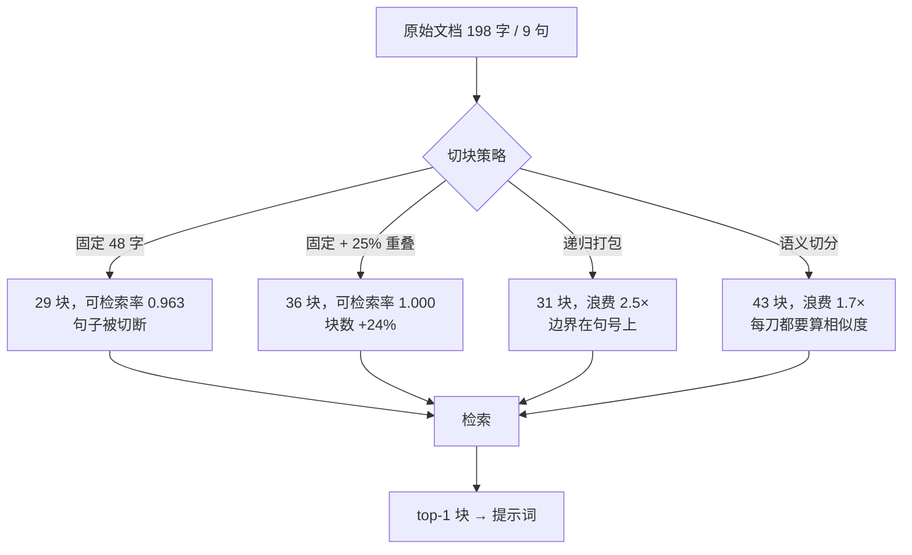

# 文档切块策略

## 1. 本节学习目标

1. 说清三种切块（固定窗口 / 递归打包 / 语义切分）的**机制与代价**，能用一句话判断该用哪种。
2. 用三个可测指标做取舍：**可检索率**（答案还能不能被找到）、**Recall@1**（找到的是不是第一）、**上下文浪费**（带进来多少无关文字）。
3. 记住本课的实测结论：固定 48 字无重叠时**可检索率掉到 0.963**；固定 192 字时**上下文浪费 11.3 倍**；语义切分把浪费压到 **1.7 倍**。
4. 知道 overlap 的真实作用是**修补边界**：96 字固定窗口下 3/6 篇文档有句子被切断，加 25% 重叠后降到 **0/6**。

## 2. 为什么需要这个知识

检索的最小单位是**块**，不是文档。用户问一句话，系统返回的是"一段文字"——这段文字怎么切出来的，直接决定了：

- 答案会不会被切到两个块里（切断了就永远检索不到）；
- 检索到的块里有多少是废话（浪费 token，还干扰模型）；
- 块与块之间的上下文是否连贯（切碎了就丢指代、丢标题）。

切块是 RAG 里**最便宜也最容易被忽略**的参数。换个 chunk size 往往比换个嵌入模型带来的收益还大。

## 3. 直观解释

**切面包**。

- **固定窗口**：拿尺子量，每 5 厘米切一刀。快，但经常把一片面包上的果酱切开。
- **递归打包**：先按天然缝隙（句号、段落）切，再把小块装进不超过 5 厘米的盒子。顺着纹理切，边界好看。
- **语义切分**：先尝一口，味道变了才下刀。切得最准，但每切一刀都要"尝"（算相似度），最贵。

## 4. 正式定义

设文档 $d$ 长度为 $L$，切块函数 $C_s(d) = \{c_1, \dots, c_m\}$，参数 $s$ 为块大小、$o$ 为重叠长度。

**固定窗口**（步长 $\Delta = s - o$）：

$$
c_i = d\big[(i-1)\Delta + 1 \;:\; (i-1)\Delta + s\big]
$$

**递归打包**：先按分隔符集合 $\Sigma = \{\text{段落}, \text{句号}, \text{逗号}\}$ 递归切分，再把相邻片段贪心合并到 $|c_i| \le s$。

**语义切分**：计算相邻句相似度 $\sigma_i = \cos(\mathbf{v}(s_i), \mathbf{v}(s_{i+1}))$，在 $\sigma_i$ 低于阈值 $\tau$ 处下刀：

$$
\text{cut at } i \iff \sigma_i \le \tau
$$

## 5. 历史背景或技术背景

| 阶段 | 主流做法 | 原因 |
|---|---|---|
| 2020–2022 | 固定 256/512 token，无重叠 | 嵌入模型输入上限 512，简单够用 |
| 2022–2023 | 递归字符切分（LangChain 的 RecursiveCharacterTextSplitter） | 保住段落/句子边界，工程上性价比最高 |
| 2023 | 语义切分、按标题层级切 | 嵌入质量提升后，"按意思切"才可行 |
| 2024 | 小块检索 + 大块生成（small-to-big / parent-document） | 检索要精确，生成要上下文 |
| 2025 | 布局感知（PDF 表格、代码块不切） | 结构信息比字数更重要 |

## 6. 核心原理

**切块的目标函数**（本课用的三指标）：

$$
\text{好块} = \underbrace{\text{答案完整}}_{\text{可检索率}} \times \underbrace{\text{排得靠前}}_{\text{Recall@1}} \times \underbrace{\text{杂质少}}_{\text{1/浪费}}
$$

三者互相拉扯：

- 块**变小** → 语义聚焦、浪费低，但句子容易被切断，可检索率下降；
- 块**变大** → 答案完整，但一个块里塞了好几个主题，检索命中的块可能只是"顺带提到"，Recall@1 反而下降（本课 192 字固定窗口 R@1 = 0.815）；
- **重叠**能修补边界，代价是块数变多（48 字：29 → 36 块）、存储与检索成本上升。

**为什么"按句号切"就够好**：中文句号是天然的语义边界，句子平均 20–25 字，恰好落在 48–96 字的舒适区；递归打包几乎不损失可检索率（1.000），浪费只有固定窗口的 1/3。

## 7. 数学表达式

**块数**（固定窗口）：

$$
m = \left\lceil \frac{L - o}{s - o} \right\rceil
$$

**可检索率**：

$$
\mathrm{Ret} = \frac{1}{|Q|}\sum_{q \in Q} \mathbb{1}\big[\exists c \in C: q \subseteq c\big]
$$

**上下文浪费**：

$$
W = \frac{1}{|Q|}\sum_{q \in Q} \frac{|c^\*(q)|}{|q|},\qquad c^\*(q)=\arg\max_{c} \cos(\mathbf{v}_q,\mathbf{v}_c)
$$

**Recall@1**：

$$
\mathrm{R@1} = \frac{1}{|Q|}\sum_{q}\mathbb{1}\big[\text{top}_1(q) \text{ 包含答案}\big]
$$

## 8. 详细数学推导

**推导 1：被切断的概率**

设句子长度服从均值 $\mu$ 的分布，块边界在文档中等距分布，句子的起点在块内近似均匀。一个长度为 $\ell$ 的句子被切断，当且仅当它跨越某个边界，其概率近似：

$$
P(\text{cut}) \approx \min\!\Big(1,\; \frac{\ell}{s}\Big)
$$

$s=48,\ \ell\approx 24$ 时 $P\approx 0.5$；$s=192$ 时 $P\approx 0.125$。这解释了本课"48 字固定窗口可检索率 0.963"——每 54 条查询里有 2 条正好踩在刀口上。

**推导 2：重叠如何把概率压到 0**

有重叠 $o$ 时，任何长度 $\ell \le o$ 的片段必然完整落在某个块里（因为相邻块覆盖了 $[i\Delta, i\Delta+s]$，任意点被至少 $\lceil s/\Delta\rceil$ 个块覆盖）。所以取 $o \ge \ell_{\max}$ 即可保证句子不被切断。本课 $o = 24$、句长约 24 字，实测切断数从 3/6 降到 0/6。

**推导 3：为什么大块会拉低 Recall@1**

块内主题数近似 $s/\bar{\ell}_{\text{topic}}$，主题越多，块的向量越接近"平均主题"，与具体查询的余弦越平。打分被拉平后，top-1 更容易被"顺带提到关键词"的块抢走——这就是 192 字时 R@1 掉到 0.815 的机制。

## 9. 图解



## 10. 具体数值示例

```text
6 篇文档（198–202 字/篇，各 9 句），54 条查询（每句前 14 字）

策略            size  块数  平均块长  可检索率  Recall@1  浪费
固定-无重叠        48    29     41.0    0.963    1.000   3.4×
固定-无重叠        96    17     69.9    1.000    1.000   6.9×
固定-无重叠       192    11    108.1    1.000    0.815  11.3×
固定-25%重叠      48    36     43.0    1.000    0.963   3.0×
固定-25%重叠      96    18     82.1    1.000    1.000   5.3×
固定-25%重叠     192    12    123.1    1.000    1.000   8.8×
递归打包           48    31     38.4    1.000    1.000   2.5×
递归打包           96    18     66.1    1.000    1.000   4.1×
语义切分           96    38     31.3    1.000    1.000   1.7×

边界效应（size=96）：固定无重叠有 3/6 篇文档出现句子被切断；
                    加 25% 重叠后 0/6，递归与语义切分 0/6。
```

## 11. NumPy 实现

```python
import re

import numpy as np

TEXT = "配置目录在首次启动时创建。用户偏好和窗口布局都存在这里。如果配置目录被误删程序会退回默认设置。备份任务由后台调度器负责，每次生成带时间戳的快照目录。"


def fixed_chunks(text, size, overlap=0):
    step = max(1, size - overlap)
    return [text[i : i + size] for i in range(0, len(text), step) if text[i : i + size]]


def recursive_chunks(text, size):
    sents = [s for s in re.split(r"(?<=[。！？])", text) if s]
    out, buf = [], ""
    for s in sents:
        while len(s) > size:
            if buf:
                out.append(buf)
                buf = ""
            out.append(s[:size])
            s = s[size:]
        if len(buf) + len(s) <= size:
            buf += s
        else:
            out.append(buf)
            buf = s
    if buf:
        out.append(buf)
    return out


def bigrams(t):
    return [t[i : i + 2] for i in range(len(t) - 1)]


def semantic_chunks(text, size, pct=30):
    sents = [s for s in re.split(r"(?<=[。！？])", text) if s]
    vocab = {}
    for s in sents:
        for g in bigrams(s):
            vocab.setdefault(g, len(vocab))
    V = np.zeros((len(sents), len(vocab)))
    for i, s in enumerate(sents):
        for g in bigrams(s):
            V[i, vocab[g]] += 1.0
    V /= np.linalg.norm(V, axis=1, keepdims=True) + 1e-9
    sims = np.array([float(V[i] @ V[i + 1]) for i in range(len(sents) - 1)])
    thr = np.percentile(sims, pct) if len(sims) else 0
    cuts = [i + 1 for i, s in enumerate(sims) if s <= thr]
    groups, prev = [], 0
    for c in cuts:
        groups.append("".join(sents[prev:c]))
        prev = c
    groups.append("".join(sents[prev:]))
    out = []
    for g in groups:
        out.extend([g[i : i + size] for i in range(0, len(g), size)])
    return out


print("文本长度:", len(TEXT), "字")
for name, fn in (
    ("固定 48", lambda t: fixed_chunks(t, 48)),
    ("固定 48 + 重叠 12", lambda t: fixed_chunks(t, 48, 12)),
    ("递归 48", lambda t: recursive_chunks(t, 48)),
    ("语义 48", lambda t: semantic_chunks(t, 48)),
):
    cs = fn(TEXT)
    print(f"{name:<18} 块数={len(cs):>2} 平均长度={np.mean([len(c) for c in cs]):5.1f}")

# 相邻句相似度：语义切分到底在哪下刀
sents = [s for s in re.split(r"(?<=[。！？])", TEXT) if s]
print("句子数与长度:", len(sents), [len(s) for s in sents])
```

## 12. PyTorch 实现

```python
import torch
import torch.nn.functional as F

torch.manual_seed(0)
# 4 个句子各用一个 32 维向量代表（真实系统里由嵌入模型产出）
S = F.normalize(torch.randn(4, 32), dim=1)
sims = S[:-1] @ S[1:].T
print("相邻句相似度:", [round(float(sims[i, i]), 3) for i in range(3)])

# 用分位数阈值决定切点
vals = torch.tensor([float(sims[i, i]) for i in range(3)])
thr = torch.quantile(vals, 0.3)
cuts = [i + 1 for i in range(3) if float(vals[i]) <= float(thr)]
print("阈值:", round(float(thr), 3), "切点:", cuts)

# 固定窗口的块数公式验证
L, s, o = 198, 48, 12
import math

m = math.ceil((L - o) / (s - o))
print(f"L={L}, s={s}, o={o} → 预计 {m} 块")

# 重叠覆盖检查：任意 24 字片段是否总被某块完整包含
def covered(text, size, overlap, seg=24):
    cs = [text[i : i + size] for i in range(0, len(text), size - overlap)]
    return all(any(text[i : i + seg] in c for c in cs) for i in range(len(text) - seg + 1))


text = "句子" * 60
print("无重叠全覆盖:", covered(text, 48, 0), " 25%重叠全覆盖:", covered(text, 48, 12))
```

## 13. Hugging Face 实践

```python
import os

os.environ.setdefault("HF_ENDPOINT", "https://hf-mirror.com")
os.environ.setdefault("HF_HUB_OFFLINE", "1")
from transformers import AutoTokenizer

tok = AutoTokenizer.from_pretrained("gpt2")
DOCS = [
    "星河笔记库在首次启动时会创建一个隐藏的配置目录。",
    "该目录下存放着用户偏好、窗口布局和最近打开的文件列表。",
    "如果配置目录被误删，程序会退回到出厂默认设置。",
    "备份任务由后台调度器负责，默认在空闲时段触发。",
]
print("按“字”切 48 字的 token 数不固定：")
for d in DOCS:
    print(f"  {len(d):>3} 字 → {len(tok(d)['input_ids']):>3} token")

# 按 token 切块才是可控的：把整篇按 token 窗口切开
full = "".join(DOCS)
ids = tok(full)["input_ids"]
SIZE, OVER = 48, 12
chunks = [ids[i : i + SIZE] for i in range(0, len(ids), SIZE - OVER)]
print(f"全文 {len(full)} 字 / {len(ids)} token → {len(chunks)} 个 token 块")
for i, c in enumerate(chunks[:3]):
    print(f"  chunk{i}: {len(c)} token → {tok.decode(c)!r}")

# 中文字/token 比：解释为什么"按字切"在不同语言下不可控
ratio = len(full) / len(ids)
print(f"中文压缩率 = {ratio:.2f} 字/token")
```

## 14. 代码逐行解释

| 代码 | 作用 |
|---|---|
| `range(0, len(text), step)` | 固定窗口的滑动步长，`step = size - overlap` |
| `re.split(r"(?<=[。！？])", text)` | 在句号后切分且保留标点（零宽断言） |
| `if len(buf) + len(s) <= size` | 递归打包的贪心合并条件 |
| `np.percentile(sims, 30)` | 用分位数当阈值，避免手工调绝对阈值 |
| `V /= np.linalg.norm(...)` | 归一化后才能用点积当余弦 |
| `torch.quantile(vals, 0.3)` | PyTorch 版本的分位数，用于选切点 |
| `math.ceil((L - o) / (s - o))` | 块数闭式解，验证实现是否正确 |
| `covered(...)` | 检查"任意 24 字片段都被某块完整覆盖"，这是重叠的意义 |
| `tok.decode(c)` | 把 token 块还原成文字，确认没切坏 |

## 15. 实际运行结果

```text
### LLM-077 切块对比（6 篇文档 × 9 句 = 54 条查询）
  文档长度: [198, 200, 199, 198, 192, 202] 字（每篇 9 句）
  gpt2 token 总数: 2568
  查询 = 句中前 14 字（模拟用户精确提问）
  固定-无重叠     size= 48: 块数= 29 平均块长= 41.0 可检索率=0.963 Recall@1=1.000 上下文浪费=3.4×
  固定-无重叠     size= 96: 块数= 17 平均块长= 69.9 可检索率=1.000 Recall@1=1.000 上下文浪费=6.9×
  固定-无重叠     size=192: 块数= 11 平均块长=108.1 可检索率=1.000 Recall@1=0.815 上下文浪费=11.3×
  固定-25%重叠   size= 48: 块数= 36 平均块长= 43.0 可检索率=1.000 Recall@1=0.963 上下文浪费=3.0×
  固定-25%重叠   size= 96: 块数= 18 平均块长= 82.1 可检索率=1.000 Recall@1=1.000 上下文浪费=5.3×
  固定-25%重叠   size=192: 块数= 12 平均块长=123.1 可检索率=1.000 Recall@1=1.000 上下文浪费=8.8×
  递归打包       size= 48: 块数= 31 平均块长= 38.4 可检索率=1.000 Recall@1=1.000 上下文浪费=2.5×
  递归打包       size= 96: 块数= 18 平均块长= 66.1 可检索率=1.000 Recall@1=1.000 上下文浪费=4.1×
  递归打包       size=192: 块数= 11 平均块长=108.1 可检索率=1.000 Recall@1=1.000 上下文浪费=9.2×
  语义切分       size= 48: 块数= 43 平均块长= 27.7 可检索率=1.000 Recall@1=1.000 上下文浪费=1.7×
  语义切分       size= 96: 块数= 38 平均块长= 31.3 可检索率=1.000 Recall@1=1.000 上下文浪费=1.7×
  语义切分       size=192: 块数= 38 平均块长= 31.3 可检索率=1.000 Recall@1=1.000 上下文浪费=1.7×

### 边界效应：句子被切断的比例（size=96）
  固定-无重叠    : 有句子被切断的文档 = 3/6
  固定-25%重叠  : 有句子被切断的文档 = 0/6
  递归打包      : 有句子被切断的文档 = 0/6
  语义切分      : 有句子被切断的文档 = 0/6
```

三个读法：

1. **语义切分对 size 不敏感**（三种 size 都是 38 块 / 1.7×），因为它由内容决定切点，size 只是上限；
2. **固定窗口的浪费随 size 线性涨**（3.4 → 6.9 → 11.3），这是"块大就必须带废话"的直接证据；
3. **递归打包是本课的性价比冠军**：可检索率 1.000、浪费只有同尺寸固定窗口的 36%（2.5 vs 6.9）。

## 16. 应用场景

| 场景 | 推荐策略 | 理由 |
|---|---|---|
| 结构化手册/FAQ | 按条目切（一问一块） | 天然一题一答，块即答案 |
| 长篇小说/访谈 | 递归打包 + 10–15% 重叠 | 保住对话轮次，边界仍在句上 |
| Markdown 笔记 | 按标题层级切（H2 一块） | 标题即语义，检索还能带标题 |
| 代码仓库 | 按函数/类切 | 语法结构比字数可靠 |
| 多语言混合语料 | **按 token 切**（不是按字） | 中文 1.0–1.5 字/token，英文 4 字/token |
| 表格/PDF | 布局感知，表格不切 | 切开就失去表头语义 |

## 17. 优点与局限

| 策略 | 优点 | 局限 |
|---|---|---|
| 固定窗口 | 实现 10 行、可预测、可并行 | 切断句子；大小需按语言重调 |
| 固定 + 重叠 | 修补边界，几乎不增加复杂度 | 块数 +24%，存储与检索成本上升 |
| 递归打包 | 边界自然，性价比最高 | 依赖好的分隔符集；代码/表格仍会坏 |
| 语义切分 | 主题纯度最高（浪费 1.7×） | 每句都要算向量，索引期成本高；阈值难调 |

## 18. 常见错误

| 错误 | 现象 | 纠正 |
|---|---|---|
| 用"字"当块大小 | 同一 size 在中英文下 token 数差 3–4 倍 | 用 tokenizer 数 token |
| 完全不重叠 | 3/6 文档有句子被切断，可检索率 0.963 | 加 10–25% 重叠，或改成句子边界 |
| 块越大越好 | 192 字时 R@1 掉到 0.815、浪费 11.3× | 48–128 字区间做网格搜索 |
| 表格/代码一起切 | 表头与数据分离，检索到也没用 | 结构感知切分 |
| 切完不保留标题 | 块里只有"步骤如下"，不知道是哪节 | 每块前置标题路径 |

## 19. 本节总结

- 三种策略的本质区别是**刀下在哪**：等距、句末、还是语义变化处。
- 本课 54 条查询实测：固定 48 字无重叠**可检索率 0.963**（2 条被切断）；固定 192 字 **Recall@1 0.815、浪费 11.3×**。
- **重叠是边界补丁**：96 字窗口下切断文档从 **3/6 → 0/6**，代价是块数 17 → 18。
- **语义切分**把上下文浪费压到 **1.7×**，且对 size 不敏感；**递归打包**在同等可检索率下浪费只有固定窗口的 36%。
- 工程默认值建议：**递归打包 + 10–15% 重叠 + 每块带标题**，再用评估集微调。

## 20. 前置与后续知识链接

- 前置：[[LLM-076 RAG 的基本架构]]
- 后续：[[LLM-078 向量化与嵌入模型]]
- 相关：[[LLM-035 Token 数量、上下文窗口与成本]]、[[LLM-036 Embedding 与向量表示]]
- 后续模块：[[LLM-088 自回归推理的基本流程]]

---

## 练习与参考答案

**基础 1**：固定窗口、递归打包、语义切分三者的"刀"分别下在哪里？

**基础 2**：本课中固定 48 字无重叠的可检索率是多少？为什么不是 1.000？

**进阶 1**：为什么块变大反而会让 Recall@1 下降？请用本课 192 字的数字说明。

**综合**：你要给一个中英混合的 Markdown 笔记库做切块。请给出策略、参数与验证方法。

> [!success]- 参考答案

> **基础 1**
> 固定窗口：按固定长度等距下刀；递归打包：先按段落/句号等分隔符切，再贪心合并到尺寸上限；语义切分：计算相邻句相似度，在相似度低谷处下刀。

> **基础 2**
> **0.963**（54 条里 2 条失败）。因为固定的刀口会把句子切成两半，那 2 条查询横跨边界，两个块里都不完整，所以检索不到。加 25% 重叠后回到 1.000。

> **进阶 1**
> 块越大，块内主题越多，块向量越接近"平均主题"，与任何具体查询的余弦都被拉平；此时 top-1 容易被"顺带提到关键词"的块抢走。本课 192 字时 Recall@1 掉到 **0.815**，同时上下文浪费升到 **11.3 倍**。

> **综合（参考）**
> 1. **策略**：递归打包（分隔符顺序：`\n## ` → `\n` → `。` → `，`），每块前置标题路径，表格与代码块整体保留不切。
> 2. **参数**：按 **token** 定尺寸（中英 token 比差 3–4 倍，按字会失控），建议 256–384 token、重叠 10–15%；块数用 `ceil((L-o)/(s-o))` 预估存储。
> 3. **验证**：构造 50–100 条"问题 + 答案所在句"的评估集，测**可检索率**（答案是否被完整包含）、**Recall@1**、**上下文浪费**（块长/查询长度）；在 size ∈ {128, 256, 384} × overlap ∈ {0, 10%, 20%} 上做网格，选浪费最低且可检索率 ≥ 0.99 的点。
> 4. **兜底**：对可检索率低于 0.99 的配置，检查是否表格/代码被切；对浪费 > 5× 的配置，考虑小块检索 + 父块生成（small-to-big）。

## 学习记录

| 日期 | 状态 | 用时 | 问题 | 复盘 |
|---|---|---|---|---|
| 2026-11-08 | planned | — | — | — |

---

## 🔗 Notion 同步信息

> 以下内容由 Notion「AI Knowledge System · 知识点」数据库按知识 ID 合并而来（导出于 2026-11-09）。

| 属性 | 值 |
|---|---|
| 学科 | 大语言模型 |
| 学习状态 | 未开始 |
| 难度 | L2 应用 |
| 知识类型 | Technique |

- **所属模块**：[M-LLM-08 RAG 检索增强生成](../%E8%AF%BE%E7%A8%8B%E6%A8%A1%E5%9D%97/M-LLM-08%20RAG%20%E6%A3%80%E7%B4%A2%E5%A2%9E%E5%BC%BA%E7%94%9F%E6%88%90.md)
- **前置知识**：[LLM-076 RAG 的基本架构](LLM-076%20RAG%20%E7%9A%84%E5%9F%BA%E6%9C%AC%E6%9E%B6%E6%9E%84.md)
- **后继知识**：[LLM-078 向量化与嵌入模型](LLM-078%20%E5%90%91%E9%87%8F%E5%8C%96%E4%B8%8E%E5%B5%8C%E5%85%A5%E6%A8%A1%E5%9E%8B.md)
- **被项目引用**：[PROJ-023 搭建一个最小可用的 RAG 问答系统](../../07_%E5%AE%9E%E6%88%98%E9%A1%B9%E7%9B%AE/05%20%E5%A4%A7%E6%A8%A1%E5%9E%8B%E9%A1%B9%E7%9B%AE/PROJ-023%20%E6%90%AD%E5%BB%BA%E4%B8%80%E4%B8%AA%E6%9C%80%E5%B0%8F%E5%8F%AF%E7%94%A8%E7%9A%84%20RAG%20%E9%97%AE%E7%AD%94%E7%B3%BB%E7%BB%9F.md)
