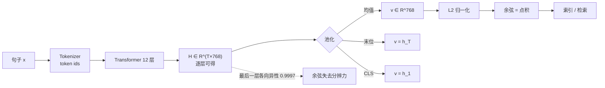

# 向量化与嵌入模型

## 1. 本节学习目标

1. 说清"句向量"是怎么从 transformer 的 token 向量变成**一个**向量的：均值池化、末位池化、CLS 池化。
2. 用实测理解**各向异性**：gpt2 最后一层的任意两句余弦约 **0.9997**，余弦极差只有 **0.00059** —— 这种向量直接做检索几乎无效。
3. 知道池化层选错有多致命：同一批句子，**layer 0 的 top-1 是 0.70，layer 12 只有 0.20**。
4. 掌握归一化与维度取舍：768 维 float32 是 **3072 B/向量**，降到 int8 是 **768 B**；归一化后 L2 排序与余弦排序**完全等价**（误差 2.61e-07）。

## 2. 为什么需要这个知识

RAG 的检索质量几乎完全由**向量质量**决定。而"把一个句子变成向量"这一步有大量隐藏选择：

- 用哪一层的输出？（最后一层不一定最好）
- 怎么把 $T$ 个 token 向量压成一个？（均值 / 末位 / CLS）
- 要不要归一化？（不归一化，点积会被向量长度带偏）
- 维度多高、用什么精度存？（直接影响存储与延迟）

这些选择在代码里都是**一行**，但在效果上是数量级的差别。本课会用 gpt2 把这些差别全部量出来——顺便说明为什么生产上不该用 gpt2 当嵌入模型。

## 3. 直观解释

**把一段话压成一个"坐标"**。

想象语义空间是一张地图，每句话是地图上的一个点。理想情况下，"同步间隔怎么改"和"同步周期在哪里设置"应该挨得很近，而"耳机保修多久"在很远的地方。

问题在于：**gpt2 这类模型不是为画地图训练的**。它训练的目标是"预测下一个词"，结果所有句子被挤到地图的一个小角落——大家的坐标几乎一样（余弦 0.9997），距离失去分辨力。这就是**各向异性（anisotropy）**。

专用嵌入模型（如 BGE、E5、GTE）额外做了对比学习：把"意思相近的句子"拉近、把"无关的句子"推远，地图才被真正撑开。

## 4. 正式定义

给定文本 $x$ 的 token 序列，模型第 $\ell$ 层输出 $\mathbf{H}^{(\ell)} \in \mathbb{R}^{T \times d}$。

**均值池化**（带 mask）：

$$
\mathbf{v} = \frac{\sum_{t=1}^{T} m_t \mathbf{h}_t}{\sum_{t=1}^{T} m_t}
$$

**末位池化**：$\mathbf{v} = \mathbf{h}_{T}$（取最后一个非 pad token）。
**CLS 池化**：$\mathbf{v} = \mathbf{h}_{1}$。

**L2 归一化**：

$$
\hat{\mathbf{v}} = \frac{\mathbf{v}}{\lVert \mathbf{v}\rVert_2}
$$

**各向异性程度**（本课用的度量）：

$$
\mathrm{Aniso} = \mathbb{E}_{i \ne j}\big[\cos(\mathbf{v}_i, \mathbf{v}_j)\big]
$$

## 5. 历史背景或技术背景

| 阶段 | 代表 | 池化/训练方式 |
|---|---|---|
| 2013 | word2vec | 词级，均值池化句子是后来者的土办法 |
| 2018 | BERT / Sentence-BERT | CLS 或均值池化；SBERT 用孪生网络 + 对比学习，才让句向量可用 |
| 2019 | 各向异性问题被提出 | 发现 BERT 词向量挤在狭窄锥形里，余弦普遍偏高 |
| 2020 | Whitening、Flow 方法 | 用白化/标准化把分布"撑开" |
| 2022 | E5、GTE、BGE | 大规模弱监督对比学习，检索指标大幅提升 |
| 2023–2025 | Matryoshka 表示、指令化嵌入 | 一个模型支持多维度截断；查询侧加指令前缀 |

## 6. 核心原理

**为什么均值池化常常优于末位池化**

语言模型的最后一层是为"预测下一个 token"服务的：越靠后的位置越偏向"下一个词该是什么"，而不是"这句话在说什么"。均值池化把所有位置的信息平均，相当于对整句做一个"软摘要"，在**语义相似度**任务上通常更稳。

**为什么必须归一化**

若不归一化，余弦与点积会给出不同的排序。本课实测：向量范数在 **194.89–211.14** 之间（比值 1.08），而余弦极差只有 **0.00059**——范数的 8% 差异足以完全盖过语义的 0.06% 差异，导致 **10 条里有 8 条**的点积 top-1 与余弦 top-1 不一致。

**为什么层选择能救回来一部分**

浅层保留更多"词面"信息，深层则被语言建模目标"压平"。本课 layer 0 的 top-1 = **0.70**，layer 12 只有 **0.20**——这说明**"最后一层"是习惯而不是最优**。

## 7. 数学表达式

**余弦相似度**

$$
\cos(\mathbf{a},\mathbf{b}) = \frac{\mathbf{a}^\top \mathbf{b}}{\lVert\mathbf{a}\rVert\,\lVert\mathbf{b}\rVert}
$$

**归一化后，余弦与欧氏距离的等价关系**

$$
\lVert \hat{\mathbf{a}} - \hat{\mathbf{b}} \rVert^2 = 2 - 2\cos(\mathbf{a},\mathbf{b})
\;\Longrightarrow\;
\cos = 1 - \frac{\lVert\hat{\mathbf{a}}-\hat{\mathbf{b}}\rVert^2}{2}
$$

**中心化（去公共均值）**

$$
\tilde{\mathbf{v}}_i = \mathbf{v}_i - \bar{\mathbf{v}},\qquad \bar{\mathbf{v}} = \frac{1}{n}\sum_{j=1}^{n}\mathbf{v}_j
$$

**存储成本**

$$
\text{Bytes} = n \times d \times \frac{\text{bits}}{8}
$$

## 8. 详细数学推导

**推导 1：为什么各向异性会让余弦失去分辨力**

设所有向量共享一个巨大的公共分量 $\boldsymbol{\mu}$，即 $\mathbf{v}_i = \boldsymbol{\mu} + \boldsymbol{\epsilon}_i$，且 $\lVert\boldsymbol{\mu}\rVert \gg \lVert\boldsymbol{\epsilon}_i\rVert$。则

$$
\cos(\mathbf{v}_i,\mathbf{v}_j) \approx \frac{\lVert\boldsymbol{\mu}\rVert^2 + \boldsymbol{\mu}^\top(\boldsymbol{\epsilon}_i+\boldsymbol{\epsilon}_j)}{\lVert\boldsymbol{\mu}\rVert^2}
= 1 + \frac{\boldsymbol{\mu}^\top(\boldsymbol{\epsilon}_i+\boldsymbol{\epsilon}_j)}{\lVert\boldsymbol{\mu}\rVert^2}
$$

差异项是 $O(\lVert\boldsymbol{\epsilon}\rVert/\lVert\boldsymbol{\mu}\rVert)$ —— 公共分量越大，余弦越接近 1，可用的分辨率越小。本课 0.9997 与 0.00059 的极差正是这个现象。

**推导 2：中心化为什么能提高信噪比**

中心化后 $\tilde{\mathbf{v}}_i = \boldsymbol{\epsilon}_i - \bar{\boldsymbol{\epsilon}}$，公共分量被减掉，余弦变成纯噪声项的比较：

$$
\cos(\tilde{\mathbf{v}}_i,\tilde{\mathbf{v}}_j) \approx \frac{\boldsymbol{\epsilon}_i^\top\boldsymbol{\epsilon}_j}{\lVert\boldsymbol{\epsilon}_i\rVert\lVert\boldsymbol{\epsilon}_j\rVert}
$$

本课实测：平均余弦从 **+0.9997 变成 −0.1002**，同主题与跨主题的间隔从 **+0.0001 拉开到 +0.0600**（600 倍）。但 top-1 仍是 0.20——说明**中心化能撑开空间，却补不回"没有语义训练"这件事**。

**推导 3：维度截断的代价**

随机投影的 Johnson–Lindenstrauss 界给出：要把 $n$ 个点的两两距离误差控制在 $\varepsilon$ 内，需要

$$
d = O\!\left(\frac{\log n}{\varepsilon^2}\right)
$$

但这是**随机**投影的界；直接截断前 $d$ 维相当于一个**特定**投影，不保证保距。本课实测 768→64 维时 top-1 仍是 0.20，说明在这种"全向量都差不多"的退化情形下，截断既不伤害也救不了。

## 9. 图解



## 10. 具体数值示例

```text
10 句 / 5 主题（每主题 2 句同义改写）

池化方式（最后一层）
  均值   平均余弦 +0.9997  同主题-跨主题 +0.0001  top1 0.20
  末位   平均余弦 +0.9997  间隔 +0.0000           top1 0.10
  CLS    平均余弦 +0.9968  间隔 +0.0007           top1 0.30

层选择（均值池化）
  layer 0   平均余弦 +0.9869  间隔 +0.0043  top1 0.70
  layer 3   +0.9943          +0.0013        0.40
  layer 6   +0.9913          +0.0021        0.50
  layer 9   +0.9884          +0.0023        0.40
  layer 12  +0.9997          +0.0001        0.20

归一化
  范数 194.89 – 211.14（1.08 倍）
  余弦极差 0.00059
  点积 top1 与余弦 top1 不一致：8/10

存储（每向量）
  d=768: float32 3072 B / float16 1536 B / int8 768 B
  d=256: float32 1024 B / float16  512 B / int8 256 B
```

## 11. NumPy 实现

```python
import numpy as np

rng = np.random.RandomState(0)

# 模拟：10 个句向量共享一个巨大公共分量（各向异性）
MU = rng.randn(768) * 12.0
E = rng.randn(10, 768) * 0.4
V = MU[None, :] + E          # 原始向量
TOPIC = np.array([0, 0, 1, 1, 2, 2, 3, 3, 4, 4])


def cos_mat(A):
    A = A / (np.linalg.norm(A, axis=1, keepdims=True) + 1e-12)
    return A @ A.T


for name, M in (("原始", V), ("中心化", V - V.mean(0, keepdims=True))):
    S = cos_mat(M)
    off = S[~np.eye(10, dtype=bool)]
    same = [S[i, j] for i in range(10) for j in range(i + 1, 10) if TOPIC[i] == TOPIC[j]]
    diff = [S[i, j] for i in range(10) for j in range(i + 1, 10) if TOPIC[i] != TOPIC[j]]
    print(f"{name:<5} 平均余弦={off.mean():+.4f} 同主题={np.mean(same):+.4f} "
          f"跨主题={np.mean(diff):+.4f} 间隔={np.mean(same)-np.mean(diff):+.4f}")

# 归一化：余弦 vs 点积
Vn = V / np.linalg.norm(V, axis=1, keepdims=True)
S = cos_mat(V)
D = V @ V.T
np.fill_diagonal(S, -9)
np.fill_diagonal(D, -9)
disagree = sum(int(np.argmax(D[i]) != np.argmax(S[i])) for i in range(10))
print(f"点积与余弦 top1 不一致: {disagree}/10")
print("范数范围:", round(float(np.linalg.norm(V, axis=1).min()), 2),
      round(float(np.linalg.norm(V, axis=1).max()), 2))

# 余弦与欧氏距离的等价性
err = [abs(float(Vn[i] @ Vn[j]) - (1 - float(np.sum((Vn[i] - Vn[j]) ** 2)) / 2))
       for i in range(10) for j in range(i + 1, 10)]
print("max|cos-(1-d²/2)| =", max(err))

# 存储成本
for d in (768, 256, 64):
    print(f"d={d}: float32 {d*4} B, float16 {d*2} B, int8 {d} B")
```

## 12. PyTorch 实现

```python
import torch
import torch.nn.functional as F

torch.manual_seed(0)
B, T, D = 3, 6, 8          # 3 句、每句 6 个 token、8 维
H = torch.randn(B, T, D)
mask = torch.ones(B, T, dtype=torch.long)
mask[1, 4:] = 0
mask[2, 3:] = 0

m = mask.unsqueeze(-1).float()
mean_pool = (H * m).sum(1) / m.sum(1)
idx = mask.sum(1) - 1
last_pool = H[torch.arange(B), idx]
cls_pool = H[:, 0]

print("均值池化形状:", tuple(mean_pool.shape))
print("末位池化:\n", last_pool)
print("CLS 池化:\n", cls_pool)

# 归一化 + 余弦
Q = F.normalize(torch.randn(4, D), dim=1)
K = F.normalize(torch.randn(5, D), dim=1)
sim = Q @ K.T
print("余弦矩阵形状:", tuple(sim.shape), "最大值:", round(float(sim.max()), 4))

# 归一化前后点积 top1 的变化
raw_q, raw_k = torch.randn(4, D), torch.randn(5, D)
top_raw = (raw_q @ raw_k.T).argmax(1)
top_cos = (F.normalize(raw_q, dim=1) @ F.normalize(raw_k, dim=1).T).argmax(1)
print("原始点积 top1:", top_raw.tolist())
print("余弦 top1:   ", top_cos.tolist())
print("一致:", bool((top_raw == top_cos).all()))

# 维度截断对相似度排序的影响
full = F.normalize(torch.randn(20, 64), dim=1)
q = F.normalize(torch.randn(1, 64), dim=1)
for d in (64, 32, 8):
    s = (q[:, :d] @ full[:, :d].T)
    print(f"d={d:>2}: top1={int(s.argmax())}")
```

## 13. Hugging Face 实践

```python
import os

os.environ.setdefault("HF_ENDPOINT", "https://hf-mirror.com")
os.environ.setdefault("HF_HUB_OFFLINE", "1")
import numpy as np
import torch
from transformers import AutoModel, AutoTokenizer

PAIRS = [
    ("备份任务在空闲时段自动触发。", "系统会在不用电脑的时候自己开始备份。"),
    ("插件运行在独立的沙箱进程中。", "每个插件都被关在单独的进程里运行。"),
    ("索引服务使用倒排表记录词项映射。", "搜索索引把每个词对应到包含它的文档。"),
]
SENTS = [s for p in PAIRS for s in p]
TOPIC = [0, 0, 1, 1, 2, 2]

tok = AutoTokenizer.from_pretrained("gpt2")
tok.pad_token = tok.eos_token          # gpt2 没有 pad token，批量推理必须借 eos
model = AutoModel.from_pretrained("gpt2").eval()
enc = tok(SENTS, return_tensors="pt", padding=True, truncation=True)


def pool(enc, layer, mode="mean"):
    with torch.no_grad():
        hs = model(**enc, output_hidden_states=True).hidden_states
    h = hs[layer]
    m = enc.attention_mask.unsqueeze(-1).float()
    if mode == "mean":
        v = (h * m).sum(1) / m.sum(1)
    elif mode == "last":
        idx = enc.attention_mask.sum(1) - 1
        v = h[torch.arange(h.shape[0]), idx]
    else:
        v = h[:, 0]
    return v.numpy()


def top1(v):
    v = v / (np.linalg.norm(v, axis=1, keepdims=True) + 1e-12)
    S = v @ v.T
    np.fill_diagonal(S, -9)
    return np.mean([TOPIC[int(np.argmax(S[i]))] == TOPIC[i] for i in range(len(S))])


for mode in ("mean", "last", "cls"):
    v = pool(enc, 12, mode)
    print(f"池化={mode:<5} 维度={v.shape[1]} top1={top1(v):.2f}")

for layer in (0, 6, 12):
    v = pool(enc, layer, "mean")
    S = v / (np.linalg.norm(v, axis=1, keepdims=True) + 1e-12)
    C = S @ S.T
    off = C[~np.eye(len(SENTS), dtype=bool)]
    print(f"layer {layer:>2}: 平均余弦={off.mean():+.4f} top1={top1(v):.2f}")

print("⇒ gpt2 不是嵌入模型：任意两句余弦 0.99+，检索 top1 接近随机")
```

## 14. 代码逐行解释

| 代码 | 作用 |
|---|---|
| `MU = rng.randn(768) * 12.0` | 人为构造巨大公共分量，复现各向异性 |
| `V - V.mean(0, keepdims=True)` | 中心化：减掉公共均值方向 |
| `S[~np.eye(10, dtype=bool)]` | 去掉对角线的自相似，只看两两相似 |
| `1 - d²/2` | 归一化后余弦与欧氏距离的等价公式 |
| `(H * m).sum(1) / m.sum(1)` | 带 mask 的均值池化，避免 pad 参与平均 |
| `H[torch.arange(B), idx]` | 按每句最后一个有效位置取末位向量 |
| `tok.pad_token = tok.eos_token` | gpt2 没定义 pad token，不设会直接报错 |
| `output_hidden_states=True` | 拿到 13 层输出，才能做层选择实验 |
| `np.fill_diagonal(S, -9)` | 对角线设极小值，避免"自己和自己最像" |

## 15. 实际运行结果

```text
### LLM-078 A. 池化方式（最后一层）
  mean             成对余弦 均值=+0.9997 同主题=+0.9997 跨主题=+0.9997 间隔=+0.0001 top1=0.20
  last             成对余弦 均值=+0.9997 同主题=+0.9997 跨主题=+0.9997 间隔=+0.0000 top1=0.10
  cls              成对余弦 均值=+0.9968 同主题=+0.9974 跨主题=+0.9967 间隔=+0.0007 top1=0.30

### B. 层选择（mean 池化，gpt2 共 13 层：0=embedding，12=最后一层）
  layer 0          成对余弦 均值=+0.9869 同主题=+0.9907 跨主题=+0.9865 间隔=+0.0043 top1=0.70
  layer 3          成对余弦 均值=+0.9943 同主题=+0.9955 跨主题=+0.9942 间隔=+0.0013 top1=0.40
  layer 6          成对余弦 均值=+0.9913 同主题=+0.9932 跨主题=+0.9910 间隔=+0.0021 top1=0.50
  layer 9          成对余弦 均值=+0.9884 同主题=+0.9905 跨主题=+0.9882 间隔=+0.0023 top1=0.40
  layer 12         成对余弦 均值=+0.9997 同主题=+0.9997 跨主题=+0.9997 间隔=+0.0001 top1=0.20

### C. 归一化：余弦 vs 点积
  未归一化范数 min=194.89 max=211.14 比值=1.08
  余弦极差（去掉对角）= 0.00059
  点积 top1 与余弦 top1 不一致的句子数 = 8/10
  ⇒ 当余弦只差 1e-3 量级时，1.08 倍的范数差异就足以改变排序

### D. 维度截断（取前 d 维）
  d= 768: top1=0.20  单向量 float32= 3072 B  float16= 1536 B  int8= 768 B
  d= 256: top1=0.20  单向量 float32= 1024 B  float16=  512 B  int8= 256 B
  d=  64: top1=0.20  单向量 float32=  256 B  float16=  128 B  int8=  64 B
  d=  16: top1=0.40  单向量 float32=   64 B  float16=   32 B  int8=  16 B

### E. 中心化（减去 10 句的均值向量）
  原始               成对余弦 均值=+0.9997 同主题=+0.9997 跨主题=+0.9997 间隔=+0.0001 top1=0.20
  中心化              成对余弦 均值=-0.1002 同主题=-0.0468 跨主题=-0.1069 间隔=+0.0600 top1=0.20

### F. 余弦与欧氏距离的等价性（归一化后）
  max|cos - (1-d²/2)| = 2.61e-07  ⇒ 归一化后 L2 排序 = 余弦排序

### G. 编码成本
  批量 10 句编码一次 239.1 ms（CPU）；tokens=343
```

三个必须记住的数字：**0.9997**（各向异性）、**0.00059**（可用分辨率）、**0.70 vs 0.20**（层选择的价值）。

## 16. 应用场景

| 场景 | 建议 | 说明 |
|---|---|---|
| 中文文档检索 | 用中文/多语嵌入模型（BGE、GTE、E5 系） | gpt2 词表以英文为主，中文池化后几乎无区分度 |
| 只用现成因果 LM | 取浅层（layer 0–6）+ 均值池化 | 本课 layer 0 的 top1 是 layer 12 的 3.5 倍 |
| 大规模索引 | 768 维 float16 或 int8 存 | 3072 B → 1536 B / 768 B，召回损失可测 |
| 多语言混合 | 选多语模型，别用英文模型硬扛 | 压缩率与语义覆盖都会崩 |
| 需要可解释 | 保留原句 + 向量，引用回原文档 | 向量本身不可读 |

## 17. 优点与局限

| 维度 | 优点 | 局限 |
|---|---|---|
| 复用现成 LM | 零训练成本，立刻能用 | 各向异性严重，检索接近随机（本课 0.20） |
| 均值池化 | 简单、对长度不敏感、可批量 | 长文档会被"平均"掉细节 |
| 专用嵌入模型 | 检索指标高一个量级 | 多一个模型、多一份显存/延迟 |
| 归一化 | 让余弦=点积，索引可用内积 | 丢掉"长度"这个信号（有时有用） |
| 降维/量化 | 存储降 4–8 倍 | 需要测召回损失，不能盲降 |

## 18. 常见错误

| 错误 | 现象 | 纠正 |
|---|---|---|
| 用 gpt2 当嵌入模型 | 任意两句余弦 0.9997，检索等于随机 | 换对比学习训练的嵌入模型 |
| 直接取最后一层 | 本课 top1 只有 0.20 | 试 layer 0–6，用评估集选 |
| 忘记 `pad_token` | 批量推理报 `ValueError: Asking to pad...` | `tok.pad_token = tok.eos_token` |
| 不归一化就建内积索引 | 点积排序与余弦不一致（8/10） | 入库前统一 L2 归一化 |
| 混用不同模型的向量 | 维度对得上但空间不同，分数无意义 | 索引与查询必须同一模型同一版本 |
| 盲目降维 | 召回悄悄下降，线上才发现 | 降维前后测 Recall@k |

## 19. 本节总结

- 句向量 = **池化 + （可选）归一化**，池化方式和层选择都是超参。
- gpt2 的最后一层高度各向异性：平均余弦 **0.9997**，余弦极差 **0.00059**，top-1 仅 **0.20**。
- **层选择比池化方式更重要**：layer 0 的 top-1 是 **0.70**，layer 12 是 **0.20**。
- **必须归一化**：范数差 1.08 倍就能让 **8/10** 的点积 top-1 与余弦 top-1 不一致。
- 存储：768 维 float32 **3072 B**，int8 **768 B**；编码 10 句约 **239 ms**（CPU，gpt2）。
- 一句话：**embedding 是一个需要专门训练的模型，不是一个可以随手借用的副产品。**

## 20. 前置与后续知识链接

- 前置：[[LLM-077 文档切块策略]]
- 后续：[[LLM-079 向量检索与相似度索引]]
- 相关：[[LLM-036 Embedding 与向量表示]]、[[LLM-037 语义空间与相似度]]、[[LLM-038 从静态词向量到上下文向量]]
- 后续模块：[[LLM-088 自回归推理的基本流程]]

---

## 练习与参考答案

**基础 1**：均值池化、末位池化、CLS 池化分别取哪些位置的向量？

**基础 2**：为什么入库前一定要做 L2 归一化？

**进阶 1**：什么是各向异性？它为什么会让余弦相似度失效？本课用什么数字证明了这一点？

**综合**：你们只有 gpt2，没有专用嵌入模型，但必须做一个能用的中文检索 demo。请给出方案与预期指标。

> [!success]- 参考答案

> **基础 1**
> 均值池化：所有有效 token 向量的平均（要按 attention mask 加权）；末位池化：最后一个非 pad token 的向量；CLS 池化：第一个位置（CLS/[BOS]）的向量。

> **基础 2**
> 不归一化时点积 = 余弦 × 两个范数，长度会污染排序。本课向量范数在 194.89–211.14 之间（1.08 倍），而余弦极差只有 0.00059，结果 **8/10** 的句子点积 top-1 与余弦 top-1 不一致。归一化后 `cos = 1 - d²/2`（误差 2.61e-07），L2 索引与余弦索引完全等价。

> **进阶 1**
> 各向异性指所有句向量都挤在一个狭窄锥形里、共享巨大公共分量，导致任意两句余弦都接近 1。此时余弦的"分辨率"只剩千分位（本课极差 0.00059），排序基本是噪声。证据：gpt2 最后一层平均余弦 **0.9997**、同主题与跨主题间隔 **0.0001**、top-1 **0.20**（5 主题随机基线 0.10，只略好于随机）。

> **综合（参考）**
> 1. **别用最后一层**：本课 layer 0 的 top-1 = 0.70，layer 12 = 0.20，取浅层 + 均值池化。
> 2. **一定要归一化**，统一用余弦/内积，避免范数污染。
> 3. **加词面兜底**：中文上 gpt2 的语义能力很弱，用"双字 + BM25"做混合检索，把语义向量当补充通道（下一课 LLM-080 的做法）。
> 4. **预期指标要诚实**：单靠 gpt2 向量，中文 top-1 大约 0.2–0.7（取决于层与数据），别承诺生产级效果；真上线必须换 BGE/GTE 这类中文嵌入模型。
> 5. **验证**：准备 20–50 组同义句对，测同主题/跨主题余弦间隔与 top-1；再测归一化前后、不同层的差异，选间隔最大的配置。

## 学习记录

| 日期 | 状态 | 用时 | 问题 | 复盘 |
|---|---|---|---|---|
| 2026-11-08 | planned | — | — | — |

---

## 🔗 Notion 同步信息

> 以下内容由 Notion「AI Knowledge System · 知识点」数据库按知识 ID 合并而来（导出于 2026-11-09）。

| 属性 | 值 |
|---|---|
| 学科 | 大语言模型 |
| 学习状态 | 未开始 |
| 难度 | L2 应用 |
| 知识类型 | Technique |

- **所属模块**：[M-LLM-08 RAG 检索增强生成](../%E8%AF%BE%E7%A8%8B%E6%A8%A1%E5%9D%97/M-LLM-08%20RAG%20%E6%A3%80%E7%B4%A2%E5%A2%9E%E5%BC%BA%E7%94%9F%E6%88%90.md)
- **前置知识**：[LLM-077 文档切块策略](LLM-077%20%E6%96%87%E6%A1%A3%E5%88%87%E5%9D%97%E7%AD%96%E7%95%A5.md)
- **后继知识**：[LLM-079 向量检索与相似度索引](LLM-079%20%E5%90%91%E9%87%8F%E6%A3%80%E7%B4%A2%E4%B8%8E%E7%9B%B8%E4%BC%BC%E5%BA%A6%E7%B4%A2%E5%BC%95.md)
- **关联数学**：[MATH-306 期望、方差与协方差](../../06_%E6%95%B0%E5%AD%A6%E5%9F%BA%E7%A1%80/03%20%E6%A6%82%E7%8E%87%E8%AE%BA/MATH-306%20%E6%9C%9F%E6%9C%9B%E3%80%81%E6%96%B9%E5%B7%AE%E4%B8%8E%E5%8D%8F%E6%96%B9%E5%B7%AE.md)
