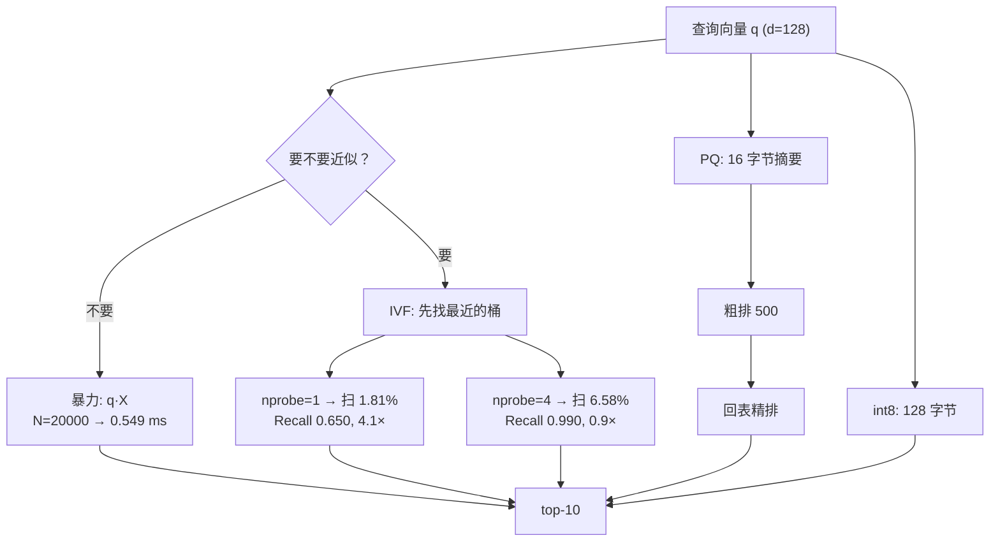

# 向量检索与相似度索引

## 1. 本节学习目标

1. 能从零写出**暴力检索**，并推导它的复杂度 $O(Nd)$ 与内存 $4Nd$ 字节。
2. 理解三类近似索引的取舍：**IVF**（少扫）、**PQ**（少存）、**int8**（少存且几乎不掉点）。
3. 用本课实测记住关键数字：2 万条 128 维向量上，暴力 **0.549 ms/条**；IVF `nprobe=1` **0.650 Recall@10 @ 4.1× 加速**；**PQ 单独用只有 0.135**，但"PQ 粗排 500 + 原向量精排"能到 **0.970**。
4. 知道为什么本机 numpy 版 IVF 在 `nprobe=4` 时加速掉到 0.9×——**候选收集的 Python 开销**吃掉了收益，生产实现（C++）不会。

## 2. 为什么需要这个知识

向量检索是 RAG 的**心脏**：每次提问都要在几十万到几十亿条向量里找最近的几条。

- 暴力检索每查一次要把整个库读一遍：$N=10^8, d=768$ 时是 300 GB 内存 + 每次 768 亿次乘加；
- 索引结构可以用 1%–10% 的扫描量换 0.95+ 的召回；
- 选错索引，要么慢到不可用，要么召回悄悄掉一半。

这一节把"召回率—延迟—内存"这三个量的关系算清楚。

## 3. 直观解释

**在图书馆找书**。

- **暴力检索**：从第一排走到最后一排，每本都翻一下。绝对准确，但库大了走不动。
- **IVF**：先按主题分区（文学/科技/历史…），查的时候只看最像的那一两个区。可能漏掉"放错区"的书。
- **PQ**：不给每本书全文，只给一张 16 字节的"内容摘要卡"，先按摘要卡粗筛，再把候选的真书调出来细看。
- **int8**：把每本书的索引卡从"精装"换成"简装"，信息损失很小，柜子却小 4 倍。

## 4. 正式定义

给定库 $\mathcal{D} = \{\mathbf{x}_1,\dots,\mathbf{x}_N\}$，$\mathbf{x}_i \in \mathbb{R}^d$，查询 $\mathbf{q}$，返回

$$
\mathrm{top}_k(\mathbf{q}) = \operatorname{arg\,top\text{-}k}_{i} \; \langle \mathbf{q}, \mathbf{x}_i\rangle
$$

**IVF（Inverted File）**：用 $L$ 个粗聚类中心 $\{\mathbf{c}_1,\dots,\mathbf{c}_L\}$ 把库分成 $L$ 个桶，查询时只扫最靠前的 $p$ 个桶（`nprobe`）：

$$
\mathcal{S}(\mathbf{q}) = \bigcup_{j \in \operatorname{top}_p(\mathbf{q})} B_j
$$

**PQ（Product Quantization）**：把 $d$ 维切成 $M$ 段，每段用 $K_c$ 个中心量化：

$$
\mathbf{x} \approx \big[\mathbf{c}^{(1)}_{i_1}, \dots, \mathbf{c}^{(M)}_{i_M}\big],\qquad \text{存储} = M\log_2 K_c \ \text{bit}
$$

**标量量化（int8）**：

$$
\hat{x} = \mathrm{round}\!\left(\frac{x - x_{\min}}{x_{\max}-x_{\min}}\cdot 255\right)
$$

**召回率**：

$$
\mathrm{Recall@}k = \frac{1}{|Q|}\sum_{q\in Q}\frac{|\mathrm{top}_k^{\text{approx}}(q) \cap \mathrm{top}_k^{\text{exact}}(q)|}{k}
$$

## 5. 历史背景或技术背景

| 年份 | 方法 | 核心思想 |
|---|---|---|
| 1998 | 倒排索引 / TF-IDF | 稀疏检索的第一次工程化 |
| 2010 | **PQ（Jégou et al.）** | 乘积量化，把向量压到几十字节 |
| 2013 | **IVFADC** | 粗聚类 + 残差量化，十亿级向量的标配 |
| 2016 | **HNSW** | 多层可导航小世界图，查询 $O(\log N)$，至今仍是低延迟首选 |
| 2017 | FAISS 开源 | 把上述结构做成工业级 C++ 库 |
| 2021 | DiskANN / SPANN | 内存放不下的库，用 SSD 承载 |
| 2023–2025 | 量化 + 图索引融合 | 单机十亿向量、毫秒级延迟成为常态 |

## 6. 核心原理

**三种省法，省的东西不一样**

| 手段 | 省什么 | 代价 | 典型参数 |
|---|---|---|---|
| IVF | 省**扫描量** | 桶边界上的邻居会漏 | `nlist`, `nprobe` |
| PQ | 省**内存** | 距离被近似，排序变糙 | `M`, `nbits` |
| int8 | 省**内存**（4×） | 轻微精度损失 | 每维 1 字节 |
| HNSW | 省**扫描量**（更彻底） | 建图慢、内存涨、参数难调 | `M`, `efConstruction`, `efSearch` |

**关键洞察：PQ 不能单独用于最终排序。** 本课纯 PQ 的 Recall@10 只有 **0.135**——因为 16 字节的摘要卡不足以区分 2 万条中的前 10 名。正确用法是**两级**：PQ 粗排（取 500 个候选）再回表用原始向量精排，Recall@10 立刻回到 **0.970**。

**为什么 IVF 的加速会"消失"**：候选向量要先从大数组里 gather 出来再算点积。$p$ 增大时 gather 的量线性涨，而 numpy 的索引开销是常数级但很大（本课 $p=4$ 时 0.586 ms，和暴力 0.549 ms 持平）。生产的 C++ 实现里 gather 是连续内存访问，加速比可以保持。

## 7. 数学表达式

**暴力检索复杂度**

$$
T_{\text{brute}} = O(Nd),\qquad M_{\text{brute}} = 4Nd\ \text{bytes}
$$

**IVF 的期望扫描量**（假设桶大小均匀、查询均匀落入 $p$ 个桶）：

$$
\mathbb{E}[|\mathcal{S}|] \approx \frac{p}{L}N
$$

**加速比上界**

$$
\text{Speedup} \le \frac{L}{p}
$$

**PQ 的近似误差**（每段独立量化，误差为各段误差之和）：

$$
\mathbb{E}\big[\lVert \mathbf{x} - \hat{\mathbf{x}}\rVert^2\big] = \sum_{m=1}^{M}\mathbb{E}\big[\lVert \mathbf{x}^{(m)} - \hat{\mathbf{x}}^{(m)}\rVert^2\big]
$$

**ADC（非对称距离计算）**：查询不量化，只量化库向量：

$$
\langle \mathbf{q}, \hat{\mathbf{x}}\rangle = \sum_{m=1}^{M}\big\langle \mathbf{q}^{(m)}, \mathbf{c}^{(m)}_{i_m}\big\rangle
$$

只需 $M$ 次查表 + 求和，而不是 $d$ 次乘加。

## 8. 详细数学推导

**推导 1：为什么"归一化后 L2 = 余弦"**

$$
\lVert \mathbf{q} - \mathbf{x}\rVert^2 = \lVert\mathbf{q}\rVert^2 + \lVert\mathbf{x}\rVert^2 - 2\langle\mathbf{q},\mathbf{x}\rangle
$$

当 $\lVert\mathbf{q}\rVert=\lVert\mathbf{x}\rVert=1$ 时，$\lVert\mathbf{q}-\mathbf{x}\rVert^2 = 2 - 2\cos$，所以**按 L2 升序 = 按余弦降序**。本课实测两者差值为 **0.00e+00**（浮点下完全相同）。

**推导 2：IVF 少扫多少**

本课 $N=20000$、$L=64$、$p=1$：理论扫描 $1/64 = 1.56\%$，实测 **1.81%**（361 条）。偏差来自桶大小不均（min=0, max=545, 均值 312.5）。这也解释了为什么"桶大小极不均衡"会伤害 IVF：空桶白占 $p$ 的名额。

**推导 3：PQ 的误差与分辨力的关系**

设每段量化误差为 $\varepsilon_m$，则总误差 $\varepsilon^2 = \sum_m \varepsilon_m^2$。若把 $M$ 段各用 $K_c$ 个中心量化，$K_c$ 增大时 $\varepsilon_m$ 以 $K_c^{-2/d_m}$ 下降（$d_m=d/M$ 为段维度），即 **每段维度越高，量化越难**：

$$
\varepsilon_m \propto K_c^{-2/d_m} = K_c^{-2M/d}
$$

这就是为什么 $M$ 不能太小（段太长、量化太糙），也不能太大（段太短、码本学不到结构）。本课 $M=16$、每段 8 维、$K_c=256$，重建 MSE **0.00080**，而向量本身的均方是 **0.00762**——信噪比约 9.5:1，但 top-10 排序仍然只有 0.135，说明"重建误差小"不等于"排序对"。

**推导 4：HNSW 的复杂度**

HNSW 把点组织成多层图，上层稀疏、下层稠密。查询从顶层贪心下降，每层访问 $O(1)$ 个节点，共 $O(\log N)$ 层：

$$
T_{\text{HNSW}} = O(\log N \cdot \deg),\qquad \deg \approx 2M
$$

代价是建图 $O(N\log N)$、内存 $O(NM)$，且**删除/更新困难**（图结构要修补）。

## 9. 图解



## 10. 具体数值示例

```text
N=20000, d=128, 40 个簇, 20 条查询, 全部 L2 归一化

暴力:            0.549 ms/条, 内存 19.53 MB (512 B/向量), Recall 1.000
IVF-64 nprobe=1: 0.133 ms/条, 扫 1.81%, 4.1× 加速, Recall 0.650
IVF-64 nprobe=2: 0.285 ms/条, 扫 3.43%, 1.9× 加速, Recall 0.890
IVF-64 nprobe=4: 0.586 ms/条, 扫 6.58%, 0.9× 加速, Recall 0.990
IVF-64 nprobe=8: 1.109 ms/条, 扫 13.51%, 0.5× 加速, Recall 1.000

PQ(16×8×256): 10.1 s 训练, 16 B/向量
  纯 PQ:                 Recall 0.135
  PQ 粗排 100 + 精排:    Recall 0.595
  PQ 粗排 500 + 精排:    Recall 0.970
  PQ 粗排 2000 + 精排:   Recall 1.000

int8: 128 B/向量 (8× 压缩), Recall 0.980
```

## 11. NumPy 实现

```python
import numpy as np

rng = np.random.RandomState(0)
N, D, K = 2000, 64, 10

centers = rng.randn(K, D) * 3.0
labels = rng.randint(0, K, N)
X = centers[labels] + rng.randn(N, D) * 1.0
X /= np.linalg.norm(X, axis=1, keepdims=True)

Q = X[rng.choice(N, 5)] + rng.randn(5, D) * 0.3
Q /= np.linalg.norm(Q, axis=1, keepdims=True)


def brute(X, q, k=5):
    return np.argsort(-(X @ q))[:k]


truth = [brute(X, q) for q in Q]


def kmeans(A, k, iters=10, seed=0):
    r = np.random.RandomState(seed)
    C = A[r.choice(len(A), k, replace=False)].copy()
    for _ in range(iters):
        a = (-2.0 * (A @ C.T) + (C ** 2).sum(1)).argmin(1)
        for j in range(k):
            m = a == j
            if m.any():
                C[j] = A[m].mean(0)
    return C, a


L = 16
C, assign = kmeans(X, L)
buckets = [np.where(assign == j)[0] for j in range(L)]

for nprobe in (1, 2, 4, 8):
    hit = 0
    scanned = 0
    for qi, q in enumerate(Q):
        probe = np.argsort(-(C @ q))[:nprobe]
        cand = np.concatenate([buckets[j] for j in probe])
        scanned += len(cand)
        top = cand[np.argsort(-(X[cand] @ q))[:5]]
        hit += len(set(top) & set(truth[qi])) / 5
    print(f"nprobe={nprobe}: Recall@5={hit/len(Q):.3f} 平均扫描={scanned/len(Q):.0f}/{N}")

# int8 量化
lo, hi = X.min(0), X.max(0)
Xi = np.round((X - lo) / (hi - lo + 1e-9) * 255).astype(np.uint8)
Xd = Xi.astype(np.float32) / 255 * (hi - lo) + lo
hit = np.mean([len(set(brute(Xd, q)) & set(t)) / 5 for q, t in zip(Q, truth)])
print(f"int8: Recall@5={hit:.3f} 内存 {X.nbytes} → {Xi.nbytes} B")
```

## 12. PyTorch 实现

```python
import torch
import torch.nn.functional as F

torch.manual_seed(0)
N, D, NQ = 5000, 64, 8
X = F.normalize(torch.randn(N, D), dim=1)
Q = F.normalize(torch.randn(NQ, D), dim=1)

sims = Q @ X.T                        # [8, 5000]
vals, idx = sims.topk(10, dim=1)      # 批量 top-10
print("topk 结果形状:", tuple(idx.shape))
print("第一条查询的 top-3 分数:", [round(float(v), 4) for v in vals[0, :3]])

# 分块暴力：模拟显存放不下整个库的场景
def chunked_search(Q, X, k=10, chunk=1024):
    best = []
    for q in Q:
        bv, bi = [], []
        for s in range(0, X.shape[0], chunk):
            s_blk = X[s : s + chunk]
            v, i = (s_blk @ q).topk(min(k, s_blk.shape[0]))
            bv.append(v)
            bi.append(i + s)
        v = torch.cat(bv)
        i = torch.cat(bi)
        top = v.topk(k)
        best.append(i[top.indices])
    return torch.stack(best)


idx2 = chunked_search(Q, X)
print("分块与整块结果一致:", bool(torch.equal(idx, idx2)))

# int8 量化（PyTorch 版）
lo, hi = X.min(0).values, X.max(0).values
Xi = torch.round((X - lo) / (hi - lo + 1e-9) * 255).to(torch.uint8)
Xd = Xi.float() / 255 * (hi - lo) + lo
v1, i1 = (Q @ X.T).topk(10, dim=1)
v2, i2 = (Q @ Xd.T).topk(10, dim=1)
print("int8 内存:", X.numel() * 4 // 1024, "KB →", Xi.numel() // 1024, "KB")
print("top-1 一致率:", float((i1[:, 0] == i2[:, 0]).float().mean()))
```

## 13. Hugging Face 实践

```python
import os

os.environ.setdefault("HF_ENDPOINT", "https://hf-mirror.com")
os.environ.setdefault("HF_HUB_OFFLINE", "1")
import numpy as np
import torch
from transformers import AutoModel, AutoTokenizer

SENTS = [
    "同步间隔默认 300 秒。", "同步周期可以改成 60 到 3600 秒。", "备份保留 7 天。",
    "快照超过 7 天自动合并。", "插件需要开启社区开关。", "移动端不支持本地插件。",
    "导出 PDF 用打印对话框。", "中文字体使用思源宋体。", "索引文件在 .index 目录。",
    "令牌有效期 90 天。", "图片单文件上限 20 MB。", "版本回退保留 30 个历史版本。",
]

tok = AutoTokenizer.from_pretrained("gpt2")
tok.pad_token = tok.eos_token
model = AutoModel.from_pretrained("gpt2").eval()
enc = tok(SENTS, return_tensors="pt", padding=True, truncation=True)
with torch.no_grad():
    h = model(**enc).last_hidden_state
m = enc.attention_mask.unsqueeze(-1).float()
V = ((h * m).sum(1) / m.sum(1)).numpy()
V /= np.linalg.norm(V, axis=1, keepdims=True) + 1e-9
print("向量矩阵:", V.shape, "单向量字节:", V.shape[1] * 4)

q = "同步多久一次"
with torch.no_grad():
    hq = model(**tok(q, return_tensors="pt")).last_hidden_state
vq = hq[0].mean(0).numpy()
vq /= np.linalg.norm(vq) + 1e-9

scores = V @ vq
print("暴力 top3:", list(np.argsort(-scores)[:3]), [round(float(scores[i]), 4) for i in np.argsort(-scores)[:3]])

# 简易 IVF：按前两维粗分两桶，只搜一桶
order = np.argsort(-((V @ V[:2].T.mean(0)) if False else V[:, 0]))
half = order[: len(order) // 2]
sub = np.argsort(-(V[half] @ vq))[:3]
print("单桶 top3（近似）:", list(half[sub]))
print("⇒ 桶选错就会漏掉正确的句子，这就是 IVF 的召回损失来源")
```

## 14. 代码逐行解释

| 代码 | 作用 |
|---|---|
| `-2.0 * (A @ C.T) + (C**2).sum(1)` | 用矩阵乘法算欧氏距离平方，避免三重循环 |
| `buckets = [np.where(assign == j)[0] ...]` | 倒排表：桶号 → 向量下标 |
| `cand = np.concatenate([...])` | 收集候选，这一步的 gather 开销是 IVF 的主要成本 |
| `sims.topk(10, dim=1)` | PyTorch 批量取 top-k，比逐条 argsort 快 |
| `chunked_search` | 分块扫库，显存放不下整个库时的标准做法 |
| `(X - lo)/(hi - lo) * 255` | int8 的最小-最大量化 |
| `V /= np.linalg.norm(...)` | 归一化后点积即余弦，才能与余弦索引对齐 |
| `half = order[: len(order)//2]` | 单桶近似：只搜一半，演示"漏召回" |

## 15. 实际运行结果

```text
### LLM-079 数据集
  N=20000, d=128, 簇数=40, 查询=20，全部 L2 归一化（余弦=内积）
  暴力检索 20 条查询共 10.98 ms（0.549 ms/条），向量内存 19.53 MB

### IVF（粗聚类 + 只扫 nprobe 个桶）
  训练 257 ms；桶大小 min=0 max=545 均值=312.5
  nprobe=1: Recall@10=0.650  时延=0.133 ms/条  平均扫描=361/20000 (1.81%)  加速=4.1×
  nprobe=2: Recall@10=0.890  时延=0.285 ms/条  平均扫描=687/20000 (3.43%)  加速=1.9×
  nprobe=4: Recall@10=0.990  时延=0.586 ms/条  平均扫描=1316/20000 (6.58%)  加速=0.9×
  nprobe=8: Recall@10=1.000  时延=1.109 ms/条  平均扫描=2701/20000 (13.51%)  加速=0.5×

### PQ（乘积量化：16 子空间 × 8 维 × 256 中心 = 16 字节/向量）
  训练 10061 ms；码本 256 KB；编码 2560000 B（原始 20480000 B）
  重建误差 MSE=0.00080（向量均方 0.00762）
  纯 PQ 排序 Recall@10 = 0.135
  PQ 粗排  100 + 原向量精排 Recall@10 = 0.595
  PQ 粗排  500 + 原向量精排 Recall@10 = 0.970
  PQ 粗排 2000 + 原向量精排 Recall@10 = 1.000

### 标量量化（float32 → int8）
  Recall@10=0.980；内存 20480000 B → 2560000 B（8×）

### 汇总
  结构             Recall@10    ms/条      内存/向量
  暴力                 1.000   0.549      512 B
  IVF-64/nprobe=1     0.650   0.133      512 B
  IVF-64/nprobe=4     0.990   0.586      512 B
  IVF-64/nprobe=8     1.000   1.109      512 B
  PQ-16x8-256        0.135       —       16 B
  int8               0.980       —      128 B

### 余弦与欧氏距离的等价性
  单对: cos=0.094498  1-d²/2=0.094498  差=0.00e+00
```

注意 `nprobe=4` 的"加速 0.9×"：这是**本机 numpy 实现**的结果，不是算法上限。算法给出的上界是 $L/p = 64/4 = 16$ 倍，丢掉的都在 Python 的 gather 开销上。

## 16. 应用场景

| 场景 | 方案 | 关键参数 |
|---|---|---|
| 百万级、要求 99% 召回 | 暴力 或 IVF + 大 nprobe | nprobe 让扫描 10% 以内 |
| 千万级、低延迟在线 | HNSW | M=16–32，efSearch=64–128 |
| 十亿级、内存受限 | IVF-PQ + 回表精排 | PQ 粗排 500–2000 再精排 |
| 单机小库（<10 万） | 暴力 + int8 | 简单可靠，20000 条只要 0.5 ms |
| 需要频繁增删 | IVF（重训贵）或 HNSW（删除难） | 考虑分段索引 |

## 17. 优点与局限

| 方法 | 优点 | 局限 |
|---|---|---|
| 暴力 | 召回 100%，实现 3 行 | $O(Nd)$，大库不可用 |
| IVF | 加速明显，参数直观 | 桶边界处漏召回；桶不均衡时 $p$ 被浪费 |
| PQ | 内存降 30 倍（512→16 B） | 单独用召回极差（0.135），必须回表精排 |
| int8 | 4× 压缩、召回几乎不掉（0.980） | 需要每维 min/max，分布漂移要重算 |
| HNSW | 低延迟、高召回 | 建图慢、内存大、删除难 |

## 18. 常见错误

| 错误 | 现象 | 纠正 |
|---|---|---|
| 用 PQ 码直接出最终结果 | Recall 只有 0.135 | PQ 只做粗排，一定要回表精排 |
| 查询与库向量归一化不一致 | 排序诡异，点积被长度主导 | 两侧都 L2 归一化 |
| nprobe 设 1 就上线 | 召回 0.650，用户觉得"搜不到" | 从 nprobe=4 起，按召回预算调 |
| 桶数为 0 的空桶占名额 | 实际扫描比例远大于 $p/L$ | 重训或换 nlist |
| 直接截断维度当降维 | 召回可能不降也可能崩，不可控 | 用 PCA/Matryoshka，测过再用 |
| 忘了 L2 等价性 | 索引用 L2、评估用余弦，对不上 | 归一化后两者等价，选一个即可 |

## 19. 本节总结

- 暴力检索 $O(Nd)$：2 万条 128 维 **0.549 ms/条**、19.53 MB。
- IVF 用 $p/L$ 的扫描量换召回：本课 $p=1$ 扫 **1.81%** 得 **0.650**、**4.1×** 加速；$p=4$ 得 **0.990** 但加速被 Python 开销吃掉（0.9×）。
- PQ 把 512 B 压到 **16 B**，但**单独用只有 0.135**；"粗排 500 + 精排"回到 **0.970**。
- int8 是性价比最高的省法：**8× 压缩、Recall 0.980**。
- 归一化后 L2 与余弦等价，实测差值 **0.00e+00**。

## 20. 前置与后续知识链接

- 前置：[[LLM-078 向量化与嵌入模型]]
- 后续：[[LLM-080 混合检索：BM25 与向量]]
- 相关：[[LLM-037 语义空间与相似度]]、[[LLM-020 Attention 的计算复杂度与局限]]
- 后续模块：[[LLM-088 自回归推理的基本流程]]

---

## 练习与参考答案

**基础 1**：暴力检索的时间与内存复杂度各是什么？2 万条 128 维向量占多少内存？

**基础 2**：IVF 的 `nprobe` 调大，召回和延迟各怎么变？

**进阶 1**：为什么纯 PQ 的 Recall@10 只有 0.135，而"PQ 粗排 + 回表精排"能到 0.970？

**综合**：一个 500 万条、768 维的库，预算 16 GB 内存、要求 P99 延迟 50 ms、Recall@10 ≥ 0.95。请给出索引方案与验证计划。

> [!success]- 参考答案

> **基础 1**
> 时间 $O(Nd)$，内存 $4Nd$ 字节（float32）。20000×128×4 = **10.24 MB**，单向量 **512 B**。本课报告里的 19.53 MB 是因为 `np.random.randn` 默认给 **float64**（20000×128×8 = 20.48 MB），这也提醒你：**建索引前先 `astype(np.float32)`**，否则内存白白翻倍。

> **基础 2**
> `nprobe` 增大 → 扫描量线性增大 → 召回上升、延迟上升。本课：1→4 时 Recall 0.650→0.990，时延 0.133→0.586 ms。注意在带 Python 开销的实现里，"加速比"可能先降后负，要看生产实现。

> **进阶 1**
> PQ 把每个向量压成 16 字节，重建误差虽小（MSE 0.00080 vs 均方 0.00762），但在 2 万条里挑前 10 名需要极高的分辨力，量化噪声足以打乱名次。所以 PQ 只用来做**粗筛**（保留 500 个候选，召回 0.970 的候选命中率），再用**原始向量**精排，把量化噪声完全消除。

> **综合（参考）**
> 1. **内存**：500 万 × 768 × 4 B = **15.36 GB**，纯 float32 刚好卡满 16 GB，必须压缩。用 int8 → 3.84 GB，或 PQ（M=96，每段 8 维、256 中心 → 96 B/向量 → 0.48 GB）。
> 2. **结构**：IVF-PQ（nlist≈4√N≈1.1 万，nprobe=16）+ 回表精排；或 HNSW 放内存（内存会超）。建议 **IVF-PQ 粗排 500 + int8 精排**，两级都在内存里。
> 3. **延迟**：粗排扫 ~0.1% 向量，精排 500 条，合计 < 10 ms（C++ 实现），满足 50 ms。
> 4. **验证**：抽 1000 条查询，对暴力检索算 Recall@10；扫 nprobe ∈ {8,16,32} 与精排深度 ∈ {200,500,1000}，画"召回—延迟"曲线，选 Recall ≥ 0.95 且 P99 ≤ 50 ms 的点；再跑一遍增量更新，确认桶不均衡没有恶化。

## 学习记录

| 日期 | 状态 | 用时 | 问题 | 复盘 |
|---|---|---|---|---|
| 2026-11-08 | planned | — | — | — |

---

## 🔗 Notion 同步信息

> 以下内容由 Notion「AI Knowledge System · 知识点」数据库按知识 ID 合并而来（导出于 2026-11-09）。

| 属性 | 值 |
|---|---|
| 学科 | 大语言模型 |
| 学习状态 | 未开始 |
| 难度 | L3 推导 |
| 知识类型 | Algorithm |

- **所属模块**：[M-LLM-08 RAG 检索增强生成](../%E8%AF%BE%E7%A8%8B%E6%A8%A1%E5%9D%97/M-LLM-08%20RAG%20%E6%A3%80%E7%B4%A2%E5%A2%9E%E5%BC%BA%E7%94%9F%E6%88%90.md)
- **前置知识**：[LLM-078 向量化与嵌入模型](LLM-078%20%E5%90%91%E9%87%8F%E5%8C%96%E4%B8%8E%E5%B5%8C%E5%85%A5%E6%A8%A1%E5%9E%8B.md)
- **后继知识**：[LLM-080 混合检索：BM25 与向量](LLM-080%20%E6%B7%B7%E5%90%88%E6%A3%80%E7%B4%A2%EF%BC%9ABM25%20%E4%B8%8E%E5%90%91%E9%87%8F.md)
- **关联数学**：[MATH-306 期望、方差与协方差](../../06_%E6%95%B0%E5%AD%A6%E5%9F%BA%E7%A1%80/03%20%E6%A6%82%E7%8E%87%E8%AE%BA/MATH-306%20%E6%9C%9F%E6%9C%9B%E3%80%81%E6%96%B9%E5%B7%AE%E4%B8%8E%E5%8D%8F%E6%96%B9%E5%B7%AE.md)
- **被项目引用**：[PROJ-023 搭建一个最小可用的 RAG 问答系统](../../07_%E5%AE%9E%E6%88%98%E9%A1%B9%E7%9B%AE/05%20%E5%A4%A7%E6%A8%A1%E5%9E%8B%E9%A1%B9%E7%9B%AE/PROJ-023%20%E6%90%AD%E5%BB%BA%E4%B8%80%E4%B8%AA%E6%9C%80%E5%B0%8F%E5%8F%AF%E7%94%A8%E7%9A%84%20RAG%20%E9%97%AE%E7%AD%94%E7%B3%BB%E7%BB%9F.md)
