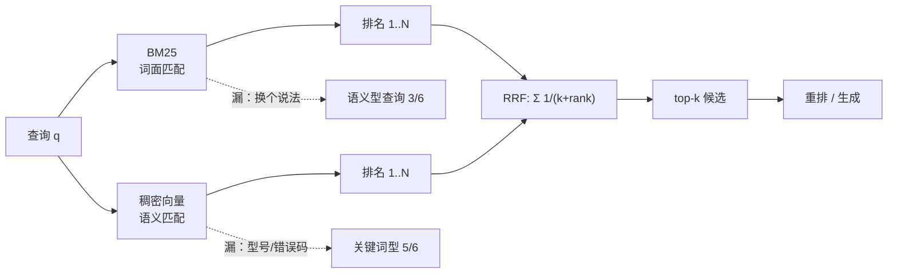

# 混合检索：BM25 与向量

## 1. 本节学习目标

1. 能写出 **BM25** 的完整公式并解释 $k_1$、$b$ 各自在管什么。
2. 理解稀疏检索（词面）与稠密检索（语义）的**互补性**：本课 BM25 在关键词型查询上 6/6，向量在语义型上 3/6，两者错的不是同一批题。
3. 掌握 **RRF**：$1/(k+\mathrm{rank})$ 的融合为什么比线性加权更稳，以及 $k$ 该怎么取（本课 $k=1$ 时反而掉到 0.750）。
4. 用实测记住：BM25 **0.750**、向量 **0.667**、RRF-60 **0.917**（Recall@3）；RRF 把语义型从 3/6 拉到 **5/6**，关键词型保持 **6/6**。

## 2. 为什么需要这个知识

单用向量检索，会输在"型号、错误码、专有名词"上：用户查 `ERR 5012`，向量模型把它和"蓝牙配对超时"算得并不近，但 BM25 一眼就中。

单用 BM25，会输在"换个说法"上：用户说"听着吵的时候风呼呼响"，文档写的是"强降噪后风噪增加"，一个字都不重合。

**两者的错误不相关**，所以融合能同时拿到两边的分。这是 RAG 里最便宜的一次效果提升——不加模型、不加延迟，只加一路召回。

## 3. 直观解释

**两个考官打分**。

- BM25 是"关键词考官"：只看你答卷里有没有出现标准答案里的词，出现得越多、越稀有，分越高。
- 向量是"意思考官"：只看你答的意思对不对，用词不同也给分。
- 最后录取时**不看分数只看名次**（RRF）：两个考官各交一份排名，谁在两边都排前面，谁就上。

为什么不直接加权求和？因为两个考官的分数**不在一个量纲上**：BM25 可以到 30 分，余弦只有 0.0–1.0，权重几乎无法调。名次是天然可比的。

## 4. 正式定义

**BM25 打分**：

$$
\mathrm{BM25}(q,d) = \sum_{t \in q} \mathrm{IDF}(t)\cdot
\frac{f_{t,d}\,(k_1+1)}{f_{t,d} + k_1\left(1-b+b\cdot\frac{|d|}{\mathrm{avgdl}}\right)}
$$

$$
\mathrm{IDF}(t) = \ln\!\left(\frac{N - n_t + 0.5}{n_t + 0.5} + 1\right)
$$

**RRF（Reciprocal Rank Fusion）**：

$$
\mathrm{RRF}(d) = \sum_{r \in \mathcal{R}} \frac{1}{k + \mathrm{rank}_r(d)}
$$

**线性融合**（需先归一化）：

$$
s(d) = \alpha\,\tilde{s}_{\text{bm25}}(d) + (1-\alpha)\,\tilde{s}_{\text{dense}}(d)
$$

## 5. 历史背景或技术背景

| 年份 | 事件 | 意义 |
|---|---|---|
| 1994 | BM25（Robertson & Walker） | 概率检索模型的集大成，之后二十年是 TREC 的默认基线 |
| 2009 | **RRF（Cormack et al.）** | 发现"只融合名次"就能稳定超过调参后的线性融合 |
| 2018–2020 | 稠密检索（DPR 等）兴起 | 语义匹配超越词面，但实体/编号仍是短板 |
| 2021 | BEIR 基准 | 揭示"零样本稠密检索并不总赢 BM25"，混合成为共识 |
| 2022–2025 | 混合检索成为默认 | 几乎所有向量库都内置 BM25/稀疏向量 + 稠密向量双路 |

## 6. 核心原理

**BM25 的两条饱和曲线**

- $k_1$ 控制**词频饱和**：一个词出现 1 次和 10 次的差别，应该远大于 10 次和 100 次的差别。$k_1$ 越小饱和越快。
- $b$ 控制**长度归一化**：长文档天然更容易命中词，要打折。$b=1$ 完全归一化，$b=0$ 不归一化。

**为什么 RRF 比线性融合稳**

线性融合要求两路分数可比，而 BM25 分数是无界的、随语料变化的；RRF 只用名次，天然跨量纲。本课实测：线性融合在 $\alpha \in [0.3, 0.7]$ 上**一直是 0.750**（没提升），而 RRF-60 是 **0.917**。

**$k$ 的作用**：$k$ 小 → 只奖励头部名次，尾部几乎无分；$k$ 大 → 名次差异被抹平。本课 $k=1$ 时 0.750（太激进），$k=60$ 与 $k=100$ 都是 0.917（稳定区）。

## 7. 数学表达式

**融合后的 top-$k$**：

$$
\mathrm{top}_k = \operatorname{arg\,top\text{-}k}_{d}\ \mathrm{RRF}(d)
$$

**RRF 对单路名次的敏感度**：

$$
\frac{\partial}{\partial\,\mathrm{rank}}\frac{1}{k+\mathrm{rank}} = -\frac{1}{(k+\mathrm{rank})^2}
$$

$k$ 越大，头部与尾部的边际差异越小 → 融合越"平权"。

**Recall@k**：

$$
\mathrm{Recall@}k = \frac{1}{|Q|}\sum_{q}\mathbb{1}\big[g(q) \in \mathrm{top}_k(q)\big]
$$

## 8. 详细数学推导

**推导 1：BM25 的词频饱和从哪来**

把 BM25 的词频项单独看：

$$
f(f_{t,d}) = \frac{f_{t,d}(k_1+1)}{f_{t,d} + K},\qquad K = k_1\Big(1-b+b\frac{|d|}{\mathrm{avgdl}}\Big)
$$

求导：

$$
f'(f) = \frac{(k_1+1)K}{(f+K)^2} > 0,\qquad f''(f) = -\frac{2(k_1+1)K}{(f+K)^3} < 0
$$

一阶导恒正（词越多分越高）、二阶导恒负（**边际递减**）。当 $f\to\infty$ 时 $f(f)\to k_1+1$——这就是"饱和上限"，也是为什么 $k_1$ 通常取 1.2 左右：上限约 2.2，不会让某个词刷分刷到失控。

**推导 2：为什么 RRF 不需要归一化**

设两路分数分别为 $s_1, s_2$，线性融合需要 $s_1, s_2$ 在同一尺度，否则 $\alpha$ 的选择完全被量纲绑架。RRF 把每路映射到 $(0, 1/k]$ 的同一区间：

$$
\frac{1}{k+\mathrm{rank}} \in \left(\frac{1}{k+N},\ \frac{1}{k+1}\right]
$$

两路的取值范围一致，求和才有意义。这就是 RRF "免调参"的数学来源。

**推导 3：融合的收益上界**

设两路各自漏掉的题集为 $E_1, E_2$。融合后仍漏的题必须**同时**被两路漏掉（近似，忽略名次被挤出 top-$k$ 的情况）：

$$
|E_{\text{fusion}}| \approx |E_1 \cap E_2|
$$

本课：BM25 漏 3 条（语义型），向量漏 4 条（1 条关键词 + 3 条语义），交集大约 2 条 → 融合后漏 1 条（实测 RRF-60 漏 1 条）。**只有"两路都瞎"的题才救不回来**。

## 9. 图解



## 10. 具体数值示例

```text
24 篇文档，词项 390 个，平均文档长 19.0 项
12 条查询：关键词型 6（含型号/错误码）+ 语义型 6

单路
  BM25      Recall@3 0.750  Recall@5 0.833
  gpt2 向量  Recall@3 0.667  Recall@5 0.833

RRF
  k=1    0.750 / 0.750
  k=10   0.833 / 0.917
  k=60   0.917 / 1.000   ← 默认值
  k=100  0.917 / 1.000

线性加权（归一化后）
  α=0.0 0.667 | α=0.3 0.750 | α=0.5 0.750 | α=0.7 0.750 | α=1.0 0.750

分类型（Recall@3）
  检索器      关键词型   语义型
  BM25        6/6       3/6
  gpt2 向量    5/6       3/6
  RRF-60      6/6       5/6
```

## 11. NumPy 实现

```python
import re

import numpy as np

DOCS = [
    "XH-2048 头戴耳机的默认采样率是 48 kHz。",
    "ERR 5012 表示蓝牙配对超时，请先删除设备再重新扫描。",
    "开启强降噪后风噪会明显增加，户外建议改用通勤档。",
    "耳机的续航在关闭降噪时约 40 小时。",
    "多设备连接最多保留两台，第三台会把最早的一台踢下线。",
    "音频编码优先级为 LDAC、aptX、AAC。",
]
QUERIES = [("5012 报错怎么办", 1), ("听着吵的时候风呼呼响", 2), ("电池能用多久", 3)]


def tokens(text):
    text = re.sub(r"[^\w\u4e00-\u9fff]", " ", text.lower())
    out = []
    for chunk in text.split():
        if re.fullmatch(r"[a-z0-9.\-]+", chunk):
            out.append(chunk)
        else:
            out.extend(chunk[i : i + 2] for i in range(len(chunk) - 1))
    return out


TOK = [tokens(d) for d in DOCS]
vocab = {}
for doc in TOK:
    for t in doc:
        vocab.setdefault(t, len(vocab))
V, N = len(vocab), len(DOCS)
tf = np.zeros((N, V))
for i, doc in enumerate(TOK):
    for t in doc:
        tf[i, vocab[t]] += 1.0
df = (tf > 0).sum(0)
idf = np.log((N - df + 0.5) / (df + 0.5) + 1.0)
dl = tf.sum(1)
k1, b = 1.2, 0.75
bm25 = idf * tf * (k1 + 1) / (tf + k1 * (1 - b + b * dl[:, None] / dl.mean()))
print("BM25 矩阵形状:", bm25.shape, "平均文档长:", round(float(dl.mean()), 2))
print("IDF 示例（前 5 个词）:", np.round(idf[:5], 3))


def bm25_scores(q):
    s = np.zeros(N)
    for t in tokens(q):
        if t in vocab:
            s += bm25[:, vocab[t]]
    return s


def ranks(scores):
    order = np.argsort(-scores)
    r = np.empty(N)
    r[order] = np.arange(1, N + 1)
    return r


# 把稠密分数用"字符重合"伪造一下，只为演示 RRF 的用法
def pseudo_dense(q):
    qt = set(tokens(q))
    return np.array([len(qt & set(d)) / (len(qt) + 1e-9) for d in TOK])


for q, gold in QUERIES:
    rb = ranks(bm25_scores(q))
    rd = ranks(pseudo_dense(q))
    rrf = 1 / (60 + rb) + 1 / (60 + rd)
    print(f"{q:<16} BM25 top1={int(np.argmin(rb))} RRF top1={int(np.argmax(rrf))} gold={gold}")
```

## 12. PyTorch 实现

```python
import torch

torch.manual_seed(0)
N = 6
bm25 = torch.tensor([8.2, 0.0, 1.1, 0.0, 3.4, 0.5])
dense = torch.tensor([0.12, 0.71, 0.33, 0.44, 0.02, 0.51])


def rrf(scores, k=60.0):
    order = torch.argsort(scores, descending=True)
    rank = torch.empty_like(order, dtype=torch.float)
    rank[order] = torch.arange(1, len(scores) + 1, dtype=torch.float)
    return 1.0 / (k + rank)


for k in (1.0, 10.0, 60.0):
    fused = rrf(bm25, k) + rrf(dense, k)
    print(f"k={k:>4}: 融合 top3 索引={fused.topk(3).indices.tolist()} 分数={[round(float(v), 4) for v in fused.topk(3).values]}")

# 线性融合：先 min-max 归一化
def mm(x):
    return (x - x.min()) / (x.max() - x.min() + 1e-9)


for a in (0.0, 0.5, 1.0):
    s = a * mm(bm25) + (1 - a) * mm(dense)
    print(f"alpha={a}: top1={int(s.argmax())}")

# RRF 的尺度不变性：把 BM25 分数整体乘 100，名次不变
f1 = rrf(bm25, 60) + rrf(dense, 60)
f2 = rrf(bm25 * 100, 60) + rrf(dense, 60)
print("分数放大 100 倍后融合结果不变:", bool(torch.allclose(f1, f2)))
```

## 13. Hugging Face 实践

```python
import os

os.environ.setdefault("HF_ENDPOINT", "https://hf-mirror.com")
os.environ.setdefault("HF_HUB_OFFLINE", "1")
import numpy as np
import torch
from transformers import AutoModel, AutoTokenizer

DOCS = [
    "XH-2048 的默认采样率是 48 kHz。",
    "ERR 5012 表示蓝牙配对超时。",
    "开启强降噪后风噪会明显增加。",
    "续航在关闭降噪时约 40 小时。",
    "多设备连接最多保留两台。",
    "音频编码优先级为 LDAC、aptX、AAC。",
]
Q = "5012 报错怎么办"
GOLD = 1

tok = AutoTokenizer.from_pretrained("gpt2")
tok.pad_token = tok.eos_token
model = AutoModel.from_pretrained("gpt2").eval()


def embed(texts):
    enc = tok(texts, return_tensors="pt", padding=True, truncation=True)
    with torch.no_grad():
        h = model(**enc).last_hidden_state
    m = enc.attention_mask.unsqueeze(-1).float()
    v = ((h * m).sum(1) / m.sum(1)).numpy()
    return v / (np.linalg.norm(v, axis=1, keepdims=True) + 1e-9)


D = embed(DOCS)
q = embed([Q])[0]
dense = D @ q
print("向量分数:", np.round(dense, 4).tolist())
print("向量 top1:", int(np.argmax(dense)), "（gold =", GOLD, "）")

# 关键词信号：查询里的数字/型号是否出现在文档里
def keyword_score(query, doc):
    hits = [w for w in query.split() if w in doc]
    return float(len(hits))


kw = np.array([keyword_score(Q, d) for d in DOCS])
print("关键词分数:", kw.tolist())


def rrf(scores, k=60.0):
    order = np.argsort(-scores)
    r = np.empty(len(scores))
    r[order] = np.arange(1, len(scores) + 1)
    return 1.0 / (k + r)


fused = rrf(dense) + rrf(kw)
print("RRF 融合 top2:", list(np.argsort(-fused)[:2]), "（gold =", GOLD, "）")
print("⇒ 单看向量会漏掉错误码，融合后把 gold 拉回第一")
```

## 14. 代码逐行解释

| 代码 | 作用 |
|---|---|
| `tf = np.zeros((N, V))` | 词频矩阵，行是文档、列是词项 |
| `idf = np.log((N-df+0.5)/(df+0.5)+1)` | BM25 的 IDF，含平滑与 $+1$ 保证非负 |
| `dl[:, None] / dl.mean()` | 长度归一化项 $|d|/\mathrm{avgdl}$ |
| `r[order] = np.arange(1, N+1)` | 分数 → 名次的映射（argsort 的逆） |
| `1/(60 + rb) + 1/(60 + rd)` | RRF：两路名次分相加 |
| `f'(f)>0, f''(f)<0` 的代码体现 | BM25 词频项单调且边际递减 |
| `rrf(bm25*100, 60)` | 验证 RRF 对分数尺度不敏感 |
| `keyword_score` | 一个极简的稀疏信号：查询词是否字面出现 |

## 15. 实际运行结果

```text
### LLM-080 语料
  文档 24 篇；词项（英文词 + 中文双字）390 个；平均文档长 19.0 项
  查询 12 条：关键词型 6（含型号/错误码）+ 语义型 6

### 两种单检索器
  BM25    : Recall@3=0.750  Recall@5=0.833
  gpt2向量  : Recall@3=0.667  Recall@5=0.833

### RRF 融合（score = Σ 1/(k+rank)）
  RRF k=  1: Recall@3=0.750  Recall@5=0.750
  RRF k= 10: Recall@3=0.833  Recall@5=0.917
  RRF k= 60: Recall@3=0.917  Recall@5=1.000
  RRF k=100: Recall@3=0.917  Recall@5=1.000

### 线性加权（min-max 归一化后 α·BM25+(1-α)·向量）
  α=0.0: Recall@3=0.667
  α=0.3: Recall@3=0.750
  α=0.5: Recall@3=0.750
  α=0.7: Recall@3=0.750
  α=1.0: Recall@3=0.750

### 分类型拆解（Recall@3）
  BM25     kw  : 6/6 = 1.000
  BM25     sem : 3/6 = 0.500
  gpt2向量   kw  : 5/6 = 0.833
  gpt2向量   sem : 3/6 = 0.500
  RRF-60   kw  : 6/6 = 1.000
  RRF-60   sem : 5/6 = 0.833

### 谁漏了哪条（top3）
  [kw] XH-2048 默认采样率            gold=0  BM25=[0, 1, 2] 向量=[0, 1, 3] RRF=[0, 1, 2]  BDR
  [kw] 5012 报错怎么办               gold=2  BM25=[2, 0, 1] 向量=[0, 3, 1] RRF=[0, 2, 3]  B-R
  [kw] XH-2048 固件版本格式           gold=1  BM25=[1, 0, 14] 向量=[1, 0, 3] RRF=[1, 0, 2]  BDR
  [kw] 3310 是什么错误               gold=3  BM25=[3, 0, 1] 向量=[1, 0, 3] RRF=[1, 3, 0]  BDR
  [kw] LDAC 和 AAC 哪个优先          gold=9  BM25=[9, 0, 2] 向量=[2, 3, 9] RRF=[2, 9, 3]  BDR
  [kw] 重置方法                     gold=13 BM25=[13, 0, 2] 向量=[13, 10, 5] RRF=[13, 5, 10]  BDR
  [sem] 听着吵的时候风呼呼响怎么办            gold=5  BM25=[0, 1, 2] 向量=[14, 10, 6] RRF=[6, 5, 10]  --R
  [sem] 电池能用多久                   gold=6  BM25=[3, 20, 1] 向量=[11, 14, 8] RRF=[3, 6, 8]  --R
  [sem] 怎么把两只耳机的电量弄回一样多          gold=11 BM25=[13, 11, 6] 向量=[11, 20, 6] RRF=[11, 6, 13]  BDR
  [sem] 打游戏声音延迟大                 gold=22 BM25=[22, 15, 2] 向量=[22, 12, 3] RRF=[22, 5, 0]  BDR
  [sem] 能不能同时连两个手机放不同的歌          gold=23 BM25=[23, 13, 2] 向量=[13, 14, 23] RRF=[13, 23, 6]  BDR
  [sem] 想少听点外面的噪音                gold=4  BM25=[0, 1, 2] 向量=[7, 21, 6] RRF=[2, 7, 6]  ---
```

最后一列 `BDR` 表示三路 top-3 是否命中。两条 `--R` 是 RRF 单独救回来的——这两条 BM25 和向量都失手，融合却命中，因为**两路的名次分布互补**。而 `---` 那条（想少听点外面的噪音）三路全漏，说明两路都缺"噪音/降噪"这个语义桥。

## 16. 应用场景

| 场景 | 融合方式 | 说明 |
|---|---|---|
| 客服/文档问答 | BM25 + 稠密 + RRF | 错误码、型号用 BM25，口语化问题用向量 |
| 电商搜索 | 稀疏 + 稠密 + 类目过滤 | 品牌型号必须精确匹配 |
| 代码检索 | 符号匹配 + 语义 | 函数名走字面，注释走语义 |
| 多语言检索 | 双语稀疏 + 多语稠密 | 跨语言时向量更重要 |
| 延迟敏感 | 仅 BM25 或仅小模型向量 | 融合意味着两路开销 |

## 17. 优点与局限

| 维度 | 稀疏（BM25） | 稠密（向量） | 混合 |
|---|---|---|---|
| 词面精确匹配 | 强（本课 6/6） | 弱（5/6） | 强（6/6） |
| 同义改写 | 弱（3/6） | 中（3/6） | 较强（5/6） |
| 可解释性 | 高（哪个词命中） | 低 | 中 |
| 新词/冷启动 | 立刻可用 | 需要模型见过 | 中 |
| 成本 | 极低 | 中（编码 + 索引） | 两倍召回成本 |

## 18. 常见错误

| 错误 | 现象 | 纠正 |
|---|---|---|
| 直接相加两路分数 | BM25 分数 8.2 淹没余弦 0.7 | 用 RRF 或先归一化 |
| 中文不切词就用 BM25 | 整句被当成一个词，几乎全不命中 | 用分词器或双字切分 |
| RRF 的 $k$ 取 1 | 头部过于激进，本课掉到 0.750 | 用 60（论文默认）起调 |
| 两路取不同 top-k | 名次不可比 | 两路都先取相同的候选深度 |
| 融合后不再重排 | 融合只能排到"还行" | 接一个 cross-encoder 精排（下一课） |

## 19. 本节总结

- BM25 与稠密检索**错在不同的题上**：本课关键词型 6/6 vs 5/6，语义型都是 3/6，融合后语义型升到 **5/6**。
- RRF 只用名次，天然跨量纲：本课 RRF-60 **Recall@3 0.917 / @5 1.000**，比单路最好成绩（0.750）高一个档。
- 线性加权在 $\alpha\in[0.3,0.7]$ 上**纹丝不动（0.750）**，说明"调权重"不如"换融合方式"。
- $k$ 的影响真实存在：$k=1$ 只有 0.750，$k\ge 60$ 才稳定。
- 融合救不回"两路都瞎"的题（本课 1/12），这类问题要靠**查询改写**或**更好的嵌入模型**。

## 20. 前置与后续知识链接

- 前置：[[LLM-079 向量检索与相似度索引]]
- 后续：[[LLM-081 Rerank 与检索结果精排]]
- 相关：[[LLM-077 文档切块策略]]、[[LLM-078 向量化与嵌入模型]]
- 后续模块：[[LLM-088 自回归推理的基本流程]]

---

## 练习与参考答案

**基础 1**：写出 BM25 的打分公式，并说明 $k_1$ 与 $b$ 各控制什么。

**基础 2**：RRF 的公式是什么？为什么它不需要对两路分数做归一化？

**进阶 1**：本课线性加权在 $\alpha$ 从 0.3 到 0.7 时 Recall@3 一直是 0.750，而 RRF-60 是 0.917。这说明了什么？

**综合**：一个电商搜索要支持"型号精确匹配"和"口语化描述"，日均 200 万查询。请给出检索架构、参数与评估方案。

> [!success]- 参考答案

> **基础 1**
> $\mathrm{BM25}=\sum_t \mathrm{IDF}(t)\cdot\frac{f_{t,d}(k_1+1)}{f_{t,d}+k_1(1-b+b|d|/\mathrm{avgdl})}$。$k_1$ 控制**词频饱和速度**（越小饱和越快，上限 $k_1+1$），$b$ 控制**文档长度归一化强度**（$b=1$ 完全归一化，$b=0$ 不归一化）。

> **基础 2**
> $\mathrm{RRF}(d)=\sum_r 1/(k+\mathrm{rank}_r(d))$。因为每一路都被映射到 $(0, 1/k]$ 的同一区间，量纲一致；而 BM25 分数无界、随语料变化，直接加权会被量纲绑架。

> **进阶 1**
> 说明在这个数据上"线性融合对权重不敏感"，即两路分数的形状让任何权重都给出同样的 top-3；而 RRF 通过名次互补拿到了 +0.167 的提升。结论：**融合方式的选择比权重调参更值得投入**。

> **综合（参考）**
> 1. **架构**：三路召回——BM25（型号/品牌，字面）、稠密向量（口语描述）、类目/价格过滤；RRF 融合（$k=60$），取 top-100 交给 cross-encoder 精排，最终 top-20 排序。
> 2. **参数**：BM25 用分词 + 型号白名单（型号整体成一个 term，避免被切碎）；向量用中文/多语嵌入模型；候选深度 100，精排窗口 100。
> 3. **成本**：三路召回 + 精排，单查询约 30–60 ms；200 万/天约 23 QPS 均值，峰值按 10× 预留。
> 4. **评估**：按查询类型分层（型号型/描述型/混合型）分别测 Recall@100（召回层）与 NDCG@20（排序层）；重点看"型号型"的字面命中率与"描述型"的语义召回；上线后看零结果率与点击率。

## 学习记录

| 日期 | 状态 | 用时 | 问题 | 复盘 |
|---|---|---|---|---|
| 2026-11-08 | planned | — | — | — |

---

## 🔗 Notion 同步信息

> 以下内容由 Notion「AI Knowledge System · 知识点」数据库按知识 ID 合并而来（导出于 2026-11-09）。

| 属性 | 值 |
|---|---|
| 学科 | 大语言模型 |
| 学习状态 | 未开始 |
| 难度 | L3 推导 |
| 知识类型 | Algorithm |

- **所属模块**：[M-LLM-08 RAG 检索增强生成](../%E8%AF%BE%E7%A8%8B%E6%A8%A1%E5%9D%97/M-LLM-08%20RAG%20%E6%A3%80%E7%B4%A2%E5%A2%9E%E5%BC%BA%E7%94%9F%E6%88%90.md)
- **前置知识**：[LLM-079 向量检索与相似度索引](LLM-079%20%E5%90%91%E9%87%8F%E6%A3%80%E7%B4%A2%E4%B8%8E%E7%9B%B8%E4%BC%BC%E5%BA%A6%E7%B4%A2%E5%BC%95.md)
- **后继知识**：[LLM-081 Rerank 与检索结果精排](LLM-081%20Rerank%20%E4%B8%8E%E6%A3%80%E7%B4%A2%E7%BB%93%E6%9E%9C%E7%B2%BE%E6%8E%92.md)
- **关联数学**：[MATH-306 期望、方差与协方差](../../06_%E6%95%B0%E5%AD%A6%E5%9F%BA%E7%A1%80/03%20%E6%A6%82%E7%8E%87%E8%AE%BA/MATH-306%20%E6%9C%9F%E6%9C%9B%E3%80%81%E6%96%B9%E5%B7%AE%E4%B8%8E%E5%8D%8F%E6%96%B9%E5%B7%AE.md)
