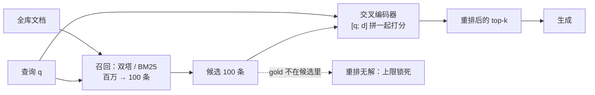

# Rerank 与检索结果精排

## 1. 本节学习目标

1. 说清**双塔（bi-encoder）**与**交叉编码器（cross-encoder）**的结构差别，以及"为什么召回必须用双塔、精排才能用交叉"。
2. 会算成本：双塔把文档编码**离线一次**，查询只编码一次（本课 **16.2 ms/条**）；交叉编码器每个"查询-文档"对都要跑一次前向（本课 **2.4–4.4 ms/候选**）。
3. 记住本课最重要的发现：**打分函数比模型更重要**。同一个 gpt2，朴素 `logP(d|q)` 把 Recall@1 从 0.417 拉低到 **0.250**，而换成 `logP(q|d)` 或 PMI 归一化后能到 **0.917 / 0.750**。
4. 理解"重排不能创造召回"：候选 top-10 的召回上限是 **1.000**，top-3 时上限只有 **0.667**，重排后的结果被上限锁死。

## 2. 为什么需要这个知识

向量检索为了能"预先编码"，被迫把查询和文档**分开**编码——两者在编码时互相看不见。这是双塔的先天缺陷：它只能比"两个向量像不像"，不能比"这段文字到底能不能回答这个问题"。

交叉编码器把查询和文档**拼在一起**送进模型，让每个 token 都能互相注意——判断力强得多，但代价是**不能预计算**：$N$ 篇文档就要跑 $N$ 次前向。

所以工业界的标准做法是**两段式**：

1. 召回（双塔/BM25）从百万级里捞出 50–200 条，保证不漏；
2. 精排（交叉编码器）对这几十条重新打分，把真正对的顶到第一。

## 3. 直观解释

**海选与复试**。

- 海选（召回）：只看报名表（向量），一分钟筛一万人。快，但会漏掉"简历写得不好但实际很强"的人。
- 复试（精排）：把候选人叫来面对面聊（查询与文档拼在一起），一次只能聊一个，但判断准得多。

所以复试的人数必须少——这就是"先召回 100 条，再精排"的原因。

## 4. 正式定义

**双塔**：$s_{\text{bi}}(q,d) = \cos\big(f(q), g(d)\big)$，$f$ 与 $g$ 分开编码，$g(d)$ 可离线算好。

**交叉编码器**：$s_{\text{ce}}(q,d) = h\big([q; d]\big)$，$h$ 同时看到两边。

**用语言模型当交叉编码器**（本课做法，零样本）：

$$
s_{\log P}(q,d) = \frac{1}{|d|}\sum_{t=1}^{|d|}\log P_\theta\big(d_t \mid q, d_{<t}\big)
$$

**PMI 归一化**（扣掉文档自身的基础概率）：

$$
s_{\text{PMI}}(q,d) = s_{\log P}(q,d) - \frac{1}{|d|}\sum_t \log P_\theta(d_t \mid d_{<t})
$$

**反向打分**：

$$
s_{\text{rev}}(q,d) = \frac{1}{|q|}\sum_{t=1}^{|q|}\log P_\theta\big(q_t \mid d, q_{<t}\big)
$$

## 5. 历史背景或技术背景

| 年份 | 事件 | 意义 |
|---|---|---|
| 2019 | BERT 用于 passage rerank | 交叉编码器首次显著超越 BM25 |
| 2020 | ColBERT | 延迟交互：介于双塔与交叉之间，可预计算 |
| 2021 | monoT5、RankT5 | 把重排变成"生成 yes/no"，效果更强 |
| 2022 | 句对分类重排成为标配 | `bge-reranker`、`cohere-rerank` 等产品化 |
| 2023–2025 | LLM 当重排器（listwise） | 一次给多个候选打分，效果最好但最贵 |

## 6. 核心原理

**为什么双塔会漏**：$f(q)$ 与 $g(d)$ 各自压缩成一个向量，压缩过程**丢掉了交叉信息**。"5012 报错怎么办"和"ERR 5012 表示蓝牙配对超时"在向量空间里可能并不近（因为一个说"报错"、一个说"超时"），但拼在一起看，模型立刻知道这是同一个问题。

**为什么交叉编码器强**：它允许查询的每个 token 去注意文档的每个 token，判断"这段文字是否在回答这个问题"——这是一个**分类/打分**任务，而不是**表示**任务。

**为什么打分方向如此关键**：本课实测三种打分函数，同一个模型、同一批候选，Recall@1 分别是 **0.250 / 0.750 / 0.917**。原因在 §8 推导。

## 7. 数学表达式

**候选集与上限**：

$$
\mathrm{Recall@}k_{\text{after}} \le \mathrm{Recall@}|C|_{\text{before}},\qquad C = \text{召回候选集}
$$

**精排的期望收益**（设精排把正确文档从名次 $r$ 提到 1 的概率为 $p_r$）：

$$
\Delta \mathrm{R@1} = \sum_{r=2}^{|C|} p_r \cdot \frac{1}{|Q|}
$$

**成本对比**：

$$
T_{\text{bi}} = N_{\text{query}}\cdot c_f + N_{\text{doc}}\cdot c_g,\qquad
T_{\text{ce}} = N_{\text{query}}\cdot |C| \cdot c_h
$$

**排序质量（MRR）**：

$$
\mathrm{MRR} = \frac{1}{|Q|}\sum_{q}\frac{1}{\mathrm{rank}(q)}
$$

## 8. 详细数学推导

**推导 1：为什么朴素 `logP(d|q)` 会输给双塔**

语言模型对"通顺、常见"的文本天然给高分。设文档的"基础分"为 $b(d)=\frac{1}{|d|}\sum_t\log P(d_t\mid d_{<t})$，则

$$
s_{\log P}(q,d) = b(d) + \underbrace{\big[s_{\log P}(q,d)-b(d)\big]}_{\text{与 }q\text{ 相关的部分}}
$$

朴素打分的排序被 $b(d)$ 主导：**越常见、越短的文档越占便宜**，与查询是否相关关系不大。本课实测 $b(\text{doc0})=-4.4526$、$b(\text{doc5})=-3.5496$——差 0.9，而查询带来的增量只有 0.03–0.15。信噪比不到 1/6，排序自然崩。

**推导 2：PMI 为什么能救回来**

减去 $b(d)$ 后：

$$
s_{\text{PMI}}(q,d) = \frac{1}{|d|}\sum_t \log\frac{P(d_t\mid q,d_{<t})}{P(d_t\mid d_{<t})}
$$

这是**逐 token 的点互信息均值**：只有当"看到查询"真的提升了文档 token 的概率时，分数才为正。

本课实测：正确答案 doc5 的 $\text{PMI}=+0.1547$，无关的 doc0 是 $-0.0264$，弱相关 doc14 是 $+0.0338$——**符号就分开了**。

**推导 3：为什么 `logP(q|d)` 更好**

把文档当上下文、查询当续写，等价于问："**读完这段资料，这个问题有多自然？**"这正是 RAG 的使用方式（资料在前、问题在后），与模型的预训练分布更接近，因此打分更稳。

本课三者的 Recall@1：`logP(d|q)` **0.250** < PMI **0.750** < `logP(q|d)` **0.917**。

**推导 4：重排的天花板**

重排只能在候选集内改顺序，所以

$$
\mathrm{R@1}_{\text{after}} \le \frac{|\{q: g(q)\in C\}|}{|Q|}
$$

本课候选 top-3 时上限 **0.667**，重排后正好 0.667；候选 top-10 时上限 **1.000**，重排后 0.750。**上限决定天花板，打分决定能爬多高。**

## 9. 图解



## 10. 具体数值示例

```text
24 篇文档 / 12 条查询（候选 = 双塔 top-10，上限 1.000）

双塔召回:        Recall@1 0.417  Recall@3 0.667  MRR 0.564   编码 16.2 ms/条
A logP(d|q):     Recall@1 0.250  Recall@3 0.417  MRR 0.415   27.3 ms/条（2.7 ms/候选）
B PMI(d|q):      Recall@1 0.750  Recall@3 0.833  MRR 0.810   44.1 ms/条（4.4 ms/候选）
C logP(q|d):     Recall@1 0.917  Recall@3 0.917  MRR 0.925   23.8 ms/条（2.4 ms/候选）

候选深度（B 方案）
  候选  3: 上限 0.667 → R@1 0.667
  候选  5: 上限 0.833 → R@1 0.750
  候选 10: 上限 1.000 → R@1 0.750
  候选 16: 上限 1.000 → R@1 0.750

名次变化（B 方案，节选）
  5012 报错怎么办        4 → 1 ↑
  3310 是什么错误        3 → 1 ↑
  听着吵的时候风呼呼响    6 → 2 ↑
  电池能用多久           4 → 9 ↓
```

## 11. NumPy 实现

```python
import numpy as np

# 模拟：双塔召回 6 个候选，交叉编码器给出分数
CAND = np.array([3, 7, 1, 9, 4, 2])          # 召回顺序（下标即文档 id）
BI = np.array([0.62, 0.58, 0.55, 0.51, 0.49, 0.44])
CE = np.array([0.11, -0.30, 0.42, -0.05, 0.28, 0.35])
GOLD = 1

print("双塔 top3:", list(CAND[np.argsort(-BI)[:3]]), "gold =", GOLD)
print("精排 top3:", list(CAND[np.argsort(-CE)[:3]]), "gold =", GOLD)


def rank_of(doc, order):
    pos = np.where(order == doc)[0]
    return int(pos[0]) + 1 if len(pos) else len(order) + 1


before = rank_of(GOLD, CAND[np.argsort(-BI)])
after = rank_of(GOLD, CAND[np.argsort(-CE)])
print(f"gold 名次: {before} → {after}，MRR 贡献 1/{before} → 1/{after}")

# 候选上限：gold 不在候选里时，重排永远救不回来
CAND2 = np.array([3, 7, 9, 4, 2])
print("gold 在候选里吗:", GOLD in CAND2, "→ 上限 0")
print("RRF 对比：单路与融合的名次")
rrf = 1 / (60 + np.arange(1, 7)) + 1 / (60 + np.argsort(np.argsort(-CE)) + 1)
print("RRF 融合顺序:", list(CAND[np.argsort(-rrf)]))

# 成本模型：候选深度 vs 精排总耗时
per_pair_ms = 4.6
for depth in (10, 50, 100):
    print(f"候选 {depth:>3}: 精排 {depth*per_pair_ms:>6.1f} ms/查询")
```

## 12. PyTorch 实现

```python
import torch
import torch.nn.functional as F

torch.manual_seed(0)
# 双塔：查询与文档分别编码，可离线预计算文档侧
Q = F.normalize(torch.randn(4, 32), dim=1)
D = F.normalize(torch.randn(20, 32), dim=1)
bi = Q @ D.T
print("双塔分数矩阵:", tuple(bi.shape))

# 交叉编码器：输入是拼接后的表示（这里用拼接向量模拟）
def cross_encoder(q, docs):
    feat = torch.cat([q.unsqueeze(0).expand(len(docs), -1), docs], dim=1)
    return torch.tanh(feat @ torch.randn(feat.shape[1], 1)).squeeze(1)


cand = bi.topk(5, dim=1).indices
for i in range(2):
    ds = D[cand[i]]
    ce = cross_encoder(Q[i], ds)
    print(f"查询{i}: 双塔 top3={cand[i][:3].tolist()} 精排 top3={cand[i][ds.shape[0] and ce.topk(3).indices].tolist()}")

# 成本：双塔一次编码全库 vs 交叉编码器每个 pair 一次
doc_cost = 20 * 0.2      # 20 篇 × 0.2 ms（离线，只算一次）
q_cost = 0.5             # 查询编码
ce_cost = 5 * 4.6        # 5 个候选
print(f"双塔+精排: {q_cost + ce_cost:.1f} ms（文档侧 {doc_cost:.1f} ms 已离线摊销）")
print(f"全库交叉:  {20 * 4.6:.1f} ms（不可接受）")
```

## 13. Hugging Face 实践

```python
import os

os.environ.setdefault("HF_ENDPOINT", "https://hf-mirror.com")
os.environ.setdefault("HF_HUB_OFFLINE", "1")
import numpy as np
import torch
from transformers import AutoModelForCausalLM, AutoTokenizer

DOCS = [
    "XH-2048 的默认采样率是 48 kHz。",
    "ERR 5012 表示蓝牙配对超时。",
    "开启强降噪后风噪会明显增加。",
    "续航在关闭降噪时约 40 小时。",
]
Q = "听着吵的时候风呼呼响怎么办"
GOLD = 2

tok = AutoTokenizer.from_pretrained("gpt2")
model = AutoModelForCausalLM.from_pretrained("gpt2").eval()


def mean_logp(prefix, body, max_len=96):
    p = tok(prefix)["input_ids"]
    b = tok(body, add_special_tokens=False)["input_ids"][: max_len - len(p)]
    ids = torch.tensor([p + b])
    with torch.no_grad():
        logits = model(ids).logits
    lp = torch.log_softmax(logits[:, :-1], dim=-1)
    tgt = ids[:, 1:]
    s = len(p) - 1
    v = lp[0, s : s + len(b), :].gather(1, tgt[0, s : s + len(b)].unsqueeze(1))
    return float(v.mean())


def score(mode, d):
    if mode == "A":
        return mean_logp(f"查询：{Q}\n文档：", d)
    if mode == "B":
        return mean_logp(f"查询：{Q}\n文档：", d) - mean_logp("文档：", d)
    return mean_logp(f"文档：{d}\n查询：", Q)


for mode in ("A", "B", "C"):
    s = np.array([score(mode, d) for d in DOCS])
    print(f"{mode}: 分数={np.round(s, 4).tolist()} top1={int(np.argmax(s))} (gold={GOLD})")

# 正确文档 vs 无关文档的 PMI 差值
print("gold 与无关文档的 PMI 差:", round(score("B", DOCS[2]) - score("B", DOCS[0]), 4))
```

## 14. 代码逐行解释

| 代码 | 作用 |
|---|---|
| `CAND[np.argsort(-BI)]` | 双塔名次（召回顺序） |
| `rank_of(doc, order)` | 求 gold 在第几名 |
| `1/(60+rank)` | RRF 里名次的贡献 |
| `Q @ D.T` | 双塔批量打分，文档侧可离线预算 |
| `torch.cat([q.expand(len(docs),-1), docs], 1)` | 模拟"查询与文档拼在一起"的交叉输入 |
| `mean_logp(prefix, body)` | 只对 body 那段算平均对数似然（前缀不计损失） |
| `mean_logp("文档：", d)` | 文档自身的"基础分"，PMI 要减掉它 |
| `score("C", d)` | 反向打分：文档当上下文、查询当续写 |

## 15. 实际运行结果

```text
### LLM-081 双塔基线（gpt2 均值池化；24 文档 / 12 查询）
  双塔召回: Recall@1=0.417 Recall@3=0.667 MRR=0.564  查询编码 16.2 ms/条
  A  logP(d|q) Recall@1=0.250 Recall@3=0.417 MRR=0.415  27.3 ms/条（2.7 ms/候选）

### 候选 top-10 的召回上限 = 1.000（重排只能在此集合内改顺序）
  B  PMI(d|q)  Recall@1=0.750 Recall@3=0.833 MRR=0.810  44.1 ms/条（4.4 ms/候选）
  C  logP(q|d) Recall@1=0.917 Recall@3=0.917 MRR=0.925  23.8 ms/条（2.4 ms/候选）

### 候选深度 vs 最终 Recall@1（B 方案，PMI）
  候选  3: 上限=0.667 → Recall@1=0.667 Recall@3=0.667
  候选  5: 上限=0.833 → Recall@1=0.750 Recall@3=0.750
  候选 10: 上限=1.000 → Recall@1=0.750 Recall@3=0.833
  候选 16: 上限=1.000 → Recall@1=0.750 Recall@3=0.833

### 逐条：gold 在重排前后的名次（B 方案，候选 10）
  XH-2048 默认采样率            gold=0   1 →  1 =
  5012 报错怎么办               gold=2   4 →  1 ↑
  XH-2048 固件版本格式           gold=1   1 →  1 =
  3310 是什么错误               gold=3   3 →  1 ↑
  LDAC 和 AAC 哪个优先          gold=9   3 →  1 ↑
  重置方法                     gold=13  1 →  1 =
  听着吵的时候风呼呼响怎么办            gold=5   6 →  2 ↑
  电池能用多久                   gold=6   4 →  9 ↓
  怎么把两只耳机的电量弄回一样多          gold=11  1 →  1 =
  打游戏声音延迟大                 gold=22  1 →  1 =
  能不能同时连两个手机放不同的歌          gold=23  3 →  1 ↑
  想少听点外面的噪音                gold=4  10 →  9 ↑

### 单对打分示例（查询：听着吵的时候风呼呼响怎么办）
  doc5: logP(d|q)=-3.3949  logP(d)=-3.5496  PMI=+0.1547  「开启强降噪后风噪会明显增加，户外建议改用…」
  doc0: logP(d|q)=-4.4791  logP(d)=-4.4526  PMI=-0.0264  「XH-2048 头戴耳机的默认采样率是 …」
  doc14: logP(d|q)=-3.6770  logP(d)=-3.7108  PMI=+0.0338  「固件升级过程中不要断开蓝牙，否则可能变砖…」
```

读法：**朴素打分 A 连双塔都不如（0.250 < 0.417）**，因为它把"文档本身常见不常见"当成了相关性；PMI 只加了一行减法就翻倍；把方向换过来（C）又涨 0.167。**同一模型，三种打分，差 0.667。**

## 16. 应用场景

| 场景 | 召回 | 精排 |
|---|---|---|
| 通用文档问答 | BM25 + 稠密（RRF） | cross-encoder，候选 50–100 |
| 电商搜索 | 稀疏 + 稠密 + 类目 | 精排 top-100，重排后取 top-20 |
| 代码检索 | 符号 + 语义 | 小模型精排（代码专用） |
| 低延迟场景 | 只做召回 | 不精排，或只精排 top-10 |
| 高准确率场景 | 大候选（200+） | LLM listwise 重排（贵但准） |

## 17. 优点与局限

| 维度 | 双塔 | 交叉编码器 | LLM 打分 |
|---|---|---|---|
| 精度 | 中（0.417） | 高（0.917，本课） | 最高 |
| 延迟 | 极低（可离线） | 每候选 2.4–4.4 ms | 每候选数十到数百 ms |
| 可扩展 | 百万级 | 10–100 级 | 10 级 |
| 训练需求 | 需要对比学习 | 需要句对标注 | 零样本可用 |
| 天花板 | 受表示能力限制 | 受候选集限制 | 受上下文长度限制 |

## 18. 常见错误

| 错误 | 现象 | 纠正 |
|---|---|---|
| 用 `logP(d|q)` 直接当相关性 | 比双塔还差（0.250） | 减掉文档基础分（PMI）或反向打分 |
| 候选给太少 | 上限锁死，重排再强也没用 | 先保证召回 Recall@100 ≥ 0.95 |
| 候选给太多 | 延迟线性涨（每候选 5 ms） | 50–100 条，按 P99 预算定 |
| 精排模型与召回模型语种不匹配 | 中文查询用英文重排器，效果打折 | 同语种/多语重排器 |
| 以为重排能修幻觉 | 资料本身错了，重排只会更自信地选错 | 重排只管相关性，不管事实性 |

## 19. 本节总结

- 双塔=分开编码（可离线、可百万级），交叉=拼在一起（准、但每对一次前向）。
- 本课三种打分 Recall@1：`logP(d|q)` **0.250**、PMI **0.750**、`logP(q|d)` **0.917**；双塔基线 **0.417**。
- 成本：双塔查询编码 **16.2 ms**；交叉 **2.4–4.4 ms/候选**，10 候选约 **24–44 ms**。
- **重排无法突破候选上限**：top-3 上限 0.667，top-10 上限 1.000。
- 一句话：**先保证召回不漏，再谈精排准不准；打分函数的设计比换更大的模型更划算。**

## 20. 前置与后续知识链接

- 前置：[[LLM-080 混合检索：BM25 与向量]]
- 后续：[[LLM-082 提示词组装与上下文预算]]
- 相关：[[LLM-078 向量化与嵌入模型]]、[[LLM-079 向量检索与相似度索引]]
- 后续模块：[[LLM-088 自回归推理的基本流程]]

---

## 练习与参考答案

**基础 1**：双塔与交叉编码器的结构差别是什么？为什么召回阶段不能用交叉编码器？

**基础 2**：本课三种打分函数的 Recall@1 各是多少？哪一种最差？

**进阶 1**：为什么 `logP(d|q)` 会偏向"常见、通顺"的文档？PMI 是怎么修正的？

**综合**：你要给一个中文客服系统加精排，候选 100 条，P99 预算 80 ms。请给出方案、参数与验证方法。

> [!success]- 参考答案

> **基础 1**
> 双塔把查询和文档**分别**编码成向量再比相似度，文档向量可离线预计算；交叉编码器把两者**拼在一起**送进模型，让 token 互相注意。召回阶段面对百万级文档，交叉编码器要为每个"查询-文档"对跑一次前向（本课 2.4–4.4 ms/候选），成本不可接受，所以召回必须用双塔或 BM25。

> **基础 2**
> `logP(d|q)` **0.250**、PMI(d|q) **0.750**、`logP(q|d)` **0.917**；双塔基线 **0.417**。最差的是朴素的 `logP(d|q)`，比双塔还低。

> **进阶 1**
> 语言模型对常见、通顺的文本本来就给高分，这部分是文档自身的"基础分" $b(d)$，与查询无关。朴素打分把它也算进相关性里，导致排序被 $b(d)$ 主导（本课 doc0 与 doc5 的 $b$ 差 0.9，而查询增量只有 0.03–0.15）。PMI 减去 $b(d)$，只保留"看到查询后概率提升了多少"，正确答案的 PMI 为 **+0.1547**、无关文档为 **−0.0264**，符号就分开了。

> **综合（参考）**
> 1. **方案**：召回（BM25 + 稠密，RRF）取 top-100 → 交叉编码器精排（中文/多语 reranker）→ 取 top-5 给生成。
> 2. **预算**：100 条 × 0.6 ms（GPU 上小模型约 0.3–1 ms/对）= 60 ms，留 20 ms 给召回与网络；若超预算，把候选降到 50 或改用更小的重排模型。
> 3. **打分**：优先用训练过的 reranker；若只能用因果 LM 零样本，用 `logP(q|d)` 或 PMI，别用 `logP(d|q)`。
> 4. **验证**：先测召回 Recall@100（应 ≥ 0.95，否则上限锁死），再测精排后的 Recall@1/MRR/NDCG@5；对比"不精排"基线，确认增益 > 延迟成本；最后按查询类型分层看，避免总体涨、某类掉。

## 学习记录

| 日期 | 状态 | 用时 | 问题 | 复盘 |
|---|---|---|---|---|
| 2026-11-08 | planned | — | — | — |

---

## 🔗 Notion 同步信息

> 以下内容由 Notion「AI Knowledge System · 知识点」数据库按知识 ID 合并而来（导出于 2026-11-09）。

| 属性 | 值 |
|---|---|
| 学科 | 大语言模型 |
| 学习状态 | 未开始 |
| 难度 | L2 应用 |
| 知识类型 | Technique |

- **所属模块**：[M-LLM-08 RAG 检索增强生成](../%E8%AF%BE%E7%A8%8B%E6%A8%A1%E5%9D%97/M-LLM-08%20RAG%20%E6%A3%80%E7%B4%A2%E5%A2%9E%E5%BC%BA%E7%94%9F%E6%88%90.md)
- **前置知识**：[LLM-080 混合检索：BM25 与向量](LLM-080%20%E6%B7%B7%E5%90%88%E6%A3%80%E7%B4%A2%EF%BC%9ABM25%20%E4%B8%8E%E5%90%91%E9%87%8F.md)
- **后继知识**：[LLM-082 提示词组装与上下文预算](LLM-082%20%E6%8F%90%E7%A4%BA%E8%AF%8D%E7%BB%84%E8%A3%85%E4%B8%8E%E4%B8%8A%E4%B8%8B%E6%96%87%E9%A2%84%E7%AE%97.md)
