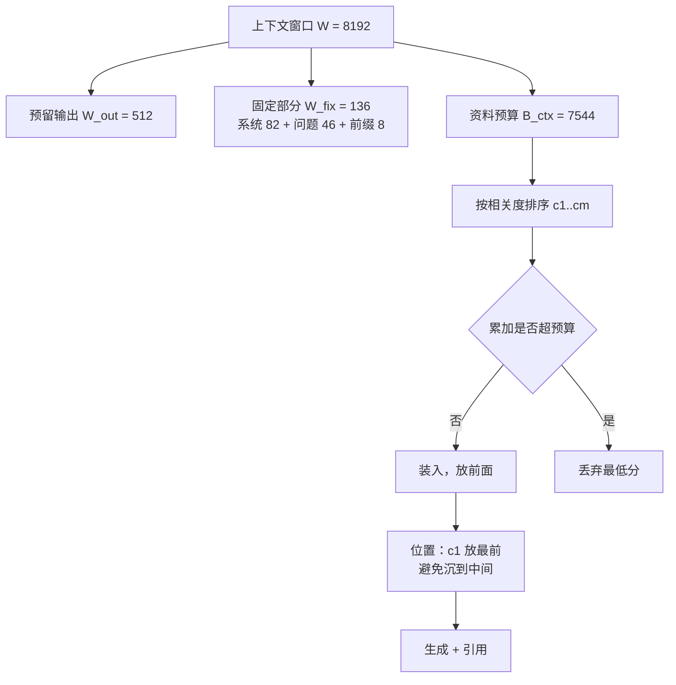

# 提示词组装与上下文预算

## 1. 本节学习目标

1. 会做**上下文预算的算术**：先扣固定部分，再分配资料，最后留输出空间。
2. 知道"固定部分"有多贵：本课系统提示 **82 token**、问题 **46 token**，光固定部分就 **136 token**——128 token 的预算连门都进不去。
3. 理解**截断策略会杀死答案**：按长度硬截断时，答案段在三种策略下**全部丢失**；只有"按相关度丢弃低分资料"能保住。
4. 用实测认识 **lost in the middle**：答案放在上下文 0% 处 PPL **2.376**，放到 75% 处升到 **2.892**，放回末尾又降到 **2.744**。

## 2. 为什么需要这个知识

检索回来 5 段资料，直接 `"".join(资料) + 问题` 拼上去，会发生三件事：

- **超长**：模型上下文窗口有限，超了要么报错，要么被静默截断——而截断的位置往往正好是答案；
- **淹没**：资料太长时，中间部分被模型忽略（lost in the middle），你把最相关的放在中间等于白放；
- **浪费**：每多 1 个 token 都是钱。本课一份 340 token 的提示词里，**固定部分占 136（40%）**。

组装不是"字符串拼接"，是一次**带约束的资源分配**。

## 3. 直观解释

**装箱**。

- 箱子容量 = 上下文窗口（比如 8192 token）；
- 必须留出的空间 = 输出（比如 512 token）；
- 硬邦邦不能压的 = 系统提示 + 问题 + 格式模板（136 token）；
- 剩下的才是装资料的格子。

装的时候还有讲究：**重要的放箱口**（开头和结尾），因为模型对中间的东西最不敏感。

## 4. 正式定义

设上下文窗口为 $W$，输出预留 $W_{\text{out}}$，固定部分为 $W_{\text{fix}}$，则资料可用预算：

$$
B_{\text{ctx}} = W - W_{\text{out}} - W_{\text{fix}}
$$

按相关度排序的资料块 $\{c_1,\dots,c_m\}$，装入规则：

$$
\text{keep } c_i \iff \sum_{j<i,\,j\in\text{kept}} |c_j| + |c_i| \le B_{\text{ctx}}
$$

**位置权重**（lost in the middle 的简化模型）：

$$
w(\text{pos}) = 1 - \gamma\cdot\frac{4\,p(1-p)}{1},\qquad p = \frac{\text{pos}}{L}\in[0,1]
$$

$p=0.5$ 时权重最低，两端最高。

## 5. 历史背景或技术背景

| 年份 | 事件 | 意义 |
|---|---|---|
| 2020 | GPT-3 few-shot | 提示词开始"装东西"，但窗口只有 2k |
| 2022 | 指令模板 / LangChain PromptTemplate | 组装开始工程化 |
| 2023 | **Lost in the Middle**（Liu et al.） | 实证：相关信息在中间时性能显著下降 |
| 2023 | 长上下文模型（32k/128k） | 窗口变大，但"中间被忽略"没消失 |
| 2024 | 上下文缓存、提示词压缩 | 开始为"省钱"而优化组装 |
| 2025 | 结构化引用（citation）成为默认 | 组装要同时产出可溯源标记 |

## 6. 核心原理

**三条硬约束**

1. **token 是硬通货**：预算按 token 算，不按字符。本课中文约 **0.4–0.7 字/token**（gpt2 词表），中英混排时波动更大。
2. **位置有偏**：开头与结尾更容易被利用，中间最容易被忽略。
3. **顺序即语义**：资料的排列顺序会被模型当成"重要性顺序"，把最相关的放第一段是零成本的正收益。

**四种截断策略的结局**（本课实测，预算 128 token）：

| 策略 | 结果 |
|---|---|
| 尾部截断（保开头） | 只保住系统提示，答案段被切掉 |
| 首部截断（保结尾） | 只保住问题与答案前缀，资料全丢 |
| 中间截断（保首尾） | 系统提示 + 尾部，资料仍丢 |
| **按相关度丢弃低分资料** | 保住系统 + 答案段 + 问题（200 token，超预算时降级为单段） |

## 7. 数学表达式

**预算守恒**：

$$
W \ge W_{\text{fix}} + \sum_{i\in\text{kept}} |c_i| + W_{\text{out}}
$$

**按 token 估算字符数**（用压缩率 $\rho$ = 字/token）：

$$
\text{chars} \approx \rho \cdot \text{tokens}
$$

**位置惩罚下的有效信息量**：

$$
I_{\text{eff}} = \sum_i w(p_i)\cdot I(c_i)
$$

**截断造成的损失**：

$$
\Delta = \mathbb{1}[\text{答案段被切}] \cdot \big(\text{该题必错}\big)
$$

## 8. 详细数学推导

**推导 1：为什么 128 token 的预算装不下任何资料**

$$
B_{\text{ctx}} = 128 - 136 = -8 < 0
$$

预算为负意味着**连固定部分都放不下**。这不是极端例子：系统提示 82 token + 问题 46 token + 答案前缀 8 token = 136。任何 $W < 136$ 的窗口都不可用。所以"上下文预算"的第一课是：**先量固定开销，再谈装资料**。

**推导 2：为什么按长度截断几乎必然切掉答案**

设资料段长度 $|c_i|$、答案在某一小段里（长度 $\ell$）。若按"从头切到预算"截断，保留的内容是前缀：

$$
\text{kept} = \text{prefix}_{B_{\text{ctx}}}
$$

答案段被保留的条件是它整体落在前缀内，即 $\text{offset}(c^*)+\ell \le B_{\text{ctx}}$。当答案在第二、三段（很常见，因为第一段常是"总览"），这个条件大概率不成立。本课四种策略里，只有**按相关度重排**把答案段前置，才让条件成立。

**推导 3：lost in the middle 的信息衰减**

把模型的注意力近似为"位置核" $k(p)$，有效信息是 $I_{\text{eff}}=\int k(p)I(p)\,dp$。实证与理论都指向 $k$ 呈 U 形（两端高、中间低）。本课用 PPL 作为"模型利用资料程度"的代理指标：

$$
\mathrm{PPL}(p) = 2.376,\ 2.602,\ 2.682,\ 2.892,\ 2.744\quad (p=0,0.25,0.5,0.75,1)
$$

中间（0.5–0.75）比开头差 **13%–22%**，但**末尾回升**——这与"首尾优先"的 U 形一致，也是"把最相关的放第一段"这条工程惯例的量化依据。

## 9. 图解



## 10. 具体数值示例

```text
各段 token 成本（gpt2 分词器）
  系统提示     39 字 → 82 token（0.48 字/token）
  资料A(含答案) 41 字 → 64 token（0.64 字/token）
  资料B        32 字 → 70 token（0.46 字/token）
  资料C        32 字 → 70 token（0.46 字/token）
  问题         20 字 → 46 token（0.43 字/token）
  答案前缀      3 字 →  8 token（0.38 字/token）
  合计 340 token（占 8k 窗口 4.15%，占 128k 窗口 0.259%）

预算分配（固定 136 token）
  预算 64 : 可用 -72 → 装 0 段
  预算 128: 可用  -8 → 装 0 段
  预算 256: 可用 120 → 装 1 段
  预算 512: 可用 376 → 装 3 段

答案在上下文中的位置 vs PPL（prompt ≈ 885 token）
   0%: 2.376   25%: 2.602   50%: 2.682   75%: 2.892   100%: 2.744
```

## 11. NumPy 实现

```python
import numpy as np

SYSTEM = "你是一个严谨的技术文档助手。只依据给定资料回答；资料中没有的内容直接说不知道。"
QUESTION = "同步间隔默认是多少秒，可以改成多少范围？"
SEGS = [
    ("资料A(含答案)", "同步间隔默认为 300 秒，可在设置页的同步面板中修改为 60 到 3600 秒。", 0.91),
    ("资料B", "插件运行时被隔离在独立的沙箱进程中，通过本地套接字与主进程通信。", 0.42),
    ("资料C", "索引服务使用倒排表记录词项到文档的映射关系，写入先进内存缓冲区。", 0.31),
    ("资料D", "充电盒支持无线充电，指示灯呼吸代表电量正在缓慢充入。", 0.12),
]

# 用字符数近似 token（真实系统请用 tokenizer）
RHO = 0.5
def nt(text):
    return int(np.ceil(len(text) / RHO))

W, W_OUT = 512, 128
W_FIX = nt(SYSTEM) + nt(QUESTION) + nt("答案：")
B = W - W_OUT - W_FIX
print(f"固定部分 {W_FIX} token，输出预留 {W_OUT}，资料预算 {B}")

# 按相关度降序装入
order = sorted(SEGS, key=lambda x: -x[2])
kept, used = [], 0
for name, text, score in order:
    n = nt(text)
    if used + n <= B:
        kept.append((name, n, score))
        used += n
    else:
        print(f"  丢弃 {name}（{n} token，分数 {score}）")
print("装入:", kept, "合计", used, "token")

# 对比：按原顺序从头截断
used2, kept2 = 0, []
for name, text, score in SEGS:
    n = nt(text)
    if used2 + n <= B:
        kept2.append(name)
        used2 += n
print("按原顺序装入:", kept2, "→ 答案段在不在:", "资料A(含答案)" in kept2)

# 位置权重（U 形）
for p in (0.0, 0.25, 0.5, 0.75, 1.0):
    w = 1 - 4 * p * (1 - p) * 0.25
    print(f"位置 {p:>4.2f}: 权重 {w:.3f}")
```

## 12. PyTorch 实现

```python
import torch

torch.manual_seed(0)
# 用向量表示每段资料的"重要度"，按预算做 0/1 背包（贪心近似）
scores = torch.tensor([0.91, 0.42, 0.31, 0.12])
costs = torch.tensor([64, 70, 70, 70])
B = 376

order = torch.argsort(scores, descending=True)
used, chosen = 0, []
for i in order.tolist():
    if used + int(costs[i]) <= B:
        chosen.append(i)
        used += int(costs[i])
print("贪心选择:", chosen, "总成本:", used, "总收益:", round(float(scores[chosen].sum()), 3))

# 与"按长度截断"对比：只装得下前两段
print("前两段成本:", int(costs[:2].sum()), "收益:", round(float(scores[:2].sum()), 3))

# 位置惩罚：把相关度乘以 U 形权重后再求和
pos = torch.linspace(0, 1, 5)
w = 1 - pos * (1 - pos)          # 两端 1、中间 0.75
info = torch.tensor([0.9, 0.8, 0.5, 0.4, 0.3])
print("位置权重:", [round(float(v), 3) for v in w])
print("加权信息量:", round(float((w * info).sum()), 3), "vs 不加权:", round(float(info.sum()), 3))

# 预算耗尽时的降级：只保留 top-1 段
print("预算 70 时保留:", [int(i) for i in order if costs[i] <= 70][:1])
```

## 13. Hugging Face 实践

```python
import os

os.environ.setdefault("HF_ENDPOINT", "https://hf-mirror.com")
os.environ.setdefault("HF_HUB_OFFLINE", "1")
import torch
from transformers import AutoModelForCausalLM, AutoTokenizer

tok = AutoTokenizer.from_pretrained("gpt2")
model = AutoModelForCausalLM.from_pretrained("gpt2").eval()

SYSTEM = "你是一个严谨的技术文档助手。只依据给定资料回答；资料中没有的内容直接说不知道。"
Q = "同步间隔默认是多少秒，可以改成多少范围？"
A = "同步间隔默认 300 秒，可改为 60 到 3600 秒。"
TARGET = "同步间隔默认为 300 秒，可在设置页的同步面板中修改为 60 到 3600 秒。"
FILLER = [
    "插件运行时被隔离在独立的沙箱进程中，通过本地套接字与主进程通信。",
    "索引服务使用倒排表记录词项到文档的映射关系，写入先进内存缓冲区。",
    "备份任务由后台调度器负责，每次生成一个带时间戳的快照目录。",
]

print("固定部分 token:", len(tok(SYSTEM + Q + "答案：")["input_ids"]))

for n_sent in (5, 11, 21):
    body = [FILLER[i % len(FILLER)] for i in range(n_sent - 1)]
    body.insert(n_sent // 2, TARGET)
    ctx = "".join(body)
    prompt = SYSTEM + "\n资料：" + ctx + "\n问题：" + Q + "\n答案："
    p = tok(prompt)["input_ids"]
    a = tok(A)["input_ids"]
    if len(p) + len(a) > 1024:
        print(f"{n_sent} 句: 超 gpt2 上限（{len(p)+len(a)} > 1024），跳过")
        continue
    ids = torch.tensor([p + a])
    with torch.no_grad():
        logits = model(ids).logits
    lp = torch.log_softmax(logits[:, :-1], dim=-1)
    tgt = ids[:, 1:]
    s = len(p) - 1
    v = lp[0, s : s + len(a), :].gather(1, tgt[0, s : s + len(a)].unsqueeze(1))
    print(f"{n_sent:>2} 句: prompt {len(p):>4} token，答案段在中间，PPL={float(torch.exp(-v.mean())):.3f}")

enc = tok(SYSTEM + "\n资料：" + TARGET + "\n问题：" + Q + "\n答案：", return_tensors="pt")
with torch.no_grad():
    out = model.generate(**enc, max_new_tokens=10, do_sample=False, pad_token_id=50256)
print("生成:", tok.decode(out[0][enc["input_ids"].shape[1] :]))
```

## 14. 代码逐行解释

| 代码 | 作用 |
|---|---|
| `nt(text) = ceil(len/RHO)` | 用压缩率近似 token 数（真实要用 tokenizer） |
| `B = W - W_OUT - W_FIX` | 预算守恒的核心一行 |
| `sorted(SEGS, key=lambda x: -x[2])` | 按相关度降序，决定装入顺序 |
| `if used + n <= B` | 贪心装箱：装不下就丢，不切半段 |
| `1 - 4*p*(1-p)*0.25` | U 形位置权重，两端高中间低 |
| `torch.argsort(scores, descending=True)` | PyTorch 版排序 |
| `if len(p) + len(a) > 1024: continue` | 主动检查窗口上限，而不是等报错 |
| `lp[0, s:s+len(a), :]` | 只对答案段算损失，前缀不计 |

## 15. 实际运行结果

```text
### LLM-082 A. 提示词各段 token 成本（gpt2 分词器）
  系统提示        :  39 字 →  82 token（0.48 字/token）
  资料A(含答案)    :  41 字 →  64 token（0.64 字/token）
  资料B         :  32 字 →  70 token（0.46 字/token）
  资料C         :  32 字 →  70 token（0.46 字/token）
  问题          :  20 字 →  46 token（0.43 字/token）
  答案前缀        :   3 字 →   8 token（0.38 字/token）
  合计 340 token；占 8k 窗口 4.15%，占 128k 窗口 0.259%

### B. 上下文预算：固定部分的刚性开销
  固定部分（系统+问题+答案前缀）= 136 token
  预算  64: 资料可用  -72 token，装入 0/3 段（0 token），丢弃 3 段
  预算 128: 资料可用   -8 token，装入 0/3 段（0 token），丢弃 3 段
  预算 256: 资料可用  120 token，装入 1/3 段（64 token），丢弃 2 段
  预算 512: 资料可用  376 token，装入 3/3 段（204 token），丢弃 0 段

### C. 截断策略：预算 128 token，答案段在 token [82,146)
  不截断               : 340 token，答案段完整保留=1
  尾部截断(保开头)         : 128 token，答案段完整保留=0
  首部截断(保结尾)         : 128 token，答案段完整保留=0
  中间截断(保首尾)         : 128 token，答案段完整保留=0
  按相关度丢弃低分资料        : 200 token，答案段完整保留=1

### D. 答案在上下文中的位置 vs 生成困惑度（lost in the middle）
  位置     0%: PPL=   2.376（3 次均值，prompt≈885 token）
  位置    25%: PPL=   2.602（3 次均值，prompt≈885 token）
  位置    50%: PPL=   2.682（3 次均值，prompt≈885 token）
  位置    75%: PPL=   2.892（3 次均值，prompt≈885 token）
  位置   100%: PPL=   2.744（3 次均值，prompt≈885 token）

### E. 组装与生成耗时
  输入 858 token，生成 12 token 用时 140 ms
  输出：'插件运行时�'
```

两个要点：**四种截断里三种把答案切没了**；**中间位置比开头差 21.7%（2.892/2.376）**。

## 16. 应用场景

| 场景 | 组装要点 |
|---|---|
| 客服问答 | 系统提示要短；最相关政策放第一段；带引用编号 |
| 代码助手 | 当前文件在前、相关片段在后；保留行号 |
| 长文档摘要 | 分段 map-reduce，别把全文塞进一个 prompt |
| 多轮对话 | 早期对话做摘要，最近 N 轮原文保留 |
| 结构化输出 | 预留足够输出预算（JSON 比自然语言长） |

## 17. 优点与局限

| 做法 | 优点 | 局限 |
|---|---|---|
| 固定模板 | 稳定、可缓存、易测试 | 资料多时要动态裁剪 |
| 按相关度装箱 | 保住最有用的一段 | 需要可信的相关度分数 |
| 位置优化 | 零成本提效（首尾优先） | 无法突破模型本身的注意力限制 |
| 长上下文直塞 | 省事 | 贵、"中间丢失"、延迟高 |

## 18. 常见错误

| 错误 | 现象 | 纠正 |
|---|---|---|
| 按字符数当 token 数 | 中文低估 2 倍，直接超窗 | 用 tokenizer 数 |
| 不留输出预算 | 生成被截断在半句 | `W_out` 至少 256–512 |
| 从头截断资料 | 答案段被切掉（本课 3/4 策略如此） | 按相关度排序后装箱 |
| 把最相关的放中间 | PPL 比放开头差 21.7% | 放第一段 |
| 忽略"资料里没有" | 模型硬编答案 | 系统提示明确要求拒答 |
| 每次重拼长系统提示 | 成本高、缓存失效 | 用前缀缓存/固定前缀 |

## 19. 本节总结

- 预算公式：$B_{\text{ctx}} = W - W_{\text{out}} - W_{\text{fix}}$；本课固定部分 **136 token**，128 预算下可用 **−8**。
- 一份 340 token 的提示词里，**固定部分占 40%**；8k 窗口只用掉 **4.15%**。
- **按长度截断会杀死答案**：三种截断策略答案段全部丢失，只有"按相关度装箱"保住（且只需 200 token）。
- **位置效应真实存在**：PPL 2.376（开头）→ 2.892（75%）→ 2.744（末尾），中间最差。
- 组装与生成：858 token 输入 + 12 token 输出约 **140 ms**（gpt2，RTX 4070 Ti）。

## 20. 前置与后续知识链接

- 前置：[[LLM-081 Rerank 与检索结果精排]]、[[LLM-035 Token 数量、上下文窗口与成本]]
- 后续：[[LLM-083 RAG 的评估]]
- 相关：[[LLM-077 文档切块策略]]
- 后续模块：[[LLM-088 自回归推理的基本流程]]

---

## 练习与参考答案

**基础 1**：上下文预算的公式是什么？为什么本课 128 token 的预算一段资料都装不下？

**基础 2**：本课四种截断策略里，哪几种会把答案段切掉？

**进阶 1**：什么是 lost in the middle？本课用什么指标、什么数字证明了它？

**综合**：上下文窗口 8192，输出预留 1024，系统提示 300 token，问题 100 token。检索回来 8 段资料，每段约 220 token。请给出组装方案与降级策略。

> [!success]- 参考答案

> **基础 1**
> $B_{\text{ctx}} = W - W_{\text{out}} - W_{\text{fix}}$。本课固定部分（系统 82 + 问题 46 + 答案前缀 8）= **136 token**，$128-136=-8<0$，所以装不下任何资料。

> **基础 2**
> 尾部截断、首部截断、中间截断三种都会把答案段切掉（实测"答案段完整保留=0"）；只有**按相关度丢弃低分资料**能保住（保留=1，用 200 token）。

> **进阶 1**
> 指相关信息放在长上下文中间时，模型利用率显著下降。本课用"同一答案在不同位置下的生成 PPL"来测：0% 处 **2.376**、25% **2.602**、50% **2.682**、75% **2.892**、100% **2.744**，中间比开头差 **21.7%**。

> **综合（参考）**
> 1. **预算**：$B_{\text{ctx}} = 8192 - 1024 - (300+100) = 6768$ token，约可装 30 段，但**不要装满**。
> 2. **策略**：按相关度排序，取前 8 段（1760 token），把第 1 段放最前；剩余预算留给对话历史与引用格式。
> 3. **降级**：若历史很长，先对早期历史做摘要（压到 300 token 以内）；若资料超预算，按分数从低到高丢整段（不切半段），并记录丢弃数量供评估。
> 4. **验证**：测三件事——是否超窗（用 tokenizer 数，不靠估算）、答案段是否被保留（构造"答案在第二段"的用例）、位置敏感性（把同一段放开头/中间各测一次 PPL 或答对率）。

## 学习记录

| 日期 | 状态 | 用时 | 问题 | 复盘 |
|---|---|---|---|---|
| 2026-11-08 | planned | — | — | — |

---

## 🔗 Notion 同步信息

> 以下内容由 Notion「AI Knowledge System · 知识点」数据库按知识 ID 合并而来（导出于 2026-11-09）。

| 属性 | 值 |
|---|---|
| 学科 | 大语言模型 |
| 学习状态 | 未开始 |
| 难度 | L2 应用 |
| 知识类型 | Technique |

- **所属模块**：[M-LLM-08 RAG 检索增强生成](../%E8%AF%BE%E7%A8%8B%E6%A8%A1%E5%9D%97/M-LLM-08%20RAG%20%E6%A3%80%E7%B4%A2%E5%A2%9E%E5%BC%BA%E7%94%9F%E6%88%90.md)
- **前置知识**：[LLM-081 Rerank 与检索结果精排](LLM-081%20Rerank%20%E4%B8%8E%E6%A3%80%E7%B4%A2%E7%BB%93%E6%9E%9C%E7%B2%BE%E6%8E%92.md) · [LLM-035 Token 数量、上下文窗口与成本](../02%20Token%E4%B8%8EEmbedding/LLM-035%20Token%20%E6%95%B0%E9%87%8F%E3%80%81%E4%B8%8A%E4%B8%8B%E6%96%87%E7%AA%97%E5%8F%A3%E4%B8%8E%E6%88%90%E6%9C%AC.md)
- **后继知识**：[LLM-083 RAG 的评估](LLM-083%20RAG%20%E7%9A%84%E8%AF%84%E4%BC%B0.md)
