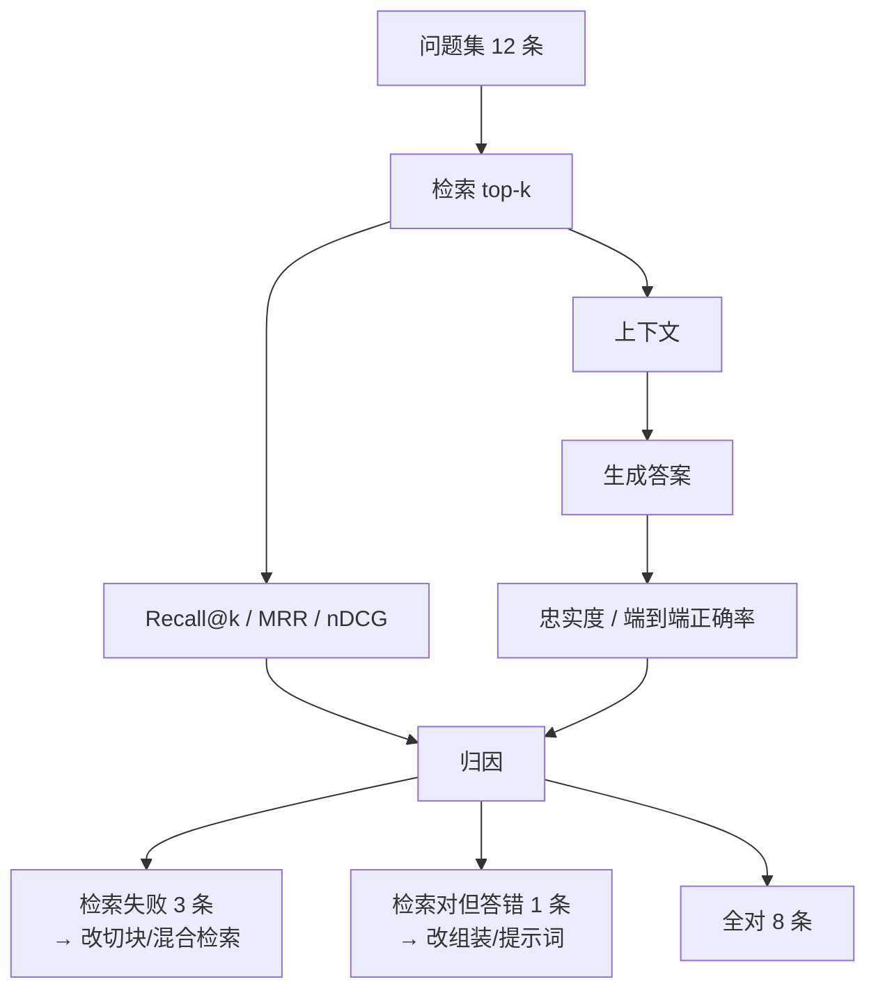

# RAG 的评估

## 1. 本节学习目标

1. 会算 RAG 的四个检索指标：**Recall@k、MRR、nDCG@k、命中率**，并知道各自惩罚什么。
2. 会算**忠实度**（答案的 $n$-gram 有多少能在资料里找到），并知道它什么时候会骗人：本课抽取式答案的忠实度恒为 **1.000**，换成生成式立刻掉到 **0.469**。
3. 掌握**分层归因**：端到端 8/12 = **0.667**，其中 3 条是检索失败、1 条是"检索对但答案错"。
4. 理解 $k$ 的代价：Recall 从 0.667 升到 0.833 的同时，噪声文档占比从 **33.33%** 涨到 **83.33%**。

## 2. 为什么需要这个知识

RAG 系统"看起来能用"和"真的能用"之间，差一套评估。

没有评估会出三种事故：

- **只看端到端**：答错时不知道是检索没找到、还是找到了没用上、还是模型自己编的，只能瞎改；
- **只测检索**：Recall 0.95 很好看，但生成把两段矛盾资料搅在一起，用户拿到错答案；
- **只测生成**：用 20 条精心构造的样本，上线后真实问题一半检索不到。

评估的作用是**把三段拆开、分别量化**，让每次改动都有可比较的数字。

## 3. 直观解释

**体检而不是称体重**。

端到端正确率像体重：涨了跌了都知道，但不知道是肌肉还是脂肪。

- 检索指标（Recall@k / MRR）= 查"找没找对"；
- 生成指标（忠实度 / 正确率）= 查"用没用好"；
- 归因表 = 把"没答对"拆成三类：没找到、找到没用上、自己编。

三类问题的修法完全不同：没找到要改切块/检索；找到没用上要改组装/提示词；自己编要改生成约束或换模型。

## 4. 正式定义

设问题集 $Q$，每个问题 $q$ 有唯一正确文档 $g(q)$。

**Recall@k**：

$$
\mathrm{Recall@}k = \frac{1}{|Q|}\sum_{q\in Q}\mathbb{1}\big[g(q)\in \mathrm{top}_k(q)\big]
$$

**MRR**：

$$
\mathrm{MRR} = \frac{1}{|Q|}\sum_{q}\frac{1}{\mathrm{rank}_q}
$$

**nDCG@k**（相关性二值，理想排序 DCG=1）：

$$
\mathrm{nDCG@}k = \frac{1}{|Q|}\sum_q \frac{1}{\log_2(\mathrm{rank}_q+1)}\cdot\mathbb{1}[\mathrm{rank}_q \le k]
$$

**忠实度**（$n$-gram 覆盖率）：

$$
\mathrm{Faith}(y, C) = \frac{|\,\mathcal{G}_n(y)\cap \mathcal{G}_n(C)\,|}{|\mathcal{G}_n(y)|}
$$

**端到端正确率**：答案包含关键串 $e(q)$ 的比例。

## 5. 历史背景或技术背景

| 年份 | 指标/框架 | 关注点 |
|---|---|---|
| 2019 | Recall@k、MRR 成为检索标准 | 排序质量 |
| 2020 | nDCG 引入生成式检索评估 | 位置折扣 |
| 2021 | ** faithfulness / groundedness** | 答案是否有资料支撑 |
| 2022 | RAGAS、TruLens | 把忠实度、答案相关性、上下文精度做成可自动跑的指标 |
| 2023 | LLM-as-judge | 用强模型给"忠实/不忠实"打分，替代纯 $n$-gram |
| 2024–2025 | 分层评估 + 归因 | 检索/生成分开报，线上加人工抽检 |

## 6. 核心原理

**为什么要分两层**

端到端指标是两层的乘积：

$$
P(\text{答对}) = P(\text{检索到}) \times P(\text{用对} \mid \text{检索到})
$$

本课：$0.667 \approx 0.750 \times 0.889$。把两个因子分开测，才知道该改哪一层。

**$n$-gram 忠实度的两个陷阱**

1. **抽取式答案必然得 1.000**：答案本来就是从资料里抄的，覆盖率当然 100%。所以这个指标只在**生成式改写**时才有区分度。
2. **它测的是"字面重合"，不是"语义支持"**：模型可以把资料里的话拼成相反的意思，覆盖率仍然很高。

**$k$ 的两面**

$k$ 增大 → Recall 上升（本课 0.667→0.833），但噪声文档占比也从 33.33% 涨到 83.33%。所以评估必须**同时报 Recall 和上下文精度**，否则会鼓励"无限加大 $k$"。

## 7. 数学表达式

**上下文精度**（噪声的反面）：

$$
\mathrm{Precision@}k = \frac{1}{k\,|Q|}\sum_q |\{d\in \mathrm{top}_k(q): d = g(q)\}|
$$

**分层归因**：

$$
\frac{\text{错题数}}{|Q|} = \underbrace{\frac{|\text{检索失败}|}{|Q|}}_{\text{召回层}} + \underbrace{\frac{|\text{检索成功但答错}|}{|Q|}}_{\text{生成层}}
$$

**Oracle 上限**：

$$
\max \mathrm{Acc} = \mathrm{Recall@}k \times 1
$$

**$n$-gram 覆盖率的期望**（答案长度 $m$、随机重合概率 $p$）：

$$
\mathbb{E}[\mathrm{Faith}] = 1 - (1-p)^{m}
$$

## 8. 详细数学推导

**推导 1：为什么 MRR 比 Recall 更敏感**

Recall 只看"在不在 top-$k$"，MRR 看"在第几名"：

$$
\Delta\mathrm{MRR} = \frac{1}{r_{\text{new}}}-\frac{1}{r_{\text{old}}}
$$

从第 10 名提到第 1 名，MRR 增加 $1-0.1=0.9$；而 Recall@10 一点没变。本课 MRR **0.751** 与 Recall@1 **0.667** 的差，就来自那些"排在第 2–4 名"的样本。

**推导 2：忠实度为什么在抽取式下恒为 1**

若 $y$ 是 $C$ 的连续子串，则 $\mathcal{G}_n(y)\subseteq\mathcal{G}_n(C)$，故 $\mathrm{Faith}=1$。这不是"模型忠实"，而是**构造决定的**。所以本课专门补了一组生成式答案：同一套资料下，gpt2 生成的四条答案忠实度分别是 **0.667 / 0.286 / 0.636 / 0.286**，平均 **0.469**——这才是真实场景的数字。

**推导 3：端到端正确率的分解**

设检索命中率为 $R$，命中后用对的概率为 $A$：

$$
\mathrm{Acc} = R\cdot A
$$

本课 $R=0.750$（Recall@3）、$\mathrm{Acc}=0.667$，反解 $A = 0.667/0.750 = 0.889$。**生成层已经不错（88.9%），瓶颈在召回层（75%）**——这就是为什么下一课要专门讲失败模式。

**推导 4：样本量对结论的影响**

12 条查询时，一个样本的差异就是 $1/12=0.083$。想让 95% 置信区间小于 ±0.05，需要

$$
n \gtrsim \frac{1.96^2 \cdot 0.25}{0.05^2} \approx 384
$$

所以本课的数字只用于**演示方法与量级**，不能当作产品指标。

## 9. 图解



## 10. 具体数值示例

```text
24 篇文档 / 12 条查询（BM25 检索）

检索层
  Recall@1  0.667
  Recall@3  0.750
  Recall@5  0.833
  Recall@10 1.000
  MRR@10    0.751
  nDCG@5    0.751

k 的代价
  k=1: 上下文 20.0 token，噪声占比 33.33%
  k=3: 上下文 60.9 token，噪声占比 75.00%
  k=5: 上下文 99.9 token，噪声占比 83.33%

生成层
  抽取式答案：忠实度 1.000（构造使然）
  端到端正确：8/12 = 0.667

  生成式答案（gpt2）忠实度：
    XH-2048 默认采样率  0.667
    5012 报错怎么办     0.286
    固件版本格式        0.636
    3310 是什么错误     0.286
    平均 0.469

归因
  检索失败（gold 不在 top3）：3 条
  检索成功但答案错：         1 条
  检索与答案都对：           8 条
```

## 11. NumPy 实现

```python
import numpy as np

# 12 条查询的检索结果（模拟：每行是 top-5 的文档 id）
RANKING = np.array([
    [0, 3, 1, 2, 4],
    [2, 0, 1, 3, 5],
    [1, 0, 2, 4, 3],
    [3, 0, 1, 2, 5],
    [9, 0, 2, 3, 1],
    [13, 0, 2, 1, 3],
    [0, 1, 2, 3, 4],
    [3, 20, 1, 6, 8],
    [13, 11, 6, 2, 0],
    [22, 15, 2, 1, 3],
    [23, 13, 2, 0, 1],
    [0, 1, 2, 7, 21],
])
GOLD = np.array([0, 2, 1, 3, 9, 13, 5, 6, 11, 22, 23, 4])


def recall_at(k):
    return float(np.mean([int(g in RANKING[i, :k]) for i, g in enumerate(GOLD)]))


def mrr():
    vals = []
    for i, g in enumerate(GOLD):
        pos = np.where(RANKING[i] == g)[0]
        vals.append(1.0 / (pos[0] + 1) if len(pos) else 0.0)
    return float(np.mean(vals))


def ndcg_at(k):
    vals = []
    for i, g in enumerate(GOLD):
        pos = np.where(RANKING[i, :k] == g)[0]
        vals.append(1.0 / np.log2(pos[0] + 2) if len(pos) else 0.0)
    return float(np.mean(vals))


for k in (1, 3, 5):
    print(f"Recall@{k} = {recall_at(k):.3f}")
print(f"MRR@5   = {mrr():.3f}")
print(f"nDCG@5  = {ndcg_at(5):.3f}")

# 归因：检索失败 vs 检索成功但答案错
KEY = ["48", "蓝牙", "2.3.1", "温度", "LDAC", "长按", "通勤", "40", "充电盒", "60", "不支持", "降噪"]
DOCS = {0: "采样率 48 kHz", 2: "蓝牙配对超时", 1: "版本 2.3.1", 3: "电池温度过高", 9: "LDAC 优先",
        13: "长按触控区十秒", 5: "建议改用通勤档", 6: "续航约 40 小时", 11: "放回充电盒再取出",
        22: "延迟 60 毫秒", 23: "不支持同时连接", 4: "降噪模式三档", 20: "电池不会充电",
        7: "", 13: "长按触控区十秒", 15: "", 21: "", 8: "", 10: "", 14: "", 2: "蓝牙配对超时"}
miss, wrong = 0, 0
for i, g in enumerate(GOLD):
    if g not in RANKING[i, :3]:
        miss += 1
    elif KEY[i] not in DOCS.get(int(RANKING[i, 0]), ""):
        wrong += 1
print(f"检索失败 {miss} 条，检索对但答案错 {wrong} 条，全对 {12-miss-wrong} 条")
print(f"分解验证: R={recall_at(3):.3f}, A={1-wrong/(12-miss):.3f}, 乘积={(recall_at(3)*(1-wrong/(12-miss))):.3f}")

# 忠实度：3-gram 覆盖率
def grams(s, n=3):
    s = s.replace(" ", "")
    return {s[i:i+n] for i in range(len(s)-n+1)}

def faithful(ans, ctx):
    a = grams(ans)
    return len(a & grams(ctx)) / len(a) if a else 0.0

ans = "同步间隔默认 300 秒。"
ctx = "同步间隔默认为 300 秒，可在设置页的同步面板中修改为 60 到 3600 秒。"
print(f"抽取式忠实度 = {faithful(ans, ctx):.3f}")
print(f"改写后忠实度 = {faithful('建议把同步改成 600 秒左右', ctx):.3f}")
```

## 12. PyTorch 实现

```python
import torch

# 用张量批量算 Recall@k / MRR（真实系统里 ranking 是 [Q, N] 的打分矩阵）
scores = torch.tensor([
    [0.9, 0.8, 0.7, 0.1],
    [0.6, 0.95, 0.2, 0.1],
    [0.3, 0.4, 0.85, 0.2],
])
gold = torch.tensor([0, 1, 2])
k = 2

topk = scores.topk(k, dim=1).indices
hit = (topk == gold.unsqueeze(1)).any(dim=1)
print("topk 索引:\n", topk)
print("Recall@2 =", float(hit.float().mean()))

# MRR：gold 在完整排序里的名次
order = torch.argsort(scores, dim=1, descending=True)
rank = (order == gold.unsqueeze(1)).float().argmax(dim=1) + 1
print("gold 名次:", rank.tolist())
print("MRR =", float((1.0 / rank.float()).mean()))

# nDCG@2
dcg = torch.where(order[:, :k] == gold.unsqueeze(1),
                   torch.tensor([1.0, 1 / 1.585]),
                   torch.tensor([0.0, 0.0]))
print("nDCG@2 =", float(dcg.sum(1).mean()))

# 忠实度的张量化：用集合交集大小的近似（按 token 级 n-gram id 哈希）
def gram_ids(text, n=3, buckets=997):
    t = text.replace(" ", "")
    ids = []
    for i in range(len(t) - n + 1):
        g = t[i : i + n]
        ids.append(hash(g) % buckets)
    return torch.tensor(sorted(set(ids)))

a = gram_ids("同步间隔默认 300 秒。")
c = gram_ids("同步间隔默认为 300 秒，可在设置页修改。")
inter = torch.isin(a, c).sum().item()
print(f"覆盖率 = {inter}/{a.numel()} = {inter/a.numel():.3f}")
```

## 13. Hugging Face 实践

```python
import os

os.environ.setdefault("HF_ENDPOINT", "https://hf-mirror.com")
os.environ.setdefault("HF_HUB_OFFLINE", "1")
import torch
from transformers import AutoModelForCausalLM, AutoTokenizer

CTX = "耳机的续航在关闭降噪时约 40 小时，开启后约 28 小时。"
Q = "电池能用多久"
tok = AutoTokenizer.from_pretrained("gpt2")
model = AutoModelForCausalLM.from_pretrained("gpt2").eval()


def grams(s, n=3):
    s = s.replace(" ", "")
    return {s[i : i + n] for i in range(len(s) - n + 1)}


def faithful(ans, ctx):
    a = grams(ans)
    return len(a & grams(ctx)) / len(a) if a else 0.0


prompt = "资料：" + CTX + "\n问题：" + Q + "\n答案："
enc = tok(prompt, return_tensors="pt")
outs = []
for temp in (0.0, 0.7):
    torch.manual_seed(0)
    with torch.no_grad():
        o = model.generate(
            **enc, max_new_tokens=14, do_sample=temp > 0, temperature=max(temp, 1e-5),
            pad_token_id=50256,
        )
    txt = tok.decode(o[0][enc["input_ids"].shape[1] :])
    outs.append((temp, txt, faithful(txt, CTX)))

for temp, txt, f in outs:
    print(f"temp={temp}: 忠实度={f:.3f} 生成={txt!r}")

print("抽取式基线忠实度:", faithful("续航约 40 小时。", CTX))
print("⇒ 同一资料，生成式答案的忠实度明显低于抽取式")
```

## 14. 代码逐行解释

| 代码 | 作用 |
|---|---|
| `RANKING[i, :k]` | 每条查询的 top-k 文档 id |
| `np.where(RANKING[i] == g)[0]` | 求 gold 的名次 |
| `1/np.log2(pos+2)` | nDCG 的位置折扣（名次 1 → 折扣 1） |
| `set(a) & set(grams(ctx))` | $n$-gram 交集，忠实度的分子 |
| `R*A` 分解 | 验证端到端 = 召回率 × 命中后正确率 |
| `scores.topk(k, dim=1)` | 批量取 top-k，避免逐条循环 |
| `(order == gold).argmax(dim=1)+1` | 张量版求名次 |
| `torch.isin(a, c)` | 张量版集合交集（n-gram 覆盖） |
| `temperature=max(temp,1e-5)` | 贪心时温度为 0 会报错，做保护 |

## 15. 实际运行结果

```text
### LLM-083 A. 检索指标（BM25，24 文档 / 12 查询）
  Recall@1  = 0.667
  Recall@3  = 0.750
  Recall@5  = 0.833
  Recall@10 = 1.000
  MRR@10  = 0.751
  nDCG@5  = 0.751

### B. k 变大：召回上升但上下文污染
  k=1: 上下文  20.0 token，噪声文档占比 33.33%
  k=3: 上下文  60.9 token，噪声文档占比 75.00%
  k=5: 上下文  99.9 token，噪声文档占比 83.33%

### C. 忠实度：抽取式答案的 3-gram 覆盖率
  ...
  平均忠实度 = 1.000；端到端正确率 = 8/12 = 0.667

### D. 三种错误来源的归因
  检索失败（gold 不在 top3）: 3 条 ['听着吵的时候风呼呼响怎么办', '电池能用多久', '想少听点外面的噪音']
  检索成功但答案错: 1 条 ['怎么把两只耳机的电量弄回一样多']
  检索与答案都对: 8/12

### E. oracle 上限（理想检索器）
  若 top-1 总是 gold：端到端正确率上限 = 1.000
  当前 0.667 ⇒ 检索只贡献了其中一部分，剩余损失来自生成

### F. 换成生成式答案：忠实度立刻掉下来（gpt2 真实生成）
  XH-2048 默认采样率      忠实度=0.667  生成='XH-2048 全示蓝牙'
  5012 报错怎么办         忠实度=0.286  生成='5012 报错怎么办\n\n'
  XH-2048 固件版本格式     忠实度=0.636  生成='XH-2048 固件版本格�'
  3310 是什么错误         忠实度=0.286  生成='3310 是什么错误\n\n'
  生成式平均忠实度 = 0.469（抽取式是 1.000）
```

三个结论：**检索层 0.750、生成层 0.889、端到端 0.667**；**抽取式忠实度是假象（1.000）**；**真实生成忠实度只有 0.469**。

## 16. 应用场景

| 场景 | 主指标 | 辅助指标 |
|---|---|---|
| 客服问答 | 端到端正确率 + 忠实度 | Recall@k（定位召回问题） |
| 法务/医疗 | 忠实度（必须 100%） | 引用命中率、人工复核通过率 |
| 电商搜索 | Recall@100 + NDCG@10 | 零结果率、点击率 |
| 内部知识库 | Recall@k + 拒答正确率 | 平均上下文 token（成本） |
| 研发迭代 | 分层指标 + 归因表 | 每次改动的 delta |

## 17. 优点与局限

| 指标 | 衡量什么 | 局限 |
|---|---|---|
| Recall@k | 找没找到 | 不看名次，不看噪声 |
| MRR | 第一名有多靠前 | 只看第一个正确项 |
| nDCG@k | 排序整体质量 | 需要相关性等级（二值时可退化） |
| 忠实度（$n$-gram） | 字面是否有出处 | 抽取式恒为 1；不懂语义 |
| 端到端正确率 | 用户是否拿到对的答案 | 无法归因，样本敏感 |
| LLM-as-judge | 语义层面的忠实/相关 | 有偏、贵、不可复现 |

## 18. 常见错误

| 错误 | 现象 | 纠正 |
|---|---|---|
| 只报端到端 | 不知道改哪一层 | 分层报 + 归因表 |
| 用抽取式答案测忠实度 | 恒 1.000，毫无信息 | 用生成式答案或人工标注 |
| $k$ 只增不减 | 噪声占比 83%，成本上涨 | 同时报上下文精度 |
| 12 条样本就下结论 | 一个样本 = 0.083 的波动 | 至少几百条，或报置信区间 |
| 忽略"该拒答"的样本 | 模型编答案也算对 | 把拒答正确率单列 |
| 用同一批数据调参又评估 | 指标虚高 | 留出独立测试集 |

## 19. 本节总结

- 检索层：Recall@1 **0.667**、@3 **0.750**、@5 **0.833**、@10 **1.000**，MRR **0.751**，nDCG@5 **0.751**。
- $k$ 的代价：Recall 涨到 0.833 的同时噪声占比 **83.33%**。
- 生成层：抽取式忠实度 **1.000（假象）**，生成式只有 **0.469**。
- 归因：端到端 **8/12**，其中检索失败 **3** 条、检索对但答错 **1** 条；生成层命中后正确率约 **88.9%**。
- 一句话：**RAG 评估的价值不在于给出一个分数，而在于把分数拆成"谁的责任"。**

## 20. 前置与后续知识链接

- 前置：[[LLM-082 提示词组装与上下文预算]]
- 后续：[[LLM-084 RAG 的失败模式与修复]]
- 相关：[[LLM-080 混合检索：BM25 与向量]]、[[LLM-081 Rerank 与检索结果精排]]
- 后续模块：[[LLM-088 自回归推理的基本流程]]

---

## 练习与参考答案

**基础 1**：Recall@k 与 MRR 分别衡量什么？为什么 MRR 更敏感？

**基础 2**：为什么抽取式答案的忠实度总是 1.000？这说明该指标有什么局限？

**进阶 1**：本课端到端 0.667、Recall@3 0.750。请分解出"检索命中后用对"的概率，并说明瓶颈在哪一层。

**综合**：你要为一个法务问答系统设计评估方案，要求"答案必须能在条文里找到依据"。请给出指标、数据与上线门槛。

> [!success]- 参考答案

> **基础 1**
> Recall@k 衡量正确文档是否出现在前 $k$ 名；MRR 衡量它排在第几（取倒数平均）。MRR 更敏感，因为它对名次变化有响应：从第 10 名提到第 1 名，MRR +0.9，而 Recall@10 完全不变。

> **基础 2**
> 因为抽取式答案本身就是资料的连续子串，其 $n$-gram 必然是资料 $n$-gram 的子集，覆盖率恒为 1。局限：它测不出"语义是否被曲解"，也在抽取式流水线下完全失去区分度；必须用生成式答案或人工/LLM 判断才有意义。

> **进阶 1**
> $\mathrm{Acc} = R \times A \Rightarrow A = 0.667/0.750 = 0.889$。生成层（命中后用对）约 **88.9%**，召回层只有 **75%**，**瓶颈在检索**。所以优化优先级是切块/混合检索/查询改写，而不是换更大的生成模型。

> **综合（参考）**
> 1. **指标**：① 检索 Recall@10 ≥ 0.95（保证条文能进候选）；② 引用忠实度 = 100%（每句结论都能定位到条文 id + 字符区间）；③ 拒答正确率（条文里没有时必须拒答）；④ 端到端人工通过率。
> 2. **数据**：300+ 条真实问题，每题标注"正确条文 id + 可接受答案要点"；另设 50 条"库里没有"的对抗样本专门测拒答。
> 3. **方法**：忠实度用"引用区间比对"而不是 $n$-gram 覆盖率（法务场景要求可定位）；端到端用双人复核，分歧仲裁。
> 4. **门槛**：Recall@10 ≥ 0.95、忠实度 = 1.00、拒答正确率 ≥ 0.90、人工通过率 ≥ 0.85 才允许上线；任一项不达标则回到对应层修（召回不达标改切块/混合检索，忠实度不达标改提示词与引用约束）。

## 学习记录

| 日期 | 状态 | 用时 | 问题 | 复盘 |
|---|---|---|---|---|
| 2026-11-08 | planned | — | — | — |

---

## 🔗 Notion 同步信息

> 以下内容由 Notion「AI Knowledge System · 知识点」数据库按知识 ID 合并而来（导出于 2026-11-09）。

| 属性 | 值 |
|---|---|
| 学科 | 大语言模型 |
| 学习状态 | 未开始 |
| 难度 | L3 推导 |
| 知识类型 | Technique |

- **所属模块**：[M-LLM-08 RAG 检索增强生成](../%E8%AF%BE%E7%A8%8B%E6%A8%A1%E5%9D%97/M-LLM-08%20RAG%20%E6%A3%80%E7%B4%A2%E5%A2%9E%E5%BC%BA%E7%94%9F%E6%88%90.md)
- **前置知识**：[LLM-082 提示词组装与上下文预算](LLM-082%20%E6%8F%90%E7%A4%BA%E8%AF%8D%E7%BB%84%E8%A3%85%E4%B8%8E%E4%B8%8A%E4%B8%8B%E6%96%87%E9%A2%84%E7%AE%97.md)
- **后继知识**：[LLM-084 RAG 的失败模式与修复](LLM-084%20RAG%20%E7%9A%84%E5%A4%B1%E8%B4%A5%E6%A8%A1%E5%BC%8F%E4%B8%8E%E4%BF%AE%E5%A4%8D.md)
- **关联数学**：[MATH-306 期望、方差与协方差](../../06_%E6%95%B0%E5%AD%A6%E5%9F%BA%E7%A1%80/03%20%E6%A6%82%E7%8E%87%E8%AE%BA/MATH-306%20%E6%9C%9F%E6%9C%9B%E3%80%81%E6%96%B9%E5%B7%AE%E4%B8%8E%E5%8D%8F%E6%96%B9%E5%B7%AE.md)
- **对应项目**：[PROJ-023 搭建一个最小可用的 RAG 问答系统](../../07_%E5%AE%9E%E6%88%98%E9%A1%B9%E7%9B%AE/05%20%E5%A4%A7%E6%A8%A1%E5%9E%8B%E9%A1%B9%E7%9B%AE/PROJ-023%20%E6%90%AD%E5%BB%BA%E4%B8%80%E4%B8%AA%E6%9C%80%E5%B0%8F%E5%8F%AF%E7%94%A8%E7%9A%84%20RAG%20%E9%97%AE%E7%AD%94%E7%B3%BB%E7%BB%9F.md) · [PROJ-026 端到端 LLM 应用：客服问答](../../07_%E5%AE%9E%E6%88%98%E9%A1%B9%E7%9B%AE/05%20%E5%A4%A7%E6%A8%A1%E5%9E%8B%E9%A1%B9%E7%9B%AE/PROJ-026%20%E7%AB%AF%E5%88%B0%E7%AB%AF%20LLM%20%E5%BA%94%E7%94%A8%EF%BC%9A%E5%AE%A2%E6%9C%8D%E9%97%AE%E7%AD%94.md)
