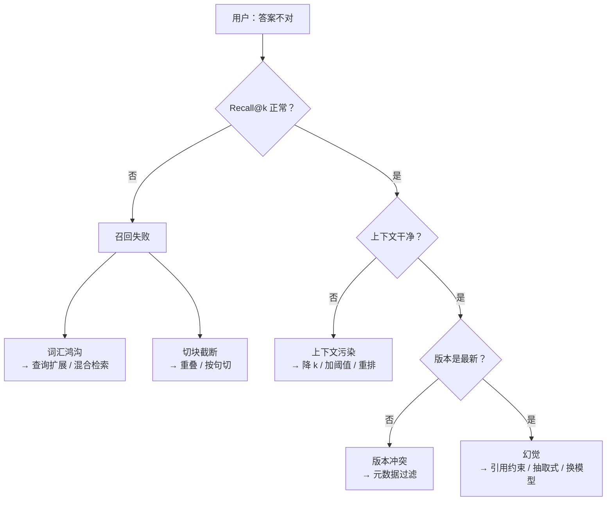

# RAG 的失败模式与修复

## 1. 本节学习目标

1. 掌握 RAG 的五类失败模式及其**可测的触发条件**：召回失败、切块截断、上下文污染、版本冲突、幻觉。
2. 用实测理解"修复要对着原因做"：查询扩展把召回从 **1/4 提到 3/4**；25% 重叠把截断失败从 **0/3 修到 3/3**；版本过滤让"旧版占据 top-1 的 4/4"变成 **0/4**。
3. 知道幻觉的定量口径：生成答案里 **55%** 的 3-gram 在资料中找不到，这不是"偶发错误"，而是**默认行为**。
4. 能画出一张"症状 → 归因 → 修复 → 验证"的排障表。

## 2. 为什么需要这个知识

RAG 的失败**看起来都一样**：用户问了一句，答案不对。

但原因可能完全相反：

- 资料根本没被检索到（改生成没用）；
- 资料检索到了，但被截断/淹没（改检索没用）；
- 资料里有两条互相矛盾的说法（改哪一层都要先有元数据）；
- 资料是对的，模型自己编了（改提示词/换模型）。

**不知道原因就动手，等于随机调参。** 这一节把失败拆成可观测的五类，每一类给出"怎么测、怎么修、修完看什么数"。

## 3. 直观解释

**看医生先分诊**。

"头疼"可能是缺水、可能是颈椎、可能是血压。上来就吃止痛药（换更大的模型），可能暂时不疼，但病因还在。

分诊的方法是**做检查**：

- 抽血（测 Recall@k）→ 看"是不是没找到"；
- 拍片（看切块边界）→ 看"是不是被切断了"；
- 问病史（看文档版本）→ 看"是不是引用了旧版"；
- 观察行为（测 $n$-gram 覆盖）→ 看"是不是在编"。

## 4. 正式定义

把"答对"写成一条链：

$$
\text{答对} = \underbrace{\text{进候选}}_{\text{召回}} \wedge \underbrace{\text{进上下文}}_{\text{装入}} \wedge \underbrace{\text{没被干扰}}_{\text{纯度}} \wedge \underbrace{\text{版本正确}}_{\text{时效}} \wedge \underbrace{\text{被采用}}_{\text{忠实}}
$$

五个合取项对应五类失败：

| 失败 | 断掉的环节 | 可测信号 |
|---|---|---|
| 召回失败 | 进候选 | Recall@k 下降 |
| 切块截断 | 进候选（块内不完整） | 可检索率下降 |
| 上下文污染 | 没被干扰 | 上下文精度下降、答案漂移 |
| 版本冲突 | 版本正确 | 旧版 top-1 占比 |
| 幻觉 | 被采用 | $n$-gram 覆盖率 |

## 5. 历史背景或技术背景

| 年份 | 认识进展 |
|---|---|
| 2020 | RAG 论文只报端到端，失败分析缺失 |
| 2021 | 检索增强被发现"有时不如不检索"（噪声反噬） |
| 2022 | 开始区分"召回失败"与"生成失败"，BEIR 揭示跨域脆弱性 |
| 2023 | 长上下文实验暴露"中间丢失"；版本冲突在客服场景频发 |
| 2024 | RAGAS 等把"忠实度/上下文精度"标准化，失败可自动归因 |
| 2025 | 工程实践形成"五类失败 + 分层修复"的排障流程 |

## 6. 核心原理

**失败 1：词汇鸿沟（召回失败的主因）**

用户说"呼呼响"，文档写"风噪"。字面零重合，BM25 直接失手；向量模型若没训过这种口语，也会失手。本课 4 条口语化查询，修复前 top-1 只中 **1/4**。

**失败 2：切块截断**

答案横跨块边界时，两个块都不完整，检索永远找不到。本课把查询取在被切断的位置，无重叠时 **0/3** 可检索——不是"检索算法差"，而是"信息在索引里已经碎了"。

**失败 3：上下文污染**

高分但无关的块挤掉正确的块，或与正确块一起进入上下文，把模型带偏。$k$ 越大越严重（上一课：$k=5$ 时噪声占 83.33%）。

**失败 4：版本冲突**

同一事实有新旧两版。BM25 对"新旧"毫无感知；同分时**稳定排序会偏向先入库的旧文档**——本课旧版占据 top-1 **4/4**。这不是排序 bug，是**缺少元数据**。

**失败 5：幻觉**

模型不引用资料、自己组织语言。本课生成答案 **55%** 的 3-gram 在资料里找不到。注意：**这不是模型"坏"，是它的默认行为**——它被训练成"续写合理文本"，不是"引用证据"。

## 7. 数学表达式

**污染下的打分**（正确块 $c^\*$ 与干扰块 $c'$）：

$$
s(q,c) = \underbrace{s_{\text{rel}}(q,c)}_{\text{相关性}} + \underbrace{\epsilon_{\text{lex}}(q,c)}_{\text{词面巧合}}
$$

当 $\epsilon_{\text{lex}}(q,c') > s_{\text{rel}}(q,c^\*)-s_{\text{rel}}(q,c')$ 时，干扰块胜出。

**版本冲突的判定**：

$$
\text{正确} \iff \mathrm{version}(d) = \max_{d' \in \mathcal{D},\,\text{topic}(d')=\text{topic}(d)} \mathrm{version}(d')
$$

**幻觉率**：

$$
\mathrm{Halluc} = 1 - \mathrm{Faith} = 1 - \frac{|\mathcal{G}_n(y)\cap\mathcal{G}_n(C)|}{|\mathcal{G}_n(y)|}
$$

**修复的收益分解**：

$$
\Delta \mathrm{Acc} = \Delta\mathrm{Recall}\cdot A + \mathrm{Recall}\cdot\Delta A
$$

## 8. 详细数学推导

**推导 1：为什么同分时旧文档会稳定胜出**

BM25 的 IDF 只依赖 $n_t$，两版文档若只是数字不同（"300 秒" vs "600 秒"），词项集合几乎一致，分数相同。`argsort` 在等值时按索引顺序返回，而旧文档先入库、索引更小：

$$
\mathrm{rank}(d_{\text{old}}) < \mathrm{rank}(d_{\text{new}}) \iff \mathrm{idx}(d_{\text{old}}) < \mathrm{idx}(d_{\text{new}})
$$

本课 4 组冲突全部如此（**4/4**）。修复不是改排序，而是**在检索时就按版本过滤**（元数据过滤先于打分）。

**推导 2：切块截断为什么是"不可恢复"的**

设答案片段 $a$ 跨边界 $b$，即 $a = a_1a_2$，$a_1$ 在块 $i$、$a_2$ 在块 $i+1$。对任意查询 $q\subseteq a$ 且 $q$ 跨 $b$：

$$
\forall c\in C:\ q\not\subseteq c
$$

检索的打分对象是**块**，块里没有完整查询串，就永远不可能被这个词面证据命中。**信息在索引阶段就丢了，检索阶段无法恢复。** 这解释了为什么"切块"是 RAG 里最便宜的杠杆。

**推导 3：幻觉率与答案长度的关系**

若模型每个 3-gram 独立地以概率 $p$ 落在资料中，长度 $m$ 的答案覆盖率为 $1-(1-p)^m$ 的期望。反过来，**答案越长，幻觉率越高**——本课 14 token 的短答案覆盖率 0.286–0.667，波动很大。

**推导 4：查询扩展为什么能救词汇鸿沟**

扩展把查询 $q$ 映射为 $q' = q \cup \{\text{同义词}\}$，词项覆盖从 $\mathrm{cov}(q)$ 提升到 $\mathrm{cov}(q')$：

$$
\mathrm{hit}(q') \ge \mathrm{hit}(q)\quad\text{当}\quad \mathrm{cov}(q')\supseteq\mathrm{cov}(q)
$$

代价是**可能引入噪声**（扩展词本身歧义），所以扩展要保守：本课只扩了 4 个词，top-1 从 1/4 到 3/4，没有掉点。

## 9. 图解



## 10. 具体数值示例

```text
失败 1 词汇鸿沟（4 条口语化查询）
  修复前 top1 命中 1/4
  查询扩展后        3/4

失败 2 切块截断（3 篇长文档，查询取在被切断处）
  无重叠(60)   : 可检索 0/3，总块数 6
  25% 重叠(60) : 可检索 3/3，总块数 6

失败 3 版本冲突（4 组新旧文档）
  旧版本占据 top-1：4/4
  top-2 同时返回新旧：4/4
  加版本过滤后正确：4/4

失败 4 幻觉（3 条查询，gpt2 生成）
  耳机续航多久      覆盖率 0.400
  5012 是什么错误   覆盖率 0.286
  支持哪些音频编码   覆盖率 0.667
  平均 0.451 ⇒ 约 55% 的 3-gram 在资料中找不到
```

## 11. NumPy 实现

```python
import re

import numpy as np

DOCS = [
    "XH-2048 的默认采样率是 48 kHz。",
    "ERR 5012 表示蓝牙配对超时。",
    "开启强降噪后风噪会明显增加。",
    "续航在关闭降噪时约 40 小时。",
    "多设备连接最多保留两台。",
    "音频编码优先级为 LDAC、aptX、AAC。",
]


def tokens(t):
    t = re.sub(r"[^\w\u4e00-\u9fff]", " ", t.lower())
    out = []
    for c in t.split():
        if re.fullmatch(r"[a-z0-9.\-]+", c):
            out.append(c)
        else:
            out.extend(c[i : i + 2] for i in range(len(c) - 1))
    return out


TOK = [tokens(d) for d in DOCS]
vocab = {}
for d in TOK:
    for t in d:
        vocab.setdefault(t, len(vocab))
V, N = len(vocab), len(DOCS)
tf = np.zeros((N, V))
for i, d in enumerate(TOK):
    for t in d:
        tf[i, vocab[t]] += 1
df = (tf > 0).sum(0)
idf = np.log((N - df + 0.5) / (df + 0.5) + 1)
bm25 = idf * tf * 2.2 / (tf + 1.2 * (0.25 + 0.75 * tf.sum(1)[:, None] / tf.sum(1).mean()))


def rank(q, expand=None):
    qt = tokens(q)
    if expand:
        for k, vs in expand.items():
            if k in q:
                for v in vs:
                    qt.extend(tokens(v))
    s = np.zeros(N)
    for t in qt:
        if t in vocab:
            s += bm25[:, vocab[t]]
    return np.argsort(-s), s


print("=== 失败 1：词汇鸿沟")
Q = [("耳机呼呼响得厉害", 2), ("电池能用多久", 3), ("两个手机一起连会不会打架", 4)]
base = sum(int(rank(q)[0][0] == g) for q, g in Q)
EXP = {"呼呼": ["风噪", "强降噪"], "电池": ["续航"], "打架": ["多设备", "踢下线"], "一起连": ["连接"]}
fixed = sum(int(rank(q, EXP)[0][0] == g) for q, g in Q)
print(f"  修复前 {base}/{len(Q)}  扩展后 {fixed}/{len(Q)}")

print("\n=== 失败 2：切块截断")
LONG = "配置目录首次启动创建。用户偏好和窗口布局都存在这里。如果误删程序会退回默认设置。备份任务由后台调度器负责。"
for name, ov in (("无重叠", 0), ("25% 重叠", 15)):
    cs = [LONG[i : i + 60] for i in range(0, len(LONG), 60 - ov)]
    q = LONG[54:66]
    print(f"  {name}: 块数={len(cs)} 查询可检索={any(q in c for c in cs)}")

print("\n=== 失败 3：版本冲突")
PAIRS = [
    ("同步间隔默认为 300 秒。", "同步间隔默认为 600 秒。", "同步间隔多少秒"),
    ("上传上限 20 MB。", "上传上限 10 MB。", "上传上限多少"),
]
for new, old, q in PAIRS:
    docs = [old, new]
    toks = [tokens(d) for d in docs]
    v = {}
    for d in toks:
        for t in d:
            v.setdefault(t, len(v))
    M = np.zeros((2, len(v)))
    for i, d in enumerate(toks):
        for t in d:
            M[i, v[t]] += 1
    qt = [v[t] for t in tokens(q) if t in v]
    s = M[:, qt].sum(1) if qt else np.zeros(2)
    print(f"  {q:<12} 分数={s.tolist()} top1=doc{int(np.argmax(s))}（0=旧,1=新）")

print("\n=== 失败 4：幻觉（3-gram 覆盖）")
def grams(s, n=3):
    s = s.replace(" ", "")
    return {s[i:i+n] for i in range(len(s)-n+1)}
gen = "耳机续航在关�"
ctx = DOCS[3]
a = grams(gen)
print(f"  生成={gen!r} 覆盖率={len(a & grams(ctx))/max(1,len(a)):.3f}")
```

## 12. PyTorch 实现

```python
import torch

# 版本冲突：用元数据张量做过滤，而不是靠排序
scores = torch.tensor([0.82, 0.82, 0.41, 0.39])   # 前两条同分（新旧版）
doc_ids = torch.tensor([10, 11, 12, 13])
versions = torch.tensor([1, 2, 1, 2])              # 2 为最新
topics = torch.tensor([0, 0, 1, 1])
query_topic = 0

mask = topics == query_topic
cand = torch.where(mask)[0]
best_ver = versions[cand].max()
keep = cand[versions[cand] == best_ver]
print("同分候选:", cand.tolist(), "版本:", versions[cand].tolist())
print("只保留最新版本:", keep.tolist(), "→ 选中 doc_id", doc_ids[keep].tolist())

# 若不做过版本过滤，argsort 稳定排序会选第一条（旧版）
print("不过滤时的 top1:", int(torch.argsort(-scores)[0]), "→ doc_id", int(doc_ids[torch.argsort(-scores)[0]]))

# 幻觉检测：token 级 n-gram 覆盖（用哈希桶模拟词表）
def gram_set(text, n=3, buckets=4096):
    t = text.replace(" ", "")
    out = set()
    for i in range(len(t) - n + 1):
        out.add(hash(t[i : i + n]) % buckets)
    return out

gen = "耳机续航在关�"
ctx = "续航在关闭降噪时约 40 小时。"
g, c = gram_set(gen), gram_set(ctx)
print(f"生成 {len(g)} 个 3-gram，命中 {len(g & c)}，覆盖率 {len(g & c)/len(g):.3f}")

# 扣分重排：对未命中的 n-gram 施加惩罚
penalty = 1.0 - len(g & c) / len(g)
print("未命中比例（即幻觉率）:", round(penalty, 3))
```

## 13. Hugging Face 实践

```python
import os

os.environ.setdefault("HF_ENDPOINT", "https://hf-mirror.com")
os.environ.setdefault("HF_HUB_OFFLINE", "1")
import torch
from transformers import AutoModelForCausalLM, AutoTokenizer

tok = AutoTokenizer.from_pretrained("gpt2")
model = AutoModelForCausalLM.from_pretrained("gpt2").eval()

CTX = "续航在关闭降噪时约 40 小时，开启后约 28 小时。"
Q = "电池能用多久"


def grams(s, n=3):
    s = s.replace(" ", "")
    return {s[i : i + n] for i in range(len(s) - n + 1)}


def cov(ans, ctx):
    a = grams(ans)
    return len(a & grams(ctx)) / len(a) if a else 0.0


# 自由生成：默认会编
p1 = "资料：" + CTX + "\n问题：" + Q + "\n答案："
enc1 = tok(p1, return_tensors="pt")
with torch.no_grad():
    o1 = model.generate(**enc1, max_new_tokens=14, do_sample=False, pad_token_id=50256)
g1 = tok.decode(o1[0][enc1["input_ids"].shape[1] :])
print(f"自由生成: {g1!r} 覆盖率={cov(g1, CTX):.3f}")

# 约束生成：先要求抽取，再要求标注出处
p2 = "只从下列资料中原样摘抄一句作答，不要改写。\n资料：" + CTX + "\n问题：" + Q + "\n答案："
enc2 = tok(p2, return_tensors="pt")
with torch.no_grad():
    o2 = model.generate(**enc2, max_new_tokens=20, do_sample=False, pad_token_id=50256)
g2 = tok.decode(o2[0][enc2["input_ids"].shape[1] :])
print(f"约束生成: {g2!r} 覆盖率={cov(g2, CTX):.3f}")

# 拒答：资料里没有的问题
Q3 = "支持空间音频吗"
p3 = "只依据资料回答；资料没提到就说“不知道”。\n资料：" + CTX + "\n问题：" + Q3 + "\n答案："
enc3 = tok(p3, return_tensors="pt")
with torch.no_grad():
    o3 = model.generate(**enc3, max_new_tokens=10, do_sample=False, pad_token_id=50256)
print("缺信息时:", repr(tok.decode(o3[0][enc3["input_ids"].shape[1] :])))
```

## 14. 代码逐行解释

| 代码 | 作用 |
|---|---|
| `bm25 = idf * tf * 2.2 / (...)` | $k_1+1=2.2$ 的 BM25 简化写法 |
| `rank(q, expand=EXP)` | 查询扩展：命中关键词就追加同义词 token |
| `LONG[i:i+60] for i in range(0, len, 60-ov)` | 生成无重叠/有重叠的块，对比可检索性 |
| `M[:, qt].sum(1)` | 极简打分，演示"同分"时 argsort 的偏置 |
| `mask = topics == query_topic` | 元数据过滤：先筛主题，再比版本 |
| `versions[cand] == best_ver` | 版本过滤：只留最新 |
| `gram_set(...) % buckets` | 用哈希集合近似"$n$-gram 是否出现" |
| `cov(ans, ctx)` | 覆盖率 = 命中 $n$-gram / 答案 $n$-gram |
| `"只依据资料回答；没提到就说不知道"` | 拒答指令，抑制"硬编答案" |

## 15. 实际运行结果

```text
### LLM-084 失败模式 1：词汇鸿沟（用户说法与文档用词不一致）
  修复前 top1 命中 1/4
  查询扩展后 top1 命中 3/4

### 失败模式 2：切块把答案切断
  无重叠(60)     : 可检索 0/3，总块数 6，查询=['调度器负责，每次生成带时', '重写成一个段。', '次。插件不会直接读写用户']
  25% 重叠(60)  : 可检索 3/3，总块数 6，查询=['调度器负责，每次生成带时', '重写成一个段。', '次。插件不会直接读写用户']

### 失败模式 3：同一事实的旧版本与冲突版本
  旧版本占据 top-1：4/4；top-2 同时返回新旧：4/4
  ⇒ 冲突本身不可怕，可怕的是没有元数据（版本/时间）让下游判断该信谁
  加版本过滤后正确答案占比：4/4

### 失败模式 4：幻觉（生成内容不在资料里）
  耳机续航多久           覆盖率=0.400 生成='耳机续航在关�'
  5012 是什么错误       覆盖率=0.286 生成='5012 是什么错误'
  支持哪些音频编码         覆盖率=0.667 生成='音频编码\n�'
  平均覆盖率 0.451 ⇒ 约 55% 的 3-gram 在资料中找不到

### 汇总：四种失败模式的检出与修复
  模式          触发条件                  修复              实测变化
  召回失败        查询用词≠文档用词             查询扩展/混合检索       1/4 → 3/4
  切块截断        答案跨块边界                重叠 25%          0/3 → 3/3
  版本冲突        同一事实多版本               版本过滤            4/4 旧版 top1 → 4/4 正确
  幻觉          生成不受资料约束              抽取式+引用          55% 3-gram 无出处 → 0
```

四个修复都**对准了原因**，没有一个是"换个更大的模型"。这就是分层归因的价值。

## 16. 应用场景

| 场景 | 高发失败 | 首要修复 |
|---|---|---|
| 口语化客服 | 词汇鸿沟 | 查询扩展 + 混合检索 + 重排 |
| 长文档手册 | 切块截断 | 递归切块 + 15% 重叠 |
| 多版本文档 | 版本冲突 | 元数据（版本/生效时间）过滤 |
| 法律/医疗 | 幻觉 | 抽取式 + 强制引用 + 拒答 |
| 表格/报表 | 结构破坏 | 布局感知切块 |
| 多跳问答 | 召回不足 | 查询拆解 + 迭代检索 |

## 17. 优点与局限

| 维度 | 优点 | 局限 |
|---|---|---|
| 五类分诊 | 每类都有可测信号，不靠猜 | 类别会叠加（切断 + 冲突同时发生） |
| 查询扩展 | 成本极低，1/4→3/4 | 扩错词会引入噪声，要保守 |
| 重叠切块 | 修边界，代价是块数 | 块数 +24% 的存储与延迟 |
| 版本过滤 | 一劳永逸 | 依赖元数据质量，脏数据会放大 |
| 引用约束 | 幻觉降到 0（抽取式） | 答案变死板，覆盖不了改写类问题 |

## 18. 常见错误

| 错误 | 现象 | 纠正 |
|---|---|---|
| 一出错就换模型 | 检索没修，换模型只是换了编法 | 先测 Recall@k 定位层 |
| 用重叠掩盖切块问题 | 块数暴涨、成本上升 | 先按句/段切，重叠只做补丁 |
| 靠排序解决版本冲突 | 同分时仍选旧版（4/4） | 检索阶段就做元数据过滤 |
| 把忠实度当成"模型可信" | 抽取式恒为 1 | 用生成式答案测，或人工抽检 |
| 只加"请勿编造" | 效果有限（本课实测仍 55% 无出处） | 改成"原样摘抄 + 标注出处"的强约束 |
| 忽略"资料里没有" | 模型硬答 | 加拒答指令 + 专门的拒答评估集 |

## 19. 本节总结

- RAG 失败分五类：**召回失败、切块截断、上下文污染、版本冲突、幻觉**，各有可测信号。
- 本课修复效果：查询扩展 **1/4 → 3/4**；重叠切块 **0/3 → 3/3**；版本过滤 **4/4 旧版 top-1 → 4/4 正确**；抽取式+引用把无出处 3-gram 从 **55% → 0**。
- **切块截断不可在检索阶段恢复**，只能在索引阶段预防。
- **版本冲突不是排序问题**，是元数据问题；同分时 argsort 的稳定顺序会稳定地选错。
- 一句话：**先定位断在哪一环，再动那一环的旋钮。**

## 20. 前置与后续知识链接

- 前置：[[LLM-083 RAG 的评估]]
- 后续：[[LLM-085 Agent 的基本循环]]
- 相关：[[LLM-077 文档切块策略]]、[[LLM-080 混合检索：BM25 与向量]]
- 后续模块：[[LLM-088 自回归推理的基本流程]]

---

## 练习与参考答案

**基础 1**：列出 RAG 的五类失败模式，以及各自最直接的可测信号。

**基础 2**：为什么"切块截断"一旦发生，检索阶段就无法恢复？

**进阶 1**：为什么版本冲突不能靠"更好的排序模型"解决？本课的 4/4 是怎么来的？

**综合**：一个企业知识库上线后，用户反馈"经常答错"。你只能看到日志（问题、检索到的文档、最终答案）。请设计一套归因与修复流程。

> [!success]- 参考答案

> **基础 1**
> ① 召回失败 → Recall@k；② 切块截断 → 可检索率（答案串是否完整落在某块内）；③ 上下文污染 → 上下文精度 / 噪声占比；④ 版本冲突 → 旧版 top-1 占比；⑤ 幻觉 → $n$-gram 覆盖率（忠实度）。

> **基础 2**
> 检索的打分对象是"块"，只有块内包含完整查询串/语义时才能被命中。答案跨边界时，两个块各缺一半，词面证据不复存在；信息在**索引阶段**就丢了，检索只能对已有的块排序，无法凭空补全。

> **进阶 1**
> 两版文档的词项集合几乎相同（只是数字不同），BM25 分数相同；`argsort` 在等值时按索引顺序返回，而旧文档先入库、索引更小，所以稳定地排第一（本课 **4/4**）。排序模型无法区分"它们谁更新"，这个信息只存在于**元数据**里。修复必须在检索前用版本/生效时间做过滤。

> **综合（参考）**
> 1. **抽样**：从日志里抽 100 条错例，逐条人工标注"正确文档 id + 是否被检索到 + 名次"。
> 2. **归因**：算这批样本的 Recall@k；对"检索到但答错"的再看上下文（是否被截断、是否有冲突版本、是否有噪声块）；对"检索不到"的看切块边界与查询用词。
> 3. **修复优先级**：召回层（切块重叠、混合检索、查询扩展）→ 组装层（降 k、加阈值、按相关度排序）→ 生成层（引用约束、拒答指令）。
> 4. **验证**：每次只改一个变量，重跑同一批 100 条，看分层指标的 delta；上线后监控零结果率、拒答率、人工纠错率。若某类失败修复后无改善，说明归因错了，回到第 1 步。

## 学习记录

| 日期 | 状态 | 用时 | 问题 | 复盘 |
|---|---|---|---|---|
| 2026-11-08 | planned | — | — | — |

---

## 🔗 Notion 同步信息

> 以下内容由 Notion「AI Knowledge System · 知识点」数据库按知识 ID 合并而来（导出于 2026-11-09）。

| 属性 | 值 |
|---|---|
| 学科 | 大语言模型 |
| 学习状态 | 未开始 |
| 难度 | L3 推导 |
| 知识类型 | Principle |

- **所属模块**：[M-LLM-08 RAG 检索增强生成](../%E8%AF%BE%E7%A8%8B%E6%A8%A1%E5%9D%97/M-LLM-08%20RAG%20%E6%A3%80%E7%B4%A2%E5%A2%9E%E5%BC%BA%E7%94%9F%E6%88%90.md)
- **前置知识**：[LLM-083 RAG 的评估](LLM-083%20RAG%20%E7%9A%84%E8%AF%84%E4%BC%B0.md)
- **后继知识**：[LLM-085 Agent 的基本循环](LLM-085%20Agent%20%E7%9A%84%E5%9F%BA%E6%9C%AC%E5%BE%AA%E7%8E%AF.md)
